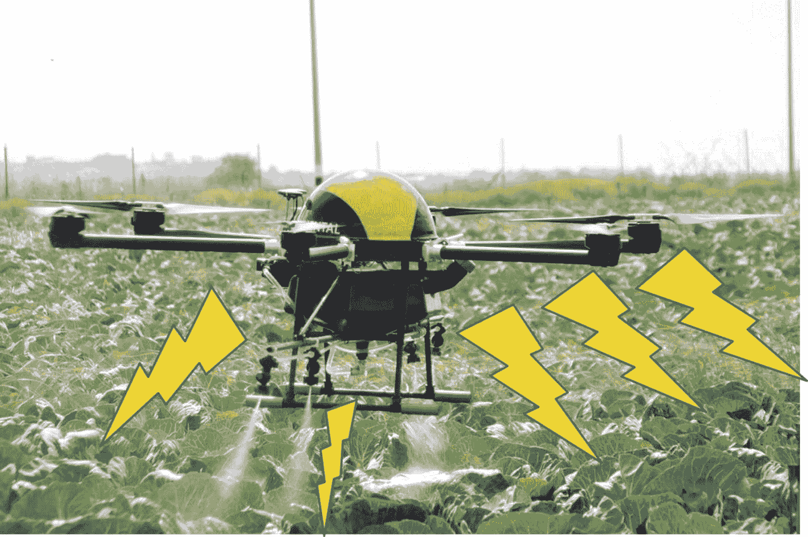

# 4. 在电信、能源和农业领域使用机器学习与物联网

在第二章中，你了解了物联网和工业物联网及其用途。你还通过一个实际示例，看到了如何使用树莓派、Arduino 和 Python 结合机器学习来设计一个物联网系统。通过这个实际示例，你现在已经理解了任何物联网或工业物联网应用的实现方面，例如通过从物联网传感器收集数据，然后将其与基准数值（如温度阈值）进行比较，并通过电子邮件或图形用户界面警报向用户发出高级预警信号，从而创建监控系统。

在本章中，你将看到机器学习与物联网在电信、能源和农业领域的最新实现。我将带你了解在每个领域中机器学习与物联网的一些快速实现方法，帮助你理解为其构建应用所涉及的细微差别和复杂性。

## 机器学习与物联网在电信领域的最新实现

目前，全球电信领域正经历着一场快速的技术浪潮。这场变革的核心是 5G 频谱的引入。在我关于 5G 物联网安全的两大原因的博文（[`https://pmauthor.com/2019/07/02/3-reasons-why-5g-iot-is-safe/`](https://pmauthor.com/2019/07/02/3-reasons-why-5g-iot-is-safe/)）中，我谈到了每种电信技术频谱所能达到的成就。移动技术已经经历了 1G、2G、3G 和 4G 四代技术发展。每一代都是一套用于移动设备（如手机和平板电脑）间通信的电话网络标准。1G 提供了 2.4 kbps 的连接速度，2G 提供了 64 Kbps 的连接速度并基于 GSM，3G 提供了 144 kbps 到 2 Mbps 的连接速度，而 4G 提供了 100 Mbps 到 1 Gbps 的连接速度并基于 LTE 技术。1G 系统始于澳大利亚，本质上是模拟的。真正的数字电信始于 2G 标准的引入，它带来了 CDMA 和 GSM 协议，以及短信和彩信等服务。3G 引领了智能手机技术的引入，如网页浏览、视频流等。4G 彻底改变了我们所知的数据成本和用量；在 3G 时代，数据是非常昂贵的。4G 以**用户可负担的价格**提供了高速、**高质量和高容量**。

在我发布于 [`https://pmauthor.com/2019/07/02/3-reasons-why-5g-iot-is-safe/`](https://pmauthor.com/2019/07/02/3-reasons-why-5g-iot-is-safe/) 的博文中，我还指出了 5G 的关键优势。除了高达 35.46 Gbps 的高速数据连接外，5G 将带给人类的最大好处是，它承诺通过其网络连接多达 1000 亿台设备。实现这一目标的通信协议被称为毫米波移动通信。这是 5G 电信标准的最大突破。我们将详细探讨其技术工作原理。

现在，让我们看看机器学习与物联网在电信领域的最新实现。

**华为**：是的，尽管深陷间谍和数据泄露的争议，这仍是一家在人工智能领域值得关注的公司。这家公司是首家推出完整移动 5G 芯片组的厂商。在我关于 2019 年三大机器学习技能的博文（[`https://pmauthor.com/2019/07/05/3-top-machine-learning-skills-for-2019/`](https://pmauthor.com/2019/07/05/3-top-machine-learning-skills-for-2019/)）以及另一篇关于 5G 物联网安全的两大原因的博文（[`https://pmauthor.com/2019/07/02/3-reasons-why-5g-iot-is-safe/`](https://pmauthor.com/2019/07/02/3-reasons-why-5g-iot-is-safe/)）中，我提到 5G 物联网将成为人工智能领域的下一个游戏规则改变者。华为已经推出了全功能的 5G 芯片组。它还推出了全球首款带有 AI 大脑的数据中心交换机。华为还推出了全栈、全场景的人工智能技术，以实现**自动驾驶网络**，并开发了 SoftCOM AI 解决方案，以帮助**移动运营商最大化**能源效率、网络性能、运维效率和用户体验。正如 [`www.busiweek.com/huawei-presents-its-simplified-5g-and-softcom-ai-solutions/`](http://www.busiweek.com/huawei-presents-its-simplified-5g-and-softcom-ai-solutions/) 文章所述，华为的解决方案侧重于建设数字乡村。物联网还将使其应用能够在设备之间进行 8K 高清音视频直播。远程虚拟医疗医生将能够与家中病危的患者进行双向流媒体通信，员工可以以更高的清晰度和低反馈进行商务会议直播，同时传输高速数据。随着 5G 服务在每个国家的推出，现在可以提供物联网云服务、个人移动服务、五星级优质家庭宽带以及云网融合。尽管华为在其网站（[`www.huawei.com/minisite/iot/en/overview.html`](http://www.huawei.com/minisite/iot/en/overview.html)）上对其 OceanConnect 物联网平台描述不多，但不难看出它认为物联网将在社会中发展的关键领域。请参见前述网页上的图 1，了解华为的物联网解决方案。

5G 和物联网注定要共同腾飞，因为 5G 电信频谱提供的技术不仅补充了物联网的能力，而且通过提供极其快速和高效的数据传输（这是每个实施该技术的国家中物联网设备和应用的支柱）增强了这些能力。

OceanConnect 物联网平台致力于将物联网融入人类生活的各个层面。该平台的基础是 5G 芯片组或 5G 设备，这些设备在 2G、3G 及其他物联网和 5G 连接基础设施网络之上拥有自己的云互联网关，并与智能家居网关相结合。在此基础层之上是 OceanConnect 物联网平台，其内部包含三大核心组件。第一个组件是物联网连接管理，它位于 2G、3G、4G 或 5G 基础设施之上，这些基础设施中包含了安装在个人住宅中的智能家居物联网网关。连接管理为这些个人智能家居网关提供了接入 OceanConnect 物联网平台的通道。每个智能家居网关都将连接已启用的物联网设备，而物联网平台将提供设备管理服务，例如将设备添加到物联网平台或从物联网平台中移除设备。然而，即使你拥有最佳的智能网关基础设施，并结合了物联网平台上的连接管理和设备管理服务，但如果平台不具备应用使能能力，它也将毫无实际用途。正是应用程序为用户带来了实际效益，并为设备提供了稳定的 5G 连接。因此，该物联网平台也提供应用使能服务。华为着眼于其物联网平台的商业化；它看到了在公共事业服务（如能源、水利和交通）中的应用。它也看到了工业应用，其中工业 4.0 使工业物联网应用能够适配其物联网平台，并利用该平台提供智能工业解决方案。它还致力于打造一个与其物联网平台相连的智能家居，从而获得各种服务，如医疗保健、食品杂货管理、交通管理、财务监控与管理。OceanConnect 物联网平台还提出了车联网的概念，这是一个由配备各种物联网传感器的小型车辆组成的网络，这些车辆能够通过相互发送数据进行通信。这样的车联网无疑将有助于使交通管理更便捷、更实时。然而，在我看来，未来还将催生出一种被称为“设备互联网”的新事物，它将是一个互联设备的网络，不仅限于车辆，而是任何使用物联网传感器的设备，这些设备能够凭借独特的应用程序接入任何物联网平台。正是这个设备互联网，将引发智能生活的革命。

物联网的另一项前沿实现是面向所有物联网连接性的开放连接基金会。物联网当前面临、并且未来将成为主要问题的一个挑战，是社会缺乏统一的物联网标准。没有统一的物联网标准，各种物联网设备和应用将相互孤立，无法与自身之外的其它物联网设备进行通信。不过，现在已有标准来解决这个问题。参与社会标准制定的有三类人群。第一类是物联网应用的开发者。第二类是企业为其开发物联网应用的消费者群体。第三类是将物联网变为现实的物联网应用的开发者或创造者。这个面向物联网标准的开放连接基金会弥合了这三者之间的鸿沟。其关键优势在于，它为安全互操作性提供了共同定义，并提供了一个通用标准平台，以及物联网设备和应用的开源实现与认证。基于此框架的新模型层出不穷，并且每月都有发布，例如智能食品储藏室物联网设备、监控应用，以及 OCF 目前支持的智能狗屋等创新应用。这个开放的物联网标准正在创建完整的生态系统，以使物联网更加安全可靠。

接下来，我们进入下一部分，探讨机器学习和物联网在能源领域的一项前沿实现。我们将审视推动能源行业发展的关键技术进展。

## 机器学习和物联网在能源领域的前沿实现

目前，全球能源领域正经历着一场快速的技术变革。这场变革的核心是将物联网和机器学习引入全球能源系统。然而，物联网和机器学习的采用并不像在电信领域那样直接。这不仅仅是创造新的频谱领域并加以利用的问题。能源行业传统上是一个资本密集型产业，无论是石油、天然气、水力发电，还是太阳能或风能等可再生能源。能源领域的这一特性使其成为物联网和机器学习等技术的缓慢采用者。真正的原因是，大多数能源公司使用大量的能源设备，而建造和安装这些工厂需要花费数十亿美元。

### 物联网在能源领域的现状

该领域面临的实际挑战在于如何利用物联网并改造旧的能源系统。对于能够使用 Modbus 接口等协议进行通信的能源设备，实施起来很容易。能源领域中那些无法使用通用工业接口进行通信的非常陈旧的设备，对任何能源公司来说无疑都是一个巨大的挑战。替换正在生产中的机械工厂的某些部件并非易事，因为这些能源系统不能停机。在无法轻易更换工厂设备的情况下，物联网和机器学习必须采用创新方法来读取此类老旧设备的数据。毕竟，机器学习需要数据来分析和预测能源领域的问题。

### 拥抱能源领域物联网的解决方案

全球有多家公司正尝试利用基于物联网传感器的新技术，为这些老旧设备开发数据采集解决方案。其中一家知名企业是西门子（[`https://new.siemens.com/us/en/products/energy/featured-topics/redefine-performance.html`](https://new.siemens.com/us/en/products/energy/featured-topics/redefine-performance.html)）。能源领域面临的关键问题如下：

1.  可再生能源电厂正在兴起。这体现在两个方面：一是老旧的化石燃料发电厂正被太阳能或风能企业取代；二是新增的发电厂本质上都是可再生能源电厂。

能源运营的去中心化正在发生，这意味着发电机组为了生产能源，正变得越来越独立。传统的能源生产方式，如石油和天然气，需要集中的工厂设施来协助生产。然而，像太阳能电网和风力发电场这样的可再生能源发电系统，则允许能源生产的去中心化。去中心化使得能源生产计划可以在小型设施中执行，并且能更便捷地为本地社区的能源需求做出独立决策。中心化则赋予了能源公司跨地域运营的自由，并能利用物联网和机器学习等技术来生产能源。去中心化确实给利用规模经济带来了挑战；然而，它所带来的快速制定本地化能源生产决策的能力及其灵活性，弥补了这一不足。本地化的小型能源生产单元，可以利用机器学习或深度学习等技术，根据观察到的消费模式，快速决定何时削减或增加发电量。这种调节能源需求的能力，将成为未来建立去中心化能源生产单元的关键差异化因素。

2.  我们都知道，人类对能源的需求，尤其是石油和天然气，在全球范围内不断增长，发电厂被迫在超出其原始设计规格的条件下运行。这对未来构成了严重威胁，因为电厂的产能已经达到极限，其未来运营面临压力。各公司正在采用多种技术：有些公司在化石燃料电厂旁边建设可再生能源电厂，而另一些公司则在提高现有化石燃料电厂的产能。

3.  大多数国家面临的一个问题是电网的稳定性。为此，他们需要一个良好的系统，能够提前准确预测电网任何部分的能源需求，以便在用电高峰或低谷到来之前增加或减少发电量。停电会给依赖能源运营的工业和居民带来问题。因此，大多数国家都在规划运营方案，以更高效地满足其社区的能源发电需求。与不稳定的电网相比，稳定的发电电网通过提供稳定的电力经济来降低成本；而不稳定的电网则会推高发电成本，并对社区产生更深层次的经济影响。

一家专注于发电厂和能源发电技术的公司——西门子，对其客户进行了一项关于利用其能源领域技术实现发电厂未来适应性的调查。参见[`https://assets.new.siemens.com/siemens/assets/public.1552332517.656a83b0-646a-4286-9546-dc54bd8a2e35.future-proofing-power-plant-ebook-2019.pdf`](https://assets.new.siemens.com/siemens/assets/public.1552332517.656a83b0-646a-4286-9546-dc54bd8a2e35.future-proofing-power-plant-ebook-2019.pdf)。调查中的客户谈到了发电厂预计在未来三年将面临的公用事业挑战。30%的受访者提到的第二个问题是采用新的人工智能技术。这表明，能源发电公司看到了在当前环境中采用人工智能、机器学习和物联网所面临的挑战。调查给出的展望是未来三年，因此这是一个短期展望。在关于通过规划和数据分析（一个与数据科学和机器学习密切相关的领域）取得成功的提问中，它询问客户在过去三年中，电厂改造和更新项目的成功程度如何；那些实现了电厂运营目标的公司的回复显示，超过 50%的公司达到了这一目标。然而，调查得出的主要结论是，能源发电商正在大力投资于包括新数字技术在内的计划升级和改造，但在决定改造和升级方面的信心水平较低：在确定优先级方面约为 20%至 27%，在决定哪些合作伙伴应参与此类升级项目方面约为 20%至 30%，在决定何时或什么时间点进行投资方面约为 18%至 33%。过去三年中，升级项目报告的整体成功率约为 25%，这意味着尽管能源发电公司已经采用了升级项目，但成功的案例很少，失败率很高。

因此，我们看到能源行业正处于动荡之中，许多公司被迫将其电厂升级为更依赖太阳能和风能等可再生能源；然而，此类项目升级的成功率非常低，导致投资回报率下降。正如调查所指出的，采用机器学习和人工智能等技术是一项挑战，这意味着该行业在适应和利用这些技术为自己创造优势方面准备不足。但在任何先进的实施方案中，像西门子这样的公司都通过使用物联网传感器和设备，并将其连接到机器学习模型来预测任何电网的能源需求，从而提供解决方案。这种创新解决方案甚至可以应用于化石燃料发电厂和旧的数据存储库，以分析和综合数据，创建预测模型。从预测工厂和设备的定期维护周期到预测用电高峰，各公司正在使用机器学习模型来解决遗留问题（[`https://assets.new.siemens.com/siemens/assets/public.1534921431.05f93d5a3c096441998512706a42840c51fd3f68.2018-05-ew-article-iot-manfred-unterweger-en.pdf`](https://assets.new.siemens.com/siemens/assets/public.1534921431.05f93d5a3c096441998512706a42840c51fd3f68.2018-05-ew-article-iot-manfred-unterweger-en.pdf)）。

另一项先进的能源技术实现来自一家名为 MindSphere 的公司，该公司专注于能源流程的数字化。它通过实施工业 4.0，将机器和流程智能互联，使其在整个使用寿命期间能够更高效、更可靠地运行，从而推广了将能源互联网作为物联网延伸的概念。该公司为能源领域构建了生态系统，应用范围广泛且性质多样，涵盖智能计量、保护数字服务、电力连接、电能质量稳定性、关键电源管理系统、电厂状态监测系统、能源中断管理系统、智慧城市平台系统、分布式能源微电网等级以及出色的预测模拟模型。这些领域正利用智能物联网传感器采集各类数据，使业务应用能够评估设备状态，并在此基础上应用机器学习和数据科学，例如对断路器进行预防性维护和警报监控。作为西门子旗下公司，MindSphere 最终为成功的数字化转型和实现盈利奠定了基础。它能够监控现场设备和装置，从而在电厂紧急情况下根据需要采取适当行动。这类数字解决方案将改变物联网和机器学习在能源领域的实施方式。能源公司的业务活动本质上非常复杂，且具有关键性，因为它们服务于医院和机场等众多紧急服务部门，因此，在决策和规划辅助中应用人工智能和机器学习也显得尤为重要。

1.  涉及能源勘探、生产和分配的跨境复杂运营，需要利用机器学习，通过创建高效业务模型，仔细分析从所有这些运营中收集的数据，以辅助能源领域管理高管的决策过程。

2.  客户数量庞大且分布广泛，给能源公司从终端用户收集数据带来了挑战。使用能够从单个客户设备（如智能电网、智能云存储应用）回传数据的智能计量技术，并利用机器学习基于这些数据预测能源消耗，有助于能源领域的决策过程。

3.  基础设施投资需要主要设备和设施、车队升级或新工厂的调试与安装。在进行此类投资前，利用机器学习和人工智能创建模型，通过提供关于过去失败原因以及如何在实施新升级或安装项目时规避问题区域的数据，能够极大地帮助做出正确决策。

为了提高运营绩效，发电厂正在利用物联网获取数据，将其工业资产连接到物联网传感器设备，监测工厂层面的机械性能，并衡量组织关键绩效指标，如机械生产率和设备效率。老旧电厂的预防性维护无疑是基于物联网的应用正在为能源领域解决的问题。可以生成物联网数据，使其能够了解设备性能负载以及老化能源资产的位置。基于物联网的管道能源计量表已变得非常普遍；它们利用机器学习来测量和预测石油、天然气等能源液体的流量。还可以监测流体的质量，并提前预测任何劣化情况，以避免在生产过程中造成巨大损失。能源领域还利用机器学习来预测化石燃料电厂的能源消耗，以便其处于就绪状态，通过启动备用可再生能源电厂来承担负荷，以应对消费者能源需求的任何激增。这种基于能源需求预测性需求预测的平衡，是能源领域一个极佳的应用案例。

您已经了解了机器学习在能源领域的先进实现。本章下一节将介绍机器学习和物联网在农业领域的先进实现。

## 机器学习与物联网在农业领域的前沿应用

农业领域正迎来一场人工智能革命。这场技术浪潮正在全球范围内展开。全球农业正在经历的关键变革是，大型食品集团正试图接管农业生产，以满足自身对终端消费产品的原料需求。这些大型食品集团希望农民种植特定的专利作物品种，以维持良好的食品质量和生产力。因此，在一些国家，它们与农业社区合作，从农民手中直接采购生鲜蔬菜和牛肉；而在另一些国家，它们则通过合同雇佣农民，专门生产特定品种的粮食及其他产品，如土豆、生菜、胡萝卜、乳制品和油菜籽。这些产品被用作终端消费品的原料，例如麦当劳通过“旗舰农民计划”（[`www.flagshipfarmers.com/en/about-the-program/`](http://www.flagshipfarmers.com/en/about-the-program/)）生产的汉堡。

这些食品巨头的努力旨在建立其核心原料（如土豆和生菜）的专利品种库。例如，麦当劳使用其著名的专利品种“Russet Burbank”土豆来制作薯条（[`www.earthandtablelawreporter.com/2015/09/11/patenting-the-potato-not-all-taters-are-created-equal/`](http://www.earthandtablelawreporter.com/2015/09/11/patenting-the-potato-not-all-taters-are-created-equal/)）。另一个例子是食品集团孟山都，它拥有许多蔬菜和种子的专利，例如豆类、西兰花、胡萝卜、黄瓜和甜瓜等。其中许多蔬菜被其他公司商业化使用。百事公司旗下的旗舰薯片品牌乐事就使用了孟山都的土豆（[`https://feast.media/food-brands-owned-by-monsanto`](https://feast.media/food-brands-owned-by-monsanto)）。孟山都持有 14 种专利品种，其中最受欢迎的是 Roundup Ready® Corn 2（[`www.monsantotechnology.com/content/genuity-traits-corn.aspx`](http://www.monsantotechnology.com/content/genuity-traits-corn.aspx)）。

这仅仅是食品公司购买专利并商业化利用的一个例子。目前，关于使用转基因产品作为商业食品原料存在争议。转基因食品可能引发多种疾病，因此大型食品公司并未使用它们；然而，这些公司面临着提高商业可行性和适应转基因实践以增加利润的压力，而转基因作物品种恰好能提供这种可能性。

转基因作物的一种全新替代方案是计算育种技术，该技术结合了人工智能和机器学习，为农民带来卓越的产量。首先，利用物联网收集作物及其环境的数据，例如通过空气过滤传感器分析空气成分，以及通过油类传感器收集土壤混合物的数据。这些应用已通过所谓的“统计育种模式”得以实现，该模式使农民能够根据由空气和土壤混合物构成的大气环境，获得最适合该环境的作物。在该系统中，农民利用智能机器学习和物联网系统，基于全球其他具有相似气候地区的过往数据，为给定的空气和土壤混合物选择最佳的种子品种，从而在自家农场实现最大产量。一家名为 HFG 的公司正在开展这项工作，它利用农业数据集和预测性数据科学，为作物构建预测性育种平台（[`www.zdnet.com/article/computational-breeding-can-ai-offer-an-alternative-to-genetically-modified-crops/`](http://www.zdnet.com/article/computational-breeding-can-ai-offer-an-alternative-to-genetically-modified-crops/)）。

人工智能的另一项前沿应用来自日本等科技发达国家，主要应用于水稻种植。农村地区的人们正迁往城市谋生。由于人口从农村地区大规模迁移到东京、京都等城市中心，日本农村地区已无人从事农业。因此，日本迫切需要农民，尤其是用于生产主食大米。在日本农村地区，利用自动化和机器学习及人工智能进行农业种植可以提供帮助。在这一应用中，日本东北部的农民和开发者开始使用无人机来补充田间劳动力（见图 4-1）。

图 4-1

用于检测作物病害的无人机机器人

一家初创公司开发了一款名为“91108 rich's”的无人机。其主要功能是向作物喷洒农药和肥料。它能在 15 分钟内完成农民需要 60 分钟才能完成的工作。通过 iPad 控制此类无人机，并结合机器学习应用来识别需要更多肥料或农药的区域，可以在这种应用的基础上进行开发。诊断型无人机能够通过持续监测作物，并保护作物附近可能存在的微生物，从而检测到病害的爆发。这正是利用物联网传感器进行害虫防治，并结合附近树莓派应用站运行的机器学习应用，来实现整个农业周期自动化的关键所在（[`www.techrepublic.com/article/how-drones-are-changing-farming-in-rural-japan/?ftag=CMG-01-10aaa1b`](http://www.techrepublic.com/article/how-drones-are-changing-farming-in-rural-japan/%253Fftag%253DCMG-01-10aaa1b)）。

## 总结

你在本章中看到的所有应用本质上都是实验性的，并且是由中国公司华为在 5G 物联网领域引入的前沿实现。你还了解了能源行业面临的挑战如何通过物联网在化石燃料和可再生能源发电领域得到解决。接着，你考察了农业领域，其中物联网和机器学习的智能应用有望解决农民出售土地并迁往城市寻求更好生活的“人力流失”问题。在第 5 章中，你将准备好在上述三个领域实施案例研究的环境。

