# 5. 准备案例研究的实施

本章主要介绍如何准备案例研究的实施。你将首先学习如何从零开始设置你的树莓派 3 Model B+及其硬件和软件。当然，为此你将安装流行的 Raspbian 操作系统。之后，你将把 Arduino Mega 2560 连接到树莓派，并连接物联网传感器模块以获取数据。接下来，将设置运行树莓派程序所需的 Python 环境。你还需要设置启用了 Modbus 的电能计量设备。然后，你将连接树莓派与 Arduino，并启动它们之间的通信。最后，你将测试所有内容。

## 设置树莓派 3 Model B+

请参考第 3 章的图 3-1，了解案例研究所需组件的示意图。有两个软件组件，即 Python IDE 和 Arduino IDE，你将在硬件组件完全设置好后进行安装。那么，让我们从硬件开始。

设置树莓派 3 Model B+ 硬件的第一步是决定用于运行应用程序的操作系统。目前有两种流行的操作系统可供选择：**Raspbian** 和 **Noobs**。Noobs 适用于树莓派新手。你将使用的是 Linux 版本的 Raspbian，可从 [`www.raspberrypi.org/downloads/`](http://www.raspberrypi.org/downloads/) 获取。如图 5-1 所示，该图显示了可从树莓派官方网站下载的可用操作系统镜像。

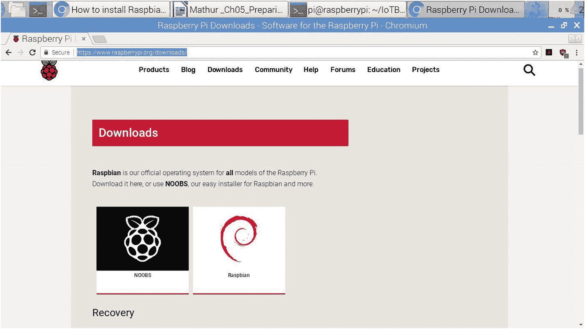

图 5-1

[www.​raspberrypi.​org](http://www.raspberrypi.org) 下载选项

请注意，在此阶段你尚未启动树莓派 3 B+，因为其 microSD 卡上尚未安装任何操作系统。树莓派 3 B+ 套件附带一张 microSD 卡和一个 microSD 卡读卡器或适配器。如果你没有 microSD 卡，可以从我网站 [`www.pmauthor.com/raspbian/`](http://www.pmauthor.com/raspbian/) 上的选项中获得。对于 Raspbian 的安装，建议的 microSD 卡基本容量为 8GB。对于 Raspbian Lite 镜像安装，Raspberrypi.org 建议至少 4GB。请记住，只有树莓派 3A+、3B+ 和 Compute Module 3+ 可以从大于 256GB 的 SD 卡启动。这是因为早期树莓派型号所使用的 SoC 存在一个错误。另外，请务必注意你的 microSD 卡所属的等级，因为这决定了其支持的写入速度；Class 4 卡很可能以 4MB/s 的速度写入，而 Class 10 卡应能达到 10 MB/s。请注意，这并不意味着 Class 10 卡在常规读写性能上一定优于 Class 4 卡，因为这种写入速度通常是以牺牲读取速度和大幅增加 microSD 卡操作的寻道时间为代价的。你的树莓派 3 B+ 套件附带的 microSD 卡应该是最新的，并且很可能像现在常见的那样是 Class 10 的；但是，如果你拿到的是 Class 4 等较低等级的卡，可以在 [`www.pmauthor.com/raspbian/`](http://www.pmauthor.com/raspbian/) 订购一张更快的 Class 10 卡。

当然，你的笔记本电脑必须有一个插槽，可以直接或通过适配器读写 microSD 卡。如图 5-2 所示。此外，你还需要一台运行 Windows 或 MacOS 的电脑或笔记本电脑，以便下载此镜像，然后格式化 SD 卡并将此镜像安装到卡上。本章我将向你展示如何在 Windows 系统上完成此操作。

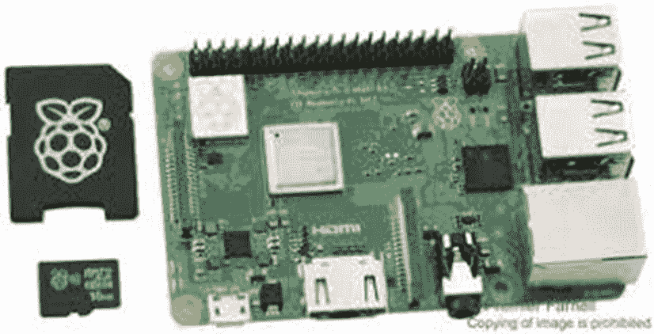

图 5-2

官方套件附带的 microSD 卡和 microSD 卡适配器

暂时不要将 microSD 卡适配器插入树莓派 3 B+ 主板，因为它是空的，尚未格式化，也没有写入任何操作系统镜像。你需要先点击网站的下载部分，下载 Raspbian 镜像。完成后，你将获得下载最新版 Raspbian 镜像的选项。在撰写本书时，有三个下载选项，如图 5-3 所示。

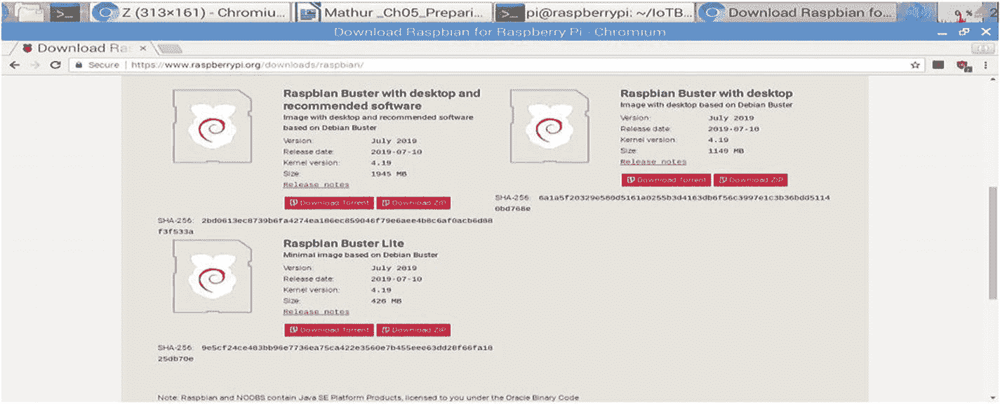

图 5-3

Raspbian 下载选项

第一个选项是 **Raspbian Buster**，这是适用于桌面环境并推荐软件的 Raspbian 版本名称。第二个选项仅包含桌面环境，第三个是 Lite 版本，它不具备你为物联网应用进行广泛编程所需的所有功能。因此，你将使用第一个选项，它提供了入门所需的所有软件组件。你可以根据解压软件点击 Torrent 或 zip 文件。我使用的是 zip 文件版本。Raspbian Buster 版本的 zip 文件大约为 2.3GB，因此下载时间取决于你的网络连接速度。

下载完成后，你需要将 microSD 卡读卡器插入用于将操作系统安装到 SD 卡插槽的电脑/笔记本电脑。由于你使用的是 Windows，因此需要一个磁盘映像工具。我使用的免费工具是 **Win32 Disk Imager**。如果你没有，可以从这个页面下载：[`www.pmauthor.com/raspbian/`](http://www.pmauthor.com/raspbian/)。从网站下载并安装 Win32 Disk Imager 工具后，你可以双击其图标打开它。它应该看起来像图 5-4 中所示。

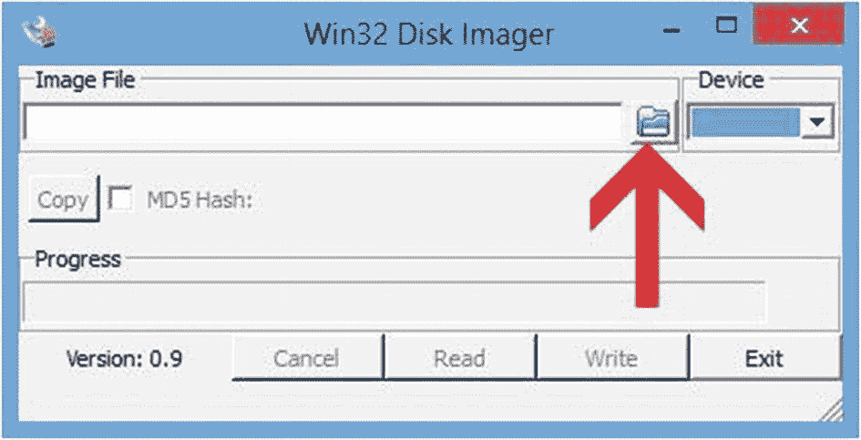

图 5-4

Win32 Disk Imager

点击图中所示的浏览图标，找到你下载并解压后的镜像文件。选择镜像文件位置后，点击右侧的 Device 下拉框，从中选择你的 microSD 卡盘符。对话框中的 Write 按钮将变为可用，点击它即可写入镜像。进度条会显示完成进度；这应该只需要几分钟。完成后，点击 Exit 按钮弹出 microSD 卡。现在，你的 microSD 卡上已写入了最新的 Raspbian OS 镜像，可以启动了。但是，在启动之前，你需要设置单板计算机（SBC）板上的物理连线，然后将 microSD 卡连接到树莓派 3 B+ 主板。

设置树莓派 3 Model B+ 的第二步是连接其主板，如第 2 章中 GPIO 引脚和 SBC 各组件的照片所示。你需要插入最少的必要组件才能开始。首先，你需要一个 LED/LCD 电视或显示器。市面上有很多选择，但我喜欢并在我的项目中使用的列在 [`www.pmauthor.com/raspbian/`](http://www.pmauthor.com/raspbian/)。如果你有闲置的电视，可以使用 HDMI 转 HDMI 线缆将其连接到 SBC 的 HDMI 端口。见图 5-5 和 5-6。

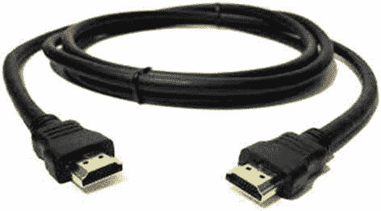

图 5-5

HDMI 转 HDMI 线缆

如果你有一个 5 英寸或 7 英寸的小型显示器，那么你会使用不同的线缆，并且紧凑型 LCD/LED 面板上可能没有 HDMI 插槽。

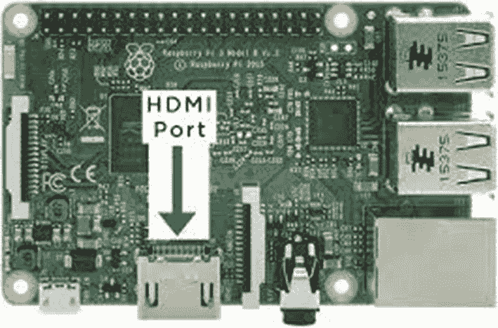

图 5-6

树莓派 3 B+ 上的 HDMI 端口

连接好的树莓派将如图 5-7 所示。请确保连接正确，并且两端（电视显示屏和树莓派 3 B+）的接口处不要松动，否则显示器将无法显示画面。这是初学者常见的问题：当你给树莓派通电后，发现显示器没有画面，却不知道发生了什么。这个问题很容易解决，因为树莓派的 HDMI 接口比较大，你可以清楚地看到线缆是否牢固地插在主板上。此外，在插拔 HDMI 线缆时，请务必不要给树莓派 3 B+ 通电；这既是出于安全考虑，也是操作上的要求。有时，当你给树莓派通电后再插入 HDMI 线缆，显示器可能不会显示画面。这种情况下，请重启树莓派 3 B+，因为这款单板计算机（SBC）上没有重启按钮。

在最终启动树莓派之前，我建议你做两件事。第一，将一个 USB 鼠标接收器插入树莓派 3 B+ 主板上的四个 USB 端口之一。第二，再插入一个无线键盘的 USB 接收器。这些是控制你的单板计算机（SBC）的必需品。你可以在图 5-7 中看到它们连接到 SBC 的样子。如果你没有无线版本的鼠标或键盘，也不必担心；有线版本的 USB 鼠标和键盘也能很好地工作。只是有线设备对于非常轻巧的 SBC 来说会显得有点沉重，如果鼠标或键盘的线缆晃动，SBC 可能会跟着移动。


图 5-7

连接到 SBC 的 USB 接收器

接下来，要让你的树莓派启动，你需要将其连接到电源。这款小巧的 SBC 的妙处在于它使用 microUSB 作为电源接口。这意味着你也可以通过连接一根 microUSB 电源线，用移动电源为其供电。为什么需要移动电源？它可以提供备用电源，这样在断电时树莓派就不会关机。如果你生活在世界上经常停电的地区，这一点尤为重要。如果你所在的地区电力稳定，则无需连接移动电源，可以直接通过电源适配器充电器连接到电源。你可以在图 5-8 中看到我连接移动电源的方式。

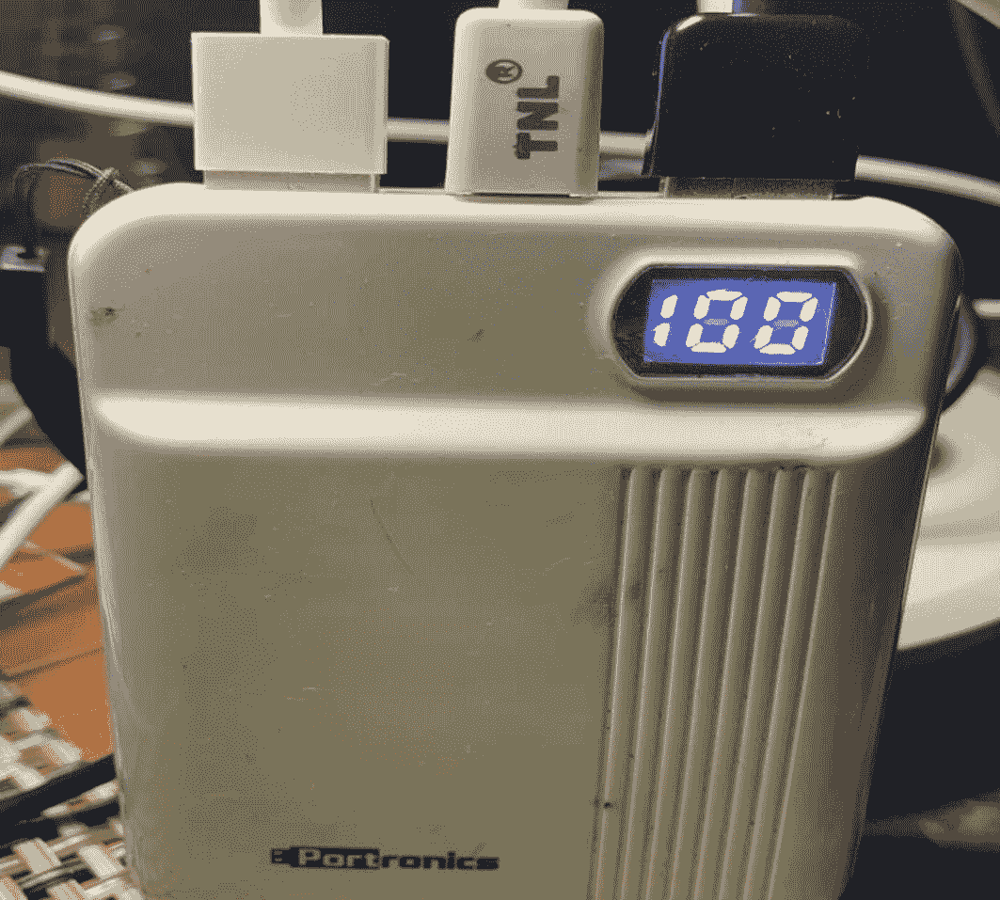

图 5-8

连接到移动电源的树莓派 3 B+ 电源线

图中是一个 Portronics 10000mAH 的移动电源。它可以为商业应用提供几个小时的电力。在我们的一次工厂能源审计应用中，我们不得不创建一个移动电源备份方案，将一个移动电源与另一个串联，第一个为第二个供电，这样即使断电几个小时，运行在树莓派上的能源审计应用也不会受到影响。有时你需要跳出固有思维，才能构建出能够从容应对断电的商业级应用。

现在，要让你的树莓派 3 B+ 启动，你只需将电源线的 microUSB 端插入 SBC 的电源插槽，如图 5-9 所示。请记住，如果你已经连接了电源或移动电源，并且在将线缆插入 SBC 时，它可能会在你手中启动。为避免这种情况，请确保在连接 microUSB 端时，另一端没有通电。

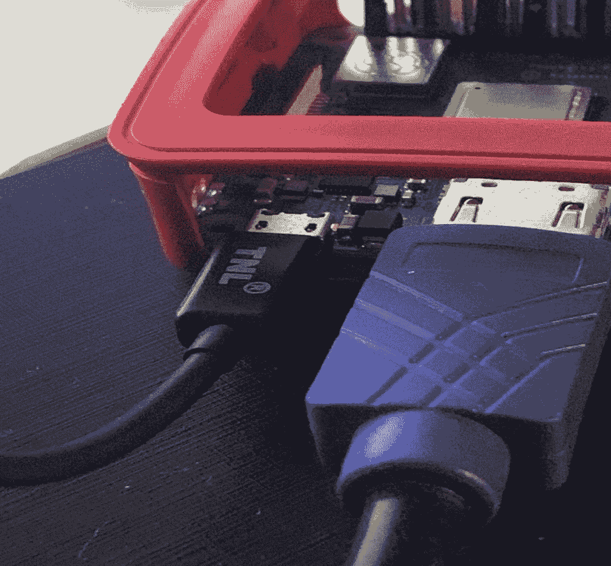

图 5-9

连接到树莓派 3 B+ SBC 的 microUSB 和 HDMI 线缆

现在你已经准备好启动设备了，请继续操作，打开连接到 microUSB 电源线的电源适配器的开关。你会看到 HDMI 接口插槽附近有一个绿色 LED 闪烁，连接的 LED/LCD 显示器应该会显示你在第 3 章中看到的启动画面。现在你拥有了一台安装了最新版 Raspbian 系统的基本树莓派。接下来，你需要安装软件，以便与物联网传感器和设备协同工作。

如果你运行的是 Raspbian（非 Lite 版本），Python 2.7 已预装在 Raspbian 发行版镜像中。但是，如果你想使用 Python 3，则需要通过以下 Raspbian 命令行提示符进行安装。不用说，你需要通过连接的以太网线或 Wi-Fi 连接为树莓派提供网络。

```
pi@raspberrypi:~ $ sudo apt-get install python3
```

通过输入图 5-10 中给出的命令，测试你在 Raspbian 上的 Python 3 安装。

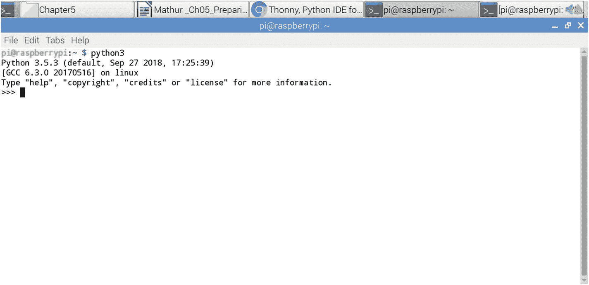

图 5-10

测试 Python 3 安装

现在你已经安装并测试了所需的 Python 版本，你需要一个集成开发环境（IDE）来在 Raspbian 上进行编程。我推荐你使用 Thonny IDE，因为它允许你在编辑器内编译和运行程序。我在第 3 章中已经讨论过它的需求和特性，所以我们直接进入在 Raspbian 上安装它的步骤。

Thonny IDE 是免费的，并且大多数带有 Stretch 程序的 Raspbian 操作系统都已预装。如果你在已安装的程序中没有找到它，正如你在第 3 章中看到的，可以从其网站下载：[`https://thonny.org/`](https://thonny.org/)。这个网站的好处是，它的主页上有一个关于如何使用该 IDE 的图文教程，非常基础且简单。安装可以使用清单 5-1 中的命令完成。

```
pi@raspberrypi:~ $ sudo apt-get install python3-thonny
正在读取软件包列表... 完成
正在分析依赖关系树
正在读取状态信息... 完成
下列软件包是自动安装的并且不再需要：
realpath vlc-plugin-notify vlc-plugin-samba vlc-plugin-video-splitter vlc-plugin-visualization
请使用 'sudo apt autoremove' 来卸载它们。
下列【新】软件包将被安装：
python3-asttokens
下列软件包将被升级：
python3-thonny
升级了 1 个软件包，新安装了 1 个软件包，要卸载 0 个软件包，有 205 个软件包未被升级。
需要下载 325 kB 的归档文件。
解压缩后会消耗 146 kB 的额外磁盘空间。
您想继续执行吗？[Y/n]
y
0% [正在连接至 archive.raspberrypi.org (2a00:1098:0:80:1000:13:0:7)]
获取:1 http://archive.raspberrypi.org/debian stretch/ui armhf python3-asttokens all 1.1.13-1+rpt1 [15.6 kB]
获取:2 http://archive.raspberrypi.org/debian stretch/ui armhf python3-thonny all 3.1.0-1+rpt2 [309 kB]
已下载 325 kB，耗时 2 分 2 秒 (2,643 B/s)
正在读取变更日志... 完成
正在选中未选择的软件包 python3-asttokens。
(正在读取数据库 ... 系统当前共安装有 149433 个文件和目录。)
正准备解包 .../python3-asttokens_1.1.13-1+rpt1_all.deb ...
正在解包 python3-asttokens (1.1.13-1+rpt1) ...
正准备解包 .../python3-thonny_3.1.0-1+rpt2_all.deb ...
正在解包 python3-thonny (3.1.0-1+rpt2) 并覆盖 (3.0.5-1+rpt1) ...
正在处理用于 mime-support (3.60) 的触发器...
正在处理用于 desktop-file-utils (0.23-1) 的触发器...
正在处理用于 man-db (2.7.6.1-2) 的触发器...
正在设置 python3-asttokens (1.1.13-1+rpt1) ...
正在处理用于 gnome-menus (3.13.3-9) 的触发器...
正在处理用于 hicolor-icon-theme (0.15-1) 的触发器...
正在设置 python3-thonny (3.1.0-1+rpt2) ...
pi@raspberrypi:~ $
清单 5-1
为 Python 3 安装 Thonny
```

Thonny IDE 的 Raspbian 软件包从 raspberry.org 官方网站的归档文件中下载，然后经过处理并设置以供使用。如果安装成功，你应该会在开始栏的“编程”菜单下看到已安装的 IDE，如图 5-11 所示。

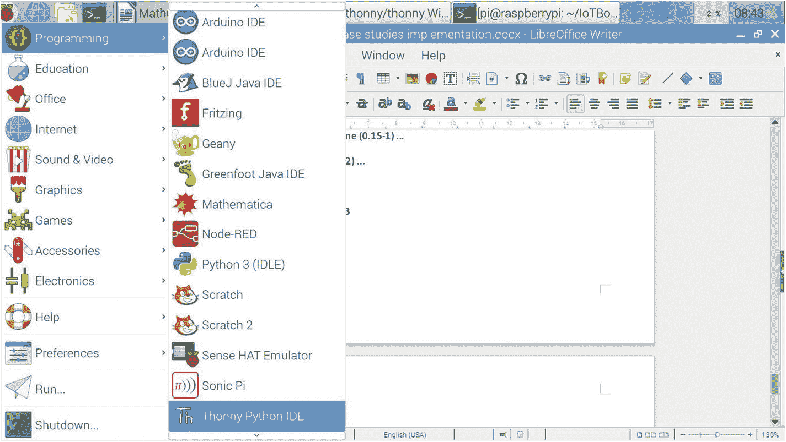

图 5-11

验证 Thonny Python IDE 安装

我在第 3 章中讨论过 Thonny IDE 的验证部分，因此我们进入下一步，安装案例研究中所需的 Python 库。以下是您需要的 Python 库列表。请记住将 `tkinter` 改为 `Tkinter`（是的，大写 T），如第 3 章所述。

*   **numpy** 用于在 Python 中对 n 维数组和矩阵进行操作。
*   **pandas** 用于数据整理。它专为快速简便的数据操作、聚合和可视化而设计。
*   **Seaborn** 用于通过热图和聚合图对统计模型进行数据可视化。
*   **scikit-learn** 为程序中使用的机器学习算法提供一致的接口。
*   **Tkinter** 用于为 Python 程序创建图形用户界面。
*   **scipy** 包含用于线性代数、优化、积分和统计的模块。
*   **matplotlib** 用于通过各种图表和图形进行数据可视化。
*   **NLTK** 是一个自然语言工具包，用于符号和统计自然语言处理的常见任务。
*   **statsmodels** 用于通过使用各种统计模型估计方法以及执行统计断言和分析来进行数据探索。

现在你已经看到了案例研究所需的 Python 库，请继续安装它们。我创建了一个脚本，可以在 Raspbian 命令行上执行此操作；见图 5-10。请记住，该代码是为 Python 2.7 安装的；如果你想在 Python 3 上安装所有库，则需要修改脚本，在 `pip` 后面加上 `3`，使其变为 `pip3`。

警告

如果你使用自己的脚本来安装 Python 库，请确保在 `pip install` 命令前加上 `sudo`，如清单 5-2 中的脚本 `pipinstaller.run` 所示。

```
pi@raspberrypi:~/$ cat pipinstaller.run
sudo pip install numpy | tee /home/pi/numpy.log
sudo pip install pandas | tee /home/pi/pandas.log
sudo pip install seaborn | tee /home/pi/seaborn.log
sudo pip install sklearn | tee /home/pi/sklearn.log
sudo pip install tkinter | tee /home/pi/tkinter.log
sudo pip install scipy | tee /home/pi/scipy.log
sudo pip install nltk | tee /home/pi/nltk.log
sudo pip install statsmodels | tee /home/pi/statsmodels.log
pi@raspberrypi:~/
清单 5-2
用于安装所需 Python 包的 Raspbian 命令行脚本
```

你会注意到，我在每个命令前都添加了 `sudo`，然后将输出通过管道传递给 `tee` 命令，以便将每个 Python 库的输出记录到文件中。因此，对于 `sudo pip install scipy | tee /home/pi/scipy.log`，输出会存储在一个名为 `scipy.log` 的单独日志文件中。这样更容易单独查看每个日志文件，并进行调试，查看安装过程中是否有任何错误。你可能会问，为什么我要将所有输出存储在日志文件中？简单的答案是，在 Raspbian 3 Model b+ 上，根据软件包的大小和你所在地区的互联网下载速度，安装一个软件包可能需要几个小时。因此，在运行脚本之前请牢记这一点，并确保你的 Raspberry Pi 系统和显示器有备用电源。在尝试运行此脚本之前，所有设备都应具备备用电源。显示器的备用电源同样重要，因为如果你的显示器因断电等原因关闭，Raspberry Pi Model 3 B+ 有时会无法显示屏幕。脚本的输出可能如清单 5-3 所示。

```
Requirement already satisfied: numpy in /usr/lib/python2.7/dist-packages
Requirement already satisfied: pandas in /usr/lib/python2.7/dist-packages
Requirement already satisfied: numpy>=1.7.0 in /usr/lib/python2.7/dist-packages (from pandas)
Requirement already satisfied: python-dateutil in /usr/lib/python2.7/dist-packages (from pandas)
Requirement already satisfied: pytz>=2011k in /usr/lib/python2.7/dist-packages (from pandas)
Requirement already satisfied: seaborn in /usr/lib/python2.7/dist-packages
Requirement already satisfied: sklearn in /usr/local/lib/python2.7/dist-packages
Requirement already satisfied: scikit-learn in /usr/lib/python2.7/dist-packages (from sklearn)
Collecting tkinter
Could not find a version that satisfies the requirement tkinter (from versions: )
No matching distribution found for tkinter
Requirement already satisfied: scipy in /usr/lib/python2.7/dist-packages
Collecting nltk
Downloading https://files.pythonhosted.org/packages/87/16/4d247e27c55a7b6412e7c4c86f2500ae61afcbf5932b9e3491f8462f8d9e/nltk-3.4.4.zip (1.5MB)
Collecting singledispatch; python_version < "3.4" (from nltk)
Downloading https://files.pythonhosted.org/packages/c5/10/369f50bcd4621b263927b0a1519987a04383d4a98fb10438042ad410cf88/singledispatch-3.4.0.3-py2.py3-none-any.whl
Requirement already satisfied: six in /usr/lib/python2.7/dist-packages (from nltk)
Building wheels for collected packages: nltk
Running setup.py bdist_wheel for nltk: started
Running setup.py bdist_wheel for nltk: finished with status 'done'
Stored in directory: /root/.cache/pip/wheels/41/c8/31/48ace4468e236e0e8435f30d33e43df48594e4d53e367cf061
Successfully built nltk
Installing collected packages: singledispatch, nltk
Successfully installed nltk-3.4.4 singledispatch-3.4.0.3
Requirement already satisfied: statsmodels in /usr/lib/python2.7/dist-packages
清单 5-3
Pip Python 包安装器脚本的输出
```

就我而言，正如你从安装程序日志输出中看到的，除了 nltk 之外，我拥有所有必要的库，而 nltk 则被下载并安装。为了验证 nltk 库在设置过程中是否有任何错误，`nltk.log` 文件的输出如清单 5-4 所示。

```
Collecting nltk
Downloading https://files.pythonhosted.org/packages/87/16/4d247e27c55a7b6412e7c4c86f2500ae61afcbf5932b9e3491f8462f8d9e/nltk-3.4.4.zip (1.5MB)
Collecting singledispatch; python_version < "3.4" (from nltk)
Downloading https://files.pythonhosted.org/packages/c5/10/369f50bcd4621b263927b0a1519987a04383d4a98fb10438042ad410cf88/singledispatch-3.4.0.3-py2.py3-none-any.whl
Requirement already satisfied: six in /usr/lib/python2.7/dist-packages (from nltk)
Building wheels for collected packages: nltk
Running setup.py bdist_wheel for nltk: started
Running setup.py bdist_wheel for nltk: finished with status 'done'
Stored in directory: /root/.cache/pip/wheels/41/c8/31/48ace4468e236e0e8435f30d33e43df48594e4d53e367cf061
Successfully built nltk
Installing collected packages: singledispatch, nltk
Successfully installed nltk-3.4.4 singledispatch-3.4.0.3
清单 5-4
nltk.log 文件的输出
```

因此，该文件中没有发现错误，Python nltk 库已成功安装。你可能想逐一检查为你安装的所有其他日志文件，例如 `scipy.log`、`statsmodels.log` 等。现在，你已经成功安装了所有必需的 Python 库。

### 测试时间

我在第 3 章开头要求你不要执行任何代码，而是享受结合 Arduino 的物联网与机器学习的执行过程。但在这里，你正在设置所有必要的基础设施软件和硬件，以便为后续的案例研究做好准备。

然而，在进入下一章的执行之前，我强烈建议你回到第 3 章，执行图 3-3 中给出的所有用于测试 Python 库的代码，即用于测试 Raspbian 上已安装库的 Hello world Python 代码。图 3-4 显示了该代码在 Thonny IDE 上的输出，你也应该得到类似的输出。如果没有，你可能没有正确安装 Python 库；你可能需要返回并检查图 5-11 中的安装日志，以查看错误发生的位置。然后，你应该继续执行图 3-5 中用于测试 Pandas 数据框的代码，其输出应与 Thonny IDE 上图 3-6 所示的输出类似。此外，你应该测试图 3-7 中用于 sklearn 机器学习集成库的小段代码，其输出显示在第 3 章的图 3-8 中。这些是对基本库的测试；然而，你也可以通过清单 5-5 中给出的 Raspbian 命令行脚本 `iotpypkgtest.run` 程序，检查第 3 章 Python 代码中使用的更高级的库，如 tkinter、gpiozero、smtplib、pygame、psutil、platform 和 time。我展示了一个你可能在首次执行时在命令行上遇到的权限拒绝错误；可以通过使用 `chmod 700` 命令更改脚本的权限来解决。

```
pi@raspberrypi:~/$ ./iotpypkgtest.run
bash: ./iotpypkgtest.run: Permission denied
pi@raspberrypi:~/$ chmod 700 iotpypkgtest.run
pi@raspberrypi:~/$./iotpypkgtest.run
pi@raspberrypi:~/$
pi@raspberrypi:~/$ ls -l ∗.out
-rw-r--r-- 1 pi pi   0 Aug 17 23:19 gpiozero.out
-rw-r--r-- 1 pi pi   0 Aug 17 23:19 platform.out
-rw-r--r-- 1 pi pi   0 Aug 17 23:19 psutil.out
-rw-r--r-- 1 pi pi   0 Aug 17 23:19 pygame.out
-rw-r--r-- 1 pi pi   0 Aug 17 23:19 smtplib.out
-rw-r--r-- 1 pi pi   0 Aug 17 23:19 time.out
-rw-r--r-- 1 pi pi 111 Aug 17 23:19 tkinter.out
pi@raspberrypi:~/$
清单 5-5
用于测试高级包安装的脚本
```

我特意在脚本中使用了命令 `python -c ‘import tkinter’` 来制造一个错误，这样你可以在清单 5-5 中看到其余文件的大小为零字节；然而，`tkinter.out` 文件有 111 字节写入其中，表明那里存在一些错误。你在第 3 章中看到了错误的原因；但重申一下，tkinter 库用于 GUI 创建目的，例如窗口屏幕和用于操作物联网设备的按钮，并且它适用于 Python 3.x 而不是 Python 2.7。在你的 Raspbian 命令行上，当你只输入 `python` 时，你调用的是 Python 2.7 解释器；如果你想调用 Python 3 版本的解释器，你需要在命令行中输入 `python3`，就像我在清单 5-6 中所做的那样。

```
pi@raspberrypi:~/$ python3 -c "import tkinter"
pi@raspberrypi:~/$
清单 5-6
在 Python 3.x 解释器上成功执行 tkinter
```

来自 Python 2.7 命令行的错误如清单 5-7 所示。

```
pi@raspberrypi:~/$ cat tkinter.out
Traceback (most recent call last):
File "", line 1, in 
ImportError: No module named tkinter
pi@raspberrypi:~/$
清单 5-7
Python 2.7 命令行报错
```

这个错误信息并不直观，但它确实表明该解释器版本无法识别名为 `tkinter` 的模块。如果其他 Python 库安装出现问题，你可能会遇到不同的错误，这需要你单独进行调试。到目前为止，你已经安装了 Python 程序运行所需的基本库，包括用于机器学习算法的 `sklearn`。然而，为了让物联网通过 Raspberry Pi 3 B+ 和 Arduino Mega 4560 正常工作，你还需要从以下列表中安装高级库：

*   **gpiozero**：用于实现 Python 与 Raspberry Pi 3 B+ 上 GPIO 端口通信的主要库。
*   **smtplib**：用于从基于 Raspbian Linux 的操作系统发送电子邮件警报。
*   **pygame**：用于在 Python 程序中生成声音。
*   **psutil（进程和系统工具）**：一个跨平台库，用于在 Python 中检索**正在运行的进程**和**系统利用率**（CPU、内存、磁盘、网络、传感器）的信息。
*   **platform**：用于访问底层平台的数据，例如硬件、操作系统和解释器版本信息。
*   **time**：Python 定义了一个名为 `time` 的包，它允许你处理与时间及其转换和表示相关的各种操作，这些操作在你的应用程序中可用于通过物联网设备存储事件的时间戳。

`gpiozero` 是我在 Raspberry Pi 3 B+ 上使用的主要 Python 包，它已经过测试并成功运行在我客户的商业应用中，因此我推荐使用这个包与物联网设备进行通信。一个能够进行监控和警报，却无法实时通知相关人员应用程序有什么用呢？为此，你需要 `smtplib` Python 库。在 Raspberry Pi 3 B+ 上配置 SMTP 服务器超出了本书的范围，因此我不会涉及这部分内容。不过，一旦配置完成，使用第 3 章中给出的 `machinemon` 应用程序发送电子邮件就很容易了。`psutil` 和 `platform` Python 包用于从 Raspberry Pi 3 B+ 的底层硬件获取数据，例如 CPU 百分比、温度、内存、磁盘空间等。要创建一个成功的商业应用程序，你需要存储通过物联网设备进行监控期间发生的每个事件的时间戳，而 `time` Python 包正好可以派上用场。

现在你已经了解了用于物联网的高级包，接下来请使用名为 `iotpypackagesinstall.run` 的脚本和名为 `iotpypackages.run` 的测试来安装它们，分别如清单 5-8 和 5-9 所示。

```
pi@raspberrypi:~/IoTBook/Chapter5 $ cat iotpypackages.run
python -c "import tkinter" &> tkinter.out
python -c "import gpiozero" &> gpiozero.out
python -c "import smtplib" &> smtplib.out
python -c "import pygame" &> pygame.out
python -c "import psutil" &> psutil.out
python -c "import platform" &> platform.out
python -c "import time" &> time.out
pi@raspberrypi:~/IoTBook/Chapter5 $ ls -l ∗.out
-rw-r--r-- 1 pi pi   0 Aug 18 00:51 gpiozero.out
-rw-r--r-- 1 pi pi   0 Aug 18 00:51 platform.out
-rw-r--r-- 1 pi pi   0 Aug 18 00:51 psutil.out
-rw-r--r-- 1 pi pi   0 Aug 18 00:51 pygame.out
-rw-r--r-- 1 pi pi   0 Aug 18 00:51 smtplib.out
-rw-r--r-- 1 pi pi   0 Aug 18 00:51 time.out
-rw-r--r-- 1 pi pi 111 Aug 18 00:51 tkinter.out
pi@raspberrypi:~/IoTBook/Chapter5 $
清单 5-9
脚本 iotpypackages.run 的输出
```

```
sudo pip install gpiozero | tee gpiozero.log
sudo pip install pygame | tee  pygame.log
sudo pip install psutil | tee  psutil.log
pi@raspberrypi:~$ ./iotpypackagesinstall.run
Requirement already satisfied: gpiozero in /usr/lib/python2.7/dist-packages
Requirement already satisfied: pygame in /usr/lib/python2.7/dist-packages
Requirement already satisfied: psutil in /usr/lib/python2.7/dist-packages
#使用脚本测试已安装的包
pi@raspberrypi:~/IoTBook/Chapter5 $ ./iotpypackages.run
清单 5-8
运行 iotpypackages.run Raspbian 脚本的代码
```

从清单 5-9 中的测试脚本输出可以看出，除了 `tkinter.out` 之外，所有文件的大小都是 0 字节。因此，高级包已成功安装。如果你在这些 Python 库安装过程中遇到任何问题，可以通过 [`www.pmauthor.com/raspbian/`](http://www.pmauthor.com/raspbian/) 的技术论坛给我留言，我会尽力帮你解决疑问。

到目前为止，你已经成功设置了 Raspberry Pi 3 B+ 以及 Python 及其所需的包，并通过本章和第 3 章中的脚本对其进行了测试。现在，你必须安装 Arduino IDE 以与 Arduino Mega 4560 通信，并创建一个 SQLite3 数据库，以便你的物联网应用程序可以存储数据。安装 Arduino IDE 后，你需要使用串行电缆测试 Raspberry Pi 和 Arduino 之间的通信。在接下来的步骤中，你将了解将 Arduino Mega 4560 硬件连接到 Raspberry Pi 3 B+ 的详细步骤。

### 确定位数

在继续安装 Arduino IDE 之前，你需要了解你的树莓派是 32 位还是 64 位的。为此，有两个有用的命令，如清单 5-10 所示，它们可以显示 bash 的位数版本。

```
> which bash
/bin/bash
> file /bin/bash
/bin/bash: ELF 32-bit LSB executable, ARM, version 1 (SYSV) ...
清单 5-10
查找树莓派的位数版本
```

我的树莓派 3 B+ 有一个 32 位的 bash 可执行文件。这不是确定位数版本的非常明确的方法，但硬件制造商在 64 位处理器上编译 32 位 bash 的可能性极小。此外，为了确认，你可以使用清单 5-11 中所示的 `uname` 命令，该命令显示我正在 ARMv7 处理器上运行树莓派 Linux 变体。

```
pi@raspberrypi:~/$ uname -a
Linux raspberrypi 4.14.98-v7+ #1200 SMP Tue Feb 12 20:27:48 GMT 2019 armv7l GNU/Linux
清单 5-11
用于确认处理器信息的命令

```

即便如此，这也没有明确说明处理器的位宽。了解此信息很重要，因为你不想安装错误的 Arduino IDE 版本而搞乱你的 Raspbian 安装。因此，你可以使用一个名为 `lshw` 的程序，你可以使用清单 5-12 中所示的命令来安装它。

```
pi@raspberrypi:~/$ sudo apt-get install lshw
正在读取软件包列表... 完成
正在构建依赖关系树
正在读取状态信息... 完成
以下软件包是自动安装的，现在不再需要：
realpath vlc-plugin-notify vlc-plugin-samba vlc-plugin-video-splitter
vlc-plugin-visualization
使用 'sudo apt autoremove' 来移除它们。
将会安装下列额外的软件包：
libpci3 pciutils
下列【新】软件包将被安装：
libpci3 lshw pciutils
升级了 0 个软件包，新安装了 3 个软件包，要卸载 0 个软件包，有 205 个软件包未被升级。
需要下载 525 kB 的归档文件。
解压缩后会消耗 1,879 kB 的额外磁盘空间。
您想继续执行吗？[Y/n] y
获取:1 http://raspbian.mirror.net.in/raspbian/raspbian stretch/main armhf libpci3 armhf 1:3.5.2-1 [50.9 kB]
获取:2 http://raspbian.mirror.net.in/raspbian/raspbian stretch/main armhf pciutils armhf 1:3.5.2-1 [271 kB]
获取:3 http://raspbian.mirror.net.in/raspbian/raspbian stretch/main armhf lshw armhf 02.18-0.1 [203 kB]
已下载 525 kB，耗时 2 秒 (188 kB/s)
正在选中未选择的软件包 libpci3:armhf。
(正在读取数据库 ... 系统当前共安装有 149467 个文件和目录。)
准备解压 .../libpci3_1%3a3.5.2-1_armhf.deb ...
正在解压 libpci3:armhf (1:3.5.2-1) ...
正在选中未选择的软件包 pciutils。
准备解压 .../pciutils_1%3a3.5.2-1_armhf.deb ...
正在解压 pciutils (1:3.5.2-1) ...
正在选中未选择的软件包 lshw。
准备解压 .../lshw_02.18-0.1_armhf.deb ...
正在解压 lshw (02.18-0.1) ...
正在设置 lshw (02.18-0.1) ...
正在处理用于 libc-bin (2.24-11+deb9u3) 的触发器...
正在处理用于 man-db (2.7.6.1-2) 的触发器...
正在设置 libpci3:armhf (1:3.5.2-1) ...
正在设置 pciutils (1:3.5.2-1) ...
正在处理用于 libc-bin (2.24-11+deb9u3) 的触发器...
清单 5-12
安装 lshw 工具以查找处理器位数
```

现在你已经安装了这个工具，可以输入命令 `lshw`。清单 5-13 中的输出清楚地显示我的处理器的位宽为 32 位。

```
pi@raspberrypi:~/$ sudo lshw
USB
raspberrypi
描述: ARMv7 Processor rev 4 (v7l)
产品: Raspberry Pi 3 Model B Plus Rev 1.3
序列号: 0000000042f31c73
位宽: 32 bits
功能: smp
∗-core
描述: Motherboard
物理 ID: 0
∗-cpu:0
描述: CPU
产品: cpu
物理 ID: 0
总线信息: cpu@0
大小: 1400MHz
容量: 1400MHz
功能: half thumb fastmult vfp edsp neon vfpv3 tls vfpv4 idiva idivt vfpd32 lpae evtstrm crc32 cpufreq
∗-cpu:1
描述: CPU
产品: cpu
物理 ID: 1
总线信息: cpu@1
大小: 1400MHz
容量: 1400MHz
功能: half thumb fastmult vfp edsp neon vfpv3 tls vfpv4 idiva idivt vfpd32 lpae evtstrm crc32 cpufreq
∗-cpu:2
描述: CPU
产品: cpu
物理 ID: 2
总线信息: cpu@2
大小: 1400MHz
容量: 1400MHz
功能: half thumb fastmult vfp edsp neon vfpv3 tls vfpv4 idiva idivt vfpd32 lpae evtstrm crc32 cpufreq
∗-cpu:3
描述: CPU
产品: cpu
物理 ID: 3
总线信息: cpu@3
大小: 1400MHz
容量: 1400MHz
功能: half thumb fastmult vfp edsp neon vfpv3 tls vfpv4 idiva idivt vfpd32 lpae evtstrm crc32 cpufreq
∗-memory
描述: System memory
物理 ID: 4
大小: 927MiB
∗-usbhost
产品: DWC OTG Controller
供应商: Linux 4.14.98-v7+ dwc_otg_hcd
物理 ID: 1
总线信息: usb@1
逻辑名称: usb1
版本: 4.14
功能: usb-2.00
配置: driver=hub slots=1 speed=480Mbit/s
∗-usb
描述: USB hub
产品: USB 2.0 Hub
供应商: Standard Microsystems Corp.
物理 ID: 1
总线信息: usb@1:1
版本: b.b3
功能: usb-2.00
配置: driver=hub maxpower=2mA slots=4 speed=480Mbit/s
∗-usb:0
描述: USB hub
产品: USB 2.0 Hub
供应商: Standard Microsystems Corp.
物理 ID: 1
总线信息: usb@1:1.1
版本: b.b3
功能: usb-2.00
配置: driver=hub maxpower=2mA slots=3 speed=480Mbit/s
∗-usb:0
描述: Generic USB device
供应商: Standard Microsystems Corp.
物理 ID: 1
总线信息: usb@1:1.1.1
版本: 3.00
功能: usb-2.10
配置: driver=lan78xx maxpower=2mA speed=480Mbit/s
∗-usb:1
描述: Mouse
产品: 2.4G Mouse
供应商: Telink
物理 ID: 2
总线信息: usb@1:1.1.2
版本: 1.00
功能: usb-1.10
配置: driver=usbhid maxpower=50mA speed=12Mbit/s
∗-usb:2
描述: Keyboard
产品: USB Receiver
供应商: Logitech
物理 ID: 3
总线信息: usb@1:1.1.3
版本: 24.07
功能: usb-2.00
配置: driver=usbhid maxpower=98mA speed=12Mbit/s
∗-usb:1
描述: Communication device
产品: Mega 2560 R3 (CDC ACM)
供应商: Arduino (www.arduino.cc)
物理 ID: 2
总线信息: usb@1:1.2
版本: 0.01
序列号: 55739323737351F052A1
功能: usb-1.10
配置: driver=cdc_acm maxpower=100mA speed=12Mbit/s
∗-network:0
描述: Wireless interface
物理 ID: 2
逻辑名称: wlan0
序列号: b8:27:eb:a6:49:26
功能: ethernet physical wireless
配置: broadcast=yes driver=brcmfmac driverversion=7.45.154 firmware=01-4fbe0b04 ip=172.20.10.11 multicast=yes wireless=IEEE 802.11
∗-network:1
描述: Ethernet interface
物理 ID: 3
逻辑名称: eth0
序列号: b8:27:eb:f3:1c:73
大小: 10Mbit/s
容量: 1Gbit/s
功能: ethernet physical tp mii 10bt 10bt-fd 100bt 100bt-fd 1000bt-fd autonegotiation
配置: autonegotiation=on broadcast=yes driver=lan78xx driverversion=1.0.6 duplex=half link=no multicast=yes port=MII speed=10Mbit/s
pi@raspberrypi:~/$
清单 5-13
lshw 命令的输出
```

虽然这个命令提供了大量关于硬件的信息，但我们感兴趣的信息在命令输出的第六行：**位宽: 32 bits**。这明确地证实了我的树莓派 3 B+ 运行在 32 位处理器上。

## 安装 Arduino IDE

既然你已经知道了处理器的位宽，就可以开始实际安装 Arduino IDE 了。安装方式有两种。一种方法是访问 [`www.arduino.cc`](http://www.arduino.cc/)，然后依次点击“软件” ➤ “下载”，如图 5-12 所示。

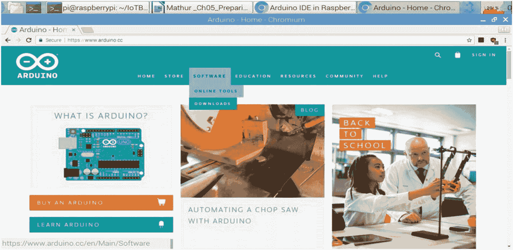

图 5-12

从 [*www.arduino.cc*](http://www.arduino.cc) 下载 Arduino IDE

现在向下滚动到图 5-13 所示的 Arduino IDE 下载区域，选择对应位宽（32 位或 64 位）的操作系统进行下载。

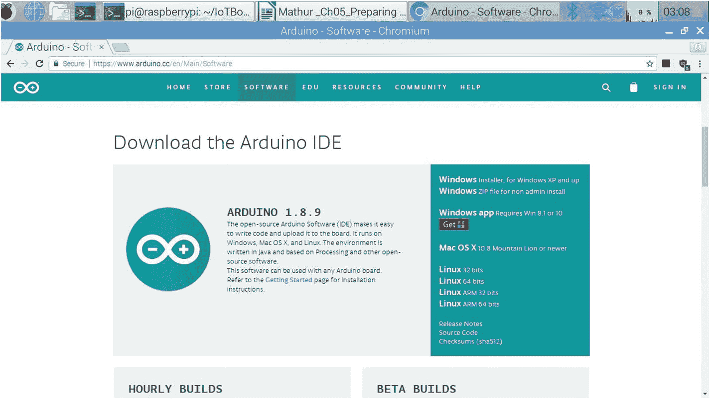

图 5-13

下载 Arduino IDE

如你所见，页面右侧的蓝色栏中有多个选项。Linux 有四个选项：Linux 32 位、Linux 64 位、Linux ARM 32 位和 Linux ARM 64 位。`uname` 和 `lshw` 命令显示我运行的是 ARM v7 处理器，位宽为 32 位，因此我选择下载 Linux ARM 32 位版本。如果你使用的是 64 位处理器，则需要下载 Linux ARM 64 位版本的 IDE。如果你不想为 Arduino 开发提供小额捐赠，请点击下一页的“仅下载”按钮。

下载完成后，按照图 5-14 所示的步骤，在浏览器中点击“在文件夹中显示”选项。

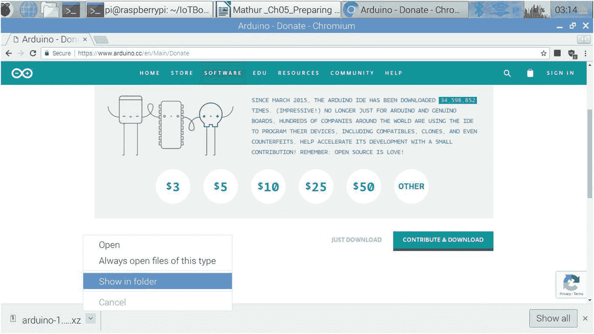

图 5-14

点击“在文件夹中显示”选项查看下载的文件

之后，Raspbian 的 GUI 文件资源管理器将打开“下载”文件夹，其中已下载了 Arduino 压缩文件，如图 5-15 所示。

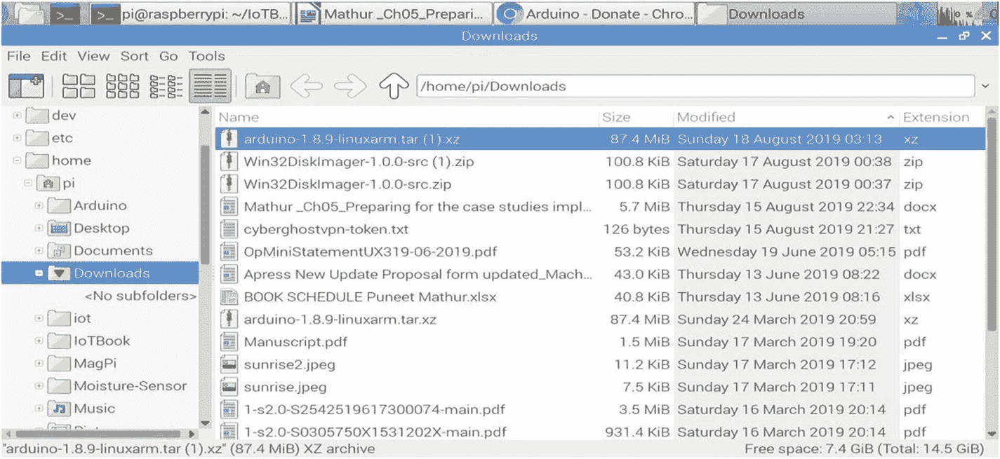

图 5-15

包含 `*.xz` 压缩文件的“下载”文件夹

你需要从 `*.xz` 扩展名文件中提取 tar 文件，如图 5-16 所示。右键单击该文件以选中它，然后左键单击“解压到此处”菜单选项。

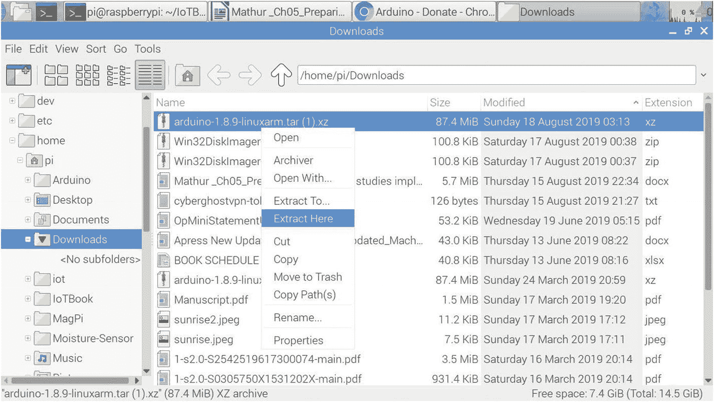

图 5-16

`*.xz` 文件的“解压到此处”选项

当你点击“解压到此处”选项时，会看到一个对话框，显示文件解压的进度。见图 5-17。

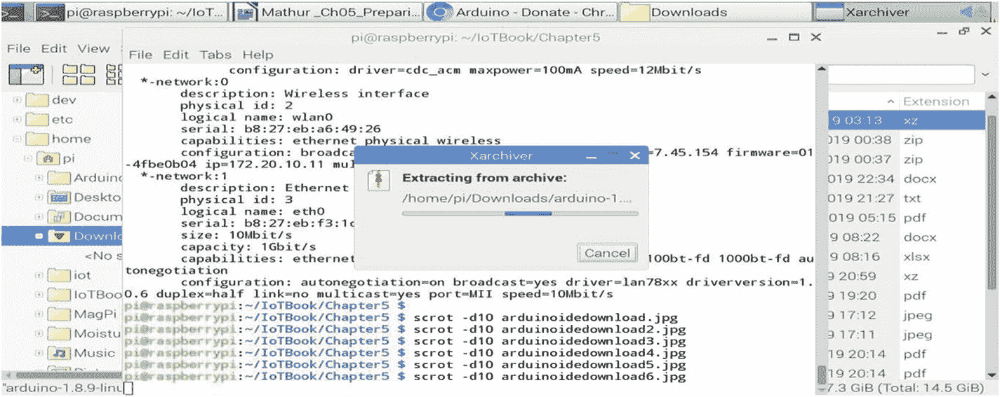

图 5-17

`*.xz` 文件正在解压中

解压完成后，你会在 `Downloads` 文件夹中看到一个新创建的文件，其名称与 `*.xz` 文件相同，但扩展名变为 `*.tar`。再次右键单击此文件，并从下拉菜单中选择“解压到此处”选项，如图 5-18 所示。

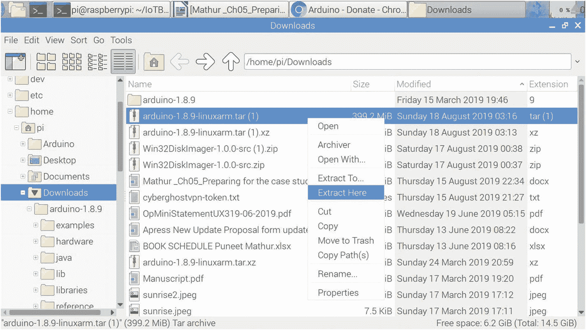

图 5-18

解压 tar 文件

解压过程完成后，你会看到创建了一个新文件夹，如图 5-19 所示。

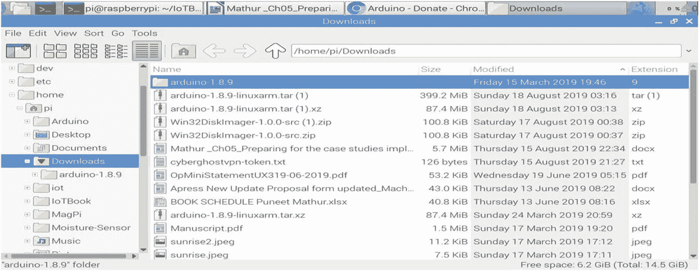

图 5-19

解压后新的 Arduino 文件夹

你可以双击该文件夹进入，如图 5-20 所示。你会看到一个名为 `install.sh` 的文件。双击此文件，Arduino IDE 将安装到你的系统上。

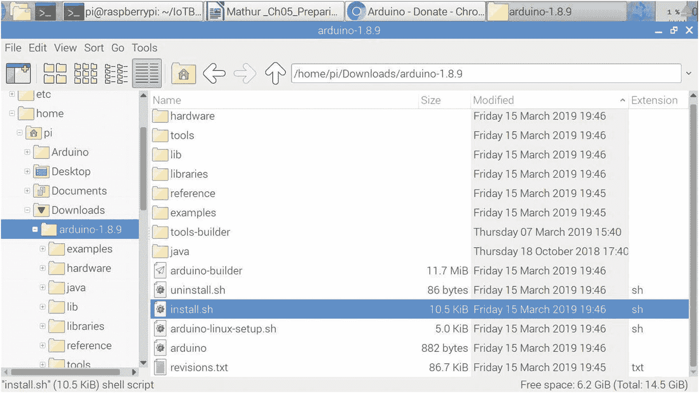

图 5-20

运行 `install.sh` 文件完成安装

第二种更简单的安装 Arduino IDE 的方法只需执行三条命令：

```
sudo apt-get update
sudo apt-get upgrade
sudo apt-get install arduino
```

虽然通过命令行安装 Arduino IDE 的方法简单得多，步骤也少很多，但有些人更喜欢图形界面而非命令行，因此我展示了这两种方法，由你决定如何安装。现在，你已经进入了设置中的数据存储步骤，即在 Raspbian 上安装 SQLite3 数据库。

## 安装 SQLite3 数据库

SQLite3 是一款免费数据库，你可以轻松地使用它在应用程序中创建和使用数据库进行存储。虽然 SQLite3 并非功能完备的数据库，但它支持大部分 SQL 标准，非常适合需要简单数据库引擎嵌入应用的开发场景。SQLite3 在智能手机开发者中非常流行。树莓派的环境也是一种移动环境，我们可以将其带到现场、工厂、农田或移动基站附近，通过物联网传感器收集数据，并存储在这个紧凑而稳健的数据库中。请记住，你不能将此数据库用于需要高级安全功能（如内置用户管理）的应用程序。因此，请在没有此类安全需求的场景下使用它。你可以在 Raspbian 上配置 PostgreSQL 或任何其他 Linux 数据库（如 MySQL），但这超出了本书的范围，因为我们只开发概念验证级别的代码。

使用以下脚本在 Raspbian 操作系统上安装 Sqlite3：

```
sudo apt-get update
sudo apt-get upgrade
sudo apt-get install sqlite3
sqlite3 
SQLite version 3.8.7.1 2014-10-29 13:59:56
Enter ".help" for usage hints.
sqlite>
```

你也可以按照我之前展示的 Arduino IDE 图形界面安装方式，从 SQLite 组织的官方网站 [`www.sqlite.org/download.html`](http://www.sqlite.org/download.html) 安装 SQLite3。

现在，你已经到了在 Arduino 上安装 Modbus 接口设备（单相电表）的最后一步。

免责声明

在继续之前，我想提醒你使用此 Modbus 设备所涉及的风险。电能表是一种电器设备，如果连接不当，存在短路风险。如果未按照其使用说明书操作，也可能危及人身安全。如果连接错误，还可能烧毁并损坏你的树莓派和 Arduino 板。因此，如果你对电气连接不熟悉，我强烈建议你不要使用此设备，或者请当地电气技术人员提供专业帮助进行正确连接。无论是作者还是出版商，均不对任何形式的物质或人身损害承担责任。请用户自行审慎判断。

你将用于设置电能表的其他设备如图 5-21 至 5-23 所示：

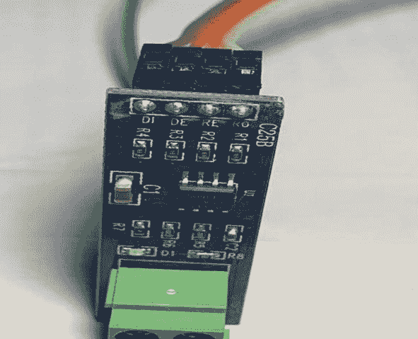

图 5-23

已连接的 5V Modbus 转换模块

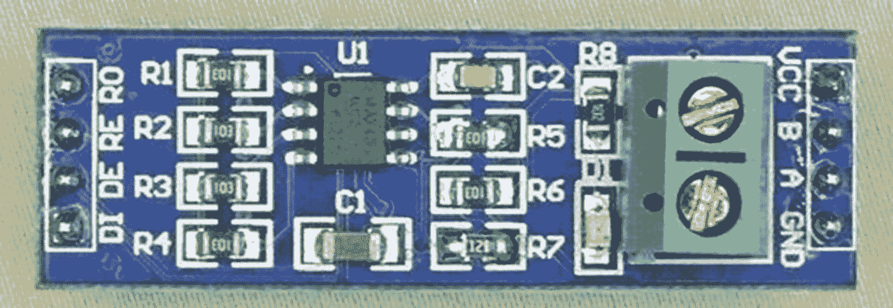

图 5-22

用于 Arduino 的 5V RS485 转 TTL 信号双向转换模块

1.  用于 Arduino 的 5V RS485 转 TTL 信号双向转换模块，带过压保护和信号指示灯


图 5-21

Conzerv EM6400 电能表

1.  施耐德电气 Conzerv EM6400 系列电力仪表

现在，让我们连接 Arduino Mega 256 和 5V RS485 Modbus 转换模块之间的导线。我已经展示了连接到 Arduino Mega 2560 上 Modbus 转换模块的导线。

为了将 Modbus 转换模块连接到 Arduino，你首先需要了解 Arduino Mega 2560 PCB 的布局，如图 5-24 所示。请注意，图中上方的引脚涉及通信和 GPIO 引脚。电路板的右侧有数据引脚，底部有电源和模拟引脚。这块板与 Arduino Uno 板有很大不同，因为它用于控制多个从设备，并用于工业应用。这就是 PCB 布局中有这么多数据引脚的原因。

现在，将 Modbus 转换模块连接到 Arduino Mega 板。你需要将三个引脚连接到板的电源区域，该区域靠近图 5-24 布局图左下角的电源控制器。最左边的深蓝色引脚连接到标有 5V 的引脚。下一根绿色导线连接到紧邻的标有 GND 的引脚。忽略图 5-24 左侧的黄色导线；你的设置中不需要它。你可以在图 5-24 中看到——连接到 Arduino Mega 板电源部分的三个引脚。请记住，你需要的是公头杜邦线，因为 Arduino Mega 板只有孔，而没有像树莓派 GPIO 那样的引脚。

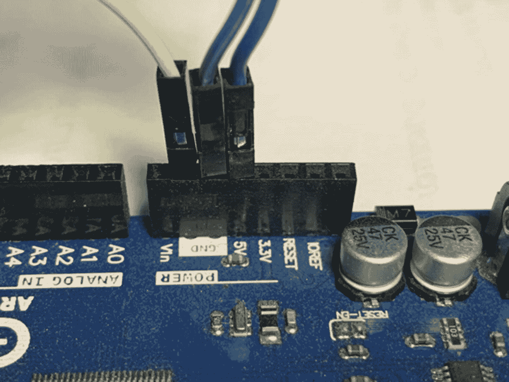

图 5-24

Modbus 转换模块与 Arduino Mega 板的导线连接

另一端的导线必须是母头杜邦线，因为 Modbus 转换模块有引脚可以插入导线。因此，你需要两根公对母杜邦线来进行此连接。将这两根导线的另一端连接到 Modbus 转换模块上标有 VCC 和 GND 的引脚（VCC 是 5V 电源线，GND 是电路接地）。你可以参考图 5-25。


图 5-25

Modbus 转换模块的电源和接地连接

连接到 Arduino 上的 5V 深蓝色导线连接到 Modbus 转换模块上标有 VCC 的引脚。Arduino 板上的 GND 绿色导线引脚连接到 Modbus 转换模块 PCB 上的 GND。

现在，你的 Modbus 转换模块的一部分已连接到 Arduino 板。你需要将另一端连接到 Arduino 板的 GPIO 引脚部分或通信侧，总共四个引脚。见图 5-26。在 Arduino 板上

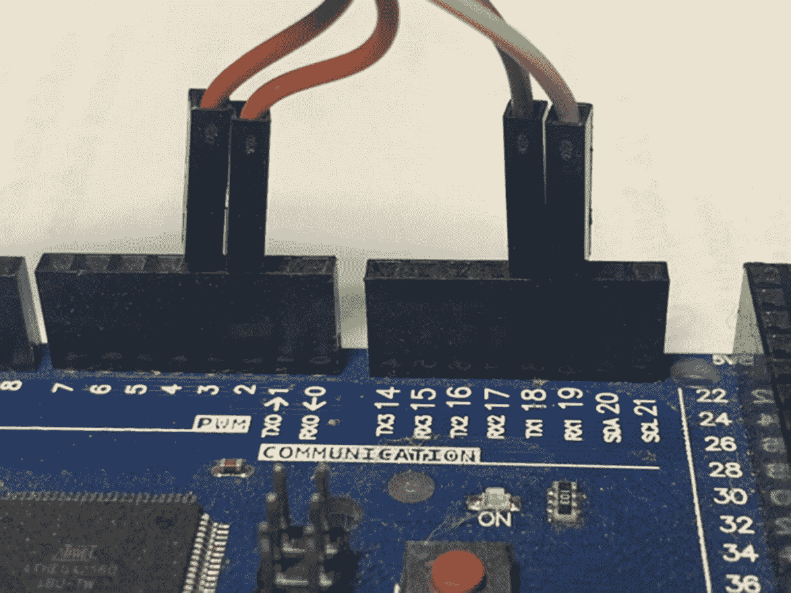

图 5-26

连接到 Arduino Mega 板的 PWM 和通信侧

如你所见，板左侧有两个名为 PWM 的引脚，连接到编号为 3 和 2 的引脚，它们彼此相邻。接下来的两个引脚连接到通信引脚 18 和 19，在 Arduino Mega 板上分别标记为 TX1 和 RX1。完成此连接后，你需要按以下方式连接四个引脚的另一端。在 Arduino 板上连接到 PWM 引脚 3 的引脚 1，需要连接到 Modbus 转换模块上标有 DE 的引脚。在 Arduino 板上连接到 PWM 引脚 2 的引脚 2，需要连接到 Modbus 转换模块中间标有 RE 的引脚。类似地，在图 5-27 中，在 Arduino 板上连接到引脚 18 的引脚 3，需要连接到 Modbus 转换模块上标有 DI 的引脚。在 Arduino 板上连接到引脚 19 的第四个引脚，应连接到 Modbus 转换模块上标有 RO 的引脚。至此，Modbus 转换模块到 Arduino Mega 板的接线过程完成。你可以对照图 5-27 检查你的连接。


图 5-27

Modbus 转换模块通信和 PWM 引脚的接线

现在你已经准备好进行下一步：将 Arduino 模块连接到树莓派板。为此，你需要一根串行 USB 线，从树莓派 3 B+ 板的串行 USB 端口连接到 Arduino Mega 2560 板。为清晰起见，该线缆如图 5-28 所示。

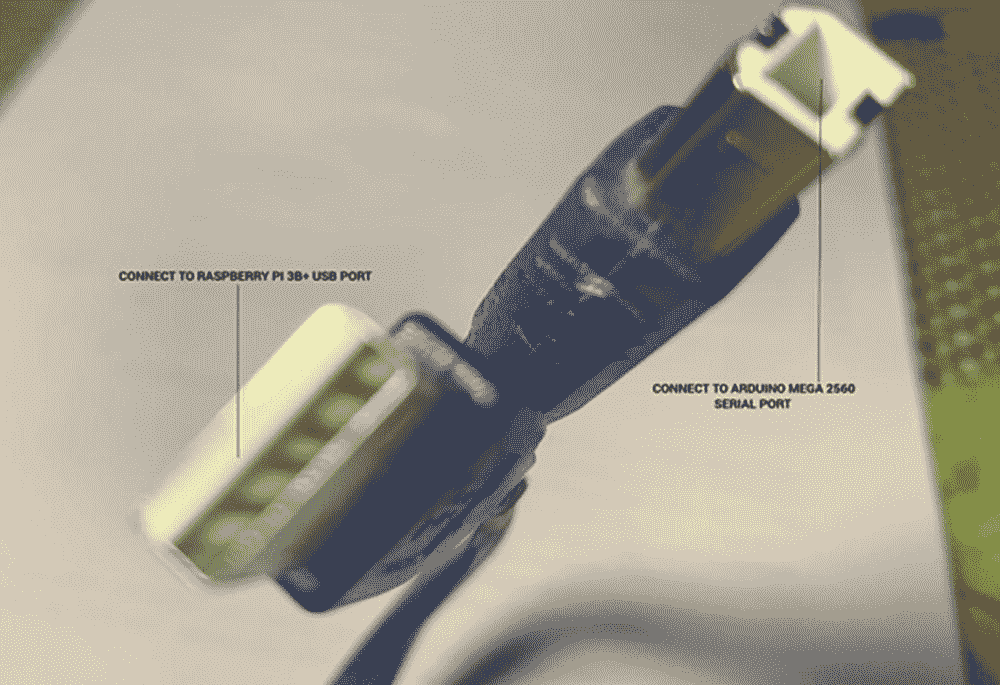

图 5-28

用于连接 Arduino Mega 2560 与树莓派 3 B+ 的 USB 串行线

现在，你终于可以启动整个系统了。Arduino 不需要单独的电源线，尽管其板上有一个电源插槽。串行线为 Arduino 板供电，因为它是树莓派 3 B+ 板的从设备。当你启动树莓派 3 B+ 时，你应该会看到 Modbus 转换模块和 Arduino Mega 2560 板上的 LED 灯亮起。这初步表明你的连接成功。如图 5-29 所示。

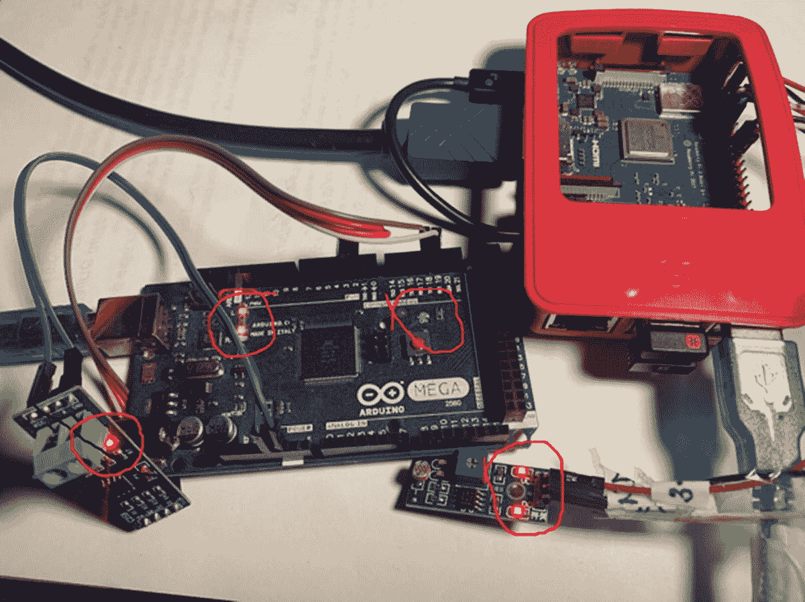

图 5-29

最终上电

如果板卡或模块没有亮起，你应该重新检查连接，特别是为模块或 Arduino 板供电的连接。现在，继续运行第 3 章的 Arduino Hello world 程序，以确认 Arduino Mega 从设备与树莓派 3 B+ 主设备之间的串行通信。

## 总结

本章介绍了如何为案例研究的实施准备你的设备。你现在已完全配置完毕：在树莓派 3 型号 B+ 上设置了 Raspbian 操作系统，并从 [`www.raspberrypi.org`](http://www.raspberrypi.org) 的下载选项中下载了该系统。你使用了 microSD 卡和 microSD 卡适配器来获取操作系统。然后，你使用 Win32 磁盘管理器解包并提取了软件包。之后，你使用 HDMI 转 HDMI 线缆将树莓派连接到电视显示器。你使用 USB 无线网卡将键盘和鼠标连接到单板计算机。接着，你将树莓派 3 B+ 的电源线连接到移动电源，以确保在断电情况下其电源连接不会中断。

然后，你在 Raspbian 上安装并测试了 Python。接下来，你安装并验证了 Thonny Python IDE。接着，你运行了一个 Raspbian 命令行脚本来安装所需的 Python 包。

你运行了一个脚本来测试 Python 高级包的安装并检查错误。你为 Python 安装了 `tkinter` 包以实现 GUI，然后在 Python 3.x 解释器上成功执行了 `tkinter`。之后，你运行了 `iotpypackages.run` Raspbian 脚本，在 Raspbian 上安装了 IoT Python 包。

接着，你通过运行 `install.sh` 文件完成了 Arduino IDE 的安装。你安装了一个 SQLite3 数据库，用于存储来自物联网传感器的数据。之后，你将 Modbus 接口设备（单相电表）安装到了 Arduino 上。你配置并连接了三个设备：施耐德电气 Conzerv EM6400 系列电力仪表、用于 Arduino 过压保护的 5V RS485 转 TTL 信号双向转换模块（带信号指示灯），以及 5V Modbus 转换器模块。接着，你将 Modbus 转换器的线缆连接到 Arduino Mega 板，并连接到 Arduino Mega 板的 PWM 和通信端。你通过 USB 串行线连接了 Modbus 转换模块的通信和 PWM 引脚，以连接 Arduino Mega 2560 与树莓派 3 B+。最后，你为整个系统执行了最终上电。

至此，你已完成系统（包括硬件和软件）的设置。现在可以继续进行案例研究了。

