# 6. 配置电能表

延续第 5 章的内容，你在该章结束时连接了施耐德电气的三相 Conzerv EM6400 电能表。在本章中，你将完成两件事。首先，你将编写代码，从 Arduino Mega 从设备上的 EM6400 电能表获取数据，然后在树莓派主设备上将其读入 Python。其次，你将使用单相电气连接设置另一个电能表，然后通过 USB 串行 Modbus 协议将其数据直接读入树莓派。第二个设置是为了让那些工业物联网爱好者能够体验工业设备（如电能表和机器）如何生成真实数据。然而，在现实世界中，你会看到像 EM6400 这样的三相电能表和机器通过 Modbus 协议进行通信。再次，我想提醒读者，我们使用 Arduino Mega 2560 是因为它是一款真正的工业级单板计算机，支持连接多个设备，例如电能表或工业机器，这些设备可以以串行或菊花链电气配置方式相互连接。如果你只有一个设备，无论是单相、两相还是三相，你都可以像本章所示的那样直接将其连接到树莓派 3B+。那么，让我们开始编写代码，从 Arduino 上的 EM6400 电能表获取数据。该代码可在名为 `modbus01_EM6400_Tested.ino` 的代码包中找到，你可以从 [`www.PMAuthor.com/raspbian/`](http://www.pmauthor.com/raspbian/) 下载。在执行代码之前，请记得像我在第 3 章中所示的那样，在 Arduino IDE 中打开它，并配置和测试 Arduino IDE。

## 为 EM6400 电能表编程

在开始运行任何代码之前，第一步是在 Arduino IDE 中安装 Modbus 库。这是必需的，以便获取一些 C 语言头文件。`ModbusMaster.h`、`SPI.h` 以及其他库可用于通过 Arduino 从机与您的电能表进行 Modbus 通信。您可以按照图 6-1 至 6-3 所示的方式打开这些库。

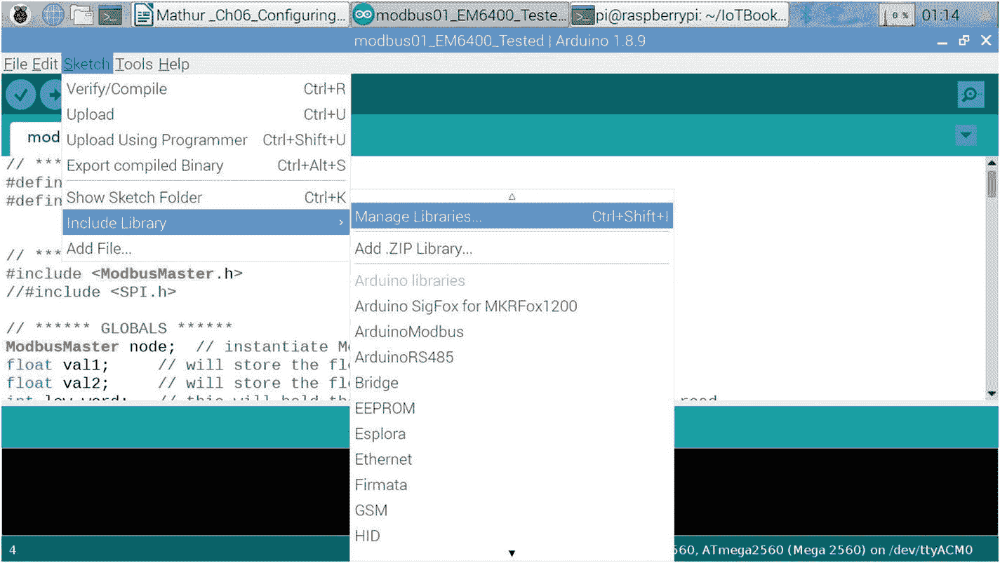

**图 6-1**
打开管理库菜单

从菜单栏选择 **项目（Sketch）** ➤ **包含库（Include Library）** ➤ **管理库（Manage Libraries）**，或使用快捷键 **Control + Shift + I** 打开管理库菜单。库管理器屏幕将会打开，如图 6-2 所示。

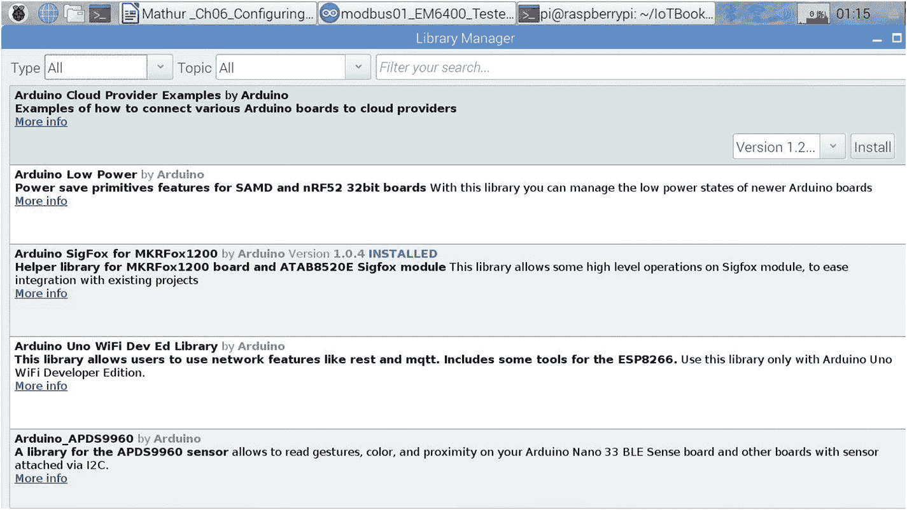

**图 6-2**
在 Arduino IDE 中打开库管理部分

现在您打开了库管理器，它是 Arduino IDE 内部维护的一个仓库，用于管理其环境中安装的库。对开发者来说，美妙之处在于您无需担心文件存储在哪里，或者它们关联的路径。库管理器会自行处理这些工作；您只需在代码中包含它提供的库即可。在您的情况下，您需要 Modbus 库，它提供了前面提到的两个头文件，这样您的 Arduino 程序才能与电能表通信。在“筛选您的搜索（Filter your search）”字段中输入 **Modbus** 并按回车键，让库管理器为您列出所有描述中包含 Modbus 的库。如图 6-3 所示。

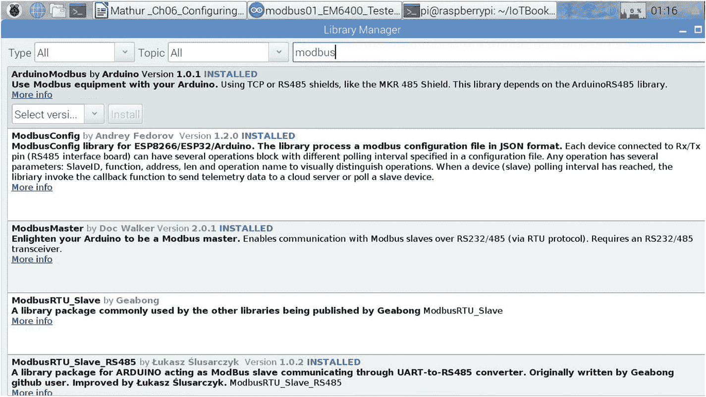

**图 6-3**
筛选搜索 Modbus 库

如图 6-3 所示，列表中列出了许多名称中包含 Modbus 的库。您只需要第一个，即由 Arduino 官方提供的 **ArduinoModbus**，版本 1.0.1。请注意，当您在您的 IDE 中执行此操作时，可能会看到不同的版本，因为 Arduino 组织会通过修复错误和为用户提供增强功能来不断更新其库。点击其描述下方的“安装（Install）”按钮安装此 Modbus 库后，您将看到一条屏幕消息显示“已安装（INSTALLED）”，如图 6-3 所示。请注意，“安装”按钮是灰色的，因为我的环境中已经安装了它。成功完成此操作后，您可以关闭库管理器窗口，返回到 Arduino IDE 中的代码窗口，如图 6-4 所示。

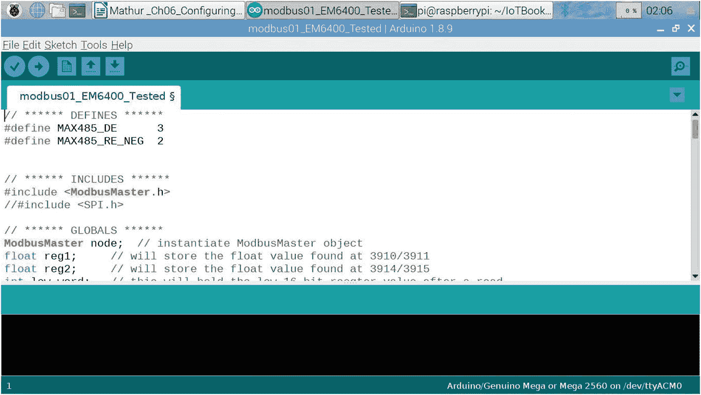

**图 6-4**
加载名为 `modbus01_EM6400_Tested.ino` 的代码文件

在代码的前几行，您会看到包含语句 `#include <ModbusMaster.h>`。这就是刚刚加载的库。在包含语句之后，继续声明全局变量，如代码清单 6-1 所示。

```
// ****** 全局变量 ******
ModbusMaster node;  // 实例化 ModbusMaster 对象
float reg1;         // 将存储寄存器 3910/3911 中的浮点数值
float reg2;         // 将存储寄存器 3914/3915 中的浮点数值
int low_word;       // 读取后将保存低 16 位寄存器值
int high_word;      // 读取后将保存高 16 位寄存器值
代码清单 6-1
声明全局变量的代码
```

第一个全局变量是 `reg1`，它是一个浮点类型变量，用于存储来自 Conzerv EM6400 电能表的寄存器 3910 和 3911 中的值。寄存器是通过 Modbus 协议查找各种电能参数值的实际位置。此信息在施耐德电气（Schneider Electric）为 EM6400 提供的用户手册中给出，官方网址为：[`www.schneider-electric.com/resources/sites/SCHNEIDER_ELECTRIC/content/live/FAQS/345000/FA345958/en_US/EM%206433%20series%20Communication.pdf`](http://www.schneider-electric.com/resources/sites/SCHNEIDER_ELECTRIC/content/live/FAQS/345000/FA345958/en_US/EM%25206433%2520series%2520Communication.pdf)。该手册还为您提供了一种使用免费软件测试协议的方法，位于第 55 页的“通信测试（Communication Test）”标题下。您可以自行尝试；这超出了本书的范围，因此我留给您自己探索。好在该手册通过截图描述了整个过程，并且非常容易理解。第 57 页的“数据地址（Data Address）”标题下提供了一个详细的表格，列出了电能表可以通过 Modbus 协议传输的各种电气数据参数。该表格包含各个参数的地址，并提供了获取特定数据所需的寄存器地址编号信息。例如，对于线对中性点电压值（VLN），寄存器地址是 3911。该值的类型是浮点数，因此您在代码中使用相应的变量（图 6-5），即 `float reg1` 用于寄存器地址 3910 和 3911，`float reg2` 用于存储寄存器 3914/3915 的值。请注意，每个寄存器是 16 位的，因此每个寄存器都会有一个高字和一个低字，所以您在通过 Arduino Mega 2560 从电能表读取数据后，声明了全局变量 `int low_word;` 和 `int high_word;`。现在您已经理解了寄存器的概念以及数据如何通过 Arduino Mega 从电能表传回，您可以查看一个用于将它们转换为浮点值的联合体结构。这在代码清单 6-2 中给出。

```
// 转换为浮点数 - 联合体结构
union u_tag {
int bdata[2];
float flotvalue;
} uniflot;
代码清单 6-2
用于存储来自电能表的寄存器值的联合体结构
```

这里声明了一个 `int variable bdata[2]` 数组，它存储两个值：来自一个寄存器的高字和低字。浮点变量 `flotvalue` 是实际转换并将值存储为浮点数据类型的变量，因为它将要获取的实际值是浮点数据类型，这是程序运行所必需的。这个联合体结构的用法在后面的代码 `loop()` 函数中会变得更加清晰。现在让我们声明一些函数，这些函数将帮助您完成使用 Modbus 接口协议与电能表通信的过程。通信序列如图 6-5 所示。

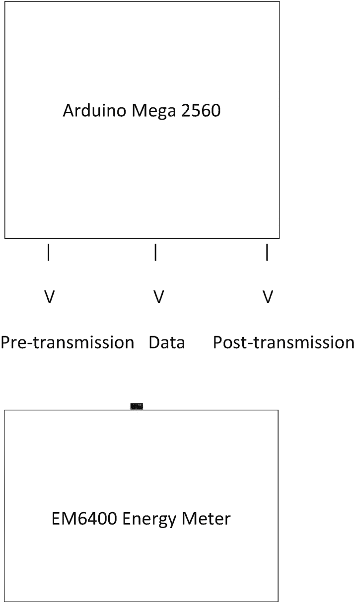

**图 6-5**
Arduino Mega 2560 与电能表之间的通信

如图所示，Arduino Mega 和电能表之间会发生三次传输。首先是预传输，然后是实际的数据传输，最后在数据从电能表传回 Arduino 之后，是后传输。理解这个周期很重要，因为代码就是按照这三个序列来划分的。

你一定注意到了，在第 5 章配置 Arduino Mega 板并连接引脚时，有两个引脚（黄色和棕色）连接到了标记为 Rx 和 Tx 的引脚上。这些正是实际通信发生的引脚。当数据通过这些引脚读取时，Arduino Mega 2560 板上有一个名为 **ATMEL MEGA 16U2** 的芯片，其 LED 灯会亮起；你可以清晰地看到它们向 Arduino 板回传通信信号，以此表明你的连接是正确的。然而，这并不能保证你一定能获取到数据；这取决于多种因素，例如函数中传递的寄存器编号和参数数值是否正确等。引脚 2 和 3 分别连接到 TTL 转 RS485 转换器模块上的橙色线和绿色线，而该模块又与电能表相连。它使用 TTL 通信与电能表交互；不过，借助其 PCB 上的一个芯片，它会将 TTL 信号转换回 Modbus 协议，反之亦然。为了获取数据并初始化它们，使其准备好来回传输数据，你需要定义变量，如代码清单 6-3 所示。

```
// ****** 宏定义 ******
#define MAX485_DE      3
#define MAX485_RE_NEG  2
代码清单 6-3
定义与电能表通信的引脚
```

请记住，由变量 `MAX485_DE` 标记的 DX 或 DE 通过 Arduino Mega 板上的 3 号引脚进行通信，而该引脚又连接到 Modbus 转换器模块上对应的 DE 公针（已标记）。同样，变量 `MAX485_RE` 是负逻辑的，通过 Arduino 板上标记的 2 号引脚进行通信，而该引脚又连接到 Modbus 转换器模块上对应的 RE 公针（已标记）。

在传输前和传输后，接下来的函数的主要工作就是向这些引脚写入信号以启动和结束通信。如代码清单 6-4 中的代码片段所示。

```
// ****** 传输函数 ******
void preTransmission()
{
digitalWrite(MAX485_RE_NEG, 1);
digitalWrite(MAX485_DE, 1);
Serial.println("preTransmission");
}
void postTransmission()
{
digitalWrite(MAX485_RE_NEG, 0);
digitalWrite(MAX485_DE, 0);
Serial.println("postTransmission");
}
代码清单 6-4
传输前和传输后函数
```

代码中给出的两个函数通过 `digitalWrite(MAX485_RE_NEG, 1);` 在函数 `void preTransmission(){}` 中初始化通信。该函数初始化 RE 引脚#2 以开始写入。`digitalWrite` 函数的第一个参数是引脚编号，已在变量 `MAX485_RE_NEG` 中定义；第二个参数是开/关二进制参数，值为 1 时启用对该引脚的写入，值为 0 时停止写入。接下来，初始化 `MAX485_DE`，然后 `postTransmission(){}` 函数向两个引脚传递值 0 以停止传输。现在你有了这些函数，就可以执行 Arduino Mega 的标准函数了，即 `void setup()` 和 `void loop()`。回顾第 3 章，`void setup()` 函数在程序中首先定义，用于初始化和设置 Arduino Mega 2560 的代码，使其开始运行。对于这个函数，你首先需要初始化引脚 2 和 3 为输出模式，以便开始通过它们使用 Modbus 485 协议控制数据流。完成后，你需要为相同的引脚初始化接收模式。之后，你设置电能表接收和发送信号所用的波特率频率。该电能表的默认波特率是 9600 Hz，我不打算更改它，因为在此速率下通信良好。接着，为此从设备定义一个从设备 ID。如果你有多个从设备连接到 Arduino Mega 板，你可以在此部分为它们分配多个从设备 ID。之后，调用 `preTransmission()` 和 `postTransmission()` 函数。为了确认 Arduino 与电能表之间的通信是否正确，你可以写入类似“Hello World”的内容。这正是你在代码清单 6-5 中看到的内容。

```
// ****** 标准 ARDUINO SETUP 函数 ******
void setup() {
// 将引脚 2 和 3 设置为 Max485 流量控制的输出引脚
pinMode(MAX485_RE_NEG, OUTPUT);
pinMode(MAX485_DE, OUTPUT);
// 初始化为接收模式
digitalWrite(MAX485_RE_NEG, 0);
digitalWrite(MAX485_DE, 0);
Serial.begin(9600);    // TX0/RX0 串口监视器
Serial1.begin(9600);   // TX1/RX1 Modbus 通信
// Modbus 从设备 ID = 1
node.begin(1, Serial1);
// 回调函数允许我们正确配置 RS485 收发器
node.preTransmission(preTransmission);
node.postTransmission(postTransmission);
Serial.println("Hello World");
}
代码清单 6-5
void setup() 函数
```

`Serial.println()` 函数由 Arduino 作为输出发送到串口。因此，你可以使用 Python 程序从连接的树莓派主设备（Arduino Mega 从设备连接至此）读取这些语句。现在，你已经在 `void setup()` 函数中完成了 Arduino 的初始配置，接下来可以进入最后一步：定义你希望该草图在 Arduino Mega 上执行的主要工作。首先，你需要从电能表读取数值，为此你需要定义变量来保存结果及其数据，如代码清单 6-6 所示。

```
// ****** 标准 ARDUINO 循环函数 ******
void loop() {
uint8_t result;
// 读取线电压（相电压）
result = node.readHoldingRegisters(3910, 2);
if (result == node.ku8MBSuccess)
{
high_word = node.getResponseBuffer(0x00);
low_word = node.getResponseBuffer(0x01);
uniflot.bdata[1] = low_word;   // Modbus 数据 16 位低字
uniflot.bdata[0] = high_word;  // Modbus 数据 16 位高字
reg1 = uniflot.flotvalue;
Serial.print("线电压: ");
Serial.println(reg1);
}
//  node.clearResponseBuffer();
delay(500);   // 读取之间的小延迟
//读取频率
result = node.readHoldingRegisters(3914, 2);
if (result == node.ku8MBSuccess)
{
high_word = node.getResponseBuffer(0x00);
low_word = node.getResponseBuffer(0x01);
uniflot.bdata[1] = low_word;   // Modbus 数据 16 位低字
uniflot.bdata[0] = high_word;  // Modbus 数据 16 位高字
reg2 = uniflot.flotvalue;
Serial.print("频率: ");
Serial.println(reg2);
}
delay(5000);    // 每 5 秒重复读取一次
node.clearResponseBuffer();
}
代码清单 6-6
void loop() 的代码
```

由于此草图基于 C 和 C++ 构建，因此 C 和 C++ 中使用的函数及其数据类型也能很好地集成到该语言中。草图语言中使用数据类型 `uint8_t` 表示 8 位无符号整数，该语言是一个基于 C++ 编译器并带有包装器的编译器。您定义了此数据类型的 `result` 变量，用于存储保持寄存器的结果，您将在下一行尝试执行此操作。您要读取的第一项内容是来自保持寄存器 #3910 的中性点电压值，使用的语句是 `result = node.readHoldingRegisters(3910, 2);`。`node` 对象在草图中自动可用，用于与多个 Arduino 从站通信。在您的情况下，只有一个从站，并且您已将其连接到树莓派。您使用语句 `node.begin(1, Serial1);` 对其进行初始化，在 `void setup()` 函数中为其分配了从站 ID 为 1 的序列号。因此，现在当您调用 `node` 对象时，草图会自动将其视为您之前初始化的这个节点。第二个参数值 2 表示第一个参数 3910 中提到的寄存器的字节长度。

接下来的代码使用 `if` 语句来检查从 Arduino 从站接收到的响应是否正常。为了检查这一点，您首先需要了解 Modbus 主站库中提供的 **Modbus 功能码和异常码**。这是用于通过 RS232/485（基于 RTU 协议）与 Modbus 从站通信的 Arduino 库（参见 [`http://4-20ma.io/ModbusMaster/group__constant.html`](http://4-20ma.io/ModbusMaster/group__constant.html)）。虽然这个 Arduino 库有各种变量可供使用，但您需要的特定变量是 `ku8MBSuccess`，仅当在 Modbus 主站和从站之间的通信中发现以下检查项均正常时，它才返回 true：

1.  从站 ID 有效。

2.  功能码有效。

3.  响应码有效。

4.  返回有效数据。

5.  CRC 校验有效。数据传输中没有错误。

您可以在此处阅读更多相关信息：[`http://4-20ma.io/ModbusMaster/group__constant.html#ga81dd9e8d2936e369359777d67769a657`](http://4-20ma.io/ModbusMaster/group__constant.html%2523ga81dd9e8d2936e369359777d67769a657)。

一旦 `if` 语句将此条件判断为真，您就可以通过给出寄存器的起始和结束地址来获取数据值，语句为 `high_word = node.getResponseBuffer(0x00);` 和 `low_word = node.getResponseBuffer(0x01);`。供您参考，`0x00` 是高字的十六进制值 0，`0x01` 是第二个低字的十六进制值 1。现在您需要将 `high_word` 和 `low_word` 变量的值连接成一个 float 类型的变量。您创建了一个联合体结构，其中包含一个名为 `unifloat` 的浮点值变量。`reg1 = uniflot.flotvalue;` 语句返回第一个寄存器的完整浮点值，这就是线电压的值。您使用语句 `Serial.println(reg1);` 打印出该值。现在您已经将线电压的值存储在一个变量中，您可以获取另一个值——频率，它存储在寄存器地址 3914 中。您添加了 500 毫秒的延迟；这是可选的，取决于您希望如何处理数据。如果您正在创建一个监控能源设备当前吞吐量的警报系统，您可能不希望有延迟，因为您需要线电压和电流频率的实时数据。但是，如果您有多个从站，过于频繁地轮询电能表可能会给树莓派带来负载，这是您在编写这部分代码时需要牢记的应用程序设计方面。代码清单 6-7 中的代码从寄存器地址 3914 获取数据，该寄存器也是 2 字节长。

```
delay(500);   // 读取之间的小延迟
//读取频率
result = node.readHoldingRegisters(3914, 2);
if (result == node.ku8MBSuccess)
{
high_word = node.getResponseBuffer(0x00);
low_word = node.getResponseBuffer(0x01);
uniflot.bdata[1] = low_word;   // Modbus 数据 16 位低字
uniflot.bdata[0] = high_word;  // Modbus 数据 16 位高字
reg2 = uniflot.flotvalue;
Serial.print("频率: ");
Serial.println(reg2);
}
代码清单 6-7
获取当前频率值的代码
```

您使用 `if` 条件语句 `if (result == node.ku8MBSuccess)` 来检查从电能表到 Arduino 从站的数据传输是否成功。一旦成功，`if` 语句块与图 6-11 中的代码块非常相似，只是使用了变量 `reg2`，您用它来存储第二个寄存器的浮点值，该寄存器中包含当前的频率值。使用语句 `Serial.println(reg2);`，您将频率值打印到串行总线上。在结束函数 `void loop()` 之前，您添加了 2 秒的延迟，以便在连续读取之间留出一些时间。同样，此时间延迟取决于您正在构建的应用程序类型，并且可以根据应用程序的业务需求进行更改。请记住，您在此处设置的时间延迟越短，您的应用程序就越频繁地占用三个设备（树莓派 3 B+、Arduino Mega 2560 和 EM 6400 电能表）的 CPU 和内存等系统资源。之后，您在语句 `node.clearResponseBuffer()` `;` 中清除响应缓冲区。这是为了确保不会再次收集旧值，并且新值从寄存器进入缓冲区，然后进入 Arduino 串行总线。

```
delay(2000);    // 每 2 秒重复读取一次
node.clearResponseBuffer();
```

至此，Arduino 端的程序代码编写完毕。你可以按照第 3 章和第 5 章所示的步骤，将其编译并上传到 Arduino Mega 2560 上。你应该能看到代码编译成功和上传成功的消息，如图 6-6 和图 6-7 所示。

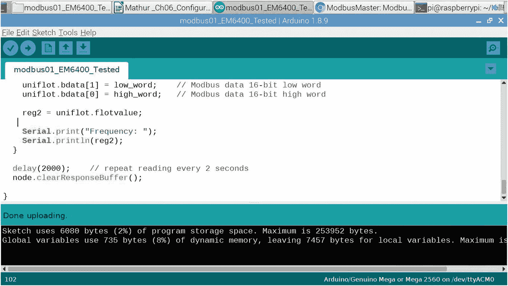

图 6-7

上传 EM6400 代码后显示的“上传完成”消息

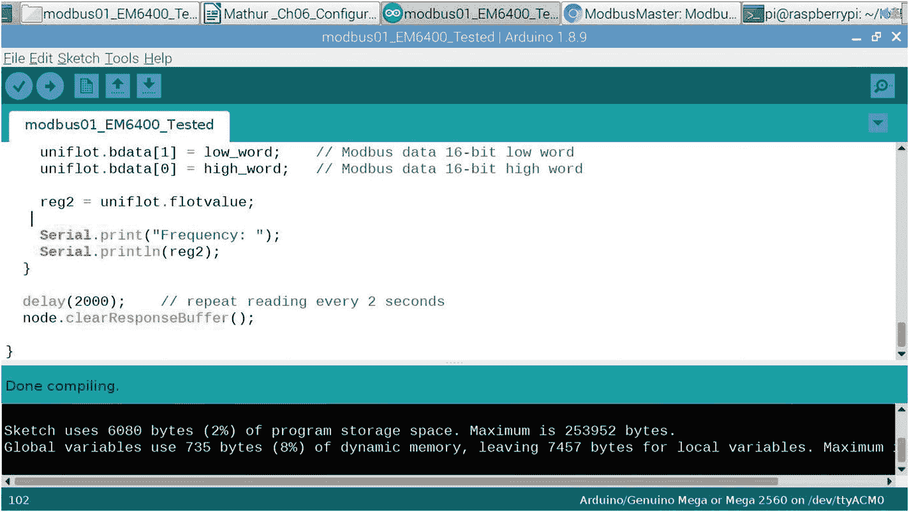

图 6-6

编译 EM6400 代码后显示的“编译完成”消息

至此，Arduino 端的代码步骤已完成。但是，你无法在 Arduino 端看到线对中性点电压和频率的结果。请记住，你是通过 `Serial.write()` 语句将所有内容写入串口的。要读取这些值，你需要编写一个非常小的 Python 程序，来显示 Arduino Mega 2560 正在向串口写入的内容。

首先，你需要安装一个名为 serial 的 Python 包或模块，可以在 Raspberry Pi 3 B+ 的命令行中完成安装，如图 6-8 所示。

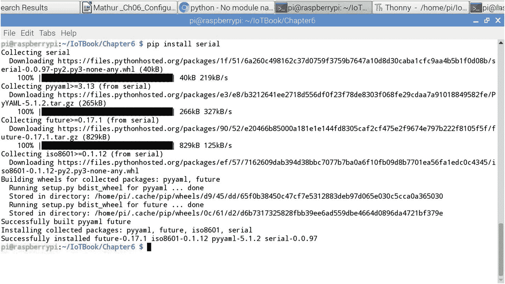

图 6-8

在 Raspberry Pi 3 B+ 上安装 Python 的 serial 模块

Python 安装通常默认包含此模块，因此你可能无需安装。你可以通过在 Python 提示符下运行简单的导入语句 `import serial` 来检查是否需要安装，如图 6-9 所示。

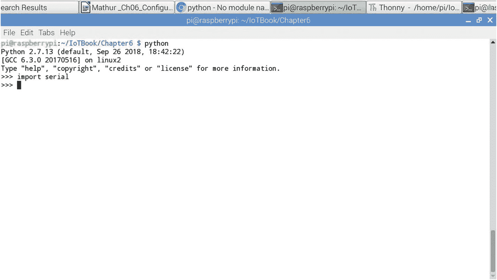

图 6-9

检查 serial Python 模块是否已安装

如果出现错误，则表示你的 Python 版本未安装该模块。如果没有出现错误，并且 Python 提示符 `>>>` 返回且未发出任何消息，则表明该库模块已存在，你无需再次安装。

现在你已经安装了 serial 库，可以继续编写 Python 代码来从串口获取数据。参见代码清单 6-8。

```
import serial
ser= serial.Serial('/dev/ttyACM0', 9600)
while 1:
print("Reading...")
print(ser.readline())
代码清单 6-8
从 Arduino 串口读取数据的 Python 代码
```

在这个 Python 程序中，你首先导入 `serial` 对象，然后使用 `serial.Serial()` 函数创建一个名为 `ser` 的对象，第一个参数是 `/dev/ttyACM0`；这通常是 Arduino 通信的串口。第二个参数 `9600` 是电能表通信的波特率。这是你在图 6-10 的代码块中设置的频率值。如果你因某种原因更改了该频率，则需要在此处将其更改为相同的值，否则会因波特率不匹配而无法通信。当你运行这个 Python 程序时，你将看到类似于代码清单 6-9 中给出的输出。代码 `ser.readline()` 从连接到 Arduino Mega 2560 的串口读取一行值，进而读取连接到 EM6400 电能表的值。

```
>>> %Run arduino.py
Reading...
b'Hello World\r\n'
Reading...
b'preTransmission\r\n'
Reading...
Line to Neutral Voltage:
221.5
Frequency:
49.67
b'postTransmission\r\n'
代码清单 6-9
Raspberry Pi 3 B+ 上 Python 程序的示例输出
```

你可以在示例输出中看到，程序以写入 `preTransmission` 开始，然后打印“Line to Neutral Voltage:”及其值 221.5，接着打印“Frequency:”及其值 49.67。这每 2 秒在一个无限循环中运行，每次设置运行时，串行通信输出中都会打印“Hello World”。你可以将其更改为更有意义的内容，例如“Setup initialized.”。这由你决定。

至此，Conzerv EM6400 电能表的配置和设置就完成了。现在，正如我在本章开头所承诺的，你将配置一个仅使用单相两线设置的电能表，这要简单得多。这款电能表是 Eastron SDM630，它也带有 Modbus 接口。这次你将不再使用 Arduino Mega 2560，而是使用 Python 和 Raspberry Pi 直接从中获取数据。

现在，你将首先通过单相连接与单个 Eastron SDM 630 进行连接。我不建议以串联或菊花链方式连接多个此类仪表，因为与 Arduino Mega 2560 不同，Raspberry Pi 3 B+ 不是坚固的工业级板卡，很容易烧毁。因此，我这里给出的连接系统仅适用于小型项目，不同于前面章节中 Conzerv EM6400 的连接和配置。

Eastron SDM630 电能表（图 6-10）由一家中国公司制造，在全球范围内都很容易买到。如果你需要，可以查看 [`www.pmauthor.com/raspbian`](https://www.pmauthor.com/raspbian) 上的链接。这款智能电能表是家用和工业用途中最受欢迎的电能表之一，也支持三相连接。我推荐这款，因为我和我的团队在客户项目中已对其进行了充分的个人和商业应用测试，它表现良好。虽然市场上有一些竞争对手，但我们最常使用的是这款流行的产品。

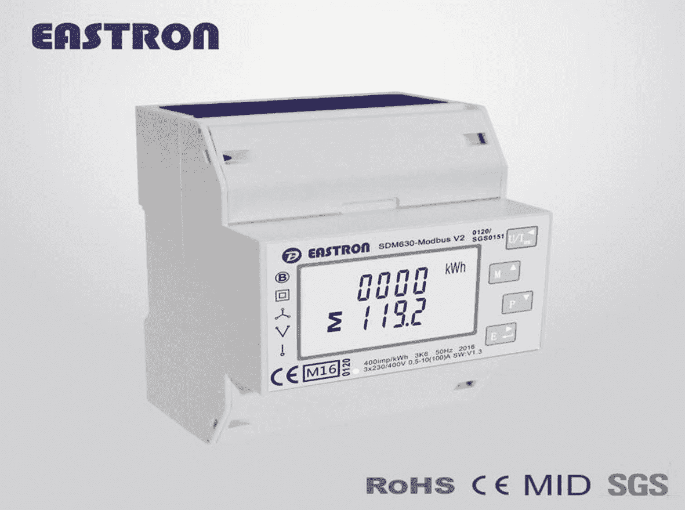

图 6-10

Eastron SDM630

第一步是将此电能表连接到 Raspberry Pi，为此你需要以下组件：

1.  RS485 Modbus USB 转换器

2.  至少 1 米长的双绞线，能够通过 5V 电流

3.  Eastron SDM630 电能表

4.  单相机器，例如带有电子线圈和电机以产生无功功率的电机或铣床

5.  至少 20W 的 LED 灯泡以产生有功功率

列出的所有物品及其规格均在 [`www.pmauthor.com/raspbian/`](https://www.pmauthor.com/raspbian/) 上提及。让我们开始将它们全部连接起来。

RS485 USB 转换器需要与双绞线连接，如图 6-11 所示。你可以看到需要连接的特定端子。USB 转换器的底部有两个端子引脚。


图 6-11

RS485 USB 转换器

它们被标记为 A 和 B。请注意，这些正是电能表上标记为 A 和 B 的相同端子，如图 6-12 所示。如果你将粉色导线插入标记为 A 的端子，那么你必须在另一端将同一根粉色导线连接到电能表上标记为 A 的端子；如果接反了，可能会损坏电能表，请务必牢记这一点。同样地，将 USB 转换器上标记为 B 端子的灰色导线连接到电能表上标记为 B 的端子。这样就完成了 USB 转换器与电能表的连接。为了你的安全，请确保树莓派和电能表都未运行。确保它们处于关闭状态，并且已从所有电气端子上拔下插头。这是为了防止意外触电。此外，除非你的电气系统中安装了 MCB 或断路器，否则切勿连接到主电源，这样万一发生短路，MCB 会跳闸，不会对电气布线系统造成损坏。

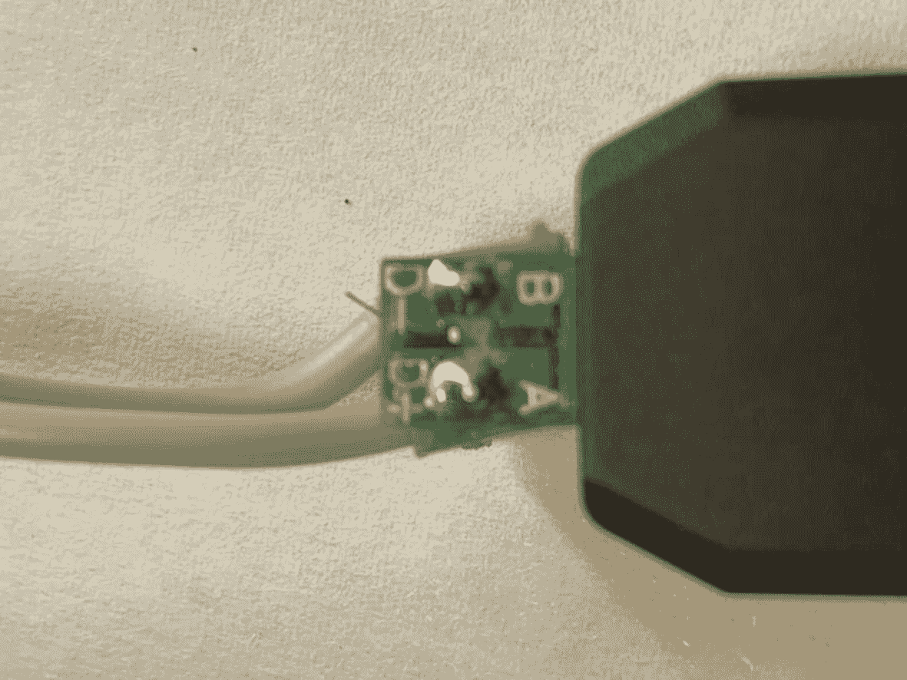

图 6-12
连接导线至 RS485 Modbus 转换器

请查看图 6-13 中对应的导线连接，其中灰色导线连接到 Eastron SDM630 电能表上的 B-端子，粉色导线连接到 A+端子。


图 6-13
连接到 Eastron SDM630 内部数据端子的导线

现在双绞线的两端都已连接好，你需要对 SDM630 电能表进行两处连接。一处是输入导线连接，它将来自主电源并为电能表供电；另一处是输出导线连接，它将向负载或电流源（如 LED 灯泡、电动机或铣床）供电。如图 6-14 所示。


图 6-14
Eastron SDM630 电能表的输入连接

如你所见，电能表输入侧有四个端子导线连接。在这四个端子中，由于你在此电能表中使用的是单相两线制型号，你只需要将 4 号端子连接黑色导线（零线），将 1 号端子连接红色导线（电源线，也称为火线）。连接好这些导线后，你可以将这些导线的插头端连接到一个插头上。请注意，在此架构中你并未使用第三根导线（地线）。为方便起见，插头连接如图 6-15 所示。


图 6-15
电能表输入导线的插头连接

现在你需要连接电能表的输出端子，并在其另一端放置一个负载，例如 LED 灯泡、电动机或铣床。请记住，它们都必须是单相的。因此，按照图 6-16 所示进行连接，其中输出红色导线（火线）连接到 6 号端子，输出黑色导线（零线）连接到 8 号端子。


图 6-16
电能表的输出导线连接

完成此连接后，你需要将端子导线的另一端连接到负载，例如 LED 灯泡、单相铣床或电动机。在图 6-17 中，你可以看到一个 LED 灯泡作为负载连接；然而，这不会提供非常真实的数据，因为无功功率将始终为零。尽管如此，这是测试电路的好方法。另一端的负载可以随时更换为任何其他负载。

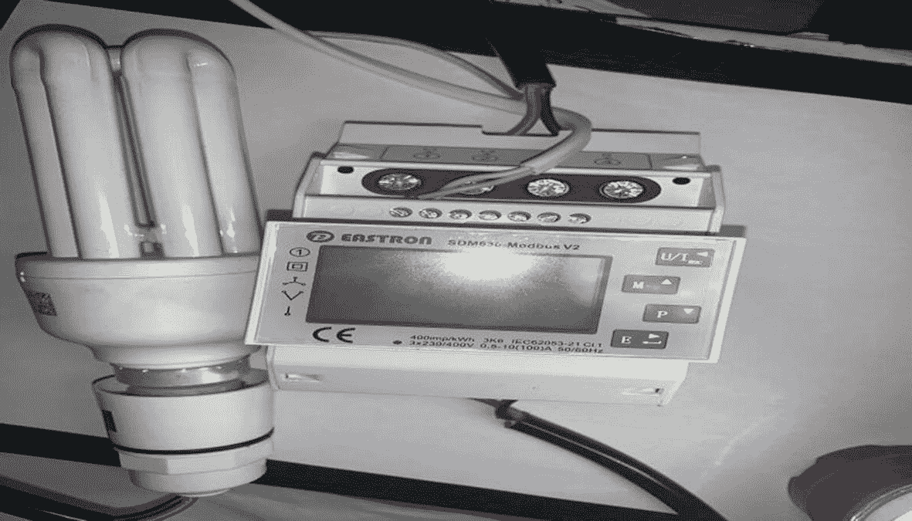

图 6-17
连接到电能表输出端的 LED 灯泡

至此，所有输出和输入连接均已完成，你可以通过将电能表从输入端连接到电源插座来为其通电。你应该会看到电能表启动，并且 LED 灯泡亮起，分别如图 6-18 和 6-19 所示。

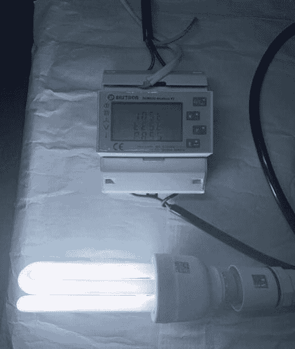

图 6-19
通电后的 LED 灯泡和电能表

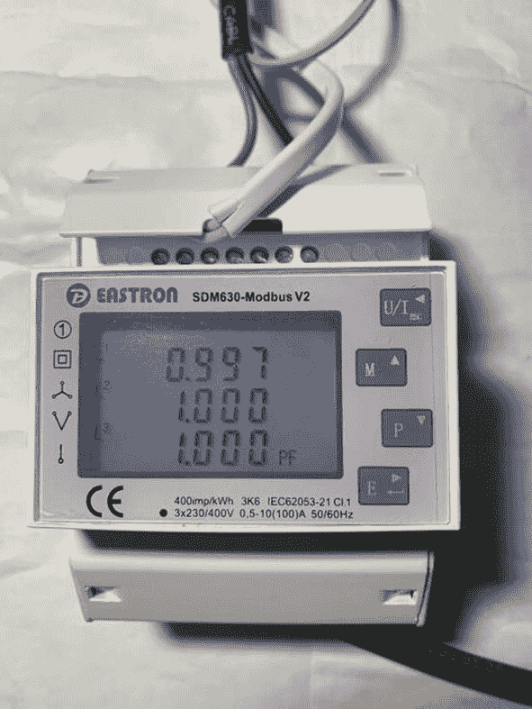

图 6-18
通电后的 Eastron SDM630 电能表

至此，硬件部分的设置就完成了。请记住，你尚未将树莓派 3 B+连接到电能表。这仅仅是为了检查电能表的所有连接是否正常工作，以及负载是否与电能表一起通电。如果成功，你可以连接树莓派，然后使用 Python 程序从中获取数据并将其存储在 SQLite3 数据库中。给电能表通电后，你可以给树莓派 3 B+通电。但在此之前，请记得将 RS485 Modbus 转换器连接到树莓派的一个 USB 端口，如图 6-20 所示。

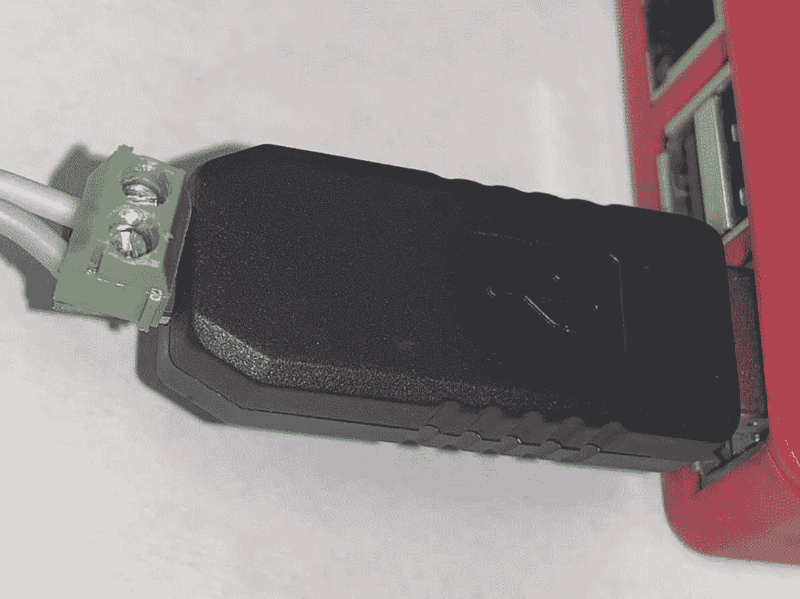

图 6-20
将 RS485 Modbus 转换器连接到树莓派 3 B+

请注意，此 RS485 转换器模块 PCB 上没有 LED 指示灯，因此除了通过 Python 软件之外，无法判断它是否正在接收来自电能表的信号。该软件名为`sdm630_tested.py`，你可以从[`www.pmauthor.com/raspbian/`](https://www.pmauthor.com/raspbian/)提供的捆绑包中解压获得。完整代码见代码清单 6-10。在运行 Python 代码之前，你需要安装树莓派使用 RS485 Modbus 协议与电能表通信所需的 Python 库。为此，你需要安装一个名为 minimalmodbus 的 Python 库。首先，运行命令`sudo apt-get update`，然后运行`sudo apt-get upgrade`，因为保持操作系统库和内核更新和升级是一个好习惯，这样较新的 Python 库就不会因为依赖较新的 Raspbian 结构而失败。图 6-21 和 6-22 展示了此安装过程。

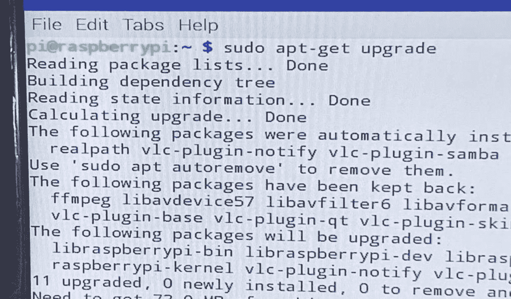

图 6-22
升级 Raspbian 内核

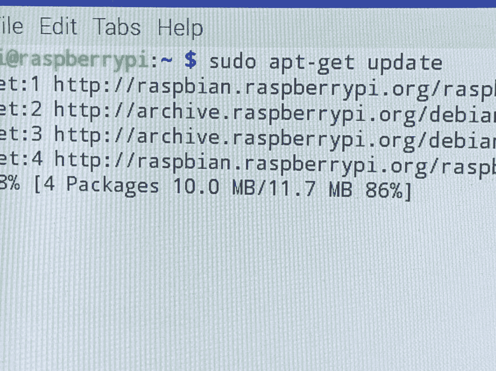

图 6-21
更新 Raspbian 内核

安装好 minimalmodbus Python 模块（图 6-23）后，你可以加载 Python 代码并运行它（代码清单 6-10）。提醒一下：此时你的电能表应该已经启动，并且树莓派 3 B+已通过 RS485 Modbus 转换器连接。

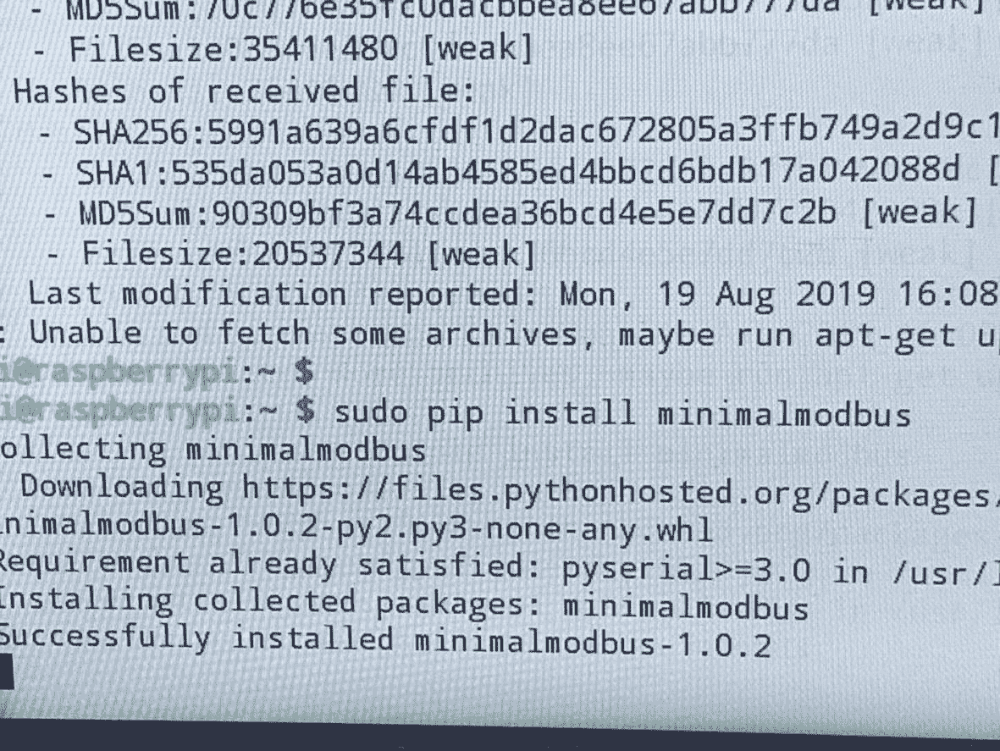

图 6-23

安装 minimalmodbus Python 模块

```
#!/usr/bin/Python
#Loading modbus library
import minimalmodbus
from datetime import datetime
#Initializing searial communication on the modbus library
sdm630 = minimalmodbus.Instrument('/dev/ttyUSB0', 1)
sdm630.serial.baudrate = 9600
sdm630.serial.bytesize = 8
sdm630.serial.parity = minimalmodbus.serial.PARITY_NONE
sdm630.serial.stopbits = 1
sdm630.serial.timeout = 1
sdm630.debug = False
sdm630.mode = minimalmodbus.MODE_RTU
print(sdm630)
while 1:
Volts = sdm630.read_float(0, functioncode=4)
Current = sdm630.read_float(6, functioncode=4)
Active_Power = sdm630.read_float(12, functioncode=4)
Apparent_Power = sdm630.read_float(18, functioncode=4)
Reactive_Power = sdm630.read_float(24, functioncode=4)
Power_Factor = sdm630.read_float(30, functioncode=4)
Phase_Angle = sdm630.read_float(36, functioncode=4)
Frequency = sdm630.read_float(70, functioncode=4)
Import_Active_Energy = sdm630.read_float(72, functioncode=4)
Export_Active_Energy = sdm630.read_float(74, functioncode=4)
Import_Reactive_Energy = sdm630.read_float(76, functioncode=4)
Export_Reactive_Energy = sdm630.read_float(78, functioncode=4)
Total_Active_Energy = sdm630.read_float(342, functioncode=4)
Total_Reactive_Energy = sdm630.read_float(344, functioncode=4)
print('Voltage: {0:.1f} Volts'.format(Volts))
print('Current: {0:.1f} Amps'.format(Current))
print('Active power: {0:.1f} Watts'.format(Active_Power))
print('Apparent power: {0:.1f} VoltAmps'.format(Apparent_Power))
print('Reactive power: {0:.1f} VAr'.format(Reactive_Power))
print('Power factor: {0:.1f}'.format(Power_Factor))
print('Phase angle: {0:.1f} Degree'.format(Phase_Angle))
print('Frequency: {0:.1f} Hz'.format(Frequency))
print('Import active energy: {0:.3f} Kwh'.format(Import_Active_Energy))
print('Export active energy: {0:.3f} kwh'.format(Export_Active_Energy))
print('Import reactive energy: {0:.3f} kvarh'.format(Import_Reactive_Energy))
print('Export reactive energy: {0:.3f} kvarh'.format(Export_Reactive_Energy))
print('Total active energy: {0:.3f} kwh'.format(Total_Active_Energy))
print('Total reactive energy: {0:.3f} kvarh'.format(Total_Reactive_Energy))
print('Current Yield (V*A): {0:.1f} Watt'.format(Volts * Current))
import sqlite3
conn = sqlite3.connect('/home/pi/IoTBook/Chapter6/energymeter.db')
#df.to_sql(name='tempdata', con=conn)
curr=conn.cursor()
query="INSERT INTO sdm630data(timestamp, voltage , current ,activepow ,apparentpow ,reactivepow ,powerfactor ,phaseangle , frequency , impactiveng , expactiveeng ,impreactiveeng , expreactiveeng ,totalactiveeng ,totalreactiveeng ,currentyield, device ) VALUES(" + "'" + str(datetime.now()) + "'" + "," + "'" + str(Volts) + "'" + "," +  "'" + str(Current) + "'" + "," +  "'" + str(Active_Power) + "'" + "," +  "'"  + str(Apparent_Power) + "'" + "," +  "'" + str(Reactive_Power) +  "'" + "," +  "'" + str(Power_Factor) + "'" + "," +  "'" +  str(Phase_Angle) + "'" + "," +  "'" + str(Frequency) + "'" + "," +  "'" +  str(Import_Active_Energy) + "'" + "," +  "'" + str(Export_Active_Energy) + "'" + "," +  "'" + str(Import_Reactive_Energy) + "'" + "," +  "'" + str(Export_Reactive_Energy) + "'" + "," +  "'" + str(Total_Active_Energy) + "'" + "," +  "'" + str(Total_Reactive_Energy) + "'" + "," +  "'" + str((Volts * Current)) + "'" + "," + "'" + str("millmachine")+ "'" + ")"
print(query)
curr.execute(query)
conn.commit()
清单 6-10
从电能表获取数据并存储到数据库的 Python 代码
```

在这段代码中，首先导入 minimalmodbus Python 库，以实现树莓派与电能表之间的 Modbus 通信。然后导入 datetime，用于在从电能表获取一条数据记录时存储时间戳。其用法在代码后面会体现。之后，通过 Rs485 Modbus USB 转换器初始化 Modbus 仪器，该转换器在 Raspbian 设备列表中显示为 `/dev/tty/USB0`。这是默认设备，在大多数情况下应该可以正常工作；但是，如果遇到任何通信错误，请使用命令 `lsusb` 检查你的 485 转换器连接到了哪个 tty 端口。接下来，以 9600 的波特率初始化串口通信。这是默认值；如果你更改了电能表中的波特率，则需要在此处将代码语句 `sdm630.serial.baudrate = 9600` 中的值改为新值。你为寄存器初始化了 8 位字节大小，以及其他设置参数，如停止位和超时间隔。`print(sdm630)` 会将对象打印到 Raspbian 的控制台，因此你应该能通过这条打印语句看到所有的连接设置配置。之后，你的电能表设置就完成了，现在你可以与其通信并从中获取数据。为此，在接下来的代码中，你使用一个无限 `while` 循环来持续获取数据并打印到屏幕上，最后将其存储到 SQLite 3 数据库中。这段代码与 Conzerv EM6400 电能表的代码非常相似，因此我不再深入探讨。但需要注意的一点是，你从电能表获取了总共 15 个值，包括其电压、电流、有功功率和无功功率，直至当前发电量。运行程序后，你应该会看到类似于图 6-24 的输出。

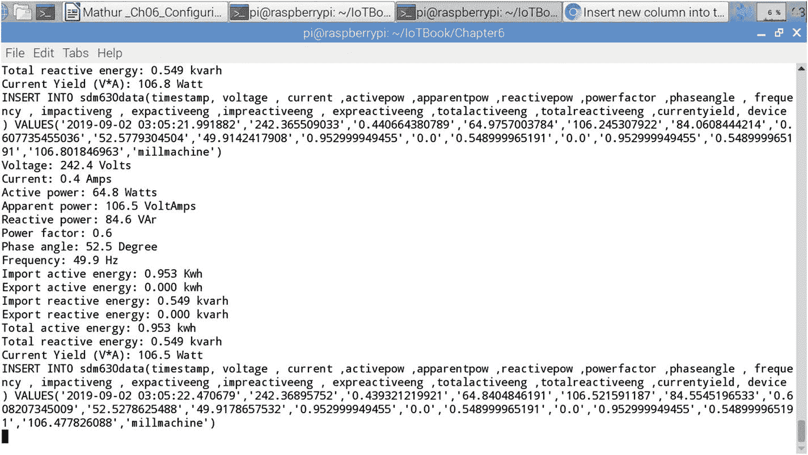

图 6-24

程序 sdm630_tested.py 的输出

用于将数据存储到 SQLite3 数据库的 `insert into` 语句的输出会进入一个名为 `sdm630data` 的表中。表创建脚本位于文件 `sdm630_db_creation_script.sql` 中，该文件随你从 [www.​pmauthor.​com/​raspbian/​](https://www.pmauthor.com/raspbian/) 下载的压缩包一起提供。

## 总结

至此，我们完成了电能表的设置、配置以及将数据获取到数据库系统的全部工作。到目前为止，你已经成功下载了用于设置电能表设备的脚本。你通过使用 Arduino IDE 中的 Modbus 库为 EM6400 电能表编写了代码。你还通过编写一个简单的“Hello World”程序，学习并实现了 Arduino Mega 2560 与 Conzerv EM6400 电能表之间的通信前与通信后操作。然后，你编写了代码，通过其寄存器从电能表获取数据值。之后，你配置了另一款更常见的 Eastron SDM630 电能表。你将其硬件连接好，然后加载了树莓派与 SDM360 电能表之间进行 Modbus 通信所需的 Python 库。最后，你编写了一个 Python 程序，用于从电能表获取电压、电流和功率等数据，并将其存储到 SQLite3 数据库中。

接下来，你将研究一些案例，并设计一些有趣的物联网和工业物联网解决方案。

