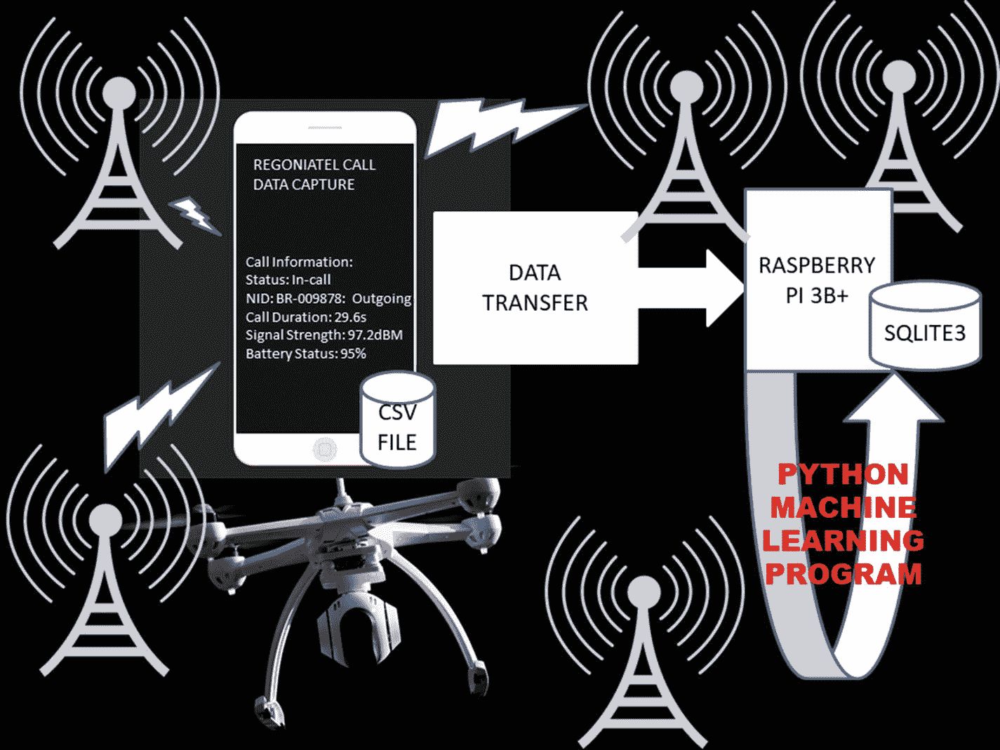
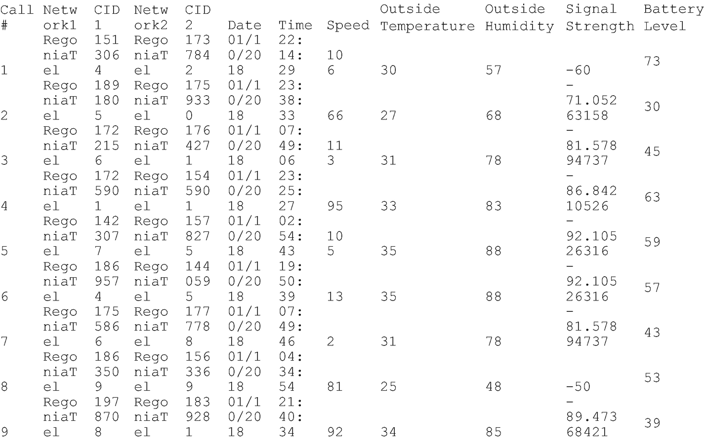

# 7. 电信行业案例研究：利用物联网解决通话中断问题

本案例研究基于一个虚构的国家、虚构的公司和虚构的场景。然而，通过本案例研究，您将了解到大多数电信公司都面临的、近乎真实的通话中断问题。案例研究将带您了解一家电信运营商的成立过程，为您提供其业务建立的足够背景信息。案例研究为您提供了一个普遍的政治和商业背景，以及相对一致的社会政治利害关系，因此具体是哪个国家并不重要。在本案例研究中纳入政治和商业背景的原因，是为了让身为机器学习工程师的您认识到，基于您构建的预测模型所做出的决策有多么重要，以及这些决策如何对商业乃至整个社会产生重大影响。现在，让我们进入案例研究。

## 电信案例研究概述

Regoniatel 于 2016 年开始运营，是 Regonia 的一家 2G 电信运营商。Regonia 是一个三面环山的国家。

首席执行官是 Kaun Methi John。他还拥有其他业务，例如采矿和炼油，并因此致富。他在这个欧洲小国建立了一个商业帝国。

当 Regonia 采用新的 2G 移动电话技术时，政府向有兴趣的企业征集提案。John 明白这是他拓展业务、进入未来将蓬勃发展的电信行业的黄金机会。由于他缺乏在本国建立电信基础设施的技术专长，他积极在全球寻找合作伙伴，以帮助他在这项新事业中取得成功。他找到了 Samtel，一家总部位于美国的公司，该公司正在与其他公司建立合资企业。

在项目计划和可行性研究完成后，合资伙伴为政府制定了 2G 频谱的提案。他们和其他三家公司一起中标了。他们成功获得了政府合同；然而，在建立电信网络并吸引客户入网方面，将面临激烈的竞争。其他三家公司也是由本地公司与国际电信公司合资成立的。政府认为将合同授予此类合资企业是明智之举，希望借此利用国际经验。

政府对该国的 2G 网络进行了数月的测试，以确定其可行性。一旦内部电信机构成功完成测试，企业就可以开始运营。

该国蓬勃发展的 1 万亿美元经济要求升级通信基础设施。该国的主要产业是农业和采矿业。该国四面环陆，没有海岸线。人们对这个国家得天独厚的金矿和钻石矿非常感兴趣，这些矿产是重要的收入来源。在金矿或钻石矿工作的矿工平均年收入为 6,000 美元。工资较高的原因是这些矿山出产一些最好的黄金和钻石。这个国家的钻石在全球范围内都备受追捧和需求。采矿业贡献了 Regonia 近 50% 的 GDP。

这个国家日益增长的需求需要良好的电信基础设施，为其公民提供强大的通信系统。这个小国能够负担得起世界上最好的基础设施。

Regoniatel 在获得频谱合同后的三年内，成功在城市地区建立了良好的基础设施。其竞争对手 Ytel 和 Fretel 也在城市和农村地区建立了移动基站。Sautele 在开发办公基础设施四年后的问题在于，它基本上已成为一家以城市为导向的公司。

政府设立了一个电信监管机构，负责发布所有公司的电信用户互动数据，例如客户投诉和网络故障。

在其 2019 年的报告中，该机构强调所有运营商的通话中断率上升了 35%。问题严重到执政党和反对党开始互相指责，称电信监管机构和政府行政部门在包庇电信运营商。总理紧急召见了三家公司的负责人，讨论问题及其可能的解决方案。Sautele 收到了关于其通话中断投诉的以下报告，如表 7-1 所示。

数据显示，RegoniaTel 网络的掉话投诉量上升了 41%。在所有运营商中，其掉话率增幅最大。由总理设立的电信委员会建议，对超过 10% 掉话投诉阈值的电信运营商处以 9 亿美元的罚款。这是一笔巨额罚款，如果掉话问题在其网络上持续发生，将给公司带来巨大的经济损失。

面对这一威胁和公众的强烈抗议，RegoniaTel 总裁召集其运营团队开会，以了解掉话率飙升背后的关键原因。根据运营经理的建议，需要设立一个试点项目，整合机器学习、物联网等前景广阔且创新的新兴技术，以解决这一技术商业问题。运营经理调来了其最有经验的机器学习工程师以及两位最优秀的数据科学家，共同组成试点团队，以寻找解决方案。

试点团队首次会面，研究了导致掉话的各种技术原因，包括对表 7-1 中给出的不同网络位置阶段的分析。

表 7-1

2018 年 Regonia 电信运营商掉话数据

| 网络名称 | 平均信号强度 (dBM) | 用户数 | 电话普及率 % | 网络停机时间 % | 通话成功率 % | 掉话率 | 掉话投诉量 |
| --- | --- | --- | --- | --- | --- | --- | --- |
| EtiTel | 92 | 1160000 | 113 | 0.05 | 98.2 | 0.048 | 55680 |
| GribaTel | 107 | 1030900 | 96 | 0.87 | 97.4 | 0.8352 | 861007.68 |
| RegoniaTel | 89 | 1243080 | 97 | 1.3 | 96.2 | 1.248 | 1551363.84 |

如您所见，信号强度以 dBm 为单位，这是衡量信号强度的单位。表格显示了用户数、电话普及率百分比、网络停机时间百分比、通话成功率百分比以及掉话率百分比。表格还显示了三家电信运营商各自收到的掉话投诉数量。平均信号强度最好的是 GribaTel，其次是 EtiTel，最后是 RegoniaTel。用户数量最多的是 RegoniaTel，约为 1240 万。RegoniaTel 的电话普及率为 97%，最高的是 EtiTel。RegoniaTel 的网络停机时间最高，为 1.3%。通话成功率最高的是 EtiTel，最低的是 RegoniaTel。RegoniaTel 的掉话率为 1.248%，最低的是 EtiTel。RegoniaTel 的掉话投诉量也最高。因此，您可以清楚地看到 RegoniaTel 存在网络停机、平均信号强度低以及掉话率最高的问题。

RegoniaTel 的运营经理报告称，用户数量正在下降，服务客户反馈显示，超过 60% 的用户表示因掉话问题而转投竞争对手的网络。用户数据见表 7-2。

表 7-2

RegoniaTel 七个月的用户数量

| 月份 | 用户数量 |
| --- | --- |
| 2018 年 4 月 | 1286588 |
| 2018 年 5 月 | 1274157 |
| 2018 年 6 月 | 1269806 |
| 2018 年 7 月 | 1266580 |
| 2018 年 8 月 | 1262845 |
| 2018 年 9 月 | 1261726 |
| 2018 年 10 月 | 1243080 |

如您所见，从 2018 年 4 月到 10 月出现了一个峰值，随后用户数量稳步下降。在七个月的时间里，其用户基数稳定下降了 3.4%。公司总裁向运营经理表达了他的担忧，并要求他加快项目进度，以找到解决此问题的方法。

试点项目中的机器学习工程师和数据科学家都意识到了这个问题的严重性，以及它与 RegoniaTel 收入减少的直接关联。如果用户流失继续下去，预计用户基数将进一步减少 4.75%（表 7-3）。运营经理还解释说，用户数量每下降一个百分点，平均会导致收入相应减少 1000 万美元。对于一家正在努力维持其网络质量的公司来说，这是一个巨大的数字。CEO 已经在考虑可能不得不裁员以降低运营成本。这是一个可怕的想法，但这是基于呈现在他面前的数据得出的。他向运营经理和试点团队解释了这项基于机器学习和物联网的试点项目的成功对公司有多么重要。

表 7-3

RegoniaTel 2019 年预计用户数

| 月份 | 用户数量 |
| --- | --- |
| 2018 年 10 月 | 1243080 |
| 2018 年 11 月 | 1212003 |
| 2018 年 12 月 | 1210760 |
| 2019 年 1 月 | 1184034 |
| 2019 年 2 月 | 1129338 |

试点团队被要求设计并实施一个试点系统，该系统能够解决掉话的直接问题，并应解决以下问题：

1.  导致掉话问题的原因是什么？
2.  掉话问题在哪些地点更为普遍？
3.  如何衡量特定地点的通话质量？
4.  能否预测掉话？如何预测？

这就是完整的案例研究。如果您来自电信行业，您会发现这些问题非常熟悉，并且应该能够轻松地将它们联系起来。请跟随我，看看作为一名机器学习顾问，我将如何为 RegoniaTel 构建这个问题的解决方案。

## 案例研究的设置与解决方案

设置工具包括硬件和软件两部分。硬件元素如下：

1.  一款安卓应用，用于捕获通话数据，其中嵌入了实时的 Regoniatel SIM 卡。
2.  一架工业级无人机，能够承载 500 克（即 1 磅）重的手机。
3.  配备 Wi-Fi 模块的 Raspberry Pi Model 3 B+，用于接收无人机上搭载手机发送的数据。

软件元素：

1.  一款由团队构建的安卓应用，用于测量和捕获通话信号质量数据，并将其存储为 CSV 文件格式。
2.  一个 Python 机器学习程序，利用从安卓应用设备导入的数据建立预测模型。

图 7-1 展示了这些元素如何组合在一起形成试点解决方案。



图 7-1

案例研究的硬件与软件解决方案设置

此设置的关键在于搭载手机在特定区域飞行的无人机。无人机由地面人员手动操控，在测试通话的移动基站周围以人体高度飞行。无人机上搭载的手机会每隔几分钟自动向同一网络中的另一部手机拨打电话。其目的是自动捕获通话质量数据，并将其存储为 CSV 格式的数据文件。当手机拨打的通话次数足够多时，由操作员将其取下，然后带到另一个具有不同移动基站的地点。通过这种方式捕获数据，然后整理到 SQLite3 数据库中。一旦从所有试点移动基站收集到足够的数据，就运行 Python 机器学习程序来查看模型结果。移动数据集如图 7-2 所示，Python 代码如代码清单 7-1 所示。



图 7-2

移动通话质量数据集

请记住，这只是一个基本的通话质量数据集；在现实世界中，你需要测量更多参数来确定通话质量，例如通话时长、语音质量参数、电话反馈等。此数据集的目的是向你展示如何从基本的电信数据进行分析。

将此数据集导入 SQLite3 数据库后，我们可以使用代码清单 7-1 中给出的程序。

```

# -*- coding: utf-8 -*-
"""
Author: Puneet Mathur
Copyright 2020
Free to copy this code with following attribution text: Author Puneet Mathur, www.PMAuthor.com
"""
import pandas as pd
import sqlite3
conn = sqlite3.connect('C:\\ machinemon.db')
#df.to_sql(name='tempdata', con=conn)
curr=conn.cursor()
#query="INSERT INTO TEMPERATURE VALUES(" +"'" + str(datetime.date(datetime.now())) + "'" +"," + "'" + str(datetime.time(datetime.now())) + "'"+ "," + "'" + str(tem) +  "'" + "," + "'" + tempstatus +"'" + ")"
df = pd.read_sql_query("select * from fielddata;", conn)
print(df)
#curr.execute(query)
#conn.commit()
#Looking at data
print(df.columns)
print(df.shape)
#Looking at datatypes
print(df.dtypes)
df.tail(1)
#Checking for missing values
print(df.isnull().any())
#EDA- Exploratory Data Analysis
import numpy as np
print("----------EDA STATISTICS---------------")
pd.option_context('display.max_columns', 40)
with pd.option_context('display.max_columns', 40):
print(df.describe(include=[np.number]))
#Correlation results
print("----------Correlation---------------")
with pd.option_context('display.max_columns', 40):
print(df.corr())
#Dividing data into features and target
target=df['Calldrop']
nm=['CID1','CID2','Speed','OutsideTemperature','OutsideHumidity','SignalStrength','BatteryLevel']
features=df[nm]
with pd.option_context('display.max_columns', 40):
features.head(1)
target.head(1)
#Building the Model
from sklearn.model_selection import train_test_split
x_train, x_test, y_train, y_test = train_test_split( features, target, test_size=0.25, random_state=0)
from sklearn.linear_model import LogisticRegression
lr  = LogisticRegression()
lr.fit(x_train, y_train)

# Returns a NumPy Array

# Predict for One Observation (image)
lr.predict(x_test)
predictions = lr.predict(x_test)

# Use score method to get accuracy of model
score = lr.score(x_test, y_test)
print(score)
import matplotlib.pyplot as plt
import seaborn as sns
from sklearn import metrics
import numpy as np
cm = metrics.confusion_matrix(y_test, predictions)
print(cm)
plt.figure(figsize=(9,9))
sns.heatmap(cm, annot=True, fmt=".3f", linewidths=.5, square = True, cmap = 'Blues_r');
plt.ylabel('Actual Calldrops');
plt.xlabel('Predicted Calldrops');
all_sample_title = 'Accuracy Score: {0}'.format(score)
plt.title(all_sample_title, size = 15);
plt.figure(figsize=(7,7))
plt.imshow(cm, interpolation="nearest", cmap="Pastel1")
plt.title('Confusion matrix', size = 15)
plt.colorbar()
tick_marks = np.arange(1)
plt.xticks(tick_marks, ["0", "1"], rotation=45, size = 15)
plt.yticks(tick_marks, ["0", "1"], size = 15)
plt.tight_layout()
plt.ylabel('Actual Calldrops', size = 15)
plt.xlabel('Predicted Calldrops', size = 15)
width, height = cm.shape
for x in range(width):
for y in range(height):
plt.annotate(str(cm[x][y]), xy=(y, x),
horizontalalignment='center',
verticalalignment='center')
plt.show()
代码清单 7-1
案例研究解决方案的代码
```

请记住，从 LightSensor 和其他物联网传感器获取数据的代码在第 [3](https://doi.org/10.1007/978-1-4842-5549-0_3Fig#25) 章的图 [3-25](https://doi.org/10.1007/978-1-4842-5549-0_3Fig#25) 中给出。无论我们尝试实现何种解决方案，从传感器获取数据的过程都是相同的。唯一的区别在于，本案例中的 Raspberry Pi 在收集数据时位于无人机内部。它类似于第 3 章中用于将 LDR 模块物联网传感器数据存储到 SQLite3 数据库的图 3-33 程序，以及用于模拟基于物联网的解决方案的图 3-35 代码，这两者共同使我们能够从物联网传感器获取数据，然后存储并处理这些数据，以便在需要时发出高级预警信号。在本案例中，我们不需要任何高级预警信号。

数据由搭载着树莓派（Raspberry Pi）作为有效载荷的无人机在飞往指定信号塔时收集，同时，代理程序既从用于监测温度和湿度的物联网传感器收集数据，也从附带的 4G/LTE 模块收集数据。这些数据被收集并存储在树莓派的 SQLite 数据库中后，便可用于进一步分析。因此，该解决方案假设数据收集已通过上述设置完成。

代码首先导入了常用的 `pandas` 和 `SQLite3` 库。它与 `machinemon` SQLite3 数据库建立连接，然后使用 `Select * from fielddata` SQL 查询从数据库中获取数据。`Fielddata` 是存储来自无人机物联网传感器和 4G/LTE 模块数据的表。接下来，在构建任何模块之前，我们检查是否存在缺失值，在本例中不存在缺失值，因此我们无需对其进行任何处理。之后，我们对数据集进行探索性数据分析。

像 Spyder 这样的 Python IDE 的问题在于，如果数据集中有大量列，它们会截断列。因此，技巧是对 pandas 数据框使用 `pd.option_context('display.max_columns', 40)` 语句。这里设置为 40，但如果你有更多列，可以将其设置为你需要的值。`df.describe()` 函数的输出如表 7-4 所示。

表 7-4

查看 EDA 统计信息

| `----------EDA 统计信息---------------` |
|   | `Call#` | `CID1` | `CID2` | `Speed  \` |
| `count` | `2000.000000` | `2.000000e+03` | `2.000000e+03` | `2000.000000` |
| `mean` | `1000.500000` | `1.693192e+06` | `1.688596e+06` | `59.706000` |
| `std` | `577.494589` | `1.709635e+05` | `1.673130e+05` | `35.214196` |
| `min` | `1.000000` | `1.399112e+06` | `1.398797e+06` | `0.000000` |
| `25%` | `500.750000` | `1.540734e+06` | `1.543660e+06` | `29.000000` |
| `50%` | `1000.500000` | `1.698208e+06` | `1.685488e+06` | `59.000000` |
| `75%` | `1500.250000` | `1.841730e+06` | `1.830084e+06` | `90.000000` |
| `max` | `2000.000000` | `1.987112e+06` | `1.986768e+06` | `120.000000` |
|   | `OutsideTemperature` | `OutsideHumidity` | `SignalStrength` | `BatteryLevel \` |
| `count` | `2000.000000` | `2000.000000` | `2000.000000` | `2000.000000` |
| `mean` | `28.046000` | `64.728000` | `-67.895895` | `52.089500` |
| `std` | `4.288482` | `12.714828` | `13.327106` | `19.043945` |
| `min` | `21.000000` | `40.000000` | `-92.105263` | `20.000000` |
| `25%` | `24.000000` | `55.000000` | `-78.947368` | `36.000000` |
| `50%` | `28.000000` | `63.000000` | `-66.000000` | `51.000000` |
| `75%` | `32.000000` | `75.000000` | `-57.894737` | `66.000000` |
| `max` | `35.000000` | `88.000000` | `-42.000000` | `96.000000` |
|   | `Calldrop` |
| `count` | `2000.00000` |
| `mean` | `0.78900` |
| `std` | `0.40812` |
| `min` | `0.00000` |
| `25%` | `1.00000` |
| `50%` | `1.00000` |
| `75%` | `1.00000` |
| `max` | `1.00000` |

需要注意的几点是：速度列的值范围从某些区域的 0.0 到其他区域的 120；室外温度介于 21 摄氏度到最高 35 摄氏度之间；室外湿度介于 40%到 88%之间，表明这是一个相当潮湿的区域。信号强度 ASU 介于-92.1 和-42.0 之间；记住，数值越低越好。

完成此步骤后，我们现在查看各列之间是否存在统计上的关系。最好的方法是对数值列进行相关性分析。这里使用了 `df.corr()`，它为我们提供了很好的见解，可以据此构建模型，如表 7-5 所示。

表 7-5

查看相关性

| `n [102]: print("----------相关性---------------")` |
| `with pd.option_context('display.max_columns', 40):` |
| `print(df.corr())` |
| `----------相关性---------------` |
|   | `Call#` | `CID1` | `CID2` | `Speed  \` |
| `Call#` | `1.000000` | `-0.028051` | `0.005757` | `-0.005541` |
| `CID1` | `-0.028051` | `1.000000` | `0.012414` | `-0.023611` |
| `CID2` | `0.005757` | `0.012414` | `1.000000` | `0.022053` |
| `Speed` | `-0.005541` | `-0.023611` | `0.022053` | `1.000000` |
| `OutsideTemperature` | `-0.026658` | `0.013036` | `0.001161` | `-0.021969` |
| `OutsideHumidity` | `-0.016984` | `0.046798` | `0.018531` | `-0.025885` |
| `SignalStrength` | `0.016455` | `-0.047521` | `-0.018348` | `0.026063` |
| `BatteryLevel` | `0.017357` | `-0.023449` | `-0.017436` | `0.008438` |
| `Calldrop` | `-0.029110` | `0.038461` | `-0.001414` | `-0.045044` |
|   | `OutsideTemperature` | `OutsideHumidity` | `SignalStrength \` |
| `Call#` | `-0.026658` | `-0.016984` | `0.016455` |
| `CID1` | `0.013036` | `0.046798` | `-0.047521` |
| `CID2` | `0.001161` | `0.018531` | `-0.018348` |
| `Speed` | `-0.021969` | `-0.025885` | `0.026063` |
| `OutsideTemperature` | `1.000000` | `0.771495` | `-0.772994` |
| `OutsideHumidity` | `0.771495` | `1.000000` | `-0.999792` |
| `SignalStrength` | `-0.772994` | `-0.999792` | `1.000000` |
| `BatteryLevel` | `0.032395` | `0.026747` | `-0.026404` |
| `Calldrop` | `0.496304` | `0.689299` | `-0.689721` |
|   | `BatteryLevel` | `Calldrop` |
| `Call#` | `0.017357` | `-0.029110` |
| `CID1` | `-0.023449` | `0.038461` |
| `CID2` | `-0.017436` | `-0.001414` |
| `Speed` | `0.008438` | `-0.045044` |
| `OutsideTemperature` | `0.032395` | `0.496304` |
| `OutsideHumidity` | `0.026747` | `0.689299` |
| `SignalStrength` | `-0.026404` | `-0.689721` |
| `BatteryLevel` | `1.000000` | `0.037316` |
| `Calldrop` | `0.037316` | `1.000000` |

在这个相关性中有几点值得注意。室外温度与湿度之间存在显著的正相关（0.77），而室外温度与信号强度之间存在负相关。这意味着当温度下降时，信号强度也会下降（信号强度具有反向效应，因此越低越好）。通话掉线与室外温度的相关性为 0.49，这并不十分显著。最值得注意的是，湿度与信号强度之间存在完美的负相关。如果湿度上升，信号强度肯定会下降。实际上，这意味着在雨天，当室外湿度非常高时，信号强度会很低。我们难道没有在雨天经历过通话语音质量下降吗？这个数据集恰恰证明了这一点。

室外湿度与通话掉线之间的相关性也呈正相关，高达 0.68，因此在构建模型时也应考虑这一点。对于模型而言，需要注意的相关结果是信号强度与通话掉线之间的相关性，为高度负相关（-0.68）。这意味着信号强度越好，通话掉线的频率就越低。既然我们知道数据集具有潜力，就可以使用这些选定的变量来构建我们的机器学习模型。

在下一步中，我们将数据集拆分为目标变量（即预测对象）和特征（即与目标或预测对象高度相关的列）。为此，我们从特征中省略了以下列：`CID1`、`CID2`、`Speed` 和 `BatteryLevel`，因为它们在结果中没有显著的相关性。我们在代码中仅为模型选择了三个变量：`nm=['OutsideTemperature', 'OutsideHumidity', 'SignalStrength']`, `features=df[nm]`。

此外，我们可以通过 `x_train, x_test, y_train, y_test = train_test_split(features, target, test_size=0.25, random_state=0)` 将数据集拆分为训练集和测试集，从而开始构建模型。我选择 25% 作为测试数据集，75% 作为训练数据集。你可以进一步试验，看看预测模型是否会得到不同的结果。接下来，我们仅使用逻辑回归分类器算法来构建预测模型；但我强烈建议你采用类似的方法来选择合适的分类器算法，就像我在我的书《*使用 Python 的机器学习应用*》第 3 章图 3-32 中所做的那样。这里，我们通过代码 `lr.fit(x_train, y_train)` 将数据集拟合到我们的逻辑回归对象，然后对 x_test（即我们的特征训练数据集）进行预测。接着，我们对预测结果进行评分，以查看模型的执行准确度，逻辑回归模型的准确度得分为 1.0。这表明我们的模型存在过拟合问题。因此，正如我所提到的，我们需要评估其他分类器算法，以找到不会过拟合的最佳算法。

混淆矩阵和准确度得分可以通过使用热图和颜色条以图形方式可视化。这就是我们接下来在代码中使用 matplotlib 和 Seaborn 库所做的事情。该代码通过语句 `cm = metrics.confusion_matrix(y_test, predictions)` 使用 sklearn 库的 metrics 包构建了一个混淆矩阵。有时，就混淆矩阵而言，这种简单的输出不如视觉上吸引人的颜色条或热图那样有影响力，而这正是代码下一部分使用 Seaborn 热图库包通过代码语句 `sns.heatmap(cm, annot=True, fmt=".3f", linewidths=.5, square = True, cmap = 'Blues_r')` 所实现的效果。这里，注释设置为 true，以便输出可以在热图上显示；此外，我们使用了 `cmap` 或一个具有蓝色色调比例的颜色映射。要了解更多关于带注释的颜色映射的信息，请参考这个 matplotlib URL：[`https://matplotlib.org/gallery/images_contours_and_fields/image_annotated_heatmap.html`](https://matplotlib.org/gallery/images_contours_and_fields/image_annotated_heatmap.html)。

## 总结

在本章中，你看到了一个近乎实际现实世界的场景：一家虚构的电信公司经历了一场社会政治危机，其老板被要求调查并解决其通话掉线问题。世界各地的电信公司都面临着类似的技术挑战和问题，并且正在使用人工智能来解决它们。我在这个案例研究解决方案中展示了如何预测通话掉线问题。预测问题是企业在找到问题解决方案之前必须跨越的第一个障碍。这在本次案例研究中已经完成。我们使用逻辑回归分类器算法构建了一个模型来预测通话掉线何时发生。有了这些数据，企业就可以看到需要什么样的技术升级来解决预测模型给出的湿度问题。是否有更好的发射和接收塔可以在这种潮湿条件下良好工作？他们是否需要将一些塔架远离水体？一旦预测模型提供结果，这些都是企业必须解决的一些问题。

