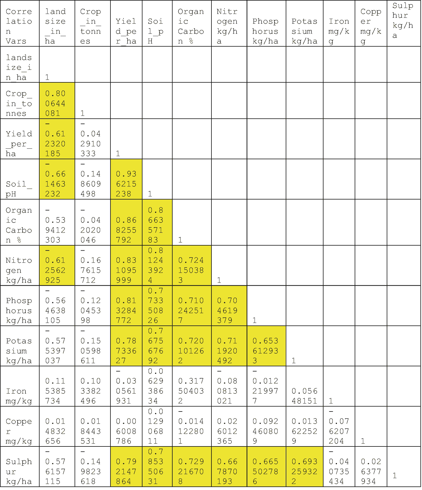
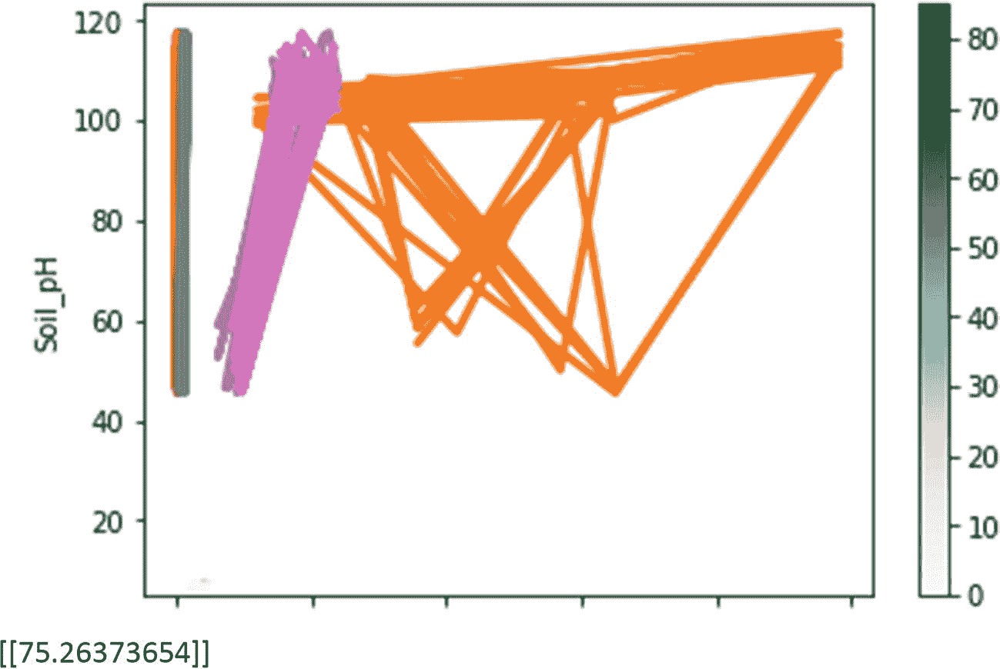
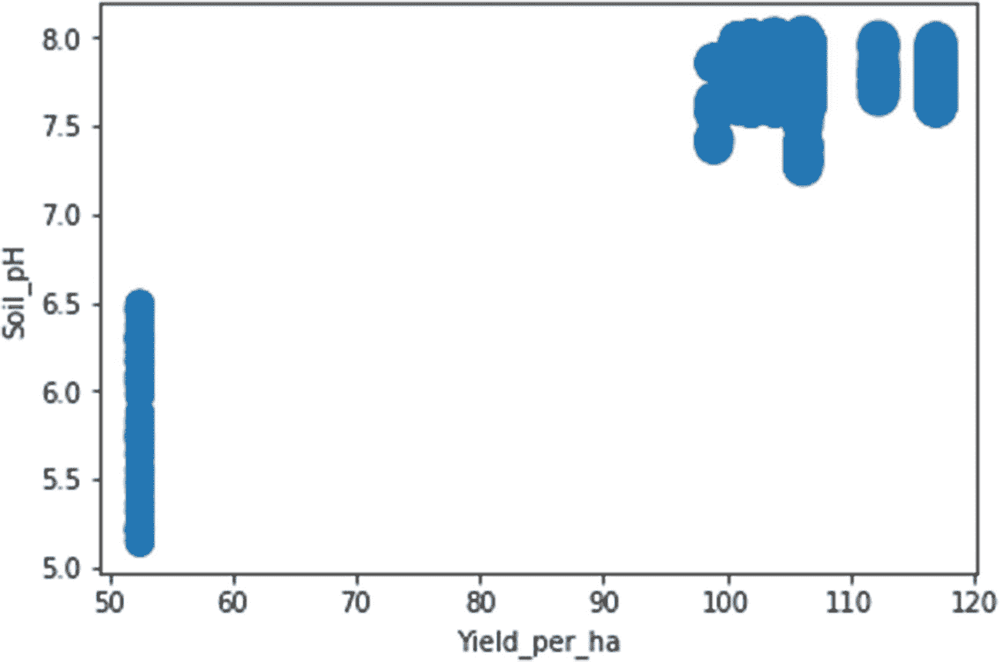
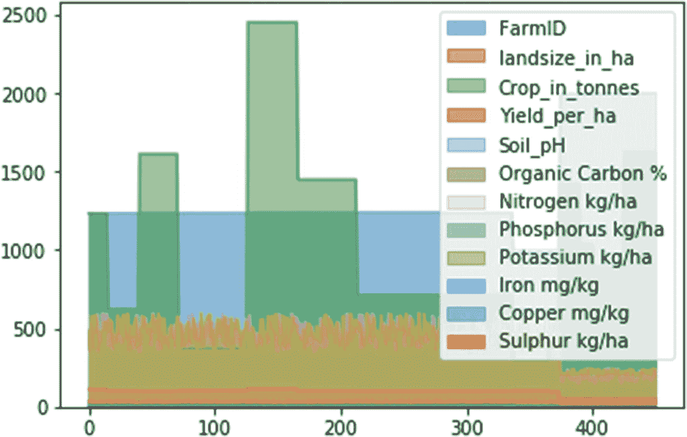
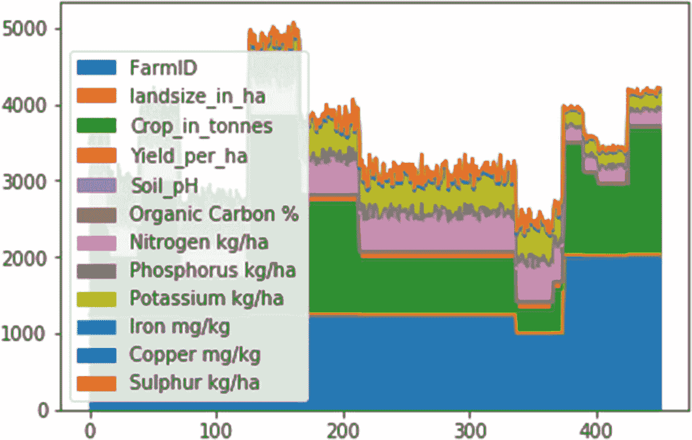
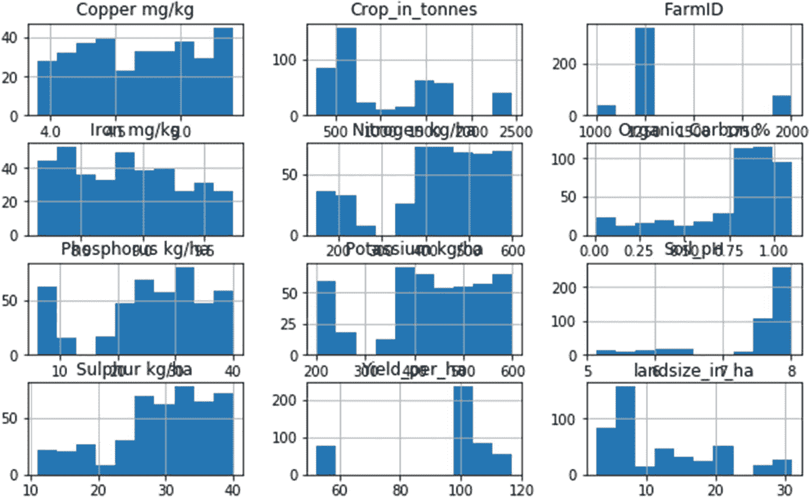
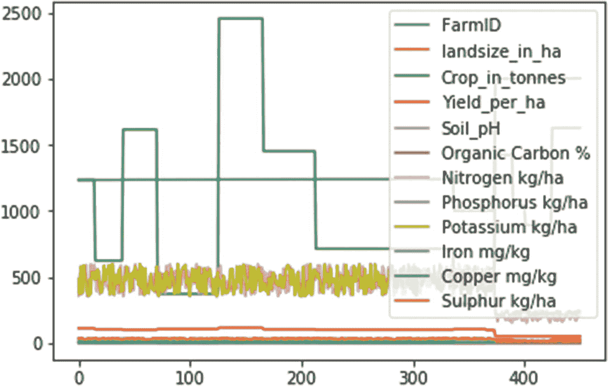
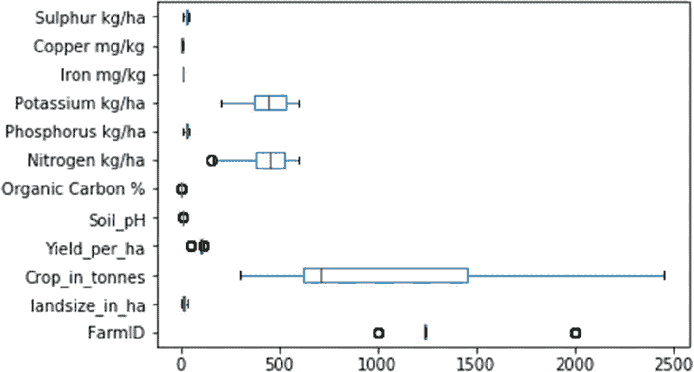
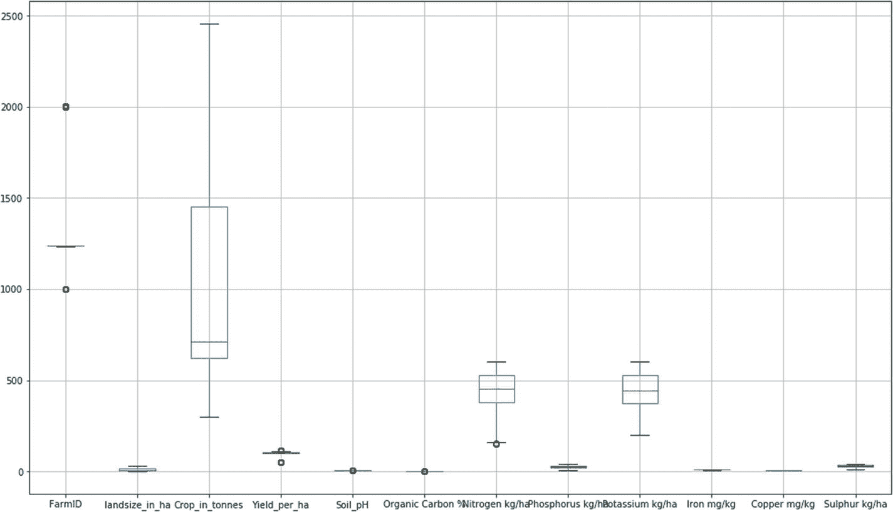

# 9. 农业行业案例研究：预测经济作物产量

本章介绍一个基于农业行业的案例研究，用于预测经济作物产量。该案例研究让您了解一家中型农业综合企业所面临的挑战，该公司正试图达到新的水平，并实现其创始人的宏伟愿景。对于此类组织而言，作物产量问题非常重要，因为他们希望最大化土地资源以获得尽可能高的收入。您在本案例研究中将主要学到的是，公司的愿景应与其正在进行的机器学习操作相结合；否则，这将是一种浪费的开支。这也是我大多数客户在聘请我进行咨询，评估他们当前的机器学习应用如何帮助他们时，我常对他们说的话。它能降低成本吗？如果能，能增加多少收入？又能增加多少？项目的目标必须是可量化的，否则不仅不会成功，还会让企业主和利益相关者感到不满。那么，请继续阅读吧…

## 农业行业案例研究概述

一家名为 Aystsaga Agro 的国际农业综合企业集团，其业务涵盖农业种植、化肥生产和拖拉机销售。公司总裁兼创始人塔米奥·波尔斯卡布，将这家企业从他父亲继承的一座北美农场，逐步发展壮大为横跨北美、非洲和亚洲三大洲的农业综合企业。农业经营并非易事，由于关税战和气候变化，正面临着诸多新出现的挑战。全球范围内，从南亚到非洲各国，一场农业危机正在上演，各国都在努力保护小农户免受这种急剧变化的冲击。与此同时，一场静默的重大变革正在发生：使用机器人等科技手段替代人类进行农业耕作。像 Aystsaga Agro 这样运营高度商业化的农业综合企业，正在积极拥抱技术，探索如何应用并从中获益。由于农业与服务业等其他行业相比利润不高，这类运营因投资回报率低而难以获得资金。这也是此类商业公司专注于玉米、甘蔗、小麦和大豆等经济作物的原因。如表 9-1 所示，对于 Aystsaga Agro 而言，甘蔗、甜菜和番茄的产量高于其他作物。

### 表 9-1 `Aystasaga Agro` 三种经济作物的全球年产量

| Aystsaga Agro |
| --- |
| 2017-2018 全球产量 | 吨 | 总土地面积 |
| --- | --- | --- |
| 甘蔗 | 470817.99 | 5361.70 |
| 甜菜 | 503999.80 | 5361.70 |
| 番茄 | 273446.70 | 5361.70 |

2013 年，Aystsaga Agro 在巴西和南非收购了大型农场。巴西的农场位于圣保罗地区，南非的农场则在内陆地区。公司创始人塔米奥通过收购土地并用于商业运营，成功拓展了公司的农业种植业务。他的愿景是让公司成为全球主要的农业综合企业。

在喝早茶时，塔米奥查看了首席财务官当天早上发来的年度财务报告。见表 9-2。

### 表 9-2 `Aystsaga Agro` 全球产量与收入数据

| 2017-2018 全球产量 | 吨 | 总土地面积 | 美元 |
| --- | --- | --- | --- |
| 甘蔗 | 470817.99 | 5361.70 | 241058809.3 |
| 甜菜 | 503999.80 | 5361.70 | 25199990 |
| 番茄 | 178446.70 | 5361.70 | 180231167 |
| **农业运营收入** |  |  | 446489966.3 |

他正看着这些数字，这时他位于南非的豪华办公室门被敲响了。他抬起头，看到首席运营官格兰佐正微笑着。他示意格兰佐进来坐到他面前。格兰佐走进来坐下后，塔米奥起身走到窗户右侧。他一边欣赏着南非首都令人叹为观止的海景，一边缓缓开口。

### 问题所在

“你看到南比今早发来的数据了吗？”塔米奥问道。

格兰佐点点头说：“考虑到今年我们在巴西和南非的农场遭遇了几次风暴，我认为这些数字已经相当可观了。”

“你不理解我的愿景，是吗？”塔米奥直视着他的得力助手问道。“我的愿景是实现 5 亿美元的营业额，并在六年内达到 10 亿美元。我在上次股东大会上已经向董事会说明了这一点。你当时也在场。”老板说道。

格兰佐耸耸肩说：“我们都在场，但我以为你那么说只是为了取悦投资者和董事会。”

“不，那是公司上市 15 年来我一直努力的目标。这不仅仅是一个愿景或目标；这是我向你们所有人提出的挑战。”塔米奥坚定地说。

格兰佐反驳道：“是的，我理解增长的必要性；否则，我们就会被行业里的大公司吞并。但你必须明白我们运营目前面临的挑战，除非我们找到真正的解决方案，否则我们无法按照你期望的速度增长。”

塔米奥此时皱起了眉头，他坐下来，头靠在宽大的真皮行政椅上。他专注地听着格兰佐继续说。“阻碍我们增长的一个关键因素，是我们预测特定土地作物产量的能力。”格兰佐继续说道，“在我们因决策失误而购买了低产贫瘠土地的地区，农业运营对我们来说是个大问题。低产土地需要我们通过在大片土地上施用不同的化学物质来改良，这增加了生产成本，侵蚀了我们的利润。如果我们想按照你提出的速度增长，就需要一种方法来确定哪块土地适合种植哪种作物，并且能获得高产。如果能做到这一点，我们就可以避免购买像我们在巴西那样的低产、无生产力的农场，那里的土壤酸性很强，必须用石灰处理才能使其碱性更强。”

塔米奥微微抬起头，示意他明白了格兰佐的意思。他问道：“格兰佐，你知道有什么方法可以预测特定类型土地的产量吗？”

格兰佐回答说：“我一直在关注世界各地大学的一些研究；但目前还没有什么具体成果。不过，在我看来，数据机器学习和人工智能显示出解决这个问题的潜力。我们可以聘请一些机器学习工程师和数据科学家，他们可以帮助我们创建一个模型，用于确定特定地块的作物产量。”

“听起来不错。你为什么不组建一个团队来研究这个问题并提出可能的解决方案呢？”塔米奥微笑着问格兰佐。

格兰佐说：“是的，这正是我打算做的。首先，我会聘请机器学习工程师和数据科学家，然后从我们的业务运营部门抽调人员加入团队。”

“给我发一封邮件批准你去做吧。”塔米奥说着，从桌上拿起眼镜，这时格兰佐起身离开了他的办公室。

### 机器学习能否力挽狂澜？

机器学习团队在两个月内组建完成，赫特·刘被聘为该试点项目的机器学习工程师。他与三位数据科学家一同，对阿斯塔萨加农业公司在巴西、南非和印度的农业运营进行了全面考察。入职培训结束后，业务运营团队成员向他们做了介绍。通过详细的简报，赫特和他的团队掌握了许多农业种植领域的专业术语。他们还了解了作物生产的内部流程。这些细致的考察确实帮助团队深入了解了公司的运营。然而，他们缺乏的是经验性知识，而这正是业务运营团队成员将在该试点团队中弥补的差距。

赫特和他的团队在会合后开了几次会。他们也多次与格兰佐会面。格兰佐有效地传达了公司创始人的愿景以及当前与增长相关的问题。赫特是一位经验丰富的机器学习工程师，此前曾在保险领域工作。他与农业的唯一交集是为农业种植者创建了一个理赔预测模型。因此，对他来说，这是一个非常陡峭的学习曲线，他必须理解商业种植农业的复杂性，以及管理它所带来的复杂性，例如虫害导致的作物歉收、天气模式的变化、土壤成分及其对农场产出的影响。赫特和他的团队开始收集一些他们认为有助于预测作物农场产出的参数。他们将分析分为天气、土壤和经济环境三个方面。他们在每两周一次的会议上与格兰佐分享了他们的理解。赫特展示了由于印度农场附近不可预测的降雨和洪水，天气如何损害了他们的作物。格兰佐指出，他们面临的最大问题是在购买前确定高产农田的特征。“根据我们创始人的愿景，我们计划在全球购买大量农田，例如在澳大利亚、泰国和其他地区；然而，我们不能盲目购买土地，然后发现其产量低于平均种植水平。这对我们的投资回报率来说是灾难性的。你们团队应该建立一个模型，帮助我们确定高产经济作物农田的特征。为此，你们应该研究土壤特征，以及是什么导致土壤高产或低产。使用你们想要的任何仪器；我们可以购买。资金不是问题，但你们必须建立一个系统，在我们追求指数级增长的过程中，能最大程度地造福我们，”他说。

在明确了前进方向后，赫特和他的团队与业务运营团队成员一起，着手了解甘蔗作物的土壤特征构成，他们选择了甘蔗作为试点项目。他们选定了表 9-3 中所示的参数。

### 表 9-3 监测土壤养分的参数

| 土壤 pH 值 |
| --- |
| 有机碳 % |
| 氮 kg/ha |
| 磷 kg/ha |
| 钾 kg/ha |
| 锌 mg/kg |
| 铁 mg/kg |
| 铜 mg/kg |
| 锰 mg/kg |
| 硫 kg/ha |

在决定锁定这些参数以创建土壤特征后，他们现在希望从全球各地的阿斯塔萨加农业公司农场收集数据。格兰佐帮助他们购买了以下设备：

1.  用于读取土壤养分数据的商用级物联网传感器套件

2.  用于物联网传感器难以运行区域的土壤养分手动测试套件

现在，我们将基于 `cashcrop_Yield_dataset.csv` 文件中的数据集，构建一个预测甘蔗经济作物产量的解决方案。

## 解决方案

# 物联网农业数据分析案例研究

我们可以假设，该数据集是通过读取物联网传感器和手动土壤养分测试套件中针对`cashcrop_Yield_dataset.csv`数据集中给出的各种参数生成的。清单 9-1 中的代码并非此问题的最权威解决方案，而是一个简单快速的实现方案，正如任何试点项目一样。在现实场景中，为土壤养分收集的数据将包含更多参数。如果运营规模横跨几个大洲，这样的数据收集工作可能需要数月才能完成。农业运营地点远离城市，分布广泛，因此对任何公司来说都是一项繁重的工作。在设计解决方案时，我们会将这些因素考虑在内。请注意，我们仅使用线性回归，因为它能给出非常高的准确率分数；不过，我鼓励您尝试其他回归算法。

### Python 代码

清单 9-1 给出了针对阿斯塔萨加农业公司所面临问题的基于 `Python` 的解决方案。代码从导入常见的 `Python` 库开始，例如 `pandas`、`StringIO`、`requests` 等。之后，我们从 `CSV` 文件`cashcrop_Yield_dataset.csv`加载数据集。您也可以改用 `SQLite` 数据库。接着，我们通过查看数据框每列的平均值、中位数、众数、标准差、最小值和最大值来进行探索性数据分析。之后，我们查找并统计异常值，例如代码`df['Yield_per_ha'].loc[df['Yield_per_ha'] <=151.50000].count()`用于每公顷产量列。这将是我们的预测目标，因为正如案例研究中讨论的，公司想知道提高该产量的参数。然后，我们使用箱线图可视化数据，并查看数值列的偏度和峰度。我们还使用面积图和直方图进行可视化。之后，是时候使用`df.corr()`代码查看各列与预测目标列`Yield_per_ha`之间的关系了。接下来是一个三步过程：第一步，代码将数据拆分为特征和目标变量。第二步，它打乱并将最终数据集拆分为训练集和测试集，用于构建预测模型。最后一步是模型构建和评估，由于我们的目标是预测每公顷产量这个数值变量，因此我们使用线性回归。代码的最后几行使我们能够输入任何新的农场数值，并通过代码`predicted= regr.predict([[26,1500,6.8,0.9,367,32,490,35]])`预测每公顷产量。要更深入地了解代码结果及其执行方式，请参阅清单 9-1 后的讨论。

```
# -*- coding: utf-8 -*-
"""
Created on Tue Oct 08 19:33:25 2019
@author: PUNEETMATHUR
"""
#importing python libraries
import pandas as pd
from io import StringIO
import requests
import os
os.getcwd()
#Loading dataset
fname="cashcrop_Yield_dataset.csv"
agriculture= pd.read_csv(fname, low_memory=False, index_col=False)
df= pd.DataFrame(agriculture)
print(df.head(1))
#Checking data sanctity
print(df.size)
print(df.shape)
print(df.columns)
df.dtypes
#Check if there are any columns with empty/null dataset
df.isnull().any()
#Checking how many columns have null values
df.info()
#Using individual functions to do EDA
#Checking out Statistical data Mean Median Mode correlation
df.mean()
df.median()
df.mode()
#How is the data distributed and detecting Outliers
df.std()
df.max()
df.min()
df.quantile(0.25)*1.5
df.quantile(0.75)*1.5
#How many Outliers in the Total Food ordered column
df.columns
df.dtypes
df.set_index(['FarmID'])
df['Yield_per_ha'].loc[df['Yield_per_ha'] =159.285].count()
#Visualizing the dataset
df.boxplot(figsize=(17, 10))
df.plot.box(vert=False)
df.kurtosis()
df.skew()
import scipy.stats as sp
sp.skew(df['Yield_per_ha'])
#Visualizing dataset
df.plot()
df.hist(figsize=(10, 6))
df.plot.area()
df.plot.area(stacked=False)
#Now look at correlation and patterns
df.corr()
#Change to dataset columns and look at scatter plots closely
df.plot.scatter(x='Yield_per_ha', y="Soil_pH",s=df['Yield_per_ha']*2)
df.plot.hexbin(x='Yield_per_ha', y="Soil_pH", gridsize=20)
#Data Preparation Steps
#Step 1 Split data into features and target variable

# Split the data into features and target label
cropyield = pd.DataFrame(df['Yield_per_ha'])
dropp=df[['Iron mg/kg','Copper mg/kg','Crop','Center','FarmID','Yield_per_ha']]
features= df.drop(dropp, axis=1)
cropyield.columns
features.columns
#Step 2 Shuffle & Split Final Dataset

# Import train_test_split
from sklearn.cross_validation import train_test_split
from sklearn.utils import shuffle

# Shuffle and split the data into training and testing subsets
features=shuffle(features,  random_state=0)
cropyield=shuffle(cropyield,  random_state=0)

# Split the 'features' and 'income' data into training and testing sets
X_train, X_test, y_train, y_test = train_test_split(features, cropyield, test_size = 0.2, random_state = 0)

# Show the results of the split
print("Training set has {} samples.".format(X_train.shape[0]))
print("Testing set has {} samples.".format(X_test.shape[0]))

# Step 3 Model Building & Evaluation
#Creating the the Model for prediction
#Loading model Libraries
import matplotlib.pyplot as plt
import numpy as np
from sklearn import linear_model
from sklearn.metrics import mean_squared_error, r2_score
#Creating Linear Regression object
regr = linear_model.LinearRegression()
regr.fit(X_train,y_train)
y_pred= regr.predict(X_test)
#Printing Codfficients
print('Coefficients: \n',regr.coef_)
#print(LinearSVC().fit(X_train,y_train).coef_)
regr.score(X_train,y_train)
#Mean squared error
print("mean squared error:  %.2f" %mean_squared_error(y_test,y_pred))
#Variance score
print("Variance score: %2f"  % r2_score(y_test, y_pred))
#Plot and visualize the Linear Regression plot
plt.plot(X_test, y_pred, linewidth=3)
plt.show()
#Predicting Yield per hectare for a new farmland
X_test.dtypes
predicted= regr.predict([[26,1500,6.8,0.9,367,32,490,35]])
print(predicted)
```
## Listing 9-1

Code for the Solution of the Case Study

这是一段直接的代码。它首先将数据集加载到 `pandas` 数据框中，然后通过 `df.size`、`df.dtypes` 等语句检查数据完整性。EDA 通过 `df.mean()`、`df.median()` 和 `df.mode()` 语句完成。相关性如图 9-1 所示。在我们的案例中，我们可以查看清单 9-2 输出中土壤 pH 值和其他土壤养分的平均值，以及图 9-2 至 9-9。异常值检测告诉我们，产量数据列在上限阈值之上没有异常值；然而，所有值都低于下限阈值。这可以通过在代码中使用命令 `df.hist()` 绘制直方图来直观地看到。之后，我们可以查看相关性。



图 9-1

变量之间的相关性

## 1. 变量相关性与选择

从图 9-1 可以看出，我们关注的是预测变量 `Yield_per_ha`（即每公顷产量）。我们认为它依赖于其他变量或土壤养分；这可以通过查看 `Yield_per_ha` 变量与其他变量之间的相关系数值来确认。`Soil_pH` 与产量变量的相关系数为 0.936215238，有机碳 % 为 0.868255792，氮 kg/ha 为 0.831095999，磷 kg/ha 为 0.831095999，钾 kg/ha 为 0.78733627，铁 mg/kg 为 -0.030561931，铜 mg/kg 为 0.006008786，硫 kg/ha 为 0.792147864。为了构建模型，我们选择那些具有显著相关性的变量，即：

*   `Soil_pH`
*   有机碳 %
*   氮 kg/ha
*   磷 kg/ha
*   钾 kg/ha
*   硫 kg/ha

我们可以忽略并移除铁和铜，因为它们没有显示出任何显著的相关性；事实上，对于我们的模型构建工作来说，它们的影响可以忽略不计。

## 2. 数据可视化


*图 9-9：Yield_per_ha 与 Soil_pH 变量的图表*


*图 9-8：Yield_per_ha 与 Soil_pH 变量的散点图*


*图 9-7：累积堆叠面积图*


*图 9-6：数值变量的堆叠面积图*


*图 9-5：数值变量的直方图*


*图 9-4：数值变量的面积图*


*图 9-3：水平箱线图可视化*


*图 9-2：垂直箱线图可视化*

## 3. 数据概览与模型训练

在图 9-2 至 9-8 中，我们可以看到箱线图显示 `Crop_in_tonnes` 的值分布非常分散。避免这种情况的一种方法是对所有数值变量进行缩放，就像我在我的书《*使用 Python 的机器学习应用*》中针对医疗、零售和金融案例研究解决方案中所做的那样。直方图显示了变量的分布，我们看到除铜和铁外，大多数土壤养分都呈右偏态。我们还注意到，通过 Python 代码 `df.plot.hexbin(x='Yield_per_ha', y="Soil_pH", gridsize=20)`，`Yield_per_ha` 和 `Soil_pH` 的散点图密切相关。

在完成通常的数据准备步骤，将其划分为名为 `cropyield` 的目标变量和包含所有其他特征的特征变量后，我们将数据集拆分为训练集和测试集，其中 360 个样本属于训练集，91 个样本属于测试集。之后，我们加载 `linear_model` Python 库，通过 Python 代码 `regr.fit(X_train,y_train)` 和 `y_pred= regr.predict(X_test)` 在训练集和测试集上执行线性回归算法。然后，在开始进行预测之前，我们通过代码 `print("Variance score: %2f" % r2_score(y_test, y_pred))` 查看测试集获得的准确率分数，该分数为 0.9502，即 95.02% 的准确率。由于这个结果不错，我们可以继续进行预测。请记住，这是虚构数据，因此我们能够达到良好的准确率水平。然而，在现实世界中，您可能需要运行更多的回归器或微调您的数据收集工作，才能达到这样的准确率水平。

### 3.1 代码输出示例

```
Crop  Center  FarmID  landsize_in_ha  Crop_in_tonnes  Yield_per_ha  \
0  Sugarcane  Africa    1234            11.0          1235.3          112.3
Soil_pH  Organic Carbon %  Nitrogen kg/ha  Phosphorus kg/ha  \
0     7.81              0.88           355.0              36.0
Potassium kg/ha  Iron mg/kg  Copper mg/kg  Sulphur kg/ha
0            485.0        9.73          4.73  33.0

(451, 14)
Index([u'Crop', u'Center', u'FarmID', u'landsize_in_ha', u'Crop_in_tonnes', u'Yield_per_ha', u'Soil_pH', u'Organic Carbon %', u'Nitrogen kg/ha', u'Phosphorus kg/ha', u'Potassium kg/ha', u'Iron mg/kg', u'Copper mg/kg', u'Sulphur kg/ha'],
dtype='object')

RangeIndex: 451 entries, 0 to 450
Data columns (total 14 columns):
Crop                451 non-null object
Center              451 non-null object
FarmID              451 non-null int64
landsize_in_ha      451 non-null float64
Crop_in_tonnes      451 non-null float64
Yield_per_ha        451 non-null float64
Soil_pH             451 non-null float64
Organic Carbon %    451 non-null float64
Nitrogen kg/ha      451 non-null float64
Phosphorus kg/ha    451 non-null float64
Potassium kg/ha     451 non-null float64
Iron mg/kg          374 non-null float64
Copper mg/kg        337 non-null float64
Sulphur kg/ha       451 non-null float64
dtypes: float64(11), int64(1), object(2)
memory usage: 49.4+ KB
训练集包含 360 个样本。
测试集包含 91 个样本。
('系数: \n', array([[-2.11198278,  0.02322665,  5.78698466,  3.69351487,  0.01497725,  0.17939622,  0.01021635,
0.15396713]]))
均方误差:  16.50
方差分数: 0.950297
清单 9-2：清单 9-1 中代码的输出
```

## 4. 进行预测

为了进行预测，使用的代码是 `predicted= regr.predict([[26,1500,6.8,0.9,367,32,490,35]])`，这些是 Aystsaga Agro 正在评估的另一国家的一块农业用地的值，其特征如下：

# 索引

`landsize_in_ha`      26
`Crop_in_tonnes`      1500
`Soil_pH`             6.8
`Organic Carbon %`    0.9
`Nitrogen kg/ha`      367
`Phosphorus kg/ha`    32
`Potassium kg/ha`     490
`Sulphur kg/ha`       35

Glanzo 想从模型中知道，在他们购买这块农田后，可能的年产量是多少。Python 程序给出的值为每公顷 75.2637 吨，如清单 9-3 所示。

```
predicted = regr.predict([[26,1500,6.8,0.9,367,32,490,35]])
print(predicted)
[[75.26373654]]
```

清单 9-3
Python 程序预测的值

请记住，该程序没有考虑其他条件，例如天气和种子品种，这些也会影响作物产量和收成。构建这样的数据集无疑是一项巨大的工作，超出了本书的范围。

## 总结

至此，我们来到了本案例研究和本书的结尾。我非常享受为您带来这些基于物联网的解决方案，以解决现代、实际的商业问题，并尝试通过机器学习来解决它们。我希望您也喜欢从中学到东西。请考虑在[`www.pmauthor.com/raspbian`](http://www.pmauthor.com/raspbian)的论坛上留下反馈。

# 索引 A, B

农业领域 无人机机器人，检测疾病爆发 农业社区 化肥/农药 食品集团 转基因产品 行业 见经济作物 产量 统计育种模式 技术浪潮

Arduino 编译中 编译完成信息 Hello world 程序 IDE 草图 `loop()` 函数 Mega 2560 板 微控制器 `Modbus` 协议 处理 Raspberry Pi 3 型号 B+ 串口 上传，草图 Arduino Mega 2560

人工智能 (AI) 优势 思维网络 打字 语音听写

C

经济作物产量 `Aystasaga Agro cashcrop_Yield_dataset.csv` 图表 绘图 代码实现 相关性 作物歉收 累积堆叠面积图 `df.corr()` 代码 财务结果 水平箱线图可视化 机器学习团队 监测 土壤养分 数值 面积图 直方图 堆叠面积图 问题 基于 Python 的解决方案 散点图 垂直箱线图可视化

D

`DataFrame()` 对象 `datetime now()` 函数 无人机

E, F

Eastron SDM630 上电后 组件 数据端子 电动机/碾磨机 输入连接 LED 灯泡 `minimalmodbus` Python 模块 输出线连接 插头连接 获取数据的 Python 代码 Rapsbian 内核，更新 RS485 `Modbus` 转换器 USB 转换器 `sdm630_tested.py` 单相碾磨机/电动机 智能电表 升级，Rapsbian 内核

EM6400 电表 Arduino Mega 2560，通信 编码 通信测试 电流 频率 数据 地址定义引脚 编译完成信息 上传完成信息 Eastron SDM630 见 Eastron SDM630 过滤器 搜索 `flotvalue` 全局变量 管理库 菜单 `MAX485_DE` `Modbus` 通信前/通信后 传输前/传输后函数 读取数据的 Python 代码 Raspberry P 3 B+ Raspberry Pi 实时数据 串行模块 `Serial.println()` 函数 TTL 通信 值类型 `unifloat` 联合结构 USB 串行 `Modbus` 协议 `void setup()` 函数

能源领域 商业应用 去中心化 决策/规划辅助 数字化 发电公司 化石燃料电厂 `Modbus` 接口 改造 定期维护周期 电网 预测性维护 可再生能源电厂 技术采用缓慢 升级项目

G

Gantara 发电厂 异常检测 燃煤电厂 煤矿 代码实现 冷却塔 相关性结果 `df.describe()` 函数 能源行业案例研究 进口阀门操作 输入/输出容量 土地需求 LP/HP 加热器 `Modbus` 协议 `PPC` Raspberry Pi 3 `sklearn` 库 蒸汽轮机 火力发电厂 `TURBINE_INLET_DATASET` 涡轮发电机组

H

硬件/软件 `df.corr()` 元素 移动通话质量数据集 室外温度 Python 机器学习程序 设置工具 高清 (HD)

I, J, K

工业物联网 (IIoT) 应用与深度学习 基于云的服务 商业用途 工业机器过程 `MQTT` 协议 `init()` 函数 集成开发环境 (IDE)

物联网 (IOT) 应用 商业用途 能源回收方法 农业自动化 家庭自动化 *vs.* IIoT 机器学习技术 医疗手术 `PaaS` 传感器数据

检查数据 电路测试，面包板 数据结构，创建 电气连接图 GPIO 引脚布局 基于 GUI 的监控代理 插入数据 LDR/光敏电阻模块 机器学习模型 PE 电阻 Pi GPIO 引脚 SQLite3 数据库 智慧城市趋势 Forbes GoodWorkLabs iotforall.com Network World 调查 PCMag 预测 TechGenix 文章

L

`loop()` 函数

M

机器学习 生命周期 流程 模型 技术 `MindSphere`

Modbus 转换模块 Arduino Mega 板 连接电表 PWM 引脚 TTL 信号互转模块 USB 串行线 VCC/GND 引脚 Modbus 协议

N, O

`node.clearResponseBuffer()`

P, Q

平台即服务 (`PaaS`) 波特兰火山灰水泥 (`PPC`) `postTransmission(){}` 函数 `preTransmission(){}` 函数 印刷电路板 (PCB) 概念验证 (PoC) `pygame.mixer.music.play()` 函数

R

Raspberry Pi 3 型号 B+ Arduino IDE 安装 下载 `install.sh` 文件 ∗.xz 扩展名文件 bash 位版本 下载选项 GPIO 引脚 HDMI 转 HDMI 线 LED/LCD 显示器 `lshw` 命令 microSD 卡 `nltk.log` 文件 移动电源 SBC 电源插槽 Python 3 安装 Python 库 SQLite3 数据库安装 见 Modbus 转换模块 `sudo pip install` 测试 `gpiozero` `iotpypackages.run` `iotpypkgtest.run` 程序 Pandas 数据框 平台 `psutil` `pygame` `smtplib` 时间 `tkinter` 在 Python 3.x 解释器上 Thonny IDE 安装 USB 加密狗 Win32 Disk Imager

Raspberry Pi，Python Arduino IDE B+ 桌面启动 代码执行 GPIO 引脚 `hello_world.py` `import pandas` 安装 Modbus 设备 `scikit-learn` 软件组件 系统图

S

`Serial.println()` 函数 单板计算机 (SBCs) 优势 Diana 微特性 GPIO 覆盖，Raspberry Pi 硬件要求 流行 SBCs 列表 Raspberry Pi 单板微控制器 (SBMs) Arduino Mega 2560 架构 闪存 GPIO 引脚 Modbus 通信

最先进的实现 农业领域 见农业领域 能源领域 见能源领域 发电 电信领域 见电信领域

T, U

电信领域 优势 AI 领域 自动驾驶网络 优势 通信协议 生态系统 代际 5G 频谱 毫米波 移动通信 OceanConnect IoT 平台 开放连接基金会 实时虚拟医疗环境，标准 电信运营商 通话掉线数据 2G 技术基础设施 RegoniaTel 用户 用户报告

V, W, X, Y, Z

`void setup()` 函数