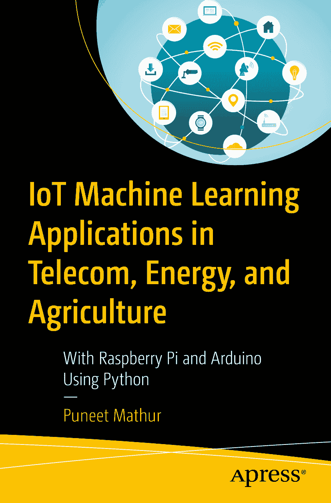

ISBN 978-1-4842-5548-3e-ISBN 978-1-4842-5549-0 [`doi.org/10.1007/978-1-4842-5549-0`](https://doi.org/10.1007/978-1-4842-5549-0) © Puneet Mathur 2020 Apress Standard 本出版物中使用通用描述性名称、注册商标、商标、服务标记等，即使未作特别声明，也不意味着这些名称不受相关保护法律和法规的约束，因此可自由通用。出版商、作者和编辑假定本书中的建议和信息在出版之日是真实准确的。出版商、作者或编辑均不对本书所含材料或可能存在的任何错误或遗漏提供明示或暗示的担保。出版商对已出版地图中的管辖权主张和机构归属保持中立。本书通过 Springer Science+Business Media New York 在全球图书贸易中发行，地址：233 Spring Street, 6th Floor, New York, NY 10013。电话：1-800-SPRINGER，传真：(201) 348-4505，电子邮件：orders-ny@springer-sbm.com，或访问 www.springeronline.com。Apress Media, LLC 是加利福尼亚州的一家有限责任公司，其唯一成员（所有者）是 Springer Science + Business Media Finance Inc (SSBM Finance Inc)。SSBM Finance Inc 是一家特拉华州公司。

*本书献给至高无上的神圣母亲。*

引言

2019 年 1 月下旬，在参加完一场关于物联网的会议后，我在孟买会见了一位潜在客户，讨论在工厂环境中使用机器学习。他想知道机器学习能否在他的环境中使用，如果能，实施后他能期待获得什么样的商业利益。我与他讨论了一些涉及工业物联网（IIoT）应用的用例。在商业中，有两种策略：一种是收入增长，另一种是成本降低。如果你的业务正处于高速增长期，那么你可能不会太在意成本降低，你的重点将是扩展业务。然而，如果你的业务多年来增长稳定，并且面临激烈竞争，那么你面临的压力就不仅仅是维持现有客户，还要降低成本，以便在竞争中胜出。我的客户正处于这种业务模式中。我向他展示的大多数用例都是关于收入增长的，这并不符合他的期望。但是，一个利用 IIoT 在他的工厂进行能源审计的用例引起了他的注意，他解释说他的电费账单很高，希望我实施能源审计来帮助降低成本。他接下来的一连串问题涉及，与实施解决方案所需的投资相比，他能期待实现多少成本降低。我为他制定了一个包含实施计划的小型方案，该方案在他的公司内部得到了良好反响，尽管这是我们第一次在工厂环境中进行此类尝试。

本书介绍了其中一种解决方案，尽管并非完整的方案（完整的方案需要另一本书来阐述）。但本书中的解决方案将帮助你入门，使用机器学习进行物联网和工业物联网应用。

致谢

我感谢在电信公司、高科技农业农场和能源领域工作的各位工程师，他们主动分享了关于其运营需要进一步改进以及人工智能可以提供帮助的信息；我通过个人和在线方式进行了匿名调查。我还要感谢来自 ABB、GE 等跨国公司的多位公司专家，他们就本书相关主题进行了讨论并提供了宝贵建议。

本书中的所有数据均已匿名处理，并非取自任何特定公司、情况或来源。与实际数据的任何相似之处纯属巧合。本书中的数据集基于我与客户和工程师合作的经验；但我已注意不从中获取任何此类数据，并且完全不存在任何抄袭。

包括无人机和能源设备在内的仪器和传感器未得到任何公司的赞助，我也没有因使用某种设备而获得任何费用或任何形式的激励。本书中使用的所有设备和传感器的选择完全基于我独立的判断和经验。

关于作者 关于技术审校者

