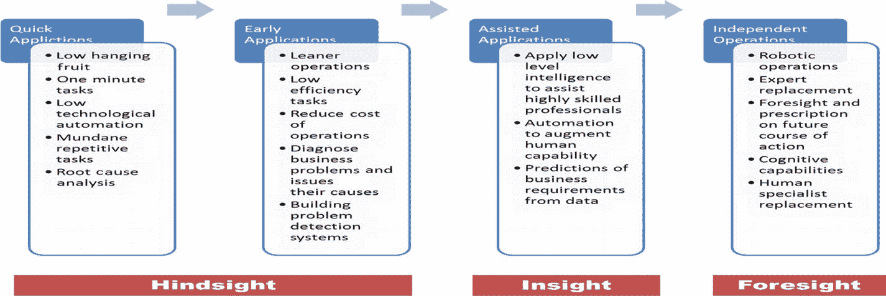
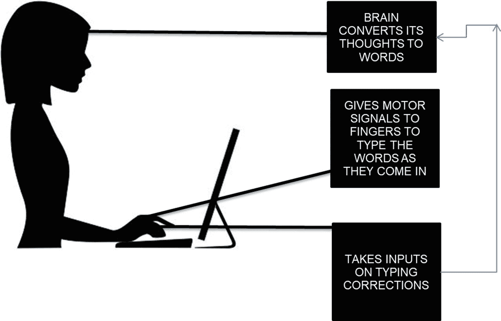
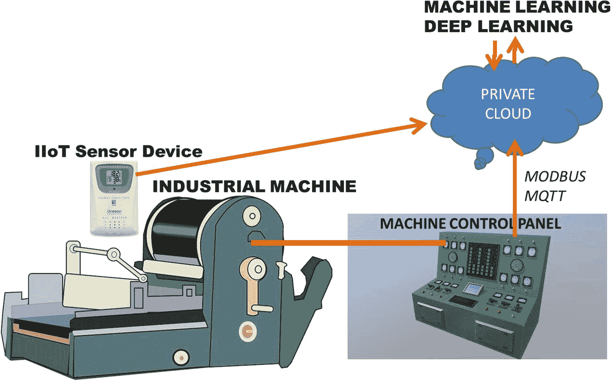

# 2. 物联网与工业物联网概述

你在第 1 章中了解了物联网的定义。在本章中，我想对此进行扩展。物联网概念得以实现的关键在于两大能力：使用小型传感器和电机，以及通过编程接口控制它们的输入和输出。物联网的核心是能够远程监控和控制设备。这可以通过与这些设备交互的小型可编程微控制器或微型计算机来实现。在应用物联网的过程中，嵌入式系统、控制系统、数字和模拟传感器等多种技术融合在了一起。其理念是将传感器嵌入日常物品中，并通过监控和控制使它们变得更加智能。然而，并非每个支持物联网的设备都能赢得消费者的青睐或满足业务需求。

## 深入探究物联网

人们已经对日常物品进行过实验，例如智能椅子，它可以监控你坐在上面的时间，并监测你的血压等生命体征。在某些情况下，消费者认为购买这些产品并无益处。

并非所有智能物品都能为消费者带来实质性好处，或者消费者可能认为其额外价格并不值得。在这种情况下，智能产品在推出时就会失败。尽管技术上确实有能力让物品变得更智能，但消费者的认知并未达到其预期。

此外，还有智能家居的概念，洗碗机等物品通过中央监控系统进行控制。然而，由于其高昂的成本，这一概念并未普及。

图 2-1 展示了物联网领域的技术进步。此图引自我的著作 *《使用 Python 的机器学习应用》*。

**图 2-1**

机器学习技术采用过程

物联网目前正处于快速应用和早期应用阶段。你知道，在追踪应用阶段，它正试图摆脱过去，例如切换所有家用电器的电源。在应用阶段，今天的益处是通过降低监控成本来实现的，例如安装物联网传感器和摄像头用于安防等。下一阶段的应用将进入辅助应用阶段。通过使用物联网，将致力于增强预测人类需求的能力，例如，利用计算机视觉摄像头监控智能橱柜内常见家居用品的数量，并预测何时需要补充，从而自动订购杂货。这类应用会进入第三阶段，即辅助应用阶段，或者第四阶段，即机器人操作增强人类能力的阶段。如今由人类仆人在家中执行的操作，例如清洗餐具和衣物，未来将由机器人完成。这类机器人将能够预测家庭中可能发生的任何未来问题，并为其提供解决方案。例如，一个自动补货机器人会检查任何物品是否即将用完，然后在线向附近提供折扣和送货上门服务的商店发送补货订单。它还可以等待订单确认。如果在指定时间内未收到确认，它会通过短信向其人类主人发送警报，甚至直接走到主人面前展示问题。它还可以建议替代方案，例如从一家不提供送货上门服务的远方商店订购产品。这样的机器人无疑会成为任何家庭的宝贵资产。这只是一个例子，说明机器人操作如何能够变得具有预测性，同时也能在潜在问题出现之前提出替代解决方案。表 2-1 展示了当前场景下物联网的一些应用示例。

**表 2-1**

物联网的应用

| 技术阶段 | 物联网应用 |
| --- | --- |
| 快速应用 | 家庭自动化 |
| 早期应用 | 个人可穿戴设备 |
| 智能城市 |
| 辅助应用 | 农业自动化 |
| 零售自动化 |
| 智能汽车 |
| 独立操作 | 医疗手术 |

在上表中，你可以看到家庭自动化已进入应用阶段，因为人们目前正在自动化他们日复一日重复执行的平凡家务，例如通过 Android 和 iPhone 等个人手机来关闭电器、监控和控制它们。这些应用允许你控制智能手表等设备，这些设备可以精确收集个人生物信息，如步数、每分钟心跳数、血压率和携氧能力。这些应用可以生成每周、每月或每年的报告，并利用这些数据展示你的健康习惯。

物联网领域的另一个发展是智能城市，它正处于早期应用阶段。其中最著名的是新加坡，它正试图在各个方面真正成为一个智能城市。智能建筑正在建设中，以便最大限度地利用阳光，并通过使用雨水收集、太阳能电池板等能源回收方法实现自给自足，为居民提供离网能源。一个智能城市会回收所有废物，并消耗和回收其所有资源，如水、石油、垃圾和天然气。

农业自动化是物联网使得自动化操作成为可能的早期应用示例之一；然而，它必须发展到预测阶段，能够预测作物周期，例如作物歉收或丰收。IBM 旗下的天气公司（[`www.ibm.com/weather`](http://www.ibm.com/weather)）正试图通过预测作物天气来改变农业自动化的方式。当今的农业完全依赖于天气周期和季节。尽管从播种到收割的与农业相关的一切都已实现自动化，但预测农业天气的能力才能真正将其推向独立操作阶段。

智能汽车是另一个此类应用。当你能够使用计算机视觉传感器和 GPS 定位器等物联网传感器在拥挤区域驾驶智能汽车时，该应用将处于独立操作阶段；同时，它还能预测和预防事故。

医疗手术在一定程度上已经达到了独立操作水平，例如用于癌症的医疗手术，机器人可以通过增强外科医生的任务来独立进行手术。其他手术将随着时间的推移而成熟，因为世界正在对如何为机器人增加手术技能进行更多研究，使其变得更加高效。

以上是物联网应用的一些示例，旨在为你提供背景，了解它们如何融入技术采用过程。

## 物联网的商业用途

现在，让我们来看看市场上一些运行良好的成功物联网应用。

teknowlogy 在 2019 年进行了一项调查（[`www.device-insight.com/wp-content/uploads/2019/03/the_iot_survey_2019_highlights_device_insight.pdf`](http://www.device-insight.com/wp-content/uploads/2019/03/the_iot_survey_2019_highlights_device_insight.pdf)），该调查基于用户评价矩阵、有效性、效率、商业价值、解决方案时间线、可视化、对新概念的支持、创新性、定价模式、产品满意度、合作伙伴生态系统、性能满意度、灵活性、易用性和客户体验等参数，对物联网供应商进行了评估。所涵盖的公司均为中型企业，这也是物联网主要实施发生的地方。我挑选了最佳参数——客户体验，并将讨论这些高分公司提供的解决方案。选择这个参数的原因是，即使你拥有根据其他参数（如创新性和可视化）来看最好的产品，但如果客户不满意，你无法长期维持该产品。表 2-2 展示了目前已在商业上使用的、拥有出色物联网解决方案的三家公司。

**表 2-2**

**2019 年三大解决方案**

| 公司 | 最佳解决方案 | 应用 |
| --- | --- | --- |
| C3 IoT | C3 AI Appliance | 由英特尔驱动的 C3 AI Appliance™ 适用于那些需要在满足严格的数据治理、合规性和安全要求的同时，部署人工智能（AI）应用以分析海量数据的组织。[`https://c3.ai/products/ai-appliance/`](https://c3.ai/products/ai-appliance/) |
| Siemens IoT EMEA | MindSphere | MindSphere 是西门子推出的基于云的物联网开放操作系统。它连接您的产品、工厂、系统和机器，使您能够利用高级分析来驾驭您的数据财富。此外，它还让您能够访问越来越多的应用和一个动态的开发平台即服务（PaaS）。MindSphere 兼容所有主流网页浏览器。[`https://siemens.mindsphere.io/en`](https://siemens.mindsphere.io/en) |
| ARM Mbed | Mbed OS 5 | Mbed OS 是面向物联网的领先开源 RTOS，可加速基于 Arm 处理器的物联网设备的创建和部署。使用 Mbed OS，您可以通过免费的在线 IDE 用 C++ 开发物联网软件，使用 Arm C/C++ 编译器生成优化代码，并在数百个硬件平台上运行。Mbed OS 堆栈包括 TLS、网络、存储和驱动程序，并通过数千个代码示例和库得到增强。[`https://os.mbed.com/`](https://os.mbed.com/) |

我在此挑选展示的三个解决方案在商业上运行良好。根据调查，排名第一的解决方案是 C3 AI Appliance。运行在不同服务器上的设备非常难以开发，而要满足所有客户期望则更加困难。鉴于这是一个基于 AI 平台、运行在英特尔服务器上的设备，它能够分析海量数据，同时满足数据治理、合规性和安全协议，其客户体验如此之高令人惊叹。网站上的客户评价非常积极，因此它在调查中占据榜首也就不足为奇了。

调查中选出的下一个产品来自西门子（[`https://new.siemens.com/global/en/products/software/mindsphere.html`](https://new.siemens.com/global/en/products/software/mindsphere.html)）。它是一个基于云的物联网开放操作系统，连接产品、工厂、系统和机器，并让客户能够通过高级分析来驾驭数据。这是平台即服务（PaaS）实施的一个绝佳范例。它被称为 MindSphere。为了使这款产品同样出色，鉴于它是一个平台即服务，MindSphere 确实可以在所有主流网页浏览器上运行，例如 Chrome、Mozilla 和 Firefox 等。

第三个产品来自 ARM Mbed（[`https://os.mbed.com/`](https://os.mbed.com/)），它为物联网创建了一个开源 RTOS 操作系统，加速了基于 Arm 处理器的物联网设备的创建和部署。该操作系统使用的主要开发语言是 C 和 C++。它可以在数百个硬件平台上运行，例如 Raspberry Pi，并且拥有一个非常活跃的社区。该平台拥有各种驱动程序和库中的代码示例，可用于快速实现所有三项功能，使它们相互竞争，尤其是与西门子的 MindSphere 物联网操作系统竞争，因为它们是提供整体解决方案的核心。C3 AI Appliance 通过其托管在私有云上的能力，将操作系统的概念进一步延伸；这个解决方案对于那些希望完全控制其物联网解决方案的公司来说是一大福音。对于寻求开源解决方案的公司来说，西门子的 MindSphere 解决方案可以在硬件平台上运行，并专门使用 C 和 C++ 代码来开发软件解决方案。

你已经看到了三家不同的公司和三种不同的解决方案，而最棒的部分是，它们都通过卓越的体验让客户感到满意。

## 未来物联网发展趋势

为了全面了解物联网领域，审视其新兴的主要趋势至关重要。针对 2019 年物联网趋势，已有大量调查和预测。根据 Eileen Brown 在 ZDNet 上关于 2019 年物联网趋势的报道（[`www.zdnet.com/article/whats-next-for-2019-iot-trends-and-predictions/`](http://www.zdnet.com/article/whats-next-for-2019-iot-trends-and-predictions/)），一项 Northstar 全球消费者调查显示，智能家居将成为主流，下一个热门领域将是通过智能手机和 GPS 定位数据向消费者提供的中介配送选项。该调查还预测，由于在医院部署联网传感器以确保缩短寻找关键医疗设备的时间，医疗保健质量将得到提升。该调查还讨论了智慧城市的功能，通过更好的废物管理和公民参与来降低配送成本，从而创造收入流机会和节能建筑。这一点如今已成为主流，例如新加坡已经证明，智能建筑可以回收利用包括水和垃圾资源在内的废弃物，实现自给自足。

GoodWorkLabs 于 2019 年 2 月发布的一项关于物联网的调查（[`www.goodworklabs.com/iot-trends-2019/`](http://www.goodworklabs.com/iot-trends-2019/)）谈到了边缘计算，这是一种在分布式智能边缘设备上执行的计算，而非在需要集中式网络进行处理的室内区域或工业领域的集中式环境中执行。该调查将物联网设备的安全性列为重要事项，并指出了西门子和通用电气等硬件制造商所做的努力，它们正在制造专注于用户端点安全的智能设备。该调查还谈到了其在医疗保健和制造业中的应用。智能信标 RFID 标签是到 2020 年将在设备上发生的新工业革命的一部分。消费者物联网行业的治理也被指出是推动智能家居发展的一个趋势。另一个重大发展是，消费行业的大型企业正在联合起来提供订阅服务。这将发生在公用事业、食品公司和服务聚合商等领域。有讨论提到联网智能汽车市场的增长，这些汽车可以通过手机上的智能应用程序访问，这些应用程序将使用物联网技术向您显示有关汽车的实时诊断信息。您汽车内的所有传感器将为您提供有关当前位置的数据，以及车内情况，例如轮胎气压。该调查对 2019 年 5G 的到来表示欢迎，5G 将通过支持物联网设备的互联互通，成为物联网技术的支柱。5G 网络将允许智能设备实时生成和发送数据，这在以前是无法想象的。

网站 iotforall.com（[`www.iotforall.com/top-iot-trends-rule-2019/`](http://www.iotforall.com/top-iot-trends-rule-2019/)）报道称，2019 年将是关于大数据和人工智能的。Gartner 的最高预测是，物联网部署量将增长 142 亿。它谈到了互联云。许多公司将依赖云来存储数据，因为云存储与带宽相关。访问数据是选择不同云服务的原因，例如亚马逊 AWS 云平台、微软 Azure 和谷歌云平台等巨头提供的服务。如今的需求是让这些不同的云能够相互通信；这被称为互联云，例如甲骨文和微软通过连接其云平台服务建立的合作伙伴关系。该调查还谈到了为任何公司连接私有云和公有云以满足其数据存储需求。该调查还谈到了边缘计算，它将在 2019 年取得突破。该调查谈到了数字孪生，也称为混合或虚拟原型设计业务，它使用人工智能、机器学习和物联网等特殊工具，通过简化数据操作来改善客户业务体验。该调查强调，5G 将通过带来革命性的应用，改变物联网市场的游戏规则。该调查提到的一点是传感器创新，虽然没有说明市场上将开发何种类型的传感器，但指出新的专用传感器将利用深度神经网络实现高效节能，从而催生新一代架构以及低功耗物联网和端点设备。利用这些传感器技术的数据开发新算法，将导致其应用领域出现新的实现方式。该调查对社交物联网的预测，即它正在引发社交焦虑，并将把商业领域从消费设备转移到大规模制造业，这就像是对物联网应用和解决方案实施者的一个警告，要求他们在构建产品时考虑社会责任。社交方面强调了人类需要接受当前人类在日常生活中接受物联网的状态。尽管该调查没有指出任何具体问题，但它表示，随着在线接受度的提高，社会、法律和伦理问题将会出现。

Network World 的一项调查涵盖了 2019 年及以后的十大物联网趋势（[`www.networkworld.com/article/3322517/a-critical-look-at-gartners-top-10-iot-trends.html`](http://www.networkworld.com/article/3322517/a-critical-look-at-gartners-top-10-iot-trends.html)）。第一个趋势是人工智能，这并不令人意外。第二个是社会、法律和伦理问题。Info Linux 和数据预订，即信息商业化并使数据代理和订阅或条件基础上的淹没可用，这是 Gartner 研究报告的内容。IV 是向电话边缘智能网格的转变。边缘网格被定义为连接边缘设备的网络，通过互联网将云和终端用户设备在高层连接在一起，称为边缘网格。该研究指出，与其让这些设备孤立工作，不如将它们连接到智能机器，并创建它们自己的网络之网络。Gartner 认为的趋势是物联网治理，涵盖物联网应用实施中涉及的法律、社会方面和伦理。

该研究提到的其他趋势，如新的用户体验和用于物联网的新无线网络技术，也具有重要意义。

PCMag（[`www.pcmag.com/feature/365945/8-iot-trends-to-watch-in-2019/8`](http://www.pcmag.com/feature/365945/8-iot-trends-to-watch-in-2019/8)）发布了其 2019 年值得关注的趋势。物联网目前面临的一个问题是针对勒索软件的附加保护。文章提到了亚特兰大市的案例，当时该市的供水服务系统等城市系统遭到黑客攻击。黑客入侵了 IT 系统，勒索技术人员交出所有智能设备，移动设备管理解决方案不得不放弃这些设备以保护它们免受搜索攻击。一个有趣的案例被重点提及：用于保障食品安全的物联网技术平板电脑调查数据。例如，一家冷食存储运营商利用混合云来保障食品安全，物联网正在帮助企业监控冷藏设施的温湿度。

本文强调的另一个问题是利用物联网简化制造业的维护工作。文章讨论了使用传感器来预判制造过程中的问题，现场技术人员只需在触摸屏上点击传感器，就能检测机器在近期可能出现的故障。正如本文所强调的，工厂工人将佩戴基于物联网的可穿戴设备，以便控制中心对其进行管理、监控和控制。

TechGenix 一篇关于 2019 年趋势与预测的文章，探讨了新型物联网平台的两个有趣方面（[`http://techgenix.com/iot-trends-2019/`](http://techgenix.com/iot-trends-2019/)）。文章指出，物联网平台供应商并未专注于用例和完整性。超大规模云将被标记为物联网目的地；从今年起，超大规模云与物联网平台将开始融合。另一个趋势是物联网托管服务市场的发展。物联网服务的出现将包括物联网网络及其他物联网资产的管理和运营。文章预测，这些服务将为智能家居的智能产品进行定制，以支持 IT 解决方案。

最后一项调查是福布斯（[`www.forbes.com/sites/bernardmarr/2019/02/04/5-internet-of-things-trends-everyone-should-know-about/#752315be4b1f`](http://www.forbes.com/sites/bernardmarr/2019/02/04/5-internet-of-things-trends-everyone-should-know-about/%2523752315be4b1f)）在 2019 年 2 月由伯纳德·马尔撰写的文章。除其他事项外，文章预测设备将变得更加“健谈”。例如，Alexa、Siri 和 Google 语音指令将迎来它们的崛起。

我们已经审视了物联网领域众多预测中的共同点，并找出其中的共性。这些物联网预测与趋势的总结如表 2-3 所示。

表 2-3

2019 年起物联网的常见预测与趋势

| 物联网趋势领域 | 描述 |
| --- | --- |
| 智能家居 | 家电、清洁服务等方面的家庭自动化。 |
| 边缘计算 | 在偏远操作区域工作的去中心化分布式边缘设备。 |
| 端点安全 | 针对物联网设备勒索软件的安全系统。 |
| 5G 服务引入 | 5G 将使物联网设备能够以更高带宽、更快速度向集中式云传输数据。 |
| 人工智能 | 机器学习和深度学习能力以及机器人技术。 |
| 物联网云服务 | 所有云服务现在都将提供基于物联网的解决方案。 |
| 物联网传感器创新 | 许多传感器，如思维传感器和语音传感器，将得到创新。 |

在审视了业内顶尖机构对物联网未来共同趋势和预测之后，我现在向您介绍一个从 2020 年开始必将崛起的趋势。思维人工智能尚未实现商业应用，包括思维传感器的发明。我将在本章的下一节讨论所有这些内容。

## 深入探讨思维人工智能

您已经看到了物联网领域最优秀的商业应用。您也看到了上述文章预测的未来趋势。然而，作为一名技术远见者，我认为这些趋势中没有任何一项能像某个特定应用那样具有颠覆性。是的，我谈论的这项技术不仅将彻底改变，还将重塑人类与机器互动的方式。它将创造一个更直观、更轻松、更能响应人类需求的世界。它将带来如同个人电脑或手机发明一样的革命性变革。它将见证技术提升到一个前所未有的水平。它将使技术无限接近智人。这将是机器成为朋友和“流氓”的时代。当然，这类技术同样具有反人类的潜力。我再次引用我的第一本书《使用 Python 的机器学习应用》中的话：“改变我们未来生活方式的不是人工智能，而是人工智能背后的人类智能。”请记住，本节内容具有未来主义色彩，思维人工智能是近未来的基础，因为它尚未实现。它可能在将来发生。此外，您需要知道，实施思维人工智能的成本将会很高，因为它仍处于研发阶段。

作为一名远见者，我向您展示未来的技术。这就是我所说的思维人工智能。如果您审视人类向任何机器输入信息的方式，其实只有两种。第一种是通过键盘打字，第二种是通过扬声器进行语音听写。表 2-4 列出了在我们的计算机上模拟类机器人的打字输入和语音输入之间的区别。

图 2-2 展示了人脑为了产生打字作品所需经历的过程。您需要将两者结合起来阅读，以理解思维人工智能的优势。

图 2-2

人脑的打字过程

表 2-4

使用思维人工智能的优势

| 打字输入 | 语音听写 | 思维 AI |
| --- | --- | --- |
| **优势** |
| 这是一种传统方式。 | 这是一种新方式。 | 这将成为未来的新方式。 |
| 许多人都会键盘打字。 | 任何会说话的人都能使用这种输入方式。 | 任何会思考的人都能使用这种输入方式，甚至残障人士也能使用。 |
| 新设备中的键盘现已集成在软件中，无需外接设备即可打字。 | 如今，包括个人电脑、笔记本电脑、手机和平板电脑在内的所有设备都内置了麦克风。 | 商用级思维传感器尚待开发。一旦上市，它们将被集成到我们今天所知的每一种设备中，如手机、个人电脑、笔记本电脑等。 |
| 只要屏幕不被他人看到，打字就是一项私密活动。 | 不够私密，因为你所说的话周围人都能听到。 | 对你而言完全私密。除了运行思维物联网传感器的设备外，没有人知道你在想什么。 |
| **劣势** |
| 耗时 | 耗时，但比打字快。 | 优势：实时输入，正如那句流行语“**所思即所得**”。 |
| 需要专门练习才能快速高效地打字。 | 在嘈杂环境中无法使用。 | 优势：无需任何特殊技能，比如学习敲击键盘。你只需思考。 |
| 如果需要输入大量内容，会是一项令人疲惫的活动。手会因打字而疲劳。 | 长时间连续说话会让人感到疲倦。 | 优势：只有当你厌倦了自己的想法时，你才会感到疲倦。 |
| 无法与大脑活动实时同步。我们的思维流与键盘打字活动之间存在延迟。大脑需要额外处理，将想法转化为拼写每个单词的运动活动，然后向每个手指发出打字指令。 | 缺乏隐私，因为声音会被周围的人听到。 | 优势：无法更实时了，因为输入会通过思维传感器在你思考时即时接收。 |
|  | 仅英语一门语言就存在全球各地不同口音的挑战。 | 优势：不存在口音问题，因为特定语言中的思维是通用的。 |

### 打字输入

打字是一种传统的操作方式。自计算机诞生以来，笔记本电脑和个人电脑一直通过这种方式接收人类的输入。其优势在于许多人熟悉如何在键盘上打字。然而，对于个人电脑和许多笔记本电脑来说，必须使用外接键盘。只要屏幕不被他人看到，在键盘上打字是一项相当私密的活动。就写情书而言，屏幕隐私至关重要。

至于劣势，打字需要时间和技巧；事实上，要快速准确地打字需要专门的练习。手指在键盘上的正确放置需要练习。无论技巧如何，打字都会让人非常疲劳，并可能导致严重损伤，如腕管综合征。另一个劣势是它并非来自大脑的实时输入；我们大脑与键盘上任何活动之间的延迟，源于将想法转化为拼写每个单词的运动活动，然后向每个手指发出适当打字指令的额外处理过程。这一点如图 2-2 所示，图中展示了人类打字的过程。

### 语音听写

现在让我们看看语音听写。这是一种将数据输入计算机和其他机器的新方式。与打字相比，其主要优势在于任何会说话的人都能使用这种输入方式。另一个优势是，如今包括个人电脑、笔记本电脑、手机和平板电脑在内的所有设备都内置了麦克风。该技术最大的劣势之一是它并非一项私密活动；任何附近的人都能听到你对机器说的话。这种输入方式的另一个劣势是它耗时；不过与打字相比，它更快，因为大脑无需将每个单词转换为手指动作。这种输入方式最大的劣势是它在嘈杂环境中无法使用；如果有人大声说话，系统可能无法正确识别你的指令。另一个劣势是长时间连续说话会因使用嘴部周围肌肉而导致下巴疲劳。除了隐私问题外，语音打字的另一个困难是口音差异；例如，存在多种不同的英语、非洲、美国及亚洲口音。这就是语音听写程序不太普及的原因。

未来，技术将迎来爱，这是我对这项技术将如何发展的愿景。它将成为未来的新方式。其最大优势在于，任何会思考的人都能使用这种输入方式。残障人士也能使用这种输入方式。最好的例子是著名科学家斯蒂芬·霍金，他虽有身体残疾，但能通过他的思维与机器沟通。目前的劣势是商用级思维物联网传感器尚待开发。一旦这类物联网传感器开发成功并上市，它们将被集成到每一种设备中。思维 AI 的关键优势在于它提供了完全的隐私；除了读取你思维的设备外，没有人知道你在想什么。这就是这种输入方式将变得流行的原因；它将成为来自大脑的实时输入。一个朗朗上口的短语将很好地诠释这个概念：“所思即所得”。其优势在于无需任何特殊技能，比如学习敲击键盘。另一个优势是这种输入几乎不需要任何身体活动；只有当你厌倦了自己的想法时，你才会感到疲倦。这种输入最大的优势在于，你的想法与通过思维物联网传感器传递给机器的内容之间几乎没有延迟。也不存在口音问题，因为思维是通用的，没有任何口音，所以无论你说的是非洲英语、亚洲英语还是美国英语都无关紧要。现在你已经了解了未来派的思维 AI。它将真正彻底改变我们与机器互动的方式，以及机器与我们互动的方式。

### 思维人工智能技术

思维人工智能技术将催生一个独立的网络。“思维网络”将无处不在、无孔不入，因为它将成为一个互联网络，能够在几分钟内读取一个国家民众的公开思维。正如政府正在利用社交媒体一样，“思维网络”也将被利用。这将催生一种新媒体——“思维媒体”。许多新设备需要被发明出来，以满足思维网络和思维媒体的需求。

对于像吃冰淇淋这样简单的事情，会有专门的站点读取你的思维，然后根据你的情绪和思维模式为你购买冰淇淋。一件可穿戴的思维感应服装会分析穿着者，寻找诸如自杀倾向或强迫思维等模式，并提醒该人及其关联的思维医生。特殊的思维传感器可以安装在惯犯身上，以检测他们的犯罪思维模式，并阻止他们实施犯罪。这真正做到了在犯罪念头从罪犯大脑转化为行动之前就预测到犯罪事件。它还能检测人们的强迫思维模式，并尝试通过在这些思维模式更突出的领域提供指导或咨询课程，来防止有害行为。企业可以通过寻找对某些商品的强迫思维模式，并根据你的强迫需求进行推广，从而利用幸福模式。

在这样的社会中，思维速度将成为新的货币，物联网传感器将受到监管，尤其是在公共思维领域。一个人将有能力决定并定制物联网设备，哪些思维保持私密，哪些保持公开。

思维识别将发展起来，通过机器训练来识别一个人的思维模式，从而识别该人。能够打印你思维模式的设备将赋予你这种能力。本部分的第二部分视频还涉及思维到语音的转换，让你能够与他人分享思维，而不是使用电子邮件进行语音通信。这个概念类似于内在声音和外在声音，与私密思维和公开思维的概念相似。

所有这一切只有在拥有良好的思维物联网传感器、思维发射器和思维接收器的情况下才能实现。知识产权法必须修改，以承认人们的思维为知识产权。思维转文本将被认可为法律文件。在这样的未来社会中，公共喷子会用思维读取器来评估人们的情绪，这将会非常普遍。当然，有些人可能会选择思维干扰器来阻止公共读取器。基于个人思维模式和犯罪倾向的预防措施在这样的社会中将变得司空见惯。在这样的思维时代，你可以根据你的公开思维实时获得优惠；例如，你反复出现的对披萨的思维模式会让你获得与之相关的新促销优惠。将不再有文本或书面文件，而是思维文件在人们的个人思维读取器之间共享。最佳思维将在法庭上被采纳为证据。医生将能够根据思维报告诊断疾病。零售商店可以根据你对某些物品的强迫思维提供折扣。“渴望、思考、购买”产品和“渴望、思考、出售”将成为常态。在这样的社会中，约会意味着与约会对象的个人思维读取器分享你私密的内在声音和所有个人想法。

它带来的最大变化是，你的思维在法律上不再私密，因为有一台机器在持续读取你脑海中的声音。如果设备不安全，黑客攻击这种设备将成为现实可能。大规模洗脑的可能性将使这项技术备受争议。思维黑客攻击是这项技术在早期阶段将面临的最大问题之一。

## 工业物联网

现在是时候了解工业物联网（IIoT）了。IIoT 扮演着物联网在工业领域的对应角色；它是计算机、设备和物体，可以相互连接并共享车间数据。收集到的数据作为中央服务（如基于云的服务）存在，或驻留在供其自身使用的私有计算机中。IIoT 在制造业世界中运作。IIoT 允许以更快的速度访问工业数据，并直接在工厂环境中使用连接设备。许多 IIoT 协议，如 Modbus 或 MQTT 协议，允许物联网设备直接与工业设备连接，例如装配线机器、加工机器、锅炉或热交换器等。那么，连接当今已经通过某种自有软件进行监控的工厂机器有什么优势呢？是的，如今制造的任何工业机器都有某种监控和控制系统，其数据可从机器内部获取，因为机器具有有限的存储容量，用于循环操作以维持连续运行。让我们考虑一个作为发电厂一部分的热交换器。它在控制面板内拥有温度细节数据，如热量和压力。然而，如果我们想让单个机器单元更高效、更具生产力，就需要某种操作模式，并且这些数据可以集中到公共或私有云上。你还可以在热交换器上应用一些物联网传感器，以收集其内部未生成的不同数据。因此，在这个简单的例子中，我们看到，如果我们能够从当前孤立运行的机器中收集数据，然后对其应用学习和深度学习以获得优势，那么最大的好处就是降低成本。这可以从图 2-3 中看出。

图 2-3

IIoT 传感器和工业通信协议如何与机器学习协同工作

图中展示了一台带有自身控制面板的工业机器。（具体是什么工业加工过程并不重要；我向你展示的是它具有普遍适用性。）这里共有四个主要的物联网系统。第一个是工业机器本身。第二个是它的“你好”。第三个是私有云。第四个是影响工业机器的物联网传感器设备。V 大陆实际上是物联网系统的核心，它提供了利用私有云或公有云构建的机器学习或深度学习模型背后的真正价值。工业机器无法直接与物联网传感器设备通信，因此它们有一个控制面板，面向机器部件进行监控并生成数据。我们通过使用 MQTT 协议与设备接口的控制单元来生成机器级别的内部数据访问。这些常见的工业通信协议帮助我们访问私有数据，并将其全部发送到私有云。如果我们要监控温度对工业机器的影响，就必须在工业机器上安装物联网传感器设备。安装物联网传感器设备后，该设备会将数据发送到私有云，并将其集成到集中式数据库中。一旦我们拥有足够的数据，就可以将机器学习或深度学习模型应用于这些数据。现在，由企业来检查机器学习或深度学习模型的结果，并在工业机器上应用效率优化。因此，通过这个例子，你现在应该清楚地了解机器学习或深度学习是如何在工业环境中应用的。工业物联网应用可以包括能源审计、机器效率检查以及提高工厂效率。其应用是无限的。现在，让我们看看市场上一些运行良好的成功工业物联网应用。

### 工业物联网的商业用途

让我们看看市场上一些运行良好的成功物联网应用。专注于这个市场的参与者并不多。尽管如此，我们还是来看看几个在这个领域占据主导地位的公司。一家名为 Corlina ([`https://corlina.com/product/`](https://corlina.com/product/)) 的工业物联网厂商，其产品为市场提供边缘设备安全服务，使设备可见并认证其可信度。它为工业物联网设备提供了抵御安全攻击的第一道防线。它拥有一个智能工厂解决方案，允许工厂所有者从工厂内部或远程位置监控和控制工业物联网基础设施，甚至支持车间内数千台设备的运行。

接下来是大型企业集团通用电气。Predix ([`www.ge.com/digital/lp/predix-industrial-internet-platform-brief`](http://www.ge.com/digital/lp/predix-industrial-internet-platform-brief)) 是一个工业物联网平台，可以将工厂实时产生的工业数据转化为可操作的见解和预测模型。它利用来自边缘设备的数据，帮助工业所有者利用数字孪生和工业人工智能，将这些数字工业数据转化为预测模型。

施耐德电气提供 Wonderware ([`https://sw.aveva.com/monitor-and-control/industrial-information-management/insight`](https://sw.aveva.com/monitor-and-control/industrial-information-management/insight))，这是一套基于工业物联网的系统和解决方案，用于能源管理和工业自动化。它以快速、安全的方式收集工业数据，提供设备集成，如边缘设备、人机界面过程可视化软件以及工厂的监控和控制解决方案。它还有一个名为“从边缘到企业”的解决方案，该方案利用来自边缘设备的数据，将数据从工厂环境移动到云端，并使用机器学习和人工智能从中提取有意义的业务行动。

## 物联网与工业物联网的区别

到目前为止，你已经详细了解了物联网和工业物联网。你现在了解了这些领域正在发生的商业发展。然而，了解它们之间的区别很重要；这是我在会议和研讨会上经常被问到的一个非常常见的问题。表 2-5 突出了这些区别。

表 2-5

物联网与工业物联网应用的区别

| 参数 | 物联网 | 工业物联网 | 描述 |
| --- | --- | --- | --- |
| 关注点 | 消费者 | 工业 | 物联网主要面向广大消费者，而工业物联网则侧重于工业和工厂环境。 |
| 准确性与精度 | 低 | 高 | 工业物联网应用的准确性和精度高于物联网应用，因为工业需要具有更高容错能力的系统，因为它们处理的是大型机器。 |
| 风险影响 | 低 | 高 | 工业物联网系统在航空航天、医疗保健等领域工作，这些领域容错空间非常小，因此与面向消费者的物联网应用相比，其风险影响非常高。 |

物联网应用关注的是广大消费者，而工业物联网关注的是工业应用。这实际上决定了接下来两个参数的基础：准确性/精度和风险影响。工业级应用的准确性和精度应该更高，因为它们有时会处理危险过程，并影响工厂车间许多人的生命。工业物联网应用的一个错误可能导致公司损失数百万甚至数十亿美元，并危及参与生产过程的人员的生命安全。这就是为什么工业物联网设备使用的传感器比个人物联网应用中使用的传感器具有更高精度水平的原因。工业物联网应用失败的风险影响非常高，因为涉及许多生命以及大量的企业资金和资源。物联网也用于关键流程，如医疗保健，其中生命可能面临危险；然而，它们属于个人性质。尽管如此，每条生命都是重要且有价值的。至此，本章内容结束。接下来，你将看到如何使用 Python 以及示例代码将机器学习与物联网和工业物联网结合使用。

## 总结

在本章中，你了解了物联网和工业物联网的全部内容。你现在理解了它们在关注点、准确性和风险影响方面实施上的差异。你了解了一些商业物联网应用，例如 C3 AI Appliance、MindSphere（西门子基于云的物联网开放操作系统）和 Mbed OS（领先的物联网开源实时操作系统）。接着，你了解了人工智能从打字到听写到未来思维人工智能的人类需求转变。你深入研究了工业物联网以及工业通信协议如何协同工作以支持工业应用。你探索了诸如 Corlina（认证边缘设备）和通用电气 Predix 平台（用于工业物联网设备和解决方案）等公司的工业物联网商业用途。最后，你学习了物联网和工业物联网之间的区别，以理解它们在实际环境中的实施方式。

