# 3. 在 Python 中使用机器学习与 IoT 和 IIoT

本章的目的并非引导你完成硬件和软件的搭建，而是向你展示在物联网中，硬件与软件之间是如何实现互联的。你将在此处初步了解这一概念，随后在第 5 章中，当我向你展示如何从头开始安装树莓派、Arduino 及其他设备时，你将学习如何进行硬件和软件的设置。

本章旨在展示如何对整个系统进行测试，并使其准备好实施机器学习模型。我将逐步向你展示如何使用硬件和软件从物联网传感器获取数据，并将这些数据存储在平面文件中。之后，你将执行机器学习流程，特别是我在《使用 Python 的机器学习应用》一书第 1 章中介绍的七步机器学习生命周期流程。图 3-1 展示了一个框图系统，说明了本章中硬件和软件组件之间的通信方式。

## 使用 Python 测试树莓派

使用任何硬件创建解决方案的第一步是测试硬件-软件互连，并检查其是否工作正常。图 3-1 展示了我为测试硬件和软件以及物联网传感器数据（通过在其上应用机器学习）而构建的系统图。

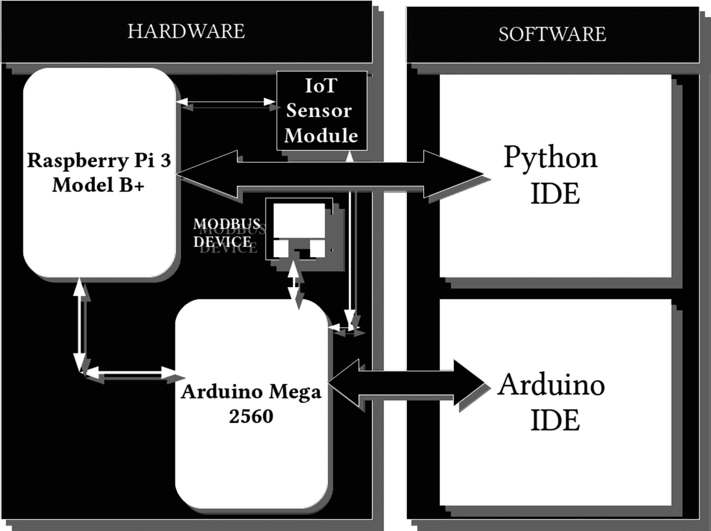

图 3-1

框图系统

你可以清晰地看到系统图中的两个模块：硬件和软件。区分它们非常重要，这样你才能清楚地理解基于 IoT 和 IIoT 的解决方案的工作方式。软件层通过其各自的编程集成开发环境（IDE）与相应的硬件组件进行通信。这里的 Python IDE 是 Raspbian 上的 Thonny IDE；它是与树莓派 3 Model B+ 通信的软件组件，而 Arduino IDE 软件组件则与 Arduino Mega 2560 微控制器通信。在硬件部分，这是需要理解的最重要的一点。树莓派 3 Model B+ 是作为主机的单板计算机（SBC），承载着 Python 和 Arduino 的软件。软件组件完全在 Raspbian 上运行。树莓派硬件组件在其板载上有 GPIO 引脚，通过这些引脚与物联网传感器通信（请记住第 2 章的内容：大多数物联网传感器对树莓派和 Arduino 都是通用的）。树莓派还通过其 USB 串口线缆与 Arduino Mega 2560 通信，并从中获取数据。请记住，你可以向 Arduino 添加更多设备（尤其是那些需要通过 Modbus 与微控制器板通信的设备），数量可以超过树莓派，因为 Arduino 板上有更多可用的引脚。Arduino Mega 2560 与 Modbus 设备（如电能表等）通信。然后，它通过其 USB 串口将数据传回树莓派 3 Model B+。为了创建一个健壮的系统，你需要测试从树莓派 Python 代码到其连接的物联网传感器或 LED 的通信。之后，你将测试树莓派和 Arduino 之间的 Arduino 通信。一旦你获取了物联网传感器数据，你将把它存储在一个轻量级数据库 SQLite3 中。在实际应用中，你可以将其存储在任何其他数据库中，例如 Oracle、db2、PostgreSQL 等。一旦你拥有了数据，就需要在其之上应用机器学习流程，以获取关于物联网或任何连接的 Modbus 设备运行的有意义的见解。然而，在本章中，你将不会使用带有 Arduino 的 Modbus 设备，而是使用一个连接到 Arduino 微控制器的简单物联网传感器，来测试主设备和从设备之间是否正在进行串行通信。让我们开始测试系统吧。

### 测试系统

在启动系统之前，你需要确保解决方案中的每个设备都能正常工作。树莓派是你的主系统，你需要先启动它，看看它是否正常工作。为此，你需要将电源线插入树莓派板的电源接口。完成后，你需要使用 HDMI 端口连接 LED 屏幕。所有这些操作都是在你将 Raspbian 操作系统安装到树莓派 3 Model B+ 的 SD 卡上之后进行的。图 3-2 展示了树莓派的启动过程。

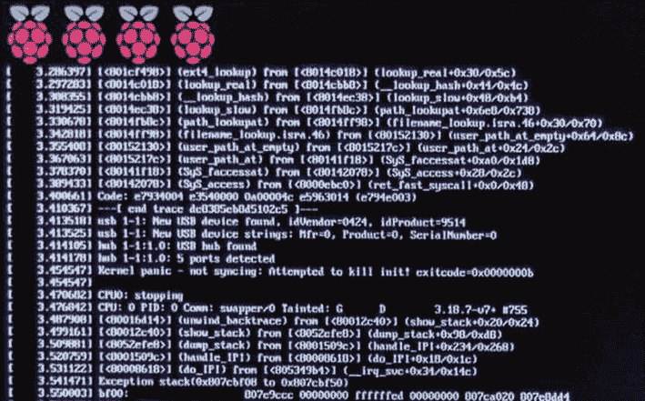

图 3-2

树莓派启动

启动完成后，树莓派桌面将会显示出来，看起来与你在图 3-3 中看到的类似。


图 3-3

启动后的树莓派 3 Model B+ 桌面

转到树莓派桌面顶部的“开始”按钮，点击“编程”，然后点击“Thonny Python IDE”。这就是你将用于编程的 IDE。请记住，这不是一个非常专业的 IDE，而是一个小型 IDE，旨在帮助你入门物联网项目。它没有像 PyCharm 这样的 IDE 所具有的高级功能，但对于编写代码并在 Python IDLE 上执行来说已经足够好了。

Thonny IDE 启动后，你将输入一个简单的“Hello world”程序，以检查 Python 的 pandas 库是否已正确安装并能正常工作（列表 3-1）。用于测试 pandas 库是否已安装以及 Python 是否正常工作的简单程序 `hello_world.py` 的代码如图 3-3 所示。你将标准库导入到程序中：pandas 用于管理数据框，matplotlib 用于图形和图表等可视化，numpy 用于数学计算，Seaborn 用于热力图等数据可视化。

```
import pandas as pd
import matplotlib as plt
import numpy as np
import seaborn as sb
print("Hello World from Raspberry Pi")
列表 3-1
hello_world.py
```

在 Thonny IDE 中按工具栏上的“运行”按钮来运行 Python 代码，你应该会看到如图 3-4 所示的输出。

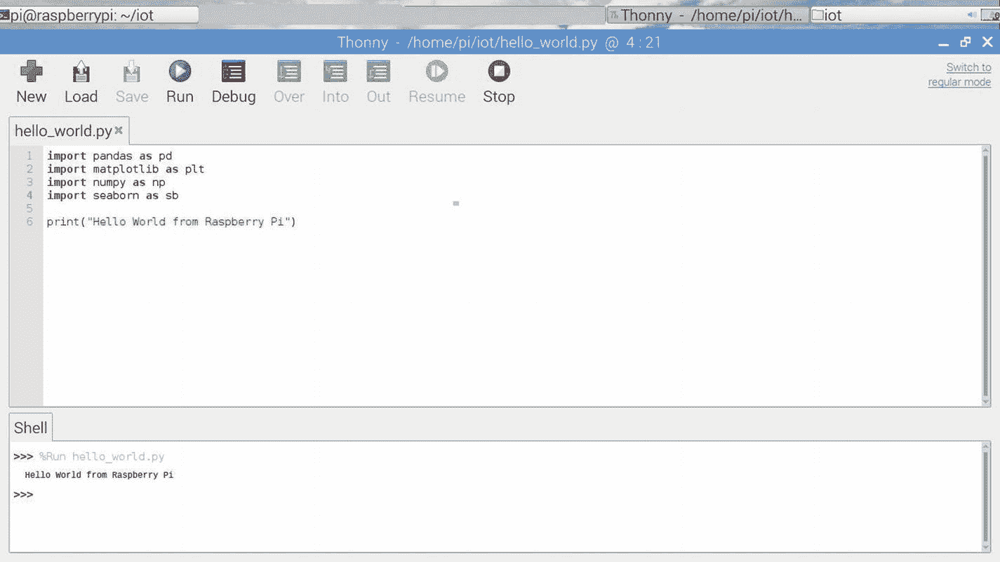

图 3-4

树莓派 3 Model B+ 上的“Hello world”Python 代码

成功的输出意味着大多数常用库（如 pandas、matplotlib、numpy 和 Seaborn）都已安装，并且 Python IDLE 已配置好可以输出结果。如果你在树莓派上运行这个简单的 Python 程序时遇到任何错误，可能是由于拼写错误，或者某个库未安装在你的基于 Raspbian 的 Python 环境中。在这种情况下，你可以尝试使用 `pip install <library_name>` 命令来安装它。将 `<library_name>` 替换为导致错误的库的名称，例如 pandas、Seaborn、matplotlib 等。

你可以通过创建一个测试数据框来对 pandas 进行另一个简单测试，例如下面代码中给出的测试，该代码导入 pandas 数据框，然后创建一个 `DataFrame()` 对象的实例，最后打印出“Pandas loaded”。结果会显示在 Thonny IDE 中，如图 3-5 所示。

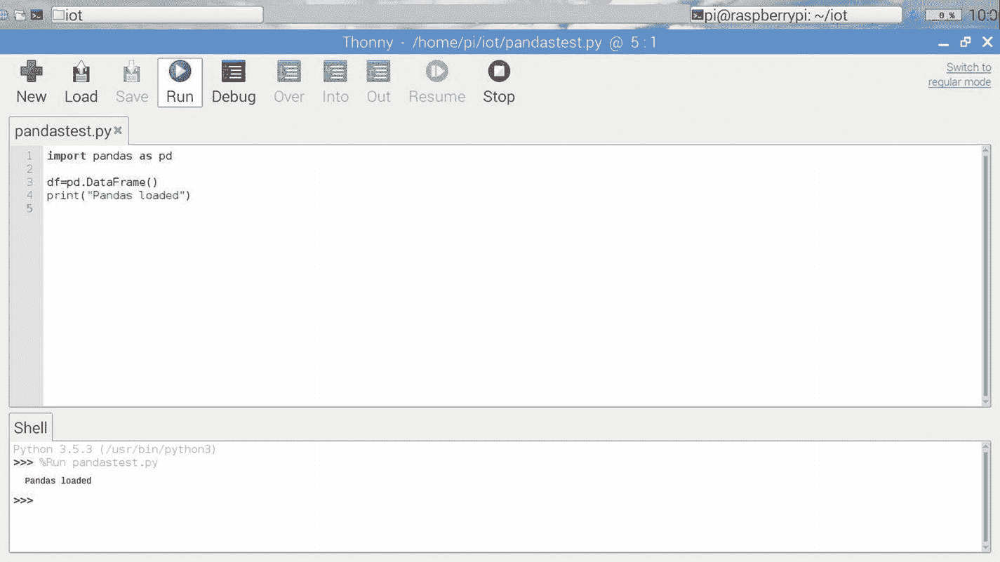

图 3-5

测试 pandas 数据集加载的代码执行结果

```
import pandas as pd
df=pd.DataFrame()
print("Pandas loaded")
```


运行 pandas 加载测试后，你可以确认 pandas 的 Python 安装没有问题。现在你需要测试机器学习库 scikit-learn，这是你在本书的解决方案练习中用于实现机器学习的库。运行以下代码来测试在树莓派上加载 scikit-learn。输出结果如图 3-6 所示。

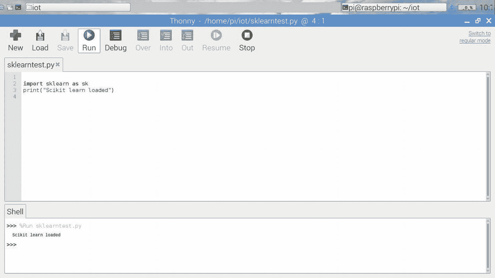

图 3-6

在树莓派上加载 scikit-learn 的结果

```
import sklearn as sk
print("Scikit learn loaded")
```

如果 scikit-learn 库加载成功，你应该会在底部的 shell 区域看到图 3-6 所示的输出。如果你从 shell 中收到任何错误，说明该库未在你的树莓派系统中加载。要加载该库，请使用命令 `pip3 install scikit-learn`。如果需要排查问题，请参考 Stackoverflow.com 上关于此主题的讨论：[`https://stackoverflow.com/questions/38865708/how-can-i-run-python-scikit-learn-on-raspberry-pi`](https://stackoverflow.com/questions/38865708/how-can-i-run-python-scikit-learn-on-raspberry-pi)。

现在，你已经测试并运行了 Python 及其库。如果到目前为止一切正常，下一步是使用 Python 测试 Arduino，这将在下一节中进行。

## 使用 Python 测试 Arduino

Arduino 是一种微控制器。正如你在第 2 章中所了解的，它用于通过 Modbus 协议与工业设备通信。让我们开始使用 Arduino。

Arduino 程序是在 Arduino IDE 中编写的。Arduino IDE 是运行在树莓派系统上的特殊软件。你将把它用作主设备，而 Arduino 将作为从设备，与你的 IIoT 设备（如电能表）进行通信。它允许你为不同的 Arduino 板编写草图（在 Arduino 语言中，*程序*的同义词）。Arduino 编程语言基于一种非常简单的硬件编程语言 Processing，其语法类似于 C 语言。在 Arduino IDE 中编写草图后，需要将其烧录到 Arduino 芯片板上执行。这个过程称为上传到 Arduino 微控制器。在此测试中，你将使用 Arduino IDE 在树莓派 3 Model B+ 上进行测试。请记住，Arduino 不是一个功能完整的计算机；它不像树莓派那样拥有自己的操作系统，这就是为什么它需要一个像树莓派这样的主设备来监控、控制和使用它。从设备 Arduino 在其主设备和连接的 IIoT 或 IoT 设备之间进行双向通信。虽然这最初看起来复杂，但一旦你开始测试并将每个硬件和软件组件组合起来使系统工作，它就会变得更容易。

### Arduino 硬件设置与通信

首先，使用 Arduino Mega 2560 附带的 USB 串行电缆将其与树莓派 3 Model B+ 连接，如图 3-7 所示。使用树莓派的 USB 端口进行连接，另一端连接到 Arduino 板的串行端口。

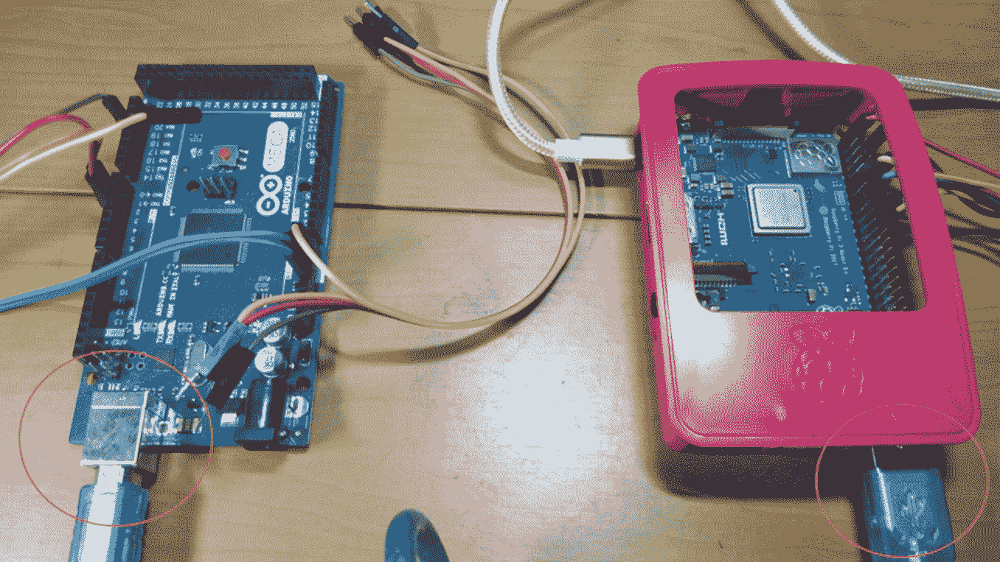

图 3-7

连接的树莓派 3 B+ 和 Arduino Mega 2560

下一步，打开 Arduino IDE，如图 3-8 所示，并编写清单 3-2 中所示的程序。

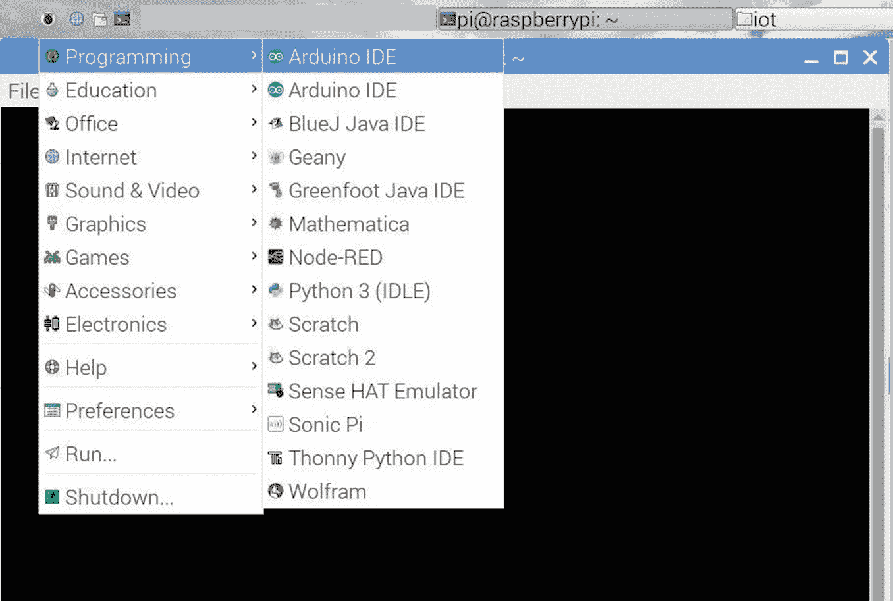

图 3-8

在树莓派 3 Model B+ 上打开 Arduino IDE

打开 Arduino IDE 后，你可以编写 Arduino 版本的“Hello world”程序。

```
void setup() {
// put your setup code here, to run once:
Serial.begin(9600);
}
void loop() {
// put your main code here, to run repeatedly:
Serial.println("Hello World from Arduino");
}
清单 3-2
Arduino “Hello world” 程序
```

当你为 Arduino 编写草图程序时，需要包含两个与 C 语言非常相似的函数。第一个是 `void setup()` 函数，主要用于初始化串行总线通信、LED 或连接到 Arduino 微控制器的其他设备。图 3-12 所示的 Arduino IDE 是你将在树莓派 3 B+ 上从桌面“开始 ➤ 编程”菜单中打开的，然后你将编写图 3-9 所示的程序。

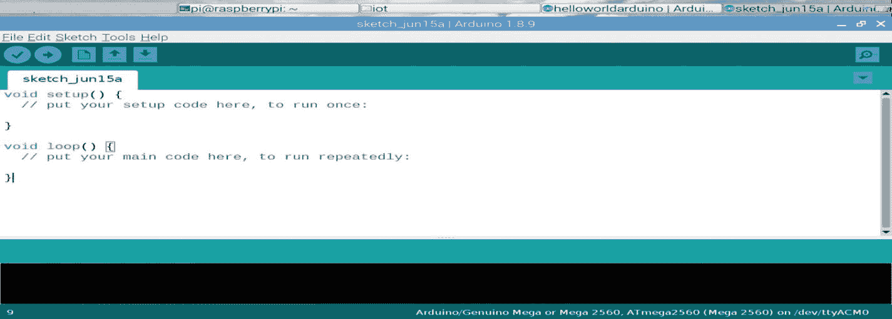

图 3-9

默认的 Arduino IDE 草图

代码不言自明，采用 C 风格和语法。第一个函数是 `void setup()`，符号 `//` 后的注释（表示注释）说明你可以在此处放置代码，并且只需运行一次，例如初始化任何设备或变量值等。在 setup 函数中，由花括号 { } 表示的主体是你编写代码的区域。下一个函数是 loop 函数，你希望它循环或重复运行。如果你有纯软件背景，可能会觉得这令人困惑，可能不明白为什么需要一个重复执行操作的函数。试着这样理解：像 Arduino 这样的机器或微控制器无法自行运行，除非有一个程序反复告诉它该做什么。这就像有一个随时听候差遣的仆人，闲着就会感到无聊。同样，Arduino 也需要重复做一些事情，不能闲置。你可以让它监控一个设备，并在某个事件发生或设备即将出现故障时触发某些操作。这只是你可以使用这个 `loop()` 函数的一个例子；其应用是无限的。你可以根据 Modbus 设备的输入值（如温度等）打开或关闭 LED。这只需要 Arduino 微控制器持续不间断地工作，而这正是 `loop()` 函数的全部意义所在。

在继续之前，你需要了解在 Arduino IDE 中编译和运行程序的过程。首先，编写草图代码并将其保存为扩展名为 `∗.ino` 的文件。保存后，转到“工具 ➤ 板”并悬停以打开支持的 Arduino 微控制器板列表。从列表中选择 Arduino Mega 2560。你必须记住每次打开 Arduino IDE 时都要检查，以免在编译中出现错误。图 3-10 显示了如何执行此操作。


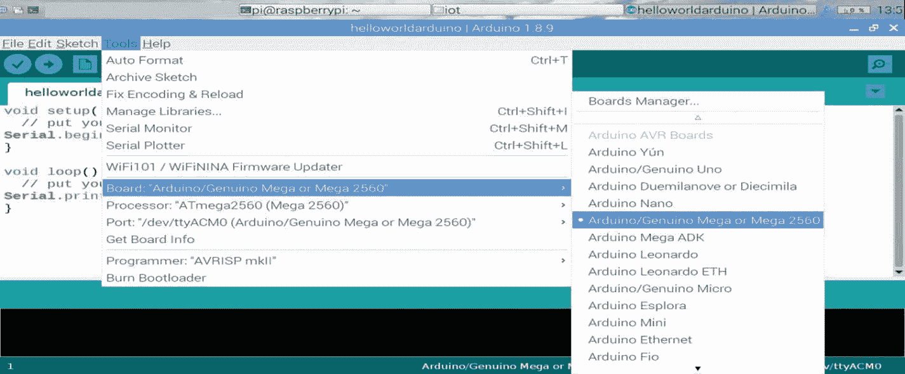

图 3-10

选择 Arduino Mega 2560 开发板

选择 Arduino/Genuino Mega 或 Mega 2560 后，你就可以编写第一个 Hello world 程序了，如图 3-11 所示。

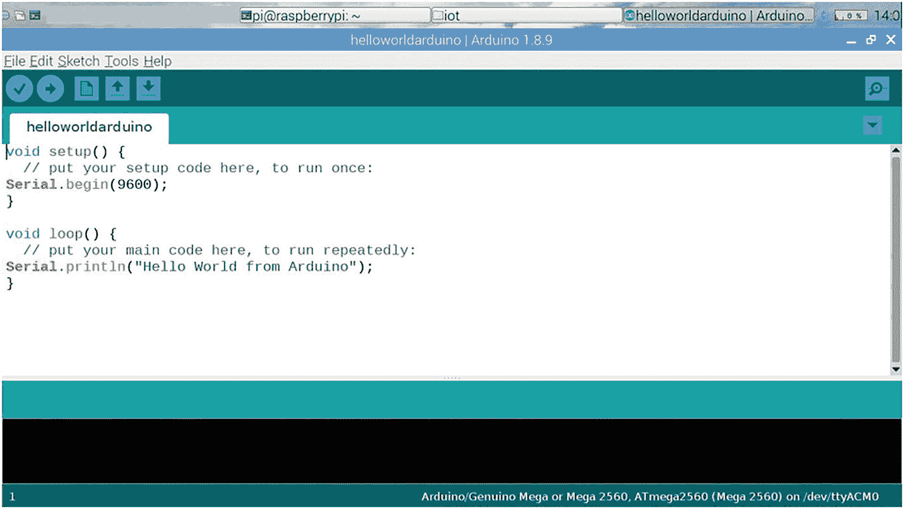

图 3-11

在 Arduino IDE 中编写 Hello world 程序

你会注意到，程序的 `setup` 函数以 9600 的波特率初始化了串口。`loop` 函数中包含一条向 Arduino 串口打印信息的语句。实际上，这类程序本身并无实际意义；然而，你是在尝试测试与 Arduino 微控制器的通信。下一步，如果你能成功编译该程序，则说明你没有犯任何错误。这个 Hello world 程序中常见的错误是首字母大写（在 `Serial` 中，字母 S 必须大写）。另一件需要记住的事情是，`Serial` 对象的函数名不需要大写。`begin` 和 `println` 函数名都没有大写。就像任何 C 或 C++ 程序一样，每条语句都必须以分号结尾。

现在，让我们进入下一步，在 Arduino IDE 中编译程序，如图 3-12 所示。

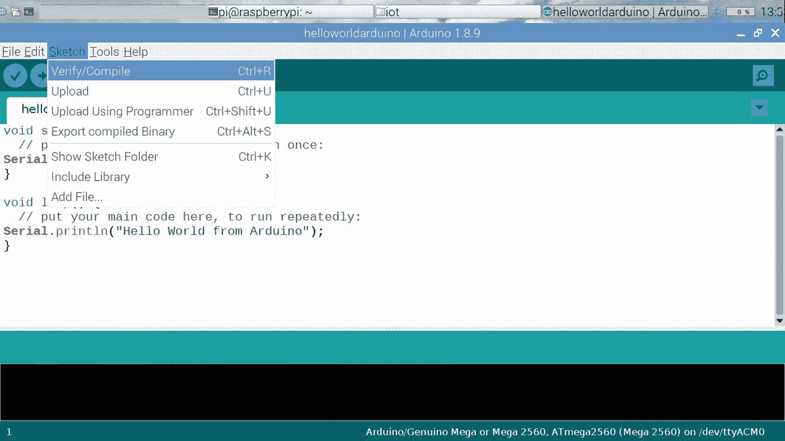

图 3-12

在 Arduino IDE 中编译草图

### 运行草图

成功编译 Hello world 程序后，你可以继续下一步：上传程序。在此步骤中，Arduino IDE 通过树莓派的 USB 串行接口与 Arduino Mega 2560 微控制器通信，并将整个程序烧录到其中。现在，该程序将驻留在微控制器的内存中并无限运行，直到你编写下一个程序并通过相同的过程将其覆盖写入。图 3-13 显示了“草图”菜单中用于将程序上传到微控制器开发板的“上传”选项。

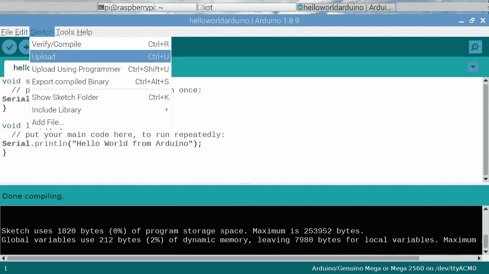

图 3-13

Arduino IDE 中用于上传草图的选项

现在，你已经编译了程序并点击了上传，你应该会看到程序正在上传，并且有一个进度条指示 Arduino IDE 将程序写入微控制器开发板的进度。如果你没有选择正确的微控制器开发板，你将在此处看到错误。如果树莓派和 Arduino 之间的连接出现问题，你也会在此步骤中看到错误。上传阶段出错的最常见原因是线缆松动或串行总线线缆不良。因此，请检查树莓派和 Arduino 开发板两端的接口，以确认你的线缆没有问题。如果上传时仍然遇到错误，请尝试更换线缆。图 3-14 显示了将 Hello world 程序成功上传到 Arduino 微控制器开发板的结果。请注意 Arduino IDE 底部面板上的“完成编译”消息。下面的方框显示了与程序存储空间或可供其使用的最大空间相关的消息。在此例中，它使用了可用最大空间 253952 字节中的 1820 字节。同样，它还告知你，其全局变量使用了 212 字节（2%）的动态内存，在总共 8192 字节中，为局部变量留下了 7980 字节。非常长的程序可能无法放入 Arduino Mega 2560 开发板的小容量内存中，因此这些信息会派上用场，以便你可以优化程序以使其适合。

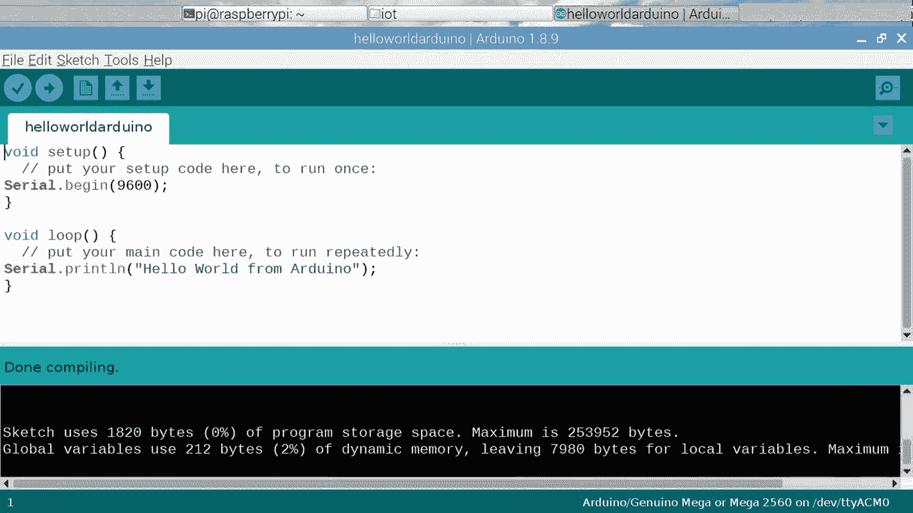

图 3-14

Arduino IDE 上的“完成编译”消息

这是测试树莓派与 Arduino 通信过程的最后一步。现在，你已经准备好进行下一步，从树莓派获取物联网传感器数据。

## 使用树莓派示例代码获取物联网传感器数据

为了在树莓派中获取物联网传感器数据，你首先需要重新审视单板计算机上的 GPIO 引脚。它们如图 3-15 所示。

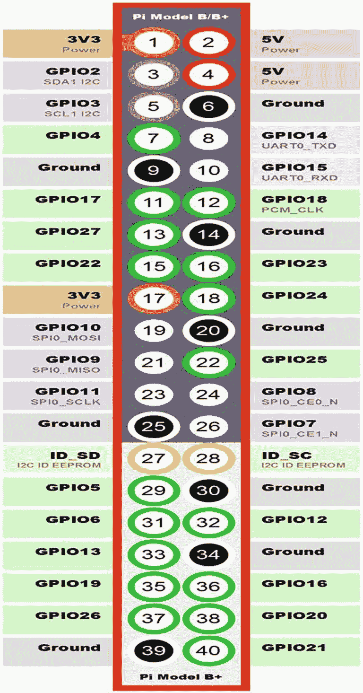

图 3-15

树莓派 3 型号 B+ GPIO 引脚布局

40 个 GPIO 引脚在图 3-15 中清晰可见。我在前面的章节中解释过它们的用途；然而，在本章中，你将使用它们来构建电路，与 LED 和物联网传感器等设备进行通信。此后，我将引用这些引脚编号，例如，带有红色圆圈且编号为 1 的引脚标有 3V，这意味着它用于为你的设备提供 3V 电流；而带有红色圆圈且编号为 2 和 4 的引脚提供 5V 电源。此外，你将使用编号为 6、9、14、20、30、34 和 39 的接地引脚。其余引脚可用于数字 GPIO 通信。

你现在正处于将物联网传感器连接到树莓派开发板 GPIO 引脚的步骤。有两种方法可以做到这一点：使用面包板（如图 3-16 所示）或印刷电路板（PCB）。本书中的所有示例、解决方案和案例研究练习都处于概念验证（PoC）级别。当你首次设计电子系统作为概念验证时，会使用面包板；当你在面包板上测试了与程序配合使用的电子电路，并且现在希望将其永久化用于生产或商业用途时，则会使用 PCB。

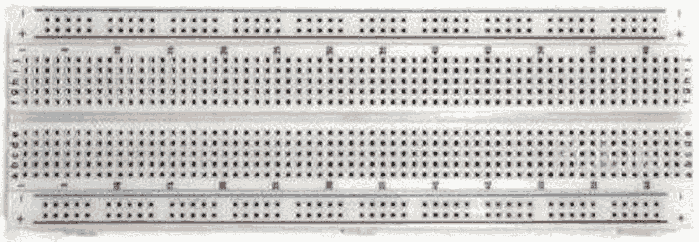

图 3-16

用于电路测试的面包板

如你所见，面包板的顶部和底部有两条导轨，其内部嵌有正极和负极孔。中间的分区各有五列和六十四行，用于连接 LED、物联网传感器或电机等设备。关于此面包板，需要注意的关键点是，在塑料涂层下面是一个电路网格，它将每一行连接在一起。因此，如果你将 LED 的一个引脚放在该行的任何中间位置，你应该能够通过将另一根导线放在同一行上来连接到它。你无需将导线插入与插入任何设备引脚的同一个孔中。面包板的这一特性使其使用起来非常方便，并且无需焊接电路（在使用印刷电路板时需要焊接）。由于此板的性质是整个电路基于孔且不是永久性的，因此你不能将其用于生产级工作。


### 整合所有环节

现在，让我们在 Raspberry Pi 3 Model B+ 板上连接一个物联网传感器，并编写一个 Python 程序来获取其数据。在本章下一节中，你将学习如何将物联网传感器数据存储到数据库中。

首先需要定义带有 Raspberry Pi 的物联网传感器电路图，以便你理解要构建的内容。图 3-17 展示了该项目的电气连接图。

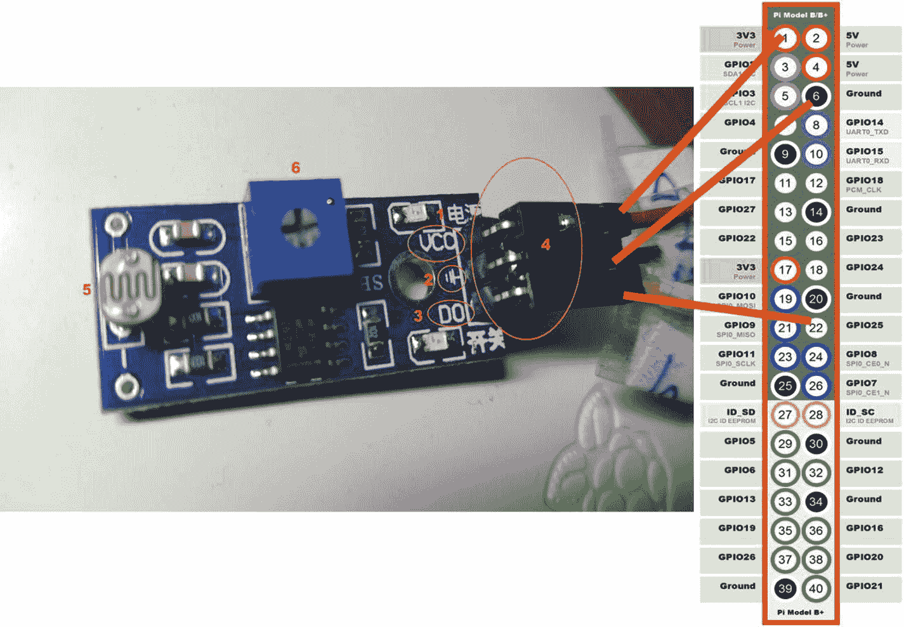

图 3-17

连接到 Raspberry Pi 的物联网传感器电气连接图

你将使用的物联网传感器是一个 LDR（光敏电阻模块）。你使用的并非单个 LDR 或光敏电阻，而是一个预制的 LDR 模块，其 PCB 上集成了功能完整的电路板，远端装有光电电阻，在图 3-17 中标记为数字 6。该模块感知环境中的光线，并以 0/1 格式返回数据。它返回的值是浮点数，白天返回 0，黑暗时返回接近 1 的值（如 0.90 到 0.99）。要模拟黑暗，你可以用物体遮住 LDR 的光敏电阻。你可以看到标记为 1 的点，即 VCC；你需要将导线从这里连接到 Raspberry Pi 板上的 GPIO 引脚 1。标记为接地的点必须连接到 Raspberry Pi 板上的 GPIO 引脚 6。点 3 是 LDR 模块的 DO（数字输出信号线），必须连接到 Raspberry Pi 板上的 GPIO 引脚 25。LDR 模块完全连接后，两侧会亮起两个红色 LED 信号，如图 3-18 所示。

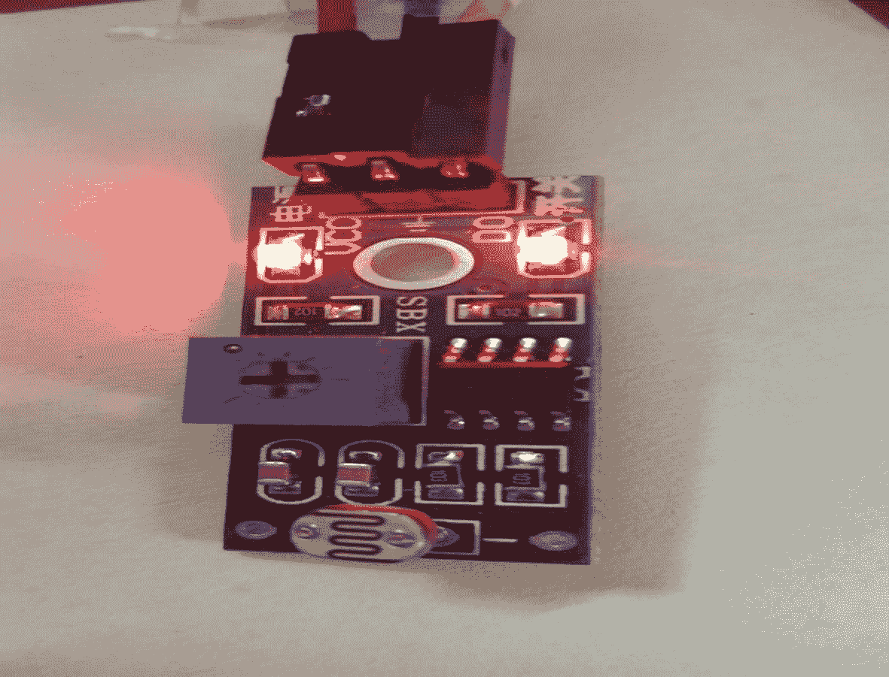

图 3-18

完全连接的 LDR 模块

现在让我们看看带有光电电阻的 LDR 模块。在远端，它被遮盖了；结果只有一个灯亮起，表明 LDR 模块周围是黑暗的（见图 3-19）。

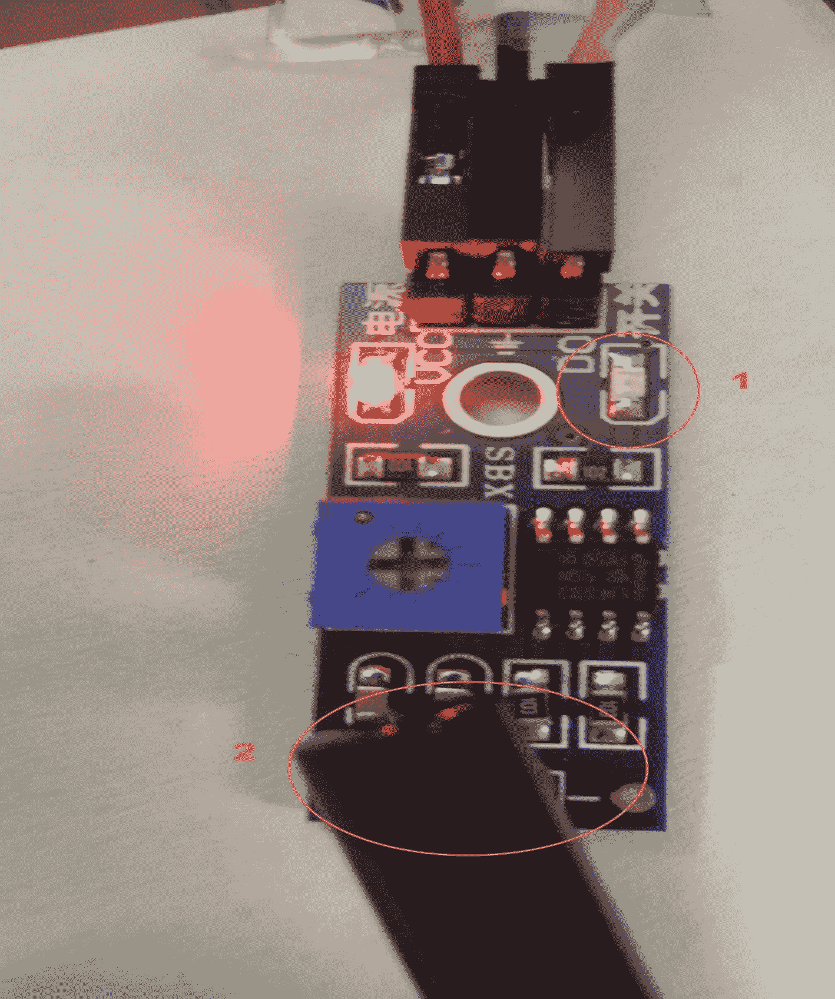

图 3-19

完全连接并遮盖光电电阻的 LDR 模块

图 3-19 中标记为 1 的点是用于数字输出的第二个 LED，它处于熄灭状态，表明没有从光电电阻接收到信号。图中标记为 2 的点是光电电阻，我用铅笔将其遮盖住了。任何不透光的物体都可以用来遮盖光电电阻。模拟白天和黑夜是为了测试目的；然而，在现实世界中，当你将此传感器应用于诸如检测白天或黑夜，并根据结果打开或关闭消费/工业电器等场景时，它会发挥奇妙的作用。这些数据与来自工业机器的数据相结合，还有助于诊断预测性维护应用中的关键问题，你将在案例研究中应用这些方法。在本章下一节中，你将把此 LDR 物联网传感器数据存储到数据库中。

请确保表 3-1 中列出的 GPIO 引脚已连接到 Raspberry Pi 板上对应的引脚。

表 3-1

Raspberry Pi GPIO 引脚与 LDR 模块的连接

| Raspberry Pi | GPIO 引脚编号 | 光敏传感器模块 |
| --- | --- | --- |
| 3.3v 电源 | 1 | VCC (V) |
| 接地 | 6 | GND (G) |
| GPIO 信号引脚 | 25 | SIGNAL (S) |

GPIO 引脚 1 必须连接到 LDR 模块上标记为 VCC 的引脚。同样，接地的 GPIO 引脚应通过导线连接到 LDR 模块上显示 GND 的中间引脚。你在程序中使用的第三个引脚是 GPIO 信号引脚，它将与 LDR 模块发送和接收数字信号，即引脚 25 连接到 GPIO 信号引脚的第三个引脚。有些 LDR 模块有四个引脚；最后一个引脚用于模拟输入和输出，以备你需要使用。但在你的情况下，由于你使用的是三引脚 LDR 模块，无需担心这一点。GPIO 和 LDR 模块上已连接的 LDR 引脚如图 3-20 所示。

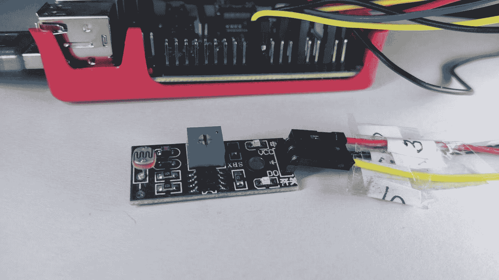

图 3-20

Raspberry Pi GPIO 引脚与 LDR 模块的连接


### 对物联网传感器 LDR 模块进行编程

正确连接引脚的首要迹象是，你会看到 LDR 模块上有两个红色 LED 灯亮起，这表明该模块正在从树莓派主板接收电源和输入。这一点至关重要，因为除非看到这些指示灯亮起，否则你将无法运行清单 3-3 中所示的名为 `ldr.py` 的 Python 代码。

```
#打开光传感器
from gpiozero import LightSensor
ldr = LightSensor(25)
while True:
print(ldr.value)
ldval=float(ldr.value)
#print(ldval)
#print("done deal")
if(ldval>0.0):
print("现在是夜晚时间")
else:
print("现在是白天时间")
清单 3-3
对 LDR 模块物联网传感器进行编程
```

`gpiozero` 库并未安装在树莓派默认版本的 Python 中，因此你必须在已安装的 Python 目录中通过输入 `pip install gpiozero` 来安装它。该库拥有与 GPIO 引脚和设备通信所需的属性和函数。在这个程序中，你首先导入 `gpiozero` 库中的 `LightSensor`，然后在第二行将其初始化为 GPIO 引脚编号 25，以便从 LDR 模块获取信号。请参考表 3-1，将 GPIO 信号引脚编号与本程序第二行中给出的编号进行核对；它们必须匹配，否则你将完全无法与 LDR 模块通信。接下来，你使用一个无限循环来打印 LDR 值，该值返回 0 表示白天，返回 1 表示夜晚。然而，输出是一个浮点数，更接近于 1，范围在 0.9 到 1 之间。如果你希望它更灵敏，可能需要调整 LDR 模块顶部的蓝色电位器。这个小程序使用了一个 `if` 条件来检查 LDR 的值是否大于 0，如果大于 0，则打印“现在是夜晚时间”；否则，打印“现在是白天时间”。循环结束后，你关闭 LDR 模块传感器，以便它可以再次被初始化。在实际应用中，这里就是你通过树莓派控制任何设备（如 LED 灯或任何其他电器）的应用代码所在的位置。清单 3-4 给出了使用 Python 运行清单 3-2 中程序的输出。

```
pi@raspberrypi:~/ python ldr.py

0.94490146637
现在是夜晚时间
0.94490146637
现在是夜晚时间
0.94490146637
现在是夜晚时间
0.94490146637
现在是夜晚时间
0.94490146637
现在是夜晚时间
0.94490146637
现在是夜晚时间
0.94490146637
现在是夜晚时间
0.94490146637
现在是夜晚时间
0.94490146637
现在是夜晚时间
0.94490146637
现在是夜晚时间
0.94490146637
现在是夜晚时间
清单 3-4
LDR Python 程序的输出

输出是 LDR Python 程序的一次试运行，它通过输出接近 1 的浮点数来工作，这意味着运行此程序时环境是黑暗的，或者 LDR 传感器模块周围是黑暗的（它可能被物体遮挡了）。如果你在 LDR 模块的光敏电阻上方点亮手电筒或灯泡，它就会开始输出 0 值，表明其周围有光。你可以通过调整 LDR 模块 PCB 顶部的蓝色方形电位器来测试这一点并提高灵敏度。至此，你已经完成了本节的学习，因为你已经能够从物联网传感器获取数据了。

请记住，还有许多其他传感器，用途广泛，可用于从简单到复杂的消费和工业应用。任何这些传感器的数据都非常相似。数字输出总是在 0 和 1 的两个极端；然而，模拟输出可以是变化的，并给出介于两者之间的读数，这些读数不在 0 和 1 的极端范围内。另外，需要记住的一点是，这些物联网传感器在大量使用后，其精度会随着时间的推移而下降，因此你可能需要更换那些接触水或土壤的传感器，因为这些接触会导致传感器头腐蚀。

## 将物联网传感器数据存储在数据库中

在本节中，我将向你展示如何将数据存储在 SQLite3 数据库中。你将在第 5 章中详细了解如何安装此数据库。然而，与本章前面的示例一样，我将让你坐下来，看看你可以通过测试物联网传感器、逐一组装系统并将数据累积到数据库中来做些什么。在上一节的示例中，你已成功获取了 LDR 模块物联网传感器的数据；然而，如果孤立地收集，这些数据是没有意义的，需要与其他数据集结合才能变得有意义。例如，仅仅知道是白天还是夜晚是不够的；如果你将其与温度物联网传感器数据结合起来，就可以找出它们之间的相关性，看看光照是否与温度有关。如果发现了任何关系，那么它就有了一定的意义。

你还将修改清单 3-2 中的现有代码并添加新代码，以便将其存储在 SQLite3 数据库中。你也可以将这些数据存储在任何其他关系型数据库管理系统（RDBMS）中，或者存储在像 CSV 或 JSON 格式这样的平面文件中；但是，这里你将使用在 Raspbian 上运行良好的 SQLite3。

### 配置 SQLite3 数据库

在图 3-21 中，你可以看到一个名为 `iotsensor.db` 的 SQLite3 数据库。由于这是一个空白数据库，SQLite3 数据库引擎会自动为你创建它。这个新数据库将是空的，没有任何表或其他结构。你需要创建它们。

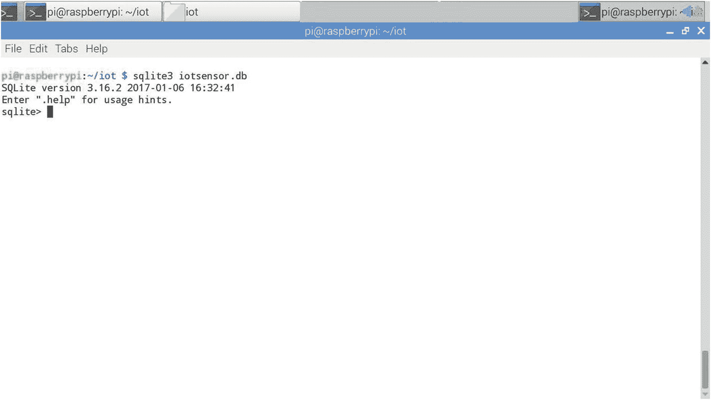

图 3-21

启动 SQLite3 数据库

启动 SQLite3 数据库的代码如清单 3-5 所示。

```
pi@raspberrypi:~/iot $ SQLite3 iotsensor.db
SQLite version 3.16.2 2017-01-06 16:32:41
Enter ".help" for usage hints.
sqlite>
清单 3-5
启动 SQLite3 数据库
```

一旦你登录到数据库，它会显示其版本号以及你登录时的日期和时间戳来欢迎你。它会显示一个提示符 `sqlite>`，你可以在其中运行命令来操作数据库。在此提示符下有两组命令可以工作：一组是以点开头的命令，例如 `.databases` 或 `.tables`；另一组是 SQL 命令，例如 `select ∗ from <tablename>;`。初学者常犯的一个错误是忘记在 `databases` 或 `tables` 命令前加点，然后 SQLite 提示符会报错。对于 SQL 命令，不要忘记在每个语句的末尾使用分号 (`;`)；如果不这样做，`sqlite>` 提示符会继续到下一行，你的命令将不会执行。

你现在可以通过在 `sqlite>` 提示符下输入 `.databases` 和 `.dbinfo` 命令来查看数据库及其信息。命令的代码和输出分别如清单 3-6 和图 3-22 所示。

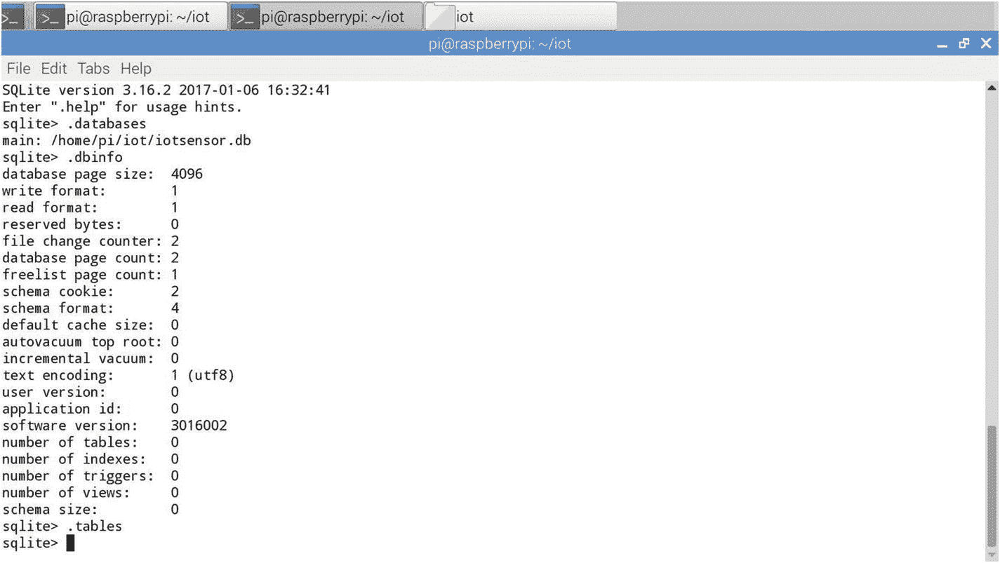

图 3-22

数据库信息命令代码的输出

```
SQLite version 3.16.2 2017-01-06 16:32:41
Enter ".help" for usage hints.
sqlite> .databases
sqlite> .dbinfo
sqlite> .tables
sqlite>
清单 3-6
SQLite3 数据库信息代码
```


### 创建数据库结构

输出显示了数据库的各种结果，例如内存中使用的页面大小、文本编码、表数量、索引数量、触发器数量和视图数量。由于这是一个原始数据库，你没有任何表、视图、触发器或索引。你可以使用点命令 `.tables` 来验证这一点，该命令会显示所有已存在的表，如图 3-22 所示。它返回了空结果，这意味着该数据库中没有表。因此，让我们创建一个表来存储带有日期和时间戳的小型物联网传感器数据，如代码清单 3-7 所示。

```
pi@raspberrypi:~/iot $ SQLite3 iotsensor.db
SQLite version 3.16.2 2017-01-06 16:32:41
Enter ".help" for usage hints.
sqlite> .tables
sqlite> create table ldrvalues(date date, time time, ldrvalue float);
sqlite>
代码清单 3-7
用于创建存储 LDR 物联网传感器值的表的代码
```

你可以在图 3-23 中看到此表创建的结果，该图显示了 `.tables` 命令的输出，并且表 `ldrvalues` 现在已存在。

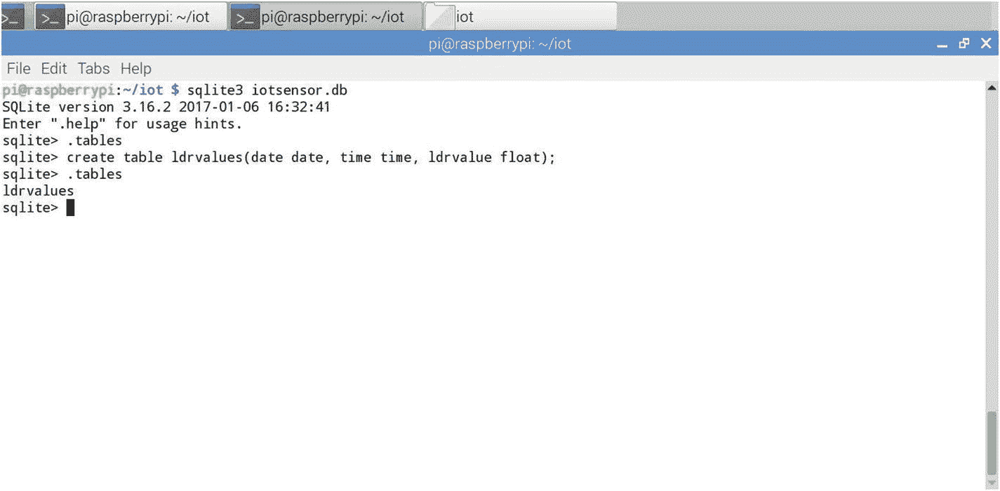

图 3-23

在 SQLite3 中创建用于存储物联网传感器数据的表

### 向数据库中插入数据

你现在有了一个名为 `ldrvalues` 的表结构，用于将物联网传感器数据存储在名为 `iotsensor.db` 的 SQLite3 数据库中。你可以继续更新代码清单 3-2 中的 Python 程序（该程序从物联网传感器获取数据），现在将值写入此 SQLite3 数据库。该程序如代码清单 3-8 所示。

```
pi@raspberrypi:~/iot $ cat ldrdb.py
#Light Dependant Resistor Module Initialization
from gpiozero import LightSensor
#importing Sqlite3 python library to connect with database
import SQLite3
from datetime import datetime
#GPIO LDR Signal Pin initialization
ldr = LightSensor(25)
#Read value infinitely in a loop
while True:
print(ldr.value)
ldval=float(ldr.value)
if(ldval>0.0):
print("It is Night time now")
else:
print("It is Day time")
conn = SQLite3.connect('iotsensor.db')
curr=conn.cursor()
query="INSERT INTO ldrvalues(date,time,ldrvalue) VALUES(" +"'" + str(datetime.date(datetime.now())) + "'" +"," + "'" +                 str(datetime.time(datetime.now())) + "'" + "," + "'" + str(ldval) + "'" + ")"
print(query)
curr.execute(query)
conn.commit()
代码清单 3-8
将 LDR 模块物联网传感器数据存储到 SQLite3 数据库的程序
```

请注意代码清单 3-2 中对代码的修改。你添加了 SQLite3 Python 库的导入语句；这是与 SQLite3 数据库通信所必需的。你还导入了 datetime 库以获取日期和时间，以便在插入查询时将其输入到数据库中。`while(true):` 循环没有改变；你只是在它的末尾添加了数据库插入代码。`conn` 对象用于连接到 `iotsensor.db` 数据库，你在其中创建了一个名为 `ldrvalues` 的表；请参考图 3-23。`while` 循环内的 cursor 对象使用与 `iotsensor` 数据库的连接来初始化游标。下一条语句是一个 INSERT INTO... 语句，它将数据插入到所有三个列中：`date`、`time` 和 `ldrvalue`。输入到 `time` 列的值取自 `datetime.now()` 函数，该函数同时返回日期和时间。由于你需要分别获取时间和日期，因此首先使用 `datetime.date()`，然后在第二列中使用 `datetime.time()` 函数来仅从中获取时间值。你将日期和时间分开而不是创建单个列，因为在进行探索性数据分析（EDA）时，如果日期和时间位于单独的列中会更方便；更容易找到日期和时间的趋势。尽管你可以在 EDA 期间执行相同的操作来从列中提取日期和时间，但你在查询时可以省去一些繁琐的函数。然而，在实际应用中，你很少会发现日期和时间这两个值分开，它们通常位于同一列中，称为时间戳。查询完成后，你使用 `curr.execute(query)` 让 SQLite3 数据库引擎执行插入语句。如果你的查询存在语法问题，此时你很可能会收到错误。

### 检查数据的合理性

根据你收到的错误消息，你应该尝试解决它。我运行了该程序几分钟，它将 LDR 模块物联网传感器数据插入到了 SQLite3 `iotsensor.db` 数据库中。你可以在图 3-24 中看到结果。

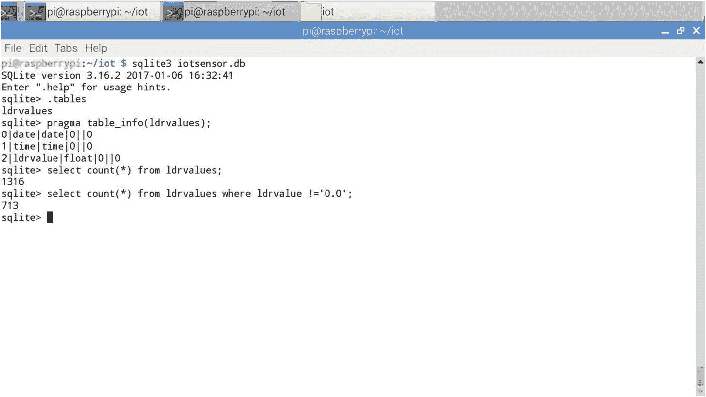

图 3-24

ldrdb.py 的程序执行结果

你可以看到该程序在几分钟内插入了大约 1316 行。表的结构可以通过执行 `pragma table_info(ldrvalues);` 语句来查看。pragma 语句有一个名为 `table_info` 的函数，该函数接受已连接数据库的表名作为参数。在你的例子中，连接的数据库是 `iotsensor.db`，表是 `ldrvalues`。它有三列，你可以将其视为 pragma 语句的输出。第一列是 `date`，第二列是 `time`，第三列是 `ldrvalue`。它们在 SQLite3 表中各自的数据类型显示在它们旁边。之后，你运行查询 `select count(∗) from ldrvalues` 来获取总行数。接下来，你查看 `ldrvalue` 列中所有不等于 0.0（代表白天）的值的计数。该列中的任何值都表示黑暗或夜晚。通过这个简单程序的演示，你应该了解物联网传感器数据如何存储在数据库中并使用。

接下来，我将向你展示一个完整的 Python 程序，它使用树莓派内部的 CPU 来测量其温度并将其存储在数据库中。该程序将模拟从工业设备或物联网传感器测量数据并将其存储在数据库中的过程。之后，通过一个单独的程序，它将创建一个图表来显示数据，就像你在现实世界的物联网应用中所做的那样。在下一节中，你将应用并构建一个机器学习模型。当你从树莓派单板计算机（SBC）板获取这些数据，然后将其存储在数据库中供以后在机器学习模型中使用时，这将会非常令人兴奋。让我们开始吧。

用于实现机器学习的程序如代码清单 3-9 所示。


```
#初始化 Python 库
from gpiozero import CPUTemperature
import time
from datetime import datetime
import pandas as pd
import psutil
import platform
from gpiozero import LED
import time
#初始化红色状态音频播放
import pygame
pygame.mixer.init()
pygame.mixer.music.load("example.mp3")
#在引脚 18 初始化 LED
redled= LED(18)
greenled= LED(22)
yellowled= LED(17)
#初始化光敏模块
from gpiozero import LightSensor
ldr = LightSensor(25)
tempstatus=""
#pandas 数据框的列名
columns=['date','time','temperature','tempstatus','cpupercent','diskpercent','memorypercent']
#创建一个 pandas 数据框来存储树莓派硬件数据
df=pd.DataFrame(columns=columns)
df['date']=datetime.date(datetime.now())
df['time']=datetime.time(datetime.now())
df['temperature']=0
df['tempstatus']=""
df["ldrval"]=0
cpu = CPUTemperature()
counter=0
while True:
#print(cpu.temperature)
time.sleep(1)
tem=cpu.temperature
if(tem>60):
print("红色警报：CPU 温度过高")
tempstatus="RED"
redled.on()
greenled.off()
yellowled.off()
pygame.mixer.music.play()
elif(tem>55 and tem<60):
print("黄色警报：CPU 接近高温阈值")
tempstatus="ORANGE"
redled.off()
greenled.off()
yellowled.on()
else:
print("温度正常")
tempstatus="GREEN"
#time.sleep(1)
greenled.on()
redled.off()
yellowled.off()
df['date'].loc[counter]=datetime.date(datetime.now())
print(datetime.date(datetime.now()))
df['time'].loc[counter]=datetime.time(datetime.now())
df['temperature'].loc[counter]=tem
df['tempstatus'].loc[counter]=tempstatus
#print(df['date'].values)
#print(df['time'].values)
#print(df['temperature'].values)
#print(df['tempstatus'].values)
#现在将数据写入 SQLite3 数据库 temperature.db
#print("已连接到 MACHINEMON 数据库")
import SQLite3
conn = SQLite3.connect('machinemon.db')
#df.to_sql(name='tempdata', con=conn)
curr=conn.cursor()
#获取机器数据
os, name, version, _, _, _ = platform.uname()
version = version.split('-')[0]
cores = psutil.cpu_count()
cpu_percent = psutil.cpu_percent()
memory_percent = psutil.virtual_memory()[2]
disk_percent = psutil.disk_usage('/')[3]
#获取光敏传感器数据以判断白天或夜晚，0 表示白天，1 表示夜晚
#print(ldr.value)
ldrval=ldr.value
#boot_time = datetime.datetime.fromtimestamp(psutil.boot_time())
#running_since = boot_time.strftime("%A %d. %B %Y")
#query="INSERT INTO TEMPERATURE VALUES(" +"'" + str(datetime.date(datetime.now())) + "'" +"," + "'" + str(datetime.time(datetime.now())) + "'"+ "," + "'" + str(tem) +  "'" + "," + "'" + tempstatus +"'" + ")"
query="INSERT INTO machinedata(date,time,temperature,tempstatus,cpupercent,diskpercent,memorypercent,ldrval) VALUES(" +"'" + str(datetime.date(datetime.now())) + "'" +"," + "'" + str(datetime.time(datetime.now())) + "'"+ "," + "'" + str(tem) +  "'" + "," + "'" + tempstatus + "'" + "," + "'" + str(cpu_percent) + "'" + "," + "'" + str(disk_percent) + "'" + "," + "'" + str(memory_percent) + "'" "," + "'" + str(ldrval) + "'" + ")"
print(query)
curr.execute(query)
conn.commit()
#计数器递增，以解析到数据框中的下一条记录
counter=counter+1
列表 3-9
模拟物联网解决方案的代码
```

虽然你看到的是一大段代码，但其真正目的是向你展示如何构建一个基于 Python 的实用物联网应用程序。你进行的唯一模拟是：并非从实际的物联网传感器获取数据，而是从树莓派内置的硬件物联网传感器中获取数据。温度和百分比值的概念适用于工业设备，例如热交换器或锅炉，这些设备同时包含温度值、百分比值以及一些绝对值。电气设备则有从频率到电压的各种数值。所有这些构成了你将在案例研究示例中使用的数据，因为在这些示例中，数据将来自连接到树莓派和 Arduino 的实际物联网传感器。

代码首先初始化并导入所需的 Python 库，例如来自`gpiozero`库的`CPUTemperature`。这个库将用于获取树莓派的内部温度。你还导入了`datetime`库以获取数据生成的时间和日期，`pandas`数据框用于临时存储数据，以及导入的`LED`用于通过点亮相应的 LED 来显示绿色、橙色或红色状态。例如，如果 CPU 温度低于 55 摄氏度，绿色 LED 将点亮；如果树莓派的 CPU 温度高于 55 但低于 60 摄氏度，橙色 LED 将点亮；如果温度高于 60 摄氏度，红色 LED 将点亮。这正是你在测量外部温度值时，使用物联网传感器实现预警系统的方式。之后，你导入了`pygame`，以确保当温度超过 60 摄氏度时，树莓派扬声器会发出声音。这对你的单板计算机来说是一个关键系统，如果不采取措施，系统过一段时间后会挂起，甚至主板或其组件也可能烧毁。试着想象一下，在一个物联网环境中，你希望实现这样一个关键的警报系统。`pygame`库通过`init()`函数进行初始化，在下一行中，它将`example.mp3`（一个尖锐的警报声）加载到内存中。它不会播放，因为你还没有发出命令；它只是被加载到了内存中。

在代码的下一部分，你初始化了将根据 CPU 温度点亮的 LED。红色 LED 连接 GPIO 引脚 18，绿色 LED 连接 GPIO 引脚 22，黄色 LED 连接 GPIO 引脚 17。请确保树莓派上的 LED 已连接到图 3-15 中给出的正确引脚编号。

现在，预警系统包括针对红色温度的声音警报以及使用 LED 针对 CPU 温度的视觉警报。在实际应用中，你将需要这些警报系统以及其他系统，例如短信或电子邮件警报，为此你可能需要在树莓派上配置邮件和短信网关服务器。我们不会这样做，因为我们正在进行概念验证级别的代码，这超出了本书的范围。


现在你需要在 25 号引脚初始化 LDR（光敏传感器模块），这在本章前面的部分已经完成。之后，你需要初始化 pandas 数据框（dataframe）来在内存中存储数据。使用 pandas 的原因是它能给数据提供结构，并允许你根据需求在 Python 中操作和分析数据。接下来是一个无限`while`循环，首先你通过`cpu.temperature`获取 CPU 温度并存储在一个变量中。下一步是检查温度值。如果温度大于 60，屏幕上会显示一条警报信息：“RED ALERT CPU EXCEEDING HIGH TEMPERATURE”（红色警报：CPU 温度过高），随后程序中使用`redled.on()`函数点亮红色 LED。当此事件发生时，其他 LED（绿色和黄色）应被关闭，因此你为这些 LED 对象使用`off()`函数，以避免对 CPU 温度状态产生混淆。你不希望所有 LED 都亮起；此时只有红色 LED 应亮起以显示危急状态。使用 pygame 通过`pygame.mixer.music.play()`函数从树莓派扬声器播放警报音。类似地，还有另外两个条件。下一个条件是当 CPU 温度值介于 55 到 60 度之间时，屏幕上显示状态信息“YELLOW ALERT CPU NEARING HIGH-TEMPERATURE THRESHOLD”（黄色警报：CPU 接近高温阈值），并使用`on()`函数点亮黄色 LED，同时使用各自的`off()`函数关闭红色和绿色 LED。此时不播放声音，因为这不是危急情况；只有当温度达到 60 度的临界极限时才会播放声音。你可能会好奇我是如何得出 60 摄氏度这个数值的。我只是参考了树莓派附带的官方手册，其中提到了 30 到 60 摄氏度的范围。下一个是绿色状态，此时 CPU 安全，无需任何警报，但对于观看屏幕的人来说，会显示一条信息“TEMPERATURE IS NORMAL”（温度正常）。使用其`on()`函数点亮绿色 LED，并使用各自的`off()`函数关闭黄色和红色 LED。一旦你在变量`tempstatus`中获得了 CPU 系统的这个状态，就需要将其存储到 pandas 数据框中，这通过使用`datetime now()`函数将日期和时间存储到`df['date']`和`df['time']`列中来完成。`df['temperature']`存储来自`tem`变量的温度值。`df['tempstatus']`列存储的是你通过`if`条件对 tempstatus 变量进行判断后得到的值，即“GREEN”、“RED”或“YELLOW”。

现在你需要准备将数据写入 SQLite3 数据库，这通过导入语句`import SQLite3`完成。然后你初始化连接到`machinemon.db`数据库的连接对象。之后创建一个`curr`游标对象，以便在需要时解析表。在写入数据框之前，它的一些列（如`cpu_percent`、`memory_percent`、`disk_percent`和`LDR value`）是空值。`cpu_percent`变量用于存储 CPU 百分比值，`memory_percent`变量用于存储内存百分比值，`disk_percent`用于存储磁盘百分比值，`ldrval`变量用于存储 LDR 模块的白天或夜晚值。

接下来，你已拥有写入数据库表的所有数据，因此现在构建一个`insert into`语句，类似于你在图 3-33 的代码中所做的那样，使用`datetime now()`函数获取日期和时间，并附加其余列的值，例如从树莓派通过 psutil 库获取的`temperature`、`cpu_percent`、`disk_percent`、`tempstatus`、`memory_percent`和`ldrval`变量。使用你从 SQLite3 库创建的`curr`游标对象，通过`execute()`函数执行包含`insert into`语句的查询字符串。为了统计已插入到 machinedata 表中的记录数量，你使用一个计数器变量，该变量也在`while`循环末尾递增。清单 3-10 显示了运行清单 3-9 中代码的结果。

```
pi@raspberrypi:~/iot $ python machinemon.py
TEMPERATURE IS NORMAL
2019-06-19
INSERT INTO machinedata(date,time,temperature,tempstatus,cpupercent,diskpercent,memorypercent,ldrval) VALUES('2019-06-19','22:09:22.857943','47.236','GREEN','8.1','43.9','29.1','0.0')
TEMPERATURE IS NORMAL
2019-06-19
INSERT INTO machinedata(date,time,temperature,tempstatus,cpupercent,diskpercent,memorypercent,ldrval) VALUES('2019-06-19','22:09:23.914717','47.236','GREEN','8.2','43.9','29.2','0.0')
TEMPERATURE IS NORMAL
2019-06-19
INSERT INTO machinedata(date,time,temperature,tempstatus,cpupercent,diskpercent,memorypercent,ldrval) VALUES('2019-06-19','22:09:24.970186','47.236','GREEN','10.2','43.9','29.2','0.0')
TEMPERATURE IS NORMAL
2019-06-19
INSERT INTO machinedata(date,time,temperature,tempstatus,cpupercent,diskpercent,memorypercent,ldrval) VALUES('2019-06-19','22:09:26.038476','46.16','GREEN','12.3','43.9','29.5','0.0')
TEMPERATURE IS NORMAL
2019-06-19
INSERT INTO machinedata(date,time,temperature,tempstatus,cpupercent,diskpercent,memorypercent,ldrval) VALUES('2019-06-19','22:09:27.102077','47.236','GREEN','13.0','43.9','29.2','0.0')
TEMPERATURE IS NORMAL
2019-06-19
INSERT INTO machinedata(date,time,temperature,tempstatus,cpupercent,diskpercent,memorypercent,ldrval) VALUES('2019-06-19','22:09:28.153815','47.236','GREEN','12.6','43.9','29.2','0.0')
TEMPERATURE IS NORMAL
2019-06-19
INSERT INTO machinedata(date,time,temperature,tempstatus,cpupercent,diskpercent,memorypercent,ldrval) VALUES('2019-06-19','22:09:29.205080','47.236','GREEN','14.1','43.9','29.2','0.0')
TEMPERATURE IS NORMAL
2019-06-19
INSERT INTO machinedata(date,time,temperature,tempstatus,cpupercent,diskpercent,memorypercent,ldrval) VALUES('2019-06-19','22:09:30.265720','47.236','GREEN','9.9','43.9','29.3','0.0')
清单 3-10
运行 machinemon.py 的输出
```

如你所见，此输出给出了`insert into`语句，这些语句执行得非常快，几乎每秒一次。数据从树莓派硬件传感器和操作系统插入，然后存储到 SQLite3 的`machinemon.db`数据库中。清单 3-11 显示了用于在名为`machinemon.db`的 SQLite3 数据库和名为`machinedata`的表中存储树莓派内部传感器数据的数据库结构。

```
pi@raspberrypi:~/iot $ SQLite3 machinemon.db
SQLite version 3.16.2 2017-01-06 16:32:41
Enter ".help" for usage hints.
sqlite> .databases
main: /home/pi/iot/machinemon.db
sqlite> .tables
machinedata
sqlite> .schema
CREATE TABLE [machinedata] ([date] date , [time] time, [temperature] numeric , [tempstatus] nvarchar(7) ,[cpupercent] numeric,[diskpercent] numeric,[memorypercent] numeric, outage varchar, ldrval boolean);
sqlite> pragma table_info(machinedata);
0|date|date|0||0
1|time|time|0||0
2|temperature|numeric|0||0
3|tempstatus|nvarchar(7)|0||0
4|cpupercent|numeric|0||0
5|diskpercent|numeric|0||0
6|memorypercent|numeric|0||0
7|outage|varchar|0||0
8|ldrval|boolean|0||0
sqlite> select count(∗) from machinedata;


sqlite>
列表 3-11
用于存储 machinemon.py 数据的数据库结构
```

在开始执行 `machinemon.py` 之前，需要先创建此数据库结构，因为如果后端数据库结构不存在，程序将抛出错误并运行失败。这里，你首先创建一个名为 `machinemon.db` 的新数据库连接，并使用语句 `SQLite3 machinemon.db` 连接到它。完成此操作后，在代码中通过运行点命令 `.databases`、`.tables` 和 `.schema` 来查看基本数据，这些命令会告诉你数据库的路径、数据库中存在的表以及表的模式或结构。在你的案例中，表名为 `machinedata`，包含以下列：`date`、`time`、`temperature`、`tempstatus`、`cpupercent`、`diskpercent`、`memorypercent`、`outage` 和 `ldrvalue`。这些列的用途已在列表 3-9 和 3-10 的代码执行中展示。

### 创建基于物联网图形用户界面的监控代理

对于任何专业的物联网应用来说，要真正作为早期预警系统发挥作用，都需要有一个监控代理来监控状态并发送更多警报，例如在图形用户界面上、屏幕上显示，以及向管理员发送电子邮件。你将要做的正是如此：为你的 CPU 监控程序创建一个小的监控代理。创建完美监控代理的方法有很多；但为了简洁起见，我采用了一种简单的方法，即使用树莓派上的 crontab 调度器，它每分钟运行一次，检查 LED 的状态，然后根据当前点亮的 LED 决定要采取的行动。因此，如果红色 LED 亮起，代码将在图形用户界面屏幕上发送严重警报，并同时向管理员发送电子邮件。你可以在列表 3-12 中看到代码。

```
∗∗此为 Python 3.6 兼容代码
import tkinter as tk
import tkinter.font
from gpiozero import LED
import smtplib
win= tk.Tk()
win.title("LED 监控代理应用程序")
myfont= tkinter.font.Font(family= 'Helvetica', size=30, weight="bold")
redled=LED(18)
yellowled=LED(22)
greenled=LED(17)
def ledstatus():
while(1):
if(redled.value==1):
print("红色 LED 亮")
sender = 'newsletter@machinelearningcasestudies.com'
receivers = ['newsletter@machinelearningcasestudies.com']
message = """发件人：某人

收件人：某人 
主题：SMTP 电子邮件严重警报
消息：    这是一条严重消息警报，树莓派的 CPU 温度已超过阈值。
"""
try:
smtpObj = smtplib.SMTP('mail.machinelearningcasestudies.com')
smtpObj.sendmail(sender, receivers, message)
print("成功发送电子邮件")
except smtplib.SMTPException:
print("错误：无法发送电子邮件")
if(yellowled.value==1):
print("黄色 LED 亮")
if(greenled.value==1):
print("绿色 LED 亮")
def exitprog():
win.quit()
#command=ledstatus
statusButton= tk.Button(win, text=“,command=ledstatus,font=myfont ,bg='green', height=1, width=24)
statusButton.grid(row=0,sticky=tk.NSEW)
exitButton= tk.Button(win, text="退出", font=myfont , command=exitprog,bg='green', height=1, width=24)
exitButton.grid(row=30,sticky=tk.NSEW)
tk.mainloop()
列表 3-12
Machinemon 应用程序监控代理的代码
```

此代理运行在 Python 3.6 上，因为使用的库是 tkinter 图形用户界面库。要运行它，你只需在 Raspbian 命令行中输入 `python3 mmagent.py`。请注意使用的是 `python3` 而不仅仅是 `python`。仅输入 `python` 将调用 Python 2.7 编译器，而输入 `python3` 将调用 Python 3.x 编译器。要使图 3-38 中的代码与 Python 2.7 兼容，你可能需要先安装 Tkinter 图形用户界面 Python 库，然后将代码中的导入改为导入 Tkinter（大写 T）而不是小写的 tkinter。大小写的区别可能会让不了解其重要性的人感到困惑。StackOverflow 上关于此主题的讨论可能有助于你更好地理解；请访问 [`https://raspberrypi.stackexchange.com/questions/53899/tkinter-on-raspberry-pi-raspbian-jessie-python-3-4`](https://raspberrypi.stackexchange.com/questions/53899/tkinter-on-raspberry-pi-raspbian-jessie-python-3-4)。

列表 3-12 中的代码创建了一个 `tk.TK() win` 对象的实例窗口。它为其设置了标题“LED 监控代理应用程序”，然后在下一行将屏幕字体设置为 Helvetica，大小为 30，粗细参数为粗体。之后，你在树莓派板上的 GPIO 引脚（引脚编号 18-红色、22-黄色和 17-绿色）处初始化了三个 LED。接下来，你创建了一个函数来检查 LED 状态，因为每次代理调用它时都需要重复执行此操作。该函数通过其 `value` 属性检查 LED 状态值，并检查其是否等于 1。如果任何 LED 的值等于 1，则表示该 LED 亮起。它会在屏幕上打印 LED 状态。在此函数之后，你有另一个函数用于优雅地退出程序。该函数只有一行，使用 `win.quit()` 函数退出应用程序窗口，同时关闭应用程序监控图形用户界面。在 `exitprog()` 函数之后的通用部分，你使用 `tk.Button()` 方法实例化了一个 `ledstatus` 按钮，该方法接受 `command=ledstatus` 参数。`ledstatus` 是按钮函数的名称，当按下状态按钮时需要执行该函数。默认情况下，按钮颜色为绿色。然后使用 `grid()` 函数将其放置在网格中，指定其所在的行；这里你使用 0，因为你希望将其放置在屏幕顶部。`sticky` 参数接受 `tk.NSEW`，代表北、南、东、西。以类似的方式，你现在固定了退出按钮，它允许用户通过 `exitprog()` 函数中的 `win.quit()` 优雅地退出程序。该程序的最后一条语句是 `tk.mainloop()`，这是使窗口保持打开状态直到应用程序工作完成所必需的。在命令行运行命令 `$python mmagent.py` 后，树莓派上生成的屏幕窗口如图 3-25 所示。

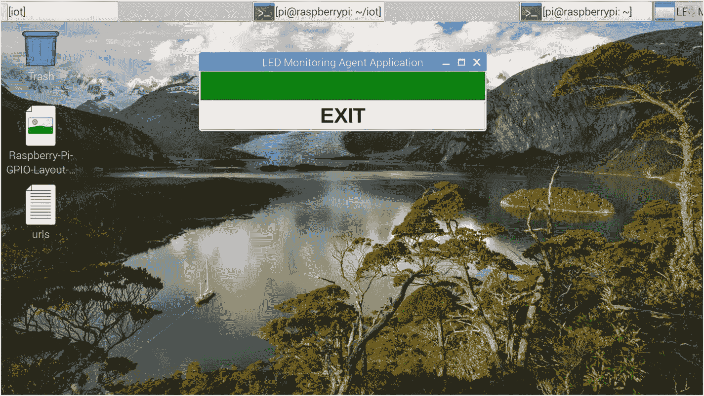

图 3-25

运行 LED 监控代理应用程序

你也可以通过 crontab 运行此代理监控服务应用程序，只需添加一个简单的 crontab 条目，如下所示：

```
$crontab -e
0 10 ∗ ∗ 1 python3 /home/pi/iot/mmagent.py
```

上面 crontab 中的条目每天上午 10 点运行命令 `python3 /home/pi/iot/mmagent.py`，LED 监控代理检查 LED 状态并在屏幕上输出值，如果当时状态为红色，则通过电子邮件发送警报。你可以修改 crontab 条目，使其每隔几分钟检查一次。

在本章的最后一节中，你将把机器学习模型应用于你在 SQLite3 数据库中收集的模拟传感器数据。


## 将机器学习模型应用于传感器数据

为了进行机器学习并将其应用于上一节中 `machinemon.db` 数据库和 `machinedata` 表中的模拟传感器数据，你需要执行清单 3-13 中所示的代码。

```
import pandas as pd
import SQLite3
conn = SQLite3.connect('machinemon.db')
#df.to_sql(name='tempdata', con=conn)
curr=conn.cursor()
#query="INSERT INTO TEMPERATURE VALUES(" +"'" + str(datetime.date(datetime.now())) + "'" +"," + "'" + str(datetime.time(datetime.now())) + "'"+ "," + "'" + str(tem) +  "'" + "," + "'" + tempstatus +"'" + ")"
df = pd.read_sql_query("select ∗ from machinedata;", conn)
print(df)
#curr.execute(query)
conn.commit()
#Looking at data
print(df.columns)
print(df.shape)
#Looking at datatypes
print(df.dtypes)
df['outage']=df['outage'].astype("int")
#Cleaning up and dummy variables
df['tempstatus'] = df['tempstatus'].map({'RED':2, 'ORANGE':1, 'GREEN':0})
df=df.drop('date',1)
df=df.drop('time',1)
#Checking for missing values
print(df.isnull().any())
#EDA- Exploratory Data Analysis
print("----------EDA STATISTICS---------------")
print(df.describe())
print("----------Correlation---------------")
print(df.corr())
#Dividing data into features and target
target=df['outage']
features=df.drop('outage',1)
#Building the Model
from sklearn.model_selection import train_test_split
x_train, x_test, y_train, y_test = train_test_split( features, target, test_size=0.25, random_state=0)
from sklearn.linear_model import LogisticRegression
lr  = LogisticRegression()
lr.fit(x_train, y_train)
