# Use score method to get accuracy of model
score = lr.score(x_test, y_test)
print(score)
import matplotlib.pyplot as plt
import seaborn as sns
from sklearn import metrics
import numpy as np
cm = metrics.confusion_matrix(y_test, predictions)
print(cm)
plt.figure(figsize=(9,9))
sns.heatmap(cm, annot=True, fmt=".3f", linewidths=.5, square = True, cmap = 'Blues_r');
plt.ylabel('Actual label');
plt.xlabel('Predicted label');
all_sample_title = 'Accuracy Score: {0}'.format(score)
plt.title(all_sample_title, size = 15);
plt.figure(figsize=(9,9))
plt.imshow(cm, interpolation="nearest", cmap="Pastel1")
plt.title('Confusion matrix', size = 15)
plt.colorbar()
tick_marks = np.arange(10)
plt.xticks(tick_marks, ["0", "1", "2", "3", "4", "5", "6", "7", "8", "9"], rotation=45, size = 10)
plt.yticks(tick_marks, ["0", "1", "2", "3", "4", "5", "6", "7", "8", "9"], size = 10)
plt.tight_layout()
plt.ylabel('Actual label', size = 15)
plt.xlabel('Predicted label', size = 15)
width, height = cm.shape
for x in xrange(width):
for y in xrange(height):
plt.annotate(str(cm[x][y]), xy=(y, x),
horizontalalignment='center',
verticalalignment='center')
plt.show()
清单 3-13
在模拟传感器数据上应用机器学习
```

从代码中可以看出，它首先导入稍后将在程序中使用的 Python 库，例如 `pandas` 和 `SQLite3`。然后初始化与 `machinemon.db` 数据库的连接，并为连接对象创建一个游标。这次，你没有使用查询字符串来创建查询，而是使用 pandas 对象 `pd` 及其下的函数 `read_sql_query()`，通过传递 SQL 查询和 `conn` 对象，通过 SQLite3 驱动程序连接到你的数据库。使用代码 `df = pd.read_sql_query("select ∗ from machinedata;", conn)` 将 `machinemon.db` 数据库中的整个 `machinedata` 表传输到 pandas 数据框 `df` 中。

下一部分是探索性数据分析（EDA），你使用 `df.columns` 和 `df.size` 语句查看数据框 `df` 的大小和形状。在代码的下一部分，你使用 `astype()` 函数将 `outage` 列转换为整数，因为它包含的值中，1 表示发生中断，0 表示未发生中断。`tempstatus` 列包含非数值（RED、GREEN 和 YELLOW）；需要将它们映射为 0 表示绿色，1 表示橙色或黄色，2 表示红色。你需要这样做，因为 Python 中的机器学习库无法处理非数值，需要数值数据来进行计算。这种转换也称为创建虚拟变量，通过代码中的语句 `df['tempstatus'] = df['tempstatus'].map({'RED':2, 'ORANGE':1, 'GREEN':0})` 实现。

代码的下一部分是检查是否存在任何缺失值，但这里没有缺失值，因为你有自己的程序将值输入数据库，并且在此过程中没有人工干预。

你使用 pandas 数据框对象 `df` 的 `df.describe()` 函数进行探索性数据分析。完成此操作后，你将查看变量之间的相关性，以检查是否存在任何强关系。确定之后，你将数据框划分为目标变量和特征变量。目标变量是你想要预测的内容。在你的案例中，它是中断（outage）。你想要预测中断并查看其发生时间。你将 `outage` 从特征变量中删除，因为它是你的预测目标。

现在你可以开始创建训练集和测试集。为此，你使用 sklearn 库中的 `train_test_split` 函数。你知道，你的预测目标 `outage` 的值可以是 1 或 0。1 表示发生中断，0 表示未发生中断。所以这是一个分类问题。你使用一个简单的分类算法：逻辑回归。你也可以使用其他算法，如朴素贝叶斯或支持向量机（SVM），来观察预测准确率是否会提高。

你使用 `x_train` 和 `y_train` 数据集训练逻辑回归模型，然后使用 `x_test` 进行预测。预测结果存储在 `predictions` 变量中。为了获得模型的准确率，你使用 `score()` 函数，并将 `x_test` 和 `y_test` 数据集输入其中。一旦知道预测的得分，你就可以使用预测结果来可视化混淆矩阵。这是通过语句 `cm = metrics.confusion_matrix(y_test, predictions)` 完成的。接下来的几行代码初始化 `matplotlib` 对象，并通过将 `cm`（混淆矩阵）对象输入其中来创建图形热力图。你将在本节中看到两个图形可视化：第一个是准确率得分，第二个是输入到 `plt.title()` 函数中的混淆矩阵。最后，`plt.show()` 将两个图形显示在屏幕上。如果你在 Raspbian 命令行窗口中运行此代码，它将自动在桌面上弹出一个包含两个图形的窗口，看起来非常像图 3-26 和图 3-27。

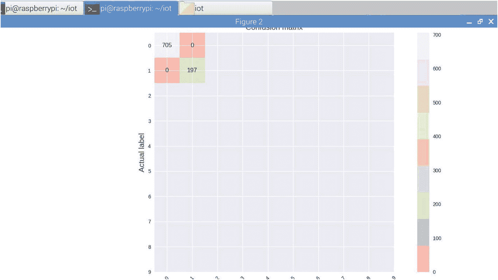

图 3-27

混淆矩阵

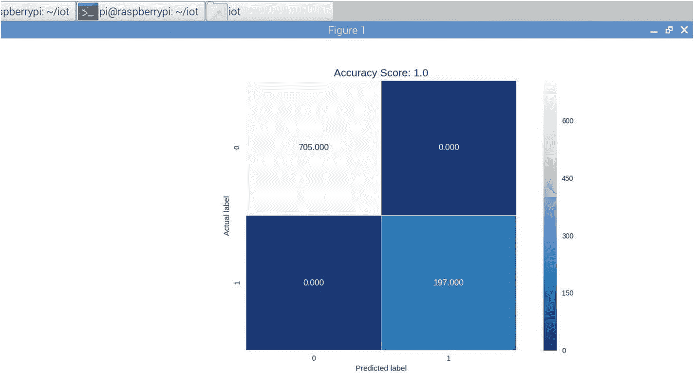

图 3-26

准确率得分热力图


## 总结

在本章中，你了解了使用 Python 的树莓派以及该物联网监控应用的整体框图。你通过编写一个 Python 树莓派 Hello world 程序测试了你的系统。接着，你测试了诸如 scikit-learn 和 pandas 等所有 Python 库是否都能完美加载。然后，你使用 Python 测试了 Arduino 设置，以确认其硬件配置完成后能否正常通信。你通过将第一个草图刷写到 Arduino 的内存中运行了它。接下来，你了解了如何通过首先配置树莓派的 GPIO 引脚，然后使用面包板电路进行硬件设置，从而从树莓派的示例代码中获取物联网传感器数据。接着，你学习了通过一个 Python 程序对物联网传感器光敏电阻模块进行编程，以检测白天和黑夜。该程序的另一个重要部分是通过配置 SQLite3 等数据库并创建数据库结构来存储物联网数据。然后，你运行了一个 Python 程序，从 LDR 模块获取数据并将其存储在 SQLite3 数据库中。接着，你创建了一个基于 Python 的实用物联网应用，该应用基于温度和光照状态数据具备高级预警能力，使你能够为其创建一个监控代理。然后，你通过使用逻辑回归算法，根据物联网传感器的读数对温度状态进行分类，将机器学习应用于从温度和 LDR 模块收集的数据之上。你通过使用 Seaborn Python 库构建混淆矩阵，创建了分类模型的可视化，并确定了预测模型的准确性。

通过准确率分数和混淆矩阵的可视化，我在此结束本节及本章的内容。你现在已经对如何利用物联网传感器数据应用机器学习以获得业务成果有了实质性的理解。在第五章中，你将了解使用 Python 执行物联网和工业物联网应用所需的设置和安装。

# 4. 在电信、能源和农业领域使用机器学习与物联网

在第二章中，你了解了物联网和工业物联网及其用途。你还通过一个实际示例，看到了如何使用树莓派、Arduino 和 Python 结合机器学习来设计一个物联网系统。通过这个实际示例，你现在已经理解了任何物联网或工业物联网应用的实现方面，例如通过从物联网传感器收集数据，然后将其与基准数值（如温度阈值）进行比较，并通过电子邮件或图形用户界面警报向用户发出高级预警信号，从而创建监控系统。

在本章中，你将看到机器学习与物联网在电信、能源和农业领域的最新实现。我将带你了解在每个领域中机器学习与物联网的一些快速实现方法，帮助你理解为其构建应用所涉及的细微差别和复杂性。

## 机器学习与物联网在电信领域的最新实现

目前，全球电信领域正经历着一场快速的技术浪潮。这场变革的核心是 5G 频谱的引入。在我关于 5G 物联网安全的两大原因的博文（[`https://pmauthor.com/2019/07/02/3-reasons-why-5g-iot-is-safe/`](https://pmauthor.com/2019/07/02/3-reasons-why-5g-iot-is-safe/)）中，我谈到了每种电信技术频谱所能达到的成就。移动技术已经经历了 1G、2G、3G 和 4G 四代技术发展。每一代都是一套用于移动设备（如手机和平板电脑）间通信的电话网络标准。1G 提供了 2.4 kbps 的连接速度，2G 提供了 64 Kbps 的连接速度并基于 GSM，3G 提供了 144 kbps 到 2 Mbps 的连接速度，而 4G 提供了 100 Mbps 到 1 Gbps 的连接速度并基于 LTE 技术。1G 系统始于澳大利亚，本质上是模拟的。真正的数字电信始于 2G 标准的引入，它带来了 CDMA 和 GSM 协议，以及短信和彩信等服务。3G 引领了智能手机技术的引入，如网页浏览、视频流等。4G 彻底改变了我们所知的数据成本和用量；在 3G 时代，数据是非常昂贵的。4G 以**用户可负担的价格**提供了高速、**高质量和高容量**。

在我发布于 [`https://pmauthor.com/2019/07/02/3-reasons-why-5g-iot-is-safe/`](https://pmauthor.com/2019/07/02/3-reasons-why-5g-iot-is-safe/) 的博文中，我还指出了 5G 的关键优势。除了高达 35.46 Gbps 的高速数据连接外，5G 将带给人类的最大好处是，它承诺通过其网络连接多达 1000 亿台设备。实现这一目标的通信协议被称为毫米波移动通信。这是 5G 电信标准的最大突破。我们将详细探讨其技术工作原理。

现在，让我们看看机器学习与物联网在电信领域的最新实现。

**华为**：是的，尽管深陷间谍和数据泄露的争议，这仍是一家在人工智能领域值得关注的公司。这家公司是首家推出完整移动 5G 芯片组的厂商。在我关于 2019 年三大机器学习技能的博文（[`https://pmauthor.com/2019/07/05/3-top-machine-learning-skills-for-2019/`](https://pmauthor.com/2019/07/05/3-top-machine-learning-skills-for-2019/)）以及另一篇关于 5G 物联网安全的两大原因的博文（[`https://pmauthor.com/2019/07/02/3-reasons-why-5g-iot-is-safe/`](https://pmauthor.com/2019/07/02/3-reasons-why-5g-iot-is-safe/)）中，我提到 5G 物联网将成为人工智能领域的下一个游戏规则改变者。华为已经推出了全功能的 5G 芯片组。它还推出了全球首款带有 AI 大脑的数据中心交换机。华为还推出了全栈、全场景的人工智能技术，以实现**自动驾驶网络**，并开发了 SoftCOM AI 解决方案，以帮助**移动运营商最大化**能源效率、网络性能、运维效率和用户体验。正如 [`www.busiweek.com/huawei-presents-its-simplified-5g-and-softcom-ai-solutions/`](http://www.busiweek.com/huawei-presents-its-simplified-5g-and-softcom-ai-solutions/) 文章所述，华为的解决方案侧重于建设数字乡村。物联网还将使其应用能够在设备之间进行 8K 高清音视频直播。远程虚拟医疗医生将能够与家中病危的患者进行双向流媒体通信，员工可以以更高的清晰度和低反馈进行商务会议直播，同时传输高速数据。随着 5G 服务在每个国家的推出，现在可以提供物联网云服务、个人移动服务、五星级优质家庭宽带以及云网融合。尽管华为在其网站（[`www.huawei.com/minisite/iot/en/overview.html`](http://www.huawei.com/minisite/iot/en/overview.html)）上对其 OceanConnect 物联网平台描述不多，但不难看出它认为物联网将在社会中发展的关键领域。请参见前述网页上的图 1，了解华为的物联网解决方案。

5G 和物联网注定要共同腾飞，因为 5G 电信频谱提供的技术不仅补充了物联网的能力，而且通过提供极其快速和高效的数据传输（这是每个实施该技术的国家中物联网设备和应用的支柱）增强了这些能力。


OceanConnect 物联网平台致力于将物联网融入人类生活的各个层面。该平台的基础是 5G 芯片组或 5G 设备，这些设备在 2G、3G 及其他物联网和 5G 连接基础设施网络之上拥有自己的云互联网关，并与智能家居网关相结合。在此基础层之上是 OceanConnect 物联网平台，其内部包含三大核心组件。第一个组件是物联网连接管理，它位于 2G、3G、4G 或 5G 基础设施之上，这些基础设施中包含了安装在个人住宅中的智能家居物联网网关。连接管理为这些个人智能家居网关提供了接入 OceanConnect 物联网平台的通道。每个智能家居网关都将连接已启用的物联网设备，而物联网平台将提供设备管理服务，例如将设备添加到物联网平台或从物联网平台中移除设备。然而，即使你拥有最佳的智能网关基础设施，并结合了物联网平台上的连接管理和设备管理服务，但如果平台不具备应用使能能力，它也将毫无实际用途。正是应用程序为用户带来了实际效益，并为设备提供了稳定的 5G 连接。因此，该物联网平台也提供应用使能服务。华为着眼于其物联网平台的商业化；它看到了在公共事业服务（如能源、水利和交通）中的应用。它也看到了工业应用，其中工业 4.0 使工业物联网应用能够适配其物联网平台，并利用该平台提供智能工业解决方案。它还致力于打造一个与其物联网平台相连的智能家居，从而获得各种服务，如医疗保健、食品杂货管理、交通管理、财务监控与管理。OceanConnect 物联网平台还提出了车联网的概念，这是一个由配备各种物联网传感器的小型车辆组成的网络，这些车辆能够通过相互发送数据进行通信。这样的车联网无疑将有助于使交通管理更便捷、更实时。然而，在我看来，未来还将催生出一种被称为“设备互联网”的新事物，它将是一个互联设备的网络，不仅限于车辆，而是任何使用物联网传感器的设备，这些设备能够凭借独特的应用程序接入任何物联网平台。正是这个设备互联网，将引发智能生活的革命。

物联网的另一项前沿实现是面向所有物联网连接性的开放连接基金会。物联网当前面临、并且未来将成为主要问题的一个挑战，是社会缺乏统一的物联网标准。没有统一的物联网标准，各种物联网设备和应用将相互孤立，无法与自身之外的其它物联网设备进行通信。不过，现在已有标准来解决这个问题。参与社会标准制定的有三类人群。第一类是物联网应用的开发者。第二类是企业为其开发物联网应用的消费者群体。第三类是将物联网变为现实的物联网应用的开发者或创造者。这个面向物联网标准的开放连接基金会弥合了这三者之间的鸿沟。其关键优势在于，它为安全互操作性提供了共同定义，并提供了一个通用标准平台，以及物联网设备和应用的开源实现与认证。基于此框架的新模型层出不穷，并且每月都有发布，例如智能食品储藏室物联网设备、监控应用，以及 OCF 目前支持的智能狗屋等创新应用。这个开放的物联网标准正在创建完整的生态系统，以使物联网更加安全可靠。

接下来，我们进入下一部分，探讨机器学习和物联网在能源领域的一项前沿实现。我们将审视推动能源行业发展的关键技术进展。

## 机器学习和物联网在能源领域的前沿实现

目前，全球能源领域正经历着一场快速的技术变革。这场变革的核心是将物联网和机器学习引入全球能源系统。然而，物联网和机器学习的采用并不像在电信领域那样直接。这不仅仅是创造新的频谱领域并加以利用的问题。能源行业传统上是一个资本密集型产业，无论是石油、天然气、水力发电，还是太阳能或风能等可再生能源。能源领域的这一特性使其成为物联网和机器学习等技术的缓慢采用者。真正的原因是，大多数能源公司使用大量的能源设备，而建造和安装这些工厂需要花费数十亿美元。

### 物联网在能源领域的现状

该领域面临的实际挑战在于如何利用物联网并改造旧的能源系统。对于能够使用 Modbus 接口等协议进行通信的能源设备，实施起来很容易。能源领域中那些无法使用通用工业接口进行通信的非常陈旧的设备，对任何能源公司来说无疑都是一个巨大的挑战。替换正在生产中的机械工厂的某些部件并非易事，因为这些能源系统不能停机。在无法轻易更换工厂设备的情况下，物联网和机器学习必须采用创新方法来读取此类老旧设备的数据。毕竟，机器学习需要数据来分析和预测能源领域的问题。


### 拥抱能源领域物联网的解决方案

全球有多家公司正尝试利用基于物联网传感器的新技术，为这些老旧设备开发数据采集解决方案。其中一家知名企业是西门子（[`https://new.siemens.com/us/en/products/energy/featured-topics/redefine-performance.html`](https://new.siemens.com/us/en/products/energy/featured-topics/redefine-performance.html)）。能源领域面临的关键问题如下：

1.  可再生能源电厂正在兴起。这体现在两个方面：一是老旧的化石燃料发电厂正被太阳能或风能企业取代；二是新增的发电厂本质上都是可再生能源电厂。

能源运营的去中心化正在发生，这意味着发电机组为了生产能源，正变得越来越独立。传统的能源生产方式，如石油和天然气，需要集中的工厂设施来协助生产。然而，像太阳能电网和风力发电场这样的可再生能源发电系统，则允许能源生产的去中心化。去中心化使得能源生产计划可以在小型设施中执行，并且能更便捷地为本地社区的能源需求做出独立决策。中心化则赋予了能源公司跨地域运营的自由，并能利用物联网和机器学习等技术来生产能源。去中心化确实给利用规模经济带来了挑战；然而，它所带来的快速制定本地化能源生产决策的能力及其灵活性，弥补了这一不足。本地化的小型能源生产单元，可以利用机器学习或深度学习等技术，根据观察到的消费模式，快速决定何时削减或增加发电量。这种调节能源需求的能力，将成为未来建立去中心化能源生产单元的关键差异化因素。

2.  我们都知道，人类对能源的需求，尤其是石油和天然气，在全球范围内不断增长，发电厂被迫在超出其原始设计规格的条件下运行。这对未来构成了严重威胁，因为电厂的产能已经达到极限，其未来运营面临压力。各公司正在采用多种技术：有些公司在化石燃料电厂旁边建设可再生能源电厂，而另一些公司则在提高现有化石燃料电厂的产能。

3.  大多数国家面临的一个问题是电网的稳定性。为此，他们需要一个良好的系统，能够提前准确预测电网任何部分的能源需求，以便在用电高峰或低谷到来之前增加或减少发电量。停电会给依赖能源运营的工业和居民带来问题。因此，大多数国家都在规划运营方案，以更高效地满足其社区的能源发电需求。与不稳定的电网相比，稳定的发电电网通过提供稳定的电力经济来降低成本；而不稳定的电网则会推高发电成本，并对社区产生更深层次的经济影响。

一家专注于发电厂和能源发电技术的公司——西门子，对其客户进行了一项关于利用其能源领域技术实现发电厂未来适应性的调查。参见[`https://assets.new.siemens.com/siemens/assets/public.1552332517.656a83b0-646a-4286-9546-dc54bd8a2e35.future-proofing-power-plant-ebook-2019.pdf`](https://assets.new.siemens.com/siemens/assets/public.1552332517.656a83b0-646a-4286-9546-dc54bd8a2e35.future-proofing-power-plant-ebook-2019.pdf)。调查中的客户谈到了发电厂预计在未来三年将面临的公用事业挑战。30%的受访者提到的第二个问题是采用新的人工智能技术。这表明，能源发电公司看到了在当前环境中采用人工智能、机器学习和物联网所面临的挑战。调查给出的展望是未来三年，因此这是一个短期展望。在关于通过规划和数据分析（一个与数据科学和机器学习密切相关的领域）取得成功的提问中，它询问客户在过去三年中，电厂改造和更新项目的成功程度如何；那些实现了电厂运营目标的公司的回复显示，超过 50%的公司达到了这一目标。然而，调查得出的主要结论是，能源发电商正在大力投资于包括新数字技术在内的计划升级和改造，但在决定改造和升级方面的信心水平较低：在确定优先级方面约为 20%至 27%，在决定哪些合作伙伴应参与此类升级项目方面约为 20%至 30%，在决定何时或什么时间点进行投资方面约为 18%至 33%。过去三年中，升级项目报告的整体成功率约为 25%，这意味着尽管能源发电公司已经采用了升级项目，但成功的案例很少，失败率很高。

因此，我们看到能源行业正处于动荡之中，许多公司被迫将其电厂升级为更依赖太阳能和风能等可再生能源；然而，此类项目升级的成功率非常低，导致投资回报率下降。正如调查所指出的，采用机器学习和人工智能等技术是一项挑战，这意味着该行业在适应和利用这些技术为自己创造优势方面准备不足。但在任何先进的实施方案中，像西门子这样的公司都通过使用物联网传感器和设备，并将其连接到机器学习模型来预测任何电网的能源需求，从而提供解决方案。这种创新解决方案甚至可以应用于化石燃料发电厂和旧的数据存储库，以分析和综合数据，创建预测模型。从预测工厂和设备的定期维护周期到预测用电高峰，各公司正在使用机器学习模型来解决遗留问题（[`https://assets.new.siemens.com/siemens/assets/public.1534921431.05f93d5a3c096441998512706a42840c51fd3f68.2018-05-ew-article-iot-manfred-unterweger-en.pdf`](https://assets.new.siemens.com/siemens/assets/public.1534921431.05f93d5a3c096441998512706a42840c51fd3f68.2018-05-ew-article-iot-manfred-unterweger-en.pdf)）。


另一项先进的能源技术实现来自一家名为 MindSphere 的公司，该公司专注于能源流程的数字化。它通过实施工业 4.0，将机器和流程智能互联，使其在整个使用寿命期间能够更高效、更可靠地运行，从而推广了将能源互联网作为物联网延伸的概念。该公司为能源领域构建了生态系统，应用范围广泛且性质多样，涵盖智能计量、保护数字服务、电力连接、电能质量稳定性、关键电源管理系统、电厂状态监测系统、能源中断管理系统、智慧城市平台系统、分布式能源微电网等级以及出色的预测模拟模型。这些领域正利用智能物联网传感器采集各类数据，使业务应用能够评估设备状态，并在此基础上应用机器学习和数据科学，例如对断路器进行预防性维护和警报监控。作为西门子旗下公司，MindSphere 最终为成功的数字化转型和实现盈利奠定了基础。它能够监控现场设备和装置，从而在电厂紧急情况下根据需要采取适当行动。这类数字解决方案将改变物联网和机器学习在能源领域的实施方式。能源公司的业务活动本质上非常复杂，且具有关键性，因为它们服务于医院和机场等众多紧急服务部门，因此，在决策和规划辅助中应用人工智能和机器学习也显得尤为重要。

1.  涉及能源勘探、生产和分配的跨境复杂运营，需要利用机器学习，通过创建高效业务模型，仔细分析从所有这些运营中收集的数据，以辅助能源领域管理高管的决策过程。

2.  客户数量庞大且分布广泛，给能源公司从终端用户收集数据带来了挑战。使用能够从单个客户设备（如智能电网、智能云存储应用）回传数据的智能计量技术，并利用机器学习基于这些数据预测能源消耗，有助于能源领域的决策过程。

3.  基础设施投资需要主要设备和设施、车队升级或新工厂的调试与安装。在进行此类投资前，利用机器学习和人工智能创建模型，通过提供关于过去失败原因以及如何在实施新升级或安装项目时规避问题区域的数据，能够极大地帮助做出正确决策。

为了提高运营绩效，发电厂正在利用物联网获取数据，将其工业资产连接到物联网传感器设备，监测工厂层面的机械性能，并衡量组织关键绩效指标，如机械生产率和设备效率。老旧电厂的预防性维护无疑是基于物联网的应用正在为能源领域解决的问题。可以生成物联网数据，使其能够了解设备性能负载以及老化能源资产的位置。基于物联网的管道能源计量表已变得非常普遍；它们利用机器学习来测量和预测石油、天然气等能源液体的流量。还可以监测流体的质量，并提前预测任何劣化情况，以避免在生产过程中造成巨大损失。能源领域还利用机器学习来预测化石燃料电厂的能源消耗，以便其处于就绪状态，通过启动备用可再生能源电厂来承担负荷，以应对消费者能源需求的任何激增。这种基于能源需求预测性需求预测的平衡，是能源领域一个极佳的应用案例。

您已经了解了机器学习在能源领域的先进实现。本章下一节将介绍机器学习和物联网在农业领域的先进实现。


## 机器学习与物联网在农业领域的前沿应用

农业领域正迎来一场人工智能革命。这场技术浪潮正在全球范围内展开。全球农业正在经历的关键变革是，大型食品集团正试图接管农业生产，以满足自身对终端消费产品的原料需求。这些大型食品集团希望农民种植特定的专利作物品种，以维持良好的食品质量和生产力。因此，在一些国家，它们与农业社区合作，从农民手中直接采购生鲜蔬菜和牛肉；而在另一些国家，它们则通过合同雇佣农民，专门生产特定品种的粮食及其他产品，如土豆、生菜、胡萝卜、乳制品和油菜籽。这些产品被用作终端消费品的原料，例如麦当劳通过“旗舰农民计划”（[`www.flagshipfarmers.com/en/about-the-program/`](http://www.flagshipfarmers.com/en/about-the-program/)）生产的汉堡。

这些食品巨头的努力旨在建立其核心原料（如土豆和生菜）的专利品种库。例如，麦当劳使用其著名的专利品种“Russet Burbank”土豆来制作薯条（[`www.earthandtablelawreporter.com/2015/09/11/patenting-the-potato-not-all-taters-are-created-equal/`](http://www.earthandtablelawreporter.com/2015/09/11/patenting-the-potato-not-all-taters-are-created-equal/)）。另一个例子是食品集团孟山都，它拥有许多蔬菜和种子的专利，例如豆类、西兰花、胡萝卜、黄瓜和甜瓜等。其中许多蔬菜被其他公司商业化使用。百事公司旗下的旗舰薯片品牌乐事就使用了孟山都的土豆（[`https://feast.media/food-brands-owned-by-monsanto`](https://feast.media/food-brands-owned-by-monsanto)）。孟山都持有 14 种专利品种，其中最受欢迎的是 Roundup Ready® Corn 2（[`www.monsantotechnology.com/content/genuity-traits-corn.aspx`](http://www.monsantotechnology.com/content/genuity-traits-corn.aspx)）。

这仅仅是食品公司购买专利并商业化利用的一个例子。目前，关于使用转基因产品作为商业食品原料存在争议。转基因食品可能引发多种疾病，因此大型食品公司并未使用它们；然而，这些公司面临着提高商业可行性和适应转基因实践以增加利润的压力，而转基因作物品种恰好能提供这种可能性。

转基因作物的一种全新替代方案是计算育种技术，该技术结合了人工智能和机器学习，为农民带来卓越的产量。首先，利用物联网收集作物及其环境的数据，例如通过空气过滤传感器分析空气成分，以及通过油类传感器收集土壤混合物的数据。这些应用已通过所谓的“统计育种模式”得以实现，该模式使农民能够根据由空气和土壤混合物构成的大气环境，获得最适合该环境的作物。在该系统中，农民利用智能机器学习和物联网系统，基于全球其他具有相似气候地区的过往数据，为给定的空气和土壤混合物选择最佳的种子品种，从而在自家农场实现最大产量。一家名为 HFG 的公司正在开展这项工作，它利用农业数据集和预测性数据科学，为作物构建预测性育种平台（[`www.zdnet.com/article/computational-breeding-can-ai-offer-an-alternative-to-genetically-modified-crops/`](http://www.zdnet.com/article/computational-breeding-can-ai-offer-an-alternative-to-genetically-modified-crops/)）。

人工智能的另一项前沿应用来自日本等科技发达国家，主要应用于水稻种植。农村地区的人们正迁往城市谋生。由于人口从农村地区大规模迁移到东京、京都等城市中心，日本农村地区已无人从事农业。因此，日本迫切需要农民，尤其是用于生产主食大米。在日本农村地区，利用自动化和机器学习及人工智能进行农业种植可以提供帮助。在这一应用中，日本东北部的农民和开发者开始使用无人机来补充田间劳动力（见图 4-1）。

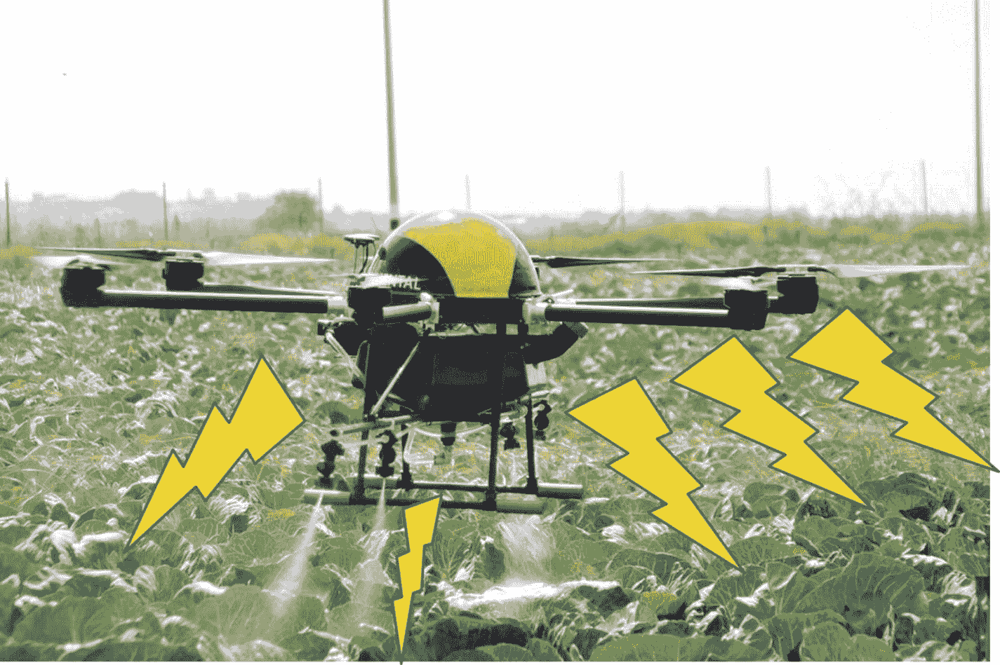

图 4-1

用于检测作物病害的无人机机器人

一家初创公司开发了一款名为“91108 rich's”的无人机。其主要功能是向作物喷洒农药和肥料。它能在 15 分钟内完成农民需要 60 分钟才能完成的工作。通过 iPad 控制此类无人机，并结合机器学习应用来识别需要更多肥料或农药的区域，可以在这种应用的基础上进行开发。诊断型无人机能够通过持续监测作物，并保护作物附近可能存在的微生物，从而检测到病害的爆发。这正是利用物联网传感器进行害虫防治，并结合附近树莓派应用站运行的机器学习应用，来实现整个农业周期自动化的关键所在（[`www.techrepublic.com/article/how-drones-are-changing-farming-in-rural-japan/?ftag=CMG-01-10aaa1b`](http://www.techrepublic.com/article/how-drones-are-changing-farming-in-rural-japan/%253Fftag%253DCMG-01-10aaa1b)）。

## 总结

你在本章中看到的所有应用本质上都是实验性的，并且是由中国公司华为在 5G 物联网领域引入的前沿实现。你还了解了能源行业面临的挑战如何通过物联网在化石燃料和可再生能源发电领域得到解决。接着，你考察了农业领域，其中物联网和机器学习的智能应用有望解决农民出售土地并迁往城市寻求更好生活的“人力流失”问题。在第 5 章中，你将准备好在上述三个领域实施案例研究的环境。

# 5. 准备案例研究的实施

本章主要介绍如何准备案例研究的实施。你将首先学习如何从零开始设置你的树莓派 3 Model B+及其硬件和软件。当然，为此你将安装流行的 Raspbian 操作系统。之后，你将把 Arduino Mega 2560 连接到树莓派，并连接物联网传感器模块以获取数据。接下来，将设置运行树莓派程序所需的 Python 环境。你还需要设置启用了 Modbus 的电能计量设备。然后，你将连接树莓派与 Arduino，并启动它们之间的通信。最后，你将测试所有内容。


## 设置树莓派 3 Model B+

请参考第 3 章的图 3-1，了解案例研究所需组件的示意图。有两个软件组件，即 Python IDE 和 Arduino IDE，你将在硬件组件完全设置好后进行安装。那么，让我们从硬件开始。

设置树莓派 3 Model B+ 硬件的第一步是决定用于运行应用程序的操作系统。目前有两种流行的操作系统可供选择：**Raspbian** 和 **Noobs**。Noobs 适用于树莓派新手。你将使用的是 Linux 版本的 Raspbian，可从 [`www.raspberrypi.org/downloads/`](http://www.raspberrypi.org/downloads/) 获取。如图 5-1 所示，该图显示了可从树莓派官方网站下载的可用操作系统镜像。

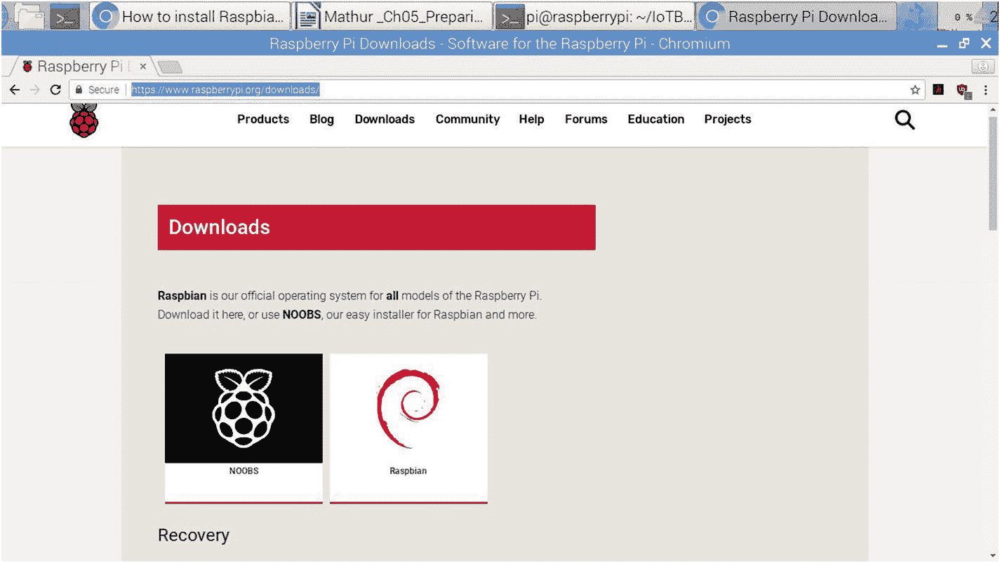

图 5-1

[www.​raspberrypi.​org](http://www.raspberrypi.org) 下载选项

请注意，在此阶段你尚未启动树莓派 3 B+，因为其 microSD 卡上尚未安装任何操作系统。树莓派 3 B+ 套件附带一张 microSD 卡和一个 microSD 卡读卡器或适配器。如果你没有 microSD 卡，可以从我网站 [`www.pmauthor.com/raspbian/`](http://www.pmauthor.com/raspbian/) 上的选项中获得。对于 Raspbian 的安装，建议的 microSD 卡基本容量为 8GB。对于 Raspbian Lite 镜像安装，Raspberrypi.org 建议至少 4GB。请记住，只有树莓派 3A+、3B+ 和 Compute Module 3+ 可以从大于 256GB 的 SD 卡启动。这是因为早期树莓派型号所使用的 SoC 存在一个错误。另外，请务必注意你的 microSD 卡所属的等级，因为这决定了其支持的写入速度；Class 4 卡很可能以 4MB/s 的速度写入，而 Class 10 卡应能达到 10 MB/s。请注意，这并不意味着 Class 10 卡在常规读写性能上一定优于 Class 4 卡，因为这种写入速度通常是以牺牲读取速度和大幅增加 microSD 卡操作的寻道时间为代价的。你的树莓派 3 B+ 套件附带的 microSD 卡应该是最新的，并且很可能像现在常见的那样是 Class 10 的；但是，如果你拿到的是 Class 4 等较低等级的卡，可以在 [`www.pmauthor.com/raspbian/`](http://www.pmauthor.com/raspbian/) 订购一张更快的 Class 10 卡。

当然，你的笔记本电脑必须有一个插槽，可以直接或通过适配器读写 microSD 卡。如图 5-2 所示。此外，你还需要一台运行 Windows 或 MacOS 的电脑或笔记本电脑，以便下载此镜像，然后格式化 SD 卡并将此镜像安装到卡上。本章我将向你展示如何在 Windows 系统上完成此操作。

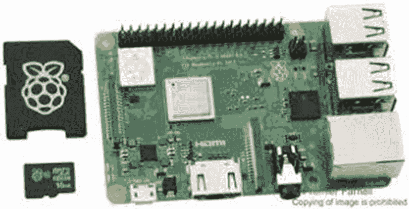

图 5-2

官方套件附带的 microSD 卡和 microSD 卡适配器

暂时不要将 microSD 卡适配器插入树莓派 3 B+ 主板，因为它是空的，尚未格式化，也没有写入任何操作系统镜像。你需要先点击网站的下载部分，下载 Raspbian 镜像。完成后，你将获得下载最新版 Raspbian 镜像的选项。在撰写本书时，有三个下载选项，如图 5-3 所示。

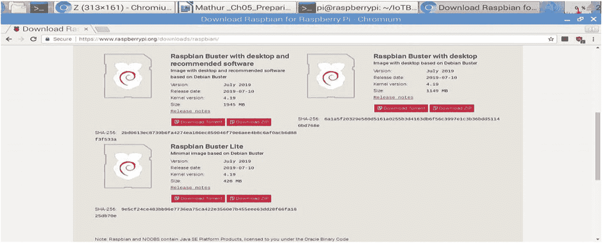

图 5-3

Raspbian 下载选项

第一个选项是 **Raspbian Buster**，这是适用于桌面环境并推荐软件的 Raspbian 版本名称。第二个选项仅包含桌面环境，第三个是 Lite 版本，它不具备你为物联网应用进行广泛编程所需的所有功能。因此，你将使用第一个选项，它提供了入门所需的所有软件组件。你可以根据解压软件点击 Torrent 或 zip 文件。我使用的是 zip 文件版本。Raspbian Buster 版本的 zip 文件大约为 2.3GB，因此下载时间取决于你的网络连接速度。

下载完成后，你需要将 microSD 卡读卡器插入用于将操作系统安装到 SD 卡插槽的电脑/笔记本电脑。由于你使用的是 Windows，因此需要一个磁盘映像工具。我使用的免费工具是 **Win32 Disk Imager**。如果你没有，可以从这个页面下载：[`www.pmauthor.com/raspbian/`](http://www.pmauthor.com/raspbian/)。从网站下载并安装 Win32 Disk Imager 工具后，你可以双击其图标打开它。它应该看起来像图 5-4 中所示。

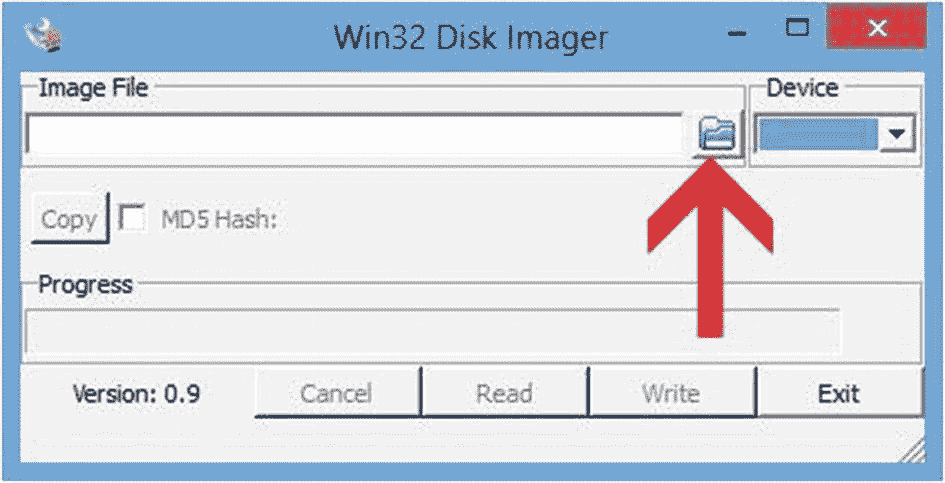

图 5-4

Win32 Disk Imager

点击图中所示的浏览图标，找到你下载并解压后的镜像文件。选择镜像文件位置后，点击右侧的 Device 下拉框，从中选择你的 microSD 卡盘符。对话框中的 Write 按钮将变为可用，点击它即可写入镜像。进度条会显示完成进度；这应该只需要几分钟。完成后，点击 Exit 按钮弹出 microSD 卡。现在，你的 microSD 卡上已写入了最新的 Raspbian OS 镜像，可以启动了。但是，在启动之前，你需要设置单板计算机（SBC）板上的物理连线，然后将 microSD 卡连接到树莓派 3 B+ 主板。

设置树莓派 3 Model B+ 的第二步是连接其主板，如第 2 章中 GPIO 引脚和 SBC 各组件的照片所示。你需要插入最少的必要组件才能开始。首先，你需要一个 LED/LCD 电视或显示器。市面上有很多选择，但我喜欢并在我的项目中使用的列在 [`www.pmauthor.com/raspbian/`](http://www.pmauthor.com/raspbian/)。如果你有闲置的电视，可以使用 HDMI 转 HDMI 线缆将其连接到 SBC 的 HDMI 端口。见图 5-5 和 5-6。


图 5-5

HDMI 转 HDMI 线缆

如果你有一个 5 英寸或 7 英寸的小型显示器，那么你会使用不同的线缆，并且紧凑型 LCD/LED 面板上可能没有 HDMI 插槽。

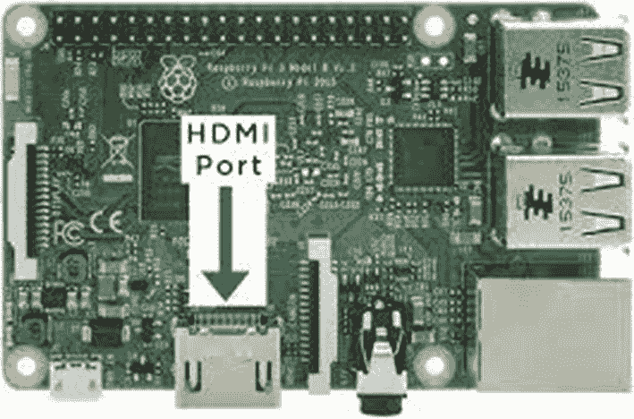

图 5-6

树莓派 3 B+ 上的 HDMI 端口


连接好的树莓派将如图 5-7 所示。请确保连接正确，并且两端（电视显示屏和树莓派 3 B+）的接口处不要松动，否则显示器将无法显示画面。这是初学者常见的问题：当你给树莓派通电后，发现显示器没有画面，却不知道发生了什么。这个问题很容易解决，因为树莓派的 HDMI 接口比较大，你可以清楚地看到线缆是否牢固地插在主板上。此外，在插拔 HDMI 线缆时，请务必不要给树莓派 3 B+ 通电；这既是出于安全考虑，也是操作上的要求。有时，当你给树莓派通电后再插入 HDMI 线缆，显示器可能不会显示画面。这种情况下，请重启树莓派 3 B+，因为这款单板计算机（SBC）上没有重启按钮。

在最终启动树莓派之前，我建议你做两件事。第一，将一个 USB 鼠标接收器插入树莓派 3 B+ 主板上的四个 USB 端口之一。第二，再插入一个无线键盘的 USB 接收器。这些是控制你的单板计算机（SBC）的必需品。你可以在图 5-7 中看到它们连接到 SBC 的样子。如果你没有无线版本的鼠标或键盘，也不必担心；有线版本的 USB 鼠标和键盘也能很好地工作。只是有线设备对于非常轻巧的 SBC 来说会显得有点沉重，如果鼠标或键盘的线缆晃动，SBC 可能会跟着移动。


图 5-7

连接到 SBC 的 USB 接收器

接下来，要让你的树莓派启动，你需要将其连接到电源。这款小巧的 SBC 的妙处在于它使用 microUSB 作为电源接口。这意味着你也可以通过连接一根 microUSB 电源线，用移动电源为其供电。为什么需要移动电源？它可以提供备用电源，这样在断电时树莓派就不会关机。如果你生活在世界上经常停电的地区，这一点尤为重要。如果你所在的地区电力稳定，则无需连接移动电源，可以直接通过电源适配器充电器连接到电源。你可以在图 5-8 中看到我连接移动电源的方式。

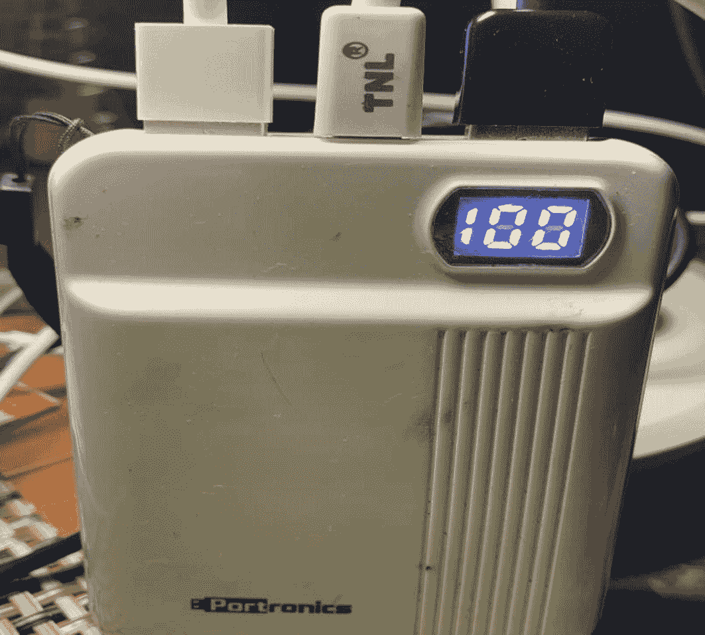

图 5-8

连接到移动电源的树莓派 3 B+ 电源线

图中是一个 Portronics 10000mAH 的移动电源。它可以为商业应用提供几个小时的电力。在我们的一次工厂能源审计应用中，我们不得不创建一个移动电源备份方案，将一个移动电源与另一个串联，第一个为第二个供电，这样即使断电几个小时，运行在树莓派上的能源审计应用也不会受到影响。有时你需要跳出固有思维，才能构建出能够从容应对断电的商业级应用。

现在，要让你的树莓派 3 B+ 启动，你只需将电源线的 microUSB 端插入 SBC 的电源插槽，如图 5-9 所示。请记住，如果你已经连接了电源或移动电源，并且在将线缆插入 SBC 时，它可能会在你手中启动。为避免这种情况，请确保在连接 microUSB 端时，另一端没有通电。

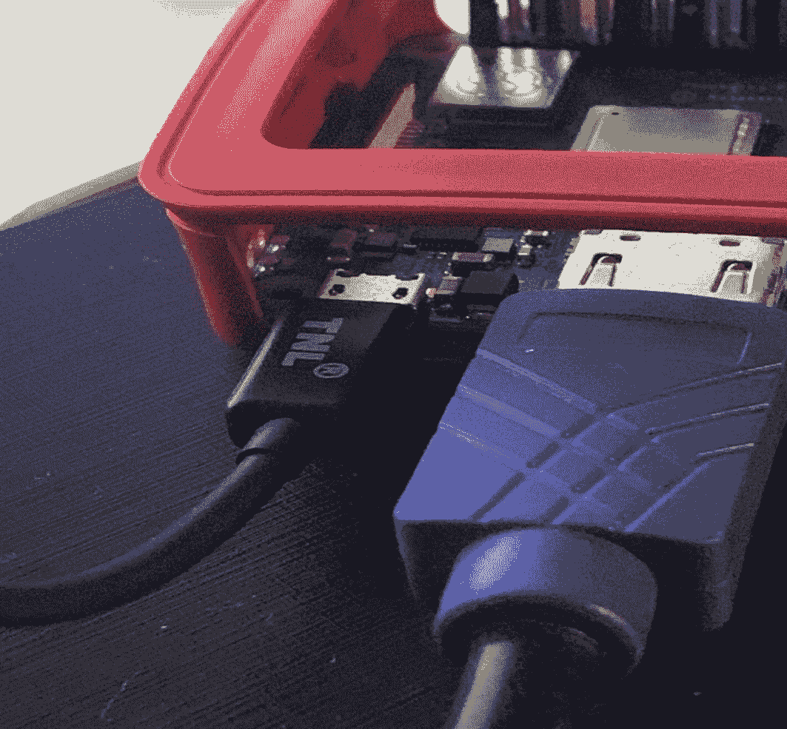

图 5-9

连接到树莓派 3 B+ SBC 的 microUSB 和 HDMI 线缆

现在你已经准备好启动设备了，请继续操作，打开连接到 microUSB 电源线的电源适配器的开关。你会看到 HDMI 接口插槽附近有一个绿色 LED 闪烁，连接的 LED/LCD 显示器应该会显示你在第 3 章中看到的启动画面。现在你拥有了一台安装了最新版 Raspbian 系统的基本树莓派。接下来，你需要安装软件，以便与物联网传感器和设备协同工作。

如果你运行的是 Raspbian（非 Lite 版本），Python 2.7 已预装在 Raspbian 发行版镜像中。但是，如果你想使用 Python 3，则需要通过以下 Raspbian 命令行提示符进行安装。不用说，你需要通过连接的以太网线或 Wi-Fi 连接为树莓派提供网络。

```
pi@raspberrypi:~ $ sudo apt-get install python3
```

通过输入图 5-10 中给出的命令，测试你在 Raspbian 上的 Python 3 安装。

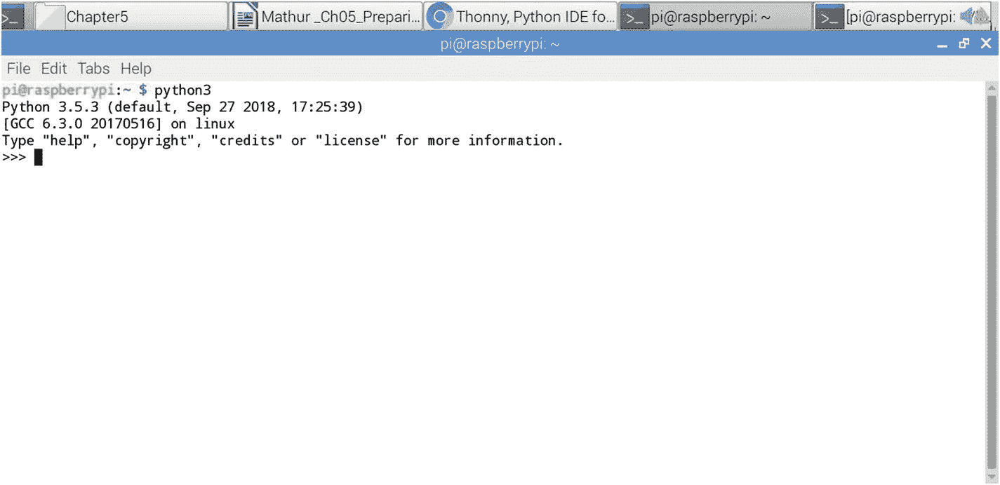

图 5-10

测试 Python 3 安装

现在你已经安装并测试了所需的 Python 版本，你需要一个集成开发环境（IDE）来在 Raspbian 上进行编程。我推荐你使用 Thonny IDE，因为它允许你在编辑器内编译和运行程序。我在第 3 章中已经讨论过它的需求和特性，所以我们直接进入在 Raspbian 上安装它的步骤。

Thonny IDE 是免费的，并且大多数带有 Stretch 程序的 Raspbian 操作系统都已预装。如果你在已安装的程序中没有找到它，正如你在第 3 章中看到的，可以从其网站下载：[`https://thonny.org/`](https://thonny.org/)。这个网站的好处是，它的主页上有一个关于如何使用该 IDE 的图文教程，非常基础且简单。安装可以使用清单 5-1 中的命令完成。


```
pi@raspberrypi:~ $ sudo apt-get install python3-thonny
正在读取软件包列表... 完成
正在分析依赖关系树
正在读取状态信息... 完成
下列软件包是自动安装的并且不再需要：
realpath vlc-plugin-notify vlc-plugin-samba vlc-plugin-video-splitter vlc-plugin-visualization
请使用 'sudo apt autoremove' 来卸载它们。
下列【新】软件包将被安装：
python3-asttokens
下列软件包将被升级：
python3-thonny
升级了 1 个软件包，新安装了 1 个软件包，要卸载 0 个软件包，有 205 个软件包未被升级。
需要下载 325 kB 的归档文件。
解压缩后会消耗 146 kB 的额外磁盘空间。
您想继续执行吗？[Y/n]
y
0% [正在连接至 archive.raspberrypi.org (2a00:1098:0:80:1000:13:0:7)]
获取:1 http://archive.raspberrypi.org/debian stretch/ui armhf python3-asttokens all 1.1.13-1+rpt1 [15.6 kB]
获取:2 http://archive.raspberrypi.org/debian stretch/ui armhf python3-thonny all 3.1.0-1+rpt2 [309 kB]
已下载 325 kB，耗时 2 分 2 秒 (2,643 B/s)
正在读取变更日志... 完成
正在选中未选择的软件包 python3-asttokens。
(正在读取数据库 ... 系统当前共安装有 149433 个文件和目录。)
正准备解包 .../python3-asttokens_1.1.13-1+rpt1_all.deb ...
正在解包 python3-asttokens (1.1.13-1+rpt1) ...
正准备解包 .../python3-thonny_3.1.0-1+rpt2_all.deb ...
正在解包 python3-thonny (3.1.0-1+rpt2) 并覆盖 (3.0.5-1+rpt1) ...
正在处理用于 mime-support (3.60) 的触发器...
正在处理用于 desktop-file-utils (0.23-1) 的触发器...
正在处理用于 man-db (2.7.6.1-2) 的触发器...
正在设置 python3-asttokens (1.1.13-1+rpt1) ...
正在处理用于 gnome-menus (3.13.3-9) 的触发器...
正在处理用于 hicolor-icon-theme (0.15-1) 的触发器...
正在设置 python3-thonny (3.1.0-1+rpt2) ...
pi@raspberrypi:~ $
清单 5-1
为 Python 3 安装 Thonny
```

Thonny IDE 的 Raspbian 软件包从 raspberry.org 官方网站的归档文件中下载，然后经过处理并设置以供使用。如果安装成功，你应该会在开始栏的“编程”菜单下看到已安装的 IDE，如图 5-11 所示。

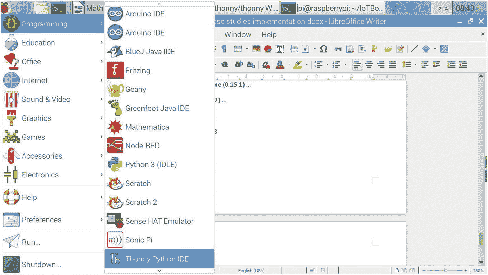

图 5-11

验证 Thonny Python IDE 安装

我在第 3 章中讨论过 Thonny IDE 的验证部分，因此我们进入下一步，安装案例研究中所需的 Python 库。以下是您需要的 Python 库列表。请记住将 `tkinter` 改为 `Tkinter`（是的，大写 T），如第 3 章所述。

*   **numpy** 用于在 Python 中对 n 维数组和矩阵进行操作。
*   **pandas** 用于数据整理。它专为快速简便的数据操作、聚合和可视化而设计。
*   **Seaborn** 用于通过热图和聚合图对统计模型进行数据可视化。
*   **scikit-learn** 为程序中使用的机器学习算法提供一致的接口。
*   **Tkinter** 用于为 Python 程序创建图形用户界面。
*   **scipy** 包含用于线性代数、优化、积分和统计的模块。
*   **matplotlib** 用于通过各种图表和图形进行数据可视化。
*   **NLTK** 是一个自然语言工具包，用于符号和统计自然语言处理的常见任务。
*   **statsmodels** 用于通过使用各种统计模型估计方法以及执行统计断言和分析来进行数据探索。

现在你已经看到了案例研究所需的 Python 库，请继续安装它们。我创建了一个脚本，可以在 Raspbian 命令行上执行此操作；见图 5-10。请记住，该代码是为 Python 2.7 安装的；如果你想在 Python 3 上安装所有库，则需要修改脚本，在 `pip` 后面加上 `3`，使其变为 `pip3`。

警告

如果你使用自己的脚本来安装 Python 库，请确保在 `pip install` 命令前加上 `sudo`，如清单 5-2 中的脚本 `pipinstaller.run` 所示。

```
pi@raspberrypi:~/$ cat pipinstaller.run
sudo pip install numpy | tee /home/pi/numpy.log
sudo pip install pandas | tee /home/pi/pandas.log
sudo pip install seaborn | tee /home/pi/seaborn.log
sudo pip install sklearn | tee /home/pi/sklearn.log
sudo pip install tkinter | tee /home/pi/tkinter.log
sudo pip install scipy | tee /home/pi/scipy.log
sudo pip install nltk | tee /home/pi/nltk.log
sudo pip install statsmodels | tee /home/pi/statsmodels.log
pi@raspberrypi:~/
清单 5-2
用于安装所需 Python 包的 Raspbian 命令行脚本
```

你会注意到，我在每个命令前都添加了 `sudo`，然后将输出通过管道传递给 `tee` 命令，以便将每个 Python 库的输出记录到文件中。因此，对于 `sudo pip install scipy | tee /home/pi/scipy.log`，输出会存储在一个名为 `scipy.log` 的单独日志文件中。这样更容易单独查看每个日志文件，并进行调试，查看安装过程中是否有任何错误。你可能会问，为什么我要将所有输出存储在日志文件中？简单的答案是，在 Raspbian 3 Model b+ 上，根据软件包的大小和你所在地区的互联网下载速度，安装一个软件包可能需要几个小时。因此，在运行脚本之前请牢记这一点，并确保你的 Raspberry Pi 系统和显示器有备用电源。在尝试运行此脚本之前，所有设备都应具备备用电源。显示器的备用电源同样重要，因为如果你的显示器因断电等原因关闭，Raspberry Pi Model 3 B+ 有时会无法显示屏幕。脚本的输出可能如清单 5-3 所示。


```
Requirement already satisfied: numpy in /usr/lib/python2.7/dist-packages
Requirement already satisfied: pandas in /usr/lib/python2.7/dist-packages
Requirement already satisfied: numpy>=1.7.0 in /usr/lib/python2.7/dist-packages (from pandas)
Requirement already satisfied: python-dateutil in /usr/lib/python2.7/dist-packages (from pandas)
Requirement already satisfied: pytz>=2011k in /usr/lib/python2.7/dist-packages (from pandas)
Requirement already satisfied: seaborn in /usr/lib/python2.7/dist-packages
Requirement already satisfied: sklearn in /usr/local/lib/python2.7/dist-packages
Requirement already satisfied: scikit-learn in /usr/lib/python2.7/dist-packages (from sklearn)
Collecting tkinter
Could not find a version that satisfies the requirement tkinter (from versions: )
No matching distribution found for tkinter
Requirement already satisfied: scipy in /usr/lib/python2.7/dist-packages
Collecting nltk
Downloading https://files.pythonhosted.org/packages/87/16/4d247e27c55a7b6412e7c4c86f2500ae61afcbf5932b9e3491f8462f8d9e/nltk-3.4.4.zip (1.5MB)
Collecting singledispatch; python_version < "3.4" (from nltk)
Downloading https://files.pythonhosted.org/packages/c5/10/369f50bcd4621b263927b0a1519987a04383d4a98fb10438042ad410cf88/singledispatch-3.4.0.3-py2.py3-none-any.whl
Requirement already satisfied: six in /usr/lib/python2.7/dist-packages (from nltk)
Building wheels for collected packages: nltk
Running setup.py bdist_wheel for nltk: started
Running setup.py bdist_wheel for nltk: finished with status 'done'
Stored in directory: /root/.cache/pip/wheels/41/c8/31/48ace4468e236e0e8435f30d33e43df48594e4d53e367cf061
Successfully built nltk
Installing collected packages: singledispatch, nltk
Successfully installed nltk-3.4.4 singledispatch-3.4.0.3
Requirement already satisfied: statsmodels in /usr/lib/python2.7/dist-packages
清单 5-3
Pip Python 包安装器脚本的输出
```

就我而言，正如你从安装程序日志输出中看到的，除了 nltk 之外，我拥有所有必要的库，而 nltk 则被下载并安装。为了验证 nltk 库在设置过程中是否有任何错误，`nltk.log` 文件的输出如清单 5-4 所示。

```
Collecting nltk
Downloading https://files.pythonhosted.org/packages/87/16/4d247e27c55a7b6412e7c4c86f2500ae61afcbf5932b9e3491f8462f8d9e/nltk-3.4.4.zip (1.5MB)
Collecting singledispatch; python_version < "3.4" (from nltk)
Downloading https://files.pythonhosted.org/packages/c5/10/369f50bcd4621b263927b0a1519987a04383d4a98fb10438042ad410cf88/singledispatch-3.4.0.3-py2.py3-none-any.whl
Requirement already satisfied: six in /usr/lib/python2.7/dist-packages (from nltk)
Building wheels for collected packages: nltk
Running setup.py bdist_wheel for nltk: started
Running setup.py bdist_wheel for nltk: finished with status 'done'
Stored in directory: /root/.cache/pip/wheels/41/c8/31/48ace4468e236e0e8435f30d33e43df48594e4d53e367cf061
Successfully built nltk
Installing collected packages: singledispatch, nltk
Successfully installed nltk-3.4.4 singledispatch-3.4.0.3
清单 5-4
nltk.log 文件的输出
```

因此，该文件中没有发现错误，Python nltk 库已成功安装。你可能想逐一检查为你安装的所有其他日志文件，例如 `scipy.log`、`statsmodels.log` 等。现在，你已经成功安装了所有必需的 Python 库。

### 测试时间

我在第 3 章开头要求你不要执行任何代码，而是享受结合 Arduino 的物联网与机器学习的执行过程。但在这里，你正在设置所有必要的基础设施软件和硬件，以便为后续的案例研究做好准备。

然而，在进入下一章的执行之前，我强烈建议你回到第 3 章，执行图 3-3 中给出的所有用于测试 Python 库的代码，即用于测试 Raspbian 上已安装库的 Hello world Python 代码。图 3-4 显示了该代码在 Thonny IDE 上的输出，你也应该得到类似的输出。如果没有，你可能没有正确安装 Python 库；你可能需要返回并检查图 5-11 中的安装日志，以查看错误发生的位置。然后，你应该继续执行图 3-5 中用于测试 Pandas 数据框的代码，其输出应与 Thonny IDE 上图 3-6 所示的输出类似。此外，你应该测试图 3-7 中用于 sklearn 机器学习集成库的小段代码，其输出显示在第 3 章的图 3-8 中。这些是对基本库的测试；然而，你也可以通过清单 5-5 中给出的 Raspbian 命令行脚本 `iotpypkgtest.run` 程序，检查第 3 章 Python 代码中使用的更高级的库，如 tkinter、gpiozero、smtplib、pygame、psutil、platform 和 time。我展示了一个你可能在首次执行时在命令行上遇到的权限拒绝错误；可以通过使用 `chmod 700` 命令更改脚本的权限来解决。

```
pi@raspberrypi:~/$ ./iotpypkgtest.run
bash: ./iotpypkgtest.run: Permission denied
pi@raspberrypi:~/$ chmod 700 iotpypkgtest.run
pi@raspberrypi:~/$./iotpypkgtest.run
pi@raspberrypi:~/$
pi@raspberrypi:~/$ ls -l ∗.out
-rw-r--r-- 1 pi pi   0 Aug 17 23:19 gpiozero.out
-rw-r--r-- 1 pi pi   0 Aug 17 23:19 platform.out
-rw-r--r-- 1 pi pi   0 Aug 17 23:19 psutil.out
-rw-r--r-- 1 pi pi   0 Aug 17 23:19 pygame.out
-rw-r--r-- 1 pi pi   0 Aug 17 23:19 smtplib.out
-rw-r--r-- 1 pi pi   0 Aug 17 23:19 time.out
-rw-r--r-- 1 pi pi 111 Aug 17 23:19 tkinter.out
pi@raspberrypi:~/$
清单 5-5
用于测试高级包安装的脚本
```

我特意在脚本中使用了命令 `python -c ‘import tkinter’` 来制造一个错误，这样你可以在清单 5-5 中看到其余文件的大小为零字节；然而，`tkinter.out` 文件有 111 字节写入其中，表明那里存在一些错误。你在第 3 章中看到了错误的原因；但重申一下，tkinter 库用于 GUI 创建目的，例如窗口屏幕和用于操作物联网设备的按钮，并且它适用于 Python 3.x 而不是 Python 2.7。在你的 Raspbian 命令行上，当你只输入 `python` 时，你调用的是 Python 2.7 解释器；如果你想调用 Python 3 版本的解释器，你需要在命令行中输入 `python3`，就像我在清单 5-6 中所做的那样。

```
pi@raspberrypi:~/$ python3 -c "import tkinter"
pi@raspberrypi:~/$
清单 5-6
在 Python 3.x 解释器上成功执行 tkinter
```

来自 Python 2.7 命令行的错误如清单 5-7 所示。


```
pi@raspberrypi:~/$ cat tkinter.out
Traceback (most recent call last):
File "", line 1, in 
ImportError: No module named tkinter
pi@raspberrypi:~/$
清单 5-7
Python 2.7 命令行报错
```

这个错误信息并不直观，但它确实表明该解释器版本无法识别名为 `tkinter` 的模块。如果其他 Python 库安装出现问题，你可能会遇到不同的错误，这需要你单独进行调试。到目前为止，你已经安装了 Python 程序运行所需的基本库，包括用于机器学习算法的 `sklearn`。然而，为了让物联网通过 Raspberry Pi 3 B+ 和 Arduino Mega 4560 正常工作，你还需要从以下列表中安装高级库：

*   **gpiozero**：用于实现 Python 与 Raspberry Pi 3 B+ 上 GPIO 端口通信的主要库。
*   **smtplib**：用于从基于 Raspbian Linux 的操作系统发送电子邮件警报。
*   **pygame**：用于在 Python 程序中生成声音。
*   **psutil（进程和系统工具）**：一个跨平台库，用于在 Python 中检索**正在运行的进程**和**系统利用率**（CPU、内存、磁盘、网络、传感器）的信息。
*   **platform**：用于访问底层平台的数据，例如硬件、操作系统和解释器版本信息。
*   **time**：Python 定义了一个名为 `time` 的包，它允许你处理与时间及其转换和表示相关的各种操作，这些操作在你的应用程序中可用于通过物联网设备存储事件的时间戳。

`gpiozero` 是我在 Raspberry Pi 3 B+ 上使用的主要 Python 包，它已经过测试并成功运行在我客户的商业应用中，因此我推荐使用这个包与物联网设备进行通信。一个能够进行监控和警报，却无法实时通知相关人员应用程序有什么用呢？为此，你需要 `smtplib` Python 库。在 Raspberry Pi 3 B+ 上配置 SMTP 服务器超出了本书的范围，因此我不会涉及这部分内容。不过，一旦配置完成，使用第 3 章中给出的 `machinemon` 应用程序发送电子邮件就很容易了。`psutil` 和 `platform` Python 包用于从 Raspberry Pi 3 B+ 的底层硬件获取数据，例如 CPU 百分比、温度、内存、磁盘空间等。要创建一个成功的商业应用程序，你需要存储通过物联网设备进行监控期间发生的每个事件的时间戳，而 `time` Python 包正好可以派上用场。

现在你已经了解了用于物联网的高级包，接下来请使用名为 `iotpypackagesinstall.run` 的脚本和名为 `iotpypackages.run` 的测试来安装它们，分别如清单 5-8 和 5-9 所示。

```
pi@raspberrypi:~/IoTBook/Chapter5 $ cat iotpypackages.run
python -c "import tkinter" &> tkinter.out
python -c "import gpiozero" &> gpiozero.out
python -c "import smtplib" &> smtplib.out
python -c "import pygame" &> pygame.out
python -c "import psutil" &> psutil.out
python -c "import platform" &> platform.out
python -c "import time" &> time.out
pi@raspberrypi:~/IoTBook/Chapter5 $ ls -l ∗.out
-rw-r--r-- 1 pi pi   0 Aug 18 00:51 gpiozero.out
-rw-r--r-- 1 pi pi   0 Aug 18 00:51 platform.out
-rw-r--r-- 1 pi pi   0 Aug 18 00:51 psutil.out
-rw-r--r-- 1 pi pi   0 Aug 18 00:51 pygame.out
-rw-r--r-- 1 pi pi   0 Aug 18 00:51 smtplib.out
-rw-r--r-- 1 pi pi   0 Aug 18 00:51 time.out
-rw-r--r-- 1 pi pi 111 Aug 18 00:51 tkinter.out
pi@raspberrypi:~/IoTBook/Chapter5 $
清单 5-9
脚本 iotpypackages.run 的输出
```

```
sudo pip install gpiozero | tee gpiozero.log
sudo pip install pygame | tee  pygame.log
sudo pip install psutil | tee  psutil.log
pi@raspberrypi:~$ ./iotpypackagesinstall.run
Requirement already satisfied: gpiozero in /usr/lib/python2.7/dist-packages
Requirement already satisfied: pygame in /usr/lib/python2.7/dist-packages
Requirement already satisfied: psutil in /usr/lib/python2.7/dist-packages
#使用脚本测试已安装的包
pi@raspberrypi:~/IoTBook/Chapter5 $ ./iotpypackages.run
清单 5-8
运行 iotpypackages.run Raspbian 脚本的代码
```

从清单 5-9 中的测试脚本输出可以看出，除了 `tkinter.out` 之外，所有文件的大小都是 0 字节。因此，高级包已成功安装。如果你在这些 Python 库安装过程中遇到任何问题，可以通过 [`www.pmauthor.com/raspbian/`](http://www.pmauthor.com/raspbian/) 的技术论坛给我留言，我会尽力帮你解决疑问。

到目前为止，你已经成功设置了 Raspberry Pi 3 B+ 以及 Python 及其所需的包，并通过本章和第 3 章中的脚本对其进行了测试。现在，你必须安装 Arduino IDE 以与 Arduino Mega 4560 通信，并创建一个 SQLite3 数据库，以便你的物联网应用程序可以存储数据。安装 Arduino IDE 后，你需要使用串行电缆测试 Raspberry Pi 和 Arduino 之间的通信。在接下来的步骤中，你将了解将 Arduino Mega 4560 硬件连接到 Raspberry Pi 3 B+ 的详细步骤。


### 确定位数

在继续安装 Arduino IDE 之前，你需要了解你的树莓派是 32 位还是 64 位的。为此，有两个有用的命令，如清单 5-10 所示，它们可以显示 bash 的位数版本。

```
> which bash
/bin/bash
> file /bin/bash
/bin/bash: ELF 32-bit LSB executable, ARM, version 1 (SYSV) ...
清单 5-10
查找树莓派的位数版本
```

我的树莓派 3 B+ 有一个 32 位的 bash 可执行文件。这不是确定位数版本的非常明确的方法，但硬件制造商在 64 位处理器上编译 32 位 bash 的可能性极小。此外，为了确认，你可以使用清单 5-11 中所示的 `uname` 命令，该命令显示我正在 ARMv7 处理器上运行树莓派 Linux 变体。

```
pi@raspberrypi:~/$ uname -a
Linux raspberrypi 4.14.98-v7+ #1200 SMP Tue Feb 12 20:27:48 GMT 2019 armv7l GNU/Linux
清单 5-11
用于确认处理器信息的命令

```

即便如此，这也没有明确说明处理器的位宽。了解此信息很重要，因为你不想安装错误的 Arduino IDE 版本而搞乱你的 Raspbian 安装。因此，你可以使用一个名为 `lshw` 的程序，你可以使用清单 5-12 中所示的命令来安装它。

```
pi@raspberrypi:~/$ sudo apt-get install lshw
正在读取软件包列表... 完成
正在构建依赖关系树
正在读取状态信息... 完成
以下软件包是自动安装的，现在不再需要：
realpath vlc-plugin-notify vlc-plugin-samba vlc-plugin-video-splitter
vlc-plugin-visualization
使用 'sudo apt autoremove' 来移除它们。
将会安装下列额外的软件包：
libpci3 pciutils
下列【新】软件包将被安装：
libpci3 lshw pciutils
升级了 0 个软件包，新安装了 3 个软件包，要卸载 0 个软件包，有 205 个软件包未被升级。
需要下载 525 kB 的归档文件。
解压缩后会消耗 1,879 kB 的额外磁盘空间。
您想继续执行吗？[Y/n] y
获取:1 http://raspbian.mirror.net.in/raspbian/raspbian stretch/main armhf libpci3 armhf 1:3.5.2-1 [50.9 kB]
获取:2 http://raspbian.mirror.net.in/raspbian/raspbian stretch/main armhf pciutils armhf 1:3.5.2-1 [271 kB]
获取:3 http://raspbian.mirror.net.in/raspbian/raspbian stretch/main armhf lshw armhf 02.18-0.1 [203 kB]
已下载 525 kB，耗时 2 秒 (188 kB/s)
正在选中未选择的软件包 libpci3:armhf。
(正在读取数据库 ... 系统当前共安装有 149467 个文件和目录。)
准备解压 .../libpci3_1%3a3.5.2-1_armhf.deb ...
正在解压 libpci3:armhf (1:3.5.2-1) ...
正在选中未选择的软件包 pciutils。
准备解压 .../pciutils_1%3a3.5.2-1_armhf.deb ...
正在解压 pciutils (1:3.5.2-1) ...
正在选中未选择的软件包 lshw。
准备解压 .../lshw_02.18-0.1_armhf.deb ...
正在解压 lshw (02.18-0.1) ...
正在设置 lshw (02.18-0.1) ...
正在处理用于 libc-bin (2.24-11+deb9u3) 的触发器...
正在处理用于 man-db (2.7.6.1-2) 的触发器...
正在设置 libpci3:armhf (1:3.5.2-1) ...
正在设置 pciutils (1:3.5.2-1) ...
正在处理用于 libc-bin (2.24-11+deb9u3) 的触发器...
清单 5-12
安装 lshw 工具以查找处理器位数
```

现在你已经安装了这个工具，可以输入命令 `lshw`。清单 5-13 中的输出清楚地显示我的处理器的位宽为 32 位。

```
pi@raspberrypi:~/$ sudo lshw
USB
raspberrypi
描述: ARMv7 Processor rev 4 (v7l)
产品: Raspberry Pi 3 Model B Plus Rev 1.3
序列号: 0000000042f31c73
位宽: 32 bits
功能: smp
∗-core
描述: Motherboard
物理 ID: 0
∗-cpu:0
描述: CPU
产品: cpu
物理 ID: 0
总线信息: cpu@0
大小: 1400MHz
容量: 1400MHz
功能: half thumb fastmult vfp edsp neon vfpv3 tls vfpv4 idiva idivt vfpd32 lpae evtstrm crc32 cpufreq
∗-cpu:1
描述: CPU
产品: cpu
物理 ID: 1
总线信息: cpu@1
大小: 1400MHz
容量: 1400MHz
功能: half thumb fastmult vfp edsp neon vfpv3 tls vfpv4 idiva idivt vfpd32 lpae evtstrm crc32 cpufreq
∗-cpu:2
描述: CPU
产品: cpu
物理 ID: 2
总线信息: cpu@2
大小: 1400MHz
容量: 1400MHz
功能: half thumb fastmult vfp edsp neon vfpv3 tls vfpv4 idiva idivt vfpd32 lpae evtstrm crc32 cpufreq
∗-cpu:3
描述: CPU
产品: cpu
物理 ID: 3
总线信息: cpu@3
大小: 1400MHz
容量: 1400MHz
功能: half thumb fastmult vfp edsp neon vfpv3 tls vfpv4 idiva idivt vfpd32 lpae evtstrm crc32 cpufreq
∗-memory
描述: System memory
物理 ID: 4
大小: 927MiB
∗-usbhost
产品: DWC OTG Controller
供应商: Linux 4.14.98-v7+ dwc_otg_hcd
物理 ID: 1
总线信息: usb@1
逻辑名称: usb1
版本: 4.14
功能: usb-2.00
配置: driver=hub slots=1 speed=480Mbit/s
∗-usb
描述: USB hub
产品: USB 2.0 Hub
供应商: Standard Microsystems Corp.
物理 ID: 1
总线信息: usb@1:1
版本: b.b3
功能: usb-2.00
配置: driver=hub maxpower=2mA slots=4 speed=480Mbit/s
∗-usb:0
描述: USB hub
产品: USB 2.0 Hub
供应商: Standard Microsystems Corp.
物理 ID: 1
总线信息: usb@1:1.1
版本: b.b3
功能: usb-2.00
配置: driver=hub maxpower=2mA slots=3 speed=480Mbit/s
∗-usb:0
描述: Generic USB device
供应商: Standard Microsystems Corp.
物理 ID: 1
总线信息: usb@1:1.1.1
版本: 3.00
功能: usb-2.10
配置: driver=lan78xx maxpower=2mA speed=480Mbit/s
∗-usb:1
描述: Mouse
产品: 2.4G Mouse
供应商: Telink
物理 ID: 2
总线信息: usb@1:1.1.2
版本: 1.00
功能: usb-1.10
配置: driver=usbhid maxpower=50mA speed=12Mbit/s
∗-usb:2
描述: Keyboard
产品: USB Receiver
供应商: Logitech
物理 ID: 3
总线信息: usb@1:1.1.3
版本: 24.07
功能: usb-2.00
配置: driver=usbhid maxpower=98mA speed=12Mbit/s
∗-usb:1
描述: Communication device
产品: Mega 2560 R3 (CDC ACM)
供应商: Arduino (www.arduino.cc)
物理 ID: 2
总线信息: usb@1:1.2
版本: 0.01
序列号: 55739323737351F052A1
功能: usb-1.10
配置: driver=cdc_acm maxpower=100mA speed=12Mbit/s
∗-network:0
描述: Wireless interface
物理 ID: 2
逻辑名称: wlan0
序列号: b8:27:eb:a6:49:26
功能: ethernet physical wireless
配置: broadcast=yes driver=brcmfmac driverversion=7.45.154 firmware=01-4fbe0b04 ip=172.20.10.11 multicast=yes wireless=IEEE 802.11
∗-network:1
描述: Ethernet interface
物理 ID: 3
逻辑名称: eth0
序列号: b8:27:eb:f3:1c:73
大小: 10Mbit/s
容量: 1Gbit/s
功能: ethernet physical tp mii 10bt 10bt-fd 100bt 100bt-fd 1000bt-fd autonegotiation
配置: autonegotiation=on broadcast=yes driver=lan78xx driverversion=1.0.6 duplex=half link=no multicast=yes port=MII speed=10Mbit/s
pi@raspberrypi:~/$
清单 5-13
lshw 命令的输出
```

虽然这个命令提供了大量关于硬件的信息，但我们感兴趣的信息在命令输出的第六行：**位宽: 32 bits**。这明确地证实了我的树莓派 3 B+ 运行在 32 位处理器上。


## 安装 Arduino IDE

既然你已经知道了处理器的位宽，就可以开始实际安装 Arduino IDE 了。安装方式有两种。一种方法是访问 [`www.arduino.cc`](http://www.arduino.cc/)，然后依次点击“软件” ➤ “下载”，如图 5-12 所示。

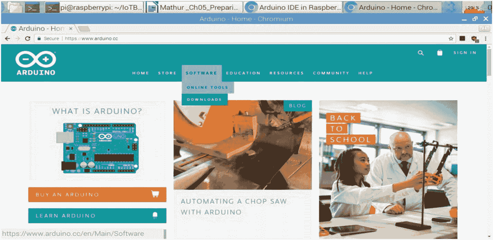

图 5-12

从 [*www.arduino.cc*](http://www.arduino.cc) 下载 Arduino IDE

现在向下滚动到图 5-13 所示的 Arduino IDE 下载区域，选择对应位宽（32 位或 64 位）的操作系统进行下载。

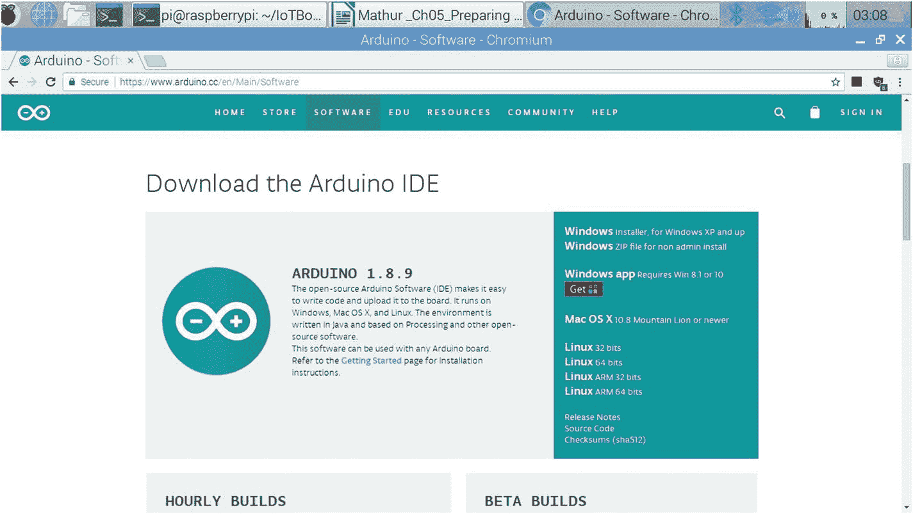

图 5-13

下载 Arduino IDE

如你所见，页面右侧的蓝色栏中有多个选项。Linux 有四个选项：Linux 32 位、Linux 64 位、Linux ARM 32 位和 Linux ARM 64 位。`uname` 和 `lshw` 命令显示我运行的是 ARM v7 处理器，位宽为 32 位，因此我选择下载 Linux ARM 32 位版本。如果你使用的是 64 位处理器，则需要下载 Linux ARM 64 位版本的 IDE。如果你不想为 Arduino 开发提供小额捐赠，请点击下一页的“仅下载”按钮。

下载完成后，按照图 5-14 所示的步骤，在浏览器中点击“在文件夹中显示”选项。

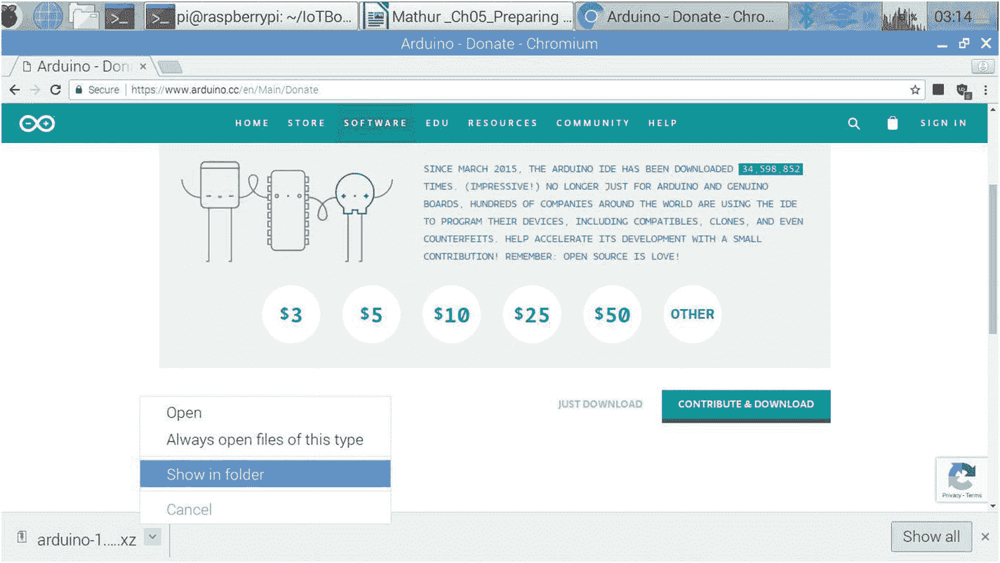

图 5-14

点击“在文件夹中显示”选项查看下载的文件

之后，Raspbian 的 GUI 文件资源管理器将打开“下载”文件夹，其中已下载了 Arduino 压缩文件，如图 5-15 所示。

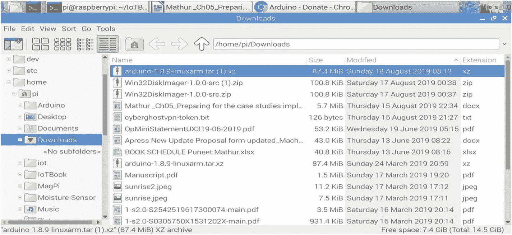

图 5-15

包含 `*.xz` 压缩文件的“下载”文件夹

你需要从 `*.xz` 扩展名文件中提取 tar 文件，如图 5-16 所示。右键单击该文件以选中它，然后左键单击“解压到此处”菜单选项。

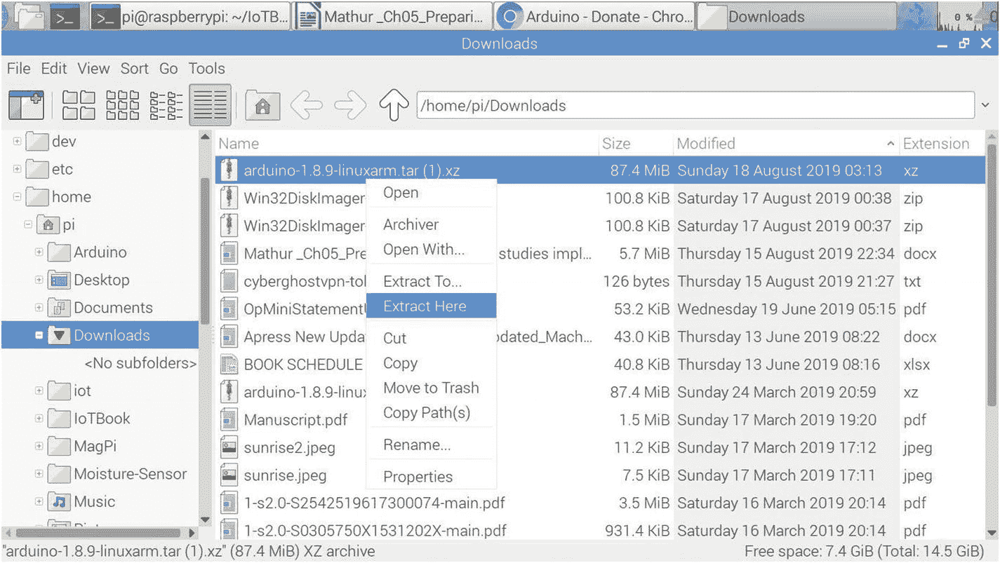

图 5-16

`*.xz` 文件的“解压到此处”选项

当你点击“解压到此处”选项时，会看到一个对话框，显示文件解压的进度。见图 5-17。

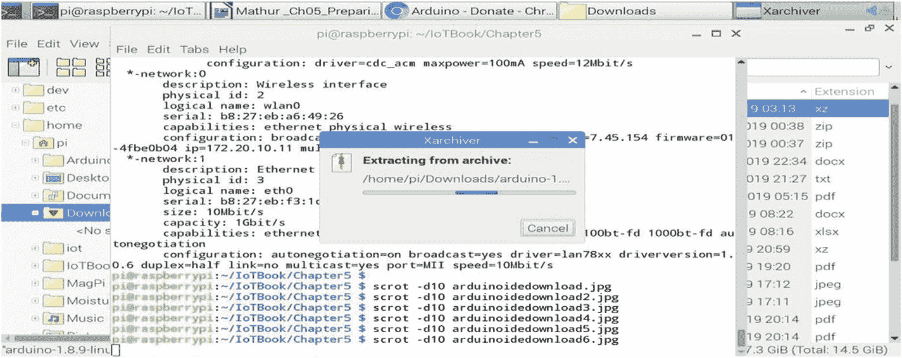

图 5-17

`*.xz` 文件正在解压中

解压完成后，你会在 `Downloads` 文件夹中看到一个新创建的文件，其名称与 `*.xz` 文件相同，但扩展名变为 `*.tar`。再次右键单击此文件，并从下拉菜单中选择“解压到此处”选项，如图 5-18 所示。

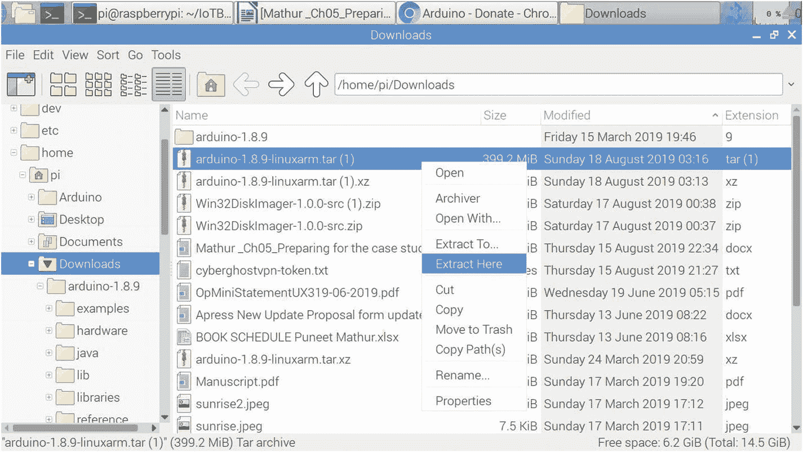

图 5-18

解压 tar 文件

解压过程完成后，你会看到创建了一个新文件夹，如图 5-19 所示。

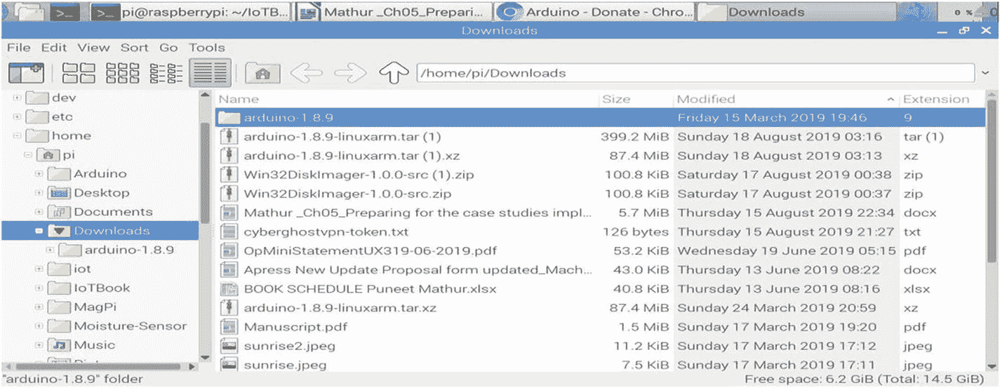

图 5-19

解压后新的 Arduino 文件夹

你可以双击该文件夹进入，如图 5-20 所示。你会看到一个名为 `install.sh` 的文件。双击此文件，Arduino IDE 将安装到你的系统上。

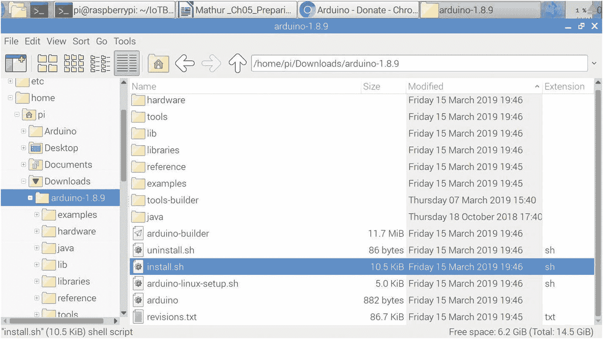

图 5-20

运行 `install.sh` 文件完成安装

第二种更简单的安装 Arduino IDE 的方法只需执行三条命令：

```
sudo apt-get update
sudo apt-get upgrade
sudo apt-get install arduino
```

虽然通过命令行安装 Arduino IDE 的方法简单得多，步骤也少很多，但有些人更喜欢图形界面而非命令行，因此我展示了这两种方法，由你决定如何安装。现在，你已经进入了设置中的数据存储步骤，即在 Raspbian 上安装 SQLite3 数据库。


## 安装 SQLite3 数据库

SQLite3 是一款免费数据库，你可以轻松地使用它在应用程序中创建和使用数据库进行存储。虽然 SQLite3 并非功能完备的数据库，但它支持大部分 SQL 标准，非常适合需要简单数据库引擎嵌入应用的开发场景。SQLite3 在智能手机开发者中非常流行。树莓派的环境也是一种移动环境，我们可以将其带到现场、工厂、农田或移动基站附近，通过物联网传感器收集数据，并存储在这个紧凑而稳健的数据库中。请记住，你不能将此数据库用于需要高级安全功能（如内置用户管理）的应用程序。因此，请在没有此类安全需求的场景下使用它。你可以在 Raspbian 上配置 PostgreSQL 或任何其他 Linux 数据库（如 MySQL），但这超出了本书的范围，因为我们只开发概念验证级别的代码。

使用以下脚本在 Raspbian 操作系统上安装 Sqlite3：

```
sudo apt-get update
sudo apt-get upgrade
sudo apt-get install sqlite3
sqlite3 
SQLite version 3.8.7.1 2014-10-29 13:59:56
Enter ".help" for usage hints.
sqlite>
```

你也可以按照我之前展示的 Arduino IDE 图形界面安装方式，从 SQLite 组织的官方网站 [`www.sqlite.org/download.html`](http://www.sqlite.org/download.html) 安装 SQLite3。

现在，你已经到了在 Arduino 上安装 Modbus 接口设备（单相电表）的最后一步。

免责声明

在继续之前，我想提醒你使用此 Modbus 设备所涉及的风险。电能表是一种电器设备，如果连接不当，存在短路风险。如果未按照其使用说明书操作，也可能危及人身安全。如果连接错误，还可能烧毁并损坏你的树莓派和 Arduino 板。因此，如果你对电气连接不熟悉，我强烈建议你不要使用此设备，或者请当地电气技术人员提供专业帮助进行正确连接。无论是作者还是出版商，均不对任何形式的物质或人身损害承担责任。请用户自行审慎判断。

你将用于设置电能表的其他设备如图 5-21 至 5-23 所示：

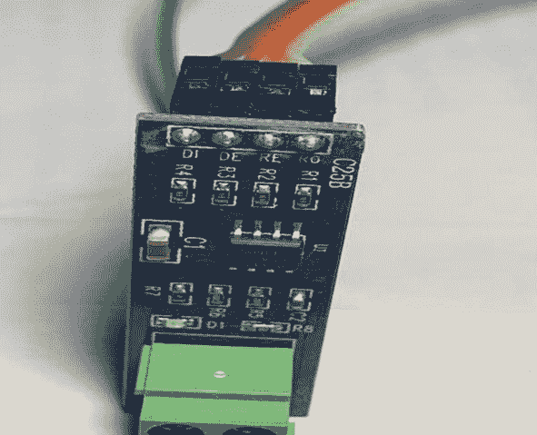

图 5-23

已连接的 5V Modbus 转换模块

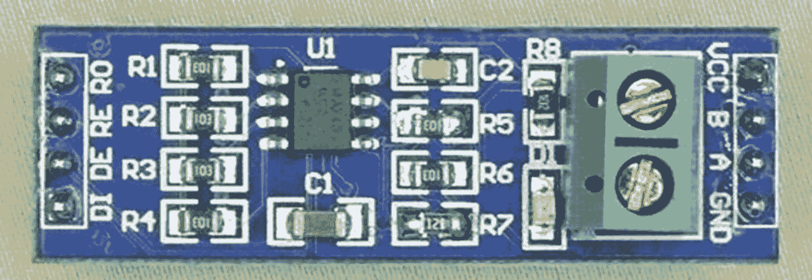

图 5-22

用于 Arduino 的 5V RS485 转 TTL 信号双向转换模块

1.  用于 Arduino 的 5V RS485 转 TTL 信号双向转换模块，带过压保护和信号指示灯

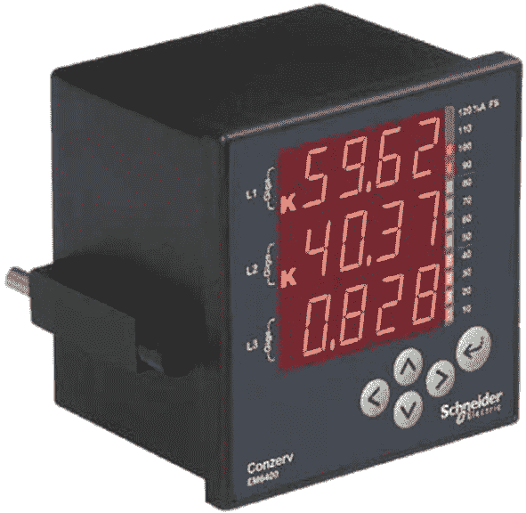

图 5-21

Conzerv EM6400 电能表

1.  施耐德电气 Conzerv EM6400 系列电力仪表

现在，让我们连接 Arduino Mega 256 和 5V RS485 Modbus 转换模块之间的导线。我已经展示了连接到 Arduino Mega 2560 上 Modbus 转换模块的导线。

为了将 Modbus 转换模块连接到 Arduino，你首先需要了解 Arduino Mega 2560 PCB 的布局，如图 5-24 所示。请注意，图中上方的引脚涉及通信和 GPIO 引脚。电路板的右侧有数据引脚，底部有电源和模拟引脚。这块板与 Arduino Uno 板有很大不同，因为它用于控制多个从设备，并用于工业应用。这就是 PCB 布局中有这么多数据引脚的原因。

现在，将 Modbus 转换模块连接到 Arduino Mega 板。你需要将三个引脚连接到板的电源区域，该区域靠近图 5-24 布局图左下角的电源控制器。最左边的深蓝色引脚连接到标有 5V 的引脚。下一根绿色导线连接到紧邻的标有 GND 的引脚。忽略图 5-24 左侧的黄色导线；你的设置中不需要它。你可以在图 5-24 中看到——连接到 Arduino Mega 板电源部分的三个引脚。请记住，你需要的是公头杜邦线，因为 Arduino Mega 板只有孔，而没有像树莓派 GPIO 那样的引脚。

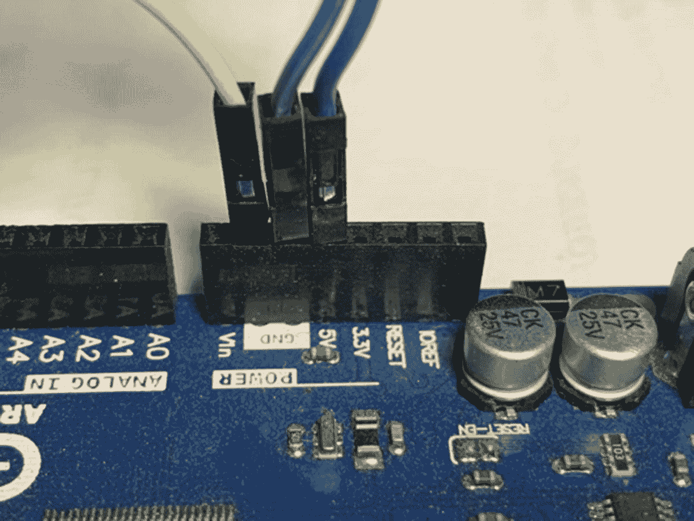

图 5-24

Modbus 转换模块与 Arduino Mega 板的导线连接

另一端的导线必须是母头杜邦线，因为 Modbus 转换模块有引脚可以插入导线。因此，你需要两根公对母杜邦线来进行此连接。将这两根导线的另一端连接到 Modbus 转换模块上标有 VCC 和 GND 的引脚（VCC 是 5V 电源线，GND 是电路接地）。你可以参考图 5-25。


图 5-25

Modbus 转换模块的电源和接地连接

连接到 Arduino 上的 5V 深蓝色导线连接到 Modbus 转换模块上标有 VCC 的引脚。Arduino 板上的 GND 绿色导线引脚连接到 Modbus 转换模块 PCB 上的 GND。

现在，你的 Modbus 转换模块的一部分已连接到 Arduino 板。你需要将另一端连接到 Arduino 板的 GPIO 引脚部分或通信侧，总共四个引脚。见图 5-26。在 Arduino 板上

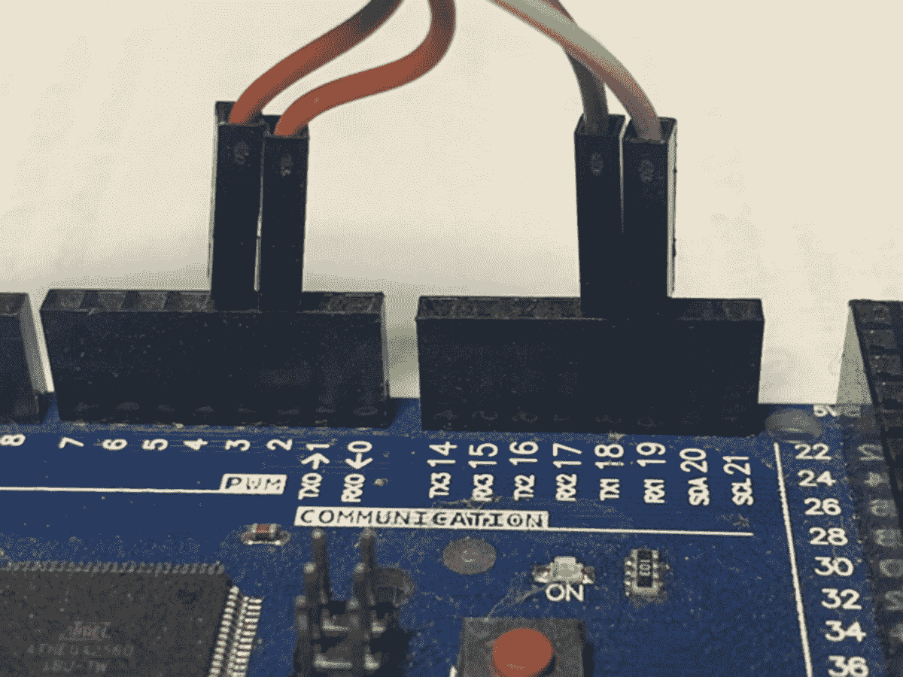

图 5-26

连接到 Arduino Mega 板的 PWM 和通信侧

如你所见，板左侧有两个名为 PWM 的引脚，连接到编号为 3 和 2 的引脚，它们彼此相邻。接下来的两个引脚连接到通信引脚 18 和 19，在 Arduino Mega 板上分别标记为 TX1 和 RX1。完成此连接后，你需要按以下方式连接四个引脚的另一端。在 Arduino 板上连接到 PWM 引脚 3 的引脚 1，需要连接到 Modbus 转换模块上标有 DE 的引脚。在 Arduino 板上连接到 PWM 引脚 2 的引脚 2，需要连接到 Modbus 转换模块中间标有 RE 的引脚。类似地，在图 5-27 中，在 Arduino 板上连接到引脚 18 的引脚 3，需要连接到 Modbus 转换模块上标有 DI 的引脚。在 Arduino 板上连接到引脚 19 的第四个引脚，应连接到 Modbus 转换模块上标有 RO 的引脚。至此，Modbus 转换模块到 Arduino Mega 板的接线过程完成。你可以对照图 5-27 检查你的连接。


图 5-27

Modbus 转换模块通信和 PWM 引脚的接线


现在你已经准备好进行下一步：将 Arduino 模块连接到树莓派板。为此，你需要一根串行 USB 线，从树莓派 3 B+ 板的串行 USB 端口连接到 Arduino Mega 2560 板。为清晰起见，该线缆如图 5-28 所示。


图 5-28

用于连接 Arduino Mega 2560 与树莓派 3 B+ 的 USB 串行线

现在，你终于可以启动整个系统了。Arduino 不需要单独的电源线，尽管其板上有一个电源插槽。串行线为 Arduino 板供电，因为它是树莓派 3 B+ 板的从设备。当你启动树莓派 3 B+ 时，你应该会看到 Modbus 转换模块和 Arduino Mega 2560 板上的 LED 灯亮起。这初步表明你的连接成功。如图 5-29 所示。

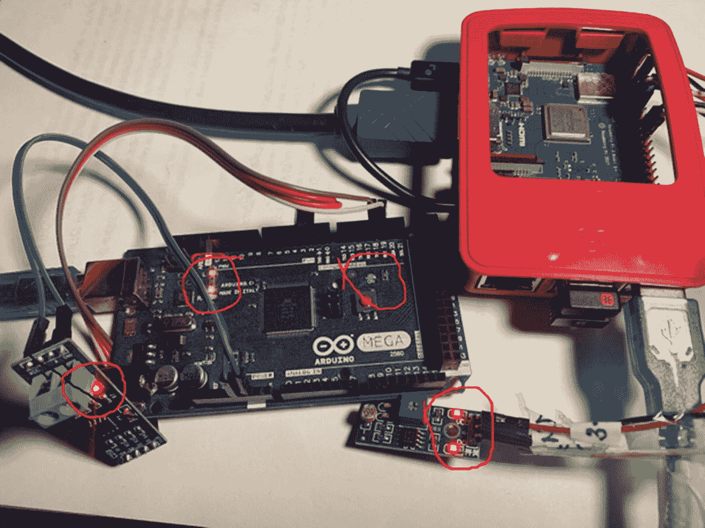

图 5-29

最终上电

如果板卡或模块没有亮起，你应该重新检查连接，特别是为模块或 Arduino 板供电的连接。现在，继续运行第 3 章的 Arduino Hello world 程序，以确认 Arduino Mega 从设备与树莓派 3 B+ 主设备之间的串行通信。

## 总结

本章介绍了如何为案例研究的实施准备你的设备。你现在已完全配置完毕：在树莓派 3 型号 B+ 上设置了 Raspbian 操作系统，并从 [`www.raspberrypi.org`](http://www.raspberrypi.org) 的下载选项中下载了该系统。你使用了 microSD 卡和 microSD 卡适配器来获取操作系统。然后，你使用 Win32 磁盘管理器解包并提取了软件包。之后，你使用 HDMI 转 HDMI 线缆将树莓派连接到电视显示器。你使用 USB 无线网卡将键盘和鼠标连接到单板计算机。接着，你将树莓派 3 B+ 的电源线连接到移动电源，以确保在断电情况下其电源连接不会中断。

然后，你在 Raspbian 上安装并测试了 Python。接下来，你安装并验证了 Thonny Python IDE。接着，你运行了一个 Raspbian 命令行脚本来安装所需的 Python 包。

你运行了一个脚本来测试 Python 高级包的安装并检查错误。你为 Python 安装了 `tkinter` 包以实现 GUI，然后在 Python 3.x 解释器上成功执行了 `tkinter`。之后，你运行了 `iotpypackages.run` Raspbian 脚本，在 Raspbian 上安装了 IoT Python 包。

接着，你通过运行 `install.sh` 文件完成了 Arduino IDE 的安装。你安装了一个 SQLite3 数据库，用于存储来自物联网传感器的数据。之后，你将 Modbus 接口设备（单相电表）安装到了 Arduino 上。你配置并连接了三个设备：施耐德电气 Conzerv EM6400 系列电力仪表、用于 Arduino 过压保护的 5V RS485 转 TTL 信号双向转换模块（带信号指示灯），以及 5V Modbus 转换器模块。接着，你将 Modbus 转换器的线缆连接到 Arduino Mega 板，并连接到 Arduino Mega 板的 PWM 和通信端。你通过 USB 串行线连接了 Modbus 转换模块的通信和 PWM 引脚，以连接 Arduino Mega 2560 与树莓派 3 B+。最后，你为整个系统执行了最终上电。

至此，你已完成系统（包括硬件和软件）的设置。现在可以继续进行案例研究了。

# 6. 配置电能表

延续第 5 章的内容，你在该章结束时连接了施耐德电气的三相 Conzerv EM6400 电能表。在本章中，你将完成两件事。首先，你将编写代码，从 Arduino Mega 从设备上的 EM6400 电能表获取数据，然后在树莓派主设备上将其读入 Python。其次，你将使用单相电气连接设置另一个电能表，然后通过 USB 串行 Modbus 协议将其数据直接读入树莓派。第二个设置是为了让那些工业物联网爱好者能够体验工业设备（如电能表和机器）如何生成真实数据。然而，在现实世界中，你会看到像 EM6400 这样的三相电能表和机器通过 Modbus 协议进行通信。再次，我想提醒读者，我们使用 Arduino Mega 2560 是因为它是一款真正的工业级单板计算机，支持连接多个设备，例如电能表或工业机器，这些设备可以以串行或菊花链电气配置方式相互连接。如果你只有一个设备，无论是单相、两相还是三相，你都可以像本章所示的那样直接将其连接到树莓派 3B+。那么，让我们开始编写代码，从 Arduino 上的 EM6400 电能表获取数据。该代码可在名为 `modbus01_EM6400_Tested.ino` 的代码包中找到，你可以从 [`www.PMAuthor.com/raspbian/`](http://www.pmauthor.com/raspbian/) 下载。在执行代码之前，请记得像我在第 3 章中所示的那样，在 Arduino IDE 中打开它，并配置和测试 Arduino IDE。


## 为 EM6400 电能表编程

在开始运行任何代码之前，第一步是在 Arduino IDE 中安装 Modbus 库。这是必需的，以便获取一些 C 语言头文件。`ModbusMaster.h`、`SPI.h` 以及其他库可用于通过 Arduino 从机与您的电能表进行 Modbus 通信。您可以按照图 6-1 至 6-3 所示的方式打开这些库。

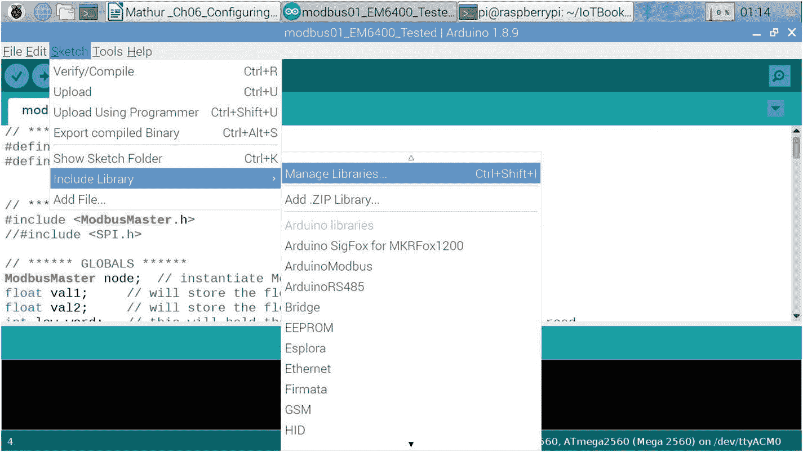

**图 6-1**
打开管理库菜单

从菜单栏选择 **项目（Sketch）** ➤ **包含库（Include Library）** ➤ **管理库（Manage Libraries）**，或使用快捷键 **Control + Shift + I** 打开管理库菜单。库管理器屏幕将会打开，如图 6-2 所示。

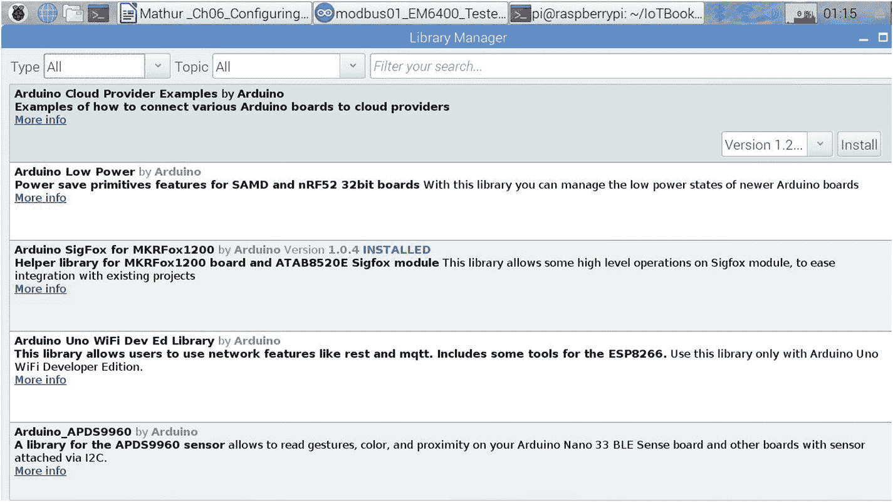

**图 6-2**
在 Arduino IDE 中打开库管理部分

现在您打开了库管理器，它是 Arduino IDE 内部维护的一个仓库，用于管理其环境中安装的库。对开发者来说，美妙之处在于您无需担心文件存储在哪里，或者它们关联的路径。库管理器会自行处理这些工作；您只需在代码中包含它提供的库即可。在您的情况下，您需要 Modbus 库，它提供了前面提到的两个头文件，这样您的 Arduino 程序才能与电能表通信。在“筛选您的搜索（Filter your search）”字段中输入 **Modbus** 并按回车键，让库管理器为您列出所有描述中包含 Modbus 的库。如图 6-3 所示。

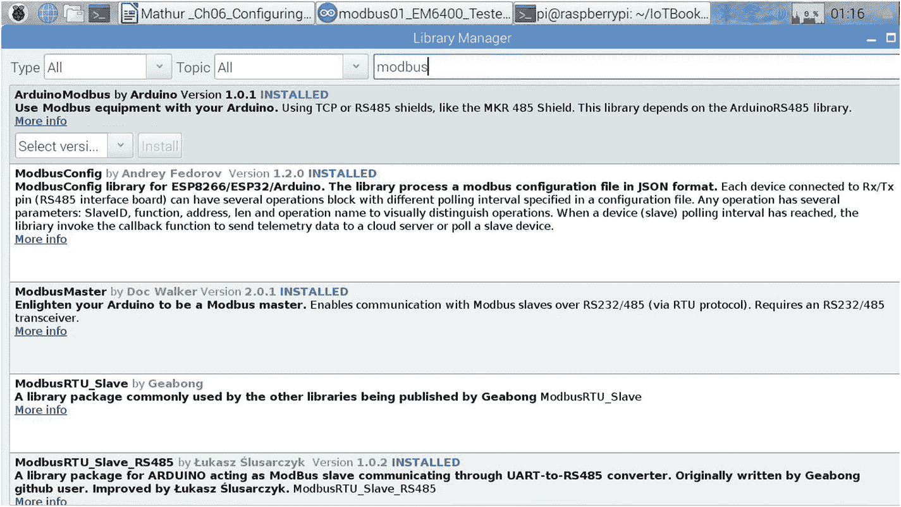

**图 6-3**
筛选搜索 Modbus 库

如图 6-3 所示，列表中列出了许多名称中包含 Modbus 的库。您只需要第一个，即由 Arduino 官方提供的 **ArduinoModbus**，版本 1.0.1。请注意，当您在您的 IDE 中执行此操作时，可能会看到不同的版本，因为 Arduino 组织会通过修复错误和为用户提供增强功能来不断更新其库。点击其描述下方的“安装（Install）”按钮安装此 Modbus 库后，您将看到一条屏幕消息显示“已安装（INSTALLED）”，如图 6-3 所示。请注意，“安装”按钮是灰色的，因为我的环境中已经安装了它。成功完成此操作后，您可以关闭库管理器窗口，返回到 Arduino IDE 中的代码窗口，如图 6-4 所示。

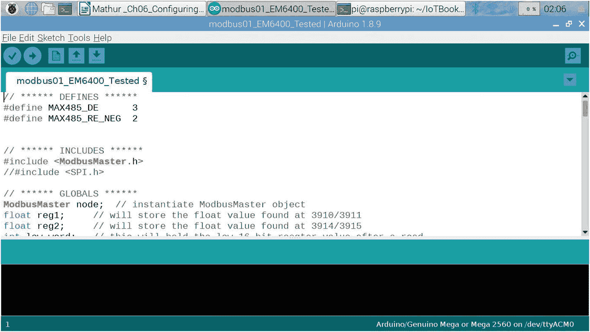

**图 6-4**
加载名为 `modbus01_EM6400_Tested.ino` 的代码文件

在代码的前几行，您会看到包含语句 `#include <ModbusMaster.h>`。这就是刚刚加载的库。在包含语句之后，继续声明全局变量，如代码清单 6-1 所示。

```
// ****** 全局变量 ******
ModbusMaster node;  // 实例化 ModbusMaster 对象
float reg1;         // 将存储寄存器 3910/3911 中的浮点数值
float reg2;         // 将存储寄存器 3914/3915 中的浮点数值
int low_word;       // 读取后将保存低 16 位寄存器值
int high_word;      // 读取后将保存高 16 位寄存器值
代码清单 6-1
声明全局变量的代码
```

第一个全局变量是 `reg1`，它是一个浮点类型变量，用于存储来自 Conzerv EM6400 电能表的寄存器 3910 和 3911 中的值。寄存器是通过 Modbus 协议查找各种电能参数值的实际位置。此信息在施耐德电气（Schneider Electric）为 EM6400 提供的用户手册中给出，官方网址为：[`www.schneider-electric.com/resources/sites/SCHNEIDER_ELECTRIC/content/live/FAQS/345000/FA345958/en_US/EM%206433%20series%20Communication.pdf`](http://www.schneider-electric.com/resources/sites/SCHNEIDER_ELECTRIC/content/live/FAQS/345000/FA345958/en_US/EM%25206433%2520series%2520Communication.pdf)。该手册还为您提供了一种使用免费软件测试协议的方法，位于第 55 页的“通信测试（Communication Test）”标题下。您可以自行尝试；这超出了本书的范围，因此我留给您自己探索。好在该手册通过截图描述了整个过程，并且非常容易理解。第 57 页的“数据地址（Data Address）”标题下提供了一个详细的表格，列出了电能表可以通过 Modbus 协议传输的各种电气数据参数。该表格包含各个参数的地址，并提供了获取特定数据所需的寄存器地址编号信息。例如，对于线对中性点电压值（VLN），寄存器地址是 3911。该值的类型是浮点数，因此您在代码中使用相应的变量（图 6-5），即 `float reg1` 用于寄存器地址 3910 和 3911，`float reg2` 用于存储寄存器 3914/3915 的值。请注意，每个寄存器是 16 位的，因此每个寄存器都会有一个高字和一个低字，所以您在通过 Arduino Mega 2560 从电能表读取数据后，声明了全局变量 `int low_word;` 和 `int high_word;`。现在您已经理解了寄存器的概念以及数据如何通过 Arduino Mega 从电能表传回，您可以查看一个用于将它们转换为浮点值的联合体结构。这在代码清单 6-2 中给出。

```
// 转换为浮点数 - 联合体结构
union u_tag {
int bdata[2];
float flotvalue;
} uniflot;
代码清单 6-2
用于存储来自电能表的寄存器值的联合体结构
```

这里声明了一个 `int variable bdata[2]` 数组，它存储两个值：来自一个寄存器的高字和低字。浮点变量 `flotvalue` 是实际转换并将值存储为浮点数据类型的变量，因为它将要获取的实际值是浮点数据类型，这是程序运行所必需的。这个联合体结构的用法在后面的代码 `loop()` 函数中会变得更加清晰。现在让我们声明一些函数，这些函数将帮助您完成使用 Modbus 接口协议与电能表通信的过程。通信序列如图 6-5 所示。

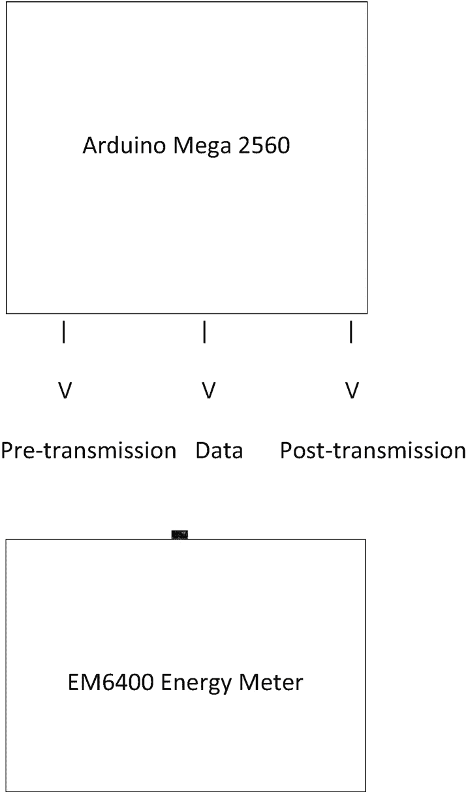

**图 6-5**
Arduino Mega 2560 与电能表之间的通信

如图所示，Arduino Mega 和电能表之间会发生三次传输。首先是预传输，然后是实际的数据传输，最后在数据从电能表传回 Arduino 之后，是后传输。理解这个周期很重要，因为代码就是按照这三个序列来划分的。


你一定注意到了，在第 5 章配置 Arduino Mega 板并连接引脚时，有两个引脚（黄色和棕色）连接到了标记为 Rx 和 Tx 的引脚上。这些正是实际通信发生的引脚。当数据通过这些引脚读取时，Arduino Mega 2560 板上有一个名为 **ATMEL MEGA 16U2** 的芯片，其 LED 灯会亮起；你可以清晰地看到它们向 Arduino 板回传通信信号，以此表明你的连接是正确的。然而，这并不能保证你一定能获取到数据；这取决于多种因素，例如函数中传递的寄存器编号和参数数值是否正确等。引脚 2 和 3 分别连接到 TTL 转 RS485 转换器模块上的橙色线和绿色线，而该模块又与电能表相连。它使用 TTL 通信与电能表交互；不过，借助其 PCB 上的一个芯片，它会将 TTL 信号转换回 Modbus 协议，反之亦然。为了获取数据并初始化它们，使其准备好来回传输数据，你需要定义变量，如代码清单 6-3 所示。

```
// ****** 宏定义 ******
#define MAX485_DE      3
#define MAX485_RE_NEG  2
代码清单 6-3
定义与电能表通信的引脚
```

请记住，由变量 `MAX485_DE` 标记的 DX 或 DE 通过 Arduino Mega 板上的 3 号引脚进行通信，而该引脚又连接到 Modbus 转换器模块上对应的 DE 公针（已标记）。同样，变量 `MAX485_RE` 是负逻辑的，通过 Arduino 板上标记的 2 号引脚进行通信，而该引脚又连接到 Modbus 转换器模块上对应的 RE 公针（已标记）。

在传输前和传输后，接下来的函数的主要工作就是向这些引脚写入信号以启动和结束通信。如代码清单 6-4 中的代码片段所示。

```
// ****** 传输函数 ******
void preTransmission()
{
digitalWrite(MAX485_RE_NEG, 1);
digitalWrite(MAX485_DE, 1);
Serial.println("preTransmission");
}
void postTransmission()
{
digitalWrite(MAX485_RE_NEG, 0);
digitalWrite(MAX485_DE, 0);
Serial.println("postTransmission");
}
代码清单 6-4
传输前和传输后函数
```

代码中给出的两个函数通过 `digitalWrite(MAX485_RE_NEG, 1);` 在函数 `void preTransmission(){}` 中初始化通信。该函数初始化 RE 引脚#2 以开始写入。`digitalWrite` 函数的第一个参数是引脚编号，已在变量 `MAX485_RE_NEG` 中定义；第二个参数是开/关二进制参数，值为 1 时启用对该引脚的写入，值为 0 时停止写入。接下来，初始化 `MAX485_DE`，然后 `postTransmission(){}` 函数向两个引脚传递值 0 以停止传输。现在你有了这些函数，就可以执行 Arduino Mega 的标准函数了，即 `void setup()` 和 `void loop()`。回顾第 3 章，`void setup()` 函数在程序中首先定义，用于初始化和设置 Arduino Mega 2560 的代码，使其开始运行。对于这个函数，你首先需要初始化引脚 2 和 3 为输出模式，以便开始通过它们使用 Modbus 485 协议控制数据流。完成后，你需要为相同的引脚初始化接收模式。之后，你设置电能表接收和发送信号所用的波特率频率。该电能表的默认波特率是 9600 Hz，我不打算更改它，因为在此速率下通信良好。接着，为此从设备定义一个从设备 ID。如果你有多个从设备连接到 Arduino Mega 板，你可以在此部分为它们分配多个从设备 ID。之后，调用 `preTransmission()` 和 `postTransmission()` 函数。为了确认 Arduino 与电能表之间的通信是否正确，你可以写入类似“Hello World”的内容。这正是你在代码清单 6-5 中看到的内容。

```
// ****** 标准 ARDUINO SETUP 函数 ******
void setup() {
// 将引脚 2 和 3 设置为 Max485 流量控制的输出引脚
pinMode(MAX485_RE_NEG, OUTPUT);
pinMode(MAX485_DE, OUTPUT);
// 初始化为接收模式
digitalWrite(MAX485_RE_NEG, 0);
digitalWrite(MAX485_DE, 0);
Serial.begin(9600);    // TX0/RX0 串口监视器
Serial1.begin(9600);   // TX1/RX1 Modbus 通信
// Modbus 从设备 ID = 1
node.begin(1, Serial1);
// 回调函数允许我们正确配置 RS485 收发器
node.preTransmission(preTransmission);
node.postTransmission(postTransmission);
Serial.println("Hello World");
}
代码清单 6-5
void setup() 函数
```

`Serial.println()` 函数由 Arduino 作为输出发送到串口。因此，你可以使用 Python 程序从连接的树莓派主设备（Arduino Mega 从设备连接至此）读取这些语句。现在，你已经在 `void setup()` 函数中完成了 Arduino 的初始配置，接下来可以进入最后一步：定义你希望该草图在 Arduino Mega 上执行的主要工作。首先，你需要从电能表读取数值，为此你需要定义变量来保存结果及其数据，如代码清单 6-6 所示。


```
// ****** 标准 ARDUINO 循环函数 ******
void loop() {
uint8_t result;
// 读取线电压（相电压）
result = node.readHoldingRegisters(3910, 2);
if (result == node.ku8MBSuccess)
{
high_word = node.getResponseBuffer(0x00);
low_word = node.getResponseBuffer(0x01);
uniflot.bdata[1] = low_word;   // Modbus 数据 16 位低字
uniflot.bdata[0] = high_word;  // Modbus 数据 16 位高字
reg1 = uniflot.flotvalue;
Serial.print("线电压: ");
Serial.println(reg1);
}
//  node.clearResponseBuffer();
delay(500);   // 读取之间的小延迟
//读取频率
result = node.readHoldingRegisters(3914, 2);
if (result == node.ku8MBSuccess)
{
high_word = node.getResponseBuffer(0x00);
low_word = node.getResponseBuffer(0x01);
uniflot.bdata[1] = low_word;   // Modbus 数据 16 位低字
uniflot.bdata[0] = high_word;  // Modbus 数据 16 位高字
reg2 = uniflot.flotvalue;
Serial.print("频率: ");
Serial.println(reg2);
}
delay(5000);    // 每 5 秒重复读取一次
node.clearResponseBuffer();
}
代码清单 6-6
void loop() 的代码
```

由于此草图基于 C 和 C++ 构建，因此 C 和 C++ 中使用的函数及其数据类型也能很好地集成到该语言中。草图语言中使用数据类型 `uint8_t` 表示 8 位无符号整数，该语言是一个基于 C++ 编译器并带有包装器的编译器。您定义了此数据类型的 `result` 变量，用于存储保持寄存器的结果，您将在下一行尝试执行此操作。您要读取的第一项内容是来自保持寄存器 #3910 的中性点电压值，使用的语句是 `result = node.readHoldingRegisters(3910, 2);`。`node` 对象在草图中自动可用，用于与多个 Arduino 从站通信。在您的情况下，只有一个从站，并且您已将其连接到树莓派。您使用语句 `node.begin(1, Serial1);` 对其进行初始化，在 `void setup()` 函数中为其分配了从站 ID 为 1 的序列号。因此，现在当您调用 `node` 对象时，草图会自动将其视为您之前初始化的这个节点。第二个参数值 2 表示第一个参数 3910 中提到的寄存器的字节长度。

接下来的代码使用 `if` 语句来检查从 Arduino 从站接收到的响应是否正常。为了检查这一点，您首先需要了解 Modbus 主站库中提供的 **Modbus 功能码和异常码**。这是用于通过 RS232/485（基于 RTU 协议）与 Modbus 从站通信的 Arduino 库（参见 [`http://4-20ma.io/ModbusMaster/group__constant.html`](http://4-20ma.io/ModbusMaster/group__constant.html)）。虽然这个 Arduino 库有各种变量可供使用，但您需要的特定变量是 `ku8MBSuccess`，仅当在 Modbus 主站和从站之间的通信中发现以下检查项均正常时，它才返回 true：

1.  从站 ID 有效。

2.  功能码有效。

3.  响应码有效。

4.  返回有效数据。

5.  CRC 校验有效。数据传输中没有错误。

您可以在此处阅读更多相关信息：[`http://4-20ma.io/ModbusMaster/group__constant.html#ga81dd9e8d2936e369359777d67769a657`](http://4-20ma.io/ModbusMaster/group__constant.html%2523ga81dd9e8d2936e369359777d67769a657)。

一旦 `if` 语句将此条件判断为真，您就可以通过给出寄存器的起始和结束地址来获取数据值，语句为 `high_word = node.getResponseBuffer(0x00);` 和 `low_word = node.getResponseBuffer(0x01);`。供您参考，`0x00` 是高字的十六进制值 0，`0x01` 是第二个低字的十六进制值 1。现在您需要将 `high_word` 和 `low_word` 变量的值连接成一个 float 类型的变量。您创建了一个联合体结构，其中包含一个名为 `unifloat` 的浮点值变量。`reg1 = uniflot.flotvalue;` 语句返回第一个寄存器的完整浮点值，这就是线电压的值。您使用语句 `Serial.println(reg1);` 打印出该值。现在您已经将线电压的值存储在一个变量中，您可以获取另一个值——频率，它存储在寄存器地址 3914 中。您添加了 500 毫秒的延迟；这是可选的，取决于您希望如何处理数据。如果您正在创建一个监控能源设备当前吞吐量的警报系统，您可能不希望有延迟，因为您需要线电压和电流频率的实时数据。但是，如果您有多个从站，过于频繁地轮询电能表可能会给树莓派带来负载，这是您在编写这部分代码时需要牢记的应用程序设计方面。代码清单 6-7 中的代码从寄存器地址 3914 获取数据，该寄存器也是 2 字节长。

```
delay(500);   // 读取之间的小延迟
//读取频率
result = node.readHoldingRegisters(3914, 2);
if (result == node.ku8MBSuccess)
{
high_word = node.getResponseBuffer(0x00);
low_word = node.getResponseBuffer(0x01);
uniflot.bdata[1] = low_word;   // Modbus 数据 16 位低字
uniflot.bdata[0] = high_word;  // Modbus 数据 16 位高字
reg2 = uniflot.flotvalue;
Serial.print("频率: ");
Serial.println(reg2);
}
代码清单 6-7
获取当前频率值的代码
```

您使用 `if` 条件语句 `if (result == node.ku8MBSuccess)` 来检查从电能表到 Arduino 从站的数据传输是否成功。一旦成功，`if` 语句块与图 6-11 中的代码块非常相似，只是使用了变量 `reg2`，您用它来存储第二个寄存器的浮点值，该寄存器中包含当前的频率值。使用语句 `Serial.println(reg2);`，您将频率值打印到串行总线上。在结束函数 `void loop()` 之前，您添加了 2 秒的延迟，以便在连续读取之间留出一些时间。同样，此时间延迟取决于您正在构建的应用程序类型，并且可以根据应用程序的业务需求进行更改。请记住，您在此处设置的时间延迟越短，您的应用程序就越频繁地占用三个设备（树莓派 3 B+、Arduino Mega 2560 和 EM 6400 电能表）的 CPU 和内存等系统资源。之后，您在语句 `node.clearResponseBuffer()` `;` 中清除响应缓冲区。这是为了确保不会再次收集旧值，并且新值从寄存器进入缓冲区，然后进入 Arduino 串行总线。

```
delay(2000);    // 每 2 秒重复读取一次
node.clearResponseBuffer();
```


至此，Arduino 端的程序代码编写完毕。你可以按照第 3 章和第 5 章所示的步骤，将其编译并上传到 Arduino Mega 2560 上。你应该能看到代码编译成功和上传成功的消息，如图 6-6 和图 6-7 所示。

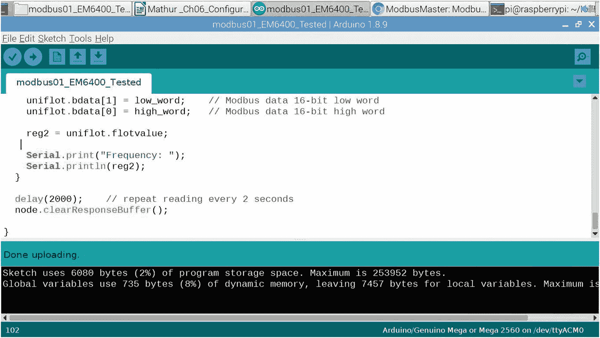

图 6-7

上传 EM6400 代码后显示的“上传完成”消息

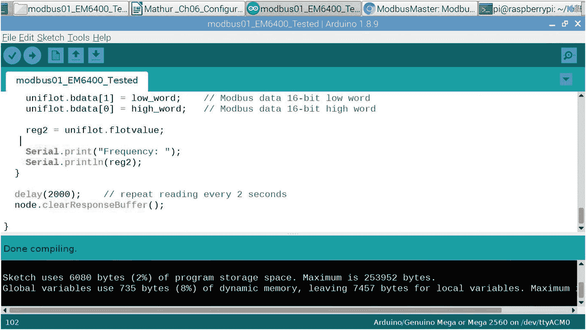

图 6-6

编译 EM6400 代码后显示的“编译完成”消息

至此，Arduino 端的代码步骤已完成。但是，你无法在 Arduino 端看到线对中性点电压和频率的结果。请记住，你是通过 `Serial.write()` 语句将所有内容写入串口的。要读取这些值，你需要编写一个非常小的 Python 程序，来显示 Arduino Mega 2560 正在向串口写入的内容。

首先，你需要安装一个名为 serial 的 Python 包或模块，可以在 Raspberry Pi 3 B+ 的命令行中完成安装，如图 6-8 所示。

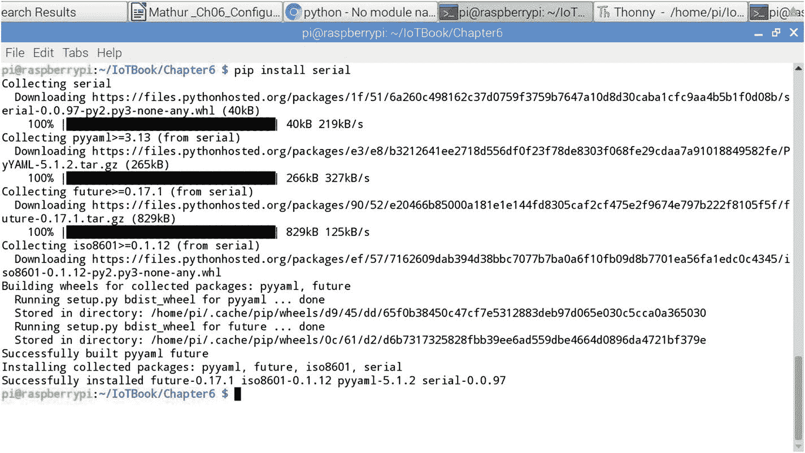

图 6-8

在 Raspberry Pi 3 B+ 上安装 Python 的 serial 模块

Python 安装通常默认包含此模块，因此你可能无需安装。你可以通过在 Python 提示符下运行简单的导入语句 `import serial` 来检查是否需要安装，如图 6-9 所示。

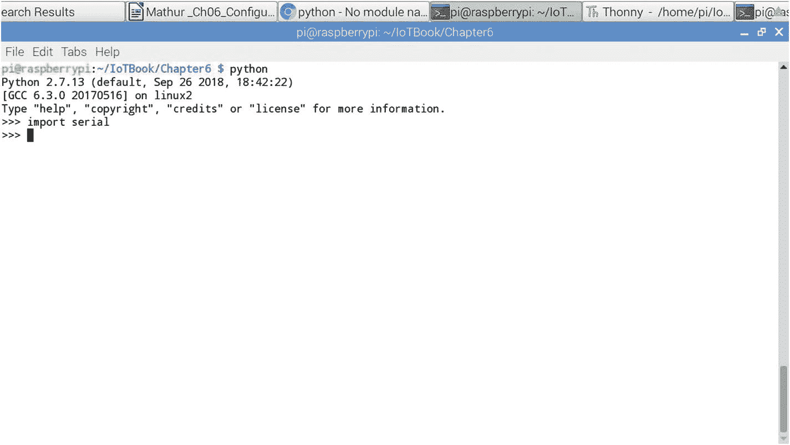

图 6-9

检查 serial Python 模块是否已安装

如果出现错误，则表示你的 Python 版本未安装该模块。如果没有出现错误，并且 Python 提示符 `>>>` 返回且未发出任何消息，则表明该库模块已存在，你无需再次安装。

现在你已经安装了 serial 库，可以继续编写 Python 代码来从串口获取数据。参见代码清单 6-8。

```
import serial
ser= serial.Serial('/dev/ttyACM0', 9600)
while 1:
print("Reading...")
print(ser.readline())
代码清单 6-8
从 Arduino 串口读取数据的 Python 代码
```

在这个 Python 程序中，你首先导入 `serial` 对象，然后使用 `serial.Serial()` 函数创建一个名为 `ser` 的对象，第一个参数是 `/dev/ttyACM0`；这通常是 Arduino 通信的串口。第二个参数 `9600` 是电能表通信的波特率。这是你在图 6-10 的代码块中设置的频率值。如果你因某种原因更改了该频率，则需要在此处将其更改为相同的值，否则会因波特率不匹配而无法通信。当你运行这个 Python 程序时，你将看到类似于代码清单 6-9 中给出的输出。代码 `ser.readline()` 从连接到 Arduino Mega 2560 的串口读取一行值，进而读取连接到 EM6400 电能表的值。

```
>>> %Run arduino.py
Reading...
b'Hello World\r\n'
Reading...
b'preTransmission\r\n'
Reading...
Line to Neutral Voltage:
221.5
Frequency:
49.67
b'postTransmission\r\n'
代码清单 6-9
Raspberry Pi 3 B+ 上 Python 程序的示例输出
```

你可以在示例输出中看到，程序以写入 `preTransmission` 开始，然后打印“Line to Neutral Voltage:”及其值 221.5，接着打印“Frequency:”及其值 49.67。这每 2 秒在一个无限循环中运行，每次设置运行时，串行通信输出中都会打印“Hello World”。你可以将其更改为更有意义的内容，例如“Setup initialized.”。这由你决定。

至此，Conzerv EM6400 电能表的配置和设置就完成了。现在，正如我在本章开头所承诺的，你将配置一个仅使用单相两线设置的电能表，这要简单得多。这款电能表是 Eastron SDM630，它也带有 Modbus 接口。这次你将不再使用 Arduino Mega 2560，而是使用 Python 和 Raspberry Pi 直接从中获取数据。

现在，你将首先通过单相连接与单个 Eastron SDM 630 进行连接。我不建议以串联或菊花链方式连接多个此类仪表，因为与 Arduino Mega 2560 不同，Raspberry Pi 3 B+ 不是坚固的工业级板卡，很容易烧毁。因此，我这里给出的连接系统仅适用于小型项目，不同于前面章节中 Conzerv EM6400 的连接和配置。

Eastron SDM630 电能表（图 6-10）由一家中国公司制造，在全球范围内都很容易买到。如果你需要，可以查看 [`www.pmauthor.com/raspbian`](https://www.pmauthor.com/raspbian) 上的链接。这款智能电能表是家用和工业用途中最受欢迎的电能表之一，也支持三相连接。我推荐这款，因为我和我的团队在客户项目中已对其进行了充分的个人和商业应用测试，它表现良好。虽然市场上有一些竞争对手，但我们最常使用的是这款流行的产品。


图 6-10

Eastron SDM630

第一步是将此电能表连接到 Raspberry Pi，为此你需要以下组件：

1.  RS485 Modbus USB 转换器

2.  至少 1 米长的双绞线，能够通过 5V 电流

3.  Eastron SDM630 电能表

4.  单相机器，例如带有电子线圈和电机以产生无功功率的电机或铣床

5.  至少 20W 的 LED 灯泡以产生有功功率

列出的所有物品及其规格均在 [`www.pmauthor.com/raspbian/`](https://www.pmauthor.com/raspbian/) 上提及。让我们开始将它们全部连接起来。

RS485 USB 转换器需要与双绞线连接，如图 6-11 所示。你可以看到需要连接的特定端子。USB 转换器的底部有两个端子引脚。


图 6-11

RS485 USB 转换器


它们被标记为 A 和 B。请注意，这些正是电能表上标记为 A 和 B 的相同端子，如图 6-12 所示。如果你将粉色导线插入标记为 A 的端子，那么你必须在另一端将同一根粉色导线连接到电能表上标记为 A 的端子；如果接反了，可能会损坏电能表，请务必牢记这一点。同样地，将 USB 转换器上标记为 B 端子的灰色导线连接到电能表上标记为 B 的端子。这样就完成了 USB 转换器与电能表的连接。为了你的安全，请确保树莓派和电能表都未运行。确保它们处于关闭状态，并且已从所有电气端子上拔下插头。这是为了防止意外触电。此外，除非你的电气系统中安装了 MCB 或断路器，否则切勿连接到主电源，这样万一发生短路，MCB 会跳闸，不会对电气布线系统造成损坏。

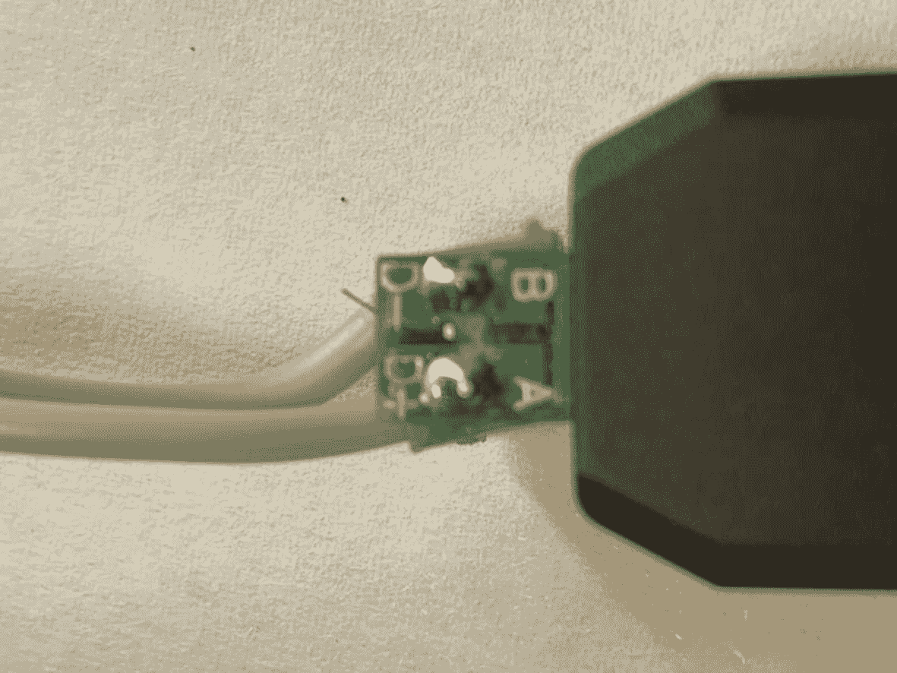

图 6-12
连接导线至 RS485 Modbus 转换器

请查看图 6-13 中对应的导线连接，其中灰色导线连接到 Eastron SDM630 电能表上的 B-端子，粉色导线连接到 A+端子。


图 6-13
连接到 Eastron SDM630 内部数据端子的导线

现在双绞线的两端都已连接好，你需要对 SDM630 电能表进行两处连接。一处是输入导线连接，它将来自主电源并为电能表供电；另一处是输出导线连接，它将向负载或电流源（如 LED 灯泡、电动机或铣床）供电。如图 6-14 所示。


图 6-14
Eastron SDM630 电能表的输入连接

如你所见，电能表输入侧有四个端子导线连接。在这四个端子中，由于你在此电能表中使用的是单相两线制型号，你只需要将 4 号端子连接黑色导线（零线），将 1 号端子连接红色导线（电源线，也称为火线）。连接好这些导线后，你可以将这些导线的插头端连接到一个插头上。请注意，在此架构中你并未使用第三根导线（地线）。为方便起见，插头连接如图 6-15 所示。


图 6-15
电能表输入导线的插头连接

现在你需要连接电能表的输出端子，并在其另一端放置一个负载，例如 LED 灯泡、电动机或铣床。请记住，它们都必须是单相的。因此，按照图 6-16 所示进行连接，其中输出红色导线（火线）连接到 6 号端子，输出黑色导线（零线）连接到 8 号端子。


图 6-16
电能表的输出导线连接

完成此连接后，你需要将端子导线的另一端连接到负载，例如 LED 灯泡、单相铣床或电动机。在图 6-17 中，你可以看到一个 LED 灯泡作为负载连接；然而，这不会提供非常真实的数据，因为无功功率将始终为零。尽管如此，这是测试电路的好方法。另一端的负载可以随时更换为任何其他负载。

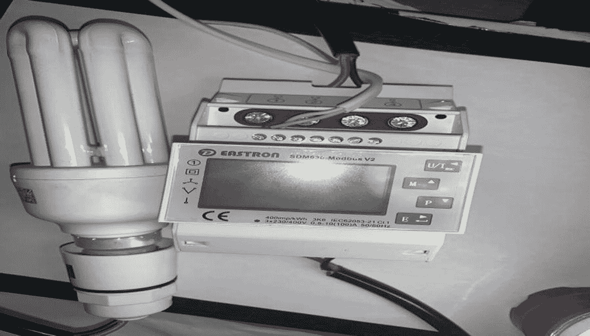

图 6-17
连接到电能表输出端的 LED 灯泡

至此，所有输出和输入连接均已完成，你可以通过将电能表从输入端连接到电源插座来为其通电。你应该会看到电能表启动，并且 LED 灯泡亮起，分别如图 6-18 和 6-19 所示。

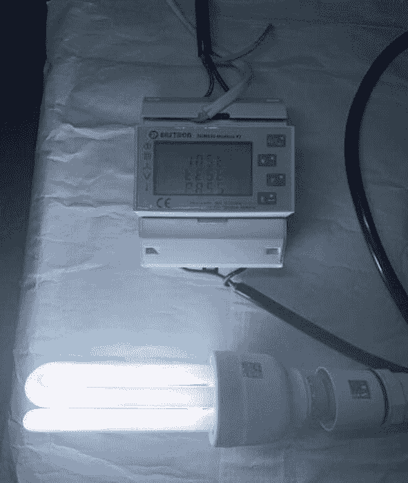

图 6-19
通电后的 LED 灯泡和电能表

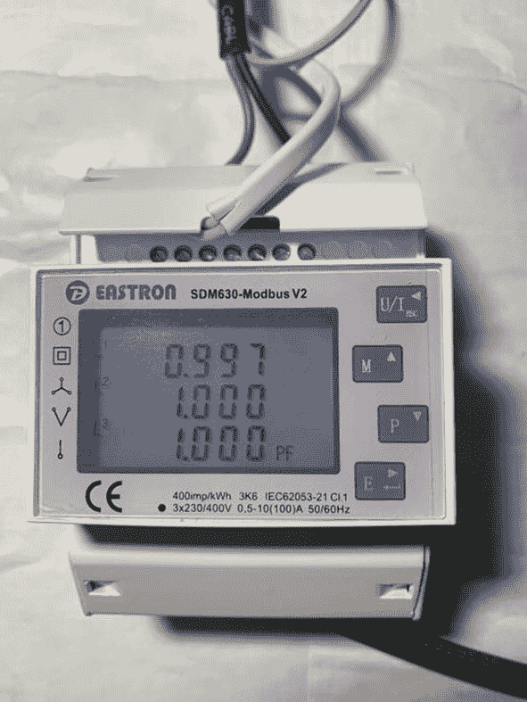

图 6-18
通电后的 Eastron SDM630 电能表

至此，硬件部分的设置就完成了。请记住，你尚未将树莓派 3 B+连接到电能表。这仅仅是为了检查电能表的所有连接是否正常工作，以及负载是否与电能表一起通电。如果成功，你可以连接树莓派，然后使用 Python 程序从中获取数据并将其存储在 SQLite3 数据库中。给电能表通电后，你可以给树莓派 3 B+通电。但在此之前，请记得将 RS485 Modbus 转换器连接到树莓派的一个 USB 端口，如图 6-20 所示。

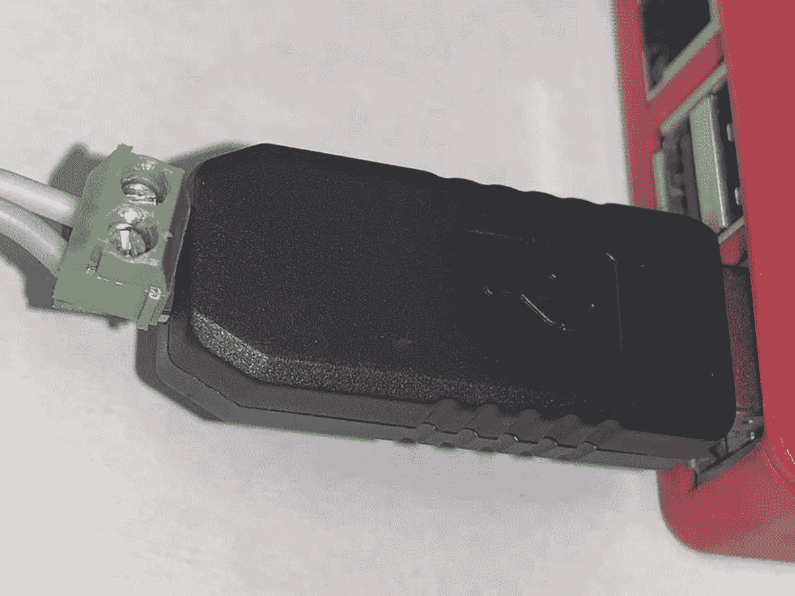

图 6-20
将 RS485 Modbus 转换器连接到树莓派 3 B+

请注意，此 RS485 转换器模块 PCB 上没有 LED 指示灯，因此除了通过 Python 软件之外，无法判断它是否正在接收来自电能表的信号。该软件名为`sdm630_tested.py`，你可以从[`www.pmauthor.com/raspbian/`](https://www.pmauthor.com/raspbian/)提供的捆绑包中解压获得。完整代码见代码清单 6-10。在运行 Python 代码之前，你需要安装树莓派使用 RS485 Modbus 协议与电能表通信所需的 Python 库。为此，你需要安装一个名为 minimalmodbus 的 Python 库。首先，运行命令`sudo apt-get update`，然后运行`sudo apt-get upgrade`，因为保持操作系统库和内核更新和升级是一个好习惯，这样较新的 Python 库就不会因为依赖较新的 Raspbian 结构而失败。图 6-21 和 6-22 展示了此安装过程。

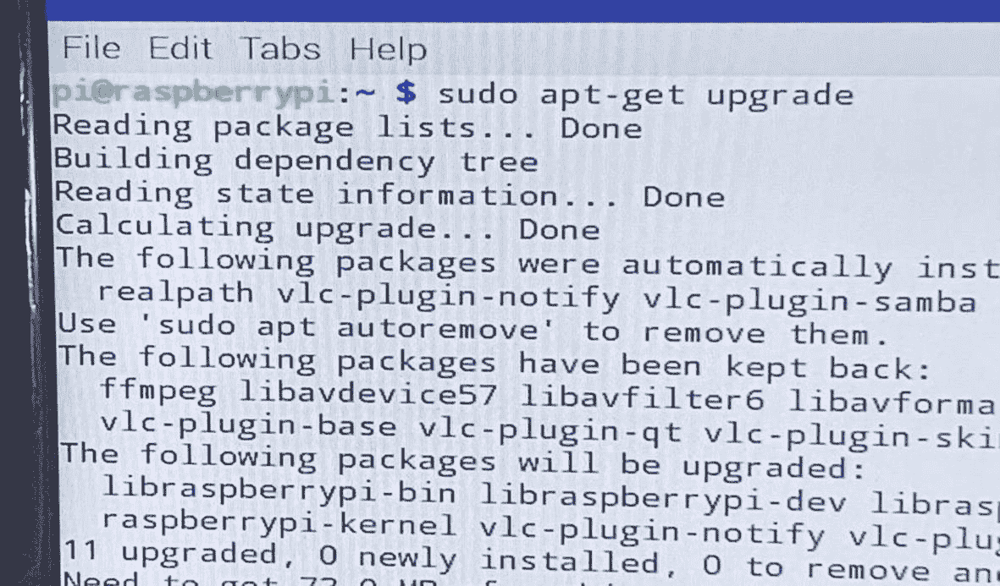

图 6-22
升级 Raspbian 内核

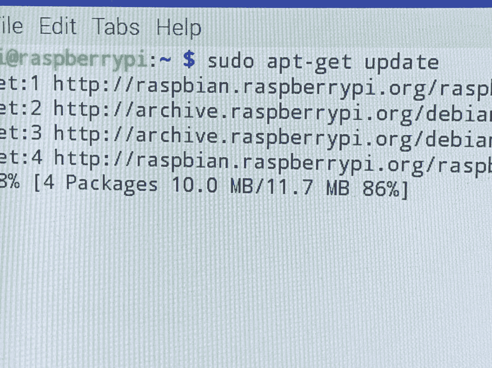

图 6-21
更新 Raspbian 内核

安装好 minimalmodbus Python 模块（图 6-23）后，你可以加载 Python 代码并运行它（代码清单 6-10）。提醒一下：此时你的电能表应该已经启动，并且树莓派 3 B+已通过 RS485 Modbus 转换器连接。


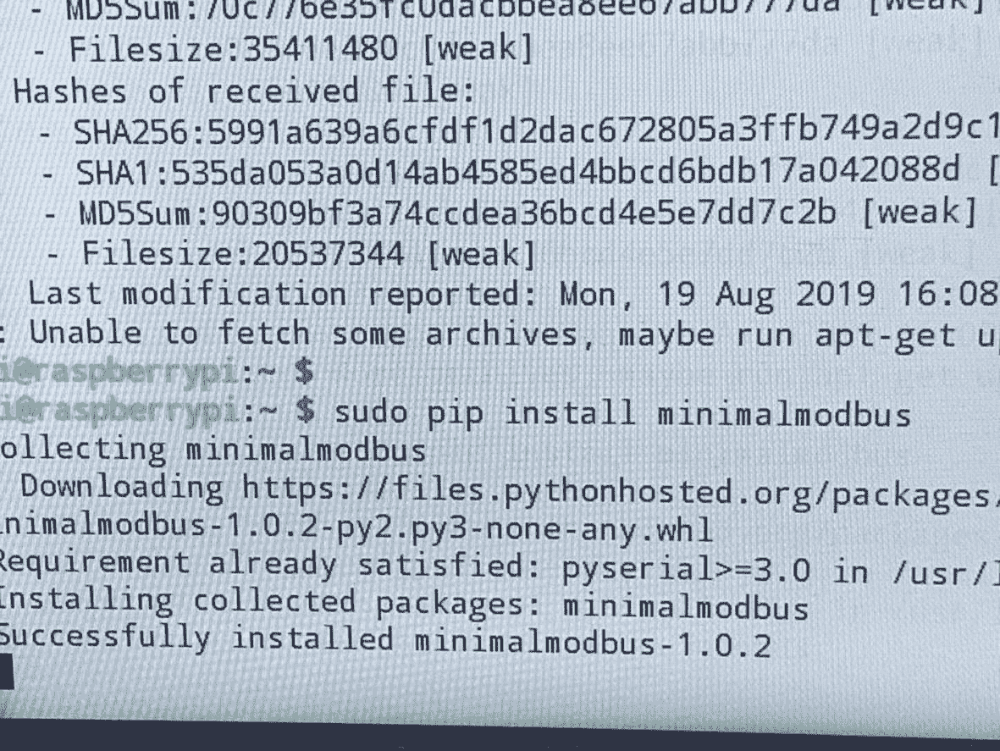

图 6-23

安装 minimalmodbus Python 模块

```
#!/usr/bin/Python
#Loading modbus library
import minimalmodbus
from datetime import datetime
#Initializing searial communication on the modbus library
sdm630 = minimalmodbus.Instrument('/dev/ttyUSB0', 1)
sdm630.serial.baudrate = 9600
sdm630.serial.bytesize = 8
sdm630.serial.parity = minimalmodbus.serial.PARITY_NONE
sdm630.serial.stopbits = 1
sdm630.serial.timeout = 1
sdm630.debug = False
sdm630.mode = minimalmodbus.MODE_RTU
print(sdm630)
while 1:
Volts = sdm630.read_float(0, functioncode=4)
Current = sdm630.read_float(6, functioncode=4)
Active_Power = sdm630.read_float(12, functioncode=4)
Apparent_Power = sdm630.read_float(18, functioncode=4)
Reactive_Power = sdm630.read_float(24, functioncode=4)
Power_Factor = sdm630.read_float(30, functioncode=4)
Phase_Angle = sdm630.read_float(36, functioncode=4)
Frequency = sdm630.read_float(70, functioncode=4)
Import_Active_Energy = sdm630.read_float(72, functioncode=4)
Export_Active_Energy = sdm630.read_float(74, functioncode=4)
Import_Reactive_Energy = sdm630.read_float(76, functioncode=4)
Export_Reactive_Energy = sdm630.read_float(78, functioncode=4)
Total_Active_Energy = sdm630.read_float(342, functioncode=4)
Total_Reactive_Energy = sdm630.read_float(344, functioncode=4)
print('Voltage: {0:.1f} Volts'.format(Volts))
print('Current: {0:.1f} Amps'.format(Current))
print('Active power: {0:.1f} Watts'.format(Active_Power))
print('Apparent power: {0:.1f} VoltAmps'.format(Apparent_Power))
print('Reactive power: {0:.1f} VAr'.format(Reactive_Power))
print('Power factor: {0:.1f}'.format(Power_Factor))
print('Phase angle: {0:.1f} Degree'.format(Phase_Angle))
print('Frequency: {0:.1f} Hz'.format(Frequency))
print('Import active energy: {0:.3f} Kwh'.format(Import_Active_Energy))
print('Export active energy: {0:.3f} kwh'.format(Export_Active_Energy))
print('Import reactive energy: {0:.3f} kvarh'.format(Import_Reactive_Energy))
print('Export reactive energy: {0:.3f} kvarh'.format(Export_Reactive_Energy))
print('Total active energy: {0:.3f} kwh'.format(Total_Active_Energy))
print('Total reactive energy: {0:.3f} kvarh'.format(Total_Reactive_Energy))
print('Current Yield (V*A): {0:.1f} Watt'.format(Volts * Current))
import sqlite3
conn = sqlite3.connect('/home/pi/IoTBook/Chapter6/energymeter.db')
#df.to_sql(name='tempdata', con=conn)
curr=conn.cursor()
query="INSERT INTO sdm630data(timestamp, voltage , current ,activepow ,apparentpow ,reactivepow ,powerfactor ,phaseangle , frequency , impactiveng , expactiveeng ,impreactiveeng , expreactiveeng ,totalactiveeng ,totalreactiveeng ,currentyield, device ) VALUES(" + "'" + str(datetime.now()) + "'" + "," + "'" + str(Volts) + "'" + "," +  "'" + str(Current) + "'" + "," +  "'" + str(Active_Power) + "'" + "," +  "'"  + str(Apparent_Power) + "'" + "," +  "'" + str(Reactive_Power) +  "'" + "," +  "'" + str(Power_Factor) + "'" + "," +  "'" +  str(Phase_Angle) + "'" + "," +  "'" + str(Frequency) + "'" + "," +  "'" +  str(Import_Active_Energy) + "'" + "," +  "'" + str(Export_Active_Energy) + "'" + "," +  "'" + str(Import_Reactive_Energy) + "'" + "," +  "'" + str(Export_Reactive_Energy) + "'" + "," +  "'" + str(Total_Active_Energy) + "'" + "," +  "'" + str(Total_Reactive_Energy) + "'" + "," +  "'" + str((Volts * Current)) + "'" + "," + "'" + str("millmachine")+ "'" + ")"
print(query)
curr.execute(query)
conn.commit()
清单 6-10
从电能表获取数据并存储到数据库的 Python 代码
```

在这段代码中，首先导入 minimalmodbus Python 库，以实现树莓派与电能表之间的 Modbus 通信。然后导入 datetime，用于在从电能表获取一条数据记录时存储时间戳。其用法在代码后面会体现。之后，通过 Rs485 Modbus USB 转换器初始化 Modbus 仪器，该转换器在 Raspbian 设备列表中显示为 `/dev/tty/USB0`。这是默认设备，在大多数情况下应该可以正常工作；但是，如果遇到任何通信错误，请使用命令 `lsusb` 检查你的 485 转换器连接到了哪个 tty 端口。接下来，以 9600 的波特率初始化串口通信。这是默认值；如果你更改了电能表中的波特率，则需要在此处将代码语句 `sdm630.serial.baudrate = 9600` 中的值改为新值。你为寄存器初始化了 8 位字节大小，以及其他设置参数，如停止位和超时间隔。`print(sdm630)` 会将对象打印到 Raspbian 的控制台，因此你应该能通过这条打印语句看到所有的连接设置配置。之后，你的电能表设置就完成了，现在你可以与其通信并从中获取数据。为此，在接下来的代码中，你使用一个无限 `while` 循环来持续获取数据并打印到屏幕上，最后将其存储到 SQLite 3 数据库中。这段代码与 Conzerv EM6400 电能表的代码非常相似，因此我不再深入探讨。但需要注意的一点是，你从电能表获取了总共 15 个值，包括其电压、电流、有功功率和无功功率，直至当前发电量。运行程序后，你应该会看到类似于图 6-24 的输出。

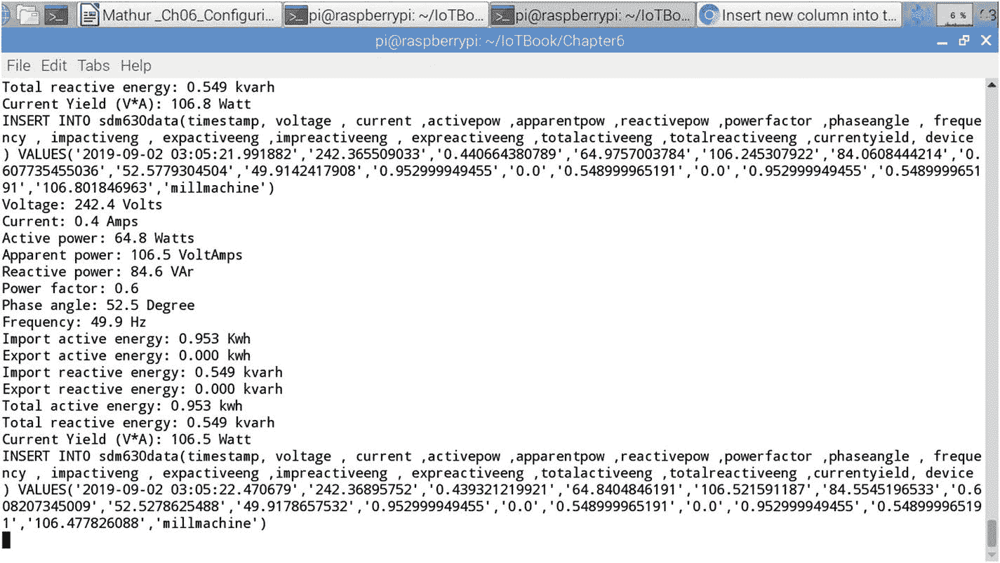

图 6-24

程序 sdm630_tested.py 的输出

用于将数据存储到 SQLite3 数据库的 `insert into` 语句的输出会进入一个名为 `sdm630data` 的表中。表创建脚本位于文件 `sdm630_db_creation_script.sql` 中，该文件随你从 [www.​pmauthor.​com/​raspbian/​](https://www.pmauthor.com/raspbian/) 下载的压缩包一起提供。

## 总结

至此，我们完成了电能表的设置、配置以及将数据获取到数据库系统的全部工作。到目前为止，你已经成功下载了用于设置电能表设备的脚本。你通过使用 Arduino IDE 中的 Modbus 库为 EM6400 电能表编写了代码。你还通过编写一个简单的“Hello World”程序，学习并实现了 Arduino Mega 2560 与 Conzerv EM6400 电能表之间的通信前与通信后操作。然后，你编写了代码，通过其寄存器从电能表获取数据值。之后，你配置了另一款更常见的 Eastron SDM630 电能表。你将其硬件连接好，然后加载了树莓派与 SDM360 电能表之间进行 Modbus 通信所需的 Python 库。最后，你编写了一个 Python 程序，用于从电能表获取电压、电流和功率等数据，并将其存储到 SQLite3 数据库中。

接下来，你将研究一些案例，并设计一些有趣的物联网和工业物联网解决方案。


# 7. 电信行业案例研究：利用物联网解决通话中断问题

本案例研究基于一个虚构的国家、虚构的公司和虚构的场景。然而，通过本案例研究，您将了解到大多数电信公司都面临的、近乎真实的通话中断问题。案例研究将带您了解一家电信运营商的成立过程，为您提供其业务建立的足够背景信息。案例研究为您提供了一个普遍的政治和商业背景，以及相对一致的社会政治利害关系，因此具体是哪个国家并不重要。在本案例研究中纳入政治和商业背景的原因，是为了让身为机器学习工程师的您认识到，基于您构建的预测模型所做出的决策有多么重要，以及这些决策如何对商业乃至整个社会产生重大影响。现在，让我们进入案例研究。

## 电信案例研究概述

Regoniatel 于 2016 年开始运营，是 Regonia 的一家 2G 电信运营商。Regonia 是一个三面环山的国家。

首席执行官是 Kaun Methi John。他还拥有其他业务，例如采矿和炼油，并因此致富。他在这个欧洲小国建立了一个商业帝国。

当 Regonia 采用新的 2G 移动电话技术时，政府向有兴趣的企业征集提案。John 明白这是他拓展业务、进入未来将蓬勃发展的电信行业的黄金机会。由于他缺乏在本国建立电信基础设施的技术专长，他积极在全球寻找合作伙伴，以帮助他在这项新事业中取得成功。他找到了 Samtel，一家总部位于美国的公司，该公司正在与其他公司建立合资企业。

在项目计划和可行性研究完成后，合资伙伴为政府制定了 2G 频谱的提案。他们和其他三家公司一起中标了。他们成功获得了政府合同；然而，在建立电信网络并吸引客户入网方面，将面临激烈的竞争。其他三家公司也是由本地公司与国际电信公司合资成立的。政府认为将合同授予此类合资企业是明智之举，希望借此利用国际经验。

政府对该国的 2G 网络进行了数月的测试，以确定其可行性。一旦内部电信机构成功完成测试，企业就可以开始运营。

该国蓬勃发展的 1 万亿美元经济要求升级通信基础设施。该国的主要产业是农业和采矿业。该国四面环陆，没有海岸线。人们对这个国家得天独厚的金矿和钻石矿非常感兴趣，这些矿产是重要的收入来源。在金矿或钻石矿工作的矿工平均年收入为 6,000 美元。工资较高的原因是这些矿山出产一些最好的黄金和钻石。这个国家的钻石在全球范围内都备受追捧和需求。采矿业贡献了 Regonia 近 50% 的 GDP。

这个国家日益增长的需求需要良好的电信基础设施，为其公民提供强大的通信系统。这个小国能够负担得起世界上最好的基础设施。

Regoniatel 在获得频谱合同后的三年内，成功在城市地区建立了良好的基础设施。其竞争对手 Ytel 和 Fretel 也在城市和农村地区建立了移动基站。Sautele 在开发办公基础设施四年后的问题在于，它基本上已成为一家以城市为导向的公司。

政府设立了一个电信监管机构，负责发布所有公司的电信用户互动数据，例如客户投诉和网络故障。

在其 2019 年的报告中，该机构强调所有运营商的通话中断率上升了 35%。问题严重到执政党和反对党开始互相指责，称电信监管机构和政府行政部门在包庇电信运营商。总理紧急召见了三家公司的负责人，讨论问题及其可能的解决方案。Sautele 收到了关于其通话中断投诉的以下报告，如表 7-1 所示。


数据显示，RegoniaTel 网络的掉话投诉量上升了 41%。在所有运营商中，其掉话率增幅最大。由总理设立的电信委员会建议，对超过 10% 掉话投诉阈值的电信运营商处以 9 亿美元的罚款。这是一笔巨额罚款，如果掉话问题在其网络上持续发生，将给公司带来巨大的经济损失。

面对这一威胁和公众的强烈抗议，RegoniaTel 总裁召集其运营团队开会，以了解掉话率飙升背后的关键原因。根据运营经理的建议，需要设立一个试点项目，整合机器学习、物联网等前景广阔且创新的新兴技术，以解决这一技术商业问题。运营经理调来了其最有经验的机器学习工程师以及两位最优秀的数据科学家，共同组成试点团队，以寻找解决方案。

试点团队首次会面，研究了导致掉话的各种技术原因，包括对表 7-1 中给出的不同网络位置阶段的分析。

表 7-1

2018 年 Regonia 电信运营商掉话数据

| 网络名称 | 平均信号强度 (dBM) | 用户数 | 电话普及率 % | 网络停机时间 % | 通话成功率 % | 掉话率 | 掉话投诉量 |
| --- | --- | --- | --- | --- | --- | --- | --- |
| EtiTel | 92 | 1160000 | 113 | 0.05 | 98.2 | 0.048 | 55680 |
| GribaTel | 107 | 1030900 | 96 | 0.87 | 97.4 | 0.8352 | 861007.68 |
| RegoniaTel | 89 | 1243080 | 97 | 1.3 | 96.2 | 1.248 | 1551363.84 |

如您所见，信号强度以 dBm 为单位，这是衡量信号强度的单位。表格显示了用户数、电话普及率百分比、网络停机时间百分比、通话成功率百分比以及掉话率百分比。表格还显示了三家电信运营商各自收到的掉话投诉数量。平均信号强度最好的是 GribaTel，其次是 EtiTel，最后是 RegoniaTel。用户数量最多的是 RegoniaTel，约为 1240 万。RegoniaTel 的电话普及率为 97%，最高的是 EtiTel。RegoniaTel 的网络停机时间最高，为 1.3%。通话成功率最高的是 EtiTel，最低的是 RegoniaTel。RegoniaTel 的掉话率为 1.248%，最低的是 EtiTel。RegoniaTel 的掉话投诉量也最高。因此，您可以清楚地看到 RegoniaTel 存在网络停机、平均信号强度低以及掉话率最高的问题。

RegoniaTel 的运营经理报告称，用户数量正在下降，服务客户反馈显示，超过 60% 的用户表示因掉话问题而转投竞争对手的网络。用户数据见表 7-2。

表 7-2

RegoniaTel 七个月的用户数量

| 月份 | 用户数量 |
| --- | --- |
| 2018 年 4 月 | 1286588 |
| 2018 年 5 月 | 1274157 |
| 2018 年 6 月 | 1269806 |
| 2018 年 7 月 | 1266580 |
| 2018 年 8 月 | 1262845 |
| 2018 年 9 月 | 1261726 |
| 2018 年 10 月 | 1243080 |

如您所见，从 2018 年 4 月到 10 月出现了一个峰值，随后用户数量稳步下降。在七个月的时间里，其用户基数稳定下降了 3.4%。公司总裁向运营经理表达了他的担忧，并要求他加快项目进度，以找到解决此问题的方法。

试点项目中的机器学习工程师和数据科学家都意识到了这个问题的严重性，以及它与 RegoniaTel 收入减少的直接关联。如果用户流失继续下去，预计用户基数将进一步减少 4.75%（表 7-3）。运营经理还解释说，用户数量每下降一个百分点，平均会导致收入相应减少 1000 万美元。对于一家正在努力维持其网络质量的公司来说，这是一个巨大的数字。CEO 已经在考虑可能不得不裁员以降低运营成本。这是一个可怕的想法，但这是基于呈现在他面前的数据得出的。他向运营经理和试点团队解释了这项基于机器学习和物联网的试点项目的成功对公司有多么重要。

表 7-3

RegoniaTel 2019 年预计用户数

| 月份 | 用户数量 |
| --- | --- |
| 2018 年 10 月 | 1243080 |
| 2018 年 11 月 | 1212003 |
| 2018 年 12 月 | 1210760 |
| 2019 年 1 月 | 1184034 |
| 2019 年 2 月 | 1129338 |

试点团队被要求设计并实施一个试点系统，该系统能够解决掉话的直接问题，并应解决以下问题：

1.  导致掉话问题的原因是什么？
2.  掉话问题在哪些地点更为普遍？
3.  如何衡量特定地点的通话质量？
4.  能否预测掉话？如何预测？

这就是完整的案例研究。如果您来自电信行业，您会发现这些问题非常熟悉，并且应该能够轻松地将它们联系起来。请跟随我，看看作为一名机器学习顾问，我将如何为 RegoniaTel 构建这个问题的解决方案。


## 案例研究的设置与解决方案

设置工具包括硬件和软件两部分。硬件元素如下：

1.  一款安卓应用，用于捕获通话数据，其中嵌入了实时的 Regoniatel SIM 卡。
2.  一架工业级无人机，能够承载 500 克（即 1 磅）重的手机。
3.  配备 Wi-Fi 模块的 Raspberry Pi Model 3 B+，用于接收无人机上搭载手机发送的数据。

软件元素：

1.  一款由团队构建的安卓应用，用于测量和捕获通话信号质量数据，并将其存储为 CSV 文件格式。
2.  一个 Python 机器学习程序，利用从安卓应用设备导入的数据建立预测模型。

图 7-1 展示了这些元素如何组合在一起形成试点解决方案。

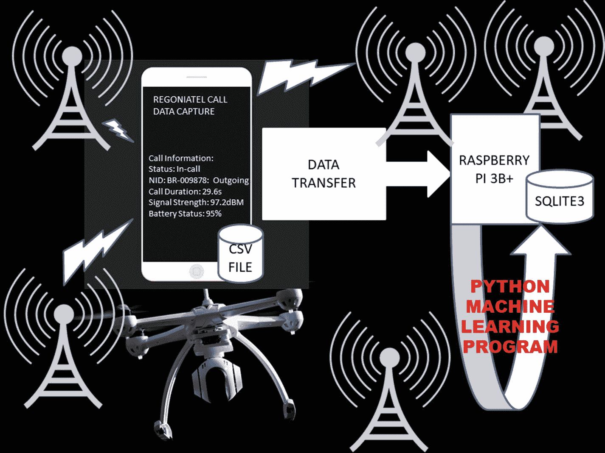

图 7-1

案例研究的硬件与软件解决方案设置

此设置的关键在于搭载手机在特定区域飞行的无人机。无人机由地面人员手动操控，在测试通话的移动基站周围以人体高度飞行。无人机上搭载的手机会每隔几分钟自动向同一网络中的另一部手机拨打电话。其目的是自动捕获通话质量数据，并将其存储为 CSV 格式的数据文件。当手机拨打的通话次数足够多时，由操作员将其取下，然后带到另一个具有不同移动基站的地点。通过这种方式捕获数据，然后整理到 SQLite3 数据库中。一旦从所有试点移动基站收集到足够的数据，就运行 Python 机器学习程序来查看模型结果。移动数据集如图 7-2 所示，Python 代码如代码清单 7-1 所示。

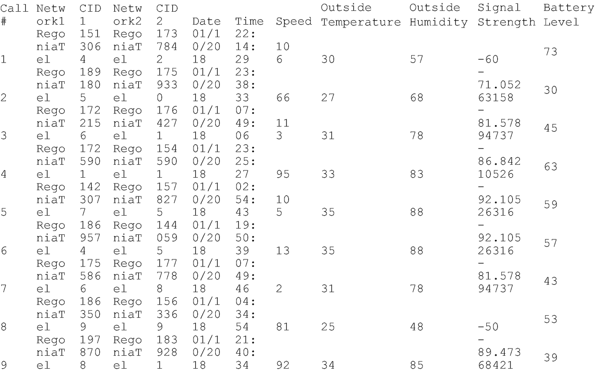

图 7-2

移动通话质量数据集

请记住，这只是一个基本的通话质量数据集；在现实世界中，你需要测量更多参数来确定通话质量，例如通话时长、语音质量参数、电话反馈等。此数据集的目的是向你展示如何从基本的电信数据进行分析。

将此数据集导入 SQLite3 数据库后，我们可以使用代码清单 7-1 中给出的程序。

```
