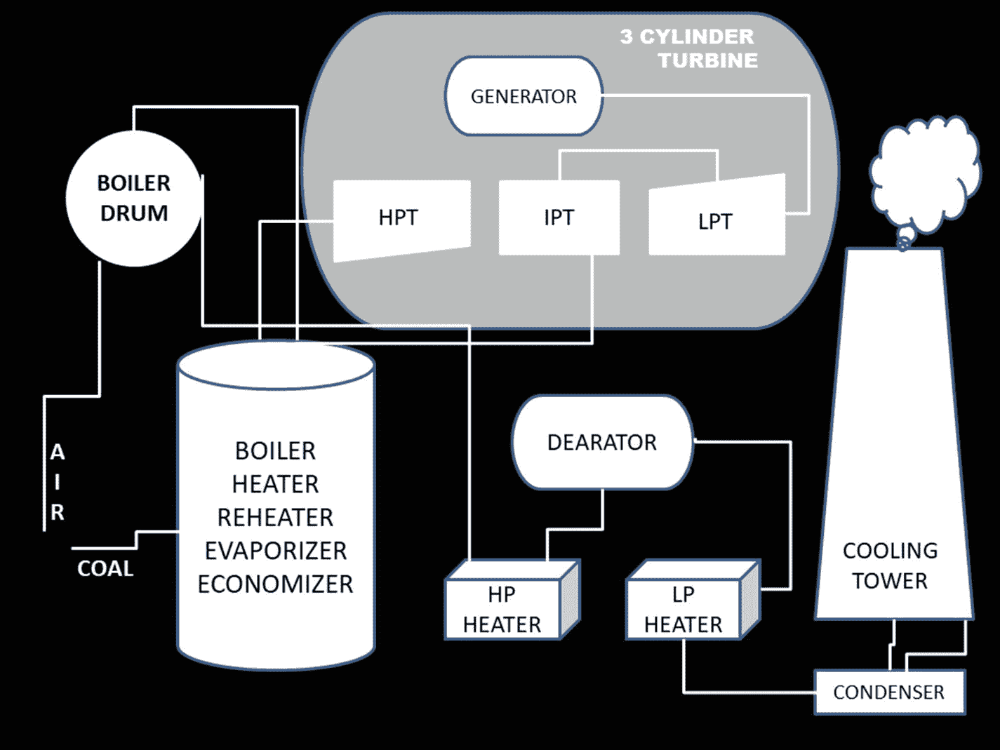
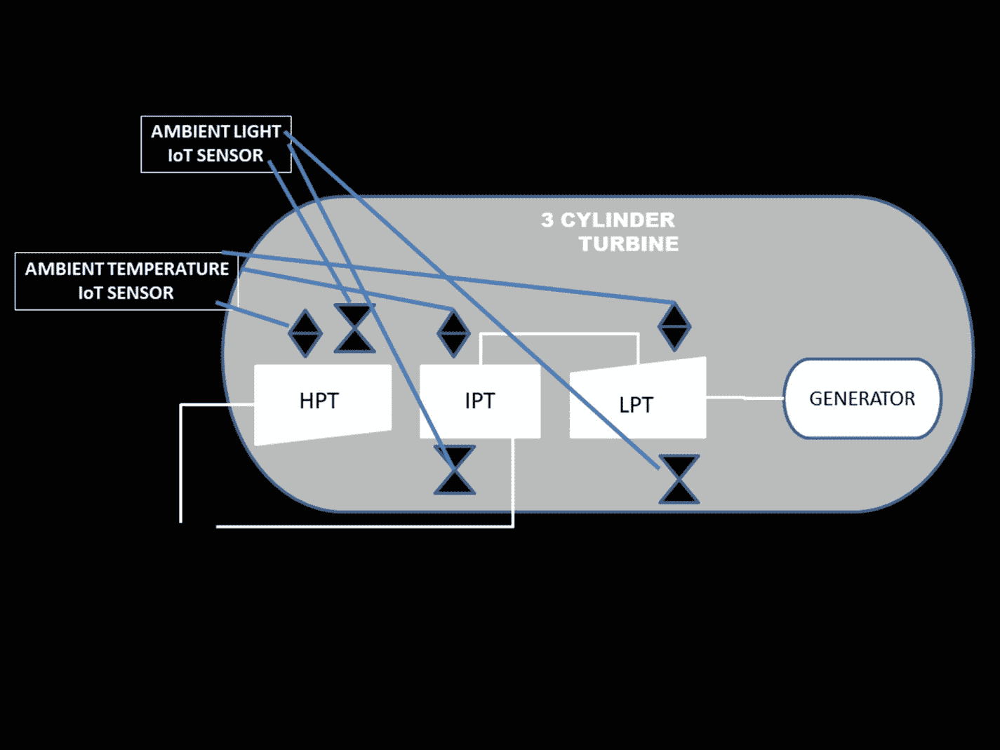

# Use score method to get accuracy of model
score = lr.score(x_test, y_test)
print(score)
import matplotlib.pyplot as plt
import seaborn as sns
from sklearn import metrics
import numpy as np
cm = metrics.confusion_matrix(y_test, predictions)
print(cm)
plt.figure(figsize=(9,9))
sns.heatmap(cm, annot=True, fmt=".3f", linewidths=.5, square = True, cmap = 'Blues_r');
plt.ylabel('Actual Calldrops');
plt.xlabel('Predicted Calldrops');
all_sample_title = 'Accuracy Score: {0}'.format(score)
plt.title(all_sample_title, size = 15);
plt.figure(figsize=(7,7))
plt.imshow(cm, interpolation="nearest", cmap="Pastel1")
plt.title('Confusion matrix', size = 15)
plt.colorbar()
tick_marks = np.arange(1)
plt.xticks(tick_marks, ["0", "1"], rotation=45, size = 15)
plt.yticks(tick_marks, ["0", "1"], size = 15)
plt.tight_layout()
plt.ylabel('Actual Calldrops', size = 15)
plt.xlabel('Predicted Calldrops', size = 15)
width, height = cm.shape
for x in range(width):
for y in range(height):
plt.annotate(str(cm[x][y]), xy=(y, x),
horizontalalignment='center',
verticalalignment='center')
plt.show()
代码清单 7-1
案例研究解决方案的代码
```

请记住，从 LightSensor 和其他物联网传感器获取数据的代码在第 [3](https://doi.org/10.1007/978-1-4842-5549-0_3Fig#25) 章的图 [3-25](https://doi.org/10.1007/978-1-4842-5549-0_3Fig#25) 中给出。无论我们尝试实现何种解决方案，从传感器获取数据的过程都是相同的。唯一的区别在于，本案例中的 Raspberry Pi 在收集数据时位于无人机内部。它类似于第 3 章中用于将 LDR 模块物联网传感器数据存储到 SQLite3 数据库的图 3-33 程序，以及用于模拟基于物联网的解决方案的图 3-35 代码，这两者共同使我们能够从物联网传感器获取数据，然后存储并处理这些数据，以便在需要时发出高级预警信号。在本案例中，我们不需要任何高级预警信号。


数据由搭载着树莓派（Raspberry Pi）作为有效载荷的无人机在飞往指定信号塔时收集，同时，代理程序既从用于监测温度和湿度的物联网传感器收集数据，也从附带的 4G/LTE 模块收集数据。这些数据被收集并存储在树莓派的 SQLite 数据库中后，便可用于进一步分析。因此，该解决方案假设数据收集已通过上述设置完成。

代码首先导入了常用的 `pandas` 和 `SQLite3` 库。它与 `machinemon` SQLite3 数据库建立连接，然后使用 `Select * from fielddata` SQL 查询从数据库中获取数据。`Fielddata` 是存储来自无人机物联网传感器和 4G/LTE 模块数据的表。接下来，在构建任何模块之前，我们检查是否存在缺失值，在本例中不存在缺失值，因此我们无需对其进行任何处理。之后，我们对数据集进行探索性数据分析。

像 Spyder 这样的 Python IDE 的问题在于，如果数据集中有大量列，它们会截断列。因此，技巧是对 pandas 数据框使用 `pd.option_context('display.max_columns', 40)` 语句。这里设置为 40，但如果你有更多列，可以将其设置为你需要的值。`df.describe()` 函数的输出如表 7-4 所示。

表 7-4

查看 EDA 统计信息

| `----------EDA 统计信息---------------` |
|   | `Call#` | `CID1` | `CID2` | `Speed  \` |
| `count` | `2000.000000` | `2.000000e+03` | `2.000000e+03` | `2000.000000` |
| `mean` | `1000.500000` | `1.693192e+06` | `1.688596e+06` | `59.706000` |
| `std` | `577.494589` | `1.709635e+05` | `1.673130e+05` | `35.214196` |
| `min` | `1.000000` | `1.399112e+06` | `1.398797e+06` | `0.000000` |
| `25%` | `500.750000` | `1.540734e+06` | `1.543660e+06` | `29.000000` |
| `50%` | `1000.500000` | `1.698208e+06` | `1.685488e+06` | `59.000000` |
| `75%` | `1500.250000` | `1.841730e+06` | `1.830084e+06` | `90.000000` |
| `max` | `2000.000000` | `1.987112e+06` | `1.986768e+06` | `120.000000` |
|   | `OutsideTemperature` | `OutsideHumidity` | `SignalStrength` | `BatteryLevel \` |
| `count` | `2000.000000` | `2000.000000` | `2000.000000` | `2000.000000` |
| `mean` | `28.046000` | `64.728000` | `-67.895895` | `52.089500` |
| `std` | `4.288482` | `12.714828` | `13.327106` | `19.043945` |
| `min` | `21.000000` | `40.000000` | `-92.105263` | `20.000000` |
| `25%` | `24.000000` | `55.000000` | `-78.947368` | `36.000000` |
| `50%` | `28.000000` | `63.000000` | `-66.000000` | `51.000000` |
| `75%` | `32.000000` | `75.000000` | `-57.894737` | `66.000000` |
| `max` | `35.000000` | `88.000000` | `-42.000000` | `96.000000` |
|   | `Calldrop` |
| `count` | `2000.00000` |
| `mean` | `0.78900` |
| `std` | `0.40812` |
| `min` | `0.00000` |
| `25%` | `1.00000` |
| `50%` | `1.00000` |
| `75%` | `1.00000` |
| `max` | `1.00000` |

需要注意的几点是：速度列的值范围从某些区域的 0.0 到其他区域的 120；室外温度介于 21 摄氏度到最高 35 摄氏度之间；室外湿度介于 40%到 88%之间，表明这是一个相当潮湿的区域。信号强度 ASU 介于-92.1 和-42.0 之间；记住，数值越低越好。

完成此步骤后，我们现在查看各列之间是否存在统计上的关系。最好的方法是对数值列进行相关性分析。这里使用了 `df.corr()`，它为我们提供了很好的见解，可以据此构建模型，如表 7-5 所示。

表 7-5

查看相关性

| `n [102]: print("----------相关性---------------")` |
| `with pd.option_context('display.max_columns', 40):` |
| `print(df.corr())` |
| `----------相关性---------------` |
|   | `Call#` | `CID1` | `CID2` | `Speed  \` |
| `Call#` | `1.000000` | `-0.028051` | `0.005757` | `-0.005541` |
| `CID1` | `-0.028051` | `1.000000` | `0.012414` | `-0.023611` |
| `CID2` | `0.005757` | `0.012414` | `1.000000` | `0.022053` |
| `Speed` | `-0.005541` | `-0.023611` | `0.022053` | `1.000000` |
| `OutsideTemperature` | `-0.026658` | `0.013036` | `0.001161` | `-0.021969` |
| `OutsideHumidity` | `-0.016984` | `0.046798` | `0.018531` | `-0.025885` |
| `SignalStrength` | `0.016455` | `-0.047521` | `-0.018348` | `0.026063` |
| `BatteryLevel` | `0.017357` | `-0.023449` | `-0.017436` | `0.008438` |
| `Calldrop` | `-0.029110` | `0.038461` | `-0.001414` | `-0.045044` |
|   | `OutsideTemperature` | `OutsideHumidity` | `SignalStrength \` |
| `Call#` | `-0.026658` | `-0.016984` | `0.016455` |
| `CID1` | `0.013036` | `0.046798` | `-0.047521` |
| `CID2` | `0.001161` | `0.018531` | `-0.018348` |
| `Speed` | `-0.021969` | `-0.025885` | `0.026063` |
| `OutsideTemperature` | `1.000000` | `0.771495` | `-0.772994` |
| `OutsideHumidity` | `0.771495` | `1.000000` | `-0.999792` |
| `SignalStrength` | `-0.772994` | `-0.999792` | `1.000000` |
| `BatteryLevel` | `0.032395` | `0.026747` | `-0.026404` |
| `Calldrop` | `0.496304` | `0.689299` | `-0.689721` |
|   | `BatteryLevel` | `Calldrop` |
| `Call#` | `0.017357` | `-0.029110` |
| `CID1` | `-0.023449` | `0.038461` |
| `CID2` | `-0.017436` | `-0.001414` |
| `Speed` | `0.008438` | `-0.045044` |
| `OutsideTemperature` | `0.032395` | `0.496304` |
| `OutsideHumidity` | `0.026747` | `0.689299` |
| `SignalStrength` | `-0.026404` | `-0.689721` |
| `BatteryLevel` | `1.000000` | `0.037316` |
| `Calldrop` | `0.037316` | `1.000000` |

在这个相关性中有几点值得注意。室外温度与湿度之间存在显著的正相关（0.77），而室外温度与信号强度之间存在负相关。这意味着当温度下降时，信号强度也会下降（信号强度具有反向效应，因此越低越好）。通话掉线与室外温度的相关性为 0.49，这并不十分显著。最值得注意的是，湿度与信号强度之间存在完美的负相关。如果湿度上升，信号强度肯定会下降。实际上，这意味着在雨天，当室外湿度非常高时，信号强度会很低。我们难道没有在雨天经历过通话语音质量下降吗？这个数据集恰恰证明了这一点。

室外湿度与通话掉线之间的相关性也呈正相关，高达 0.68，因此在构建模型时也应考虑这一点。对于模型而言，需要注意的相关结果是信号强度与通话掉线之间的相关性，为高度负相关（-0.68）。这意味着信号强度越好，通话掉线的频率就越低。既然我们知道数据集具有潜力，就可以使用这些选定的变量来构建我们的机器学习模型。

在下一步中，我们将数据集拆分为目标变量（即预测对象）和特征（即与目标或预测对象高度相关的列）。为此，我们从特征中省略了以下列：`CID1`、`CID2`、`Speed` 和 `BatteryLevel`，因为它们在结果中没有显著的相关性。我们在代码中仅为模型选择了三个变量：`nm=['OutsideTemperature', 'OutsideHumidity', 'SignalStrength']`, `features=df[nm]`。


此外，我们可以通过 `x_train, x_test, y_train, y_test = train_test_split(features, target, test_size=0.25, random_state=0)` 将数据集拆分为训练集和测试集，从而开始构建模型。我选择 25% 作为测试数据集，75% 作为训练数据集。你可以进一步试验，看看预测模型是否会得到不同的结果。接下来，我们仅使用逻辑回归分类器算法来构建预测模型；但我强烈建议你采用类似的方法来选择合适的分类器算法，就像我在我的书《*使用 Python 的机器学习应用*》第 3 章图 3-32 中所做的那样。这里，我们通过代码 `lr.fit(x_train, y_train)` 将数据集拟合到我们的逻辑回归对象，然后对 x_test（即我们的特征训练数据集）进行预测。接着，我们对预测结果进行评分，以查看模型的执行准确度，逻辑回归模型的准确度得分为 1.0。这表明我们的模型存在过拟合问题。因此，正如我所提到的，我们需要评估其他分类器算法，以找到不会过拟合的最佳算法。

混淆矩阵和准确度得分可以通过使用热图和颜色条以图形方式可视化。这就是我们接下来在代码中使用 matplotlib 和 Seaborn 库所做的事情。该代码通过语句 `cm = metrics.confusion_matrix(y_test, predictions)` 使用 sklearn 库的 metrics 包构建了一个混淆矩阵。有时，就混淆矩阵而言，这种简单的输出不如视觉上吸引人的颜色条或热图那样有影响力，而这正是代码下一部分使用 Seaborn 热图库包通过代码语句 `sns.heatmap(cm, annot=True, fmt=".3f", linewidths=.5, square = True, cmap = 'Blues_r')` 所实现的效果。这里，注释设置为 true，以便输出可以在热图上显示；此外，我们使用了 `cmap` 或一个具有蓝色色调比例的颜色映射。要了解更多关于带注释的颜色映射的信息，请参考这个 matplotlib URL：[`https://matplotlib.org/gallery/images_contours_and_fields/image_annotated_heatmap.html`](https://matplotlib.org/gallery/images_contours_and_fields/image_annotated_heatmap.html)。

## 总结

在本章中，你看到了一个近乎实际现实世界的场景：一家虚构的电信公司经历了一场社会政治危机，其老板被要求调查并解决其通话掉线问题。世界各地的电信公司都面临着类似的技术挑战和问题，并且正在使用人工智能来解决它们。我在这个案例研究解决方案中展示了如何预测通话掉线问题。预测问题是企业在找到问题解决方案之前必须跨越的第一个障碍。这在本次案例研究中已经完成。我们使用逻辑回归分类器算法构建了一个模型来预测通话掉线何时发生。有了这些数据，企业就可以看到需要什么样的技术升级来解决预测模型给出的湿度问题。是否有更好的发射和接收塔可以在这种潮湿条件下良好工作？他们是否需要将一些塔架远离水体？一旦预测模型提供结果，这些都是企业必须解决的一些问题。

# 8. Gantara 发电厂：工业机器的预测性维护

本章是关于一个能源行业的案例研究，我们尝试模拟工业机器预测性维护的数据。该案例研究的背景是未来非洲地区的一个虚构国家。它阐述了在第三世界国家建立发电厂所面临的挑战，从承担土地征用任务，到构思其设计，再到实际建设。还涵盖了建立发电厂的技术要求和技术规格，其中包括与行业相关的发电厂用地，以便你了解发电厂真正需要什么才能建立起来。如果你对能源行业不熟悉或有一些了解，你会发现关于发电厂需求的输入、处理和输出格式的表格很有帮助，它列出了企业的完整结构和基础。尽管人物、情境和国家都是虚构的，但它们会让你了解社会政治环境压力是如何作用于像发电这样基本的事情的。作为案例研究的一部分，还包括一位机器学习工程师，其角色在案例研究中被精心塑造，以让你了解典型的机器学习工程师在处理这类问题时可能会承受的压力。那么，让我们深入我们的案例研究吧。

## 案例研究

Noki Ora，一家私营发电厂的首席执行官，刚刚降落在非洲 Nobag 的 Gantara 首都，由于最近当选政府的进步政策，该地区正在快速发展。然而，发展也带来了为工业和住宅需求生产足够电力的挑战。Noki 从电厂概念化到目前状态（即现在能在 500 MW 峰值负荷下发电）就一直在这家公司。这个过程并非一帆风顺；一路上充满了问题。事实是，在第三世界国家建立发电厂面临着巨大的挑战，从寻找融资伙伴到寻找愿意进行安装的工厂设备供应商。

Nobag 在 2024 年叙利亚战争结束后，在主要国家联合起来划出这个国家后，成为了非洲大陆的一个独立国家。自独立以来，该国对其采矿和农业产业（这里是人们的主要职业）的发展兴趣日益浓厚。其政府设立了各种经济特区，为来此设立业务的公司提供各种税收减免。Noki 的公司，Nobag Power Enterprise Ltd.，就是这样一个由一群欧洲企业集团设立的公司，旨在利用该国的发展潜力并促进其基础设施建设。Nobag 总统 Ag Zisi 发布了以下章程，作为总统令的一部分，授予 Nobag Power Enterprises 以使其成功完成使命：

*授予 Nobag Power Enterprises 在两年时间内发电和输送高达 500 MW 容量的热能电力，以支持 Gantara 首都地区的电力需求。*

公司的愿景声明反映了总统的章程，内容如下：

*Nobag Power Enterprises 的愿景是发电和输送电力，以满足 Nobag 人民的电能需求，以帮助其住宅和工业发展。*


## 项目背景

当诺巴格电力企业构思甘塔拉发电厂项目时，它制定了电厂建设和安装所需的土地需求计划，因为这是诺巴格政府设立该项目的关键因素。土地需求已传达给政府官员，由于这是一座火力发电厂，需要尽快完成土地征用，以便启动电厂建设进程。这座 500 兆瓦电厂的土地规划时间表见表 8-1。

表 8-1

甘塔拉发电厂的土地需求

| 面积（英亩） |
| --- |
| 描述 | 500 兆瓦 |
| --- | --- |
| **电厂边界内设施** |
| **主厂房** | **25** |
| **输煤系统** | **230** |
| **水系统** | **45** |
| **水库** | **30** |
| **开关站** | **25** |
| **辅助设施、仓库和道路** | **70** |
| **绿化带区域** | **150** |
| **电厂边界外设施** |
| **灰渣处置区** | **270** |
| **员工生活区** | **100** |
| **灰渣、原水和煤炭处置** | **250** |
| **总计** | **1195** |

尽管诺巴格拥有充足的土地来建设电厂项目，但甘塔拉市周边的大部分土地都被农民占用。他们对新成立的诺巴格政府为开发电厂而征用土地的努力进行了强烈抵制。这导致了暴力事件，政府宣布该公司寻求征地的区域进入紧急状态，因为该区域靠近一座水库。最终，在政府同意农民关于充分补偿的要求后，土地征用经过九个月的斗争才得以推进——考虑到政府为水坝和其他项目征地的类似案例往往陷入诉讼和暴力抗议，这算是一个创纪录的速度。尽管诺巴格人民明白电厂是为了他们的利益（正如政府和诺基·奥拉在与农民及甘塔拉市民的互动中所传达的那样），但问题在于他们是否信任政府能提供双赢的方案。在其欧洲财团施加的一点压力下，政府屈服于压力，通过提供基于市场价格的补偿来征用土地。

54 岁的诺基·奥拉是一位出生于非洲的电气工程师，曾任职于通用电气等公司，在为欧洲财团合作伙伴建设电厂设施方面拥有丰富经验。他在成功实施中东某电厂项目后晋升为首席执行官。作为非洲本土人，他非常熟悉当地地理环境。他在政界人脉广泛，能够动用一些关系来确保项目成功。他被遴选委员会从三位潜在候选人中选中，这三人背景相似，但只有他具备种族优势，从而获得了这份工作。

诺巴格拥有丰富的煤矿储量，足以再开采 100 年。因此，建设火力发电厂是最佳选择，因为其石油储量较少，无法满足电厂对天然气的需求。它需要从其他中东国家购买天然气，这将非常昂贵，并会耗尽本已微薄的外汇储备。此外，这将使其电力供应依赖天然气，因为邻国刚刚结束长期战争，如果该地区局势再次动荡，天然气管道可能成为武装袭击的目标。尽管诺巴格有自己的污染控制法律，但由于它正在接受欧洲财团等外部机构的帮助，因此必须遵守这些机构制定的清洁电力要求。这座燃煤火力发电厂必须实施碳捕集与封存（CCS）技术，即捕获碳并将其注入地下（[`https://en.wikipedia.org/wiki/Carbon_capture_and_storage`](https://en.wikipedia.org/wiki/Carbon_capture_and_storage)），从而减少碳向大气的释放。电厂的主要目的是将煤炭的化学能转化为电能。这通常通过锅炉产生蒸汽、蒸汽通过汽轮机膨胀做功，然后将汽轮机与发电机耦合来实现，发电机将机械能转化为电能。这座火力发电厂的输入和输出能力见表 8-2。请注意，所有数据均基于 24 小时的日消耗周期。

表 8-2

甘塔拉发电厂的输入与输出

| 描述 | 输入 | 处理 | 描述 | 输出 |
| --- | --- | --- | --- | --- |
| **煤炭** | 6000 |   | **二氧化碳** | 15000 |
| **重油** | 50.5 | 500 兆瓦 | **二氧化硫 + 二氧化氮** | 340 |
| **水** | 4900 |   | **发电量** | 460 |
| **电力** | 40 |   | **灰渣** | 2100 |

典型的燃煤火力发电厂的问题在于会产生二氧化碳、二氧化硫和二氧化氮等气体，这些气体会严重污染环境。因此，这些气体需要通过捕获并注入地下的方式进行处理，尤其是二氧化碳。这增加了项目成本和资金需求。电厂自身运行也需要消耗电力，因此其运行需要输入约 40 兆瓦的电流，最终只有 460 兆瓦被释放用于进一步输送到甘塔拉市。每天 4900 立方米的水需求是为什么选址在靠近水库的特定土地的原因，也是农田对电厂建设构成问题的原因。每天产生 2100 吨灰渣，政府邀请私营企业建造工厂，利用这些灰渣生产混凝土制品和墙板，以免污染水库周边的土地，因为农民也在使用这片土地。当甘塔拉附近的电厂开始运行时，几乎没有工厂生产能够回收灰渣的火山灰质硅酸盐水泥（PPC），因此灰渣被排放到电厂附近的干式填埋场。环保活动人士抗议此举对电厂周边农民造成环境危害；然而，政府向他们保证，完全利用电厂粉煤灰产出的设施将在几年内准备就绪，从而减少拟建电厂周边的环境危害。

为了在甘塔拉附近建设这座火力发电厂，该公司从一个全球投资者财团获得了 6 亿美元的贷款，以满足附近地区日益增长的电力消费需求。


在新建发电厂的调试过程中，该电厂峰值负荷装机容量为 500 兆瓦，而当前峰值负荷需求为 640 兆瓦。困扰其运行的问题包括：电力系统损耗高、电厂效率低、供电不稳定、窃电现象、停电事故以及电厂维护资金短缺。总体而言，过去十年该国发电机组无法满足系统需求。目前该国正从邻国购电，且需以美元支付，这正在消耗其宝贵的外汇储备。每当该电厂发生故障停电时，便从邻国获取备用电力以维持供电。该电厂在夏季和冬季用电高峰季节均存在发电问题。

诺巴格总统阿格·齐西上月因夏季大量消费者投诉电厂停电事故，紧急召见了首席执行官诺基·奥拉。这些停电导致首都地区多次断电数小时。最近一次停电持续超过 48 小时，直至邻国提供替代电力后全城才恢复供电。总统质疑为何一座仅投产八个月的新电厂会问题频发。火电厂设计寿命通常超过 30 年。由于媒体持续施压，指责政府无法为首都提供充足电力，总统召集欧洲企业集团官员成立调查委员会，要求就频繁停电的原因及解决方案提交报告。该委员会耗时 20 余天研究电厂基础设施。团队中包括一位名为卡尔的机器学习工程师，他受命利用电厂现有数据协助团队确定停电的真正原因。卡尔通过 Modbus RS485 接口设备，在两周内从电厂关键设备中采集数据。其发现如下：

*   蒸汽轮机是电厂最常见的停电故障源。
*   必须设法缩短停电持续时间。
*   需减少停电次数。
*   需围绕电厂当前负荷及未来数小时的预测负荷建立预测模型。

基于第一委员会的调查结果，诺巴格政府成立了第二个国家委员会，以查明并纠正停电的主要原因。报告发现，故障实际上源于燃气轮机运行协调不足。

同样参与第二国家委员会的卡尔制定了以下参数，用于从燃气轮机/电网收集停电数据：

*   总周期 T
*   周期 T 内发生的故障次数
*   维护间隔期间的故障次数
*   维护间隔期间的总运行时间
*   每年总停电小时数
*   每年故障次数
*   燃气轮机运行时间
*   燃气轮机停机时间

与任何传统燃煤电厂设施一样，各设备与机器独立运行，缺乏集中存储的互联数据源。从汽轮机到变压器再到锅炉，每个单元均独立监控。此外，电厂并未存储卡尔所需的数据，因此委员会成员无法确定燃气轮机故障的真正原因。国家委员会要求诺基·奥拉的公司利用物联网传感器从燃气轮机采集数据，并通过中继传输存储至新的私有云服务器。结果需在两周内全天候生成，以便清晰记录停电持续时间。此举旨在帮助卡尔创建停电预测模型。当然，描述和诊断停电也是流程的一部分。委员会的努力方向是让电厂公司从被动应对转向主动预防，对电厂内部发生的停电事件具备预测性和规范性。

如同任何改变运营方式的尝试，委员会的工作遭遇了阻力。工会联合起来，迫切想知道此举的后果：是否会导致失业？是否会削减薪资？所有人都充满疑虑。在汽轮机周围安装新型物联网传感器以获取新数据集的做法也遭到抵制。尽管如此，卡尔及其团队仍决心推进计划实施。

该计划部署了大量传感器，从测量汽轮机周围温度和光照的传感器，到测量附近超声波信号的传感器。卡尔希望确保在确定汽轮机故障的真正原因时不留任何死角。尽管身为机器学习工程师，卡尔仍需研究其工作领域——电厂，因此他必须学习电厂的完整运行原理。他绘制了电厂的简易示意图，其单元如图 8-1 所示。



图 8-1

火电厂原理示意图

他向委员会官员及其他不了解火电厂工作原理的成员展示了这份报告。报告内容如下：

“请记住，这并非技术图纸，而是一份帮助您理解火电厂关键组件的简图。实际电厂更为复杂，但核心组件相同。让我们逐一讨论各个组件。

锅炉是一种容器，水作为输入进入其中，蒸汽以所需的压力、温度和流量输出。热量施加于容器上。为此，锅炉需具备燃烧燃料并释放热量的功能。锅炉的主要功能如下：

*   将燃料（如空气）的化学能转化为热能。
*   将这些热能传递给水使其蒸发，并传递给蒸汽使其过热。

锅炉的基本组件包括：

*   炉膛与燃烧器
*   蒸汽与过热装置

同样，另一组件——省煤器，旨在通过从烟气中回收热量来加热给水并将其送入锅炉汽包，从而提高锅炉效率。

顾名思义，省煤器的优点包括：

*   节省燃料：用于节约燃料，提高锅炉装置的整体效率。
*   减小锅炉尺寸：由于给水在省煤器中预热后以更高温度进入锅炉管，所需的蒸发换热面积显著减少。


在低压和高压加热器中，热量从流经省煤器的烟气中提取，并进一步用于预热即将送入燃烧室的空气。它是将热空气送入煤粉燃料系统以干燥煤炭、从而促进炉膛内燃料燃烧的关键设备。如果缺少这一功能，燃烧室可能会出现故障。发电厂锅炉还包含一个再热器组件，其管道由流经管道的热烟气加热。从高压汽轮机排出的蒸汽被送入再热器管道内部以获取能量，从而驱动后续的中低压汽轮机。

汽轮机主要用作所有火力发电站的核心部件。汽轮机分为两种类型：

*   冲动式汽轮机
*   冲动-反动式汽轮机

汽轮发电机组由一系列相互连接并共同安装在同一根轴（铁质杆状结构）上的汽轮机和一台发电机组成。一端是高压汽轮机（HPT），随后是中压汽轮机（IPT）、两台低压汽轮机（LPT）以及发电机。蒸汽在高温（约 536°C 至 540°C）和高压（140 至 170 kg/cm²）下进入汽轮机膨胀做功。

凝汽器将汽轮机排出的蒸汽冷凝成液态水，以便进一步泵送。凝汽器的功能包括：

*   为蒸汽提供最低的排热温度。
*   将汽轮机排出的蒸汽转化为水进行回收，从而节省发电厂的给水需求。

冷却塔是一种半封闭式设备，通过空气接触对水进行蒸发冷却。从凝汽器流出的热水被送入冷却塔顶部，并以薄片或水滴的形式向下滴落。空气从冷却塔底部或垂直于水流方向流入，在有效冷却后排入大气。

发电机是汽轮发电机组中的电气部分。它将燃气轮机的机械能转换为电能。发电基于电磁感应原理。没有发电机，燃气轮机的输出就无法产生电力。因此，它是发电厂中最重要的设备。”

卡尔在报告中解释完这些之后，接着说明了获取燃气轮机周围物联网传感器数据所需的设置。正如第一份委员会报告所指出的，故障发生在燃气轮机上。然而，该报告未能得出根本原因，也未指出任何可能导致燃气轮机反复故障的潜在问题。这使得情况更加复杂，因此需要结合燃气轮机附带电子单元生成的数据进行监控，这些数据通过 Modbus 协议发送到树莓派工作站进行收集。为了确定根本原因并观察外部环境温度是否产生影响，在燃气轮机上安装了一些物联网传感器。监测了三个参数：环境光照、环境温度，以及一个用于测量机器设备周围超声波声音的物联网传感器。当然，在现阶段，这仅仅是一个假设，即外部环境中的任何这些因素都可能导致让电厂工程师和设备制造商困惑的故障。只有精心收集的数据才能证明或反驳这一假设。该设置如图 8-2 所示。



图 8-2

用于收集数据的燃气轮机物联网传感器

树莓派 3 B+ 使用 Python 程序以 SQLite 格式记录数据，记录时间至少持续数周，在此期间燃气轮机很可能发生故障。然后使用 Python 对收集到的数据应用机器学习程序，以得出最终结论。

首席执行官诺基·奥拉希望卡尔和他的团队提供以下结果：

*   关于那台异常汽轮机故障原因的确凿证据
*   能够实现自动化监控和预测故障流程的可行解决方案

两者都必须向第二委员会进行概念验证阶段的演示，以便后续开展商业开发。

至此，本案例研究结束。我们将从名为 `powerplant.db` 的 SQLite3 数据库中收集的汽轮机数据集推导出解决方案。我们将使用这些数据，假设电厂技术人员从物联网传感器收集了这些数据并将其发送到树莓派程序。使用机器学习并结合 Python 代码的完整解决方案如代码清单 8-1 所示。


```
