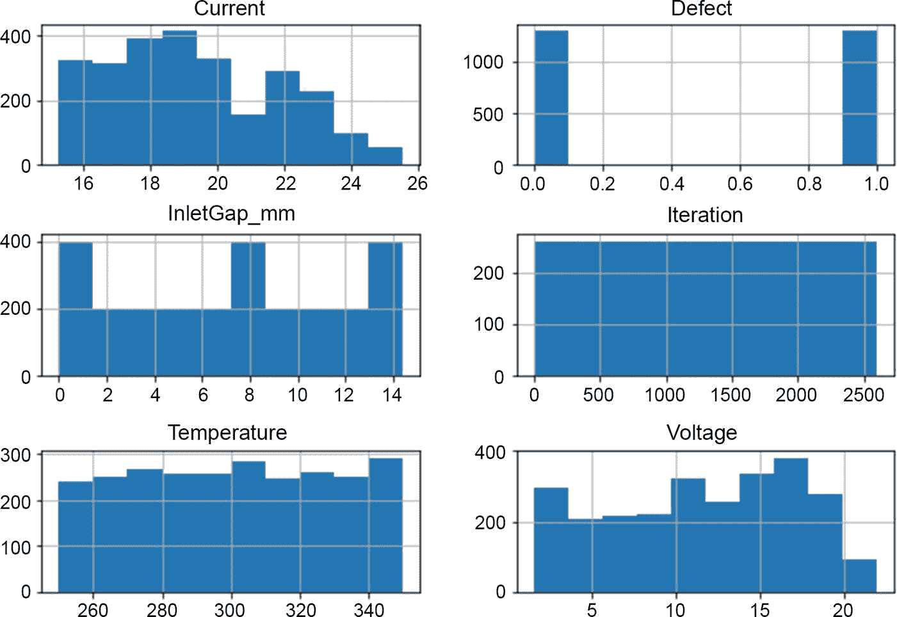
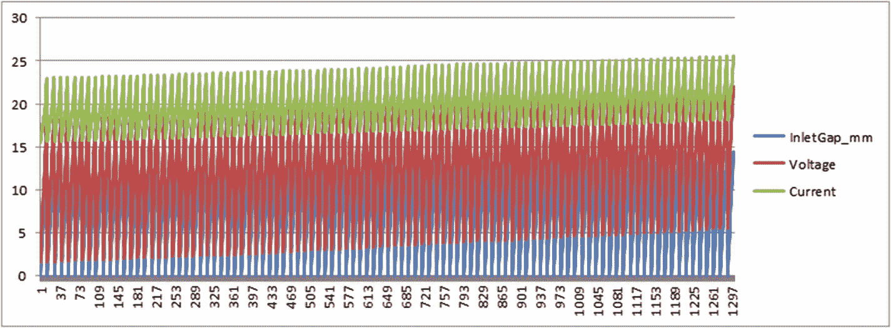
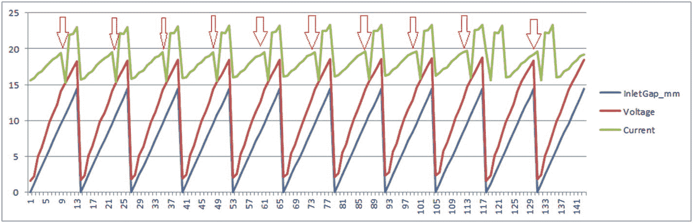

# 使用 score 方法获取模型准确率
score = lr.score(x_test, y_test)
print(score)
import matplotlib.pyplot as plt
import seaborn as sns
from sklearn import metrics
import numpy as np
cm = metrics.confusion_matrix(y_test, predictions)
print(cm)
plt.figure(figsize=(9,9))
sns.heatmap(cm, annot=True, fmt=".3f", linewidths=.5, square = True, cmap = 'Blues_r');
plt.ylabel('实际缺陷');
plt.xlabel('预测缺陷');
all_sample_title = '准确率得分: {0}'.format(score)
plt.title(all_sample_title, size = 15);
plt.figure(figsize=(7,7))
plt.imshow(cm, interpolation="nearest", cmap="Pastel1")
plt.title('混淆矩阵', size = 15)
plt.colorbar()
tick_marks = np.arange(2)
plt.xticks(tick_marks, ["0", "1"], rotation=45, size = 15)
plt.yticks(tick_marks, ["0", "1"], size = 15)
plt.tight_layout()
plt.ylabel('实际缺陷', size = 15)
plt.xlabel('预测缺陷', size = 15)
width, height = cm.shape
for x in range(width):
for y in range(height):
plt.annotate(str(cm[x][y]), xy=(y, x),
horizontalalignment='center',
verticalalignment='center')
plt.show()
清单 8-1
案例研究解决方案代码
```

如你所见，代码实现完全遵循第 3 章中机器学习代码实现的思路。但请注意，其结果和输出与第 3 章的解决方案截然不同。

由于我们正在复现第 3 章中的机器学习代码，我将简要描述该问题的解决方案。理解蒸汽轮机至关重要，因此我们将其作为本案例研究解决方案的一部分进行探讨。

火力发电厂的原动机介质是蒸汽。简单来说，水被加热后转化为蒸汽，在蒸汽轮机中旋转，进而驱动发电机。之后，蒸汽通过涡轮机并在冷凝器中冷凝；这被称为朗肯循环。

蒸汽轮机始终在高蒸汽压力环境下运行，并拥有大量高速运动部件。喷嘴（进口和出口阀门）以及涡轮叶片均经过仔细分析设计，其部件制造精度极高。

蒸汽轮机发电厂通常可实现高达 95% 的可用性，并且两次停机维护和检查之间的运行时间可超过一年。其非计划或强制停机率通常低于 2%，即每年少于一周。在我们的案例研究中，经过对整个电厂数据的仔细分析，包括机器学习工程师 Carl 在内的团队中的电厂制造工程师将异常停机问题缩小到蒸汽轮机的故障。

在清单 8-1 中，我们首先导入 pandas 和 sqlite3 等库以连接数据库。数据库名为 `powerplant.db`，表名为 `TURBINE_INLET_DATASET`。我们利用这些信息，首先通过 `sqlite3.connect()` 建立与数据库的连接，然后使用代码 `pd.read_sql_query("select * from TURBINE_INLET_DATASET;", conn)` 读取表 `TURBINE_INLET_DATASET` 中的所有行，从而连接到我们的电厂数据集。成功将数据从数据库读取到 pandas 数据框 `df` 后，我们通过 `df.columns`、`df.shape` 和 `df.dtypes` 语句查看其结构。之后，我们通过代码 `df.tail(1)` 查看最后一行；我们也可以使用 `df.head(1)` 来查看第一行。这仅用于进行完整性检查，以确认数据是否已正确加载。下一步是检查数据集中是否存在缺失值，由于本案例中用于监测蒸汽轮机进口和出口阀门的仪器是 Vibro Meter（振动计），它测量蒸汽轮机内阀门系统的声音和电气输入等值，因此缺失值的可能性较小。使用的代码是 `print(df.isnull().any())`，在我们的案例中，由于任何列中都没有空值，因此输出结果为 False。通过此数据检查后，我们就可以对电厂数据集进行探索性数据分析。在实际工作中，你需要合并来自物联网传感器和设备（如 Vibro Meter）的数据，以及蒸汽轮机监控软件（如 GE 的 GateCycle™）的数据。这将是团队中机器学习工程师最耗时的活动。在合并过程中，你可能会遇到数据不兼容问题，例如日期时间格式不同，你需要在最终合并之前解决这些问题。

为了快速进行探索性数据分析，我们使用 pandas 数据框的 `df.describe()` 函数。它为我们提供基本统计信息，例如均值、标准差、变量最小值、变量最大值、第 25 百分位数、第 50 百分位数和第 75 百分位数的数据。之后，我们查看数值列的直方图，如图 8-3 所示。



图 8-3

所有列的直方图

Inlet Gap 变量的曲线更接近正态曲线；然而，它在左侧较重。温度几乎呈均匀分布。然而，电压变量在图形上显示出一些潜力。让我们通过相关性来确认这些关系。运行语句 `df.corr()`，输出结果如表 8-3 所示。

表 8-3

电厂数据集的相关性结果


| 相关性 | 迭代次数 | 入口间隙 _ 毫米 | 电压 | 电流 | 温度 | 缺陷 |
| --- | --- | --- | --- | --- | --- | --- |
| **迭代次数** | 1 | 0.005 | -0.1 | -0.17 | 0.211 | 0.251 |
| **入口间隙 _ 毫米** | 0.005 | 1 | 0.964 | 0.782 | 0.171 | 0.193 |
| **电压** | -0.1 | 0.964 | 1 | 0.826 | 0.084 | 0.094 |
| **电流** | -0.17 | 0.782 | 0.826 | 1 | -0.176 | -0.21 |
| **温度** | 0.211 | 0.171 | 0.084 | -0.176 | 1 | 0.853 |
| **缺陷** | 0.251 | 0.193 | 0.094 | -0.21 | 0.853 | 1 |

我们可以推断出各列之间存在的关系，例如入口间隙和电压，其相关性高达 0.964；同样，入口间隙和电流的相关性为 0.782。电压和电流的相关性也很高，为 0.826，这符合预期。通过工业级物联网温度传感器测量的入口阀附近内部温度与缺陷呈正相关，相关性为 0.853。汽轮机入口阀操作的缺陷或异常状况如图 8-4 所示，入口阀操作周期中的正常运行状况如图 8-5 所示。



图 8-5

入口阀操作周期中的正常运行状况



图 8-4

入口阀操作周期中的异常或缺陷

入口阀操作图上的红色箭头显示了入口间隙、电压和电流之间的操作异常。这显示了电厂发生停机的状况，其根本原因被确定为汽轮机入口阀的电子控制器故障。

那么这些数据有什么用呢？它允许机器学习工程师为此类机器构建预测模型，不仅用于异常检测，还能为汽轮机的预测性维护提供提前预警。当然，这需要比此处展示的多得多的数据，但这是为电厂运营构建可行概念验证的良好开端。让我们继续构建我们的预测模型。

在接下来的代码部分中，在计算完变量之间的相关性后，我们将数据集划分为目标变量（即`Defect`列）和特征变量（即`Voltage`、`Temperature`和`InletGap_mm`）。请注意，我没有使用交叉验证或缩放，因为这只是原型级别的代码，仅用于查看构建模型是否可行。您可以根据我著作《使用 Python 的机器学习应用》中的第 3 章添加这些步骤。

之后，我们导入 sklearn 库，例如`train_test_split`，以及分类器算法，例如逻辑回归、线性判别分析、K 近邻分类器、高斯朴素贝叶斯、决策树分类器和支持向量机。然后初始化每个 sklearn 算法库，并对每个算法使用`fit()`方法，使其利用`x_train`和`y_train`数据集进行模型学习。一旦系统完成预测，我们就可以在测试数据集上测试其预测准确性。这是通过每个分类器的`predict()`函数完成的。接下来，使用`accuracy_score()`函数，我们对每个算法进行评分并检查其结果。请注意，在现实世界中，您不会得到所有分类器都达到 1.0 准确率分数这样精确的预测。因此，基于这些结果，您需要选择能在最短时间内给出最准确结果的最佳分类器。同样，我在我的著作《使用 Python 的机器学习应用》中以代码形式讨论过这一点。

分类器使用分类变量作为预测因子，因此它们应该有一个混淆矩阵，这就是我们在代码的最后部分以文本和图形格式创建的内容，以便查看结果。

## 总结

在本章中，您研究了一个属于能源领域的非常技术性的案例研究：热电厂。这个案例研究将您带到了电厂公司在建立和成功运营电厂时所面临的一些挑战的前沿。该案例研究提出了一个非常年轻的电厂出现停机的问题，这很可能是由于温度引起的，就像炎热气候下的电厂情况一样。团队利用数据将问题定位到蒸汽轮机内部一个异常的入口操作单元，但需要数据和预测模型来为此类异常创建预警系统。这将触发预测性维护请求，只要通过定期数据监测看到此类异常的症状。我们创建了一个解决方案作为概念验证，以确定构建这样一个模型是否可行，以及是否能有切实的成果。通过使用分类算法，我们创建了一个能够 100%预测或准确率分数为 1.0 的模型，这在现实世界中是罕见的。您看到了如何利用物联网传感器和树莓派 Model 3 B+ 的数据轻松创建整个解决方案。

# 9. 农业行业案例研究：预测经济作物产量

本章介绍一个基于农业行业的案例研究，用于预测经济作物产量。该案例研究让您了解一家中型农业综合企业所面临的挑战，该公司正试图达到新的水平，并实现其创始人的宏伟愿景。对于此类组织而言，作物产量问题非常重要，因为他们希望最大化土地资源以获得尽可能高的收入。您在本案例研究中将主要学到的是，公司的愿景应与其正在进行的机器学习操作相结合；否则，这将是一种浪费的开支。这也是我大多数客户在聘请我进行咨询，评估他们当前的机器学习应用如何帮助他们时，我常对他们说的话。它能降低成本吗？如果能，能增加多少收入？又能增加多少？项目的目标必须是可量化的，否则不仅不会成功，还会让企业主和利益相关者感到不满。那么，请继续阅读吧…


## 农业行业案例研究概述

一家名为 Aystsaga Agro 的国际农业综合企业集团，其业务涵盖农业种植、化肥生产和拖拉机销售。公司总裁兼创始人塔米奥·波尔斯卡布，将这家企业从他父亲继承的一座北美农场，逐步发展壮大为横跨北美、非洲和亚洲三大洲的农业综合企业。农业经营并非易事，由于关税战和气候变化，正面临着诸多新出现的挑战。全球范围内，从南亚到非洲各国，一场农业危机正在上演，各国都在努力保护小农户免受这种急剧变化的冲击。与此同时，一场静默的重大变革正在发生：使用机器人等科技手段替代人类进行农业耕作。像 Aystsaga Agro 这样运营高度商业化的农业综合企业，正在积极拥抱技术，探索如何应用并从中获益。由于农业与服务业等其他行业相比利润不高，这类运营因投资回报率低而难以获得资金。这也是此类商业公司专注于玉米、甘蔗、小麦和大豆等经济作物的原因。如表 9-1 所示，对于 Aystsaga Agro 而言，甘蔗、甜菜和番茄的产量高于其他作物。

**表 9-1**

**Aystasaga Agro 三种经济作物的全球年产量**

| Aystsaga Agro |
| --- |
| 2017-2018 全球产量 | 吨 | 总土地面积 |
| --- | --- | --- |
| 甘蔗 | 470817.99 | 5361.70 |
| 甜菜 | 503999.80 | 5361.70 |
| 番茄 | 273446.70 | 5361.70 |

2013 年，Aystsaga Agro 在巴西和南非收购了大型农场。巴西的农场位于圣保罗地区，南非的农场则在内陆地区。公司创始人塔米奥通过收购土地并用于商业运营，成功拓展了公司的农业种植业务。他的愿景是让公司成为全球主要的农业综合企业。

在喝早茶时，塔米奥查看了首席财务官当天早上发来的年度财务报告。见表 9-2。

**表 9-2**

**Aystsaga Agro 全球产量与收入数据**

| 2017-2018 全球产量 | 吨 | 总土地面积 | 美元 |
| --- | --- | --- | --- |
| 甘蔗 | 470817.99 | 5361.70 | 241058809.3 |
| 甜菜 | 503999.80 | 5361.70 | 25199990 |
| 番茄 | 178446.70 | 5361.70 | 180231167 |
| **农业运营收入** |   |   | 446489966.3 |

他正看着这些数字，这时他位于南非的豪华办公室门被敲响了。他抬起头，看到首席运营官格兰佐正微笑着。他示意格兰佐进来坐到他面前。格兰佐走进来坐下后，塔米奥起身走到窗户右侧。他一边欣赏着南非首都令人叹为观止的海景，一边缓缓开口。

### 问题所在

“你看到南比今早发来的数据了吗？”塔米奥问道。

格兰佐点点头说：“考虑到今年我们在巴西和南非的农场遭遇了几次风暴，我认为这些数字已经相当可观了。”

“你不理解我的愿景，是吗？”塔米奥直视着他的得力助手问道。“我的愿景是实现 5 亿美元的营业额，并在六年内达到 10 亿美元。我在上次股东大会上已经向董事会说明了这一点。你当时也在场。”老板说道。

格兰佐耸耸肩说：“我们都在场，但我以为你那么说只是为了取悦投资者和董事会。”

“不，那是公司上市 15 年来我一直努力的目标。这不仅仅是一个愿景或目标；这是我向你们所有人提出的挑战。”塔米奥坚定地说。

格兰佐反驳道：“是的，我理解增长的必要性；否则，我们就会被行业里的大公司吞并。但你必须明白我们运营目前面临的挑战，除非我们找到真正的解决方案，否则我们无法按照你期望的速度增长。”

塔米奥此时皱起了眉头，他坐下来，头靠在宽大的真皮行政椅上。他专注地听着格兰佐继续说。“阻碍我们增长的一个关键因素，是我们预测特定土地作物产量的能力。”格兰佐继续说道，“在我们因决策失误而购买了低产贫瘠土地的地区，农业运营对我们来说是个大问题。低产土地需要我们通过在大片土地上施用不同的化学物质来改良，这增加了生产成本，侵蚀了我们的利润。如果我们想按照你提出的速度增长，就需要一种方法来确定哪块土地适合种植哪种作物，并且能获得高产。如果能做到这一点，我们就可以避免购买像我们在巴西那样的低产、无生产力的农场，那里的土壤酸性很强，必须用石灰处理才能使其碱性更强。”

塔米奥微微抬起头，示意他明白了格兰佐的意思。他问道：“格兰佐，你知道有什么方法可以预测特定类型土地的产量吗？”

格兰佐回答说：“我一直在关注世界各地大学的一些研究；但目前还没有什么具体成果。不过，在我看来，数据机器学习和人工智能显示出解决这个问题的潜力。我们可以聘请一些机器学习工程师和数据科学家，他们可以帮助我们创建一个模型，用于确定特定地块的作物产量。”

“听起来不错。你为什么不组建一个团队来研究这个问题并提出可能的解决方案呢？”塔米奥微笑着问格兰佐。

格兰佐说：“是的，这正是我打算做的。首先，我会聘请机器学习工程师和数据科学家，然后从我们的业务运营部门抽调人员加入团队。”

“给我发一封邮件批准你去做吧。”塔米奥说着，从桌上拿起眼镜，这时格兰佐起身离开了他的办公室。


### 机器学习能否力挽狂澜？

机器学习团队在两个月内组建完成，赫特·刘被聘为该试点项目的机器学习工程师。他与三位数据科学家一同，对阿斯塔萨加农业公司在巴西、南非和印度的农业运营进行了全面考察。入职培训结束后，业务运营团队成员向他们做了介绍。通过详细的简报，赫特和他的团队掌握了许多农业种植领域的专业术语。他们还了解了作物生产的内部流程。这些细致的考察确实帮助团队深入了解了公司的运营。然而，他们缺乏的是经验性知识，而这正是业务运营团队成员将在该试点团队中弥补的差距。

赫特和他的团队在会合后开了几次会。他们也多次与格兰佐会面。格兰佐有效地传达了公司创始人的愿景以及当前与增长相关的问题。赫特是一位经验丰富的机器学习工程师，此前曾在保险领域工作。他与农业的唯一交集是为农业种植者创建了一个理赔预测模型。因此，对他来说，这是一个非常陡峭的学习曲线，他必须理解商业种植农业的复杂性，以及管理它所带来的复杂性，例如虫害导致的作物歉收、天气模式的变化、土壤成分及其对农场产出的影响。赫特和他的团队开始收集一些他们认为有助于预测作物农场产出的参数。他们将分析分为天气、土壤和经济环境三个方面。他们在每两周一次的会议上与格兰佐分享了他们的理解。赫特展示了由于印度农场附近不可预测的降雨和洪水，天气如何损害了他们的作物。格兰佐指出，他们面临的最大问题是在购买前确定高产农田的特征。“根据我们创始人的愿景，我们计划在全球购买大量农田，例如在澳大利亚、泰国和其他地区；然而，我们不能盲目购买土地，然后发现其产量低于平均种植水平。这对我们的投资回报率来说是灾难性的。你们团队应该建立一个模型，帮助我们确定高产经济作物农田的特征。为此，你们应该研究土壤特征，以及是什么导致土壤高产或低产。使用你们想要的任何仪器；我们可以购买。资金不是问题，但你们必须建立一个系统，在我们追求指数级增长的过程中，能最大程度地造福我们，”他说。

在明确了前进方向后，赫特和他的团队与业务运营团队成员一起，着手了解甘蔗作物的土壤特征构成，他们选择了甘蔗作为试点项目。他们选定了表 9-3 中所示的参数。

**表 9-3 监测土壤养分的参数**

| 土壤 pH 值 |
| --- |
| 有机碳 % |
| 氮 kg/ha |
| 磷 kg/ha |
| 钾 kg/ha |
| 锌 mg/kg |
| 铁 mg/kg |
| 铜 mg/kg |
| 锰 mg/kg |
| 硫 kg/ha |

在决定锁定这些参数以创建土壤特征后，他们现在希望从全球各地的阿斯塔萨加农业公司农场收集数据。格兰佐帮助他们购买了以下设备：

1.  用于读取土壤养分数据的商用级物联网传感器套件
2.  用于物联网传感器难以运行区域的土壤养分手动测试套件

现在，我们将基于 `cashcrop_Yield_dataset.csv` 文件中的数据集，构建一个预测甘蔗经济作物产量的解决方案。

## 解决方案

我们可以假设，该数据集是通过读取物联网传感器和手动土壤养分测试套件中针对 `cashcrop_Yield_dataset.csv` 数据集中给出的各种参数生成的。清单 9-1 中的代码并非此问题的最权威解决方案，而是一个简单快速的实现方案，正如任何试点项目一样。在现实场景中，为土壤养分收集的数据将包含更多参数。如果运营规模横跨几个大洲，这样的数据收集工作可能需要数月才能完成。农业运营地点远离城市，分布广泛，因此对任何公司来说都是一项繁重的工作。在设计解决方案时，我们会将这些因素考虑在内。请注意，我们仅使用线性回归，因为它能给出非常高的准确率分数；不过，我鼓励您尝试其他回归算法。

### Python 代码

清单 9-1 给出了针对阿斯塔萨加农业公司所面临问题的基于 Python 的解决方案。代码从导入常见的 Python 库开始，例如 pandas、StringIO、requests 等。之后，我们从 CSV 文件 `cashcrop_Yield_dataset.csv` 加载数据集。您也可以改用 SQLite 数据库。接着，我们通过查看数据框每列的平均值、中位数、众数、标准差、最小值和最大值来进行探索性数据分析。之后，我们查找并统计异常值，例如代码 `df['Yield_per_ha'].loc[df['Yield_per_ha'] <=151.50000].count()` 用于每公顷产量列。这将是我们的预测目标，因为正如案例研究中讨论的，公司想知道提高该产量的参数。然后，我们使用箱线图可视化数据，并查看数值列的偏度和峰度。我们还使用面积图和直方图进行可视化。之后，是时候使用 `df.corr()` 代码查看各列与预测目标列 `Yield_per_ha` 之间的关系了。接下来是一个三步过程：第一步，代码将数据拆分为特征和目标变量。第二步，它打乱并将最终数据集拆分为训练集和测试集，用于构建预测模型。最后一步是模型构建和评估，由于我们的目标是预测每公顷产量这个数值变量，因此我们使用线性回归。代码的最后几行使我们能够输入任何新的农场数值，并通过代码 `predicted= regr.predict([[26,1500,6.8,0.9,367,32,490,35]])` 预测每公顷产量。要更深入地了解代码结果及其执行方式，请参阅清单 9-1 后的讨论。


```
