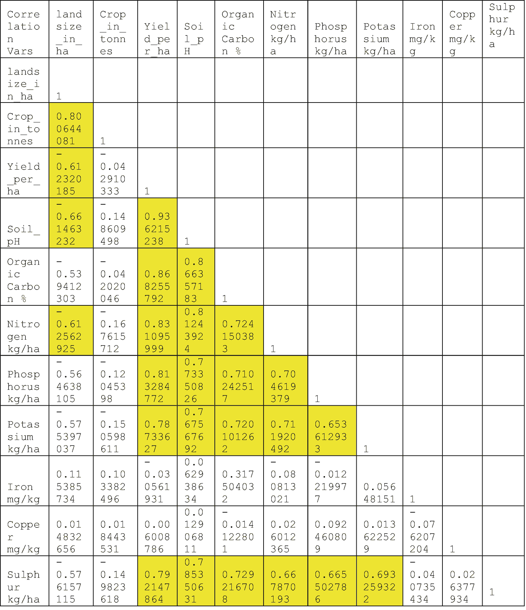
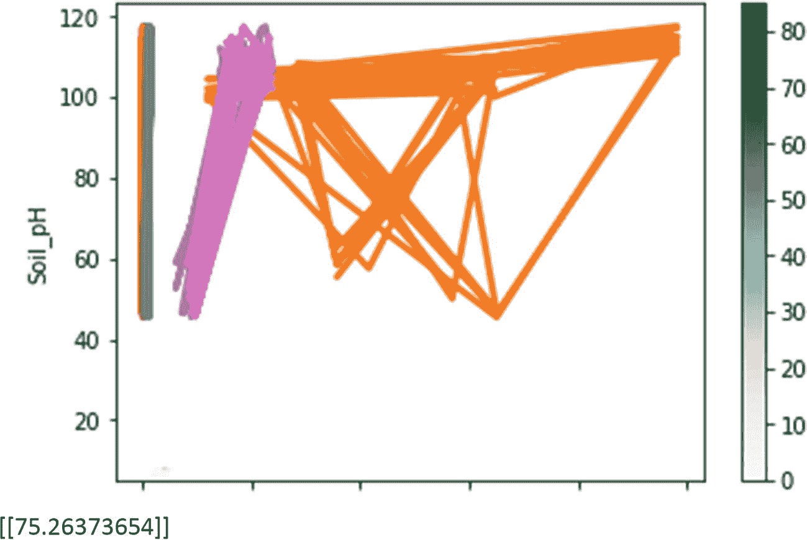
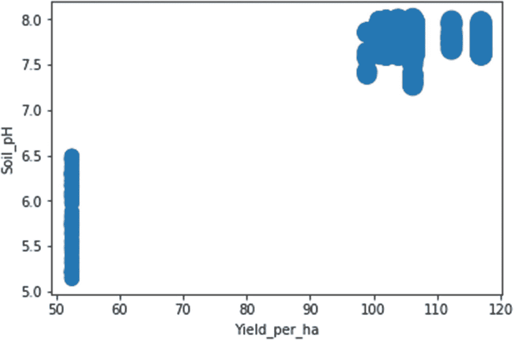
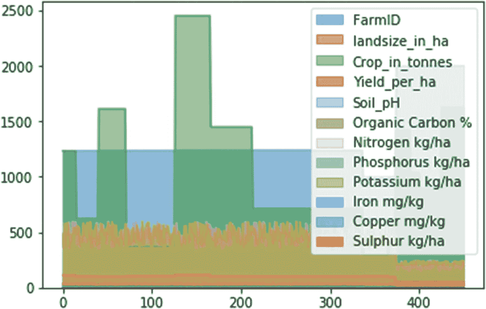
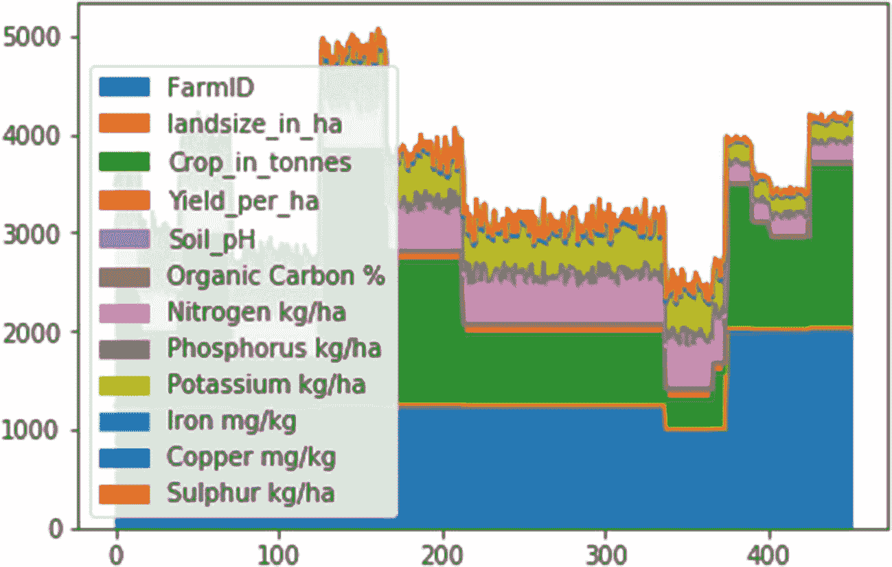
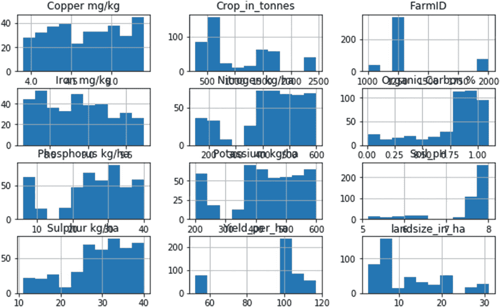
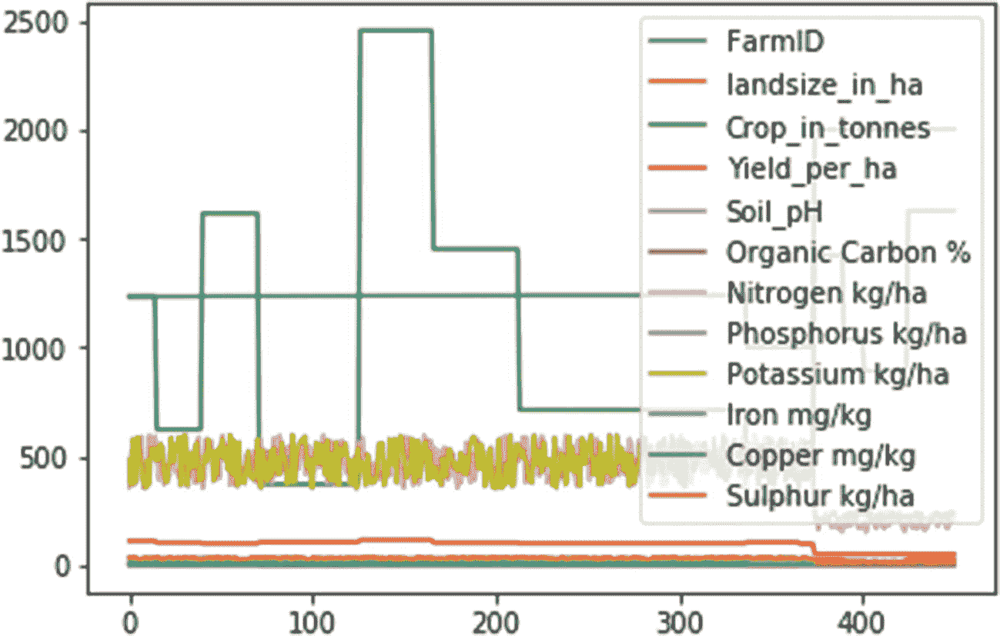
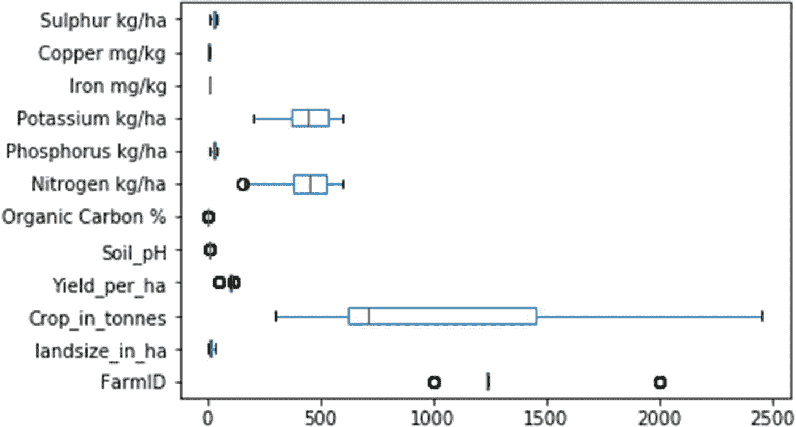
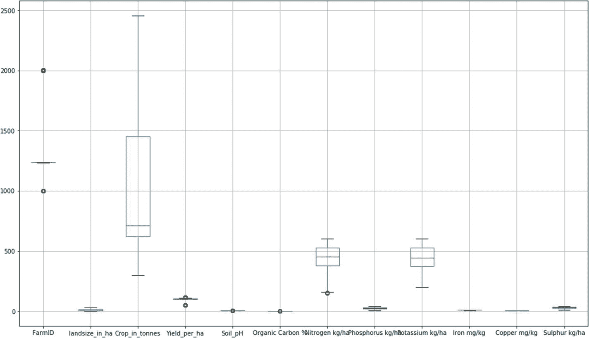

# Step 3 Model Building & Evaluation
#Creating the the Model for prediction
#Loading model Libraries
import matplotlib.pyplot as plt
import numpy as np
from sklearn import linear_model
from sklearn.metrics import mean_squared_error, r2_score
#Creating Linear Regression object
regr = linear_model.LinearRegression()
regr.fit(X_train,y_train)
y_pred= regr.predict(X_test)
#Printing Codfficients
print('Coefficients: \n',regr.coef_)
#print(LinearSVC().fit(X_train,y_train).coef_)
regr.score(X_train,y_train)
#Mean squared error
print("mean squared error:  %.2f" %mean_squared_error(y_test,y_pred))
#Variance score
print("Variance score: %2f"  % r2_score(y_test, y_pred))
#Plot and visualize the Linear Regression plot
plt.plot(X_test, y_pred, linewidth=3)
plt.show()
#Predicting Yield per hectare for a new farmland
X_test.dtypes
predicted= regr.predict([[26,1500,6.8,0.9,367,32,490,35]])
print(predicted)
Listing 9-1
Code for the Solution of the Case Study
```

这是一段直接的代码。它首先将数据集加载到 pandas 数据框中，然后通过 `df.size`、`df.dtypes` 等语句检查数据完整性。EDA 通过 `df.mean()`、`df.median()` 和 `df.mode()` 语句完成。相关性如图 9-1 所示。在我们的案例中，我们可以查看清单 9-2 输出中土壤 pH 值和其他土壤养分的平均值，以及图 9-2 至 9-9。异常值检测告诉我们，产量数据列在上限阈值之上没有异常值；然而，所有值都低于下限阈值。这可以通过在代码中使用命令 `df.hist()` 绘制直方图来直观地看到。之后，我们可以查看相关性。



图 9-1

变量之间的相关性

从图 9-1 可以看出，我们关注的是预测变量 Yield_per_ha（即每公顷产量）。我们认为它依赖于其他变量或土壤养分；这可以通过查看 Yield_per_ha 变量与其他变量之间的相关系数值来确认。Soil_pH 与产量变量的相关系数为 0.936215238，有机碳 % 为 0.868255792，氮 kg/ha 为 0.831095999，磷 kg/ha 为 0.831095999，钾 kg/ha 为 0.78733627，铁 mg/kg 为 -0.030561931，铜 mg/kg 为 0.006008786，硫 kg/ha 为 0.792147864。为了构建模型，我们选择那些具有显著相关性的变量，即：

*   Soil_pH

*   有机碳 %

*   氮 kg/ha

*   磷 kg/ha

*   钾 kg/ha

*   硫 kg/ha

我们可以忽略并移除铁和铜，因为它们没有显示出任何显著的相关性；事实上，对于我们的模型构建工作来说，它们的影响可以忽略不计。



图 9-9

Yield_per_ha 与 Soil_pH 变量的图表



图 9-8

Yield_per_ha 与 Soil_pH 变量的散点图



图 9-7

累积堆叠面积图



图 9-6

数值变量的堆叠面积图



图 9-5

数值变量的直方图



图 9-4

数值变量的面积图



图 9-3

水平箱线图可视化



图 9-2

垂直箱线图可视化

```
Crop  Center  FarmID  landsize_in_ha  Crop_in_tonnes  Yield_per_ha  \
0  Sugarcane  Africa    1234            11.0          1235.3          112.3
Soil_pH  Organic Carbon %  Nitrogen kg/ha  Phosphorus kg/ha  \
0     7.81              0.88           355.0              36.0
Potassium kg/ha  Iron mg/kg  Copper mg/kg  Sulphur kg/ha
0            485.0        9.73          4.73  33.0


(451, 14)
Index([u'Crop', u'Center', u'FarmID', u'landsize_in_ha', u'Crop_in_tonnes', u'Yield_per_ha', u'Soil_pH', u'Organic Carbon %', u'Nitrogen kg/ha', u'Phosphorus kg/ha', u'Potassium kg/ha', u'Iron mg/kg', u'Copper mg/kg', u'Sulphur kg/ha'],
dtype='object')

RangeIndex: 451 entries, 0 to 450
Data columns (total 14 columns):
Crop                451 non-null object
Center              451 non-null object
FarmID              451 non-null int64
landsize_in_ha      451 non-null float64
Crop_in_tonnes      451 non-null float64
Yield_per_ha        451 non-null float64
Soil_pH             451 non-null float64
Organic Carbon %    451 non-null float64
Nitrogen kg/ha      451 non-null float64
Phosphorus kg/ha    451 non-null float64
Potassium kg/ha     451 non-null float64
Iron mg/kg          374 non-null float64
Copper mg/kg        337 non-null float64
Sulphur kg/ha       451 non-null float64
dtypes: float64(11), int64(1), object(2)
memory usage: 49.4+ KB
训练集包含 360 个样本。
测试集包含 91 个样本。
('系数: \n', array([[-2.11198278,  0.02322665,  5.78698466,  3.69351487,  0.01497725,  0.17939622,  0.01021635,
0.15396713]]))
均方误差:  16.50
方差分数: 0.950297
清单 9-2
清单 9-1 中代码的输出
```

在图 9-2 至 9-8 中，我们可以看到箱线图显示 `Crop_in_tonnes` 的值分布非常分散。避免这种情况的一种方法是对所有数值变量进行缩放，就像我在我的书《*使用 Python 的机器学习应用*》中针对医疗、零售和金融案例研究解决方案中所做的那样。直方图显示了变量的分布，我们看到除铜和铁外，大多数土壤养分都呈右偏态。我们还注意到，通过 Python 代码 `df.plot.hexbin(x='Yield_per_ha', y="Soil_pH", gridsize=20)`，`Yield_per_ha` 和 `Soil_pH` 的散点图密切相关。在完成通常的数据准备步骤，将其划分为名为 `cropyield` 的目标变量和包含所有其他特征的特征变量后，我们将数据集拆分为训练集和测试集，其中 360 个样本属于训练集，91 个样本属于测试集。之后，我们加载 `linear_model` Python 库，通过 Python 代码 `regr.fit(X_train,y_train) , y_pred= regr.predict(X_test)` 在训练集和测试集上执行线性回归算法。然后，在开始进行预测之前，我们通过代码 `print("Variance score: %2f" % r2_score(y_test, y_pred))` 查看测试集获得的准确率分数，该分数为 0.9502，即 95.02% 的准确率。由于这个结果不错，我们可以继续进行预测。请记住，这是虚构数据，因此我们能够达到良好的准确率水平。然而，在现实世界中，您可能需要运行更多的回归器或微调您的数据收集工作，才能达到这样的准确率水平。

为了进行预测，使用的代码是 `predicted= regr.predict([[26,1500,6.8,0.9,367,32,490,35]])`，这些是 Aystsaga Agro 正在评估的另一国家的一块农业用地的值，其特征如下：

```
landsize_in_ha      26
Crop_in_tonnes      1500
Soil_pH             6.8
Organic Carbon %    0.9
Nitrogen kg/ha      367
Phosphorus kg/ha    32
Potassium kg/ha     490
Sulphur kg/ha       35
```

Glanzo 想从模型中知道，在他们购买这块农田后，可能的年产量是多少。Python 程序给出的值为每公顷 75.2637 吨，如清单 9-3 所示。

```
predicted= regr.predict([[26,1500,6.8,0.9,367,32,490,35]])
print(predicted)
[[75.26373654]]
清单 9-3
Python 程序预测的值
```

请记住，该程序没有考虑其他条件，例如天气和种子品种，这些也会影响作物产量和收成。构建这样的数据集无疑是一项巨大的工作，超出了本书的范围。

## 总结

至此，我们来到了本案例研究和本书的结尾。我非常享受为您带来这些基于物联网的解决方案，以解决现代、实际的商业问题，并尝试通过机器学习来解决它们。我希望您也喜欢从中学到东西。请考虑在 [`www.pmauthor.com/raspbian`](http://www.pmauthor.com/raspbian) 的论坛上留下反馈。


索引 A, B
农业领域无人机机器人，检测疾病爆发 农业社区 化肥/农药 食品集团 转基因产品 行业 见经济作物 产量 统计育种模式 技术浪潮
Arduino 编译中 编译完成信息 Hello world 程序 IDE 草图 loop 函数 Mega 2560 板 微控制器 Modbus 协议 处理 Raspberry Pi 3 型号 B+ 串口 上传，草图 Arduino Mega 2560
人工智能 (AI) 优势 思维网络 打字 语音听写
C
经济作物产量 Aystasaga Agro cashcrop_Yield_dataset.csv 图表 绘图 代码实现 相关性 作物歉收 累积堆叠面积图 df.corr() 代码 财务结果 水平箱线图可视化 机器学习团队 监测 土壤养分 数值 面积图 直方图 堆叠面积图 问题 基于 Python 的解决方案 散点图 垂直箱线图可视化
D
DataFrame() 对象 datetime now() 函数 无人机
E, F
Eastron SDM630 上电后 组件 数据端子 电动机/碾磨机 输入连接 LED 灯泡 minimalmodbus Python 模块 输出线连接 插头连接 获取数据的 Python 代码 Rapsbian 内核，更新 RS485 Modbus 转换器 USB 转换器 sdm630_tested.py 单相碾磨机/电动机 智能电表 升级，Rapsbian 内核
EM6400 电表 Arduino Mega 2560，通信 编码 通信测试 电流 频率 数据 地址定义引脚 编译完成信息 上传完成信息 Eastron SDM630 见 Eastron SDM630 过滤器 搜索 flotvalue 全局变量 管理库 菜单 MAX485_DE Modbus 通信前/通信后 传输前/传输后函数 读取数据的 Python 代码 Raspberry P 3 B+ Raspberry Pi 实时数据 串行模块 Serial.println() 函数 TTL 通信 值类型 unifloat 联合结构 USB 串行 Modbus 协议 void setup() 函数
能源领域 商业应用 去中心化 决策/规划辅助 数字化 发电公司 化石燃料电厂 Modbus 接口 改造 定期维护周期 电网 预测性维护 可再生能源电厂 技术采用缓慢 升级项目
G
Gantara 发电厂 异常检测 燃煤电厂 煤矿 代码实现 冷却塔 相关性结果 df.describe() 函数 能源行业案例研究 进口阀门操作 输入/输出容量 土地需求 LP/HP 加热器 Modbus 协议 PPC Raspberry Pi 3 sklearn 库 蒸汽轮机 火力发电厂 TURBINE_INLET_DATASET 涡轮发电机组
H
硬件/软件 df. corr () () 元素 移动通话质量数据集 室外温度 Python 机器学习程序 设置工具 高清 (HD)
I, J, K
工业物联网 (IIoT) 应用与深度学习 基于云的服务 商业用途 工业机器过程 MQTT 协议 `init() 函数` 集成开发环境 (IDE)
物联网 (IOT) 应用 商业用途 能源回收方法 农业自动化 家庭自动化 *vs.* IIoT 机器学习技术 医疗手术 PaaS 传感器数据
检查数据 电路测试，面包板 数据结构，创建 电气连接图 GPIO 引脚布局 基于 GUI 的监控代理 插入数据 LDR/光敏电阻模块 机器学习模型 PE 电阻 Pi GPIO 引脚 SQLite3 数据库 智慧城市趋势 Forbes GoodWorkLabs iotforall.com Network World 调查 PCMag 预测 TechGenix 文章
L
loop() 函数
M
机器学习 生命周期 流程 模型 技术 MindSphere
Modbus 转换模块 Arduino Mega 板 连接电表 PWM 引脚 TTL 信号互转模块 USB 串行线 VCC/GND 引脚 Modbus 协议
N, O
node.clearResponseBuffer()
P, Q
平台即服务 (PaaS) 波特兰火山灰水泥 (PPC) postTransmission(){} 函数 preTransmission(){} 函数 印刷电路板 (PCB) 概念验证 (PoC) pygame.mixer.music.play() 函数
R
Raspberry Pi 3 型号 B+ Arduino IDE 安装 下载 install.sh 文件 ∗.xz 扩展名文件 bash 位版本 下载选项 GPIO 引脚 HDMI 转 HDMI 线 LED/LCD 显示器 lshw 命令 microSD 卡 nltk.log 文件 移动电源 SBC 电源插槽 Python 3 安装 Python 库 SQLite3 数据库安装 见 Modbus 转换模块 sudo pip install 测试 gpiozero iotpypackages.run iotpypkgtest.run 程序 Pandas 数据框 平台 psutil pygame smtplib 时间 tkinter 在 Python 3.x 解释器上 Thonny IDE 安装 USB 加密狗 Win32 Disk Imager
Raspberry Pi，Python Arduino IDE B+ 桌面启动 代码执行 GPIO 引脚 hello_world.py import pandas 安装 Modbus 设备 scikit-learn 软件组件 系统图
S
Serial.println() 函数 单板计算机 (SBCs) 优势 Diana 微特性 GPIO 覆盖，Raspberry Pi 硬件要求 流行 SBCs 列表 Raspberry Pi 单板微控制器 (SBMs) Arduino Mega 2560 架构 闪存 GPIO 引脚 Modbus 通信
最先进的实现 农业领域 见农业领域 能源领域 见能源领域 发电 电信领域 见电信领域
T, U
电信领域 优势 AI 领域 自动驾驶网络 优势 通信协议 生态系统 代际 5G 频谱 毫米波 移动通信 OceanConnect IoT 平台 开放连接基金会 实时虚拟医疗环境，标准 电信运营商 通话掉线数据 2G 技术基础设施 RegoniaTel 用户 用户报告
V, W, X, Y, Z
void setup() 函数
