# 1. Excel 与数据挖掘

让我们直接切入正题。为什么在数据挖掘工作中需要学习 Excel？诚然，有一些出色的数据挖掘软件工具（如 `RapidMiner`）能让挖掘过程变得简单直接。此外，编程语言 `Python` 和 `R` 也拥有大量专用于各种数据挖掘任务的可靠包。那么，通过 Excel 学习数据挖掘或机器学习的目的何在？

## 为什么选择 Excel？

如果你已经是一位经验丰富的数据挖掘专业人士，我会说你的问题提得很好，而且你可能不应该读这本书。然而，如果你是数据挖掘的初学者、视觉型学习者、想了解某些流行数据挖掘技术背后的数学原理，或者是一名教育工作者，那么这本书正适合你，而且很可能是在你开启数据挖掘之旅前应该阅读的第一本书。

Excel 允许你以透明的方式处理数据，这意味着当打开一个 Excel 文件时，数据立即可见，并且数据处理的每一步也是可见的。中间结果包含在 Excel 工作表中，可以在执行挖掘任务时进行检查。这让你能够深入清晰地理解数据是如何被处理的，以及结果是如何获得的。其他软件工具和编程语言则隐藏了模型构建过程中的关键方面。对于大多数数据挖掘项目而言，目标是发现数据内部隐藏的模式。因此，隐藏详细过程对工具或包的用户是有益的。但这对于初学者、视觉型学习者或那些想了解挖掘过程如何运作的人来说并无帮助。让我用 `k-近邻法（K-NN）` 来说明 `RapidMiner`、`R` 和 Excel 之间的学习差异。在此之前，我们需要了解数据挖掘中的几个术语。

数据挖掘技术分为两种类型：监督式和非监督式。监督式方法需要先使用训练数据集来“训练”软件程序或算法（此类程序或算法通常被称为机器）。程序经过训练达到一种称为模型的最优状态。这就是为什么训练过程也被称为建模。数据挖掘方法还可以分为参数方法和非参数方法。对于参数方法，模型只是一组通过训练过程获得的参数或规则，这些参数或规则被认为能让程序在训练数据集上表现良好。非参数方法不会生成一组参数。相反，它们会基于现有数据集动态评估输入的数据。此时你可能会对这些定义感到困惑。但很快它们就会变得清晰。

什么是训练数据集？在训练数据集中，目标变量（也称为标签、目标、因变量、结果变量、响应变量）的值是已知或给定的，该变量的值将被预测。目标变量的值取决于其他变量的值，这些变量通常被称为属性、预测变量或自变量。基于属性值，监督式数据挖掘方法会计算（或所谓预测）目标变量的值。某些计算出的目标值可能与训练数据集中的已知目标值不匹配。一个好的模型意味着能够最小化不匹配情况的一组最优参数或规则。

在监督式数据挖掘方法中，模型通常是为了处理未来目标值未知的数据集而构建的。这类未来数据集通常被称为评分数据集。然而，在非监督式数据挖掘方法中，没有训练数据集，模型是一种可以直接应用于评分数据集的算法。`k-近邻法` 是一种监督式数据挖掘技术。

假设我们要根据一个人的年龄、性别、收入以及他们已有的信用卡数量，来预测其是否可能接受信用卡优惠。目标变量是对信用卡优惠的响应（假设为“是”或“否”），而年龄、性别、收入和现有信用卡数量则是属性。在训练数据集中，包括目标和属性在内的所有变量都是已知的。在这种情况下，我们通过使用训练数据集来构建一个 `K-NN` 模型。基于构建好的模型，我们可以预测那些信息存储在评分数据集中的人对信用卡优惠的响应。

在最佳数据挖掘工具之一 `RapidMiner` 中，预测过程如下：从存储库中检索训练数据和评分数据 ➤ 为训练数据设置角色 ➤ 对训练数据应用 `K-NN` 算子以构建模型 ➤ 将模型和评分数据连接到“应用模型”算子。就这样！现在你可以执行该过程，结果就会得到。是的，非常直接。如图 1-1 所示。请注意，在这个简单过程中没有模型验证。

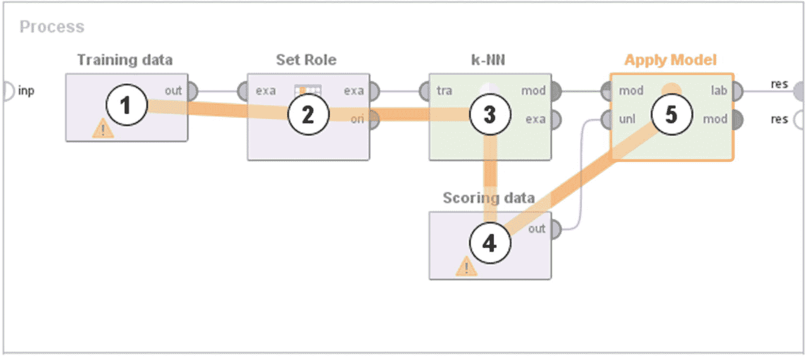

`K-NN` 模型的示意图。流程包括训练数据、设置角色、`K-NN`、评分数据和应用模型。最终得到结果。

图 1-1

`RapidMiner` 中的 `K-NN` 模型

在 `R` 语言中应用 `K-NN` 方法也非常简单。加载`class`库后，读取训练数据和评分数据，使用 `K-NN` 函数，至此我们就完成了任务：可以查看结果了。如图 1-2 所示。请注意，以“#”开头的行是注释。

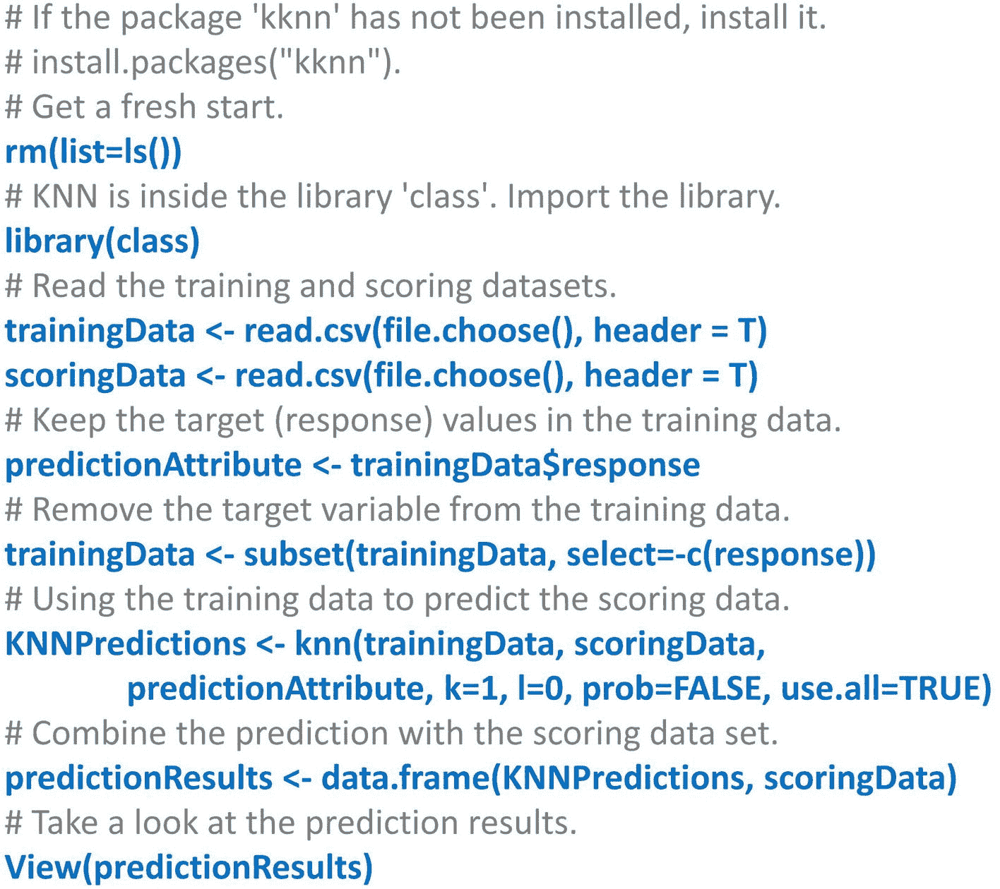

一个包含 10 行代码的 `R` 语言 `K-NN` 程序截图。它包括导入 `class` 库、读取训练数据和评分数据、结合评分数据集进行预测，以及查看预测结果。

图 1-2

`R` 语言中的 `K-NN`

你从前面的任务中获得的知识足以让你能够应用数据挖掘方法 `K-NN`。但如果你想逐步理解 `K-NN` 为何以及如何工作，你将需要更多信息。Excel 可以让你有机会在数据集上逐步进行分析过程，在此过程中你可以对 `K-NN` 算法建立扎实的理解。有了这种扎实的理解，你就能更熟练地使用其他强大的工具或编程语言。最重要的是，你将更好地理解数据挖掘结果的质量和价值。你将在后续章节中看到这一点。

当然，与 `Python`、`R` 和 `RapidMiner` 相比，Excel 在数据挖掘方面的局限性要大得多。Excel 只能处理较小规模的数据。同时，有些数据挖掘技术过于复杂，无法通过 Excel 实践。尽管如此，Excel 为我们提供了对数据挖掘机制直接且直观的理解。此外，Excel 天然适合数据准备。

如今，由于软件工具和其他程序包的存在，数据挖掘任务中的大部分精力都花在理解任务（包括业务理解和数据理解）、准备数据和呈现结果上。只有不到 10%的精力花在建模过程上。为建模准备数据的过程称为数据工程。当数据集不是太大时，Excel 在数据工程方面具有优势，因为它能提供数据工程的可视化表示，这让我们在数据准备过程中更有信心。

作为一名经验丰富的教育工作者，我意识到如果通过 Excel 中的逐步指导来解释数据挖掘方法，学生可以更好地深入理解这些方法。通过 Excel 学习能揭开数据挖掘或机器学习方法背后的神秘面纱，让学生更自信地应用这些方法。

我刚才提到机器学习了吗？是的，我提到了。机器学习是当今另一个流行词。什么是机器学习？数据挖掘和机器学习有什么区别？此外，什么是人工智能（AI），AI 和机器学习又有什么区别？

机器学习和数据挖掘的目的有所不同。机器学习的目的是研究计算机如何通过从数据中学习来发展类似人类的学习能力。数据挖掘的目的是从数据中发现有价值的模式或知识。然而，数据挖掘利用机器学习方法来实现其目标，也就是说，数据挖掘和机器学习的方法论可以是相同的。无论如何，没有必要区分它们，我建议我们目前将它们视为相同。

同样的情形也适用于 AI 和机器学习。简单来说，AI 是模拟人脑功能的计算机软件，而机器学习是通过数据训练计算机算法来模拟人类思维能力。由于大多数 AI 利用机器学习来实现其目标，机器学习通常被认为是 AI 的一个子集，因此几乎不可能区分 AI 和机器学习。

## 为何推出第二版？

实践是学习的关键，尤其是在学习包括 Excel 和数据挖掘在内的技术时。因此，推出第二版的第一个原因，是在每章末尾提供类似作业的练习题，以便你能自行练习每章讲解的核心技能。从第一章开始，你就会发现一些强化练习，其难度甚至可能超过书中逐步讲解的内容。当然，这些练习都提供了标准答案或建议。

第二个原因是，根据一些读者的反馈，部分章节进行了更新。

1.  第 3 章，`K-Means` 聚类：通过引入 `SHEET` 函数，更新了 `K-Means` 聚类过程，使其更加自动化。

2.  第 6 章，逻辑回归：由于损失函数在机器学习中经常使用，本章介绍了损失函数的概念和用法。

3.  第 9 章，朴素贝叶斯分类：现在详细解释了朴素贝叶斯定理，从条件概率推导出该定理。这能让读者从数学上清晰地理解朴素贝叶斯分类为何有效以及如何工作。

4.  第 14 章，文本挖掘：由于 `ChatGPT` 的出现，我认为有必要简单快速地介绍一下词向量化（也称为文本嵌入）技术，该技术广泛应用于包括 `ChatGPT` 在内的大型语言模型中。

第三个原因是修正了一些小错误并更新了一些公式。例如，更频繁地使用 `IFERROR` 函数来简化一些公式。

最后一个原因，可能也是推出第二版的主要原因，是增加了两个全新的章节。

1.  一章是关于探索性数据分析（`EDA`）、数据清洗和特征选择。这些关键概念和技能是学习数据挖掘或机器学习的必修课。它们通常在任何数据挖掘或机器学习模型讲解之前介绍。虽然我借此机会将它们纳入本版，但我将其放在第 11 章，在介绍完几个机器学习模型之后。原因在第 11 章中解释。所以，当你读到第 11 章时就会明白为什么。

2.  另一新章节（第 8 章）是关于层次聚类，该内容在第一版中曾与 `K-Means` 聚类一起提及。本章有两个亮点。一是在 Excel 中实现自下而上的层次聚类算法；二是展示如何在 Excel 中不借助任何插件绘制树状图。

## 准备一些 Excel 技能

本书中有相当多的 Excel 技能需要学习。我将在需要使用时详细解释其中一些。然而，在开始讨论数据挖掘之前，我们需要熟悉几个基础的 Excel 技能和函数。

### 公式

公式是 Excel 最重要的功能。编写公式就像编写编程语句。在 Excel 中，公式总是以等号（“=”，不含引号）开头。

# Excel 公式与操作

打开 Excel 文件时，我们会看到一个类似表格的工作表。是的，每个工作表都是一个巨大的表格。Excel 天然适合数据存储、分析和挖掘的一个原因，就是数据在 Excel 中会自动以表格格式排列。大表中的每个单元格都有一个名称或所谓的引用。默认情况下，每列用字母标记，每行用数字标记。例如，左上角的第一个单元格是单元格 `A1`，即 A 列第 1 行。单元格中的内容，无论是什么，都由单元格引用表示。

在单元格 `A1` 中输入数字 `1`。此时单元格 `A1` 的值为 `1`，`A1` 代表 `1`。

在单元格 `B1` 中输入公式 `=A1*10`（不含双引号，且“=”前无空格）并按回车键。注意公式以“=”开头。请注意，这是本书中唯一一次将公式放在一对双引号内展示。从现在开始，所有公式都直接展示，不带引号。

在单元格 `C1` 中输入文本“A1 * 10”。因为文本不以“=”开头，所以它不是公式。

我们的工作表如图 1-3 所示。

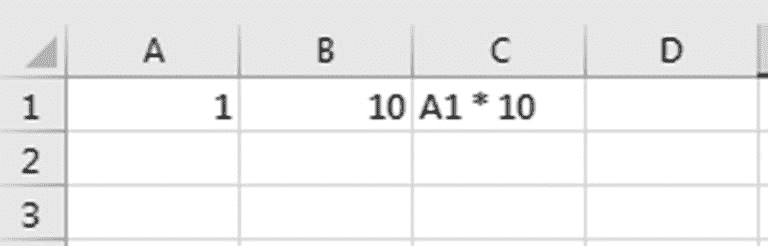

一个 Excel 截图，包含 A 到 D 列以及第 1 到 3 行。有数据的单元格是 `A1` 为 1，`B1` 为 10，`C1` 为 A1 星号 10。

图 1-3

Excel 公式

## 自动填充或复制

自动填充是 Excel 的另一个关键功能，它使 Excel 能够处理相对较大的数据集。许多人也将自动填充称为“复制”。

让我们通过以下实验来学习自动填充：

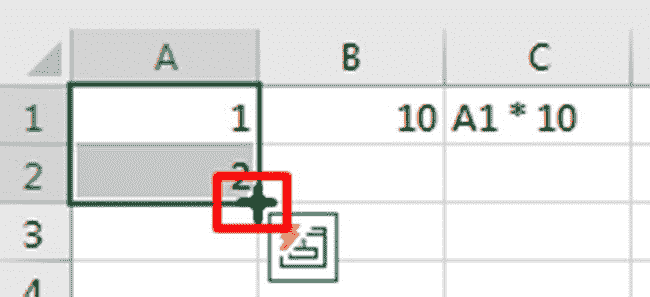

一个 Excel 截图，包含 A 到 D 列以及第 1 到 3 行。有数据的单元格是 `A1` 为 1，`B1` 为 10，`C1` 为 A1 星号 10。单元格 `A1` 和 `A2` 被选中。

图 1-4

光标变为黑色十字

1.  在单元格 `A1` 中输入 `1`。

2.  在单元格 `A2` 中输入 `2`。

3.  同时选中单元格 `A1` 和 `A2`。

4.  松开鼠标左键。

5.  将鼠标光标移动到单元格 `A2` 的右下角，直到光标变为黑色十字（如图 1-4 所示）。

6.  按住鼠标左键并向下拖动到单元格 `A6`。

单元格 `A1:A6` 会自动填充数字 `1`、`2`、`3`、`4`、`5` 和 `6`。这个过程称为自动填充。有些人也称之为“复制”。但更准确地说，这个过程是自动填充。

让我们进行另一个实验：

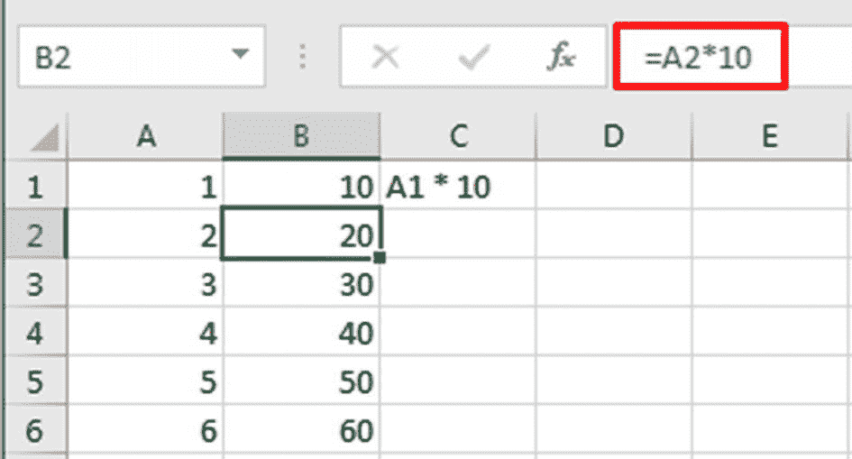

一个 Excel 截图。单元格 `A1` 到 `A6` 有数字 1 到 6。单元格 `B1` 到 `B6` 有数字 10、20、30、40、50 和 60。`C1` 是 A1 星号 10。单元格 `B2` 被选中。公式栏中的数据是等于 A2 星号 10，并被高亮显示。

图 1-5

自动填充公式（相对引用）

1.  选中单元格 `B1`（确保 `B1` 中仍有公式 `=A1*10`）。松开鼠标左键。

2.  将鼠标光标移动到单元格 `B1` 的右下角，直到光标变为黑色十字。

3.  将鼠标光标向下拖动到单元格 `B6`。我们的工作表如图 1-5 所示。

注意，在图 1-5 中，单元格 `B1` 的公式是 `=A1*10`，但单元格 `B2` 的公式自动变为了 `=A2*10`。当我们垂直向下自动填充时，Excel 会自动将公式中所有单元格引用的行号增加 1。类似地，当我们水平向右自动填充时，Excel 会自动将公式中所有单元格引用的列标增加 1。

点击单元格 `B3`；其中的公式必定是 `=A3*10`。

**注意**

将 `A1` 中的数字改为 `10`，`B1` 中的数字会自动变为 `100`。默认情况下，如果某个单元格的值发生更改，整个 Excel 工作簿将自动重新计算。这是 Excel 的另一个重要功能。

## 绝对引用

假设有一本账本，记录了固定利率以及借给客户的贷款金额。我们的任务是计算每位客户应付的利息。请按照以下说明完成实验：

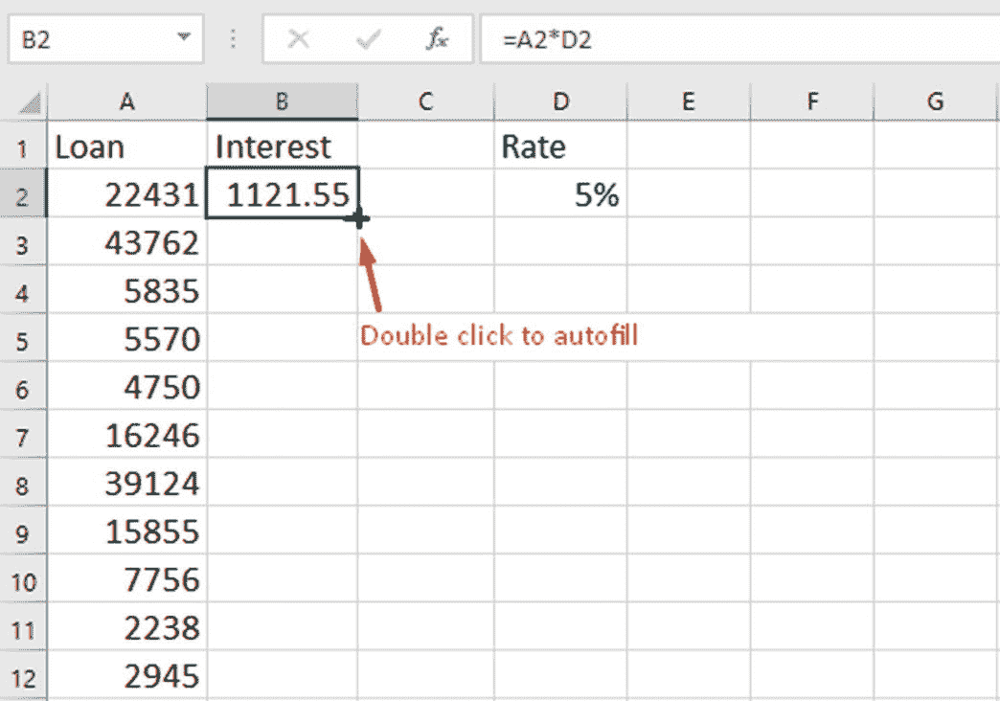

一张 Excel 截图。贷款和利息分别是单元格 `A1` 和 `B1` 中的数据。单元格 `A2` 到 `A9` 填满了数字。单元格 `B2` 被高亮显示。指向单元格 `B2` 的箭头表示双击自动填充。

图 1-6

通过双击自动填充

1.  打开一个空白的 Excel 工作表。在单元格 `A1`、`B1` 和 `D1` 中分别输入文本“贷款”、“利息”和“利率”。将 `C1` 留空。在单元格 `D2` 中输入“5%”（不含引号）。

2.  在单元格 `A2` 中，输入公式 `=RANDBETWEEN(1000,50000)`。此公式会随机生成一个介于 `1000` 和 `50000`（含）之间的整数。

3.  从 `A2` 自动填充到 `A12`。

4.  在单元格 `B2` 中，输入公式 `=A2*D2`。此公式计算 `A2` 应付的利息。此时一切应该都正常。

5.  让我们尝试另一个快速自动填充技巧：选中单元格 `B2` ➤ 将鼠标光标移动到单元格 `B2` 的右下角，直到光标变成黑色十字 ➤ 双击。见图 1-6。此双击操作会自动将公式填充到单元格 `B3` 到 `B12`（`B2` 已有公式）。注意：通过双击自动填充仅适用于垂直向下的自动填充操作。

现在，我们的工作表看起来像图 1-7。

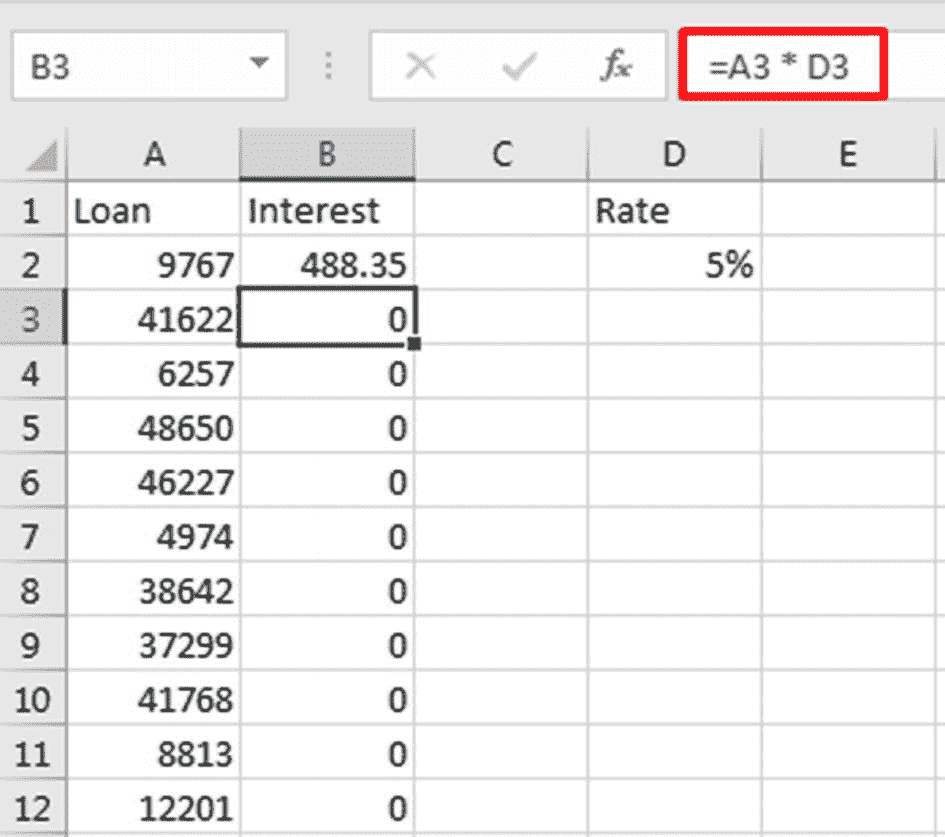

一张 Excel 截图。贷款、利息和利率分别是单元格 `A1`、`B1` 和 `D1` 中的数据。`A2` 到 `A12` 填满了数字。单元格 `B2` 被选中。单元格 `D3` 是 5%。公式栏中的数据是等于 A3 星号 D3，该部分被高亮显示。

图 1-7

利息计算自动填充失败

除了单元格 `B2`，B 列中的所有其他单元格都没有得到正确结果。原因在于，当我们从 `B2` 垂直自动填充到 `B12` 时，单元格 `B2` 中的原始公式（`=A2*D2`）发生了变化：公式中每个单元格引用的行号会自动逐一递增。如图 1-7 所示，单元格 `B3` 中的公式是 `=A3*D3`。我们可以想象，单元格 `B4` 中的公式将是 `=A4*D4`。

在单元格 `B3` 中，我们需要公式为 `=A3*D2`，也就是说，当我们从 `B2` 自动填充到 `B3` 时，我们需要单元格引用 `A2` 变为 `A3`，但需要单元格引用 `D2` 保持不变。

如前所述，单元格引用 `D2` 包含两部分：列索引 `D` 和行索引 `2`。对于垂直自动填充，列索引永远不会改变，但行索引会改变。为了在自动填充期间保持行索引不变，我们需要在行索引前加上“`$`”。这意味着，单元格 `B2` 中的公式应为 `=A2*D$2`。使用符号“`$`”来保持公式中的单元格引用在自动填充操作中不变或锁定，这被称为**绝对引用**。

在单元格 `B2` 中使用这个修正后的公式，让我们再次从单元格 `B2` 自动填充到 `B12`。这次我们应该能得到正确的结果。

请注意，对于这个特定任务，单元格 `B2` 中的公式 `=A2*$D$2` 也同样有效。当在列索引 `D` 前放置 `$` 时，即使我们执行水平自动填充，列索引也不会改变。但是，请注意，我们可能会遇到需要在自动填充操作中仅保持单元格引用的一部分（仅行索引或仅列索引）不变的情况。

## 选择性粘贴和粘贴数值

继续使用我们之前尝试计算利息的工作表。由于 A 列中的数字是由 `RANDBETWEEN` 函数生成的，它们在工作表中不断变化，这不利于演示。我们希望将单元格 `A1:D12` 中的数字复制到另一个位置，并移除随机数特性。我们可以通过使用“选择性粘贴”功能来完成此任务。

请按照以下说明操作：

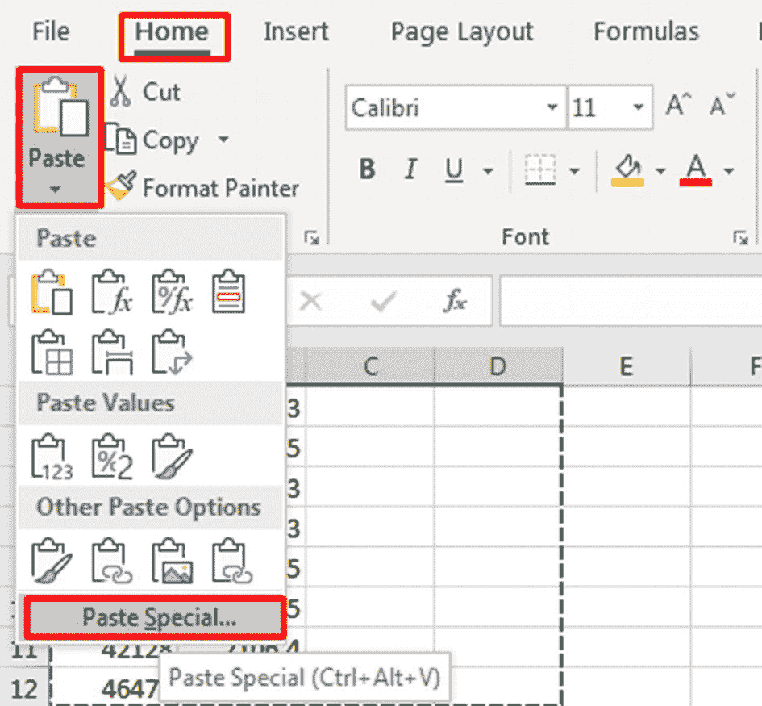

一张 Excel 截图。已选中“开始”选项卡。在“粘贴”下拉列表中，选中了“选择性粘贴”选项。

图 1-8

选择“选择性粘贴”

1.  选中单元格区域 `A1:D12`。在“开始”主选项卡下，点击“复制”工具选项卡。让我们将这些数字复制到区域 `A15:D26`。

2.  点击单元格 `A15`；在“开始”主选项卡下，点击“粘贴” ➤ 选择“选择性粘贴”。此过程在图 1-8 中进行了说明。注意，如果你的操作系统启用了右键单击功能，你也可以右键单击单元格 `A15` ➤ 选择“选择性粘贴”。

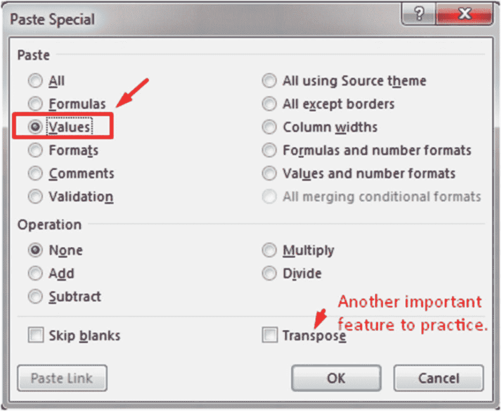

“选择性粘贴”窗口的截图。在“粘贴”选项中，选中了“数值”。在“运算”中，选中了“无”。一段文字写着“另一个需要练习的重要功能是文本”，指向“转置”复选框。

图 1-9

粘贴数值

1.  出现一个小菜单。在此菜单上，如图 1-9 所示，在“粘贴”下选择“数值”。请注意此菜单上另一个可用的功能“转置”。练习这个“转置”功能是个好主意，因为它对于数据准备非常有用。

我们工作表的一部分看起来类似于图 1-10。

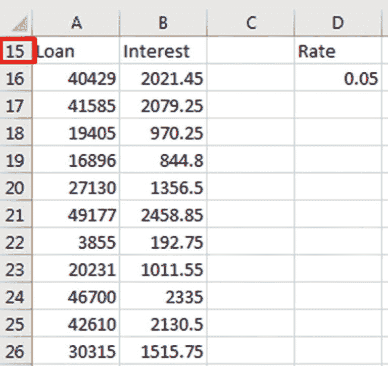

一张 Excel 截图。`A15`、`B15` 和 `D15` 中的数据分别是贷款、利息和利率。`A16` 到 `A26` 以及 `B16` 到 `B26` 是编号的单元格。`D16` 是 0.05。

图 1-10

粘贴数值之后

## IF 函数系列

`IF` 语句据说是编程中使用最频繁的语句，在我们通过 Excel 学习数据挖掘的过程中，这个说法也同样成立。由于我们会经常用到 `IF` 函数以及其他与 `IF` 相关的函数，因此先对它们有个基本了解是个好主意。

# 使用 Excel 进行数据挖掘示例

本书附带了许多示例 Excel 文件。我们会经常用到它们。这些文件位于 `https://github.com/hhohho/Learn-Data-Mining-through-Excel-2`。这些 Excel 文件是为不同的数据挖掘实践而设计的示例。有两种下载方式：

1.  将它们一起下载为压缩文件，然后解压到您电脑上的一个文件夹（目录）中。
2.  根据各个章节单独下载。

下载后，打开文件 `Chapter1-1a.xlsx`。我们的工作表看起来像图 1-11。如果您愿意，也可以在一个空白工作表中手动输入数据。

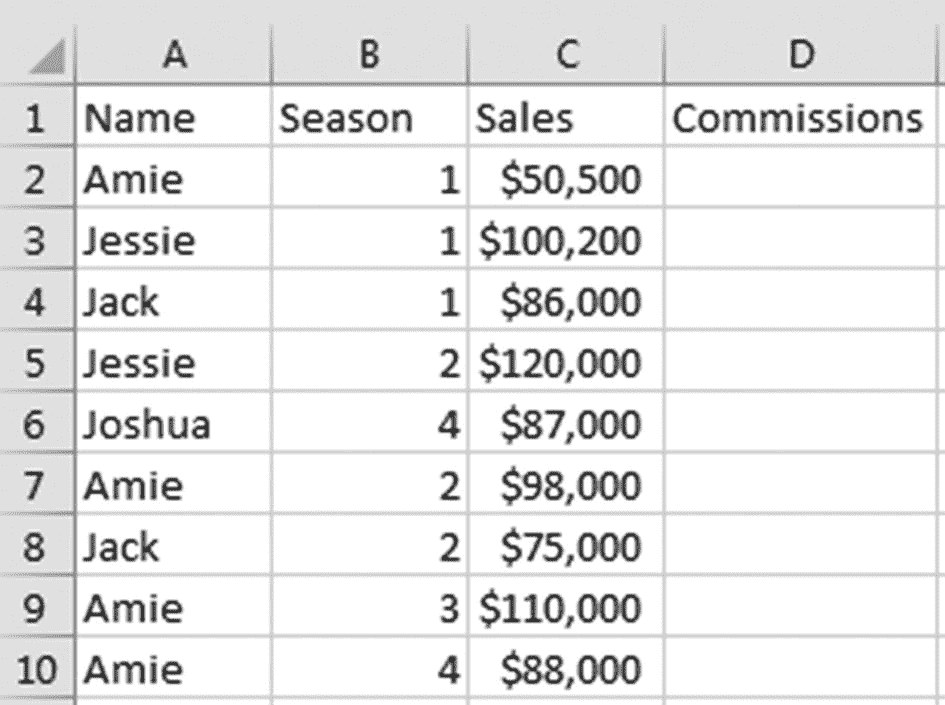

图 1-11

部分销售代表的表现

我们的第一个任务是计算每位销售代表的佣金。佣金的计算方式如下：

1.  任何销售额低于或等于 50000 美元的，没有佣金。
2.  销售额超过 50000 美元但低于或等于 100000 美元的，获得 10% 的佣金。
3.  销售额超过 100000 美元的，获得 20% 的佣金。

我们计算佣金的公式基于 `IF` 函数。在单元格 `D2` 中输入以下公式：

```
=IF(C2<=50000,0,IF(C2<=100000,(C2-50000)*10%,50000*0.1+(C2-100000)*20%))
```

`IF` 函数的基本形式是：`IF(布尔表达式, 真值, 假值)`。在我们的公式中，如果 `C2` 中的销售额不超过 50000，则返回 0。但是，当 `C2` 超过 50000 时，这里使用了一个嵌套的 `IF` 函数，因为我们还有两个条件需要评估。

在内部的 `IF` 函数中，如果 `C2<=100000`，则将超过 50000 的部分乘以 0.1（10%）并返回。否则，`C2` 必定大于 100000，因此返回表达式 `50000*0.1+(C2-100000)*20%)` 的计算结果。

我们的工作表看起来完全像图 1-12。

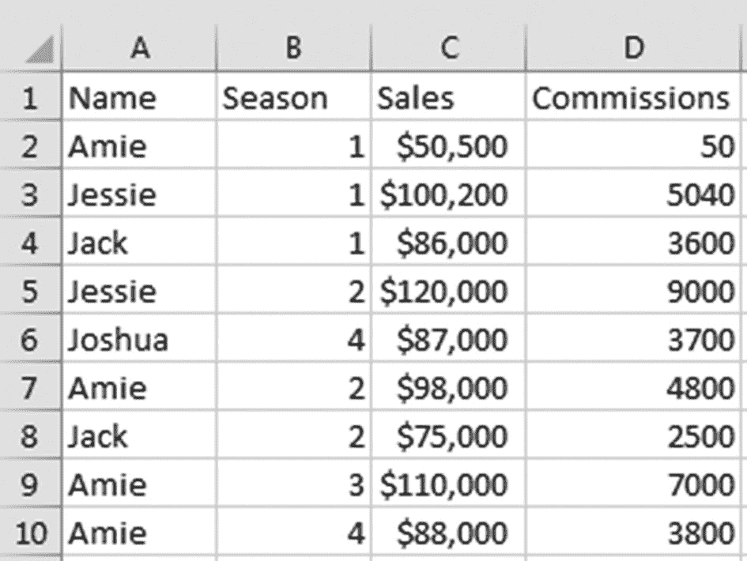

图 1-12

使用 `IF` 函数计算的佣金

如果我们想统计第一季度销售额在 50000 到 100000 之间的销售代表人数，该怎么办？要回答这个问题，我们需要应用 `COUNTIFS` 函数。在 Excel 中，还有另一个名为 `COUNTIF` 的函数。`COUNTIFS` 能够完成 `COUNTIF` 所能完成的所有任务，并且有许多任务我们必须使用 `COUNTIFS` 而不是 `COUNTIF`。

Microsoft Office 支持对 `COUNTIFS` 的解释是：“`COUNTIFS` 函数将条件应用于跨多个区域的单元格，并计算满足所有条件的次数。”其语法类似于 `COUNTIFS(条件区域 1, 条件 1, 条件区域 2, 条件 2, …)`。基于此理解，在单元格 `E1` 中输入以下公式：

```
=COUNTIFS(B2:B10,1,C2:C10,">50000",C2:C10,"<=100000")
```

此公式确保：

*   在单元格区域 `B2:B10` 中，季度为 1。
*   并且在单元格区域 `C2:C10` 中，销售额 >50000。请注意，条件被放在一对双引号内。
*   并且在单元格区域 `C2:C10` 中，销售额 <=100000。

单元格 `E1` 中的答案应为 2。

我们想检查每位销售代表的总销售额以及可能的平均销售额。为此，我们需要建立一个表格。按照以下说明建立表格：

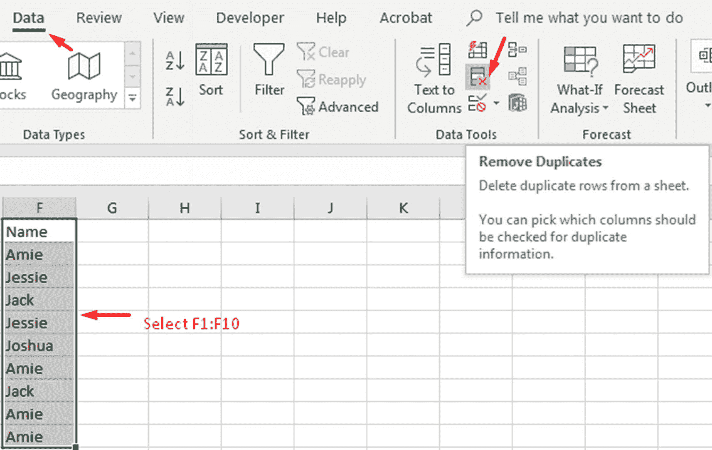

图 1-13

选择“删除重复项”功能

1.  将单元格 `A1:A10` 复制到 `F1:F10`。选中单元格 `F1:F10`；按照图 1-13 中的说明选择“删除重复项”（单击主选项卡“数据”➤ 单击“删除重复项”图标）。
2.  可能会出现一个像图 1-14 那样的小菜单。确保选中“以当前选定区域继续”。单击“删除重复项”按钮。
    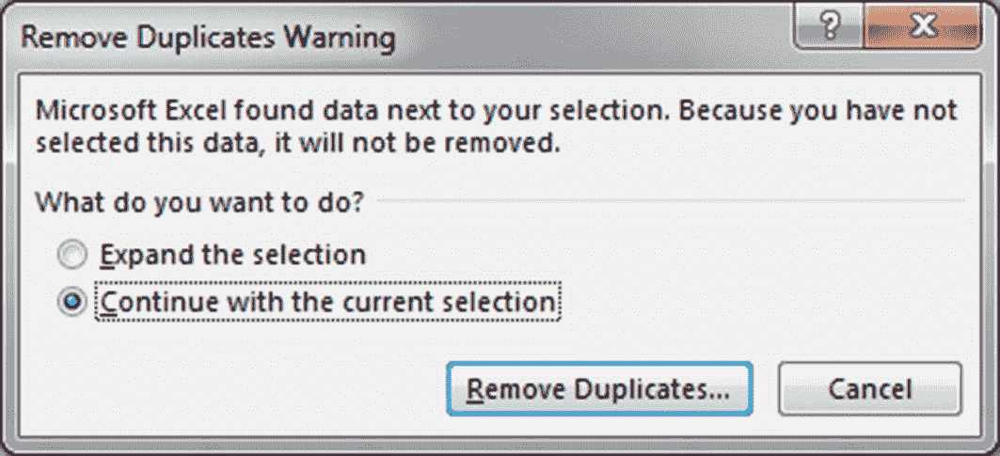
    图 1-14
    以当前选定区域继续
3.  如图 1-15 所示，勾选“数据包含标题”。
    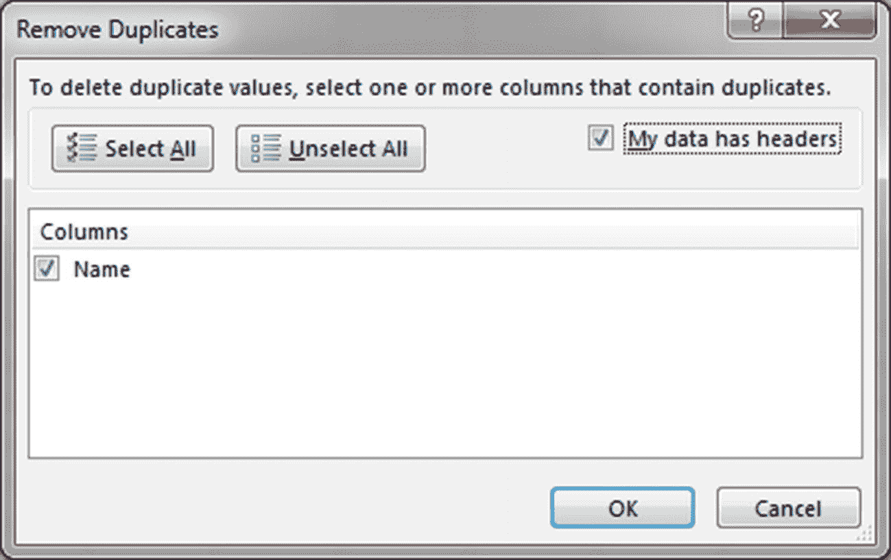
    图 1-15
    数据包含标题
4.  在随后出现的小菜单上单击“确定”。
5.  在单元格 `G1` 中输入文本“年度销售额”，在单元格 `H1` 中输入“平均销售额”。

我们的工作表应该看起来像图 1-16。

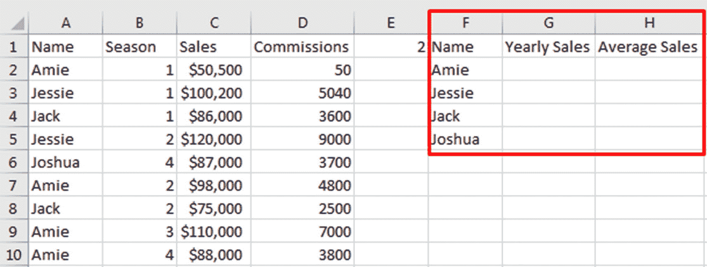

图 1-16

表格设置

对于年度销售额的计算，我们需要使用 `SUMIFS` 函数。同样，还有另一个名为 `SUMIF` 的函数。这两个函数的语法不同，可能会造成混淆。由于 `SUMIFS` 可以完成 `SUMIF` 能做的任何事情，为了简单起见，我们坚持使用 `SUMIFS`。

1.  `SUMIFS` 的语法是 `SUMIFS(求和区域, 条件区域 1, 条件 1, 条件区域 2, 条件 2, …)`。基于此理解，在单元格 `G2` 中输入以下公式：

    ```
    =SUMIFS(C$2:C$10,A$2:A$10,F2)
    ```

    上述公式的工作方式如下：在数组 `A2:A10` 中，单元格 `A2`、`A7`、`A9` 和 `A10` 等于 `F2`（“Amie”）；因此，对数组 `C2:C10` 中对应的单元格进行求和，即对单元格 `C2`、`C7`、`C9` 和 `C10` 求和。请注意公式中使用了绝对单元格引用，因为我们将要从单元格 `G2` 自动填充到 `G5`。

2.  从单元格 `G2` 自动填充到单元格 `G5`。
3.  在单元格 `H2` 中输入以下公式（这里您可以使用 `AVERAGEIF` 或 `AVERAGEIFS`，它们的语法相似）：

    ```
    =AVERAGEIFS(C$2:C$10,A$2:A$10,F2)
    ```

4.  从单元格 `H2` 自动填充到单元格 `H5`。

我们的工作表看起来完全像图 1-17。完整结果可在 `Chapter1-1b.xlsx` 中找到。

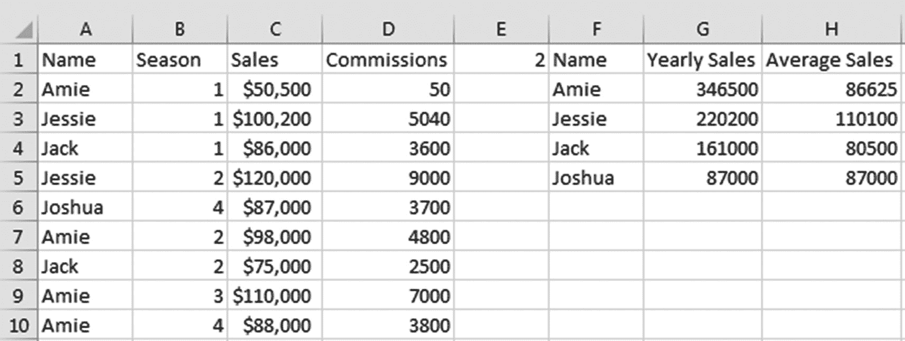

图 1-17

`SUMIFS` 和 `AVERAGEIFS` 函数的使用

请注意，自 Office 2019 或 Microsoft 365 起，Excel 在 `IF` 函数家族中增加了两个新函数：`MAXIFS` 和 `MINIFS`。它们的语法与 `COUNTIFS`、`SUMIFS` 和 `AVERAGEIFS` 非常相似。

数据准备中经常使用的另外两个 Excel 功能是数据导入和导出。在 Excel 中导出数据相当简单。例如，单击“文件”➤“另存为”➤ 选择“CSV”将当前工作表导出为 CSV 格式的文件。请注意，CSV 格式可能是数据科学中最常用的文件格式。这里，CSV 代表“逗号分隔值”。

如今，Excel 能够从不同来源导入数据。点击主选项卡“数据”➤ 点击“获取数据”；会显示一个数据源列表，包括“来自文件”、“来自数据库”等。通常来说，从文件导入数据是最常见的方式。请注意，Excel 只能正确导入文本文件。它无法正确导入带有特殊格式的文件，例如 Microsoft Word 文件。

不同版本的 Excel 在数据导入方面拥有不同的用户界面。本书不会说明如何使用此功能，因为本书所需的所有数据都已妥善准备在那些 Excel 文件中，这些文件可以从 GitHub 的 `https://github.com/hhohho/Learn-Data-Mining-through-Excel-2` 下载。

在结束本章之前，我想指出，本书适用于 Office 2016 及更高版本。因此，Office 365 中一些更新、更强大的功能并未在本书中介绍，因为它们不适用于 Office 2016。

## 强化练习

# 第一章

如果你想练习本章中提到的一些技能，请打开`Chapter1-HW.xlsx`文件进行练习。如果遇到困难，请查看`Chapter1-HW-withAnswers.xlsx`中的解决方案。

## 复习要点

这是我们的第一章。请复习以下主题和技能：

1.  通过 Excel 示例学习数据挖掘的优势

2.  Excel 公式

3.  Excel 自动填充技巧

4.  绝对引用与相对引用

5.  删除重复项和选择性粘贴

6.  Excel 函数`RANDBETWEEN`、`IF`、`COUNTIFS`、`SUMIFS`和`AVERAGEIFS`