# 2. 线性回归

请从`https://github.com/hhohho/Learn-Data-Mining-through-Excel-2`下载本章练习所需的示例 Excel 文件。

## 总体理解

线性回归是一种预测模型，它利用训练数据构建一个线性模型，以便对评分数据进行预测。当我们谈论线性模型时，意味着目标变量（因变量）与属性（自变量）之间的关系是线性的。在回归分析中，通常使用术语“自变量”和“因变量”。因此，在本章中，我们将用自变量替换属性，并用因变量替换目标变量。

在线性回归分析中，可能有一个或多个自变量。当只有一个自变量时，线性模型用常见的线性函数 `y = mx + b` 表示，其中 `y` 是因变量，`m` 是直线的斜率，`b` 是 y 轴截距。在大多数情况下，会有多个自变量；因此，线性模型表示为 `y = m_1x_1 + m_2x_2 + ... + m_nx_n + b`，其中有 `n` 个自变量，`m_i` 是与特定自变量 `x_i` 相关的系数，其中 `i = 1 ... n`。要构建这样的线性模型，我们需要根据训练数据集中已知的 `y` 和 `x_i` 值来找到 `m_i` 和 `b` 的值。

让我们开始一个场景来了解线性回归能做什么。在一个南方海滩小镇，超市经理汤米正考虑根据天气预报预测冰淇淋销量。他收集了一些数据，这些数据将夏季一周内日均最高气温与冰淇淋销量联系起来。训练数据如表 2-1 所示。

表 2-1 冰淇淋销量与气温的关系

| 气温（华氏度） | 冰淇淋销量（千美元） |
| --- | --- |
| 91 | 89.8 |
| 87 | 90.2 |
| 86 | 81.1 |
| 88 | 83.0 |
| 92.8 | 90.9 |
| 95.2 | 119.0 |
| 93.3 | 94.9 |
| 97.7 | 132.4 |

将上述数据输入 Excel 工作表。请注意，在此场景中，气温是唯一的自变量，冰淇淋销量是因变量。根据给定的数据，汤米绘制了一个散点图。图表如图 2-1 所示。

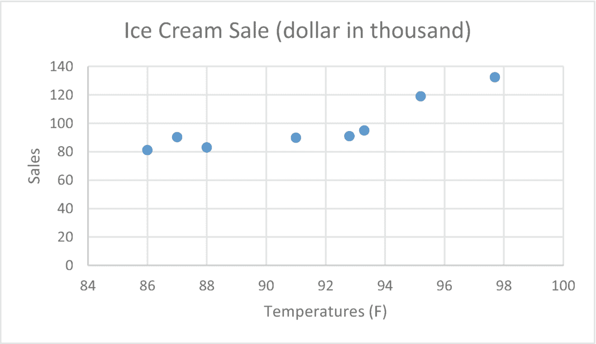
*图 2-1 气温与冰淇淋销量*

根据图 2-1 中的图表，如果预测下周的日均最高气温平均值为 88.8 华氏度，汤米发现很难预测销量，因为没有数据点直接对应 88.8 度。右键单击一个数据点；会显示一个小菜单。在菜单上，单击“添加趋势线”，如图 2-2 所示。

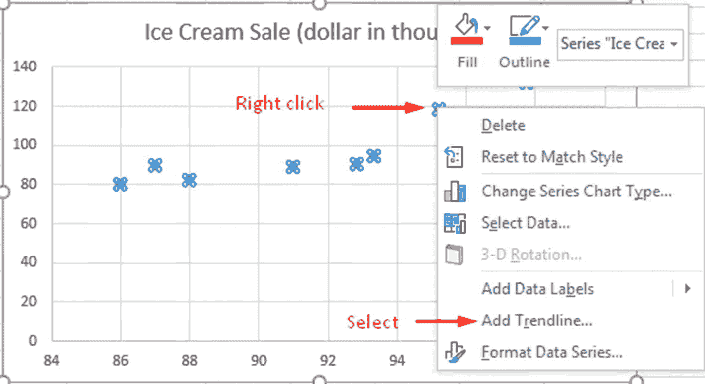
*图 2-2 添加趋势线*

图表中会出现一条趋势线，如图 2-3 所示。请注意，默认情况下，图 2-3 中的线不是实心红线，并且不会显示方程。弄清楚如何将趋势线格式化为实心红线以及如何在图表上显示方程，将是一个很好的练习。要在图表上显示方程，请右键单击图表中的趋势线 ➤ 选择“设置趋势线格式…” ➤ 勾选“在图表上显示公式”。

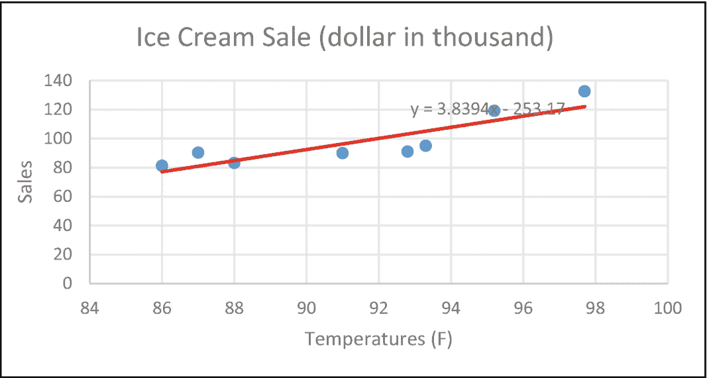
*图 2-3 使用趋势线进行预测*

利用这条线性线，Tommy 可以估算出当温度 = 88.8 时，销售额约为 8.9 万美元。使用方程 `y = 3.8394*x - 253.17`，其中 `m` = 3.8394，`b` = -253.17，Tommy 可以更精确地预测他的冰淇淋销售额：

```
3.8394 × 88.8 – 253.17 = 87.8 千美元。
```

这里的线性方程就是本次特定线性回归研究的线性数据挖掘模型。我们知道，对于这种形式的线性方程 `y = mx + b`，`m` 和 `b` 是两个决定因素。一旦找到 `m` 和 `b`，模型就构建并确定了。当然，对于这个简单的案例，模型由 `m` 和 `b` 表示，也就是说，由 `m` 和 `b` 组成的参数集就是模型。模型构建的过程就是寻找 `m` 和 `b` 的过程。

`m` 和 `b` 是如何得到的呢？从图 2-3 中我们可以看出，趋势线并未穿过每一个点，它只是遵循了趋势。如果由几个人手动独立绘制，可能会得到多条不同的趋势线。Excel 是如何得出这条特定趋势线的呢？

为了找到形如 `y = mx + b` 的特定线性方程，我们采用了最小二乘法。让我来解释一下什么是最小二乘法。

观察温度 = 91 对应的点，该点并不在趋势线上。这表明趋势线（预测值）与实际数据之间存在误差（我们可以将其理解为差异）。事实上，图 2-3 中的所有数据点都存在微小误差。误差的平方和可以表示为

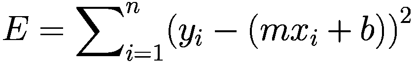
(2-1)

其中 `y_i` 是训练数据集中与温度值 `x_i` 对应的实际冰淇淋销售额。目标是使误差之和最小化。为此，我们可以求偏导数：

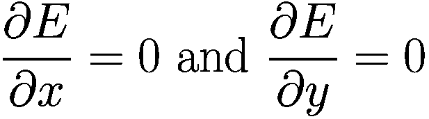
(2-2)

通过求解上述两个偏导数方程，我们可以得到 `m` 和 `b` 的值：

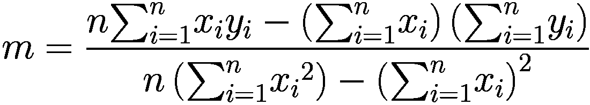
(2-3)

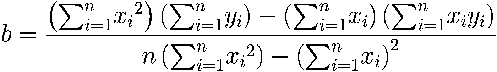
(2-4)

## 通过 Excel 学习线性回归

在公式 (2-3) 和 (2-4) 中，`x_i` 是已知的平均每日最高气温，`y_i` 是与 `x_i` 对应的实际冰淇淋销售额。它们来自表 2-1 所示的训练数据集。

打开文件 `Chapter2-1a.xlsx`。如图 2-4 所示，在 C 列和 D 列中输入文本和公式，以计算 `m` 和 `b` 的值。图 2-4 中的公式基于公式 (2-3) 和 (2-4)。请注意，在图 2-4 中，温度被重命名为 `x`，冰淇淋销售额被重命名为 `y`，以便设置更贴近公式 (2-3) 和 (2-4)。

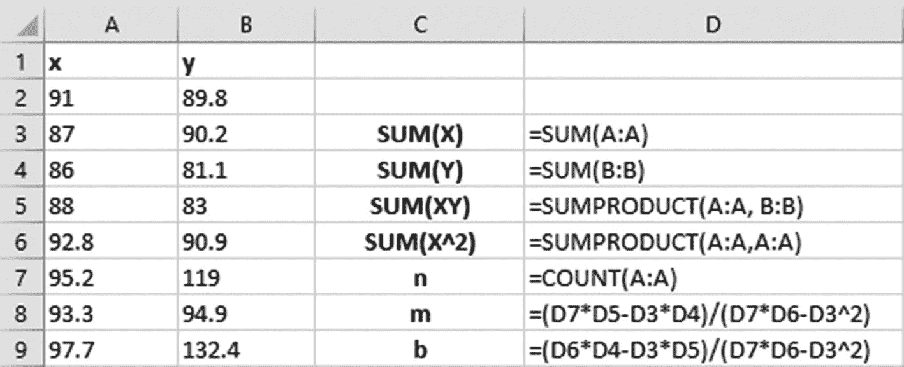
*图 2-4 通过最小二乘近似计算 m 和 b*

在图 2-4 中，`A:A` 和 `B:B` 分别用于表示 A 列和 B 列中的所有单元格。因此，`=SUM(A:A)` 和 `=SUM(B:B)` 将分别对 A 列和 B 列中的所有单元格求和。此外，还使用了 Excel 函数 `SUMPRODUCT` 来简化两个数组之间的计算。对 `SUMPRODUCT` 的一个重要理解是，两个数组必须具有相同的类型和长度。这里，相同的类型意味着两个数组可以都是列或都是行。计算出 `m` 和 `b` 后，Tommy 就可以完成他的预测，如图 2-5 所示（在单元格 D12 中输入公式 `=D$8*C12 + D$9`，然后从 D12 自动填充到 D14）。

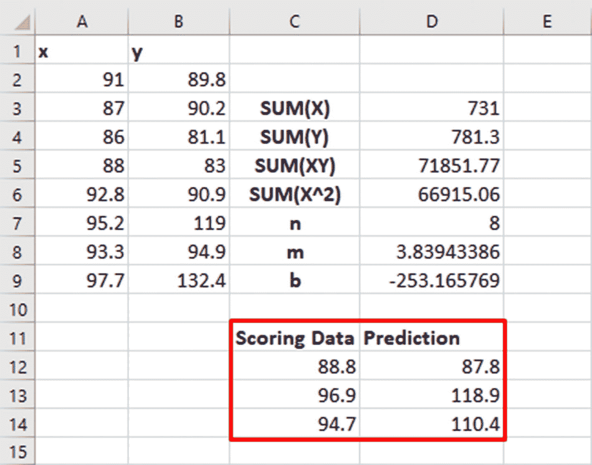

一个包含 4 列 13 行的表格。C 列和 D 列包含文本和公式，A 列中的温度被重命名为 `x`，B 列中的冰淇淋销售额被重命名为 `y`。该表格突出显示了评分数据和预测结果。

图 2-5

基于线性回归模型的预测

对于这个特定示例，计算 `m` 和 `b` 的一种更高效的方法是使用 `SLOPE` 和 `INTERCEPT` 这两个函数。请按照以下说明练习这两个函数的使用：

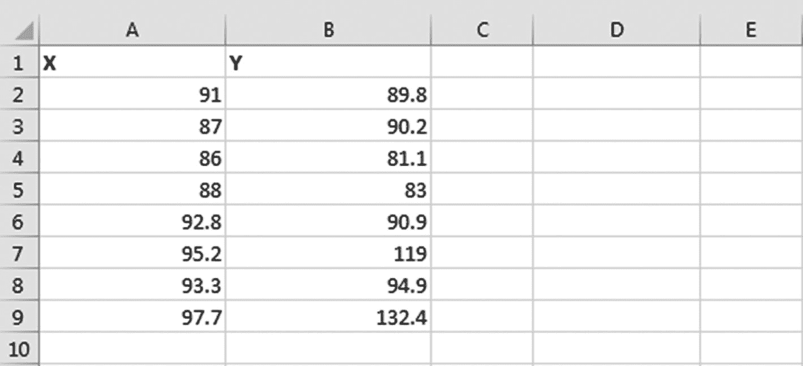

一个包含 2 列 8 行的表格。A 列中的温度被重命名为 `x`，B 列中的冰淇淋销售额被重命名为 `y`。

图 2-6

准备数据以使用 `SLOPE` 和 `INTERCEPT` 函数

1.  如图 2-6 所示输入 `x` 和 `y` 值。注意：仅输入 `x` 和 `y` 值。C 列和 D 列为空。
2.  在单元格 C2 中输入 `m`，在单元格 D2 中输入 `b`。
3.  在单元格 C3 中输入公式 `=SLOPE(B2:B9, A2:A9)`。
4.  在单元格 D3 中输入公式 `=INTERCEPT(B2:B9, A2:A9)`。

结果应如图 2-7 所示。

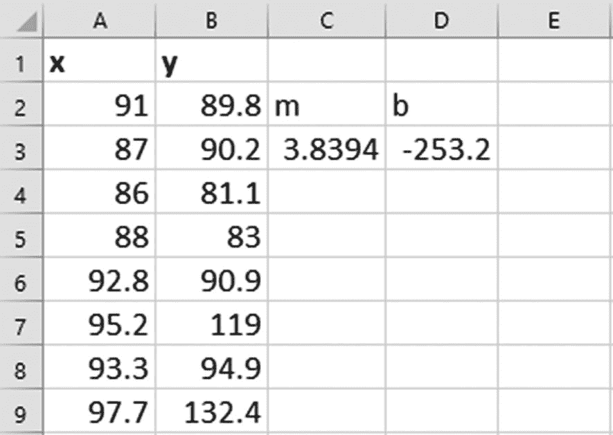

一个包含 4 列 8 行的表格。A 列中的温度被重命名为 `x`，B 列中的冰淇淋销售额被重命名为 `y`，C 列的 `m` 值为 3.8394（即斜率），D 列的 `b` 值为 -253.2（即截距）。

图 2-7

通过 `SLOPE` 和 `INTERCEPT` 函数得到的结果

另一种获取 `m` 和 `b` 值的方法是通过 Excel 的数据分析工具。这是许多人采用的一种流行方法，尽管我不喜欢它。使用数据分析工具进行回归的缺点是，一旦获得系数和截距值，它们不会随着训练数据的变化而更新。

默认情况下，我们的 Excel 没有数据分析工具。要使其可用，我们必须启用 Excel 中内置的加载项“分析工具库”。稍后当我们需要使用规划求解时，我会向您展示如何在 Excel 中启用分析工具库和规划求解。目前，我们还不需要使用数据分析工具。

上述学习过程的结果存储在文件 `Chapter2-1b.xlsx` 中。

## 通过 Excel 学习多元线性回归

Tommy 成功预测了他的冰淇淋销量，但他希望进一步提高预测的准确性。经过一番研究，他收集了更多信息，例如游客数量（从酒店获取）和一周内的晴天数。他更新后的训练数据集如表 2-2 所示。

表 2-2

冰淇淋销量 vs. 温度、游客数和晴天数

| 温度 (华氏度) | 游客数 | 晴天数 | 冰淇淋销量 (千美元) |
| --- | --- | --- | --- |
| 91 | 998 | 4 | 89.8 |
| 87 | 1256 | 7 | 90.2 |
| 86 | 791 | 6 | 81.1 |
| 88 | 705 | 5 | 83 |
| 92.8 | 1089 | 3 | 90.9 |
| 95.2 | 1135 | 6 | 119 |
| 93.3 | 1076 | 4 | 94.9 |
| 97.7 | 1198 | 7 | 132.4 |

表 2-2 中有三个自变量：温度、游客数和晴天数。当存在多个自变量时，线性回归特称为多元线性回归。我们将温度记为 `x`[`1`]，游客数记为 `x`[`2`]，晴天数记为 `x`[`3`]，y 轴截距记为 `b`，销量记为 `y`。我们的多元线性回归方程为 `y = m`[`1`]`x`[`1`] `+ m`[`2`]`x`[`2`] `+ m`[`3`]`x`[`3`] `+ b`。对于这种多元线性回归，我们需要使用 `LINEST` 函数来获取系数 `m`[`i`] 和 `b`。请按照以下说明通过 Excel 练习多元线性回归：

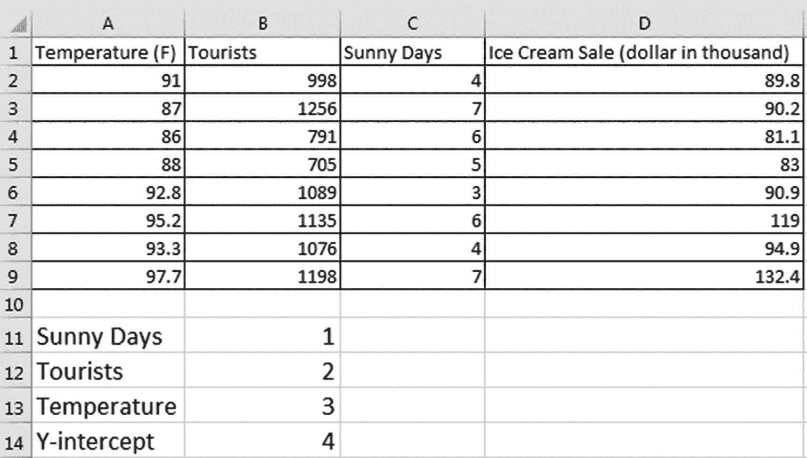

一个包含 4 列 8 行的表格。列 A 为温度，列 B 为游客数，列 C 为晴天数，列 D 为冰淇淋销量。表格下方依次放置了文本“晴天数 1”、“游客数 2”、“温度 3”和“Y 轴截距 4”。

图 2-8

设置表格以查找系数和 y 轴截距

1.  将表 2-2 的数据输入到新 Excel 工作表的单元格 A1:D9 中，或者打开文件 `Chapter2-2a.xlsx`。

模型构建过程就是找到 `m`[`1`]、`m`[`2`]、`m`[`3`] 和 `b` 的最优值。我们将使用数组函数 `LINEST`。请注意，`LINEST` 返回一个数组值。返回值的顺序是 `m`[`n`]、`m`[`n-1`]、…、`m`[`1`] 和 `b`，这与公式表达的顺序相反。因此，需要使用 `INDEX` 函数从返回的数组中提取单个值。`INDEX` 函数设计用于处理矩阵或表格。它需要行索引和列索引来定位表格中的元素。由于 `LINEST` 返回的数组只有一行，因此行索引始终为 1，而列索引分别为 1、2、3 和 4。

2.  在单元格 A11:A14 中输入文本“晴天数”、“游客数”、“温度”和“Y 轴截距”。
3.  在单元格 B11:B14 中输入数字 1、2、3 和 4。此时工作表应如图 2-8 所示。稍后我将解释为什么需要输入这些数字。

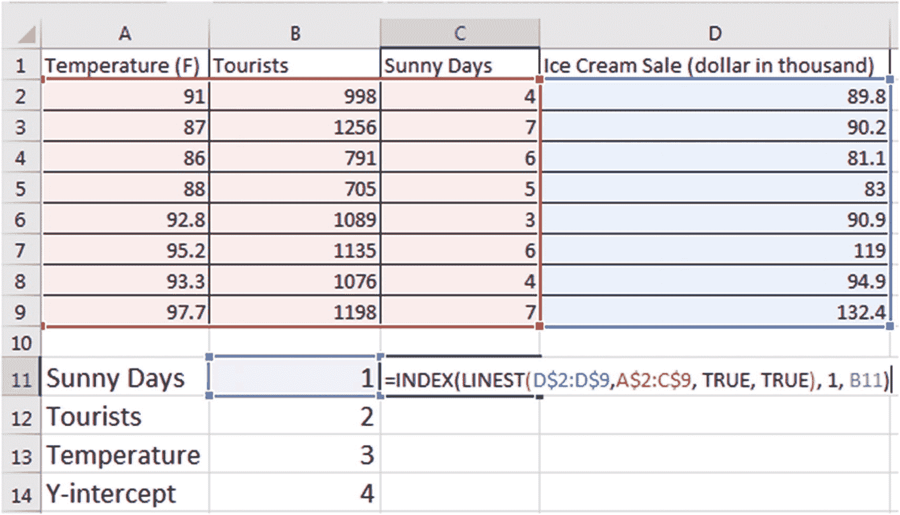

一个包含 4 列 8 行的表格。列 A 为温度，列 B 为游客数，列 C 为晴天数，列 D 为冰淇淋销量。表格下方依次放置了文本“晴天数 1（含 INDEX 公式）”、“游客数 2”、“温度 3”和“Y 轴截距 4”。

图 2-9

使用 `INDEX` 和 `LINEST` 函数获取系数

1.  在单元格 C11 中输入以下公式并按 Enter 键：

```
=INDEX(LINEST(D$2:D$9,A$2:C$9,TRUE,TRUE),1,B11)
```

在此公式中，`LINEST` 函数的第一个输入参数是 D2:D9，即因变量值。第二个输入参数是 A2:C9，其中包含 `x`[`1`]、`x`[`2`] 和 `x`[`3`] 的值。`LINEST` 返回的数组作为输入传递给 `INDEX` 函数。由于 B11 = 1，`INDEX` 函数提取返回数组中的第一个元素，即 `m`[`3`]。再次注意，`LINEST` 返回的数组按 `m`[`n`]、`m`[`n-1`]、`m`[`n-2`]、…、`m`[`1`]、`b` 的顺序排列系数。在此特定示例中，返回数组中的数据分别是自变量“晴天数”、“游客数”、“温度”和“Y 轴截距”对应的 `m`[`3`]、`m`[`2`]、`m`[`1`] 和 `b`。

请参考图 2-9。

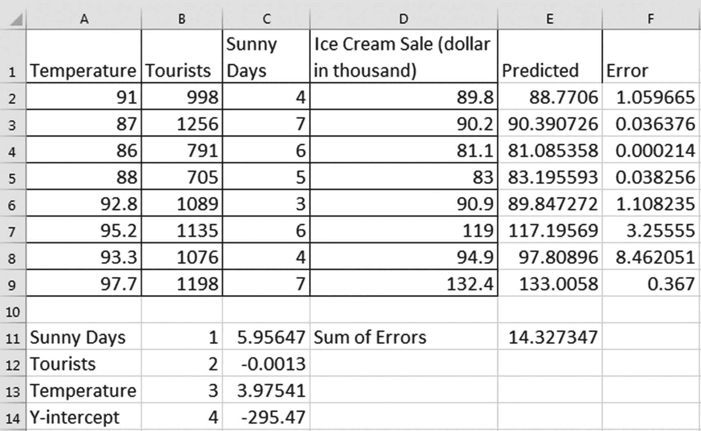

一个包含 6 列 8 行的表格。列分别为温度、游客数、晴天数、冰淇淋销量、预测值和误差。表格下方依次放置了文本“晴天数 1”、“游客数 2”、“温度 3”、“Y 轴截距 4”以及“误差总和”及其对应值。

图 2-10

多元线性回归模型

2.  从单元格 C11 自动填充到单元格 C14。注意 B11、B12、B13 和 B14 的使用。

当我们从 C11 自动填充到 C14 时，单元格 C12 中的公式会自动变为 `=INDEX(LINEST(D$2:D$9,A$2:C$9,TRUE,TRUE),1,B12)`。因为 B12 = 2，所以 C12 中的公式正确地提取了游客数的系数 (`m`[`2`])。同样的逻辑适用于 C13 和 C14 中的公式。通过预先在单元格 B11:B14 中输入数字，一旦我们正确输入了初始公式，就可以通过自动填充获得所有需要的值。

这是一种常用技巧。我们当然不希望多次输入公式。请注意，`LINEST` 函数会为每个系数重复调用。

3.  最后一步是检查新模型的效果。在单元格 E1 中输入文本“预测值”。
4.  在单元格 E2 中输入以下公式，然后自动填充到单元格 E9：

```
=A2*C$13+B2*C$12+C2*C$11+C$14
```

如前所述，参数集（即系数和 Y 轴截距）代表了线性回归模型。我们想要检查模型的好坏，因此需要在 E 列生成预测销量。

5.  为了检查上述线性回归模型的质量，我们可以进一步根据公式 (2-1) 计算误差。在单元格 F1 中输入文本“误差”，在单元格 F2 中输入公式 `=POWER(D2-E2,2)`，然后从 F2 自动填充到 F9。
6.  在单元格 D11 中输入文本“误差总和”，在单元格 E11 中输入公式 `=SUM(F2:F9)`。此时工作表应如图 2-10 所示。

回顾一下，通过 `LINEST` 函数获得的系数保证了单元格 E11 中的误差值最小化。您可以手动修改系数，看看是否能得到更小的误差值。我将此作为练习留给您实践。

自变量“游客数”的系数为负。这仅仅意味着当游客数量增多时，冰淇淋销量会减少。然而，在这个特定示例中，该系数接近于零，表明游客数量对冰淇淋销量影响不大。

完整的工作可在文件 `Chapter2-2b.xlsx` 中找到。

## 强化练习

实践是成功的关键。建议您打开 `Chapter2-HW.xlsx` 自行练习线性回归。`Chapter2-HW-withAnswers.xlsx` 提供了一种参考答案。

## 复习要点

我们已到达第 2 章的末尾。对于本章，请复习以下概念和 Excel 技能：

1. 线性回归模型

2. 最小二乘法

3. 多元线性回归

4. 函数 `SUM`、`COUNT`、`SLOPE`、`INTERCEPT`、`LINEST`、`SUMPRODUCT`、`INDEX` 和 `POWER`