# 3. K-Means 聚类

请从 [`https://github.com/hhohho/Learn-Data-Mining-through-Excel-2`](https://github.com/hhohho/Learn-Data-Mining-through-Excel-2) 下载示例 Excel 文件。双击 Chapter3-1a.xlsx 将其打开。


## 总体理解

与作为预测方法的线性回归不同，聚类是一种分类方法，它将主体（数据点）归入不同的组（簇），每个组都有一系列特征度量值。例如，银行在考虑向客户发放贷款时，可能希望将客户划分为不同的风险组。这种分类过程依赖于所选的特征和采用的算法。请注意以下术语：主体、数据点、组、簇、类别等。在表格中，一行被称为一条记录。由于一条记录可以由多个数值组成，因此它也可以被称为一个数据点。此外，一条记录可以包含用于描述某人的特征，因此在某些情况下，一条记录也被称为一个主体。在本书中，数据点、记录和主体含义相同。同样，组、簇和类别这三个术语也具有相同的含义。

聚类是一种无监督的数据挖掘方法。它不需要训练数据集。两种最流行的聚类方法是划分聚类和层次聚类。K-means 聚类（其中 `k` 表示所需的簇数量）是划分聚类的一种类型。在 K-means 聚类中，每个簇由其内部数据点的质心（或均值）定义。例如，假设一个簇有三个数据点，表示为三个向量：(1, 2, 3, 4, 5)、(2, 3, 4, 5, 6) 和 (5, 4, 3, 2, 1)。那么该簇的质心为 ((1+2+5)/3, (2+3+4)/3, (3+4+3)/3, (4+5+2)/3, (5+6+1)/3)，即 (2.7, 3, 3.3, 3.7, 4)。请注意，K-means 聚类方法要求所有数据都是数值型的。

要开始 K-means 聚类过程，首要任务是确定需要多少个簇，即 `k` 的值。我们可能需要尝试多个 `k` 值，以检查哪个 `k` 值最能满足我们的目的。第二个任务是选择 `k` 个数据点作为初始质心。我们可以随机选择这 `k` 个质心，也可以根据数据分布来挑选。计算每个数据点到每个质心的距离，并将数据点归入距离其最近的那个簇（相较于其他所有簇）。一旦每个数据点都被归入某个簇，就重新计算该簇内各点的质心。同时，重新计算每个数据点到每个新质心的距离，然后再次根据最短距离规则将点划分到簇中。重复此过程，直到连续两次迭代中所有数据点都被分配到相同的簇，此时簇质心已稳定，并将保持不变。当达到预定义的最大迭代次数时，该过程也可以停止。

计算任意两个数据点之间的距离有多种方法，但通常使用欧几里得距离。给定两个数据点 (x1, x2, x3, x4) 和 (y1, y2, y3, y4)，它们的欧几里得距离计算公式为

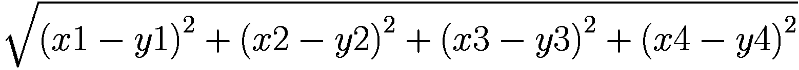

(3-1)

## 通过 Excel 学习 K-Means 聚类

假设有 50 个国家，我们希望根据四个属性（谋杀率、袭击率、城市人口和强奸率）将它们分为四个簇。所有数据都存储在 Excel 文件 Chapter3-1a.xlsx 中。让我们打开这个 Excel 文件，它只有一个名为“1”的工作表。是的，这个工作表的名字就是“1”。A 列存储每个国家的唯一代码。数据如图 3-1 所示。

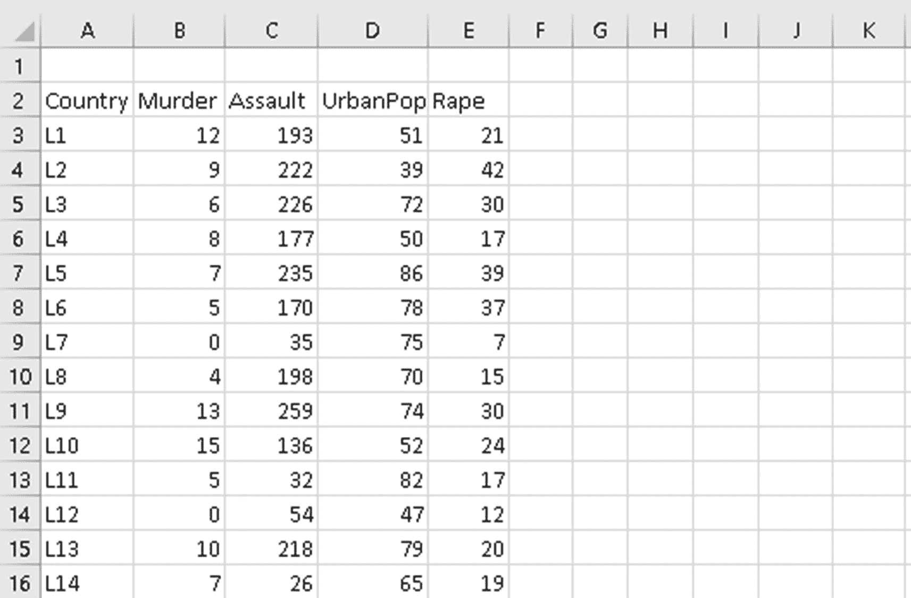

一个表格展示了 50 个国家的 K-means 聚类数据。该表格包含 12 列和 16 行。列标题为国家、谋杀、袭击、城市人口和强奸。

图 3-1

关于 50 个国家的数据

让我们选中单元格 G1:K1，然后点击“合并后居中”。单元格 G1 到 K1 被合并为一个单元格。在这个合并后的单元格（其引用为 G1）中输入“均值”。在单元格 G2:K6 中输入其他数据，如图 3-2 所示。请注意，C1、C2、C3 和 C4 均为大写。提醒一下，还有另一个名为 Chapter3-1a-preEntered.xlsx 的文件，其中 G1:K6 的数据已预先输入。欢迎您从 Chapter3-1a-preEntered.xlsx 开始操作。

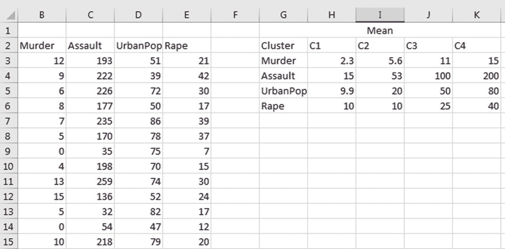

一个表格展示了 G1 到 K6 中用于 K-means 聚类的数据。该表格包含 12 列和 15 行。列标题为谋杀、袭击、城市人口、强奸和均值，其中均值下有 5 个子列：簇、C1、C2、C3 和 C4。

图 3-2

在 G1:K6 中设置数据

C1、C2、C3 和 C4 分别代表簇 1、簇 2、簇 3 和簇 4。单元格 H3:K6 中的数字是在快速查看每个属性的数据范围后选定的。我们也可以为它们随机挑选一些数字。在本演示中，让我们保持这些数字完全不变。单元格 H3:H6、I3:I6、J3:J6 和 K3:K6 中的数字分别代表 C1、C2、C3 和 C4 的质心。

选中单元格 M1:P1，点击“合并后居中”。单元格 M1 到 P1 被合并为一个单元格，我们在其中输入文本“距离”。我们将把每个数据点到四个质心的欧几里得距离存储在 M、N、O 和 P 列中。单元格 M1:Q2 的设置如图 3-3 所示。

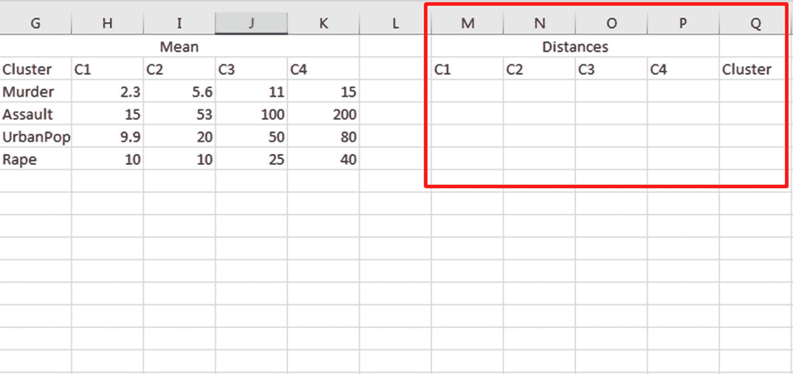

一个表格展示了 M1 到 Q2 中用于 K-means 聚类的数据。该表格包含 11 列和 6 行。列标题为均值（下有 6 个子列）和距离（下有 5 个子列：C1、C2、C3、C4 和簇）。距离列及其子列被突出显示。

图 3-3

单元格 M1:Q2 的设置

单元格 M3 存储从国家 L1 (12, 193, 51, 21) 到质心 C1 (2.3, 15, 9.9, 10) 的距离。M3 中的公式基于公式 (3-1)，如下所示：

```
=SQRT(SUMXMY2($B3:$E3, H$3:H$6))
```

此公式计算 L1 和 C1 之间的欧几里得距离。请密切注意公式中绝对引用的使用。此处使用绝对引用是为了方便自动填充。函数 SQRT 计算一个值的平方根，函数 SUMXMY2 计算两个数组中对应值之差的平方和（在此例中，两个数组分别是 L1 的 B3:E3 和 C1 的 H3:H6）。

按照以下说明继续该过程：

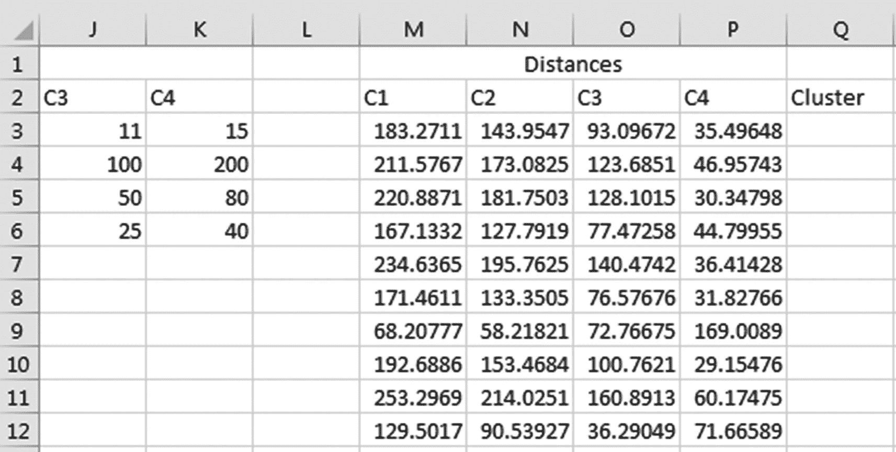

一个表格展示了 G1 到 K6 中用于 K-means 聚类的数据。该表格包含 9 列和 12 行。列标题为均值（下有 2 个子列：C3 和 C4）和距离（下有 5 个子列：簇、C1、C2、C3 和 C4）。

图 3-4

在工作表 1 中计算出的距离

1.  选中单元格 M3，并水平自动填充至 P3。

2.  选中单元格 M3:P3；将它们一起自动填充至单元格 M52:P52。到目前为止，每个数据点到每个质心的距离都已计算完毕。工作表的一部分如图 3-4 所示。


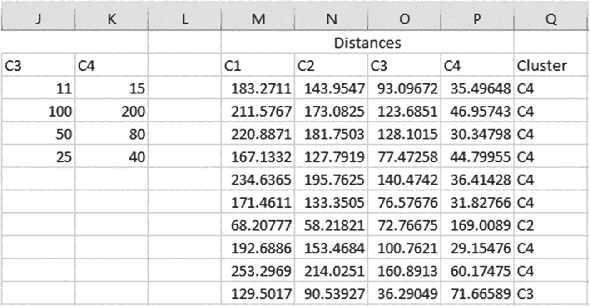

一张表格展示了使用 K-means 聚类后的数据。该表格包含 18 列和 18 行。列标题依次为国家、谋杀、袭击、城市人口、强奸、均值（含 5 个子列：聚类、C1、C2、C3、C4）以及距离（含 5 个子列：聚类、C1、C2、C3、C4）。

图 3-5

工作表 1 中第一轮计算后的结果

1.  Q 列中的数据根据最短距离规则，指明了每个数据点所属的聚类。在单元格 Q3 中，输入以下公式：

```
    =INDEX($M$2:$P$2,1,MATCH(MIN(M3:P3),M3:P3,0))
    ```

函数 MATCH 的语法为 MATCH(查找值, 查找数组, 匹配类型)。如果 match_type = 0，该函数会在查找数组中精确查找查找值。如果未找到，则返回#N/A 错误（值不可用错误）。如果找到，则返回该值在数组中的相对位置。请注意，在 Microsoft Office 工具中，第一个位置始终为 1。

在上述公式中，MATCH 函数找到数组 M3:P3 中最小值（本例中为 4）的列相对位置。该列位置被传递给 INDEX 函数，以便在数组 M2:P2 中找到对应的聚类名称。此公式用于确定数据点 L1 所属的聚类。

由于只有四个聚类，使用嵌套的 IF 语句也能达到与上述公式相同的目的。

```
    =IF(MIN(M3:P3)=M3,"C1",IF(MIN(M3:P3)=N3,"C2", IF(MIN(M3:P3)=O3,"C3","C4")))
    ```

在嵌套的 IF 公式中，如果最小值等于 M3，则返回“C1”；否则，如果最小值等于 N3，则返回“C2”；否则，如果最小值等于 O3，则返回“C3”；否则返回“C4”。

我们可以看出，当聚类数量过多时，使用 INDEX 和 MATCH 函数比嵌套 IF 语句是更好的编程方法。

2.  将 Q3 自动填充至 Q52。至此，我们的数据如图 3-5 所示。

1.  现在我们需要开始第二轮聚类过程。复制工作表 1，并将新工作表重命名为工作表 2。是的，新工作表的名称就是数字 2！同时，确保工作表 2 位于工作表 1 的右侧。它们的顺序非常重要。

在工作表 2 中，我们需要在单元格 H3 中输入一个公式，以重新计算聚类 1 内所有数据点的“谋杀”属性均值。然而，所需数据位于工作表 1 中。如下公式可以为我们完成此任务：

```
    =AVERAGEIFS('1'!$B$3:'1'!$B$52, '1'!$Q$3:'1'!$Q$52,H$2)
    ```

虽然此公式位于工作表 2 中，但所使用的数据均在工作表 1 中，'1'!通过其名称（确实是“1”）引用工作表 1。该公式利用函数 AVERAGEIFS 计算聚类 1 内所有数据点的“谋杀”属性均值。请注意，只有聚类名称与单元格 H2（C1）匹配的数据点（且仅限 B 列）才会被计算平均值。

然而，上述公式还不够完善！

首先，此公式计算的是平均值。在 k-means 聚类过程中，有可能某个聚类没有数据点。在这种情况下，分母将为零，从而导致除以零的错误。因此，我们需要利用 IFERROR 函数来防范这种情况。

其次，也是最重要的原因是，当我们需要在另一个工作表 3 中开始新一轮聚类迭代时，我们必须转到工作表 3 的单元格 H3，将“1”改为“2”，因为工作表 3 必须使用工作表 2 中的数据。我们不想一次又一次地手动修改公式。

为了解决这个难题，我们需要利用 SHEET、INDIRECT 和 ADDRESS 函数以及运算符&。

SHEET 是一个非常有趣的函数，它返回所引用工作表的编号。工作簿中最左侧的工作表编号为 1，左侧第二个工作表编号为 2，依此类推。SHEET 的语法为 SHEET(引用)，其中参数通常是一个单元格引用，例如 A1。


函数 INDIRECT 将文本作为单元格引用进行求值。函数 ADDRESS 将两个数字转换为单元格引用。函数 ADDRESS 需要一个行号和一个列号。在 Excel 中，A 列是 1，B 列是 2，依此类推。运算符 & 可以连接文本（字符串）。
    *   在工作表 2 的单元格 F1 中，输入公式 `=SHEET(A1)-1`。你会注意到 F1 中的值是 1，可用于引用工作表 1。

*   在单元格 F3 到 F6 中，分别输入数字 2、3、4 和 5。这些数字有助于我们在水平自动填充公式时选择正确的列。同样，在 Excel 中，B 列是第 2 列，C 列是第 3 列，依此类推。这些数字可用于引用 B、C、D 和 E 列。

工作表 2 的一部分如图 3-6 所示。

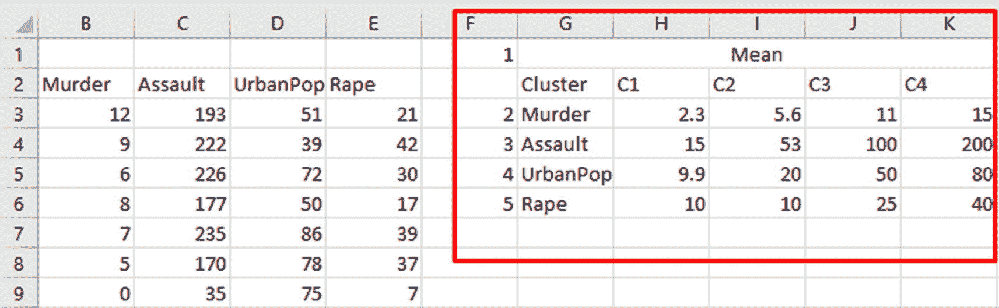

一个表格展示了使用 K-means 聚类算法的数据。该表格包含 11 列和 9 行。列标题为 murder、assault、urban-pop、rape、mean，以及 6 个子列 cluster、C 1、C 2、C 3 和 C 4。表格高亮显示了 mean 列及其子列。

图 3-6

设置工作表 2 以实现公式自动更新

在单元格 H3 中，输入以下公式：

```
    =IFERROR(AVERAGEIFS(INDIRECT($F$1 & "!" & ADDRESS(3,$F3,1)) : INDIRECT($F$1 & "!" & ADDRESS(52,$F3,1)),INDIRECT($F$1 & "!$Q$3"):INDIRECT($F$1 & "!$Q$52"),H$2),0)
    ```

在此公式中
    *   IFERROR 确保当出现错误时，平均值被设置为 0。

*   `ADDRESS(3,$F3,1)` 返回 `$B$3`。

*   `INDIRECT($F$1 & "!" & ADDRESS(3,$F3,1))` ➔ `'1'!$B$3`。

*   `INDIRECT($F$1 & "!" & ADDRESS(52,$F3,1))` ➔ `'1'!$B$52`。

*   `INDIRECT($F$1 & "!" & ADDRESS(3,$F3,1)) : INDIRECT($F$1 & "!" & ADDRESS(52,$F3,1))` ➔ `'1'!$B$3:'1'!$B$52`。

*   `INDIRECT($F$1 & "!$Q$3"):INDIRECT($F$1 & "!$Q$52")` ➔ `'1'!$Q$3:'1'!$Q$52`。

上述公式生成一个最终公式，等同于

```
    =IFERROR(AVERAGEIFS('1'!$B$3:'1'!$B$52, '1'!$Q$3:'1'!$Q$52,H$2),0)
    ```

上述公式的优点如下：
    *   我们可以从 H3 自动填充到 K6。

*   结合单元格 F1 中 SHEET 函数的使用，只要我们将工作表 3 放置在工作表 2 的紧右侧，就可以自动实现对工作表 2 的引用。

2.  从单元格 H3 自动填充到单元格 K6。我们的工作表可以与图 3-7 进行比较。

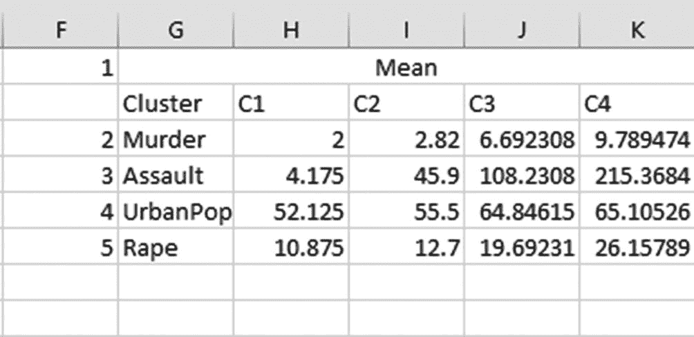

一个表格表示质心。该表格包含 6 列和 6 行。列标题为 1 和 mean，以及 5 个子列 cluster、C 1、C 2、C 3 和 C 4。

图 3-7

工作表 2 中的质心

3.  到目前为止，每个数据点到四个新质心的距离以及它们所属的簇都已自动计算出来。在单元格 R1 和 R2 中，分别输入数字 1 和 2。选中这两个单元格并自动填充到单元格 R52。现在单元格 R1:R52 中的数字为 1, 2, 3, …, 52。

4.  在单元格 S2 中，输入“旧簇”。S 列存储了上一次迭代中所有数据点所属的簇（这些数据在工作表 1 中）。

5.  在单元格 T2 中，输入“差异”。T 列记录了当前迭代与上一次迭代之间的簇切换情况。工作表的一部分如图 3-8 所示。

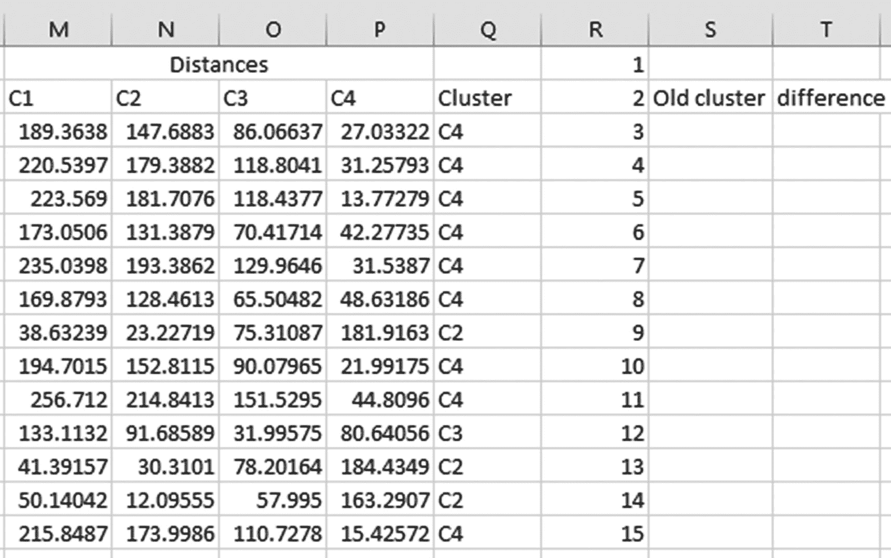

一个表格展示了使用 K-means 聚类算法的数据。该表格包含 8 列和 18 行。列标题为 distance，以及 5 个子列 cluster、C 1、C 2、C 3 和 C 4，还有 old cluster 和 difference。

图 3-8

准备与工作表 1 进行比较

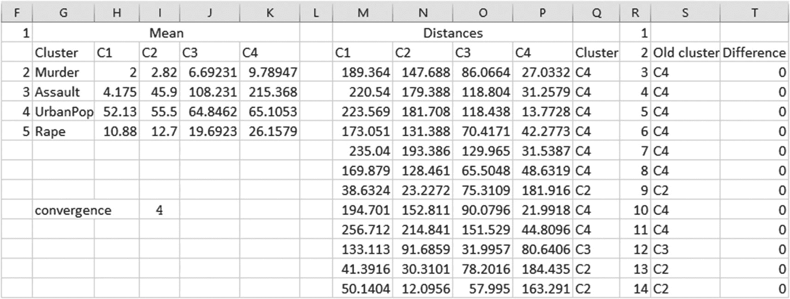

一个表格展示了使用 K-means 聚类算法的数据。该表格包含 15 列和 18 行。列标题为 mean，以及 5 个子列 cluster、C 1、C 2、C 3 和 C 4，distance 以及 5 个子列 cluster、C 1、C 2、C 3 和 C 4，还有 old cluster 和 difference。

图 3-9

工作表 2 中第二轮之后

1.  在单元格 S3 中，输入以下公式并自动填充到 S52：

```
    =INDIRECT($F$1 & "!Q" & R3)
    ```

此公式引用工作表 1 中单元格 Q3 的值。

2.  在单元格 T3 中，输入以下公式并自动填充到 T52：

```
    =IF(Q3=S3,0,1)
    ```

上述公式定义：对于给定的数据点，如果其上一次所属的簇与当前所属的簇不同，则返回 1；否则返回 0。我们的目标是达到一个稳定状态，即 S 列只有 0，这意味着所有数据点都停留在与上一次迭代相同的簇中。

3.  选中单元格 G10 和 H10，合并它们，并在其中输入“收敛”。在单元格 I10 中，输入以下公式：

```
    =SUM(T3:T52)
    ```

如前所述，我们希望单元格 I10 中的值为 0。工作表 2 的一部分应如图 3-9 所示。

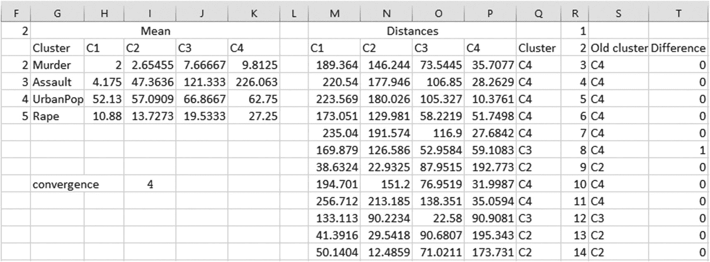

一个表格展示了使用 K-means 聚类算法的数据。该表格包含 15 列和 17 行。列标题为 mean，以及 5 个子列 cluster、C 1、C 2、C 3 和 C 4，distance 以及 5 个子列 cluster、C 1、C 2、C 3 和 C 4，还有 old cluster 和 difference。

图 3-10

工作表 3 中三轮后的 K-means 聚类

1.  由于在第二次迭代中有四个数据点切换了簇，我们需要继续聚类过程。复制工作表 2，并将新工作表命名为 3。确保工作表 3 紧邻工作表 2 的右侧。我们会注意到工作表 3 已自动完成，其部分内容如图 3-10 所示。

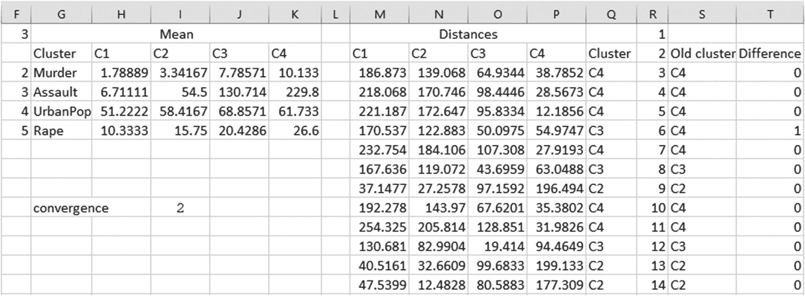

一个表格展示了使用 K-means 聚类算法的数据。该表格包含 15 列和 17 行。列标题为 mean，以及 5 个子列 cluster、C 1、C 2、C 3 和 C 4，distance 以及 5 个子列 cluster、C 1、C 2、C 3 和 C 4，还有 old cluster 和 difference。

图 3-11

工作表 4 中四轮后的 K-means 聚类

1.  重复上述聚类过程：将工作表 3 复制到工作表 4；确保新工作表命名为 4 并位于工作表 3 的右侧。工作表 4 的一部分如图 3-11 所示。

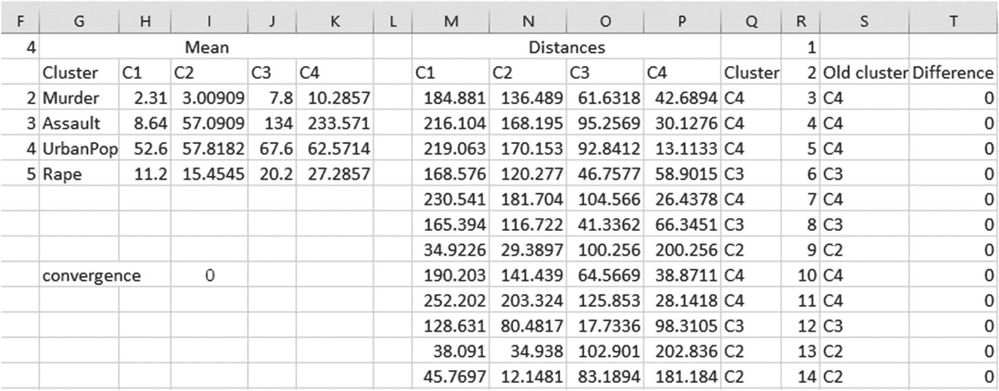

一个表格展示了使用 K-means 聚类算法的数据。该表格包含 15 列和 17 行。列标题为 mean，以及 5 个子列 cluster、C 1、C 2、C 3 和 C 4，distance 以及 5 个子列 cluster、C 1、C 2、C 3 和 C 4，还有 old cluster 和 difference。

图 3-12

工作表 5 中五轮后的 K-means 聚类

1.  再次重复聚类过程：将工作表 4 复制到工作表 5；确保新工作表命名为 5 并位于工作表 4 的右侧。收敛值变为 0，如图 3-12 所示。

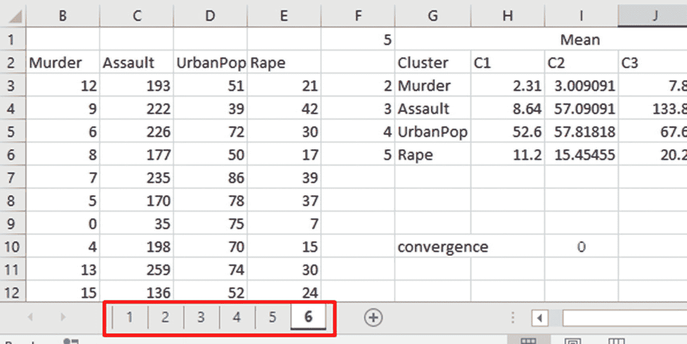

一个表格展示了使用 K-means 聚类算法的数据。该表格包含 10 列和 12 行。列标题为 murder、assault、urban pop、rape、5 和 mean，以及 4 个子列 cluster、C 1、C 2 和 C 3。底部的 6 个工作表被高亮显示。

图 3-13

六个工作表必须按顺序排列

1.  一旦收敛值达到 0，无论我们继续多少次迭代，都不会再有数据发生变化。但是，有必要通过创建另一个工作表 6 来重复上述过程以确认这一点。

注意，按顺序排列这六个工作表非常重要；否则，你将无法得到正确的结果。请查看图 3-13。

至此，所有数据点已成功聚类。


从上述聚类过程中可以看出，在 Excel 中进行聚类并不困难。相反，它让我们能够经历每一个步骤，从而深入理解 k-means 聚类的工作原理。我想挑战你分别检查四个聚类中的数字。我相信你会发现一些规律。当你这样做时，请记住，聚类的目的是将相似的记录归组在一起。

完整结果见 Chapter3-1b.xlsx 文件（其中也包含我对这些规律的观察）。

## 强化练习

Chapter3-HW.xlsx 文件为你提供了一个练习机会。在此练习中，你需要遍历 15 个工作表才能达到收敛。如果你觉得练习有困难，请参考 Chapter3-HW-withAnswers.xlsx 文件。

Chapter3-HW-withAnswers-NameManager.xlsx 文件利用了名称管理器（Excel 内置功能）来简化公式。

到目前为止，我们使用 SHEET 函数来帮助自动化 k-means 聚类过程。使用 SHEET 函数的一个关键要求是按顺序放置所有工作表。如果我们不想按顺序放置所有工作表，可以使用 CELL 函数代替 SHEET。Chapter3-HW-withAnswers-Cell-Function.xlsx 文件展示了这种解决方案。欢迎自行探索。

Excel 有一些配置公式计算的选项。默认情况下，“启用迭代计算”选项是禁用的。如果我们在 Excel 中启用迭代计算，那么只需两个工作表即可完成 k-means 聚类过程，因为第二个工作表可以执行类似循环的过程来达到收敛！由于本书篇幅有限，我不会解释如何实现这一点。但请注意，基于上述逐工作表过程获得的聚类结果可能与通过这种迭代计算获得的结果不同，尽管两种结果都是正确的，这表明可能存在不止一个最优聚类解。

## 复习要点

对于第 3 章，以下知识、技能和函数值得复习：

1.  质心、欧几里得距离
2.  通过工作表名称后跟感叹号“!”来引用工作表
3.  INDEX、IF、SQRT、SUMXMY2 和 MATCH 函数
4.  IFERROR、SHEET、INDIRECT、ADDRESS 和 AVERAGEIFS 函数
5.  运算符 &
6.  复制工作表以开始新的迭代
7.  聚类过程

