# 4. 线性判别分析

请从 [`https://github.com/hhohho/Learn-Data-Mining-through-Excel-2`](https://github.com/hhohho/Learn-Data-Mining-through-Excel-2) 下载本章练习所需的示例 Excel 文件。

## 总体理解

线性判别分析（LDA）与线性回归和 k-means 聚类相似，但也与两者不同。K-means 聚类是一种无监督分类方法；而 LDA 是有监督的，因为其分类是基于已知数据进行训练的。然而，线性回归的预测结果是定量数值型的，而 LDA 的预测结果是定性类别型的。

LDA 试图找到最佳的线性函数，该函数可以将数据点分离到不同的类别或组中。组均值之间的方差应尽可能大，而每组内部的方差应尽可能小。请注意，方差是在每个数据点投影到线性函数 `P = w`[`1`]`x`[`1`] `+ w`[`2`]`x`[`2`] `+ ... + w`[`n`]`x`[`n`] `+ b` 之后计算的。训练数据集用于找到最佳的 `P` 函数，该函数由参数集 (`w`[`1`]`,w`[`2`]`...,w`[`n`]`,b`) 表示。图 4-1 在二维空间中演示了这一概念。

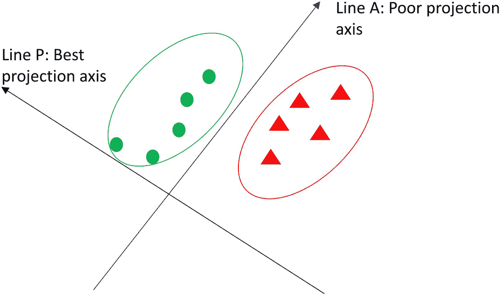

一幅插图展示了最佳投影轴（线 P）和较差的投影轴（线 A）。

图 4-1

LDA 用于分离组

给定一组已按不同组分类的训练数据点集 S，应用 LDA 的三个步骤可简化如下：

步骤 1：通过以下表达式求和组间方差：

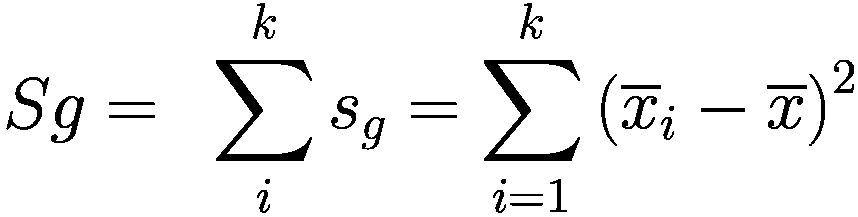

(4-1)

其中 k 是组的数量， 是各组均值的均值，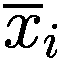 是单个组的均值。

步骤 2：通过以下表达式求和组内方差：

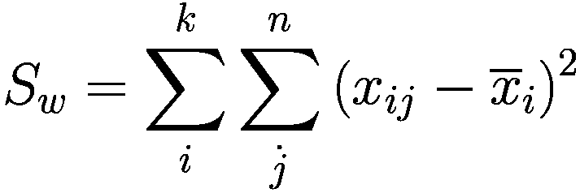

(4-2)

其中 n 是一个组中的数据点数量。

步骤 3：`P` 是最佳投影线性函数，使得 Sg(P)/Sw(P) 最大化。由于 `P` 由 (`w`[`1`]`,w`[`2`]`,...,w`[`n`]`,b`) 定义，LDA 的模型构建阶段就是求解 (`w`[`1`]`,w`[`2`]`,...,w`[`n`]`,b`)。这在公式 (4-3) 中解释：

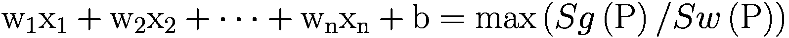

(4-3)

可以首先应用最小二乘法来求解 (`w`[`1`]`,w`[`2`]`,...,w`[`n`]`,b`)。然后，我们可以使用 Excel 规划求解进一步优化 (`w`[`1`]`,w`[`2`]`,...,w`[`n`]`,b`)。


## 求解器

Excel 求解器是一款优化工具。它通过调整决策变量的值，来搜索最大值、最小值或精确的目标值。求解器是一个内置的加载项程序，无需下载即可安装。请按照以下说明，将求解器与数据分析加载项一同安装：

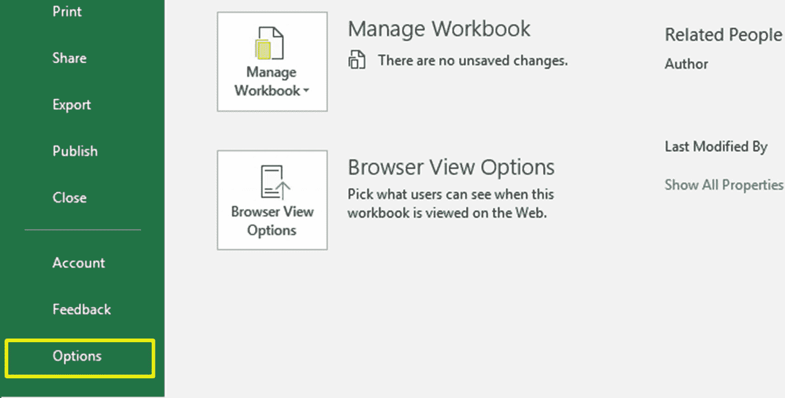

屏幕显示一个菜单，其中包含打印、共享、管理工作簿、导出等选项，允许用户与其工作簿进行交互和自定义。

图 4-2

单击文件 ➤ 选项

1.  打开一个空白 Excel 文件。

2.  单击文件 ➤ 选项。选项链接位于底部，如图 4-2 所示。

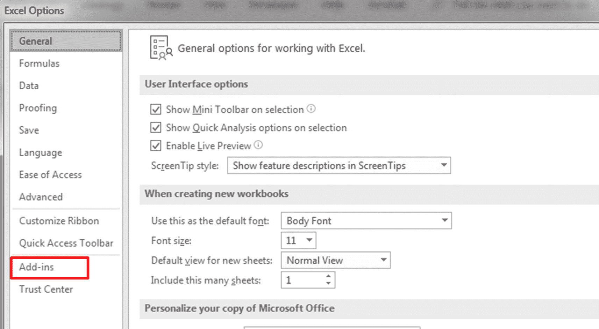

屏幕显示 Excel 选项，包含常规 Excel 使用、公式、数据、校对、保存选项、语言偏好、辅助功能、高级设置以及 Microsoft Office 中功能区与工具栏的自定义等设置。其中“加载项”被高亮显示。

图 4-3

单击加载项

1.  单击加载项，如图 4-3 所示。

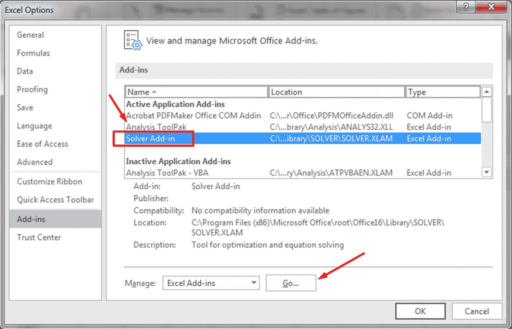

窗口屏幕显示“查看和管理 Microsoft Office 加载项”窗口，高亮显示“规划求解加载项”及其文件位置，并用箭头指示“转到”按钮。

图 4-4

选择规划求解加载项并单击转到

1.  在出现的菜单中，选择规划求解加载项，然后单击“转到...”按钮，如图 4-4 所示。同时，也选择分析工具库并单击“转到...”按钮。

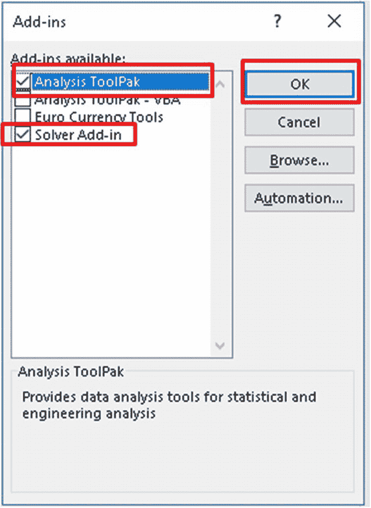

屏幕显示加载项，包括分析工具库和规划求解加载项，右侧有一个“确定”按钮。

图 4-5

添加规划求解和分析工具库

1.  单击“确定”按钮，如图 4-4 所示。随后会出现一个小菜单，如图 4-5 所示。确保“规划求解”和“分析工具库”都已勾选。单击“确定”按钮。

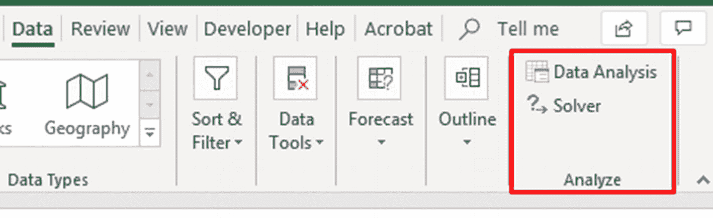

菜单栏截图，高亮显示“数据分析”和“规划求解”。

图 4-6

规划求解现已可用

1.  单击主选项卡“数据”；“数据分析”和“规划求解”均可用，如图 4-6 所示。

## 通过 Excel 学习 LDA

Chapter4-1a.xlsx 包含著名的鸢尾花数据集，它是进行 LDA 实践的绝佳样本。在鸢尾花数据集中，四个属性 x1、x2、x3 和 x4 是一些用于确定鸢尾花类型（即目标变量）的花卉特征。这是训练数据集。请注意，目标变量有三个不同的值，即目标变量有三个类别。请按照以下说明操作：

1.  打开 Chapter4-1a.xlsx；在单元格 F1 中输入“y”（不含引号）。

2.  在单元格 K1、K2 和 K3 中，分别输入 0、1 和 2。

3.  在单元格 L1、L2 和 L3 中，分别输入 Iris-setosa、Iris-versicolor 和 Iris-virginica。我们的工作表如图 4-7 所示。

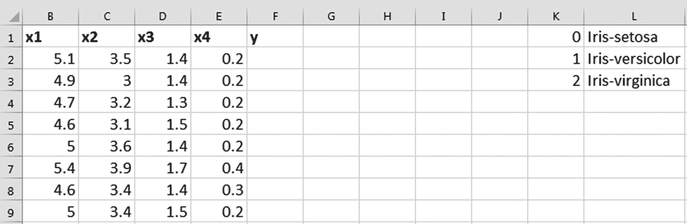

屏幕截图显示一个 Excel 工作表，数据排列在 B 列到 K 列以及第 1 行到第 9 行，包含数值和标签 Iris setosa、versicolor 和 virginica。

图 4-7

鸢尾花数据集和表格设置

我们想先利用最小二乘法来获得线性函数 P。因此，我们需要先将分类值转换为数值。单元格 K1:L3 定义了 0 ➤ Iris-setosa，1 ➤ Iris-versicolor，2 ➤ Iris-virginica。

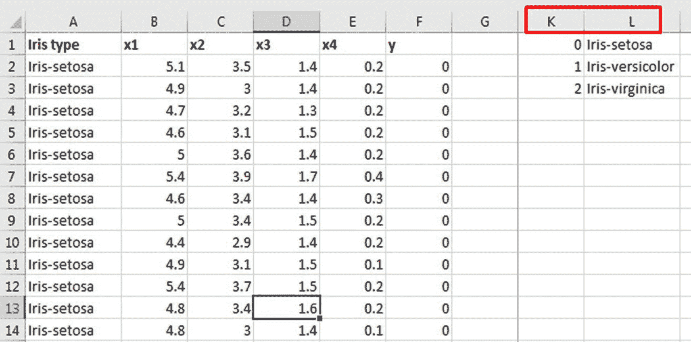

屏幕截图显示一个包含 9 列和 14 行的 Excel 数据。它高亮显示了 K 列和 L 列。

图 4-8

分类后的鸢尾花数据集

1.  在单元格 F2 中，输入以下公式：

```
    =IF(A2=L$1,K$1,IF(A2=$L$2,K$2,K$3))
    ```

2.  将单元格 F2 自动填充到 F151（共有 150 个数据点）。我们的工作表应如图 4-8 所示。

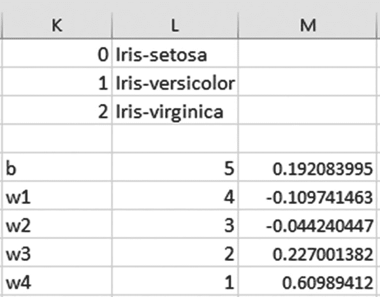

Excel 工作表截图显示 3 列和 9 行，K 列包含值 b、w1、w2、w3、w4，L 列包含值 5 到 1，M 列包含从 -0.1 到 0.6 的值。

图 4-9

使用最小二乘法获取函数系数

1.  在单元格 K5:K9 中，分别输入 b、w1、w2、w3 和 w4。这些代表线性函数 P 的系数（权重）和截距。

2.  在单元格 L5:L9 中，分别输入 5、4、3、2 和 1。我们将利用 INDEX 和 LINEST 函数来查找线性函数 P 的系数和截距。LINEST 函数返回一个包含五个元素的数组。数组中元素的顺序是 w4、w3、w2、w1 和 b。

3.  在单元格 M5 中，输入公式：

```
    =INDEX(LINEST(F$2:F$151,B$2:E$151,TRUE,TRUE),1,L5)
    ```

4.  将单元格 M5 自动填充到 M9。我们工作表的一部分应如图 4-9 所示。单元格 M5:M9 包含线性函数 P 的系数。下一步是应用 P 来获取每个数据点的预测值。我们将这些预测值存储在 G 列中。

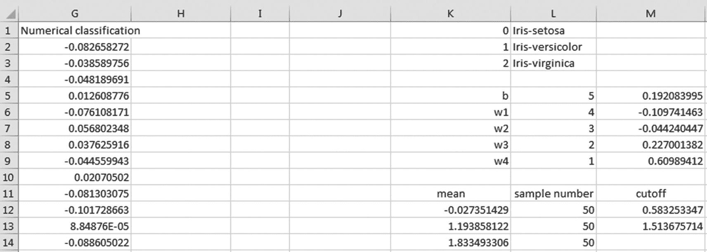

屏幕截图显示一个包含 14 行和 7 列的 Excel 表格。列标签为 G、H、I、J、K、L 和 M，表格包含与鸢尾花分类相关的数值，以及与变量 w1、w2、w3 和 w4 相关的值。

图 4-10

计算出的分界点

1.  在单元格 G1 中输入“数值预测”。在单元格 G2 中，输入以下公式：

```
    =MMULT(B2:E2, M$6:M$9)+ M$5
    ```

此公式表示表达式 w[1]x[1] + w[2]x[2] + …+ w[n]x[n] + b。由于 B2:E2 是水平数组，而 M6:M9 是垂直数组，因此两个数组的乘法只能通过执行类似矩阵乘法的 MMULT 函数来实现。类似的函数 SUMPRODUCT 在此处不适用。此公式可以用一个更繁琐的公式（不推荐）替代：

```
    =M$6*B2+M$7*C2+M$8*D2+M$9*E2+M$5
    ```


2.  自动填充单元格 G2 至 G152。一旦我们获得了每个数据点的预测值，下一步需要找到临界值，以便将每个预测值分类到特定的鸢尾花类型中。

3.  在单元格 K11、L11 和 M11 中，分别输入“均值”、“样本数量”和“临界值”（不含引号）。

4.  在单元格 K12 中，输入以下公式：

```
    =AVERAGEIFS(G$2:G$151,F$2:F$151,K1)
    ```

此公式计算 Iris-setosa 预测值的均值。

5.  自动填充 K12 至 K14。Iris-versicolor 和 Iris-virginica 的预测值均值分别存储在单元格 K13 和 K14 中。

6.  在单元格 L12 中，输入公式：

```
    =COUNTIFS(F$2:F$151,K1)
    ```

此公式统计训练数据集中 Iris-setosa 的数量。

7.  自动填充 L12 至 L14。单元格 L13 和 L14 分别存储 Iris-versicolor 和 Iris-virginica 的数量。

8.  在单元格 M12 中，输入公式计算第一个临界值：

```
    =(K12*L12+K13*L13)/(L12+L13)
    ```

9.  自动填充 M12 至 M13。不要自动填充到单元格 M14。基于这两个临界值，每个预测数值都可以转换为一种鸢尾花类型。工作表的一部分如图 4-10 所示。

1.  在单元格 H1 中，输入“类型分类”。

2.  在单元格 H2 中，输入以下公式，然后从 H2 自动填充至 H152：

```
    =IF(G2<M$12,L$1,IF(G2<M$13,L$2,L$3))
    ```

此公式将 G 列中的每个数值转换为一种鸢尾花类型。快速浏览结果即可发现，大多数鸢尾花类型都被正确分类。

3.  要统计有多少个鸢尾花数据点被错误分类，请在单元格 I1 中输入“差异”。

4.  在 I2 中，输入以下公式：

```
    =IF(A2=H2,0,1)
    ```

此公式将已知的鸢尾花类型与分类后的鸢尾花类型进行比较。如果发现不匹配，则返回 1。

5.  自动填充单元格 I2 至 I152。

6.  选中单元格 K16 和 L16，合并这两个单元格，并在合并后的单元格中输入文本“差异 =”。

7.  在单元格 M16 中，输入公式 `=SUM(I2:I151)`。公式的一部分应如图 4-11 所示。

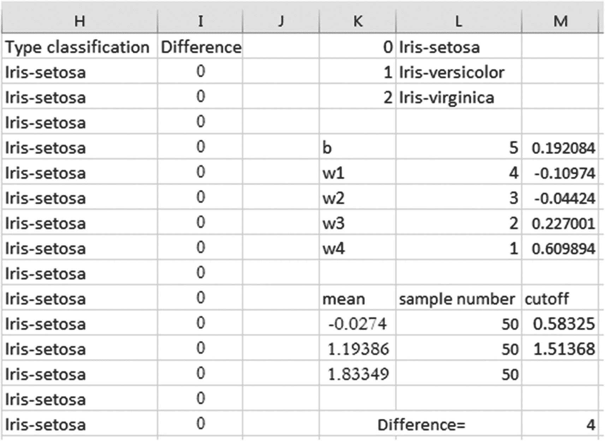

一张 Excel 表格截图，显示 14 行和 7 列。表格包含诸如类型分类、差异、均值、样本数量和临界值等标签。

图 4-11

对鸢尾花训练数据集的 LDA 分析

本次 LDA 分析相当成功，尽管仍有四个鸢尾花数据点被错误分类。请注意，数据挖掘方法在训练数据集上遗漏少量数据点是常见现象。然而，一般来说，我们不应使用同一训练数据集来评估模型性能的好坏。一个在相同训练数据集上实现完美分类或预测的模型可能暗示过拟合，这意味着模型过于针对训练数据，但很可能在未知的评分数据上失效。

如果在单元格 K1:L3 中，我们将 Iris-virginica 赋值为 0，Iris-versicolor 赋值为 1，Iris-setosa 赋值为 2，将会得到非常相似的结果。但是，如果在单元格 K1:L3 中，我们将 Iris-virginica 赋值为 0，Iris-setosa 赋值为 1，Iris-versicolor 赋值为 2，就会发现分类结果完全混乱。这是在 Excel 中进行 LDA 分析的一个缺点。

构建好第一个模型（即找到初始线性函数 P）后，我们可以根据 x1、x2、x3 和 x4 预测鸢尾花类型。我们可以在文件 Chapter4-1b.xlsx 的工作表 iris-LINEST 中查看这些预测结果。

方程 (4-3) 要求最大化 Sg/Sw 的比值。为此，我们需要使用规划求解。请注意，我们可以直接使用规划求解获得优化后的参数集，而无需先使用 LINEST。然而，在 LDA 中，在应用规划求解之前先使用最小二乘法是一个好主意。

*通过以下分步说明继续学习：*

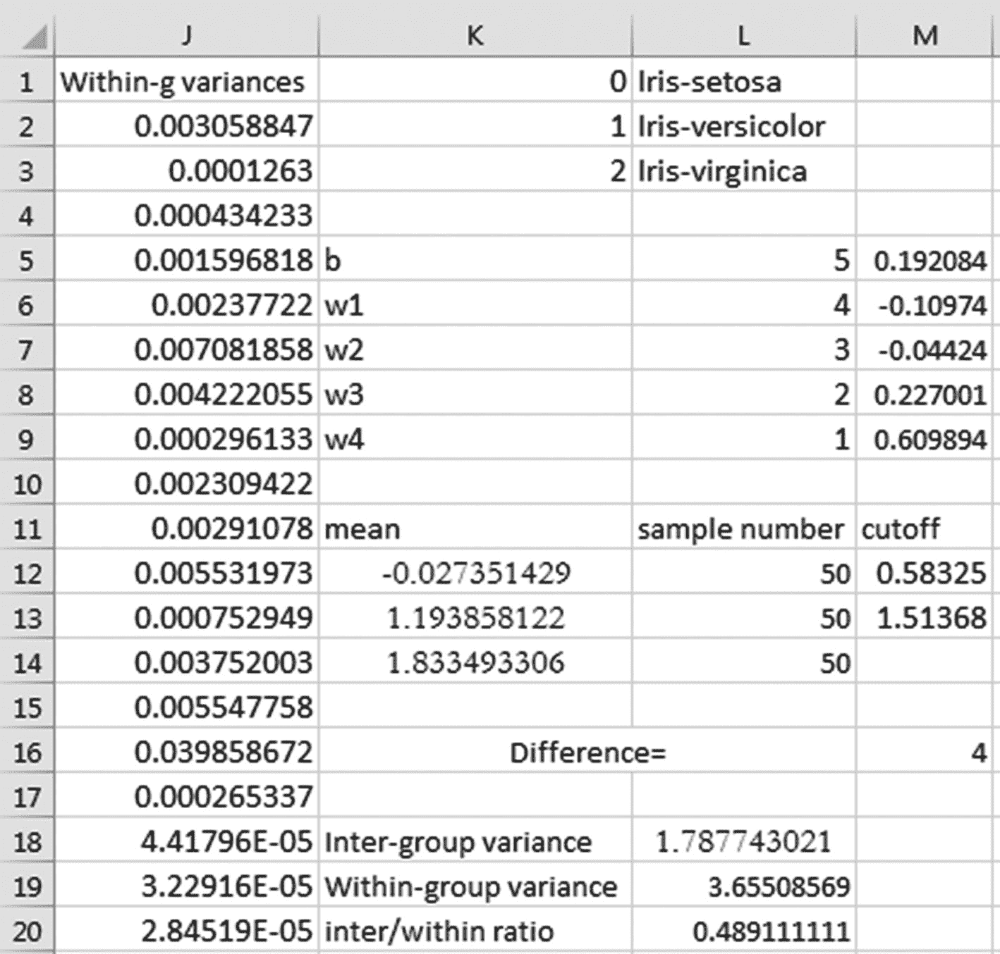


一张 Excel 表格截图显示了 20 行和 4 列。表格中包含组内方差、差值、均值、样本数量和临界值等标签。

图 4-12

计算方差

1.  在单元格 K18、K19 和 K20 中，分别输入“组间方差”、“组内方差”和“组间/组内比率”。

2.  在单元格 L18 中输入以下公式：

```
    =(K12-AVERAGE(K12:K14))²+(K13-AVERAGE(K12:K14))²+(K14-AVERAGE(K12:K14))²
    ```

此公式计算各组均值之间的方差，即公式(4-1)中所示的 Sg。该值越大，表示各组之间的可分离性越高。注意，单元格 K12、K13 和 K14 引用的是组内均值。

3.  在计算组内方差之前，我们必须先计算每个数据点在其所属组内的方差。在单元格 J1 中输入“组内方差”，然后在单元格 J2 中输入以下公式：

```
    =IF(F2=K$1,(G2-K$12)²,IF(F2=K$2, (G2-K$13)²,(G2-K$14)²))
    ```

在此公式中，F 列用于确定每个数据点属于哪个组。请注意，F 列代表每个数据点所属的真实组。LDA 是一种监督分类方法；此处使用 F 列比使用 G 列更准确。如果 F2 = K1，则通过表达式`(G2-K12)²`计算相应数据点的组内方差。如果不是但 F2 = K2，则通过表达式`(G2-K13)²`计算方差；否则，使用表达式`(G2-K14)²`。

4.  自动填充单元格 J2 至 J152。

5.  在单元格 L19 中输入公式`=SUM(J1:J152)`。这是公式(4-2)中所示的*S*[*w*]值。

6.  在单元格 L20 中输入公式`=L18/L19`。这是需要通过规划求解最大化的 Sg(P)/Sw(P)值。至此，我们的工作表部分内容如图 4-12 所示。

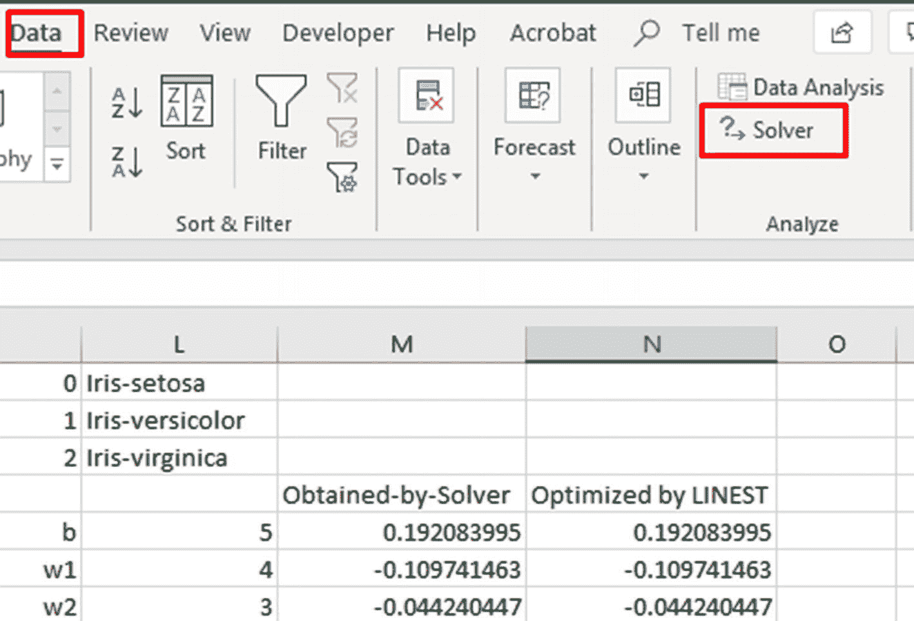

一张 Excel 表格截图，菜单中高亮显示了数据和规划求解选项。

图 4-13

使用 Excel 规划求解

1.  仅将单元格 M5:M9 的内容以数值形式复制到单元格 N5:N9。记得使用 Excel 的“选择性粘贴”功能。我们将使用规划求解来优化单元格 M5:M9 中的这些值。在此之前，我们想先复制一份，以便在使用规划求解后能看出变化。此时，查看单元格 L18 和 L19 中的值，并尝试记住它们。

2.  单击菜单选项卡“数据”；找到如图 4-13 所示的规划求解。

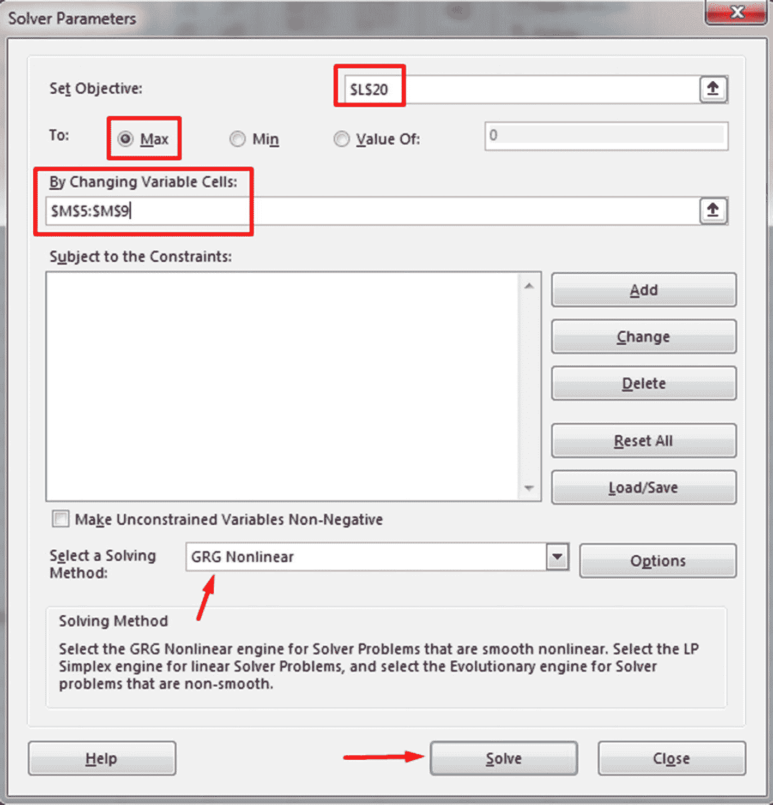

规划求解参数对话框截图，高亮显示了$L$20、最大值和通过更改可变单元格$M$5:$M$9。两个箭头指向 GRG 非线性及求解按钮。

图 4-14

使用 Excel 规划求解优化函数 P 的参数

1.  单击规划求解。在出现的菜单中，严格按照图 4-14 所示指定值。设置目标指示要优化的值。在此例中，我们需要最大化 L20 中的值。规划求解被要求通过更改单元格 M5:M9 中的值来最大化 L20。选择的求解方法是 GRG 非线性。

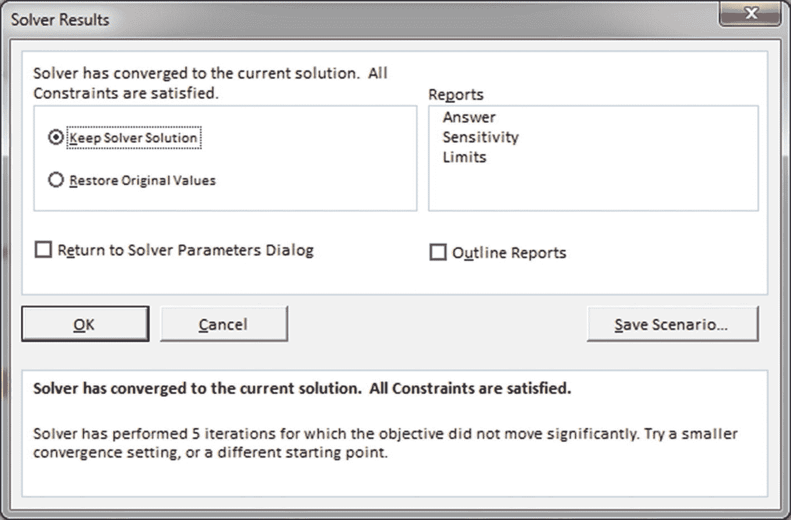

显示规划求解结果对话框的屏幕截图，表明规划求解已收敛到当前解，且满足所有约束。

图 4-15

保留规划求解的解

1.  单击求解后，在出现的菜单上单击确定，如图 4-15 所示。

单元格 M5:M9 中的值已更改，单元格 M16 中的值从 4 变为 2。如图 4-16 所示。

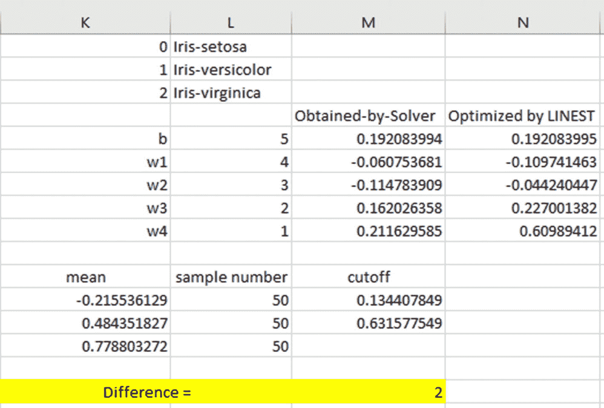

一张 Excel 表格截图，包含 4 列和 16 行。标签为均值、样本数量、临界值、由规划求解获得和由 LINEST 优化。

图 4-16

规划求解进一步改进了 LDA 模型

尽管新的参数集略微改善了分类结果，但我们需要密切关注单元格 K12:K14 和 L18:L20 中发生的变化，如图 4-17 所示。显然，组间方差显著减小，但组内方差减小得更多。

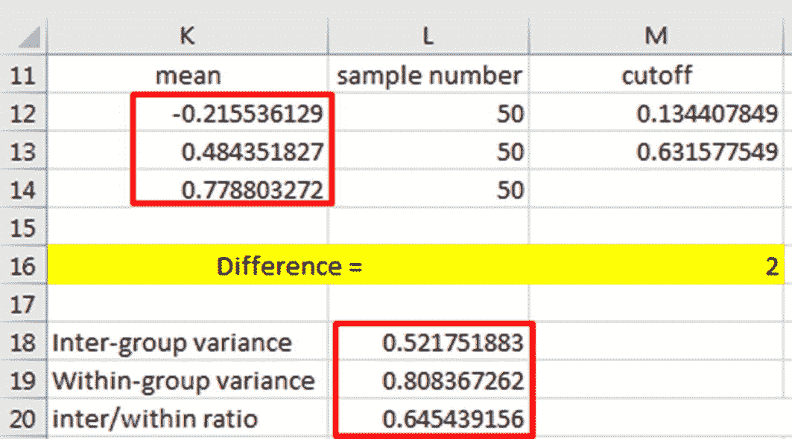

一张 Excel 表格截图，包含 3 列和 10 行。标签为均值、样本数量和临界值，差值为 2，组间方差、组内方差和组间/组内比率的值为高亮显示的 0.52、0.8 和 0.65。

图 4-17

关注参数

为了评估我们的模型有多好，我们需要对模型进行交叉验证，并学习接收者操作特征（ROC）曲线分析。这将是下一章的主题。

## 强化练习

请打开文件 Chapter4-HW.xlsx，并尝试其中的 LDA 练习。如果遇到任何困难，请参考名为 Chapter4-HW-withAnswers.xlsx 的 Excel 文件。

## 复习要点

1.  LDA 的基本理解

2.  规划求解，包括其安装和使用

3.  Excel 函数 INDEX 和 LINEST

4.  Excel 函数 IF、MMULT、COUNTIFS 和 AVERAGEIFS

