# 5. 交叉验证与ROC

请从`https://github.com/hhohho/Learn-Data-Mining-through-Excel-2`下载本章练习所需的示例 Excel 文件。

## 交叉验证的总体理解

预测模型在成功应用于评分数据之前，必须经过验证。使用与测试数据集相同的训练数据集来评估构建的模型，并不是一种好的模型验证方法。这种验证策略被称为残差分析。它比较实际输出与预测输出之间的差异（即所谓的残差）。在第 4 章中，我们应用残差分析来评估所构建的 LDA 模型的质量。

残差分析无法判断模型在评分数据（即未来目标值未知的数据）上的表现。一种解决方案是保留部分原始训练数据集作为测试子集。在许多情况下，测试子集也被称为验证子集，尽管它们可以进一步区分。在本书中，我们将它们视为等同。由于模型未使用测试子集进行训练，因此该测试子集可以充当评分数据集，并告诉我们模型在未知数据上的表现如何。这种验证策略称为交叉验证。

交叉验证有几种策略。最简单的是留出法，它将原始训练数据集分为两个子集：训练子集和测试子集。模型在训练子集上训练，但在测试子集上评估。这种方法比残差分析更可靠，但其性能在很大程度上取决于训练子集和测试子集中包含哪些数据，即如何划分原始训练数据集会显著影响模型性能。机器学习领域的一个共识是，训练子集应大于测试子集，通常至少是测试子集的两倍。此外，在保证测试子集中有足够的数据点来评估模型的前提下，训练子集应尽可能大。

K 折交叉验证是留出法的一种改进版本。在 K 折交叉验证中，原始训练数据被随机分成 k 个子集，然后进行 k 次留出评估。在每次留出评估中，一个子集被用作测试数据进行验证；所有其他 k-1 个子集被组合在一起用于训练。在 K 折交叉验证中，每个数据点在测试子集中被使用一次，但在训练子集中被使用 k-1 次。模型的性能基于这 k 次评估的整体质量。

一种广泛使用的交叉验证方法是留一法（LOO），它是 K 折交叉验证的一种极端形式。在 LOO 中，每次测试数据只包含一个数据点；其余的数据点被组合在一起作为训练子集。

## 通过 Excel 学习交叉验证

当数据集很大时，如果不涉及 VBA 编程，在 Excel 中进行 LOO 交叉验证是不切实际的。事实上，在 Excel 中进行 K 折交叉验证也非常繁琐。因此，我将仅演示如何使用 Excel 进行留出法交叉验证。不过，文件`Chapter5-cv-1c.xlsx`提供了一个使用 LDA 进行五折交叉验证的演示。

在上一章中，我们学习了如何对鸢尾花数据集进行线性判别分析。在本章中，鸢尾花数据集已被分为两个子集：训练子集和测试子集。使用随机算法选取大约三分之二的数据点作为训练数据集，其余作为测试数据集。

打开文件`Chapter5-cv-1a.xlsx`。其中有两个工作表：`training_dataset`（包含 103 条数据记录）和`testing_dataset`（包含 47 条数据记录）。按照我们在上一章中学到的关于 LDA 的知识，让我们利用函数`LINEST`在`training_dataset`工作表中找到函数`P`的参数集（`w[1]`, `w[2]`, …`w[n]`, `b`）。我们的工作表应如图 5-1 所示。请注意，训练数据集中只有 103 个数据点。

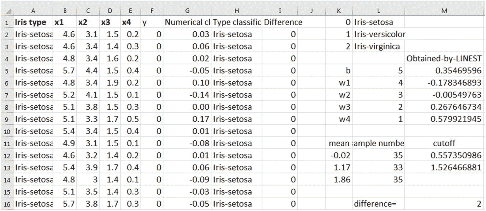

图 5-1

在训练数据集上应用 LDA

同样，LDA 在鸢尾花数据集上表现良好。只有两个错误预测。然而，图 5-1 中的验证结果是通过残差分析获得的。

请按照以下说明在 Excel 中完成交叉验证过程：

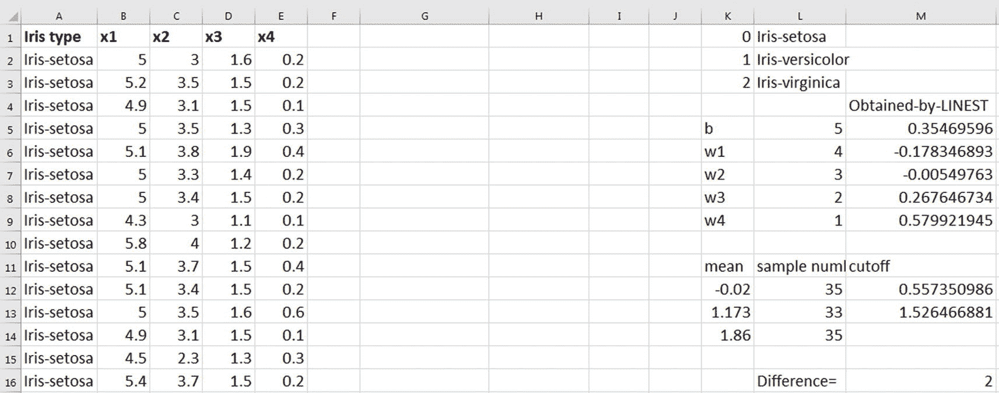

图 5-2

将 LDA 参数集复制到测试工作表

1. 在`training_dataset`工作表中，参数集（`w[1]`, `w[2]`, …`w[n]`, `b`）存储在单元格`M5:M9`中，而截止值由单元格`M12`和`M13`引用。选择单元格`K1:M16`并复制它们。
2. 单击`testing_dataset`工作表将其打开。
3. 在`testing_dataset`工作表中，右键单击单元格`K1` ➤ 应用“选择性粘贴”功能将值粘贴到单元格`K1`中。请记住仅粘贴值。

我们的`testing_dataset`工作表应如图 5-2 所示。

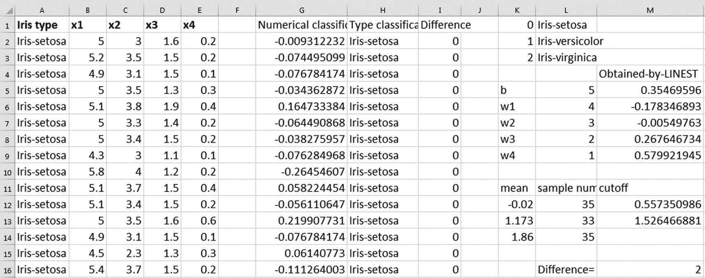

图 5-3

使用测试数据集进行交叉验证

1. 在单元格`G1:I1`中，分别输入“数值分类”、“类型分类”和“差异”。
2. 在单元格`G2`中，输入以下公式：
```
=MMULT(B2:E2, M$6:M$9)+ M$5
```
3. 从`G2`自动填充到`G48`。
4. 在单元格`H2`中，输入以下公式：
```
=IF(G2<M$12,L$1,IF(G2<M$13,L$2,L$3))
```
5. 从`H2`自动填充到`H48`。
6. 在单元格`I2`中，输入公式`=IF(A2=H2,0,1)`，按 Enter 键，然后从`I2`自动填充到`I48`。
7. 最后，在单元格`M16`中，输入公式`=SUM(I2:I48)`。

到目前为止，我们的`testing_dataset`工作表应如图 5-3 所示。上述过程将训练数据集获得的参数集（包括系数、截距和分界点）应用于测试数据集，并比较了实际的鸢尾花类型（A 列）与预测类型（H 列）。有两个样本预测错误。由于训练数据集和测试数据集之间没有共同的数据点，因此通过测试数据集进行的这种验证是真正的交叉验证。

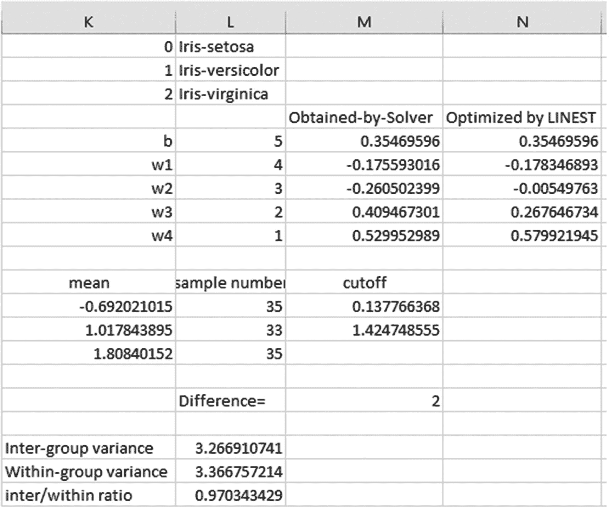

图 5-4

在训练数据集中通过求解器获得的参数集

1. 我们当然可以进一步优化`training_dataset`工作表中的 LDA 模型。按照上一章学到的步骤，将求解器应用于训练数据集。

回顾上一章，使用求解器优化模型后，“组间方差”显著减小。然而，在处理这个较小的训练数据集时，应用求解器优化模型后，“组间方差”显著增大。这是一个很好的例子，说明数据样本在数据挖掘中确实很重要。部分结果如图 5-4 所示。

2. 将参数集应用于测试子集（将`training_dataset`工作表中经求解器优化的`M5:M9`单元格的值复制到`testing_dataset`工作表中）。
3. 在`L16`单元格中输入“交叉验证遗漏数 =”。在`L17`单元格中输入“交叉验证准确率 =”，并在`M17`单元格中输入公式`=1-M16/47`。我们的结果如图 5-5 所示。

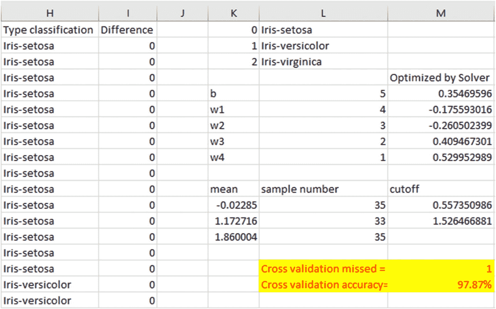

图 5-5

使用测试数据集进行交叉验证

完整结果可在文件`Chapter5-cv-1b.xlsx`中找到。

请记住，在交叉验证中，仅使用原始训练数据集的一部分来构建模型，而其余部分则用于测试模型性能。一旦确认数据挖掘方法（例如 LDA）具有可接受的性能，最好基于整个原始训练数据集，使用 LDA 方法生成最终模型（或参数集）。

## ROC 分析概述

受试者工作特征（ROC）曲线分析是另一种常用的评估模型性能的方法。与交叉验证不同，ROC 分析仅适用于目标变量恰好有两个不同值的情况，例如真与假，或阳性与阴性。因此，ROC 分析不能用于评估前述的鸢尾花数据集 LDA 模型。

ROC 分析广泛应用于生物医学模型评估中，其中诊断测试必须确定样本对于某种疾病是阳性还是阴性。以下场景有助于解释 ROC 分析的应用。

# ROC 分析概念与 Excel 实践

假设我们的研究发现某些血液特征与识别某种特定疾病有很好的相关性。我们将这些特征命名为 `C1`、`C2`、`C3` 和 `C4`，将疾病命名为 `D`。我们基于 `C1`、`C2`、`C3` 和 `C4` 开发了一个 `LDA` 模型，用于判断患者是否患有该疾病。一个完美的模型能够在大量人群中清晰地区分患病组和未患病组。不幸的是，由于分类错误，现实中并不存在清晰的区分。在患病组中，有些人被正确分类为阳性（真阳性，或 `TP`），而有些人被错误分类为阴性（假阴性，或 `FN`）。类似地，在未患病组中，有些人被正确分类为阴性（真阴性，或 `TN`），而有些人被错误分类为阳性（假阳性，或 `FP`）。通过调整分界点或其他相关的评估指标，`TP`、`FN`、`FP` 和 `TN` 的数量会发生变化。

以下概念对于理解和应用 ROC 分析至关重要：

*   **灵敏度** 是指当疾病存在时，测试结果为阳性的概率。它也被称为真阳性率，定义为 `TP / (TP + FN)`。它仅衡量测试能够正确分类的患病个体的百分比。

*   **特异度** 是指当疾病不存在时，测试结果为阴性的概率。它也被称为真阴性率，计算公式为 `TN / (TN + FP)`。它仅衡量测试能够正确分类的未患病个体的百分比。

*   **假阳性率** 是指当疾病不存在时，测试结果为阳性的概率。假阳性率 = 1 - 特异度。

*   **阳性预测值** 是指当测试结果为阳性时，疾病存在的概率，表示为 `TP / (TP + FP)`。

*   **阴性预测值** 是指当测试结果为阴性时，疾病不存在的概率，表示为 `TN / (TN + FN)`。

考虑一种极端情况：测试将每个个体都判定为阳性。在这种情况下，`FN = 0` 且 `TN = 0`，特异度 = 0，但灵敏度 = 100%。

在另一种极端情况下，当测试将每个个体都判定为阴性时，特异度 = 100%，而灵敏度 = 0。

通过调整分界点，灵敏度和特异度都会发生变化。在大多数情况下，我们会观察到当灵敏度上升时，特异度会下降。一个好的模型会有一个分界点，使得灵敏度和特异度都保持较高水平。然而，某些测试可能更强调高阳性预测值或高阴性预测值。

## 通过 Excel 学习 ROC 分析

文件 `Chapter5-roc-1a.xlsx` 中的数据是模拟的。在该文件中，`TP`、`FN`、`FP` 和 `TN` 会随着不同截断值的变化而变化，如图 5-6 所示。虽然文件中有 19 条记录，但图 5-6 仅显示了 11 条记录。第 8 至 15 行被隐藏了。

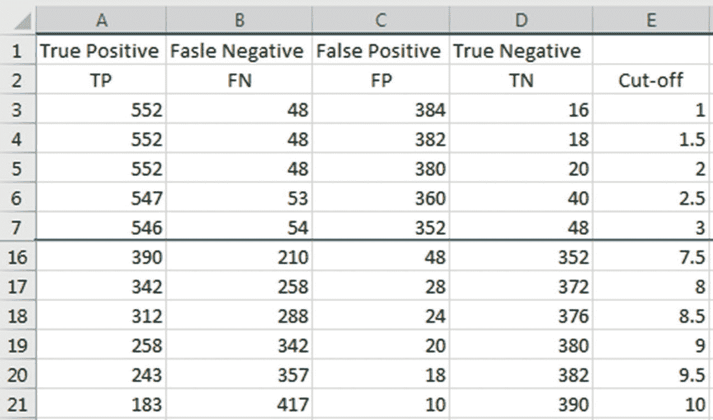

电子表格展示了真阳性、假阴性、假阳性、真阴性和截断值下的一组数值。在第 7 行处画了一条线。截断值的范围是从 1 到 7，步长为 0.5。

图 5-6 `Chapter5-roc-1a.xlsx` 训练数据集

我们想要绘制一张图表，以观察敏感度和特异度如何随不同截断值而变化。请遵循以下说明：

1.  分别在单元格 `F2` 和 `G2` 中输入“敏感度”和“特异度”。

2.  在单元格 `F3` 中，输入公式 `=A3/(A3+B3)`。此公式计算截断值 = 1 时的敏感度。从 `F3` 自动填充到 `F21`。

3.  在单元格 `G3` 中，输入公式 `=D3/(C3+D3)`。此公式计算截断值 = 1 时的特异度。从 `G3` 自动填充到 `G21`。

4.  选中单元格区域 `E2:G21`；点击菜单选项卡“插入” ➤ “图表” ➤ 选择“带平滑线和数据标记的散点图”。工作表中会出现一个散点图。

5.  我们可以根据需要添加坐标轴标题和图表标题。默认情况下，垂直轴的最大边界值为 1.2。我更喜欢将其设置为 1.0，因此我双击数值 1.2，然后在弹出的“坐标轴选项”菜单中将其更改为 1.0。

我们的图表可能类似于图 5-7（包含相关数据）。请注意，两条曲线在某一点相交。该交点标记了一个截断值，在此值下敏感度等于特异度。

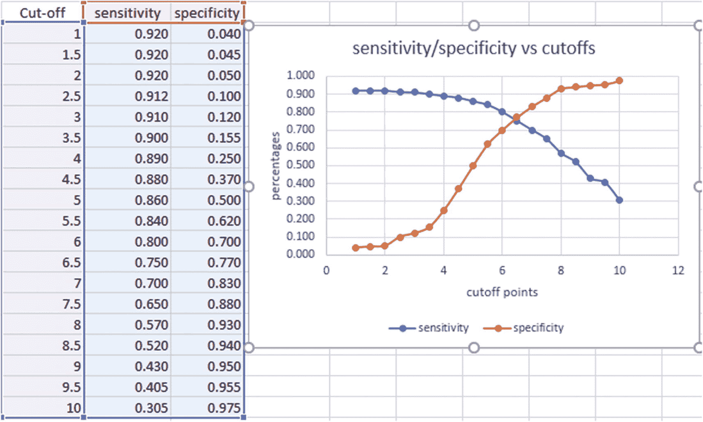

电子表格展示了截断值、敏感度和特异度下的一系列数值。折线图表示敏感度和特异度相对于截断点的百分比。敏感度呈下降趋势，特异度呈上升趋势。两者在中间相交。

图 5-7 敏感度/特异度 vs. 截断值

下一步是绘制 ROC 曲线。ROC 曲线是以假阳性率为横轴、真阳性率为纵轴绘制的，即 1-特异度 vs. 敏感度。为了更易于查看，所有数值都乘以了 100。因此，ROC 曲线实际上是 `(100-100*特异度)` vs. `(100*敏感度)`。

在 ROC 曲线图中，X 轴是 `100-特异度`。因此，特异度值应按降序排列。由于当前的特异度值是升序排列的，我们需要将特异度值翻转。相应地，我们也需要翻转敏感度值。继续遵循以下说明：

6.  选中单元格区域 `E2:G21`；使用“选择性粘贴”将数值仅粘贴到单元格 `A25`。

7.  选中单元格区域 `A25:C44`；点击菜单选项卡“数据” ➤ “排序”。

8.  在弹出的菜单中，按“截断值”排序，顺序为“从大到小”，如图 5-8 所示。确保勾选“数据包含标题”。点击“确定”。

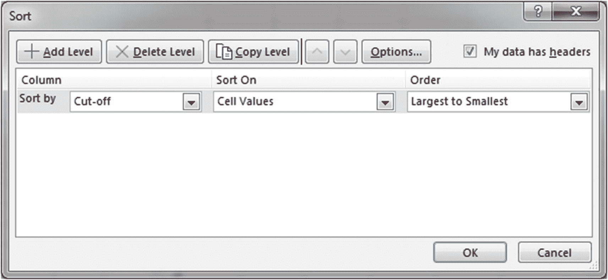

一个标题为“排序”的对话框截图。它展示了按列名“截断值”根据单元格数值从大到小排序的选项。

图 5-8 按截断值排序数据

我们工作表的一部分看起来像图 5-9。

Excel 可以仅对选中的单元格进行排序，同时保持其他所有单元格不变。这是 Excel 的一个强大功能。如果待排序的单元格包含引用排序区域外其他单元格的公式，排序可能会打乱某些计算。这就是为什么我们需要先按值复制 `E2:G21`，然后再对复制的值进行排序。

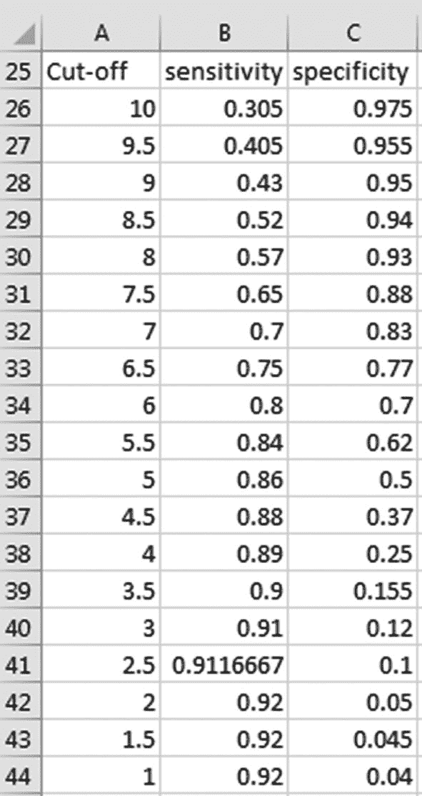

一个电子表格截图，展示了截断值、敏感度和特异度下的一系列数值。截断值范围从 1 到 10，间隔为 0.5。数值按降序排列。

图 5-9 翻转后的数据

我们还需要对数据进行缩放。继续遵循以下说明：

9.  在单元格 `D25` 中输入“100-特异度”，在单元格 `E25` 中输入“敏感度”。

10. 在单元格 `D26` 中，输入公式 `=100-ROUND(C26*100,0)`。此公式将现有的特异度值乘以 100，进行四舍五入，然后用 100 减去该结果。

11. 从单元格 `D26` 自动填充到 `D44`。

12. 在单元格 `E26` 中，输入公式 `=ROUND(100*B26,0)`。

13. 从单元格 `E26` 自动填充到 `E44`。

14. 右键单击行号 26，选择“插入”。此操作会插入一个空白行。原来的单元格 `D26` 现在变成了 `D27`。

15. 在单元格 `D26` 和 `E26` 中都输入 0。

我们工作表的一部分应该看起来像图 5-10。

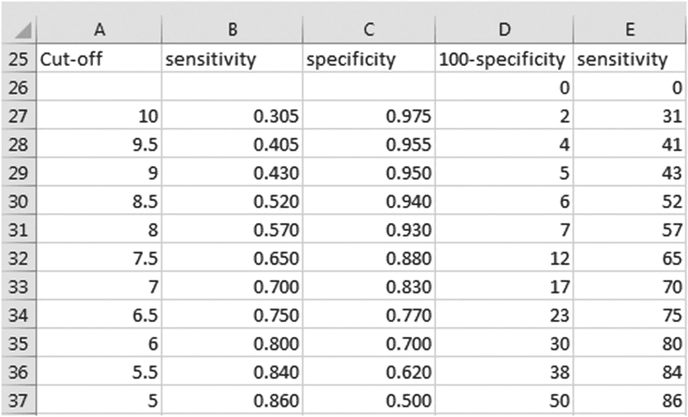

一个电子表格展示了截断值、敏感度、特异度、100-特异度和敏感度的一系列数值。从下到上，截断值范围从 5 到 10，间隔为 0.5。

图 5-10 为 ROC 曲线设置数据

现在是绘制 ROC 曲线的最后一步：

16. 选中单元格区域 `D25:E45`。

17. 点击菜单选项卡“插入” ➤ “图表” ➤ “带平滑线的散点图”。

18. 根据需要添加图表标题和坐标轴标题。我们的 ROC 图表可能类似于图 5-11。

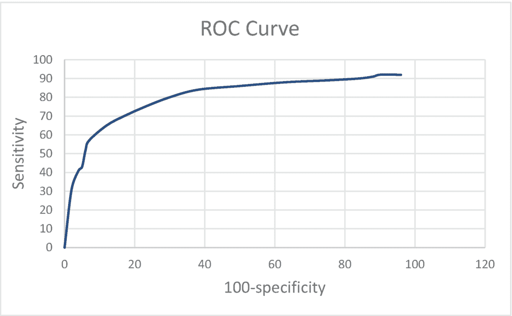

一条敏感度相对于 100-特异度的 ROC 曲线，呈上升趋势。曲线从原点开始，大致延伸到 (95, 91) 点。

图 5-11 ROC 曲线

### ROC 曲线下面积

ROC 曲线下面积的大小衡量了模型的质量。面积值越大，表明模型可以同时具有良好的敏感度和特异度。在一个完美模型中，敏感度和特异度都是 100%。这意味着，当 `100-特异度` 等于 0 时，敏感度为 100%。换句话说，一个完美模型的 ROC 曲线会经过左上角点。然而，这种情况很少发生。

文件 `Chapter5-roc-1b.xlsx` 展示了前述练习的结果。

本章到此结束。为什么我们需要在学习其他数据挖掘方法之前先学习交叉验证和 ROC 呢？嗯，一旦我们掌握了交叉验证和 ROC 的知识，我们就可以在学习其他数据挖掘方法时实践它们。本章之后，我们将学习逻辑回归、K-近邻、朴素贝叶斯、决策树等。在某个时候，我们可能想要评估我们的模型有多好，那时我们就可以实践交叉验证和/或 ROC 曲线分析了。

## 强化练习

本章有两个强化练习，一个关于交叉验证，一个关于 ROC 曲线分析。建议将两个练习都完成以巩固你的理解。你应该能找到这两个强化练习对应的四个 Excel 文件：

1.  `Chapter5-HW-CrossValidation.xlsx`

2.  `Chapter5-HW-CrossValidation-Answers.xlsx`

3.  `Chapter5-roc-HW.xlsx`

4.  `Chapter5-roc-HW-withAnswers.xlsx`

## 复习要点

1.  残差分析

2.  测试数据集

3.  交叉验证的留出法

4.  K 折交叉验证和留一法交叉验证

5.  什么是 ROC

6.  真阳性、假阳性、真阴性和假阴性

7.  敏感度和特异度

8.  ROC 曲线

9.  Excel 技巧和函数：
    1.  排序
    2.  散点图

3. 函数 `IF`、`ROUND` 和 `MMULT`