# 6. 逻辑回归

请从 `https://github.com/hhohho/Learn-Data-Mining-through-Excel-2` 下载本章练习所需的示例 Excel 文件。

## 总体理解

当预测结果为分类变量时，逻辑回归可被视为线性回归的一种特例。如果只有两种结果，逻辑回归称为二项逻辑回归，这是最常见的形式。如果结果多于两种，则称为多项逻辑回归。本章我们将学习如何在 Excel 中进行二项逻辑回归。

二项逻辑回归也可被视为 LDA 的一种特例，但其实现数据组间良好可分性的机制与 LDA 不同。

逻辑回归的名称源于模型中使用了逻辑函数。方程（6-1）展示了逻辑函数的一般形式（其中 `a`、`b` 和 `c` 均为正数）。

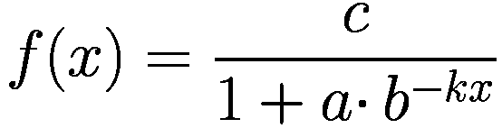

(6-1)

著名的 Sigmoid 函数是逻辑函数的一种特例。

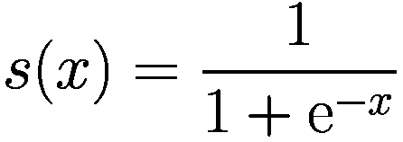

(6-2)

逻辑回归是一种统计模型，能够估计事件发生的概率。设 1 表示事件发生，0 表示事件未发生。因此，`P(1)` 是事件发生的概率，`P(0) = 1 - P(1)`。注意，概率必须介于 0 和 1 之间（含端点）。最后，`P(1)/(1-P(1))` 是事件发生的优势比。

假设事件的发生依赖于变量 `x[1]`、`x[2]`、⋯、`x[n]`。在逻辑回归中，认为优势比的对数是 `x[i]` 的线性函数，如方程（6-3）所示。

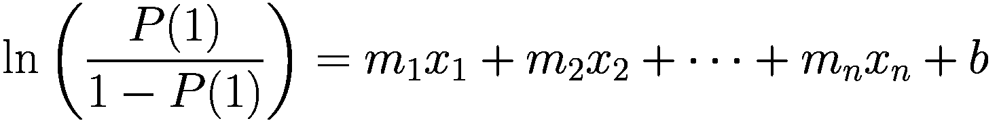

(6-3)

求解 `P(1)`，我们可以得到如方程（6-4）所示的逻辑函数。

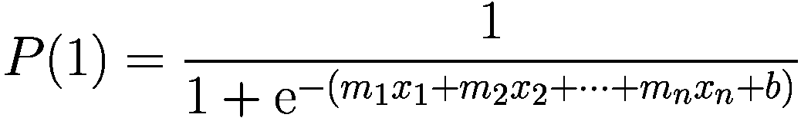

(6-4)

逻辑回归并非通过优化系数 `m[1]`、`m[2]`、⋯、`m[n]`、`b` 来最大化 `P(1)` 的概率（这里我们将 `b` 视为一个系数；稍后我们会知道，在机器学习领域 `b` 也被称为“偏置”）。相反，它试图最大化每个数据样本对应的似然。那么什么是似然？简单来说，似然是一个样本与实际事件结果（1 或 0）相匹配的概率。还是不明白？让我用一个例子来解释什么是似然。

假设训练数据集中有两个数据记录 A 和 B。A 的事件发生了，即其事件结果为 1；B 的事件未发生，即其事件结果为 0。通过逻辑函数，计算得到 A 的 `P(1)` 为 0.8，B 的 `P(1)` 为 0.6。由于 A 的实际事件结果为 1，因此 A 的似然就是事件发生的概率，即 `P(1) = 0.8`。另一方面，由于 B 的实际结果为 0，其似然是事件不发生的概率，即其匹配的事件结果为 0。因此，B 的似然是 `P(0)` 而非 `P(1)`，且 `P(0) = 1 – P(1) = 0.4`。

逻辑回归试图最大化所有样本的整体似然。通过最大化似然，逻辑回归实现了两组之间的良好可分性。在实现中，通常使用似然的对数，无论是自然对数还是以 10 为底的对数。对数的优势在于，当预测的似然偏离实际事件结果时，无论实际事件结果是 1 还是 0，对数都会迅速减小。因为当似然为 0 时，计算 `log(0)` 会导致错误。因此，`log(0)` 被当作一个预定义的最小值来处理。

在实现中，逻辑回归也可以通过最小化似然的对数损失来实现。对数损失是似然对数的相反数。因此，当实际结果为 1 时，对数损失计算为 `-log(P(1))`；当实际结果为 0 时，对数损失计算为 `-log(1-P(1))`。这里，`log(0)` 被当作一个预定义的最大值来处理。注意，当预测的似然偏离实际事件结果时，对数损失会迅速增加。图 6-1 展示了事件结果为 1 时的对数损失。这里，`log(0)` 被预定义为 0.000001。

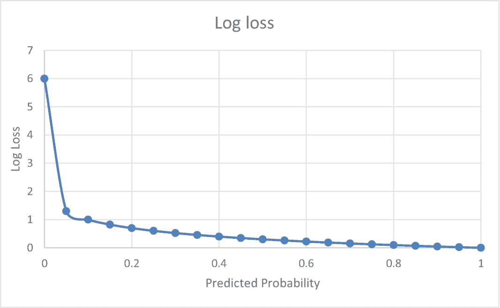

一张对数损失与预测概率关系的折线图，呈现下降趋势。该线经过坐标点 (0, 6)、(0.2, 0.8)、(0.4, 0.5)、(0.6, 0.2) 和 (0.8, 0.1)。数值为近似值。

图 6-1

事件 = 1 时对数损失的计算

基于此理解，我们进行逻辑回归的方法是：首先使用线性回归获得一组系数，然后应用规划求解来优化这些系数，要么最大化整体似然，要么最小化整体对数损失。

## 通过 Excel 学习逻辑回归

文件 `Chapter6-1a.xlsx` 和 `Chapter6-2a.xlsx` 中的数据相同。它们模拟了以下场景：

> 假设有五个基因，其表达水平可用于预测某种癌症患者五年生存概率。值 1 表示患者存活了五年，0 表示未存活。

如前所述，在我们的逻辑回归实践中，我们将应用规划求解来优化模型参数（系数），要么最大化整体似然，要么最小化整体对数损失。

### 通过最大化对数似然

请打开文件 `Chapter6-1a.xlsx`，其中包含 87 个样本，工作表顶部有 4 个空白行。这些空白行是特意留出的。

我们将再次使用 Excel 函数 `INDEX` 和 `LINEST`，基于最小二乘法获取系数。由于 `LINEST` 返回的第一个值对应基因 5，最后一个值对应系数 `b`，我们需要按图 6-2 所示设置顶部两个空白行。这样设置是为了方便后续的自动填充。

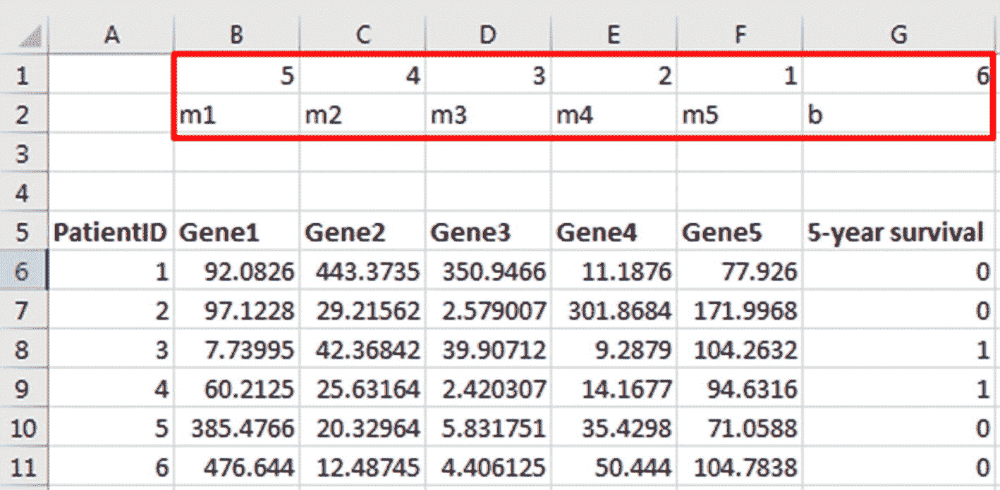

一张电子表格截图，显示了患者 ID、基因 1、基因 2、基因 3、基因 4、基因 5 和 5 年生存率的详细信息。B 列到 G 列顶部的一组值被高亮显示。

图 6-2

为最小二乘法系数设置数据

请按照以下说明在 Excel 中进行逻辑回归练习：

1.  在单元格 `B3` 和 `B4` 中输入以下公式：

    ```
    =INDEX(LINEST($G$6:$G$92,$B$6:$F$92),1,B1)
    ```

    在两个单元格中输入相同公式的原因是，我们希望保留一组系数不变，同时让另一组系数能被规划求解修改。

    注意，`LINEST` 函数中的“known_ys”参数是单元格 `$G$6:$G$92`，这些单元格只有两个值：1 和 0。这表明，如果我们的原始目标值不是 1 和 0，则必须将其归类为此类。

2.  将 `B3` 自动填充至 `G3`，并将 `B4` 自动填充至 `G4`。

3.  在单元格 `H5` 中输入文本“m1x1+m2x2+…+b”。H 列代表方程 (6-3) 的右侧表达式。

4.  在单元格 `H6` 中输入以下公式，并自动填充至单元格 `H92`：

    ```
    =SUMPRODUCT($B$4:$F$4,B6:F6)+$G$4
    ```

    函数 `SUMPRODUCT` 计算两个数组的乘积。注意，单元格引用 `B4`、`F4` 和 `G4` 使用了绝对引用。

5.  在单元格 `I5` 中输入文本“P(1)”。I 列代表基于 H 列值计算出的五年生存概率。

6.  在单元格 `I6` 中输入以下公式，并自动填充至单元格 `I92`：

    ```
    =1/(1+EXP(0-H6))
    ```

    该公式实现了方程 (6-4)。`(0-H6)` 表示 −(`m[1]x[1] + m[2]x[2] + ⋯ + m[n]x[n] + b`)，而 `EXP(0-H6)` 代表 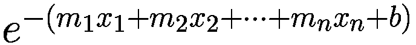。函数 `EXP` 返回常数 `e`（自然对数的底数）的幂。至此，工作表的一部分应如图 6-3 所示。

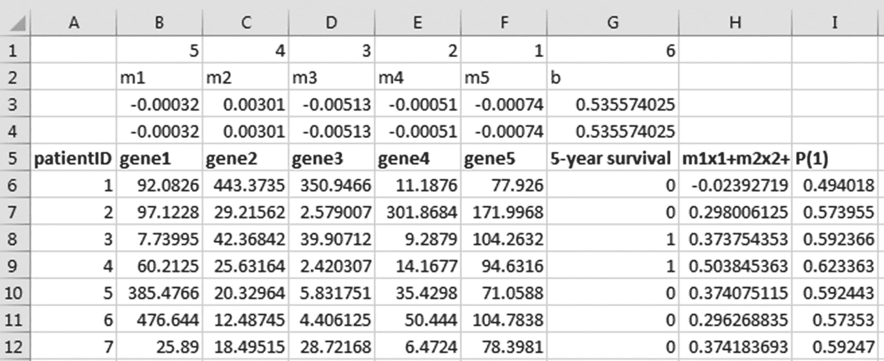

一张电子表格截图，显示了 7 个患者 ID 的基因 1、基因 2、基因 3、基因 4、基因 5、5 年生存率、m1x1 + m2x2 和 P(1) 的详细信息。顶部标出了两组值，分别对应 m1 到 m5 以及 b。

图 6-3

计算出的 P(1)

此时，了解最小二乘法生成的系数在区分两组患者（存活超过五年和未存活超过五年）方面的效果会很有趣。

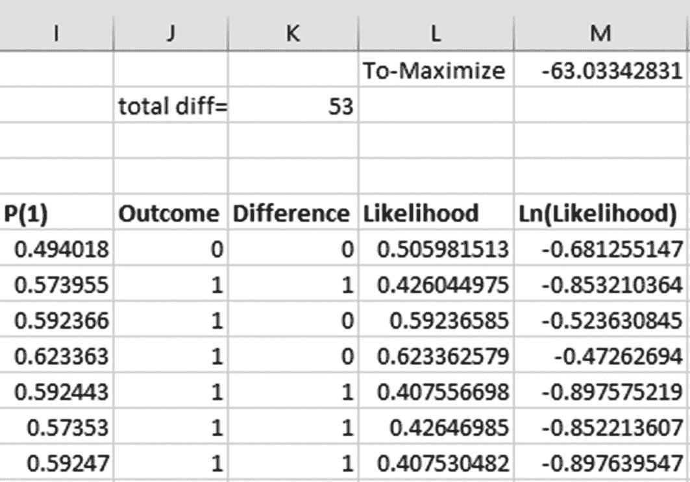

一张电子表格截图，显示了 P(1)、结果、差异、似然和对数似然的值。在表格顶部，J 列表示总差异的公式，K 列的值为 53，L 列显示文本“待最大化”，M 列的值为 -63.03342831。

图 6-6

计算出的似然

7. 在单元格 J5 中输入“结果”，并在单元格 J6 中输入公式 `=IF(I6>0.5,1,0)`。该公式规定，如果 I 列的概率大于 0.5（此处 0.5 为临界值），则患者的预测结果为 1，否则为 0。

8. 从单元格 J6 自动填充至单元格 J92。

9. 在单元格 K5 中输入“差异”，并在单元格 K6 中输入公式 `=IF(G6=J6,0,1)`。该公式断言，如果 J 列中的预测结果与 G 列中的实际结果匹配，则返回 0；否则返回 1。

10. 从单元格 K6 自动填充至单元格 K92。

11. 在单元格 J2 中输入“总差异=”，并在单元格 K2 中输入公式 `=SUM(K6:K92)`。通过统计数组 K6:K92 中 1 的个数，我们可以知道有多少预测与实际结果不匹配。

    注意，单元格 K2 中的值为 53。这表明 87 个样本中有 53 个被错误分类。如图 6-4 所示，该图显示了当前工作表的一部分。

    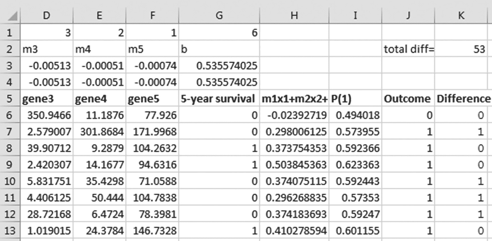

    图 6-4 检查临时分类结果

如果你的工作表结果与图 6-4 所示不同，请仔细检查公式，尤其是单元格 H6:K6 中的公式。图 6-5 显示了到目前为止输入的一些公式。请确保你的公式与图 6-5 中的一致。

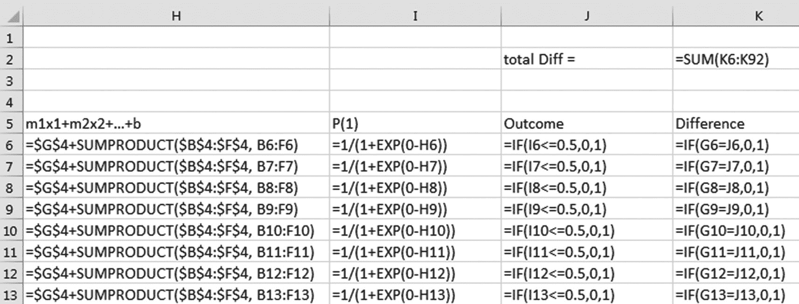

图 6-5 检查到目前为止输入的公式

12. 继续，在单元格 L5 中输入“似然”。

13. 在单元格 L6 中输入 `=IF(G6=1,I6,1-I6)`。该公式断言，如果实际结果为 1，则似然为 `I6`；否则，似然为 `1–I6`。

14. 从单元格 L6 自动填充至单元格 L92。

15. 我们需要将所有似然值视为一个整体。有多种方法可以做到这一点，例如对 L6:L92 中的所有值求和，或计算 L6:L92 的乘积。我在这里要介绍的是每个似然值的对数之和。在单元格 M5 中输入文本“Ln(似然)”。

16. 在单元格 M6 中输入公式 `=IF(L6=0, -1000000, LN(L6))`，然后从单元格 M6 自动填充至单元格 M92。此处，当似然为 0 时，预定义的最小值为 -1000000。

17. 在单元格 L1 中输入“待最大化”。

18. 在单元格 M1 中输入公式 `=SUM(M6:M92)`。单元格 M1 存储了将由规划求解最大化的值。

    工作表的一部分应如图 6-6 所示。

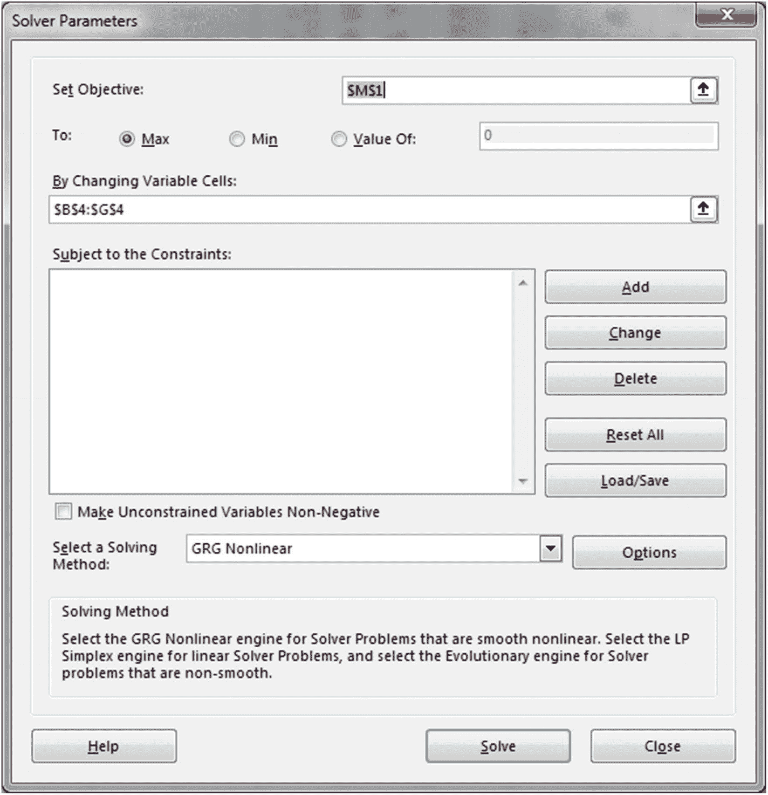

图 6-7 使用规划求解最大化似然

1. 下一步是使用规划求解最大化单元格 M1 中的值。选择单元格 M1 ➤ 单击主选项卡“数据” ➤ 单击“规划求解”。

2. 出现一个菜单，供我们选择适当的单元格并设置要求。按照图 6-7 进行操作：
    1. 为“设置目标”选择单元格 $M$1。
    2. 为“通过更改可变单元格”选择 $B$4:$G$4。
    3. 如图 6-7 所示，选择“最大值”。
    4. 选择求解方法“GRG 非线性”。注意，“使无约束变量为非负数”复选框未被选中。

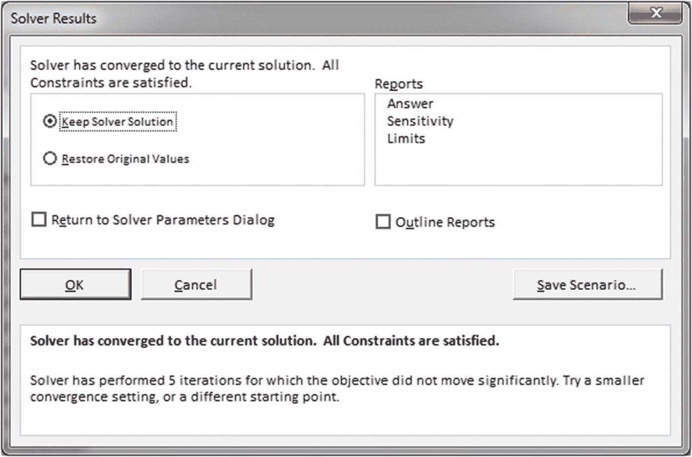

图 6-8 保留规划求解的解

1. 单击“求解”按钮。会弹出另一个菜单，确保在其中选中“保留规划求解的解”，如图 6-8 所示。

错误分类的样本数量减少到 12 个，如图 6-9（单元格 K2）所示。请注意，单元格 B4:G4 内的值已更改，即由规划求解优化，以最大化单元格 M1 内的值。它们与单元格 B3:G3 内的值不同。

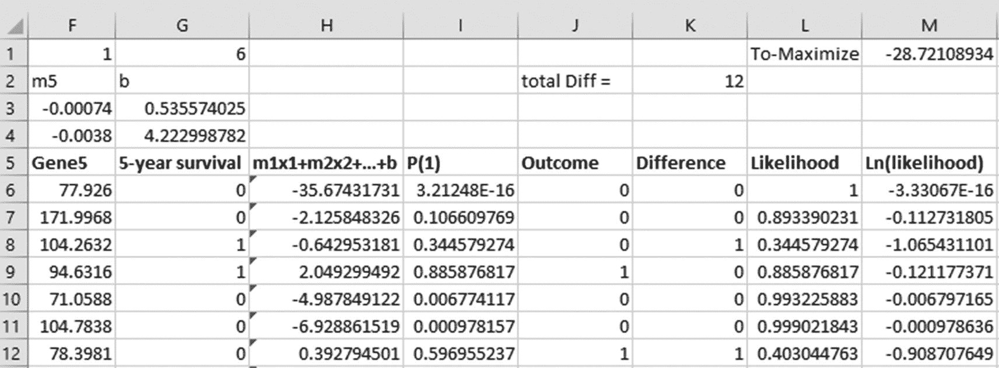

图 6-9 通过最大化对数似然进行逻辑回归的结果

回顾第 15 步，我提到我们可以用不同的方式计算单元格 M1 中的值。例如，我们可以在单元格 M1 中输入公式 `=SUM(L6:L92)` 或 `=PRODUCT(L6:L92)`，或者将 M6:M92 中的 `LN` 函数替换为 `LOG` 函数，然后使用规划求解通过优化单元格 B4:G4 中的系数来最大化 M1 中的值。我想挑战你尝试这些公式，并将你的结果与本书中使用的方法进行比较。你也可以尝试其他方法。

上述过程存储在文件 chapter6-1b.xlsx 中。Chapter6-1b.xlsx 还包含 A1:J101 中的一些评分数据。请查看一下，以便你确信如何将构建的逻辑回归模型应用于评分数据。再次强调，模型只是一组参数。在这个特定案例中，参数集位于 B4:G4 中。

### 通过最小化对数损失

“损失函数”是机器学习中非常常见的短语。它是什么？嗯，我们在线性回归中已经使用过它。在线性回归中，使用最小二乘法来最小化预测误差，通常称为均方误差或二次损失，即预测值与实际值之差的平方和（参见公式 2-1）。这里，公式 2-1 是一个真正的损失函数。因此，我们可以说，损失函数只是一个数学函数，用于量化机器学习方法中预测值与实际值之间的误差。确实，在这个意义上，我们可以将“损失”理解为“误差”。

一般来说，机器学习中有两种类型的损失：回归损失和分类损失。公式 2-1 是一种回归损失。我们在前面第 11 步中使用的“总差值”，即单元格 K2 中错误分类的样本数量，是一种分类损失。

损失函数通常与优化函数一起工作，优化函数帮助机器学习模型最小化损失。在本书中，我们不会解释优化函数，但我们一直在使用 Excel 规划求解的 GRG 非线性引擎所采用的一种优化函数来最大化目标值。然而，当使用损失函数时，我们希望最小化目标值。

让我们打开文件 Chapter6-2a.xlsx，你会注意到此工作表中的工作已接近完成，如图 6-10 所示。是的，如前所述，对数损失是似然对数的相反数。因此，我们不需要重复计算似然之前的步骤，而是从第 16 步重新开始，为每个似然计算对数损失。

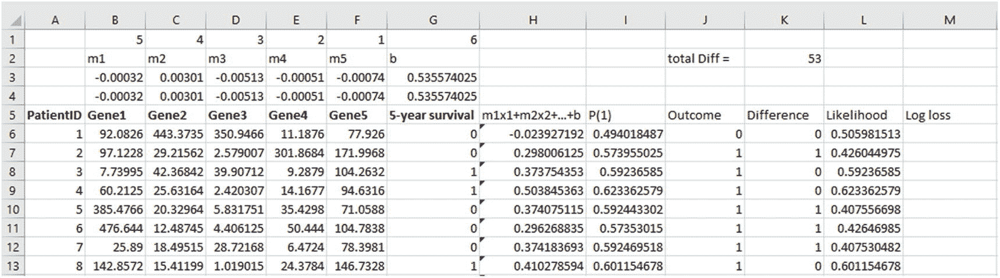

图 6-10 计算对数损失的起点

1. 在单元格 M6 中输入公式 `=IF(L6=0, 1000000, -LN(L6))`，然后从单元格 M6 自动填充到单元格 M92。这里，当似然为 0 时，预定义的最大损失为 1000000。

2. 在单元格 L1 中，输入“待最小化”。

3. 在单元格 M1 中输入公式 `=SUM(M6:M92)`。单元格 M1 存储将由规划求解最小化的值。

4. 下一步是使用规划求解最小化单元格 M1 内的值。选择单元格 M1 ➤ 单击主选项卡“数据” ➤ 单击“规划求解”。

5. 会弹出一个菜单，供我们选择适当的单元格并设置要求。按照图 6-11 进行操作：
    1. 为“设置目标”选择单元格 $M$1。
    2. 为“通过更改可变单元格”选择 $B$4:$G$4。
    3. 选择“最小值”，如图 6-11 所示。
    4. 选择求解方法“GRG 非线性”。

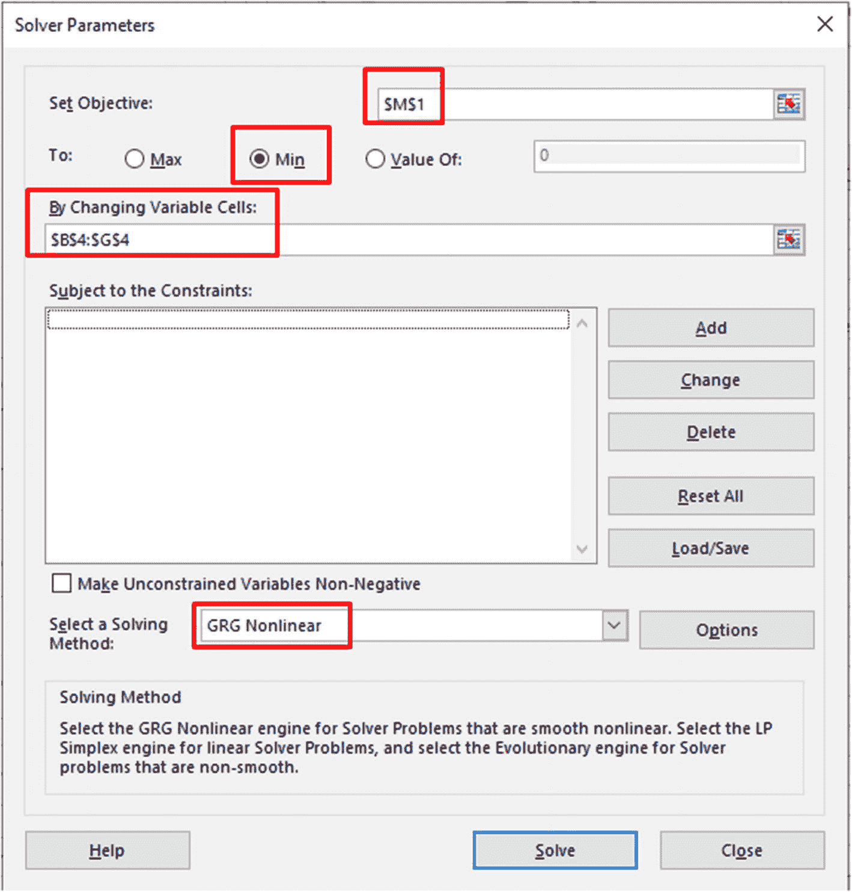

图 6-11 使用规划求解最小化对数损失

6. 单击“求解”按钮。会弹出另一个菜单，确保在其中选中“保留规划求解的解”。

我们工作表的一部分应如图 6-12 所示。

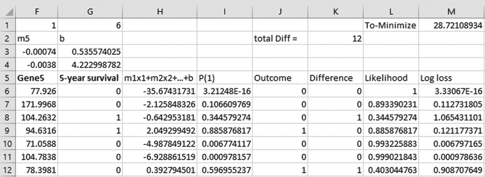

图 6-12 通过最小化对数损失进行逻辑回归的结果

完成的结果可以在 Chapter6-2b.xlsx 中找到。你会注意到，通过对数损失生成的结果与通过似然生成的结果相同。

这总结了另一章。当然，Excel 完全能够执行逻辑回归分析。

## 强化练习

强化练习使用了从 UCI 机器学习库下载的心脏病数据集，网址为 <http://archive.ics.uci.edu/dataset/45/heart+disease>（更多详情请见：[https://doi.org/10.24432/C52P4X](https://doi.org/10.24432/C52P4X)）。

*   `Chapter6-HW-1.xlsx` 用于练习逻辑回归过程。`Chapter6-HW-1-withAnswers.xlsx` 提供了两种解决方案：一种通过最大化对数似然，另一种通过最小化对数损失。

*   `Chapter6-HW-2-cross-validation.xlsx` 提供了一个额外的练习，用于练习交叉验证，因为我们刚刚学习了交叉验证。

*   `Chapter6-HW-2-cross-validation-withAnswers.xlsx` 为交叉验证练习提供了一个参考解决方案。

## 复习要点

1.  逻辑回归的机制

2.  逻辑函数、Sigmoid 函数和优势比

3.  对数优势比是线性函数的假设

4.  似然和对数损失的概念

5.  Excel 函数 `IF`、`INDEX`、`LINEST`、`SUMPRODUCT`、`EXP` 和 `LN`

6.  规划求解的使用