# 7. K 近邻

请从 [`https://github.com/hhohho/Learn-Data-Mining-through-Excel-2`](https://github.com/hhohho/Learn-Data-Mining-through-Excel-2) 下载本章练习所需的示例 Excel 文件。


## 总体理解

人们倾向于根据周围人的建议做出决定或采取行动。在我们的生活中，时常会采纳周围人的建议，尤其是那些与我们关系非常密切的人。数据挖掘方法中的 k 近邻（K-NN）方法，正是这种现实生活场景的体现。这里的 k 表示决策是基于 k 个邻居做出的。例如，在 10000 个已知样本中，当出现一个新案例 A，我们需要预测 A 的结果时，我们会从样本中找到 A 的 11 个（通常为奇数）最近邻居，并根据这 11 个邻居（此处 k=11）的多数结果来预测 A 的结果。在 K-NN 中，具有特定结果的邻居通常被视为对该结果的一票。

在第一章 1 中，我提到本书将数据挖掘和机器学习视为同一概念。谈到机器学习时，有两种类型的学习器（方法）：急切学习器和懒惰学习器。LDA 和逻辑回归都是急切学习器，因为它们首先基于训练数据集构建一个模型，然后将该模型应用于任何未来的数据。这样的模型本质上是一个参数集或规则集。相反，K-NN 是一种懒惰学习器。懒惰学习器不会先构建模型；它不会基于训练数据集生成一组参数或规则。相反，当评分数据输入时，懒惰学习器会利用整个训练数据集来动态地对评分数据进行分类。在 K-NN 的情况下，评分数据点的最近邻居是使用整个训练数据集动态计算得出的。由于没有预先计算好的参数集，K-NN 也是一种非参数数据挖掘方法。

K-NN 的主要工作是确定最近的邻居。给定一个评分数据点 A，什么可以被定义为其最近邻居？换句话说，我们如何衡量邻近度？

衡量邻近度的一种方法是计算两个数据点之间的距离。当我们讨论 k-means 聚类（注意区分 k-means 聚类和 K-NN）时，我们使用了欧几里得距离。当然，我们在这里也可以这样做。事实上，欧几里得距离是 K-NN 中最常用的邻近度度量。

曼哈顿距离和切比雪夫距离有时也用于衡量邻近度。给定两个数据点 (x1, x2, x3) 和 (y1, y2, y3)。这两个数据点之间的曼哈顿距离计算为 |y1 – x1| + |y2 – x2| + |y3 – x3|。

在两个数据点之间，切比雪夫距离是所有属性之间的最大差值。例如，给定两个数据点 (1, 2, 3) 和 (4, 3, 7)。三个差值分别为 |4 – 1| = 3, |3 – 2| = 1, 和 |7 – 3| = 4。切比雪夫距离是 4，因为 4 是最大值。

欧几里得距离、曼哈顿距离和切比雪夫距离适用于数值型数据点。对于离散属性，可以使用汉明距离。给定两个长度相同的字符串，汉明距离计算两个对应符号不同的位置数量。例如，给定两个二进制字符串 10011010 和 11001011，它们的汉明距离是 3。如下所示：

*   1 **0** 0 **1** 1 0 1 **0**

*   1 **1** 0 **0** 1 0 1 **1**

还有其他几种衡量邻近度的方法。在本章中，我们将再次使用欧几里得距离。

## 通过 Excel 学习 K-NN

Chapter7-1a.xlsx 模拟了一个业务场景。一家信用卡公司发起了一项营销活动。该公司希望根据其他类似客户的反应，预测一位给定的新客户 Daisy 是否会接受特定的信用卡优惠。假设已有 200 名客户做出了回应，并且认为年龄、收入和拥有的信用卡数量这三个属性是决定接受可能性的关键因素。

### 实验 1

打开文件 Chapter7-1a.xlsx。E 列存储了已联系人员的回应。数字 1 表示接受优惠，而 0 表示拒绝优惠。如图 7-1 所示，单元格 G1:J9 被高亮显示，我们需要根据不同的 k 值找出 Daisy 可能的回应。

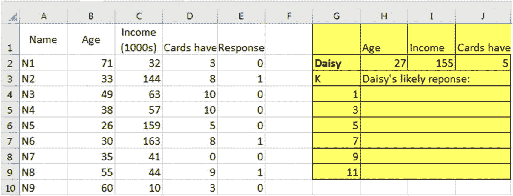

一张电子表格截图，显示了姓名、年龄、收入（千元）、信用卡数量和回应的详细信息。共有 9 行数据。右侧有一个空间，用于输入 27 岁、收入 155、拥有 5 张信用卡的 Daisy 的回应。

图 7-1

K-NN 数据挖掘的数据概览

首要任务是确定如何基于三个属性（年龄、收入和拥有的信用卡数量）计算 Daisy 与任何其他人之间的距离。让我们再次使用欧几里得距离。按照以下说明完成实验 1：

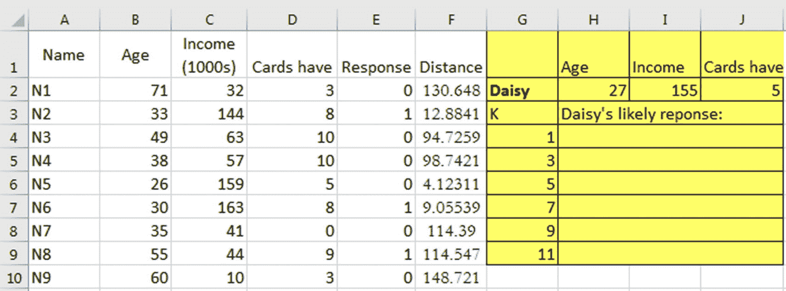

一张电子表格，显示了姓名、年龄、收入（千元）、信用卡数量、回应和距离的详细信息。表格有 9 行。右侧有一个空间，用于输入 27 岁、收入 155、拥有 5 张信用卡的 Daisy 的回应。

图 7-2

用于预测 Daisy 回应的 K-NN 数据

1.  在单元格 F1 中输入“距离”。在单元格 F2 中，输入以下公式：

```
    =SQRT(SUMXMY2(B2:D2, $H$2:$J$2))
    ```

2.  从 F2 自动填充到 F201。我们的工作表部分看起来像图 7-2。

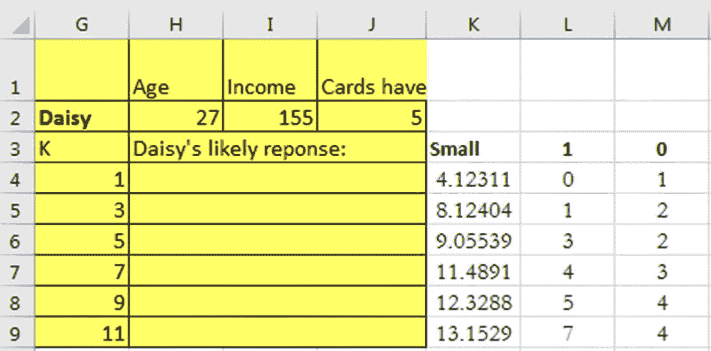

一张电子表格截图，显示了 Daisy 的年龄、收入和信用卡数量的详细信息，以及用于输入回应的空间。K、L 和 M 列代表标签“小”、“1”和“0”下的值列表。

图 7-3

计算对 1 和 0 的投票数

1.  我将使用函数 SMALL 根据给定的 K 值找到最近的邻居。在单元格 K3 中输入“小”，并在单元格 K4 中输入以下公式：

```
    =SMALL(F$2:F$201,G4)
    ```

函数 SMALL 返回数组中第 k 个最小值。由于 G4 = 1，上述公式找到 F2:F201 中的第一个最小值。

2.  从单元格 K4 自动填充到单元格 K9。

以 k=3 为例（对应单元格 G5）：由于 G5 = 3，单元格 K5 中的公式找到 F2:F201 中的第三个最小值。任何与 Daisy 的距离小于或等于单元格 K5 中数值的数据点都是 Daisy 的最近邻居。

3.  在单元格 L3 中输入数字 1，在单元格 M3 中输入数字 0。L 列记录回应为 1 的数量，而 M 列记录回应为 0 的数量。

4.  在单元格 L4 中输入以下公式：

```
    =COUNTIFS($E$2:$E$201,L$3,$F$2:$F$201,"<="&$K4)
    ```

注意，表达式 `"<="&$K4` 被转换为 `"<=4.12311"`。运算符 & 将文本“<=”与单元格 K4 中的值（即 4.12311）连接起来。

5.  从单元格 L4 自动填充到 M4，然后一起自动填充到 L9:M9。

当前结果如图 7-3 所示。

1.  基于 1 和 0 的数量，即接受和拒绝的投票数，Daisy 的回应可以通过以下公式确定，该公式应输入到单元格 H4 中（注意单元格 H4、I4 和 J4 已合并，因此 H4 代表这三个单元格）：

```
    =IF(L4>M4,$L$3,$M$3)
    ```

2.  从单元格 H4 自动填充到单元格 H9。


图 7-4 展示了最终结果。结果表明，当 k 值不同时，基于其“邻居”的多数投票对黛西反应的预测也会不同。请注意，K-NN 是一个概率模型，这意味着它会根据邻居们过去的反应来计算黛西可能做出何种反应的概率。例如，当 k 等于 5（5 是 K 的常见选择）时，K-NN 预测她很可能接受信用卡优惠。她接受的概率是 3/5。不过，她仍有 2/5 的概率拒绝该信用卡优惠。观察发现，当 k=1 时，她拒绝的概率是 100%。然而，这并不能保证她一定不会接受信用卡优惠。

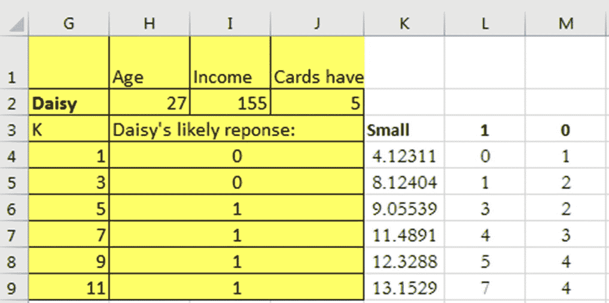

一个电子表格展示了黛西的年龄、收入和持卡数量的详细信息。响应列包含一组 0 和 1 的值。K、L、M 列分别代表标签为 small、1 和 0 下的数值列表。

图 7-4

K-NN 基于不同 K 值预测黛西的反应

不难发现，K 值在 K-NN 模型中至关重要。哪个 K 值最佳尚有争议，但普遍认为 K 最好是一个奇数整数。

如果数据量足够大可以进行交叉验证，那么我们可以计算不同 K 值下的交叉验证误差，并绘制误差与 K 值的关系图。该图应呈 L 形或 U 形，即存在一个拐点。通常最优 K 值位于拐点处（如果是 U 形，则取第一个拐点）。这就是所谓的用于寻找 K-NN 最优 K 值的肘部法或肘部曲线验证技术。

通过 Excel 进行肘部曲线验证是可行的，但并不实用，因此这里不展示具体实现方法。

### 实验 2

在现实生活中，我们往往更重视最信任之人的建议。那么，既然黛西的邻居们与她距离不同，我们是否应该区别对待他们呢？是的，应该如此。例如，我们应该赋予离她更近的邻居的投票更高的权重。

K-NN 的基本概念是，彼此接近的数据点彼此相似，属于同一类别。两个数据点越接近，它们属于同一类别的可能性就越大。相反，两个数据点距离越远，它们属于不同类别的可能性就越大。在为邻居分配权重时，应遵循的规则是：距离越大，投票权重越小。

哪个函数能恰当地将距离因素纳入投票中呢？一个简单的解决方案是使用距离的倒数。然而，当某个邻居与黛西的距离为 0 时，使用倒数会导致错误。为避免此类错误，可以使用一个修正的倒数函数：

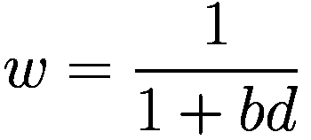

(7-1)

其中 `b` 是一个常数，最好大于或等于 1，`d` 是两个数据点之间的欧几里得距离。

一个更常见的函数采用以下方程形式：

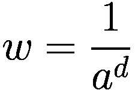

(7-2)

其中 *a* > 1。通常 `a` 被设置为自然对数的底数 `e`。注意，*w* 随着 `d` 的增加呈指数级下降，特别是当 `a` = `e` 时，在这种情况下，距离更近的数据点很容易成为主导投票。

在本实验中，我们采用方程 (7-1) 并设置 `b` = 1。打开 Chapter7-2a.xlsx。该文件中的数据设置如图 7-5 所示。

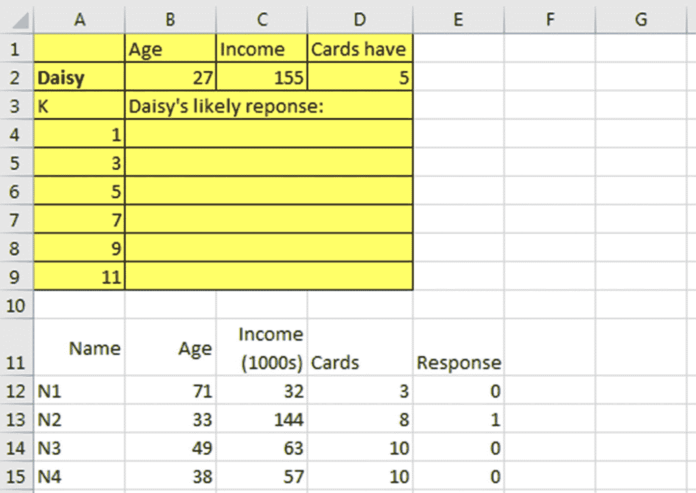

一个电子表格的截图展示了黛西的年龄、收入和持卡数量的详细信息，以及用于输入响应的空格。底部有一个表格，显示了从 N 1 到 N 4 四个名字的年龄、收入、持卡数和响应的详细信息。

图 7-5

加权 K-NN 分析的数据设置

请按照以下说明完成带加权投票的 K-NN 分析：

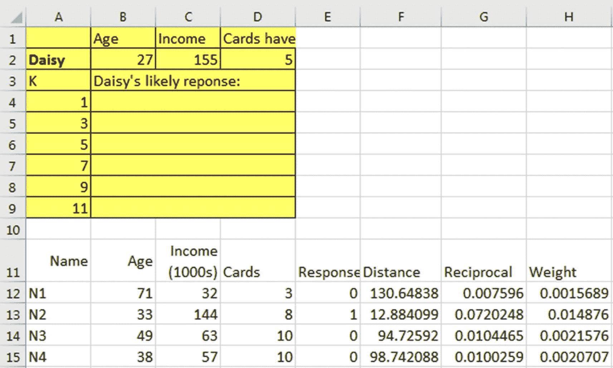

一个电子表格的截图展示了黛西的年龄、收入和持卡数量的详细信息，以及用于输入响应的空格。底部有一个包含 4 行的表格，其中包含姓名、年龄、收入、持卡数、响应、距离、倒数和权重的详细信息。

图 7-6

计算每个邻居投票的权重

1.  在单元格 F11 中输入“Distance”。列 F 中计算每个邻居到黛西的距离。这可以通过在单元格 F12 中输入以下公式，然后从 F12 自动填充到 F211 来实现：

```
    =SQRT(SUMXMY2(B12:D12, B$2:D$2))
    ```

2.  在单元格 G11 和 H11 中，分别输入“Reciprocal”和“Weight”。

3.  在单元格 G12 中，输入公式 `=1/(1+F12)`，然后从 G12 自动填充到 G211。

4.  在单元格 H12 中，输入公式 `=G12/SUM($G$12:$G$211)`。此公式确保 H 列中所有权重的总和为 1。

5.  从 H12 自动填充到 H211。

至此，所有邻居投票的权重已计算完毕，它们与黛西和每个邻居之间的距离成反比。目前，工作表的一部分应如图 7-6 所示。

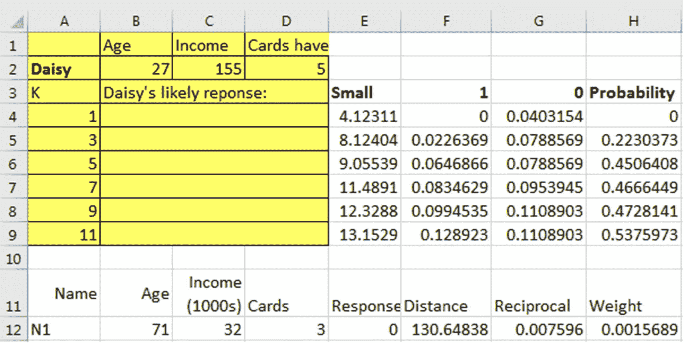

一个电子表格突出显示了黛西的年龄、收入和持卡数量的详细信息。右侧是列标题为 small、1、0 和 probability 下的数值列表。底部显示了姓名 N 1 的年龄、收入、持卡数、响应、距离、倒数和权重的详细信息。

图 7-7

计算加权投票


1.  在单元格 E3、F3、G3 和 H3 中，分别输入“Small”、“1”、“0”和“Probability”，如图 7-7 所示。

2.  在单元格 E4 中，输入公式 `=SMALL(F$12:F$211,A4)`，并从 E4 自动填充到 E9。

3.  在单元格 F4 中，输入以下公式：

```
    =SUMIFS($H$12:$H$211,$E$12:$E$211, F$3,$F$12:$F$211,"<="&$E4)
    ```

4.  从 F4 自动填充到 G4，然后从 F4 自动填充到 F9，以及从 G4 自动填充到 G9。

5.  在单元格 H4 中，输入公式 `=F4/SUM(F4:G4)`。单元格 H4 中的值即为当 k=1 时的接受概率。

6.  从 H4 自动填充到 H9。

至此，工作表的一部分应如图 7-7 所示。

1.  现在是对黛西的响应进行分类的时候了。在单元格 B4 中输入公式 `=IF(H4>0.5,"Yes","No")`。

2.  从 B4 自动填充到 B9。

我们的结果应如图 7-8 所示。当然，通过 K-NN 模型中的加权投票，我们比之前更有信心认为黛西可能会拒绝信用卡优惠。完整结果可在文件 Chapter7-2b.xlsx 中找到。

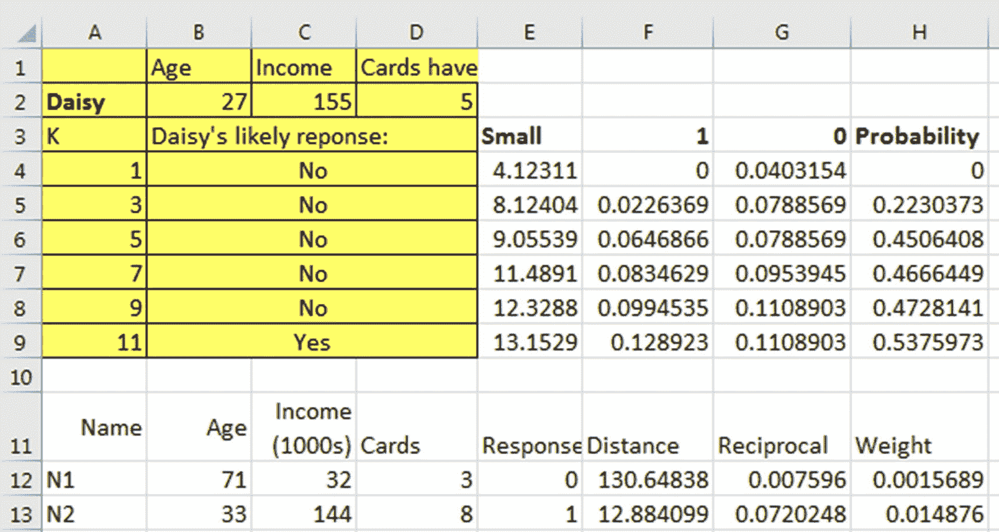

电子表格突出显示了黛西的年龄、收入和持卡数量详情，以及她的响应。右侧标明了 Small、1、0 和 Probability 的值。底部标明了名称 N1 和 N2 的年龄、收入、持卡数量、响应、距离、倒数和权重的详细信息。

图 7-8
在 K-NN 模型中应用加权投票

在此实验中，我们使用的临界值为 0.5，也就是说，如果接受概率大于 0.5，我们认为黛西的响应可能是“是”，否则为“否”。将 0.5 设为临界值是一个自然的选择。然而，在通过交叉验证评估我们的 K-NN 模型时，选择不同的临界值并进行 ROC 分析将会很有趣。

我们能否进一步改进加权 K-NN 模型？答案可能是肯定的。不难注意到，属性“收入”对距离的贡献最大，而属性“持卡数量”的贡献最小。我们知道，不同的属性对确定黛西的响应可能有不同的影响，这是开发数据挖掘模型时业务理解阶段的一部分。然而，当我们不清楚哪个属性贡献更大时，最好对所有属性一视同仁。因此，有必要对所有三个属性进行归一化，使它们处于同一量级，例如 0–100。

### 实验 3

归一化可以通过不同的方式完成。Z-score 归一化基于数据的方差。在本实验中，我们执行范围归一化，即所有属性都根据其各自的最大值和最小值进行归一化。

我们希望范围是 0–100。因此，每个属性的最小值被转换为 0，最大值被转换为 100。

让我们按照以下分步说明来执行此实验：

1.  打开 Chapter7-3a.xlsx。在单元格 J1:J6 和 K1:K6 中，输入如图 7-9 所示的文本或公式。这些值是三个属性的实际范围。

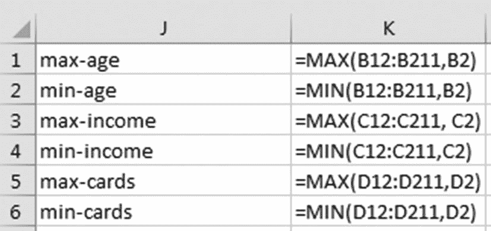

一个表格展示了一组用于计算最大年龄、最小年龄、最大收入、最小收入、最大持卡数量和最小持卡数量的公式。公式中指明了单元格的范围。

图 7-9
定义范围

归一化值的表达式为 100 / (最大值 – 最小值) * (值 – 最小值)。请注意，对于给定的属性，如果其最大值等于最小值，此表达式可能会失败。然而，这种情况非常罕见。当这种情况发生时，该属性没有方差，因此对我们的数据挖掘项目没有价值。我将在后面介绍探索性数据分析（EDA）的章节中讨论这一点。

2.  在单元格 F11、G11 和 H11 中，分别输入“归一化年龄”、“归一化收入”和“归一化持卡数量”。

3.  在单元格 F12 中，输入以下公式，然后从 F12 自动填充到 F211：

```
    =100/($K$1-$K$2)*(B12-$K$2)
    ```

4.  在单元格 G12 中，输入以下公式，然后从 G12 自动填充到 G211：

```
    =100/($K$3-$K$4)*(C12-$K$4)
    ```

5.  在单元格 H12 中，输入以下公式，然后从 H12 自动填充到 H211：

```
    =100/($K$5-$K$6)*(D12-$K$6)
    ```

工作表的一部分应如图 7-10 所示。

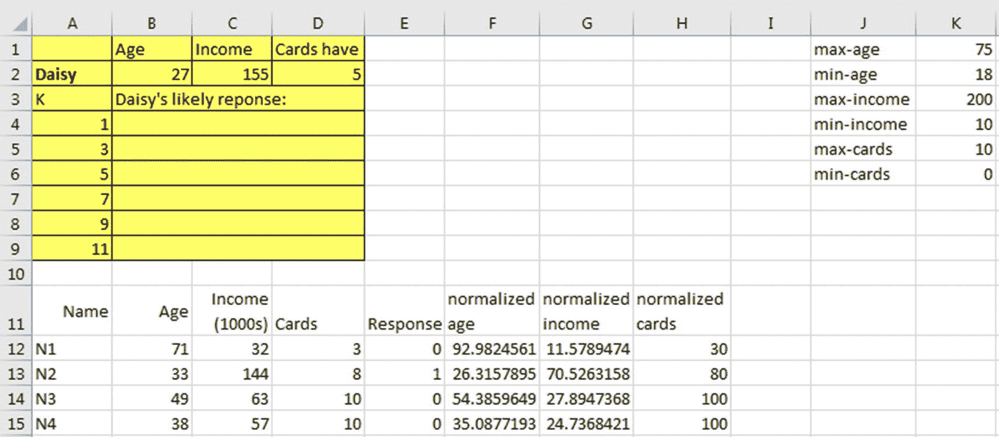

电子表格突出显示了黛西的年龄、收入和持卡数量详情。右侧标明了年龄、收入和持卡数量的最小值和最大值。底部的一个表格展示了名称、年龄、收入、持卡数量、响应以及归一化年龄、收入和持卡数量的详细信息。

图 7-10
归一化所有属性

按照我们之前的方法继续以下步骤以完成此实验：

6.  在单元格 E2 中，输入公式 `=100/(K1-K2)*(B2-K2)`。这是黛西的归一化“年龄”。

7.  在单元格 F2 中，输入公式 `=100/(K3-K4)*(C2-K4)`。这是黛西的归一化“收入”。

8.  在单元格 G2 中，输入公式 `=100/(K5-K6)*(D2-K6)`。这是黛西的归一化“持卡数量”。

9.  在单元格 I11、J11 和 K11 中，分别输入“距离”、“倒数”和“权重”。

10.  在单元格 E3、F3、G3 和 H3 中，分别输入“Small”、“1”、“0”和“Probability”。

工作表的一部分现在如图 7-11 所示。

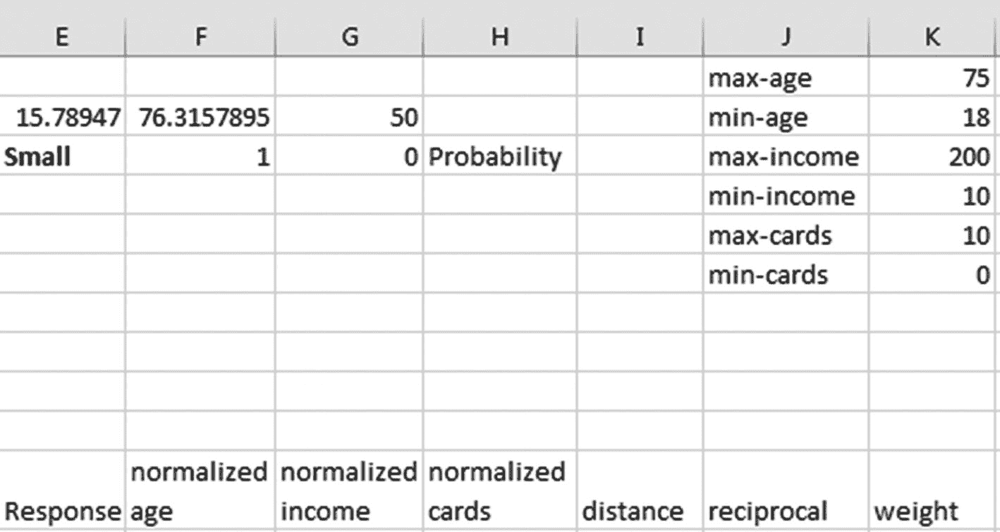

一个表格在左侧展示了 Small、1、0 和 Probability 的值。在右侧，标明了年龄、收入和持卡数量的最小值和最大值。底部有几个列标题，包括响应、归一化年龄、收入、持卡数量、距离、倒数和权重。

图 7-11
实验 3 的设置

1.  在单元格 I12 中，输入以下公式，并从 I12 自动填充到 I211：

```
    =SQRT(SUMXMY2(E$2:G$2, F12:H12))
    ```

2.  在单元格 J12 中，输入公式 `=1/(1+I12)`，并从 J12 自动填充到 J211。

3.  在单元格 K12 中，输入公式 `=J12/SUM($J$12:$J$211)`，并从 K12 自动填充到 K211。

确保我们的工作表如图 7-12 所示。如果不同，我们最好检查一下公式。

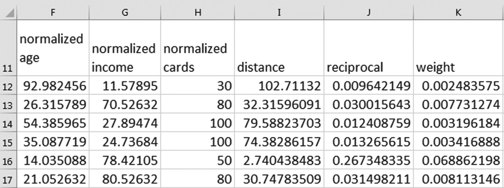

一个包含六行的表格展示了归一化年龄、归一化收入、归一化持卡数量、距离、倒数和权重的详细信息。

图 7-12
归一化后计算权重

按照以下说明继续任务：

4.  在单元格 E4 中输入公式 `=SMALL(I$12:I$211,A4)`。自动填充到 E9。

5.  在单元格 F4 中输入以下公式：

```
    =SUMIFS($K$12:$K$211,$E$12:$E$211, F$3,$I$12:$I$211,"<="&$E4)
    ```

6.  从单元格 F4 自动填充到 G4，并从 F4 自动填充到 F9 以及从 G4 自动填充到 G9。

7.  在单元格 H4 中输入公式 `=F4/SUM(F4:G4)`，然后从 H4 自动填充到 H9。

8.  在单元格 B4 中输入公式 `=IF(H4>0.5,"Yes","No")`，然后从 B4 自动填充到 B9。

最终结果如图 7-13 所示。显然，当数据以不同方式处理时，结果可能会不同（将图 7-13 与图 7-8 和图 7-4 进行比较）。在应用 K-NN 方法时，了解数据是如何处理的始终是一个好主意。完整结果可在 Chapter7-3b.xlsx 中找到。

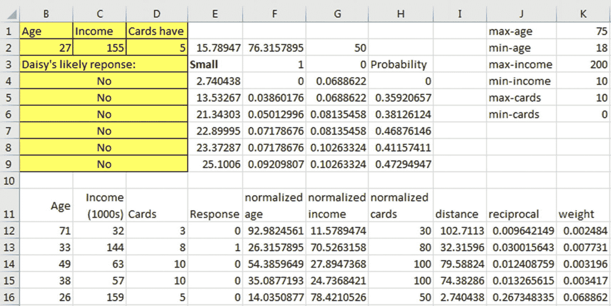

电子表格包含黛西的年龄、收入、持卡数量和响应的详细信息，以及 Small、1、0、Probability 的值，以及年龄、收入和持卡数量的最大值和最小值。底部的一个表格包含年龄、收入、持卡数量、响应、距离、倒数、权重和归一化变量的详细信息。

图 7-13
一种结合归一化属性和加权投票的 K-NN 方法


### 实验 4

在前三个实验中，目标变量只有两种不同的响应。现在，我们来开展一次目标变量具有两种以上响应的 K-NN 分析。打开 `Chapter7-4a.xlsx` 文件。该文件与 `Chapter7-3b.xlsx` 非常相似，不同之处在于：(1) 其响应为“是”、“不确定”和“否”；(2) 它尚未计算每种可能响应或 Daisy 最可能响应的概率。请先查看该文件。工作表如图 7-14 所示。请注意，在单元格 I3 中，显示的是“最大权重”，而非“概率”。

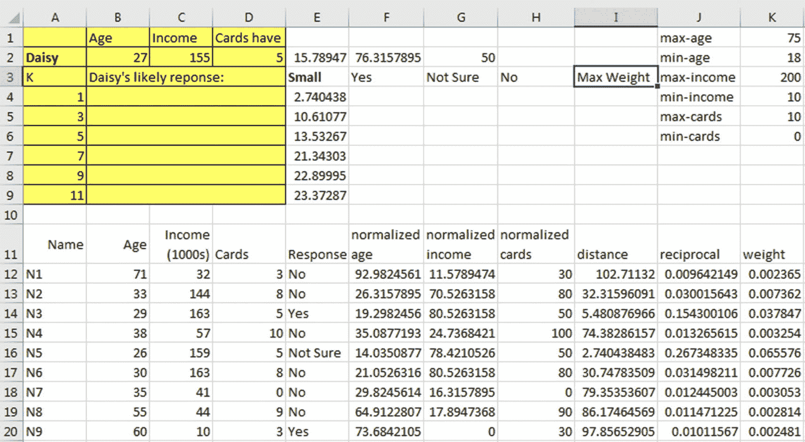

电子表格顶部包含 Daisy 的年龄、收入和持卡数量详情。右侧是年龄、收入和持卡数量的最大值与最小值详情。底部包含姓名、年龄、收入、持卡数量、响应、距离、倒数、权重以及归一化后的年龄、收入和持卡数量详情。

**图 7-14**

具有三种不同分类结果的 K-NN

请按照以下说明完成最终计算：

1.  在单元格 F4 中输入以下公式：

    ```
    =SUMIFS($K$12:$K$211,$E$12:$E$211, F$3,$I$12:$I$211,"<="&$E4)
    ```

2.  从 F4 自动填充至 H4，然后一起自动填充至第 9 行。

3.  在单元格 I4 中输入公式 `=MAX(F4:H4)`，并从 I4 自动填充至 I9。

4.  在单元格 B4 中输入以下公式，然后自动填充至单元格 B9：

    ```
    =INDEX(F$3:H$3,1,MATCH(I4,F4:H4,0))
    ```

    请注意 `MATCH` 函数的使用。`MATCH` 内部的最后一个参数是 0，表示它正在搜索精确匹配。这一点在此处很重要，因为许多数值彼此接近。

完成。最终结果如图 7-15 所示，并可在文件 `Chapter7-4b.xlsx` 中找到。

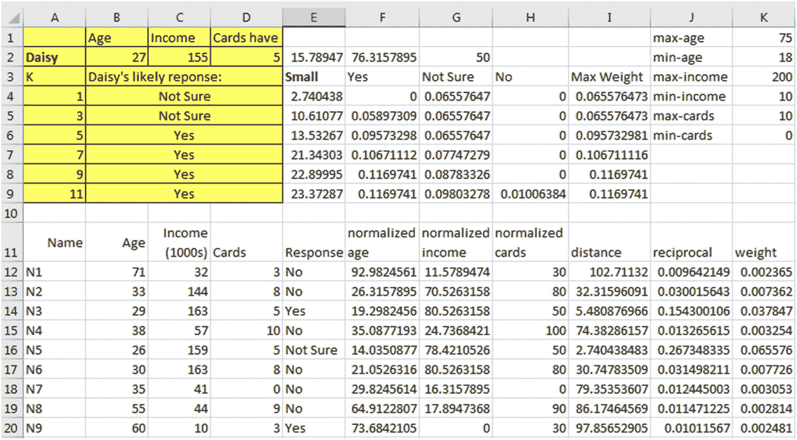

电子表格包含 Daisy 的年龄、收入、持卡数量和响应详情，以及“小”、“是”、“不确定”、“否”、“最大权重”的值，还有年龄、收入和持卡数量的最小值和最大值。底部包含姓名、年龄、收入、持卡数量、响应、距离、倒数、权重和归一化变量的详情。

**图 7-15**

具有三种预测结果的 K-NN 的最终结果

## 强化练习

`Chapter7-HW.xlsx` 中的强化练习可能需要您付出一些努力并保持谨慎。但这是您更熟练地掌握 K-NN 数据挖掘方法所必需的。如果在完成此强化练习时遇到任何困难，请随时查看 `Chapter7-HW-withAnswers.xlsx` 中的解答。

## 复习要点

1.  什么是 K-NN 及其在生活中的相似之处
2.  不同的距离函数
3.  不同的权重函数和归一化技术
4.  用于寻找 K-NN 最优 K 值的肘部法则
5.  Excel 函数 `SQRT` 和 `SMALL` 以及 Excel 运算符 `&`
6.  Excel 函数 `IF`、`COUNTIFS`、`SUMIFS`、`MATCH` 和 `INDEX`

