# 8. 层次聚类与树状图

您可能想知道为什么我不在 K 均值聚类之后立即解释层次聚类。嗯，这有几个原因。首先，Excel 并不像适用于 K 均值聚类那样适用于层次聚类或树状图。在深入探讨这个具有挑战性的主题之前，我想先介绍另外几种更流行的数据挖掘方法。第二个原因是我认为在 K-NN 之后立即解释层次聚类是合适的。最后一个原因与树状图有关。在 Excel 中绘制树状图需要相当多的手动操作，这可能会让一些学习者感到枯燥。

请从 [`https://github.com/hhohho/Learn-Data-Mining-through-Excel-2`](https://github.com/hhohho/Learn-Data-Mining-through-Excel-2) 下载本章练习所需的示例 Excel 文件。

## 总体理解

层次聚类与 K 均值聚类相似，它也是一种无监督分类方法，根据某些特征的相似性将对象（数据点）分类到不同的组（簇）中。然而，这两种聚类方法基于不同的算法，这导致了不同的最终结果。K 均值聚类生成并行的簇。而层次聚类则如其名所示，生成一个簇的树状结构。此外，层次聚类的最终结果通常以树状图的形式呈现，该图显示了原始数据点或分组数据点的相对距离。这是层次聚类在生物医学科学中经常用于展示基因或样本聚类的主要原因。

K 均值聚类从定义簇的数量`k`开始。层次聚类则从邻近度矩阵开始，并且永远不需要预先定义簇的数量。层次聚类的算法可以通过以下包含六个数据点`A`、`B`、`C`、`D`、`E`和`F`的示例来解释。

1.  最初，每个数据点都被视为一个簇。

2.  构建一个邻近度矩阵来显示这六个簇之间的距离。

3.  假设`A`和`C`之间的距离最小，那么在第一轮中，`A`和`C`被置于同一个簇中，并表示为`AC`。

4.  现在，只剩下五个簇：`AC`、`B`、`D`、`E`和`F`。

5.  重复步骤 2，为这五个簇创建一个邻近度矩阵。假设`B`和`D`的距离最小，那么只剩下四个簇：`AC`、`BD`、`E`和`F`。

6.  重复步骤 2，为这四个簇创建一个邻近度矩阵。假设`AC`和`F`的距离最小，那么只剩下三个簇：`ACF`、`BD`和`E`。

7.  重复步骤 2，为这三个簇创建一个邻近度矩阵。假设`ACF`和`BD`的距离最小，那么只剩下两个簇：`ACFBD`和`E`。

8.  层次聚类在只剩下一个簇时停止：`ACFBDE`。

上述算法适用于凝聚聚类，这是一种自下而上的层次聚类。与凝聚聚类相反的是分裂聚类，它是自上而下的。在本书中，我们将体验凝聚聚类，并且簇之间的距离仍然是欧几里得距离。

什么是树状图？嗯，在这种情况下，一张图确实胜过千言万语。按照前面的示例，该算法的最终结果可以用下图表示，这是一个真正的树状图。

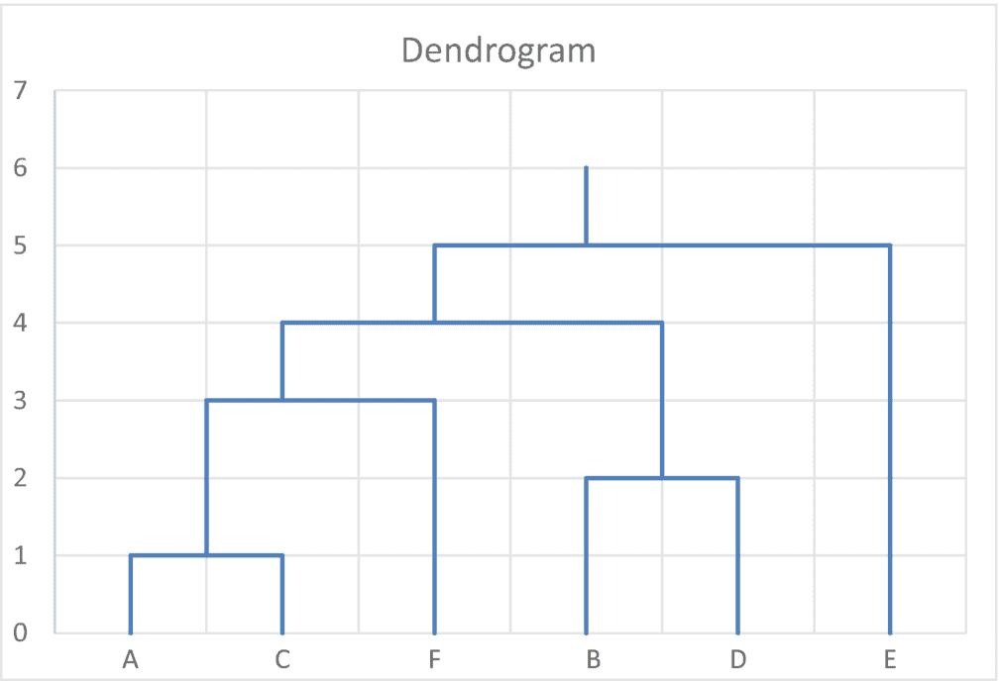

一个树状图，从第 6、5、4、3、2 和 1 层绘制了 5 个簇 `A`、`C`、`F`、`B`、`D`和`E`。

**图 8-1**

一个示例树状图，展示了`A`、`B`、`C`、`D`、`E`、`F`的层次聚类过程

观察图 8-1 可以发现：(1) 六个数据点有五个层级，一个层级对应一轮聚类；(2) `A`和`C`首先聚类在一起，因此`AC`分支的高度最小。在树状图中，分支越高，两个簇之间的距离越大。

## 在 Excel 中绘制树状图（无需加载项）

在我向你展示如何使用 Excel 实现凝聚层次聚类算法之前，我们先学习如何在 Excel 中绘制树状图。请注意，市面上有可购买并添加到 Excel 中的商业分析软件，以简化层次聚类过程和树状图的创建。而这里所展示的方法不需要任何加载项。

让我们从最简单的树状图开始，如图 8-2 所示。

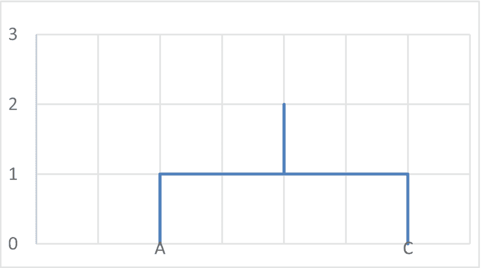

一张树状图，在高度 2 处绘制了一个聚类，并标记为`A`和`C`。

图 8-2

最简单的树状图

如果我要求你用笔在一张纸上画出图 8-2 中的图表，条件是你的笔在画完之前不能离开纸面，你会怎么画？嗯，你可以从顶部、右侧或左侧开始画。假设你从字母`A`所在的左侧开始（高度=0），你的笔应该按如下方式移动：

1.  从`A`开始，向上移动 1 个单位。

2.  向右转，停在字母`C`的上方。

3.  向下移动 1 个单位到字母`C`。

4.  向上移动 1 个单位。

5.  向左转，停在`A`和`C`的中间位置。

6.  向上移动 1 个单位到高度 2。

如果树状图看起来像图 8-3，并且我们需要停在高度 3 处，该怎么办？

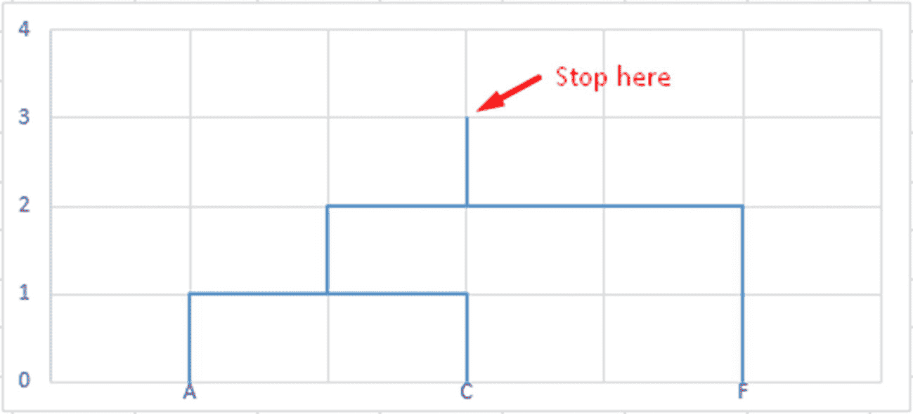

一张树状图，从高度 3 处绘制了 2 个聚类，并标记为`A`、`C`和`F`。一个箭头停在聚类 3 处并标注“停在此处”。

图 8-3

稍微复杂一点的树状图

嗯，我们可以继续移动笔，步骤如下：

7.  将笔向右转，使其正好位于字母`F`的上方。

8.  向下移动 2 个单位到高度 0。

9.  向上移动 2 个单位。

10.  向左转，停在字母`C`的上方。

11.  向上移动 1 个单位到高度 3。

到目前为止，我们应该已经明白，我们的笔有些路径走了两次。没错，这就是诀窍。如果我们将这些笔的移动轨迹转换成 Excel 中的散点图，那么这些移动就可以用图 8-4 中所示的数据点来表示。

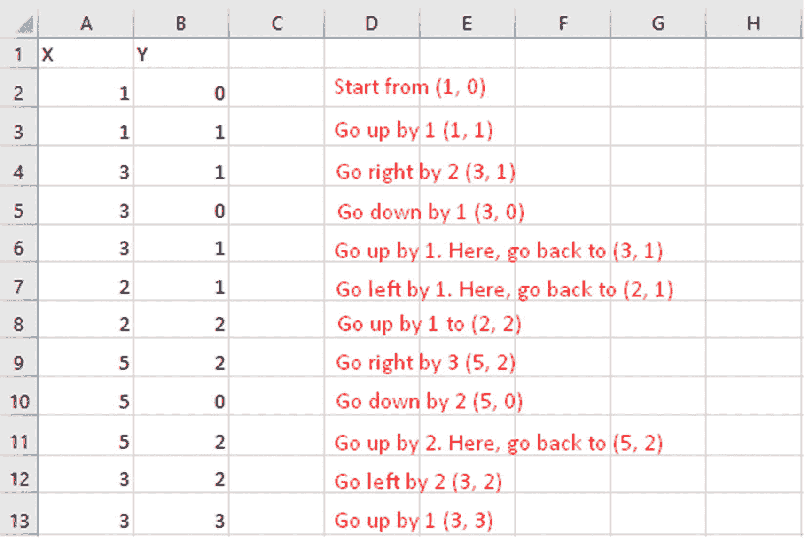

一张 Excel 表格截图，描述了一系列移动序列，从单元格 `(1, 0)` 开始，涉及向上、向下、向左、向右移动到各个单元格的步骤。这些移动在网格中形成了一条路径，最终到达单元格 `(3, 3)`。

图 8-4

用于生成树状图的散点图的 X 和 Y 值

请打开`Chapter8-1a.xlsx`。映入你眼帘的应该类似于图 8-5，这是一个与图 8-3 略有不同的树状图，因为它没有标签`A`、`C`或`F`。请注意，这个树状图是一个散点图，它是基于`A1:B13`区域的数据生成的，该数据与图 8-4 中所示相同。

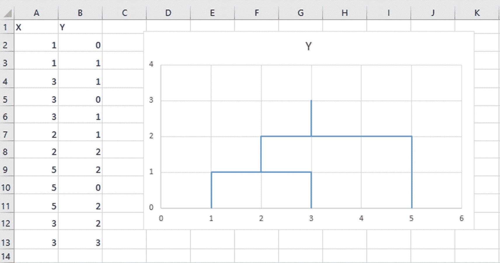

一张屏幕截图，显示了一个包含 X 和 Y 坐标的 Excel 表格以及一个没有标签的树状图。

图 8-5

没有标签的树状图

要使图 8-5 中的树状图看起来像图 8-3 中的那样，我们需要完成以下步骤：

12.  如图 8-6 所示，点击 x 轴内部，然后在弹出的菜单中选择“删除”。此操作将删除 x 轴。

13.  右键单击图表标题，也将其删除，如图 8-6 所示。

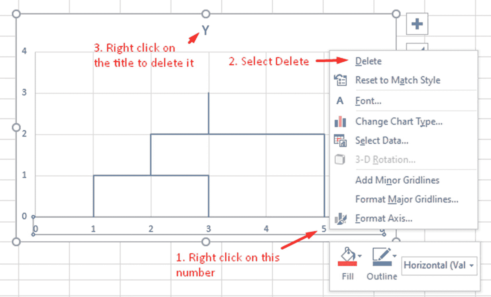

一张屏幕截图，展示了修改树状图的说明。它首先建议右键单击标题将其删除，然后选择删除选项，以及其他用于自定义图表外观的潜在操作或设置。

图 8-6

删除 x 轴和图表标题

14.  按照图 8-7 添加数据标签。确保选择“下方”。

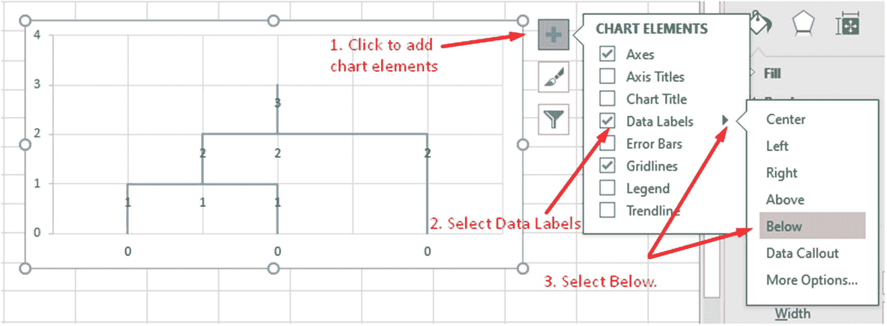

一张屏幕截图，显示了一组自定义树状图的说明。它提到了选择数据标签、添加图表元素以及调整各种图表元素（如坐标轴、标题和网格线）等操作。

图 8-7

添加数据标签

15.  按照图 8-8 逐个删除数据标签，但保留底部三个标签不变。请记住，此操作需要一些耐心。

注意，当你点击一个数据标签时，所有数据标签都会被选中。你应该继续点击那个特定的标签（单击一次）。此操作将取消选择其他数据标签，而只选中你点击的那个。

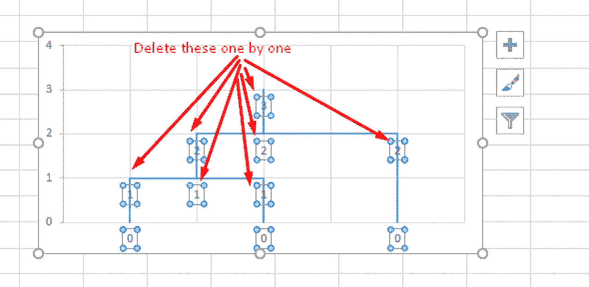

一张屏幕截图，显示了一系列操作或项目，以框架和数字 4 到 0 表示。说明要求从 4 开始依次向下到 0，逐个删除这些项目。

图 8-8

逐个删除标记的数据标签。保留底部三个标签不变

16.  对于底部的三个数据标签，点击最左边的一个。所有三个标签都被选中。立即再次点击最左边的数据标签；现在只有最左边的数据标签被选中。将其文本更改为`A`。

17.  继续更改其余两个数据标签的文本。图 8-9 显示了最后一个数据标签的文本更改过程。完成此步骤后，我们将得到一个类似于图 8-3 的树状图。

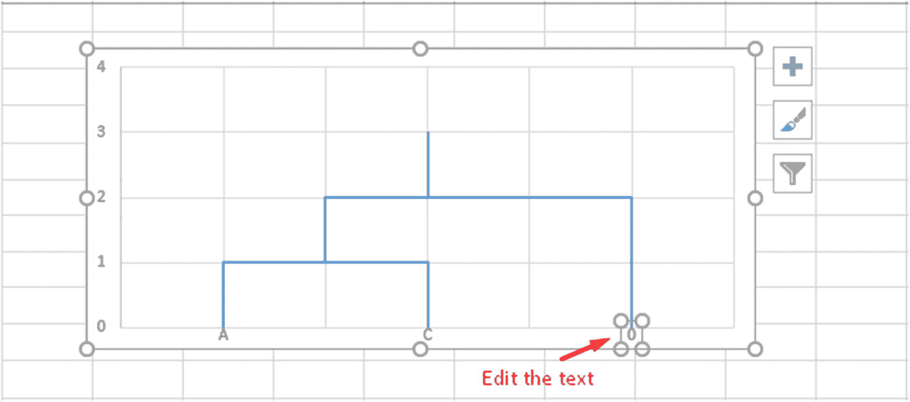

一张屏幕截图，显示在树状图图形上编辑框架 0 的文本。

图 8-9

编辑数据标签内的文本

最终结果可在`Chapter8-1b.xlsx`中找到。

## 通过 Excel 学习层次聚类

让我们打开包含十条数据记录的`Chapter8-2a.xlsx`文件。使用 Excel 演示记录过多的层次聚类并不实际，因为树状图的创建和层次聚类过程都需要相当多的人工操作。本章的目的是让你体验层次聚类的工作原理，因此无需从过多记录开始。

你可能已经注意到，这十条记录来自`Chapter3-1a.xlsx`的前十条数据。这些记录对应十个国家`L1`、`L2`、……、`L10`（B 列）。我们的任务是对这十个数据点进行层次聚类，然后观察它们之间的相对距离或相似性。

请按照以下说明执行前面介绍的层次聚类算法：

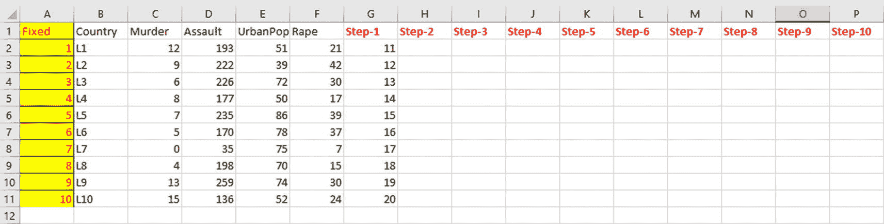

屏幕显示一个表格，包含与步骤 1 到步骤 10 相关的数据，以及国家、谋杀、袭击、城市人口和强奸等属性，并附有每个步骤对应的数值。

图 8-10

### 需要注意的问题
虽然层次聚类在 Excel 中可以实现，但过程非常手动，不适合大规模数据。理解算法步骤比实际操作更重要。

# 层次聚类的初始步骤

1.  在单元格`G1:P1`中，依次输入文本“Step-1”、“Step-2”、“Step-3”、“Step-4”、“Step-5”、“Step-6”、“Step-7”、“Step-8”、“Step-9”和“Step-10”。你可以在`G1`单元格中输入“Step-1”，然后自动填充至`P1`来实现。
2.  为了更好地区分`C:F`列中的原始数据与各个步骤，建议将`G1:P1`中的文本格式设置为`粗体`和红色（或其他非黑色）。
3.  在单元格`G2:G11`中，输入数字 11–20。这些数字代表每个数据点当前所在的簇。请注意，由于我们有十个数据点，任何大于十的整数都可以标记该数据点尚未被聚类。这是初始步骤，即 Step-1。

此时，我们的工作表应如图 8-10 所示。

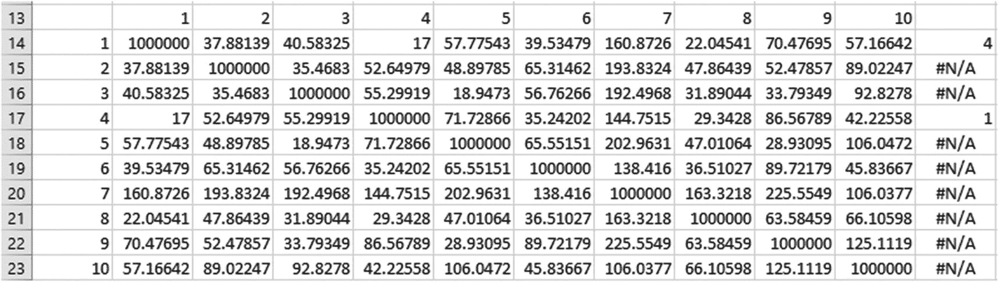

一个显示数值矩阵的 Excel 工作表。该矩阵似乎代表一个数据集或数据表，包含各种数值条目。每个单元格包含一个值，这些值似乎与某种数据分析相关。

## 图 8-11 邻近矩阵和第一个簇

1.  在单元格`B13:K13`中，分别输入整数 1–10。这些数字用于从数组`C2:F11`中提取记录。
2.  在单元格`A14:A23`中，也分别输入整数 1–10。我们将在单元格`B14:K23`中构建邻近矩阵。
3.  在单元格`B14`中，输入公式：
    ```
    =IFERROR(IF($A14=B$13,1000000, SQRT(SUMXMY2($C2:$F2,INDEX($C$2:$F$11,B$13,0)))),1000000)
    ```
    在此公式中，`INDEX($C$2:$F$11,B$13,0)` 选取由`B13`引用的记录。在此特定情况下，它是第一个数据点（`C2:F2`）。`SQRT(SUMXMY2($C2:$F2,INDEX($C$2:$F$11,B$13,0)))` 计算`C2:F2`与`C2:F2`之间的距离。

    在 `IF` 函数内部，整数 1000000 用作最大距离。如果 `$A14=B$13`，我们知道它正在计算同一数据点之间的距离（在此特定情况下，是`C2:F2`与`C2:F2`之间）。虽然这样的距离应为 0，但我们希望为其分配最大距离以便后续使用。否则，将返回`SQRT`函数的计算结果。

    `IFERROR` 函数用于确保一旦出现错误，就分配最大距离。这一点非常重要且必要！
4.  从`B14`自动填充至`K23`。现在邻近矩阵已构建完成。
5.  在单元格`L14`中输入公式 `=MATCH(MIN($B$14:$K$23),B14:K14,0)`。从`L14`自动填充至`L23`。邻近矩阵应如图 8-11 所示，它表明数据点 4 和 1 之间的距离最短。

## 步骤 2
*   现在我们需要更新十个数据点的簇信息。将`G2:G11`中的数字复制到`H2:H11`。
*   将`H2`和`H5`中的数字更新为 1。这里，1 表示这是第一个簇。
*   由于国家 L1 和 L4 位于簇 1 中，我们需要计算簇 1 的质心。在单元格`N14`中，输入公式 `=AVERAGE(C2, C5)`，然后自动填充至`Q14`。请注意，在本练习中，一个簇由其质心表示。
*   仅将`N14:Q14`的内容以数值形式复制到`N15:Q15`。注意，将`N14:Q14`复制并仅以数值形式粘贴到`N15:Q15`非常重要。目的是避免下一步中意外的迭代计算。
*   将`N15:Q15`复制到`C2:F2`，然后清除`C5:F5`中的内容。我们的工作表应如图 8-12 所示。

注意，清除国家 L4 的`C5:F5`内容非常重要，因为国家 L1（`C2:F2`）现在代表簇 1。

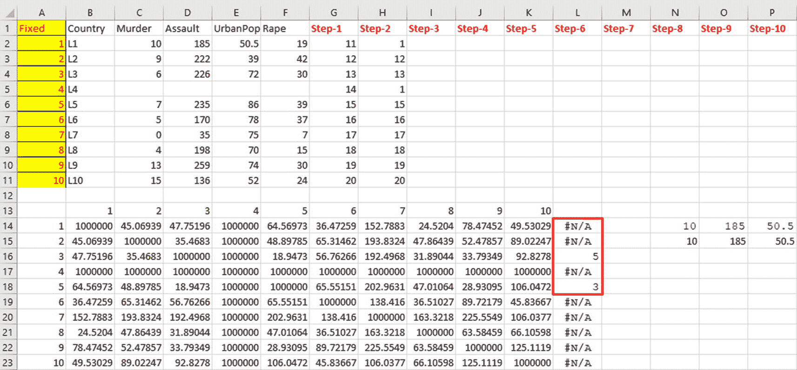

一个显示数据集的 Excel 工作表，包含列 A、B、D、E、F、G、H、J、K、M、N、O、P 和行。该表包含数值，似乎代表与不同步骤 1 到步骤 10 相关的数据，以及国家、谋杀、袭击、城市人口和强奸等属性。

## 图 8-12 步骤 2 之后，单元格数组 L14:L23 自动显示国家 L5 和 L3 处于同一簇中

## 步骤 3
*   图 8-12 显示国家 L3 和 L5 处于一个簇中。由于 L3 和 L5 当前的簇值分别为 13 和 15，均大于 10，我们知道 L3 和 L5 尚未被聚类。因此，它们应一起归入簇 2。
*   将`H2:H11`复制到`I2:I11`。
*   将单元格`I4`和`I6`更新为 2。
*   是时候计算国家 L3 和 L5 的质心了。在单元格`N14`中，输入 `=AVERAGE(C4,C6)`，然后从`N14`自动填充至`Q14`。
*   复制`N14:Q14`，并以数值形式粘贴到`N15:Q15`。
*   将`N15:Q15`复制并粘贴到`C4:F4`。我们使用`C4:F4`（国家 L3）来代表簇 2。
*   清除`C6:F6`中的内容。

我们的工作表应如图 8-13 所示。

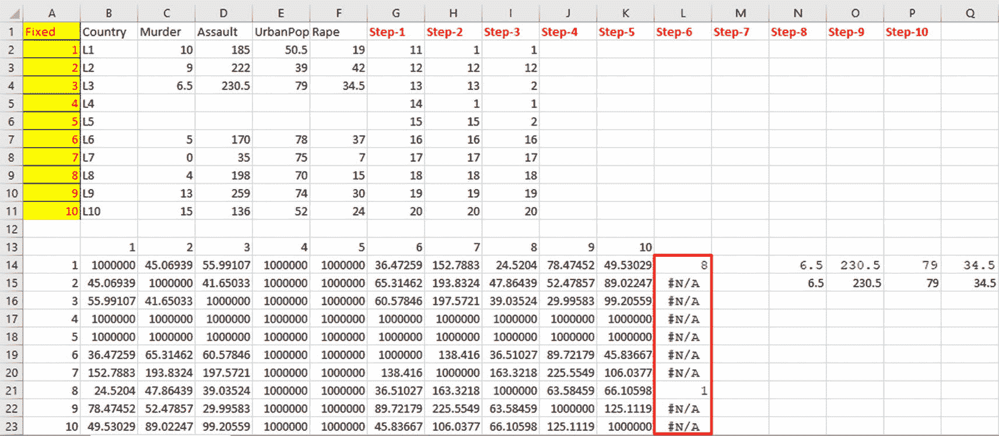

一个显示数据集的 Excel 工作表，包含列 A、B、C、D、E、F、G、H、J、K、L、M、N、O、P、Q 和行。该表包含数值和标签，与不同步骤 1 到步骤 10 相关，以及国家、谋杀、袭击、城市人口和强奸等属性。

## 图 8-13 国家 L3 和 L5 位于簇 2 中，国家 L8 与 L1 处于同一簇中

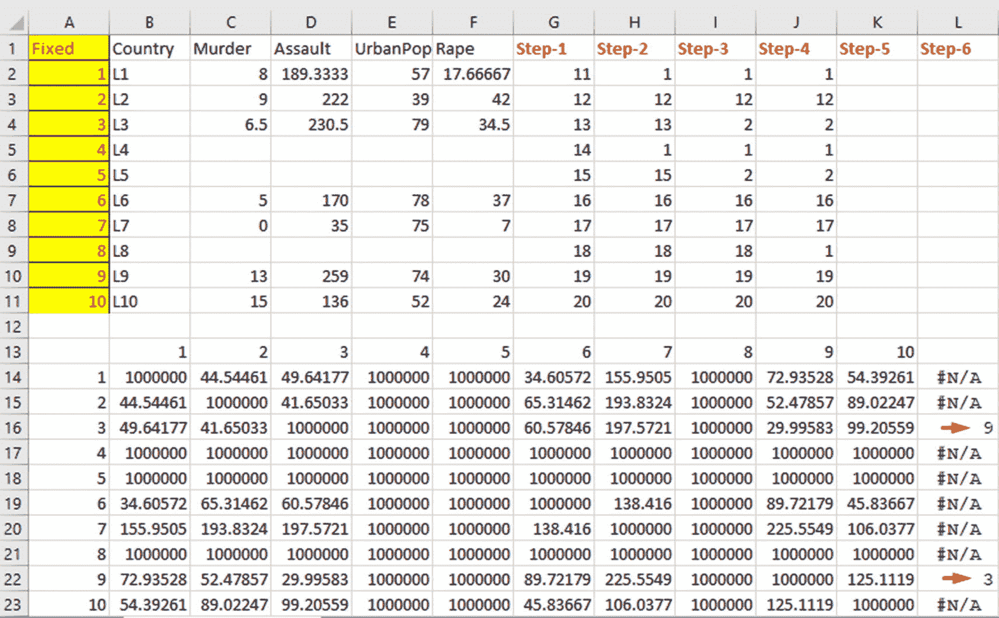

一个显示数据集的 Excel 工作表，包含列 A、B、C、D、E、F、G、H、J、K、L、M、N、O、P、Q 和行。该表包含数值和标签，与不同步骤 1 到步骤 10 相关，以及国家、谋杀、袭击、城市人口和强奸等属性。

## 图 8-14 步骤 4 之后，国家 L3 和 L9 处于同一簇中

## 步骤 4
*   图 8-13 也自动显示国家 L8 与 L1 处于同一簇中。如步骤 3 的`I2:I11`所示，L8 尚未被聚类（其当前簇值为 18），但 L1 已被聚类，因此 L8 现在应被分配到簇 1，与 L1 一起。
*   将`I2:I11`复制到`J2:J11`；将`J9`更新为 1。
*   重新计算簇 1 的质心。在单元格`N14`中输入 `=SUM(C2*2,C9)/3`；从`N14`自动填充至`Q14`。注意，由于簇 1 已有两个数据点，现在又加入了国家 L8，我们需要先将`C2`乘以 2。
*   复制`N14:Q14`并以数值形式粘贴到`N15:Q15`，然后将`N15:Q15`复制到`C2:F2`。
*   清除`C9:F9`中的内容。我们的工作表应显示国家 L3 和 L9 处于同一簇中。请参考图 8-14。

## 步骤 5
*   当然，国家 L9 应与 L3 一起归入簇 2。将`J2:J11`复制到`K2:K11`，并将`K10`更新为 2。
*   要重新计算簇 2 的质心，在`N14`中输入 `=SUM(C4*2, C10)/3`；从`N14`自动填充至`Q14`。
*   复制`N14:Q14`并以数值形式粘贴到`N15:Q15`。
*   将`N15:Q15`复制并粘贴到`C4:F4`，然后清除`C10:F10`的内容。邻近矩阵将显示国家 L6 与 L1 属于同一簇。

## 步骤-6
*   将`K2:K11`复制到`L2:L11`；将单元格`L7`（注意，是单元格`L7`，不是国家 L7！）更新为 1，以标记国家 L6 属于簇 1。
*   要重新计算簇 1 的质心，在`N14`中输入 `=SUM(C2*3, C7)/4`；然后从`N14`自动填充到`Q14`。
*   将`N14:Q14`按值复制/粘贴到`N15:Q15`，然后将`N15:Q15`复制/粘贴到`C2:F2`。
*   清除`C7:F7`中的内容。

我们的工作表应如图 8-15 所示。

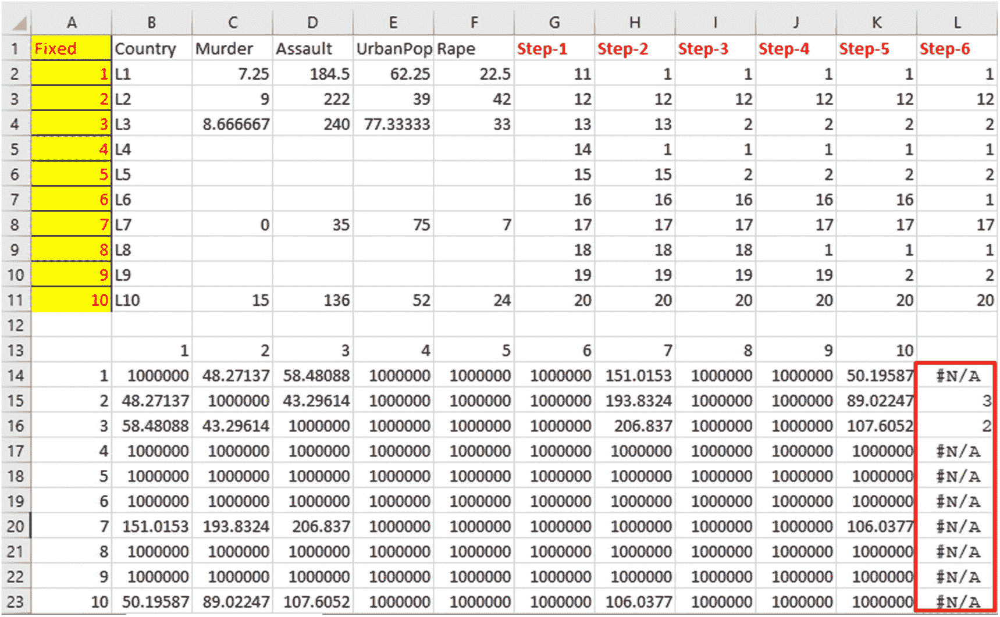

一张 Excel 工作表，显示了一个包含 A、B、C、D、E、F、G、H、J、K、L、M、N、O、P、Q 等多列和行的数据集。表格中包含与步骤-1 到步骤-10 相关的数值和标签，以及国家、谋杀、袭击、城市人口和强奸等属性。

## 图 8-15 步骤-6 之后，国家 L2 和 L3 位于同一簇中

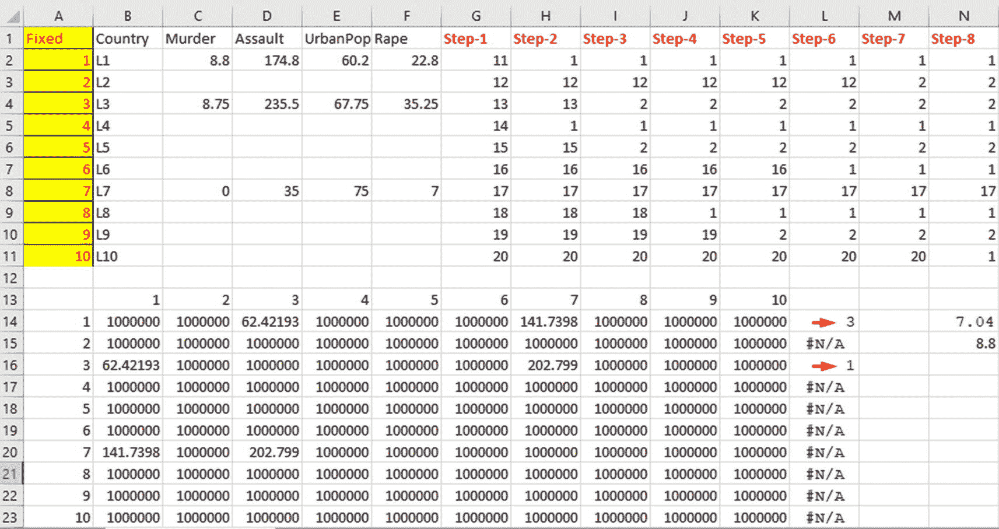

一张 Excel 工作表，显示了一个包含 A、B、C、D、E、F、G、H、J、K、L、M、N、O、P、Q 等多列和行的数据集。表格中包含与步骤-1 到步骤-10 相关的数值和标签，以及国家、谋杀、袭击、城市人口和强奸等属性。

## 图 8-16 步骤-8 之后，国家 L1 和 L3 位于同一簇中

## 步骤-7
*   将单元格数组`L2:L11`复制到`M2:M11`。
*   由于国家 L2 与 L3 属于同一簇，它必须属于簇 2。将`M3`更新为 2。
*   要重新计算簇 2 的质心，在`N14`中输入 `=SUM(C4*3,C3)/4`；然后从`N14`自动填充到`Q14`。

# 第8章 层次聚类与树状图

## 步骤-8

此时，邻近矩阵显示国家 `L1` 和 `L10` 属于同一簇。让我们将 `M2:M11` 复制到 `N2:N11`，并将 `N11` 更新为 `1`。

*   在 `N14` 中，输入公式 `=SUM(C2*4,C11)/5` 并从 `N14` 自动填充到 `Q14`。
*   将 `N14:Q14` 按值复制/粘贴到 `N15:Q15`，然后将 `N15:Q15` 复制到 `C2:F2`。
*   清除 `C11:F11` 中的内容后，邻近矩阵显示国家 `L3` 和 `L1` 属于同一簇。如图 8-16 所示。

## 步骤-9

由于国家 `L1` 属于簇 1，`L3` 属于簇 2，两者都已被处理。这表明我们现在需要合并簇 1 和簇 2。因此，将 `N2:N11` 复制到 `O2:O11`。请注意，在 `O2:O11` 中有五个 `1` 和四个 `2`。

*   在完成合并簇的质心重新计算之前，暂时不要更新 `O2:O11`。在 `N14` 中输入 `=SUM(C2*5, C4*4)/9` 并从 `N14` 自动填充到 `Q14`。
*   复制 `N14:Q14` 并按值粘贴到 `N15:Q15`。
*   现在将 `O2:O11` 中的所有 `2` 更新为 `1`。
*   确保将 `N15:Q15` 的值复制到 `C2:F2`，然后清除 `C4:F4` 的内容。

## 步骤-10

此时，邻近矩阵应显示 `L7` 与 `L1` 属于同一簇。

*   因此，我们可以在 `P2:P11` 中填入 `1`。

我们的工作表应如图 8-17 所示。

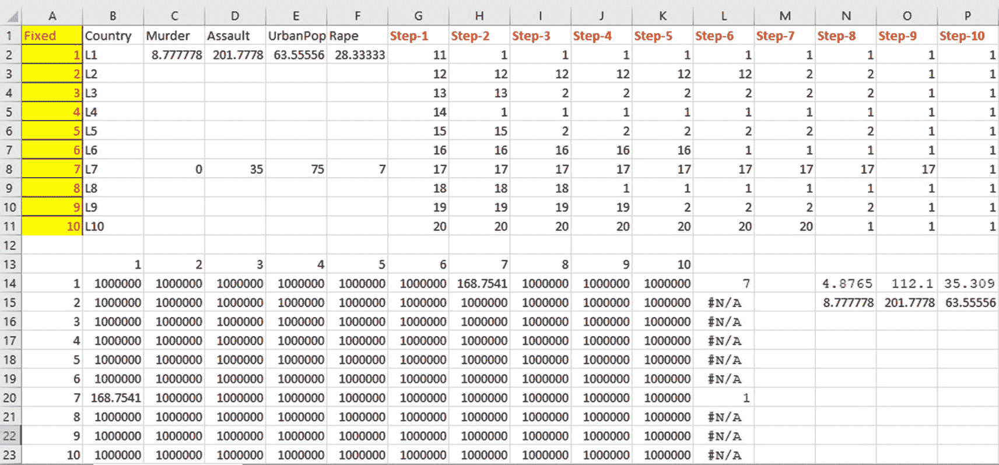

图 8-17

## 排序以准备绘制树状图

我们的任务尚未完成。我们需要整理这十个数据点，以便更好地了解如何绘制树状图。为此，我们需要对表格 `B1:P11` 进行排序。

1.  选择 `B1:P11` ➤ 单击“数据” ➤ “排序” ➤ 在“排序依据”中，选择“步骤-2”，然后单击“确定”。这在图 8-18 中进行了说明。注意，“数据包含标题”已勾选。
2.  在“排序依据”中，将“步骤-2”更改为“步骤-3”，以按“步骤-3”对 `B1:P11` 进行排序。不要忘记单击“确定”完成排序过程。
3.  继续分别按“步骤-4”、… 和“步骤-9”依次进行排序。我们工作表的一部分应如图 8-19 所示。

排序后，数据已准备好用于绘制树状图。仔细观察单元格数组 `B1:B11`，它显示当我们绘制树状图时，我们的数据点（国家）应按从左到右的顺序排列：`L1`、`L4`、`L8`、`L6`、`L10`、`L3`、`L5`、`L9`、`L2`、`L7`。

`G1:P11` 中的数据指示我们以下信息：

*   (`L1`, `L4`) 是第一级簇。
*   (`L3`, `L5`) 是第二级簇。
*   ((`L1`, `L4`), `L8`) 是第三级簇。
*   ((`L3`, `L5`), `L9`) 是第四级簇。
*   (((`L1`, `L4`), `L8`), `L6`) 是第五级簇，依此类推。

当前结果（不含树状图）可在 `Chapter8-2b.xlsx` 中找到。请尝试应用你学到的关于绘制树状图的知识，在 `Chapter8-2b.xlsx` 中绘制一个树状图。

> **注意**：我在同一个工作表中完成了层次聚类过程。如果你想保持中间步骤不变，可以在每个中间步骤复制一个工作表，类似于我们在 k-means 聚类中所做的。事实上，保持中间步骤不变有助于避免错误。
>
> `Chapter8-2e.xlsx` 通过复制工作表来保持中间步骤不变，重复了上述过程。如果你感兴趣，可以查看一下。

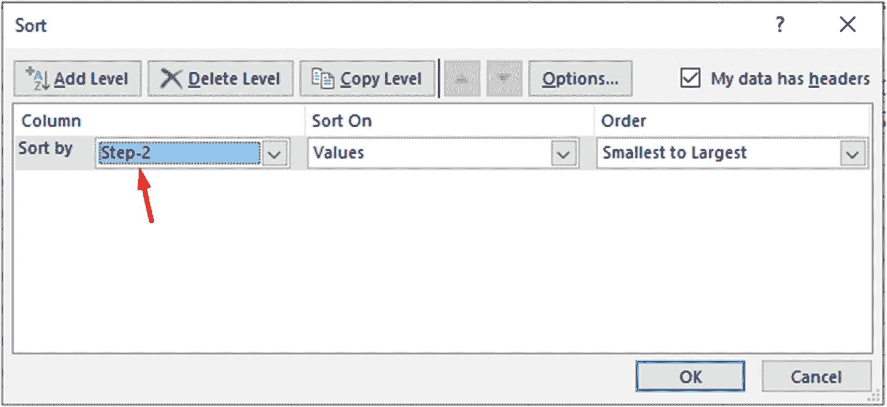

图 8-18

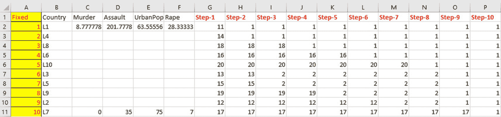

图 8-19

## 绘制树状图

要绘制树状图，最好先用笔在纸上（或在类似 iPad 的设备上）勾勒出来。这将极大地帮助我们为后续的散点图指定 X 和 Y 值。我不会详细说明 X 和 Y 值是如何生成的，但它们可以在 `Chapter8-2c.xlsx` 中找到，你现在应该打开它。

在 `Chapter8-2c.xlsx` 中，我们树状图的 X 和 Y 值显示在单元格数组 `R1:S54` 中。请选择它们并绘制一个“带直线的 XY 散点图”。我们将得到一个如图 8-20 所示的图表。

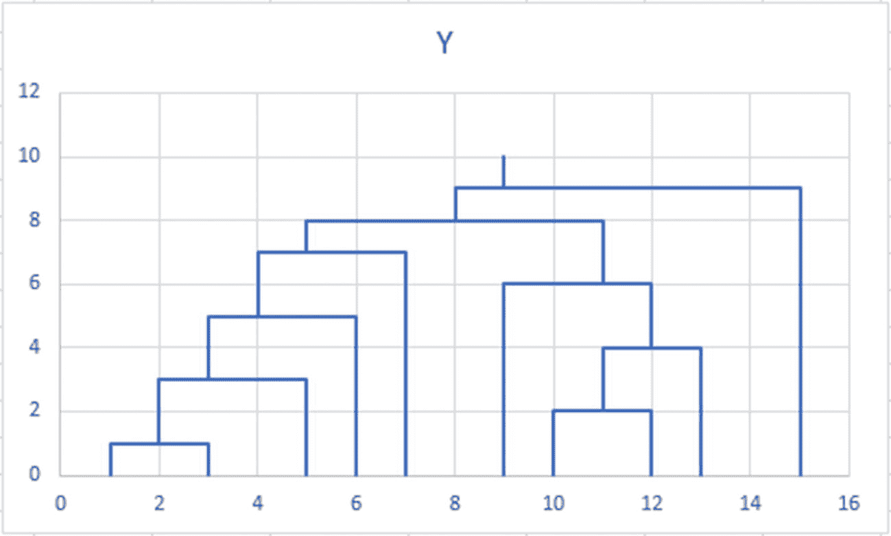

图 8-20

现在，对图表进行如下调整：

1.  请将标题修改为“树状图”。
2.  单击 x 轴将其删除。
3.  单击“添加图表元素” ➤ “轴标题”。
4.  将 y 轴标题修改为“距离不成比例”。正如这个 y 轴标题所示，我们树状图中的分支高度并不反映簇距离的比例关系。
5.  将 x 轴标题修改为 `L1 L4 L8 L6 L10 L3 L5 L9 L2 L7`。之后，在单词之间添加或删除空格，使其与图表对齐良好。

这种方法与应用数据标签不同。当然，你也可以尝试添加数据标签。图 8-21 显示了我通过调整 x 轴标题内容创建的树状图。

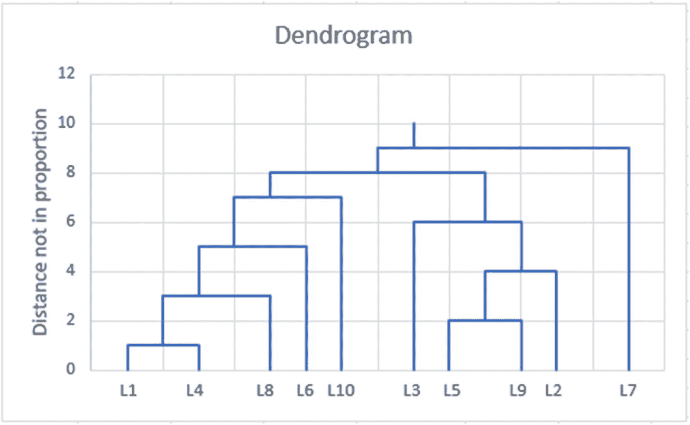

图 8-21

最终结果可以在 `Chapter8-2d.xlsx` 中找到，该文件还通过应用数据标签绘制了一个树状图。

## 强化练习

你可能已经意识到，通过 Excel 完成层次聚类和树状图容易出错，因为需要手动操作。当数据点数量增加时尤其如此。正如我之前提到的，减少错误的一种方法是通过复制工作表来保持中间步骤的完整性，类似于我们在 k-means 聚类中所做的。

我们能否通过 Excel 对数百个数据点进行层次聚类？当然可以。但我们必须首先借助 k-means 聚类。思路是先在较大的数据集上应用 k-means 聚类（例如，k=7），然后将每个聚类视为一个数据点，再开始层次聚类。

*   文件 `Chapter8-HW-1.xlsx` 为你提供了练习层次聚类和绘制树状图的机会。需要帮助时，请参考 `Chapter8-HW-1-withAnswers.xlsx`。
*   `Chapter8-HW-2.xlsx` 允许你在更大的数据集上练习层次聚类，因此你需要先应用 k-means 聚类。`Chapter8-HW-2-withAnswers.xlsx` 展示了如何实现这一点。该文件还通过保持中间步骤的完整性展示了层次聚类的过程。
*   注意，`Chapter8-2e.xlsx` 也通过复制工作表来保持中间步骤的完整性，展示了层次聚类的过程。我强烈建议你仔细查看这个文件。

## 复习要点

对于第 8 章，以下知识、技能和函数值得复习：

1.  层次聚类与树状图
2.  凝聚聚类算法
3.  邻近矩阵
4.  Excel 内置功能：排序和选择性粘贴（数值）
5.  散点图与数据标签
6.  函数 `IF`、`MIN`、`IFERROR`、`INDEX`、`MATCH`、`SQRT` 和 `SUMXMY2`
7.  复制工作表以保持中间步骤的完整性