# 9. 朴素贝叶斯分类

我们一直在学习的数据挖掘方法都偏好数值型数据：线性回归、LDA、k-means 聚类、逻辑回归、K-NN 和层次聚类。然而，朴素贝叶斯偏好分类型数据。由于其简单性，朴素贝叶斯数据挖掘方法比许多其他数据挖掘方法效率高得多，而其性能仍能与大多数其他数据挖掘方法相媲美。

请从 [`https://github.com/hhohho/Learn-Data-Mining-through-Excel-2`](https://github.com/hhohho/Learn-Data-Mining-through-Excel-2) 下载本章练习所需的示例 Excel 文件。

## 总体理解

数据挖掘方法或机器学习模型通常被认为是概率方法/模型。概率计算从训练数据集开始。一个基本原则是，如果属性或目标变量的特定状态 *S*[*k*] 在给定条件下出现的概率为 *P*[*k*]，那么可以假设在评分数据集的相同条件下，*S*[*k*] 出现的概率仍然是 *P*[*k*]。当你阅读本章以及其他章节（如关联分析和决策树）时，你会发现这个原则的隐含应用，尽管我可能明确提及也可能不提及。

朴素贝叶斯是最常用的分类算法之一。其数学基础是条件概率，它提出了这样一个问题：在给定 x 发生的情况下，事件 y 发生的概率是多少？这里，条件是 x（x 发生或 x 为真），条件概率表示为 *P*(*y*|*x*)。

条件概率 *P*(*y*|*x*) 的计算公式为

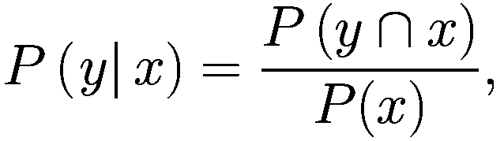

(9-1)

其中 *P*(*x*) 表示 x 为真的概率，*P*(*y* ∩ *x*) 表示 x 和 y 同时为真的概率。

类似地，条件概率 *P*(*x*|*y*) 的计算公式为

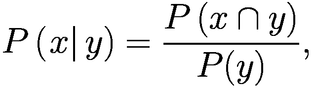

(9-2)

因为 *P*(*y* ∩ *x*)= *P*(*x* ∩ *y*)，所以我们有 *P*(*y*|*x*)*P*(*x*) = *P*(*x*|*y*)*P*(*y*)。因此，我们可以推导出最简单的贝叶斯定理，如公式 (9-3) 所述：

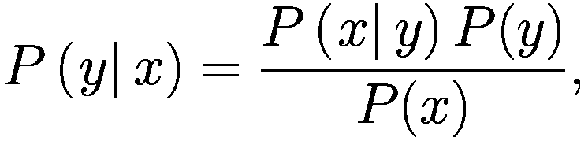

(9-3)

注意，贝叶斯定理将 *P*(*y*|*x*) 的计算转换为 *P*(*x*|*y*) 的计算。

公式 (9-3) 隐含地假设 y 是因变量 y 的研究类别，x 是自变量 x 的研究状态。这可能有点令人困惑，因为 y 必须有多个类别，x 必须有多个状态。别担心，请继续阅读，你会对贝叶斯定理有清晰的理解。

假设 y 有两个类别 y[1] 和 y[2]，让我们针对特定条件 x[a]（假设 x 有不同的状态/条件，x[a] 是其中之一）下的 y[1] 重写公式 (9-3)，我们得到

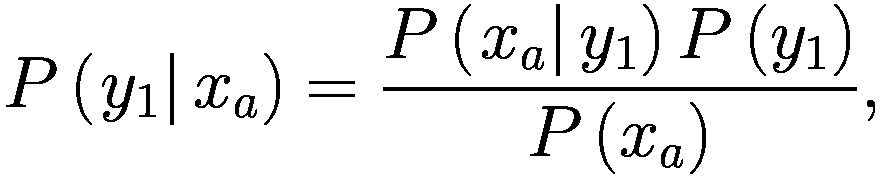

(9-4)

对 y[2] 重复上述操作，我们得到

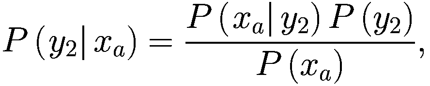

(9-5)

因为 y 只有两个类别，在条件 x[a] 下，要么 y[1] 发生，要么 y[2] 发生，即 *P*(*y*[1]|*x*[*a*]) + *P*(*y*[2]|*x*[*a*]) 必须等于 1。因此，

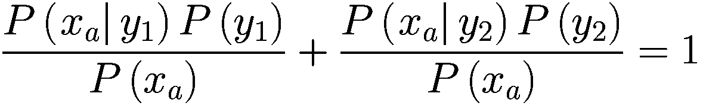

即，*P*(*x*[*a*]) = *P*(*x*[*a*]|*y*[1])*P*(*y*[1]) + *P*(*x*[*a*]|*y*[2])*P*(*y*[2])。因此，我们最终可以得到

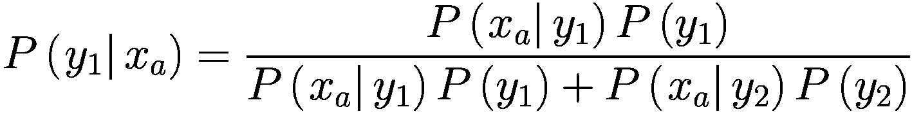

(9-6)


贝叶斯定理的精妙之处在于，它将计算 *P*(*y*[1]|*x*[*a*]) 转化为计算 *P*(*x*[*a*]|*y*[1]) 和 *P*(*x*[*a*]|*y*[2])！在数据挖掘中思考这个问题。给定已知 y 的训练数据集，我们可以轻松计算出 *P*(*x*[*a*]|*y*[1])、*P*(*x*[*a*]|*y*[2])、*P*(*y*[1]) 和 *P*(*y*[2])。现在对于评分数据集，y 未知但 x 已知。如果 x 是 x[a]，那么我们可以利用公式 (9-6) 来预测在 x[a] 条件下 y[1] 的发生概率。

公式 (9-6) 假设只有一个独立属性 x。在大多数情况下，存在多个独立属性（`x`[`1`]`,x`[`2`]`,...,x`[`n`]）来对 y 进行分类，并且 y 可能有两个以上的类别。假设 y 有 `m` 个不同的类别，并且在条件（`x`[`1`]`,x`[`2`]`,...,x`[`n`]）下，令

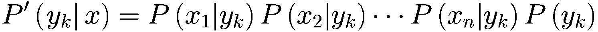

(9-7)

根据我们之前的内容，不难推导出最终的 *P*(*y*[*k*]|*x*)，即在条件（`x`[`1`]`,x`[`2`]`,...,x`[`n`]）下第 k 个 y 类别的概率，可以通过以下公式计算：

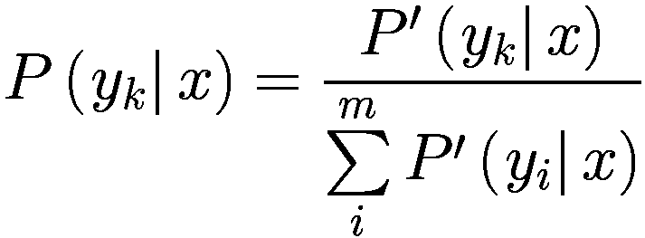

(9-8)

当然，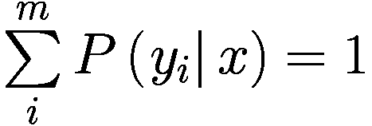 。

我们将使用表 9-1 中的示例来实现上述概念。

表 9-1 中的数据模拟了一个图像分析案例，该案例根据所拍摄图像的特征（属性）来确定某种癌症的发生。请注意，表中的数据是虚构的，不代表有效的图像或癌症分析方法。

表 9-1

用于朴素贝叶斯分析的虚构样本数据

| 编号 | 尺寸 | 数量 | 厚度 | 肺癌 |
| --- | --- | --- | --- | --- |
| 1 | 大 | 低 | 深 | 是 |
| 2 | 大 | 多 | 深 | 是 |
| 3 | 正常 | 多 | 浅 | 否 |
| 4 | 大 | 低 | 浅 | 否 |
| 5 | 大 | 多 | 深 | 是 |
| 6 | 正常 | 多 | 深 | 是 |
| 7 | 大 | 低 | 浅 | 否 |
| 8 | 大 | 多 | 浅 | 是 |
| 9 | 大 | 多 | 深 | 是 |
| 10 | 正常 | 低 | 深 | 否 |
| 评分 | 大 | 多 | 深 | ??? |

共有三个属性：尺寸、数量和厚度（将它们视为 x[1]、x[2] 和 x[3]）。每个属性有两个不同的值。目标变量是肺癌，它有两个不同的类别：是和否。在表 9-1 中，有十条训练数据记录，最后一条是评分记录，我们需要根据这三个属性值来预测其类别。

基于公式 (9-7) 和 (9-8)，评分记录为“是”的概率通过以下公式计算：


![$$ \frac{\mathrm{p}\left(\mathrm{big}|\mathrm{yes}\right)\times \mathrm{p}\left(\mathrm{over}|\mathrm{yes}\right)\times \mathrm{p}\left(\mathrm{deep}\ |\ \mathrm{yes}\right)\times \mathrm{p}\left(\mathrm{yes}\right)}{\mathrm{p}\left(\mathrm{big}|\mathrm{yes}\right)\times \mathrm{p}\left(\mathrm{over}|\mathrm{yes}\right)\times \mathrm{p}\left(\mathrm{deep}\ |\ \mathrm{yes}\right)\times \mathrm{p}\left(\mathrm{yes}\right)+\mathrm{p}\left(\mathrm{big}\ |\mathrm{no}\right)\times \mathrm{p}\left(\mathrm{over}\ |\mathrm{no}\right)\times \mathrm{p}\left(\mathrm{deep}|\mathrm{no}\right)\times \mathrm{p}\left(\mathrm{no}\right)} $$](img/494428_2_En_9_Chapter_TeX_Equc.png)

当然，我们需要计算以下各项：

1.  p(是) = 6/10，因为 10 条记录中有 6 条“是”。
2.  p(否) = 4/10，因为 10 条记录中有 4 条“否”。
3.  p(大|是) = 5/6。当类别为“是”时，相应地有 5 个“大”。
4.  p(多|是) = 5/6。当类别为“是”时，相应地有 5 个“多”。
5.  p(深|是) = 5/6。当类别为“是”时，相应地有 5 个“深”。
6.  p(大|否) = 2/4。当类别为“否”时，相应地有 2 个“大”。
7.  p(多|否) = 1/4。当类别为“否”时，相应地有 1 个“多”。
8.  p(深|否) = 1/4。当类别为“否”时，相应地有 1 个“深”。

因此，


最终答案是 0.965。这表明评分记录为“是”（肺癌阳性）的概率是 0.965。

当然，朴素贝叶斯分类的数学背景比逻辑回归、LDA 和 K-NN 相对简单得多。这是朴素贝叶斯分类在数据量较大时能够拥有出色计算效率的重要原因。此外，尽管朴素贝叶斯做出了一个“朴素”的假设，即所有属性相互独立，但与许多其他分类数据挖掘模型相比，朴素贝叶斯确实具有不错的性能。

## 通过 Excel 学习朴素贝叶斯

在本章中，我们将通过 Excel 练习两个示例。第一个示例与表 9-1 相同。第二个示例模拟了一个类似的图像分析案例。然而，数据更复杂，数据量也大得多。


### 练习 1

文件 Chapter9-1a.xlsx 包含与表 9-1 所示相同的数据。其中只有十个训练样本和一个评分样本。将样本量设置得较小是为了更好地进行说明。一旦我们通过这个简单的例子积累了足够的经验，我们将处理另一个更复杂的数据集。

在 Chapter9-1a.xlsx 中，数据已在工作表中设置好以便于处理，如图 9-1 所示。我们需要做的是完成朴素贝叶斯分析所需的必要计算。

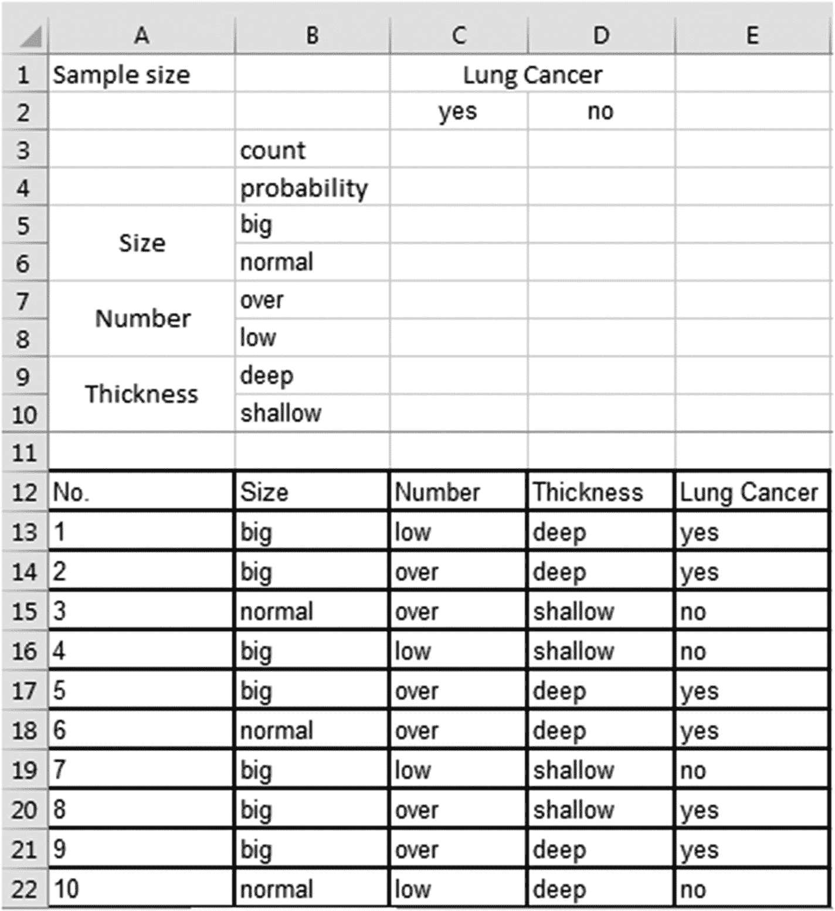

一张 Excel 截图展示了朴素贝叶斯数据设置。它包含样本量、大小、数量和厚度的数据，以及一个列标题为数量、大小、数量、厚度和肺癌的表格。

图 9-1
朴素贝叶斯数据设置

要应用朴素贝叶斯方法预测评分记录的类别，我们首先需要基于训练数据构建模型。请遵循以下说明：

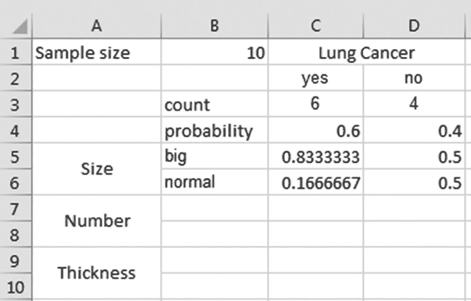

一张 Excel 截图展示了部分朴素贝叶斯分析。它包含一个列标题为“是”和“否”的表格。行标题为计数、概率、大和正常。

图 9-2
朴素贝叶斯分析部分完成

1.  在单元格 B1 中输入 10，因为只有十条训练记录。

2.  在单元格 C3 中输入公式 `=COUNTIF($E$13:$E$22,C$2)`。这将计算目标变量“肺癌”中类别为“是”的数量。从单元格 C3 自动填充到单元格 D3。单元格 D3 存储类别为“否”的数量。

3.  在单元格 C4 中输入公式 `=C$3/$B$1`，然后从单元格 C4 自动填充到单元格 D4。单元格 C4 和 D4 分别引用 p(是) 和 p(否)。

4.  在单元格 C5 中输入以下公式：

```
    =COUNTIFS($E$13:$E$22,C$2,$B$13:$B$22,$B5)/C$3
    ```

5.  从单元格 C5 自动填充到单元格 C6，然后一起自动填充到单元格 D5:D6。单元格 C5、C6、D5 和 D6 分别表示概率 p(大|是)、p(正常|是)、p(大|否) 和 p(正常|否)。回想一下，p(大|是) 是条件概率：给定“是”的情况下，大小 = “大”的概率。

此时，我们的工作表部分看起来如图 9-2 所示。

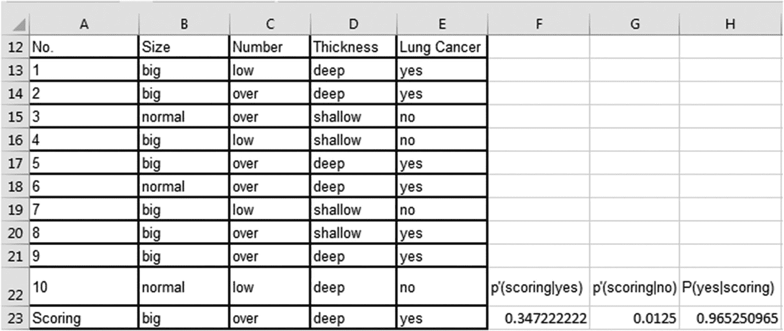

一张 Excel 截图展示了朴素贝叶斯分类。它包含一个列标题为数量、大小、数量、厚度和肺癌的表格。它有 10 行数据以及一行评分结果。

图 9-4
朴素贝叶斯分类完成

1.  在单元格 C7 中输入以下公式：

```
    =COUNTIFS($E$13:$E$22,C$2,$C$13:$C$22,$B7)/C$3
    ```

2.  从单元格 C7 自动填充到单元格 C8，然后一起自动填充到单元格 D7:D8。单元格 C7、C8、D7 和 D8 分别引用概率 p(过高|是)、p(低|是)、p(过高|否) 和 p(低|否)。

3.  在单元格 C9 中输入以下公式：

```
    =COUNTIFS($E$13:$E$22,C$2,$D$13:$D$22,$B9)/C$3
    ```

4.  从单元格 C9 自动填充到单元格 C10，然后一起自动填充到单元格 D9:D10。单元格 C9、C10、D9 和 D10 分别引用概率 p(深|是)、p(浅|是)、p(深|否) 和 p(浅|否)。

到目前为止，我们的工作表应该与图 9-3 所示相同。如果有差异，请检查单元格 C3:D10 内的公式。

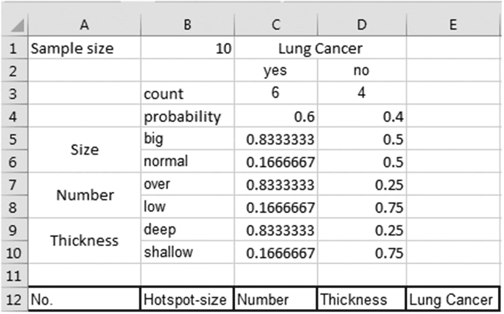

一张 Excel 截图展示了朴素贝叶斯数据准备。它包含计数、概率、大和正常大小、过高和低数量、以及深和浅厚度的数值数据。

图 9-3
朴素贝叶斯数据准备

按照以下说明继续我们的朴素贝叶斯数据挖掘过程：

5.  分别在单元格 F22、G22 和 H22 中输入“p’(评分|是)”、“p’(评分|否)”和“P(是|评分)”。

6.  在单元格 F23 中输入以下公式：

```
    =SUMIF($B$5:$B$10,$B23,C$5:C$10) * SUMIF($B$5:$B$10,$C23,C$5:C$10) * SUMIF($B$5:$B$10,$D23,C$5:C$10)*C$4
    ```

上述公式计算了在给定类别为“是”的情况下评分记录的概率。它实现了公式 (9-7)。请注意，函数 `SUMIF` 的语法与 `SUMIFS` 不同。例如，`SUMIF($B$5:$B$10,$B23,C$5:C$10)` 仅当数组 B5:B10 中对应的单元格与单元格 B23 的值相同时，才对数组 C5:C10 中的单元格求和。如果我们想使用函数 `SUMIFS` 达到相同目的，则表达式应为 `SUMIFS(C$5:C$10,$B$5:$B$10,$B23)`。

7.  从单元格 F23 自动填充到单元格 G23。单元格 G23 引用在给定类别为“否”的情况下评分记录的概率。

8.  在单元格 H23 中输入公式 `=F23/(F23+G23)`，该公式实现了公式 (9-8)。

9.  在单元格 E23 中输入公式 `=IF(H23>0.5,"是","否")`。

至此，我们完成了朴素贝叶斯分类的首次尝试。我们的结果应与图 9-4 所示相同。完整结果可在文件 Chapter9-1b.xlsx 中找到。


### 练习 2

希望到目前为止，你已经对如何在 Excel 中进行朴素贝叶斯分类有了一定的了解。接下来，我们看一个更复杂的例子。

打开文件 `Chapter9-2a.xlsx`，其中包含与 `Chapter9-1a.xlsx` 类似的随机生成数据。在 `Chapter9-2a.xlsx` 中，训练数据集包含 1978 个样本，目标变量“肺癌”有四个不同的类别。这四个类别分别是：阴性、1 期、2 期和 3 期。此外，三个预测变量均具有两个以上的分类值。请注意，朴素贝叶斯方法仅适用于分类值。如果我们的数据值不是分类值而是数值，则必须在应用朴素贝叶斯分类方法之前将其转换为分类值。

仔细查看数据。工作表的一部分如图 9-5 所示。训练数据集的范围是从第 34 行到第 2011 行。评分数据集的范围是从第 21 行到第 30 行。

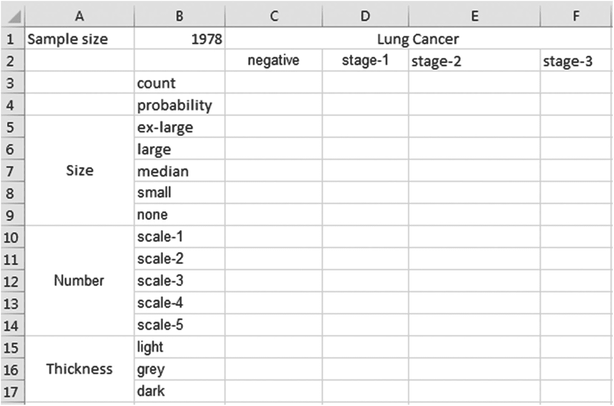

一个 Excel 截图展示了设置。它包含行标题，如计数、概率，以及尺寸下的超大、大、中、小和无，数字下的刻度 1 到 5，以及厚度下的浅色、灰色和深色。列标题是阴性和 1 期到 3 期。

图 9-5
练习 2 的设置

按照以下说明对给定数据集完成朴素贝叶斯分类：

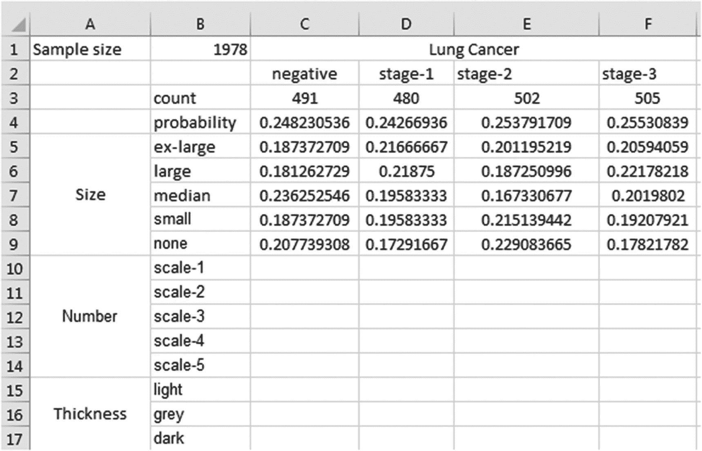

一个 Excel 截图。行标题是尺寸、数字和厚度。列标题是阴性和 1 期到 3 期。它包含不同尺寸（如超大、大、中、小和无）的数值数据。

图 9-6
检查我们当前的数据

1.  在单元格 C3 中输入以下公式，然后从单元格 C3 自动填充到单元格 F3：

```
    =COUNTIF($E$34:$E$2011,C2)
    ```

2.  在单元格 C4 中输入公式 `=C3/$B$1`，并从单元格 C4 自动填充到 F4。单元格 C4:F4 引用了每个类别的概率。

3.  要计算 p(超大|阴性)，请在单元格 C5 中输入以下公式：

```
    =COUNTIFS($B$34:$B$2011,$B5,$E$34:$E$2011,C$2)/C$3
    ```

4.  从单元格 C5 自动填充到 F5，然后一起自动填充到单元格 C9:F9。

此时，检查我们的工作表是否与图 9-6 中显示的内容相似。根据数字格式，我们工作表中单元格 C4:F9 中小数的最后几位数字可能与图 9-6 中的不同。在继续之前，请确保我们的公式是正确的。

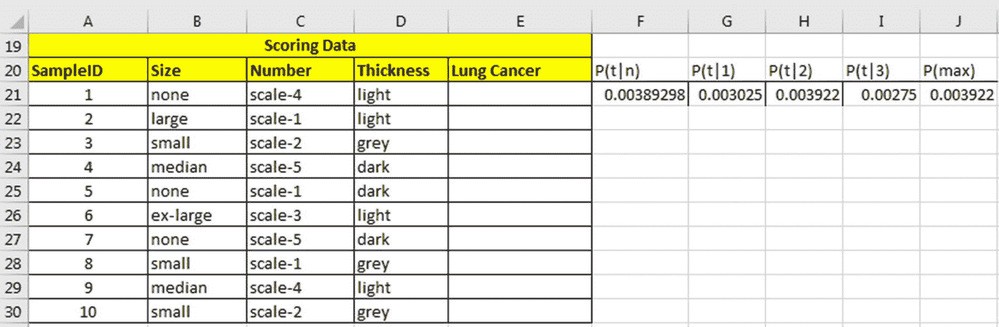

一个 Excel 截图展示了评分数据。它包含一个表格，列标题为样本 ID、尺寸、数字、厚度和肺癌。右侧有概率计算。

图 9-8
计算评分数据集的概率

1.  要计算 p(刻度-1|阴性)，请在单元格 C10 中输入以下公式：

```
    =COUNTIFS($C$34:$C$2011,$B10,$E$34:$E$2011,C$2)/C$3
    ```

2.  从单元格 C10 自动填充到单元格 F10，然后一起自动填充到单元格 C14:F14。

3.  要计算 p(浅色|阴性)，请在单元格 C15 中输入以下公式：

```
    =COUNTIFS($D$34:$D$2011,$B15,$E$34:$E$2011,C$2)/C$3
    ```

4.  从单元格 C15 自动填充到单元格 F15，然后一起自动填充到单元格 C17:F17。

再次检查我们的工作表。它应该看起来类似于图 9-7。到目前为止，我们已经基于训练数据集完成了每个单独条件概率的计算。

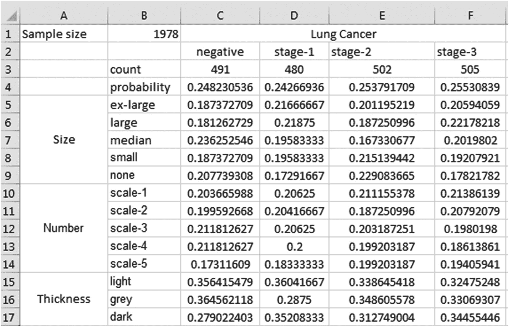

一个 Excel 截图。行标题是尺寸、数字和厚度。列标题是阴性和 1 期到 3 期。所有单元格都包含数值数据。

图 9-7
再次检查我们的数据和公式

继续处理评分数据集，请按照以下说明操作：

5.  在单元格 F21 中，输入以下公式：

```
    =SUMIF($B$5:$B$17,$B21,C$5:C$17) * SUMIF($B$5:$B$17,$C21,C$5:C$17) * SUMIF($B$5:$B$17,$D21,C$5:C$17) * C$4
    ```

第 21 行是第一条评分记录。B21 是第一条评分记录的“尺寸”属性。在此特定情况下，B21 的值为“无”。单元格 C5:C17 存储了所有相对于类别“阴性”的单个条件概率。

表达式 `SUMIF($B$5:$B$17,$B21,C$5:C$17)` 对数组 C5:C17 中所有与数组 B5:B17 中对应单元格值为“无”的单元格进行求和。实际上，此表达式获取了评分记录 1（属性：尺寸）的条件概率 p(无|阴性)。

`SUMIF($B$5:$B$17,$C21,C$5:C$17)` 获取了评分记录 1（属性：数字）的条件概率 p(刻度-4|阴性)。

`SUMIF($B$5:$B$17,$D21,C$5:C$17)` 获取了评分数据记录 1（属性：厚度）的条件概率 p(浅色|阴性)。

单元格 F21 中的公式实现了当类别为“阴性”时，评分数据记录 1 的方程 (9-7)。

6.  从单元格 F21 自动填充到单元格 I21。

单元格 G21 中的公式实现了当类别为“1 期”时，评分数据记录 1 的方程 (9-7)。

单元格 H21 中的公式实现了当类别为“2 期”时，评分数据记录 1 的方程 (9-7)。

单元格 I21 中的公式实现了当类别为“3 期”时，评分数据记录 1 的方程 (9-7)。

7.  在单元格 J21 中，输入公式 `=MAX(F21:I21)`。

由于类别超过两个，最终的分类类别由 F21:I21 中的最大值决定。请注意，此处未计算最终概率，即未实现方程 (9-8)。如果需要，我们可以通过公式 `=F21/SUM(F21:I21)` 计算 P(阴性|记录 1)。评分记录 1 的其他类别的概率可以类似方式计算。

我们的工作表部分内容如图 9-8 所示。

8.  将单元格 F21:J21 一起自动填充到单元格 F30:J30。

9.  在单元格 E21 中，输入以下公式，然后从单元格 E21 自动填充到 E30：

```
    =INDEX($C$2:$F$2, MATCH(J21, F21:I21, 0)) &" ("&TEXT(J21/SUM(F21:I21),"0.0000")&")"
    ```

上述公式值得详细解释。此公式找到评分记录 1 最可能对应的类别，并显示该类别的概率。
    1.  单元格 C2:F2 存储了目标变量“肺癌”的类别名称。单元格 F21:I21 存储了评分记录 1 相对于每个类别的概率。

2.  `=INDEX($C$2:$F$2, MATCH(J21, F21:I21, 0))` 根据单元格 J21 中的值（即 F21:I21 的最大值）找到“肺癌”对应的类别。F21:I21 中必须有一个值与单元格 J21 匹配。在此特定情况下，该值是 H21。函数 INDEX 返回单元格 C2:F2 中与 `F21:I21` 中的 H21 对齐的单元格的值。

3.  运算符 & 用于将多个字符串连接在一起。

4.  `J21/SUM(F21:I21)` 通过遵循方程 (9-8) 计算评分记录 1 最可能类别的概率。

5.  `TEXT(J21/SUM(F21:I21),"0.0000")` 格式化概率，以便小数点后显示四位数字。

我们的最终结果应类似于图 9-9。请注意，由于训练数据集是随机生成的，图 9-9 中的概率（E 列）并不占主导地位。它们都接近 0.25。

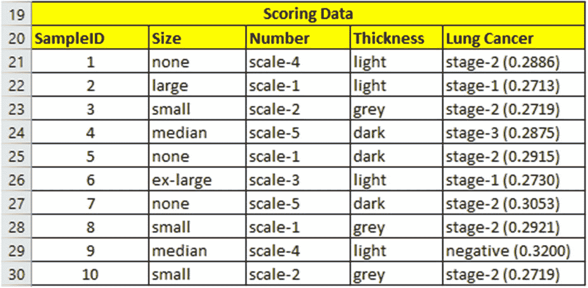

一个 Excel 截图展示了朴素贝叶斯分类。它包含一个表格，列标题为样本 ID、尺寸、数字、厚度和肺癌。所有单元格都有数据。

图 9-9
朴素贝叶斯分类完成


从练习 2 可以看出，Excel 非常适合进行朴素贝叶斯分析。练习 2 的完整结果可在 Chapter9-2b.xlsx 文件中找到。

请注意，对于 Size、Number 和 Thickness 这三个属性，我们在步骤 3、5 和 7 中输入了三个不同的公式。有一种方法可以让我们通过在 C5 单元格中输入一个公式，然后自动填充到 F17 单元格，从而完成所有三个属性的概率计算。我们将在下一章中体验这种技巧。

Chapter9-2a.xlsx 中呈现的数据是随机生成的，不适合用于交叉验证。然而，考虑到训练数据集的大小，我们当然可以将其分成两部分来练习交叉验证。

## 强化练习

Chapter9-HW.xlsx 中的数据下载自著名的 UCI 机器学习库，网址为[`https://archive.ics.uci.edu/`](https://archive.ics.uci.edu/)。该数据集为练习朴素贝叶斯数据挖掘提供了很好的机会。需要帮助时，请参考 Chapter9-HW-withAnswers 文件。

## 复习要点

1.  对朴素贝叶斯的总体理解。学习如何从条件概率推导出贝叶斯定理，并尝试自己重复推导过程。

2.  COUNTIF、COUNTIFS 和 SUMIF 函数以及连接运算符&。

3.  INDEX、MATCH 和 TEXT 函数。

