# 10. 决策树

决策树可能是最直观的数据分类和预测方法，它也被频繁使用。虽然我们学过的大多数数据挖掘方法都是参数化的，但决策树是一种基于规则的方法。理解决策树最关键的概念是熵，我们很快就会解释它。树由节点组成，叶子节点是最底层的节点。在每个非叶子节点处，必须做出决策，将该节点至少分成两个分支。图 10-1 描绘了一个示例决策树结构。

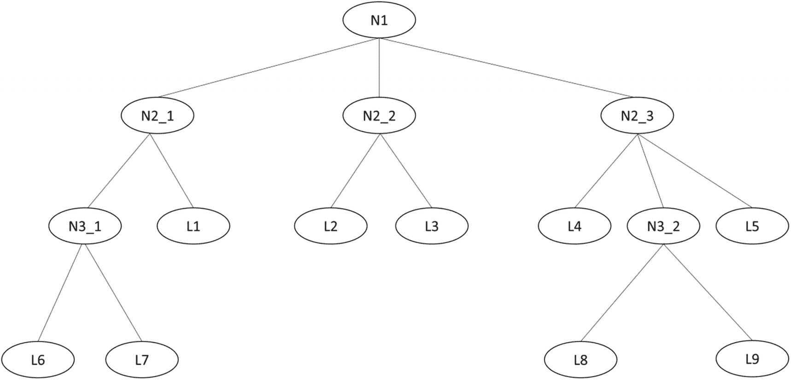

一个决策树结构。节点 N1 被细分为节点 N2_1、N2_2 和 N2_3。节点 N2_1 被细分为 N3_1 和 L1。节点 N2_2 被细分为 L2 和 L3。节点 N2_3 被细分为 L4、N3_2 和 L5。节点 N3_1 被细分为 L6 和 L7。节点 N3_2 被细分为 L8 和 L9。

图 10-1

一个示例决策树结构

在图 10-1 中，所有节点都以字母“N”开头，而所有叶子节点都以字母“L”开头。在决策树中，一个节点可以分裂成两个或更多的子节点。然而，叶子节点永远不能再被分裂。决策树中最关键的操作是确定如何分裂一个节点。尽管每个节点都适用一个通用规则，但必须根据每个节点内部的数据单独考虑。

请从[`https://github.com/hhohho/Learn-Data-Mining-through-Excel-2`](https://github.com/hhohho/Learn-Data-Mining-through-Excel-2)下载本章练习所需的示例 Excel 文件。

## 总体理解

决策树中节点如何分裂，是基于该节点内部数据计算出的熵。熵表示树节点内部数据的“纯净”程度。熵越高，数据越不纯净。让我们学习如何计算熵，以便更好地理解。

假设一个数据集的目标变量有`m`个不同的类别。该数据集的熵通常根据公式(10-1)计算：

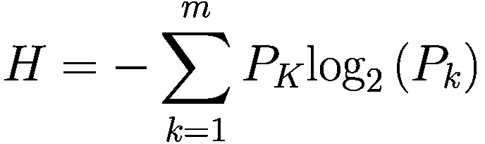

(10-1)

在公式(10-1)中，*P*[*K*]是第 k 个类别出现的概率；它用于对 log2 进行加权。例如，假设有 10 个数据项，其中 3 个是“是”，7 个是“否”。由于只有两个不同的类别（是或否），所以`m` = 2。

*   对于“是”，*p* = 3/10 = 0.3，log2 = -1.74，*p*log2 = -0.52。

*   对于“否”，*p* = 7/10 = 0.7，log2 = -0.51，*p*log2 = -0.36。

*   H = -(-0.52 - 0.36) = 0.88。

如果有 10 个“是”和 0 个“否”，计算如下：

*   对于“是”，*p* = 10/10 = 1，log2 = 0，*p*log2 = 0。

*   对于“否”，*p* = 0/10 = 0，*p*log2 = 0（假设 log2 不是错误）。

*   H = -(0 + 0) = 0。

如果有 5 个“是”和 5 个“否”，计算得出 H = 1.0。

似乎数据越偏向某个类别，熵就越低。决策树方法倾向于选择能产生最小熵的属性来分裂节点。这很容易理解。假设我们面前有两条路，需要选择一条到达目的地。如果两条路让我们准时到达的可能性相同，我们会发现自己犹豫不决（H=1）。如果某条路让我们准时到达的可能性明显大得多，我们的决定就不会困难。此外，如果只有一条路，我们的选择就是确定的（H = 0）。

在公式(10-1)中，使用了以 2 为底的对数。以 2 为底的对数是决策树中最常用的对数函数。当数据集中只有两个类别时，以 2 为底的对数能保证熵在 0 到 1 之间（包含端点）。当类别超过两个时，以 2 为底的对数不能保证熵在 0 到 1 之间。如果我们希望熵在 0 到 1 之间，那么当有 N 个不同类别时，必须使用以 N 为底的对数函数。

让我们使用著名的高尔夫数据集（也称为天气数据集）来解释如何构建决策树。

表 10-1

打高尔夫数据集

| Temperature | Humidity | Windy | Outlook | Play |
| --- | --- | --- | --- | --- |
| Hot | High | FALSE | overcast | Yes |
| Cool | Normal | TRUE | overcast | Yes |
| Mild | High | TRUE | overcast | Yes |
| Hot | Normal | FALSE | overcast | Yes |
| Mild | High | FALSE | rainy | Yes |
| Cool | Normal | FALSE | rainy | Yes |
| Cool | Normal | TRUE | rainy | No |
| Mild | Normal | FALSE | rainy | Yes |
| Mild | High | TRUE | rainy | No |
| Hot | High | FALSE | sunny | No |
| Hot | High | TRUE | sunny | No |
| Mild | High | FALSE | sunny | No |
| Cool | Normal | FALSE | sunny | Yes |
| Mild | Normal | TRUE | sunny | Yes |

这个数据集非常简单。它只有 14 个样本和 4 个属性。是否打高尔夫取决于这 4 个属性。基于这个训练数据集构建决策树，首要任务是从一开始就找到一个属性，将树分裂成多个分支。为此，我们需要计算目标变量 Play 的熵，以及 4 个属性相对于目标变量的熵。

对于目标变量 Play，有 9 个 Yes 和 5 个 No；因此，根据公式(10-1)

```
H-play = -(9/14×log2(9/14)+5/14×log2(5/14)) = 0.94
```


对于属性 Outlook（天气），共有 3 个值（状态）：阴天（overcast）、雨天（rainy）和晴天（sunny）；每个值分别有 4、5 和 5 个数据点。考虑阴天的情况，4 个阴天对应 4 个“是”和 0 个“否”。因此，

```
H-outlook-overcast = -(4/4×log2(4/4)+0/4×log2(0/4)) = 0.0
```

注意，此处 log2(0) = 0。

类似地，5 个雨天对应 3 个“是”和 2 个“否”，5 个晴天对应 2 个“是”和 3 个“否”。因此，

```
H-outlook-rainy = -(3/5×log2(3/5)+2/5×log2(2/5)) = 0.97
H-outlook-sunny = -(2/5×log2(2/5)+3/5×log2(3/5)) = 0.97
```

这三个子熵值在求和之前必须进行加权。阴天、雨天和晴天的权重分别为 4/14、5/14 和 5/14。因此，

```
H-outlook = 4/14×0.0+5/14×0.97+5/14×0.97 = 0.69
```

继续对温度（Temperature）、湿度（Humidity）和风（Windy）进行此计算；我们得到

```
H-temperature = 0.91
H-humidity = 0.79
H-windy = 0.89
```

这里引入另一个概念：“信息增益”（information gain），它表示基于某个属性划分当前数据集所能获得的信息量。其定义为目标变量的熵与某个属性的熵之差。例如，Outlook 的信息增益 = 0.94 – 0.69 = 0.25。

信息增益可能会偏向于取值较多的属性。为了减少这种偏差，可以使用“增益率”（gain ratio）。某个属性的增益率定义为

*   属性增益率 = 属性信息增益 / 属性固有信息

属性的固有信息通过公式（10-2）计算：

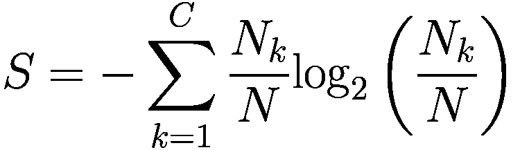

（10-2）

在公式（10-2）中，*N* 表示数据量，*N*[*k*] 是给定属性值的数据点数量，而 C 是某个属性的不同取值个数。

让我们再次以属性 Outlook 为例来应用公式（10-2）。

*   Outlook 有三个不同的取值：阴天、雨天和晴天。因此，C = 3。

*   有 4 个阴天；因此，N-阴天 = 4。

*   类似地，N-雨天 = 5 且 N-晴天 = 5。

属性 Outlook 的固有信息计算如下：

```
S-outlook
= -(4/14×Log2(4/14)+5/14×Log2(5/14)+5/14×Log2(5/14))
= 1.58
```

属性 Outlook 的最终增益率 `= (0.94–0.69)/1.58 = 0.16`。

由于在我们的决策树示例中，信息增益是衡量节点分裂的一个良好指标，我们不会为每个属性计算增益率。相反，会选择信息增益最大的属性来分裂树节点。在这种情况下，选择 Outlook 将树节点根据三个值（阴天、雨天和晴天）分裂为三个子节点。

由于阴天节点的熵为 0.0，它必定是一个叶节点。另外两个节点，即雨天节点和晴天节点，可以进一步根据温度、风或湿度进行划分。

## 通过 Excel 学习决策树

上述计算可能非常繁琐且容易出错。让我们使用 Excel 来简化这个过程。打开 Chapter10-1a.xlsx；里面只有一个名为 level-1 的工作表（level-1 表示这是树节点的第一层）。Chapter10-1a.xlsx 中的数据与表 10-1 完全相同，如图 10-2 所示。

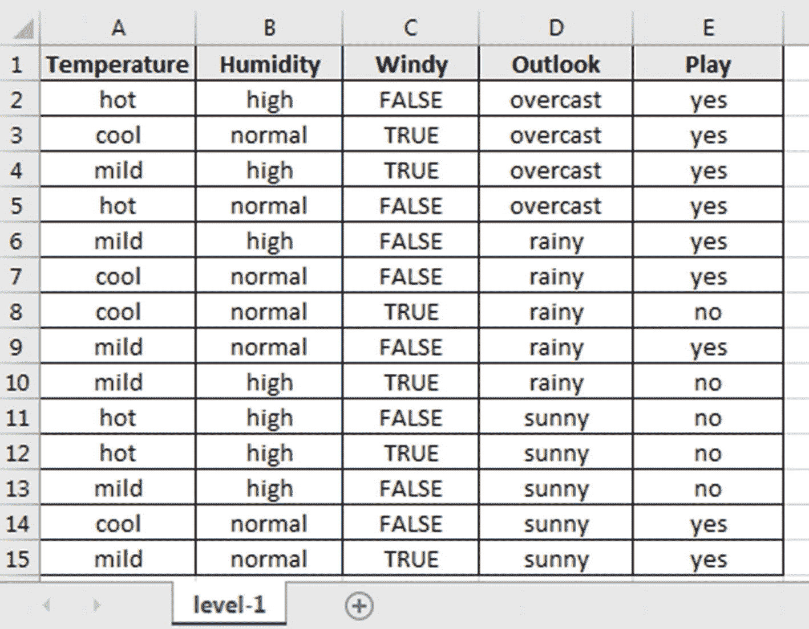

一张 Excel 中高尔夫数据的截图，包含 A 到 E 列以及第 1 到 14 行。列标题分别为温度、湿度、风、天气和是否打球。每个单元格都包含数据。

图 10-2

Excel 中的高尔夫数据

### 通过 Excel 学习决策树

我们需要将数据设置在一个合适的表格中，以便能够自动填充公式。我们在前面的章节中已经见过这样的表格组织方式。

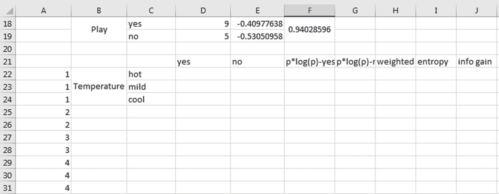

一张 Excel 截图。包含数据的单元格有 A22 到 A31（分别为 1, 1, 1, 2, 2, 3, 3, 4, 4, 4），B22 到 B24 是温度，C22 是热，C23 是温和，C24 是凉爽，D21 是“是”，E21 是“否”，F21 是 p 乘以 log(p)，G21 是 p 乘以 log(p) 减去 r，H21 是加权，I21 是熵，J21 是信息增益。

图 10-5

处理中的表格设置

1.  在单元格 A16 中输入“样本大小”，在单元格 B16 中输入 14。14 是数据量。

2.  在单元格 E17 中输入“p*log(p)”。p*log(p) 代表公式（10-1）中的 *P*[*K*]log2。

3.  在单元格 F17 中输入“熵”。

4.  合并单元格 B18 和 B19；在合并后的单元格中输入“是否打球”。

5.  在单元格 C18 中输入“是”，在单元格 C19 中输入“否”。

到目前为止，我们的工作表部分看起来像图 10-3，只是我们的工作表中单元格 D18 或 D19 没有数字。别担心，我们很快就会计算它们。

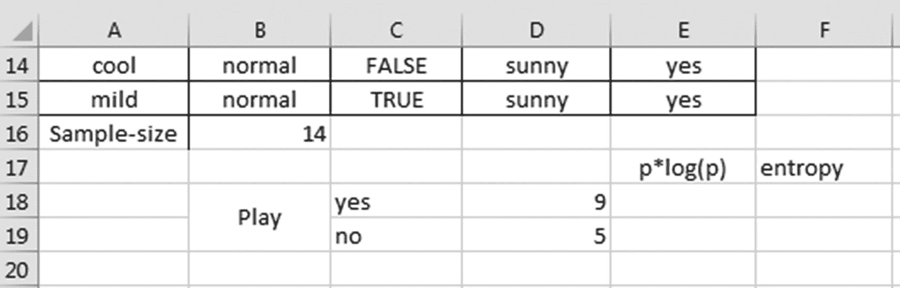

一张 Excel 中高尔夫数据的截图，包含 A 到 F 列以及第 14 到 20 行。包含数据的单元格有 A16 是样本大小，B16 是 14，E17 是 p 乘以 log(p)，F17 是熵，B18 和 B19 是是否打球，C18 是“是”，C19 是“否”，D18 是 9，D19 是 5。

图 10-3

高尔夫数据集及“是否打球”的表格设置

按照以下说明完成目标变量“是否打球”的熵的计算：

6.  在单元格 D18 中，输入公式 `=COUNTIFS($E$2:$E$15,C18)`。这会统计“是否打球”中“是”的数量。

7.  从单元格 D18 自动填充到单元格 D19。D19 统计“是否打球”中“否”的数量。

8.  在单元格 E18 中，输入公式 `=D18/$B$16*LOG(D18/$B$16,2)`。此公式计算 P[是] × Log2(P[是])。

9.  从 E18 自动填充到 E19。E19 计算 P[否] × Log2(P[否])。

10. 合并单元格 F18 和 F19；在合并后的单元格中输入公式 `=-SUM(E18:E19)`。结果就是目标变量“是否打球”的熵。

我们的工作表看起来像图 10-4。

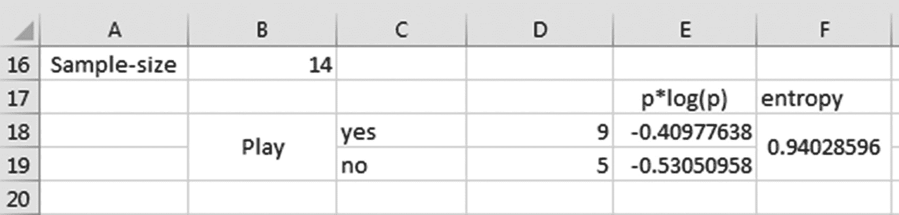

一张 Excel 截图。包含数据的单元格有 A16 是样本大小，B16 是 14，E17 是 p 乘以 log(p)，F17 是熵，B18 和 B19 是是否打球，C18 是“是”，C19 是“否”，D18 是 9，D19 是 5，E18 是 -0.40977638，E19 是 -0.53050958，F18 和 F19 是 0.94028596。

图 10-4

“是否打球”的熵已计算完成

现在是时候为四个属性设置合适的表格了。技巧在于，一旦第一个公式正确定义，如何实现垂直自动填充以处理排列在不同列中的不同属性（见图 10-2）。这听起来可能有些挑战性，但 INDEX 函数可以提供帮助。

函数 INDEX 需要一个数组（实际上是一个表格）作为第一个输入参数。如果第二个参数（行）为 0，则该函数返回由数组中的列号指定的列。在数据集中，温度、湿度、风和天气分别是第 1、2、3 和 4 列。表达式 `INDEX($A$2:$E$15,0,1)` 获取温度列，而 `INDEX($A$2:$E$15,0,4)` 获取天气列。

按照以下说明为四个属性设置辅助表格：

11. 在单元格 A22:A31 中分别输入 1, 1, 1, 2, 2, 3, 3, 4, 4, 4。

12. 在单元格 D21:J21 中分别输入“是”、“否”、“p*log(p)-是”、“p*log(p)-否”、“加权”、“熵”和“信息增益”。“加权”列存储每个属性值的加权熵。

13. 合并单元格 B22:B24；在合并后的单元格中输入“温度”。

14. 在单元格 C22、C23 和 C24 中分别输入“热”、“温和”和“凉爽”。


我们工作表的一部分如图 10-5 所示。观察发现，当对齐单元格 A22:A24 与 C22:C24 时，“hot”、“mild”和“cool”都对应 1，因为它们都是属性 Temperature（温度）的值，而该属性位于表格 A1:E15 的第一列。

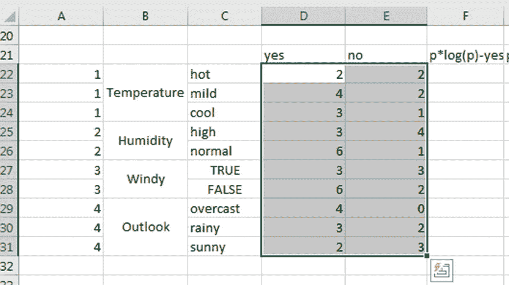

一张 Excel 截图，显示 A 至 F 列以及 20 至 32 行。D22 至 D31 和 E22 至 E31 单元格包含数值，这些单元格已被高亮显示。

图 10-7

跨属性自动填充

1.  合并单元格 B25 和 B26；在合并后的单元格中输入“Humidity”。

2.  在单元格 C25 和 C26 中分别输入“high”和“normal”。

3.  合并单元格 B27 和 B28；在合并后的单元格中输入“Windy”。

4.  在单元格 C27 中输入“TRUE”，在单元格 C28 中输入“FALSE”。

5.  合并单元格 B29:B31；在合并后的单元格中输入“Outlook”。

6.  在单元格 C29、C30 和 C31 中分别输入“overcast”、“rainy”和“sunny”。

我们工作表的另一部分与图 10-6 类似。

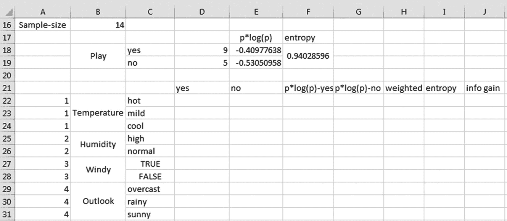

一张 Excel 截图，显示 A 至 J 列以及 16 至 31 行。部分包含数据的单元格有：B25 和 B26 为 humidity，B27 和 B28 为 windy，B29 至 B31 为 outlook，C25 至 C31 分别为 high、normal、true、false、overcast、rainy 和 sunny。

图 10-6

建立所有辅助表

辅助表准备就绪后，按照以下说明计算熵和信息增益：

7.  在单元格 D22 中输入以下公式：

```
    =COUNTIFS(INDEX($A$2:$E$15,0,$A22), $C22,$E$2:$E$15,D$21)
    ```

单元格 A22 引用 1；因此，`INDEX($A$2:$E$15,0,$A22)` 会获取 Temperature 列。此公式统计同时满足 Temperature 为“hot”且 Play 为“yes”的数据点数量。

8.  从单元格 D22 自动填充至 E22，然后一起自动填充至单元格 D31:E31。如图 10-7 所示。

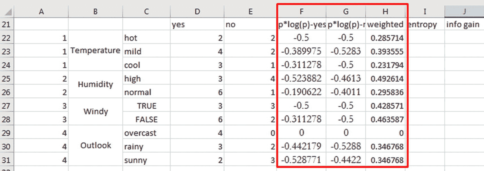

一张 Excel 截图，显示 A 至 J 列以及 21 至 31 行。F22 至 F31、G22 至 G31 和 H22 至 H31 单元格包含小数值。F、G 和 H 列已被高亮显示。

图 10-8

计算出的各个熵值

1.  在单元格 F22 中输入以下公式：

```
    =IFERROR(D22/SUM($D22:$E22)*LOG(D22/SUM($D22:$E22), 2), 0)
    ```

`SUM($D22:$E22)` 有可能返回 0，因此表达式 `D22/SUM($D22:$E22)` 会产生除零错误。此外，log 函数不能以 0 作为输入。因此，这里使用 IFERROR 函数来捕获此类错误。如果发生错误，则返回 0。

此公式计算属性值“hot”对应的 P[yes] × Log2(P[yes])。

2.  从单元格 F22 自动填充至 G22，然后一起自动填充至单元格 F31:G31。注意，单元格 G22 计算属性值“hot”对应的 P[no] × Log2(P[no])。

3.  在单元格 H22 中，输入公式 `=-SUM($D22:$E22)/$B$16 *(F22+G22)`。计算出的值是属性 Temperature 的值“hot”的加权子熵。

4.  从单元格 H22 自动填充至 H31。

我们工作表的一部分如图 10-8 所示。

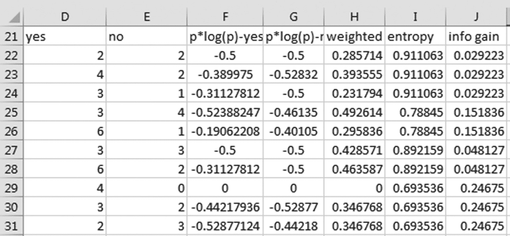

一张 Excel 截图，显示 D 至 J 列以及 21 至 31 行。D 列和 E 列的单元格包含个位数，F 至 J 列包含小数值。

图 10-9

计算出的熵和信息增益

1.  在单元格 I22 中，输入公式 `=SUMIFS(H$22:H$31,$A$22:A$31,A22)`；从单元格 I22 自动填充至 I31。单元格 I22 中的公式计算属性 Temperature 的熵。

2.  在单元格 J22 中，输入公式 `=F$18-I22` 以获取属性 Temperature 的信息增益。从单元格 J22 自动填充至 J31。将我们的结果与图 10-9 进行比较。

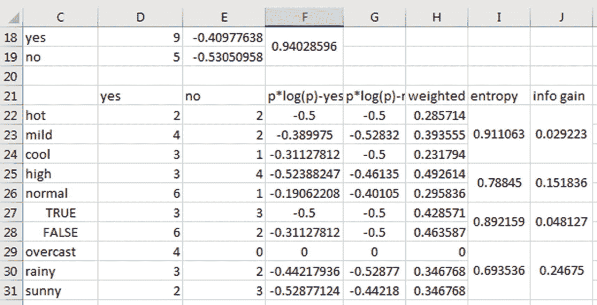

一张 Excel 截图，表示第一级值的划分。列标题包括 yes、no、p asterisk log of p minus yes、p asterisk log of p minus r、weighted、entropy 和 info gain。

图 10-10

第一级划分将基于 Outlook

1.  分别合并单元格 I22:I24、I25:I26、I27:I28、I29:I31、J22:J24、J25:J26、J27:J28 和 J29:J31。计算完成，如图 10-10 所示。由于属性 Outlook 具有最大的信息增益，因此选择它来划分第一级树节点。

1.  我们可以绘制一个简单的“树形图”，如图 10-11 所示。由于加权熵 H-outlook-overcast 为零，子节点 overcast(4,0) 是一个叶节点。下一个任务是划分节点 rainy(3,2) 和 sunny(2,3)。

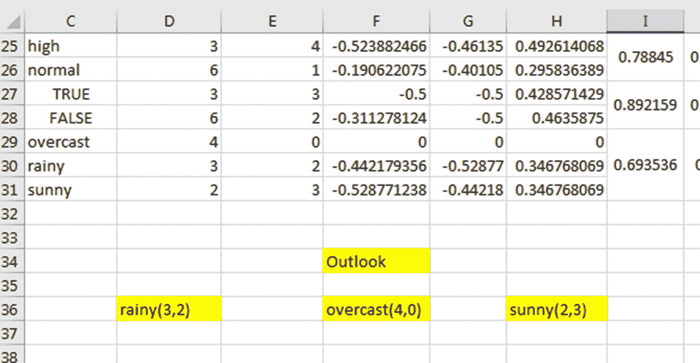

一张 Excel 截图，显示 C 至 I 列以及 25 至 37 行。部分包含数据的单元格有：F34 为 outlook，D36 为 rainy (3, 2)，F36 为 overcast (4, 0)，H36 为 sunny (2, 3)。

图 10-11

一个简单的树形图

按照以下说明划分节点 rainy(3,2)：

2.  复制工作表 level-1；将新工作表重命名为 level-2-rainy。

3.  在工作表 level-2-rainy 中，在单元格 F1 中输入“rainy”。

4.  在单元格 B16 中，输入公式 `=COUNTIFS($D$2:$D$15,$F$1)`。这将只统计那些 Outlook 值为“rainy”的单元格。

确保我们的工作表与图 10-12 完全一致。

按照以下说明继续完成任务：

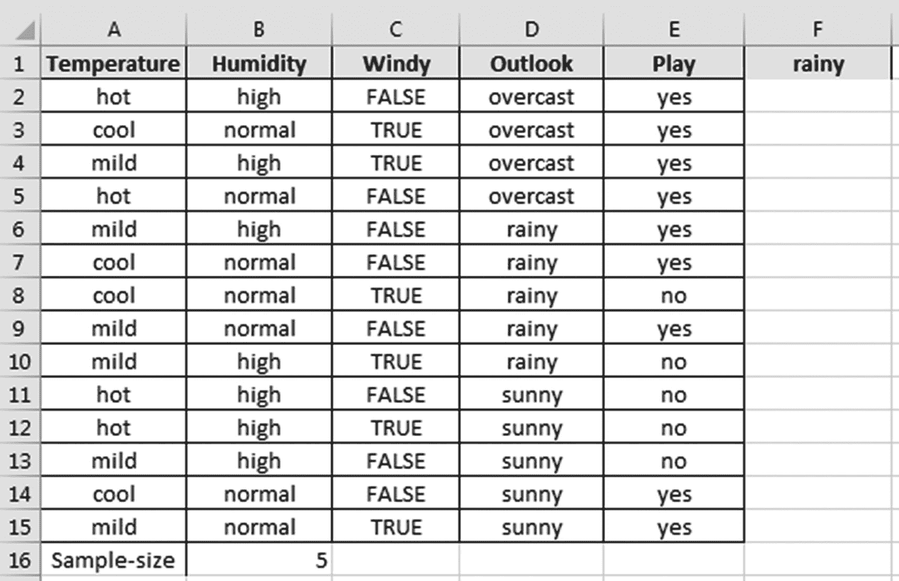

一张 Excel 截图，显示 A 至 F 列以及 1 至 16 行。列标题为 temperature、humidity、windy、outlook、play 和 rainy。A 至 E 列以及 1 至 15 行的单元格包含数据。单元格 A16 和 B16 分别代表样本大小和 5。

图 10-12

处理划分树节点 rainy(3,2)

5.  单元格 D18 包含公式 `=COUNTIFS($E$2:$E$15,C18)`。在公式中“C18”之后插入 `",$D$2:$D$15,$F$1"`，使公式变为：

```
    =COUNTIFS($E$2:$E$15,C18,$D$2:$D$15,$F$1)
    ```

同样，这将只包含那些 Outlook 值为“rainy”的单元格。

6.  从单元格 D18 自动填充至 D19。

7.  将 `",$D$2:$D$15,$F$1"` 插入到单元格 D22 的公式中；确保其公式变为：

```
    =COUNTIFS(INDEX($A$2:$E$15,0,$A22),$C22, $E$2:$E$15,D$21,$D$2:$D$15,$F$1)
    ```

8.  从 D22 自动填充至 E22，然后一起自动填充至单元格 D31:E31。

我们工作表的一部分应如图 10-13 所示。

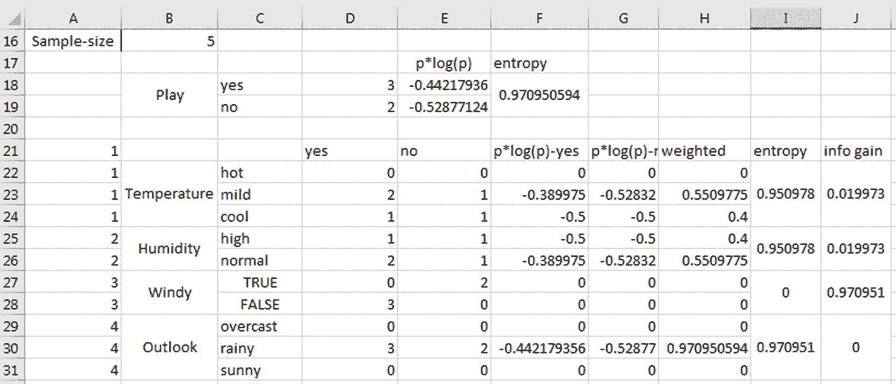

一张 Excel 截图，表示 rainy 的熵和信息增益值。列标题包括 yes、no、p asterisk log of p minus yes、p asterisk log of p minus r、weighted、entropy 和 info gain。

图 10-13

为 rainy(3,2) 计算出的所有熵和信息增益值

9.  看起来节点 rainy(3,2) 应该基于 Windy 进行分支。由于两个子节点 Windy-t(0,2) 和 Windy-f(3,0) 的熵都为零，它们都是叶节点。我们可以将现有的“图表”修改为图 10-14。

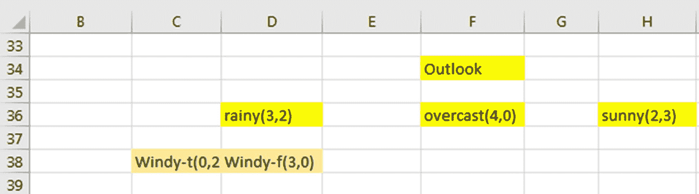

一张 Excel 截图，显示 B 至 H 列以及 33 至 39 行。F34 为 outlook，D36 为 rainy (3, 2)，F36 为 overcast (4, 0)，H36 为 sunny (2, 3)，C38 为 windy t (0, 2)，D38 为 windy f (3, 0)。

图 10-14

基于 Windy 划分节点 rainy(3,2)

划分节点 sunny(2,3) 相当简单。按照以下说明操作：

10. 复制工作表 level-2-rainy；将新工作表重命名为 level-2-sunny。

11. 在工作表 level-2-sunny 中，将单元格 F1 中的文本更改为“sunny”。

就这样；所有计算都由 Excel 自动完成。结果如图 10-15 所示。

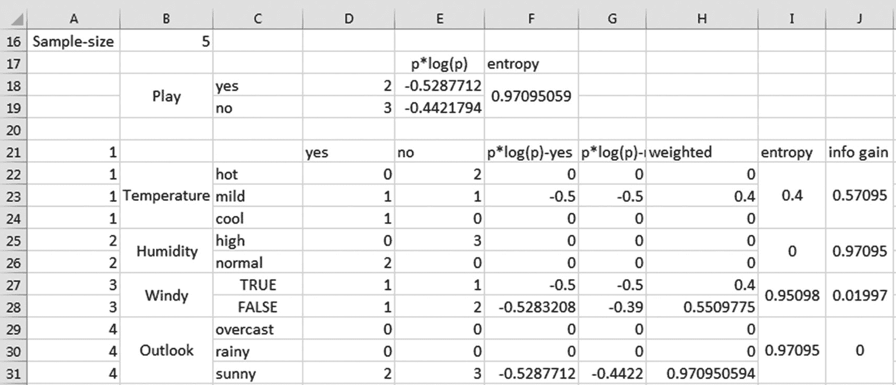


一张 Excel 截图展示了晴天（Sunny）的熵和信息增益值。列标题包括：是、否、p 乘以 log(p) 减去是、p 乘以 log(p) 减去否、加权、熵和信息增益。

图 10-15

为晴天(2,3)计算的所有熵和信息增益值

从工作表 level-2-sunny 显示的结果中，我们注意到树节点晴天(2,3)应根据湿度（Humidity）进行分支。由于生成的两个子节点熵均为零，它们都是叶节点。因此，无需再对树进行拆分。结果如图 10-16 所示。

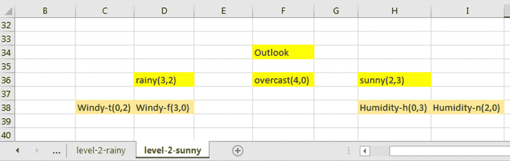

一张 Excel 截图，包含 B 到 H 列以及第 33 到 39 行。F34 是 outlook（天气），D36 是 rainy（雨天）(3, 2)，F36 是 overcast（阴天）(4, 0)，H36 是 sunny（晴天）(2, 3)，C38 是 windy t（有风-是）(0, 2)，D38 是 windy f（有风-否）(3, 0)，H38 是 humidity h（湿度-高）(0, 3) 和 humidity n（湿度-正常）(2, 0)。

图 10-16

决策树构建完成

属性温度（Temperature）从未用于拆分树。这恰好是该数据集的情况，即决策完全不依赖于温度。

上述过程的完整结果可在文件 Chapter10-1b.xlsx 中找到。

您可能会想，是否可以应用在层次聚类章节中绘制树状图时学到的相同技巧来绘制树形图。当然可以。同样，这需要大量手动操作，因此我在此不进行演示，留给您自行尝试。

### 一种更好的方法

还记得当我们从步骤 31 开始拆分节点 rainy(3,2) 时，需要修改工作表 level-2-rainy 中的一些公式吗？还有另一种非常相似但无需修改任何公式的方法。该方法在文件 Chapter10-2b.xlsx 中提供。这种方法更灵活、更好，但关键公式稍微复杂一些。这也是我一开始没有介绍它的原因之一。此外，在我们对 Excel 中的决策树分析有了清晰思路之后，再介绍这种方法，能让我们更欣赏它。请按照以下说明操作：

1.  打开 Chapter10-2a.xlsx。其中只有一个名为“level-1”的工作表，该工作表与文件 Chapter10-1b.xlsx（我们之前处理过的那个）中的工作表 level-1 相同。此工作表如图 10-17 所示。

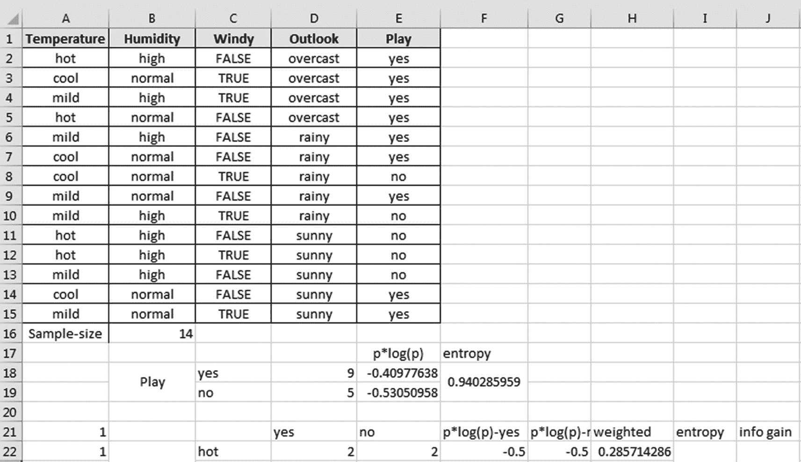

一张工作表 level-1 的 Excel 截图。它包含 A 到 J 列以及第 2 到 22 行。列标题为：温度、湿度、有风、天气和是否打球。

图 10-17

工作表 level-1 概览

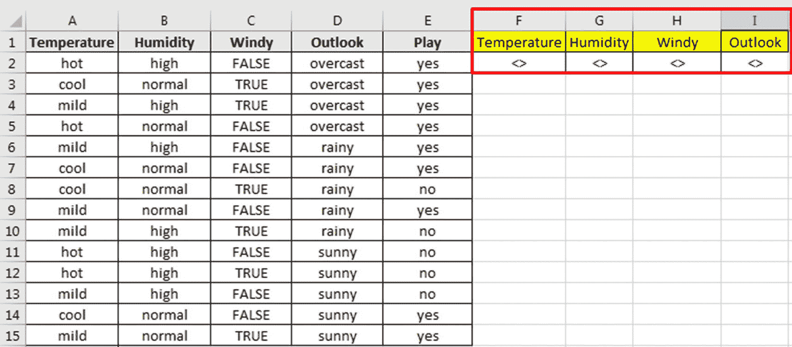

一张 Excel 截图，包含 A 到 I 列以及第 1 到 15 行。F 到 I 列的列标题为：温度、湿度、有风和天气。第 2 行的单元格内容为不等号。

图 10-18

数据表的额外设置

1.  分别在单元格 F1、G1、H1 和 I1 中输入文本“温度”、“湿度”、“有风”和“天气”。在单元格 F2:I2 中输入“<>”（不含引号）。“<>”在 Excel 中表示“不等于”。请参考图 10-18。

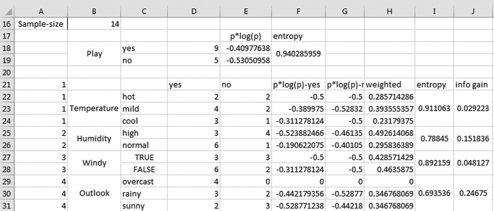

一张 Excel 截图，展示了计算结果。列标题包括：是、否、p 乘以 log(p) 减去是、p 乘以 log(p) 减去否、加权、熵和信息增益。

图 10-19

更好方法的计算结果

1.  在单元格 B16 中输入以下公式：

```
    =COUNTIFS(A2:A15,F2,B2:B15, G2,C2:C15,H2,D2:D15,I2)
    ```

由于单元格 F2:I2 都包含“<>”，上述公式实际上并未为 COUNTIFS 函数设置任何条件。单元格 B16 中的值仍然是 14。

2.  在单元格 D18 中，将公式修改为：

`=COUNTIFS($E$2:$E$15,C18,$A$2:$A$15,F$2, $B$2:$B$15,G$2,$C$2:$C$15,H$2,$D$2:$D$15,I$2)`

此公式考虑了单元格 F2:I2 中的条件。

3.  从单元格 D18 自动填充到单元格 D19。

4.  在单元格 D22 中，将公式修改为：

```
    =COUNTIFS(INDEX($A$2:$E$15,0,$A22),$C22, $E$2:$E$15,D$21,$A$2:$A$15,$F$2,$B$2:$B$15, $G$2,$C$2:$C$15,$H$2,$D$2:$D$15,$I$2)
    ```

此公式同样考虑了单元格 F2:I2 中的条件。

5.  从单元格 D22 自动填充到单元格 E22，然后将单元格 D22:E22 一起自动填充到单元格 D31:E31。

此时，此工作表中的所有内容都应自动计算完成。我们工作表的一部分看起来与图 10-19 完全一致，这与我们之前的结果相同。

1.  我们将再次拆分节点 rainy(3, 2)。像之前一样，复制工作表 level-1，并将新工作表重命名为 level-2-rainy。在工作表 level-2-rainy 的单元格 I2 中，输入“rainy”，如图 10-20 所示。仅此而已！此工作表中的所有计算都由 Excel 自动完成。

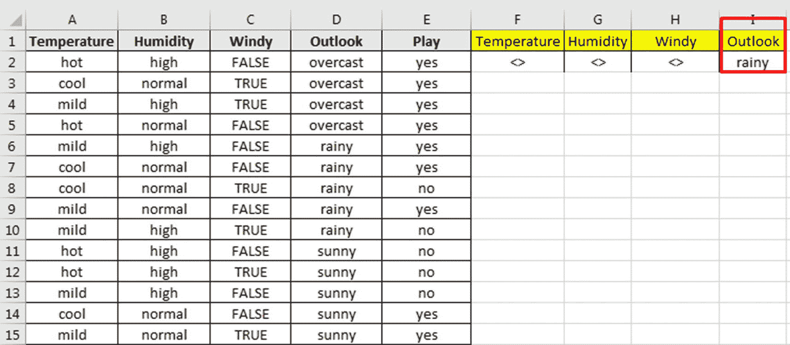

一张 Excel 截图，包含 A 到 I 列以及第 1 到 15 行。F 到 I 列的列标题为：温度、湿度、有风和天气。单元格 I2 的数据为 rainy，并已高亮显示。

图 10-20

工作表 level-2-rainy 概览

1.  要拆分节点 sunny(2, 3)，请复制工作表 level-2-rainy，并将新工作表重命名为 level-2-sunny。在工作表 level-2-sunny 中，将单元格 I2 中的文本更改为“sunny”，如图 10-21 所示。同样，仅此而已。所有计算都由 Excel 为我们自动完成。

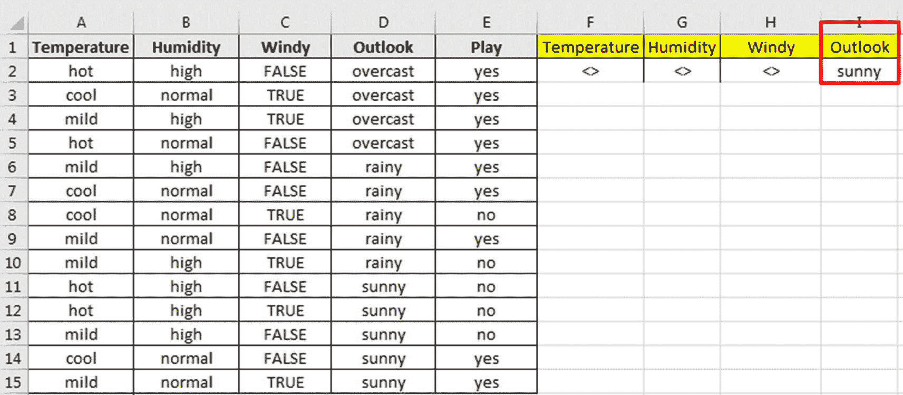

一张 Excel 截图，包含 A 到 I 列以及第 1 到 15 行。F 到 I 列的列标题为：温度、湿度、有风和天气。单元格 I2 的数据为 sunny，并已高亮显示。

图 10-21

工作表 level-2-sunny 概览


### 应用模型

决策树既是分类模型，也是预测模型。我们构建决策树模型是为了预测未来事件的类别。打开 `Chapter10-3a.xlsx` 文件；数据表如图 10-22 所示。

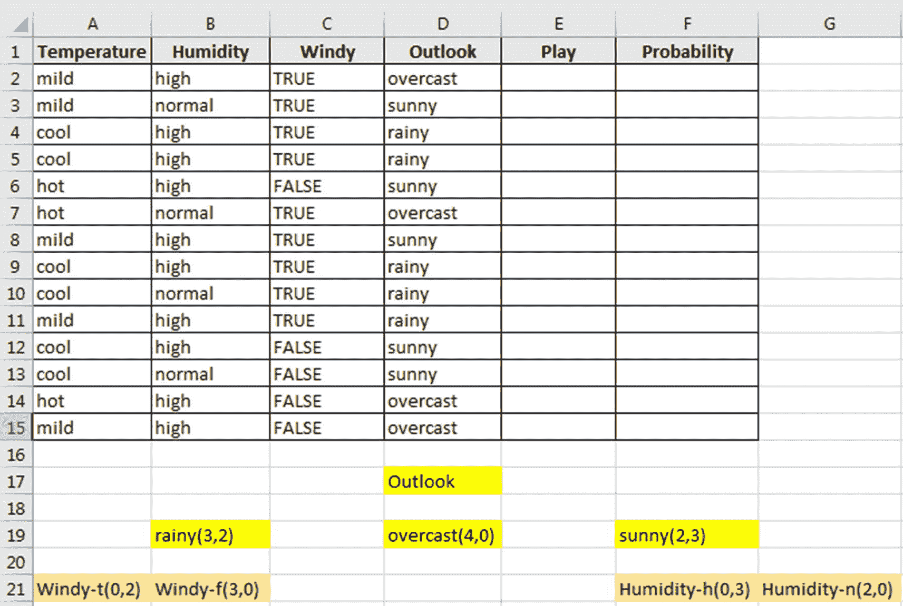

一张 Excel 截图，包含 A 到 G 列以及第 1 到 21 行。列标题为：温度、湿度、风力、天气、是否打球和概率。部分包含数据的单元格有：D17 为“天气”，B19 为“雨天 (3, 2)”，D19 为“阴天 (4, 0)”，D19 为“晴天 (2, 3)”。

图 10-22

基于决策树模型对未来事件的预测

表中的数据是随机生成的。我们的任务是基于图 10-22 所示的决策树模型，预测“是否打球”的决策。该决策树是一个基于规则的模型，最适合使用 IF 函数进行编程实现。

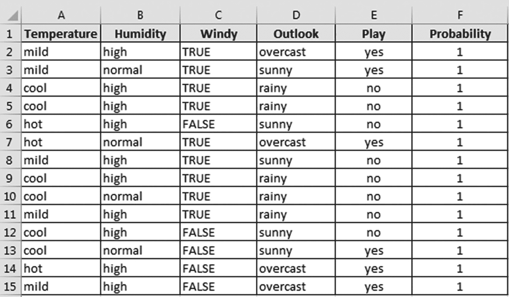

一张计算了决策树概率的 Excel 截图。它包含 A 到 E 列以及第 1 到 14 行。列标题为：温度、湿度、风力、天气、是否打球和概率。每个单元格都包含数据。

图 10-23

计算出的决策树概率

1.  在单元格 E2 中输入以下公式，并从单元格 E2 自动填充到单元格 E15：

    ```
    =IF(D2="overcast","yes", IF(D2="rainy",IF(C2="TRUE","no","yes"), IF(B2="high","no","yes")))
    ```

    此公式实现了我们简单的决策树规则。

2.  在单元格 F2 中输入以下公式：

    ```
    =IF(D2="overcast",4/4, IF(D2="rainy",IF(C2="TRUE",2/2,3/3), IF(B2="high",3/3,2/2)))
    ```

    此公式计算每个“是否打球”类别的概率。每个“是否打球”类别的概率是基于每个叶节点内的数字计算的。例如，如果天气为阴天，叶节点有 4 个“是”和 0 个“否”；因此概率为 4/4 = 1。假设天气为晴天且湿度为高，由于对应的叶节点有 0 个“是”和 3 个“否”，则“否”的概率为 3/3 = 1。我们的数据量非常小，这使得每个叶节点只包含一个类别的数据。这就是如图 10-23 所示所有概率值都为 1 的原因。

    请注意，我们在上述公式中使用了实际数字而不是单元格引用。这是为了更好的演示效果。

在我看来，仅基于每个叶节点内的数字来计算概率是有争议的。然而，这不是本书要讨论的主题。完整的预测结果可以在文件 `Chapter10-3b.xlsx` 中找到，该文件包含一个额外的工作表，用于演示目的而随机化输入数据。

本章到此结束。决策树方法的一个关键部分是模型的可视化。当然，Excel 并不适合绘制自定义的决策树图形。尽管如此，本章展示了 Excel 能够进行决策树分析。

## 强化练习

虽然之前使用的数据集很适合演示，但它非常小，不适用于实际应用。对于本章的强化练习，我们将再次使用汽车评估数据集（Bohanec, Marko. 1997. Car Evaluation. UCI Machine Learning Repository. [`https://doi.org/10.24432/C5JP48`](https://doi.org/10.24432/C5JP48)）。请打开文件 `Chapter10-HW.xlsx` 来练习决策树数据挖掘方法。当你需要帮助时，可以参考 `Chapter10-HW-withAnswers.xlsx`。

## 复习要点

1.  熵、信息增益和增益率

2.  设置辅助表

3.  函数 IF、COUNTIFS、SUMIFS 和 INDEX

4.  函数 LOG 和 IFERROR

5.  运算符 <>

6.  复制工作表以继续树节点分裂

