# 11. 探索性数据分析、数据清洗与特征选择

探索性数据分析（EDA）和数据清洗通常是传统数据挖掘课程中的前两个主题。因此，很自然会问为什么我把它们放在第 11 章。

当我开始自学数据挖掘时，我读的第一本书确实将这两个主题放在了前三章。那时，我完全不知道数据挖掘方法是如何工作的，并且渴望学习其中的奥秘。我不高兴的是，在读完前三章后，我仍然不知道典型的数据挖掘方法是什么，更不用说它们是如何工作的了。直到我读完整本书，我才开始体会到 EDA 和数据清洗的必要性。后来，通过我自己在机器学习方面的实践和研究，我认识到了特征选择的重要性。现在你已经积累了一些关于数据挖掘方法的知识，是时候对 EDA、数据清洗和特征选择这三个在构建数据挖掘模型之前应该执行的任务有所了解了。

请从 [`https://github.com/hhohho/Learn-Data-Mining-through-Excel-2`](https://github.com/hhohho/Learn-Data-Mining-through-Excel-2) 下载本章练习所需的示例 Excel 文件。


## 通过 Excel 学习探索性数据分析

一个典型的数据挖掘项目通常从业务理解和数据理解开始，因为我们需要清楚要解决什么问题以及需要哪些数据。下一个阶段是数据准备，在此阶段我们收集和准备数据。正是在数据准备阶段，我们进行探索性数据分析和数据清洗任务。

关键词“探索性”表明 EDA 指的是初步调查，以便我们了解关于数据的以下信息：

*   记录数量
*   属性数量
*   每个属性的数据类型
*   每个数值属性的总和、均值、中位数和方差
*   每个数值属性的取值范围
*   分类目标和属性的唯一值
*   目标的类别分布
*   是否存在缺失数据
*   数据异常等

Excel 非常适合进行 EDA，因为工作表中的数据直接可见，并且 Excel 拥有许多函数和内置功能，可以轻松完成汇总统计操作和异常检测。请打开 Chapter11-1a.xlsx，该文件展示了由 Chiharu Sano 贡献给 UCI 机器学习仓库的一个数据集。你会注意到，在名为“crx”的工作表中，有 15 个属性和一个目标变量，如图 11-1 所示。

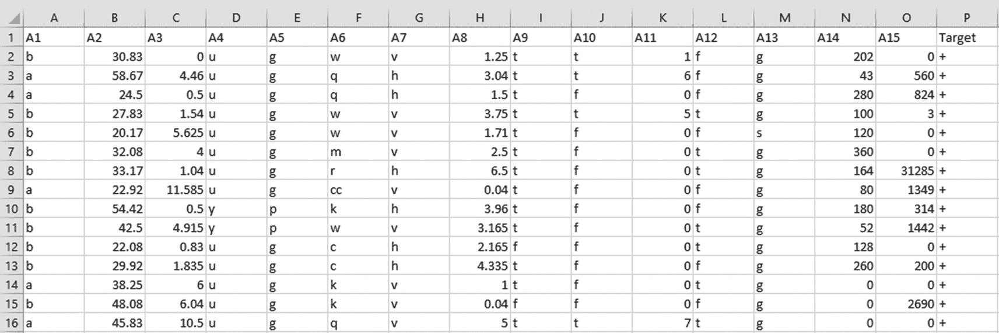

一个 Excel 工作表包含 15 个属性和一个目标变量。

图 11-1

Excel 提供了数据集的直接可视化视图

让我们在此工作表中逐一完成前面列出的探索性操作。

1.  **记录数量：**

由于数据集在 Excel 中，你可以轻松滚动到底部，发现共有 691-1 = 690 条记录。如果数据集规模过大，你可以在单元格 Q2 中输入公式 `=COUNTA(P:P) - 1` 来获取记录数量。COUNTA 函数用于计算一个区域中非空单元格的数量。由于属性内部可能存在空单元格，因此统计目标值的数量是确认记录数量的可靠方法。

2.  **属性数量：**

由于 Excel 允许我们直接查看数据，我们可以轻松判断 Excel 工作表中数据集的属性数量。如果你想使用公式，请在单元格 Q1 中输入 `=COUNTA(A1:P1)`。因此，共有 15 个属性和一个目标（标签）。

3.  **每个属性的数据类型：**

通过 Excel 工作表，我们可以直观地看出属性 A1、A4–A7、A9、A10、A12 和 A13 以及目标变量是分类文本数据，而 A2、A3、A8、A11、A14 和 A15 是数值数据。

4.  **每个数值属性的总和、均值、中位数和方差：**

当然，我们可以对列 A2、A3、A8、A11、A14 和 A15 应用 SUM、AVERAGE 和 MEDIAN 函数来获取它们的总和、均值和中位数。这里无需演示如何实现。

对于这些数值属性的方差，我们需要应用 VAR.P 函数，该函数计算总体方差。总体方差的计算公式为 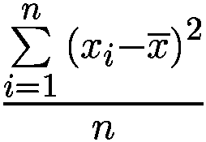。由于只有 690 条记录，我们可以滚动到工作表底部，在单元格 A692 中输入公式 `=IFERROR(VAR.P(A2:A691), "")`，然后自动填充到单元格 O692。使用 IFERROR 函数是为了处理非数值属性。注意，如果记录数量很大，我们当然可以在属性名称上方插入一行来计算和存储方差。此时，工作表的一部分应如图 11-2 所示。注意，单词“Variance”已添加到单元格 Q692 中，以标记第 692 行。

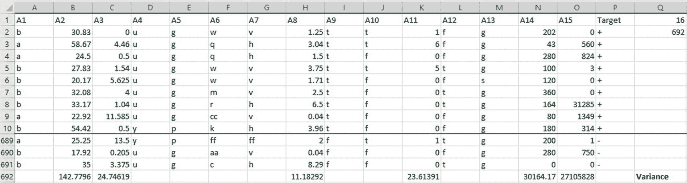

Excel 工作表的截图展示了第 692 行中的数值属性方差。

图 11-2

数值属性的方差存储在第 692 行

默认情况下，方差并非在同一尺度上计算，因此你会注意到属性 A15 的方差最大。有时，方差是在所有属性归一化到相同范围后计算的。我将在解释特征选择时详细讨论归一化问题。这里，让我们将所有数值属性归一化到 0–100 的范围。

为了在 0–100 的相同尺度上计算方差，让我们复制当前工作表并将新工作表重命名为 crx2。在 crx2 工作表的单元格 A2 中，输入以下公式：

```
    =IFERROR((crx!A2-MIN(crx!A$2:A$691))/(MAX(crx!A$2:A$691)-MIN(crx!A$2:A$691))*100, crx!A2)
    ```

此公式在处理 crx 工作表中的相应数据项后，将其放入单元格 A2。IFERROR 函数确保如果列 A 的数据不是数值，则会出错，因此 crx!A2 处的数据将直接放入单元格 A2 而不进行归一化。如果列 A 的数据是数值，则它将 crx!A2 中的数据值归一化到 0–100 的闭区间内。

从 A2 自动填充到 O2，然后一起自动填充到 A691:O691，我们将得到归一化数据的方差，这表明最大的方差在属性 A2 中。crx2 工作表的一部分应如图 11-3 所示。

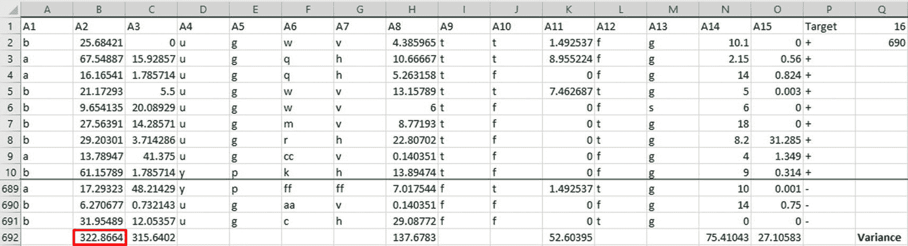

一个 Excel 电子表格，显示了数值属性归一化后的方差。

图 11-3

数值属性归一化到 0–100 范围后的方差

5.  **每个数值属性的取值范围：**

取值范围通常表示数值属性的最大值和最小值。我们可以应用 Excel 函数 MAX 和 MIN 来获取每个数值属性的最大值和最小值。取值范围有助于识别异常值和数据异常。

6.  **分类目标和属性的唯一值：**

要获取分类属性的唯一值，我们可以利用 Excel 的内置功能“删除重复项”。在为每个分类属性删除重复项之前，最好先复制 crx 工作表并将新工作表重命名为 crx3。

在 crx3 工作表中，请点击列字母 G ➤ 点击“数据”选项卡 ➤ 选择“删除重复项” ➤ 在弹出的菜单中，选择“以当前选定区域排序”选项，然后点击“删除重复项…”按钮。如图 11-4 所示。

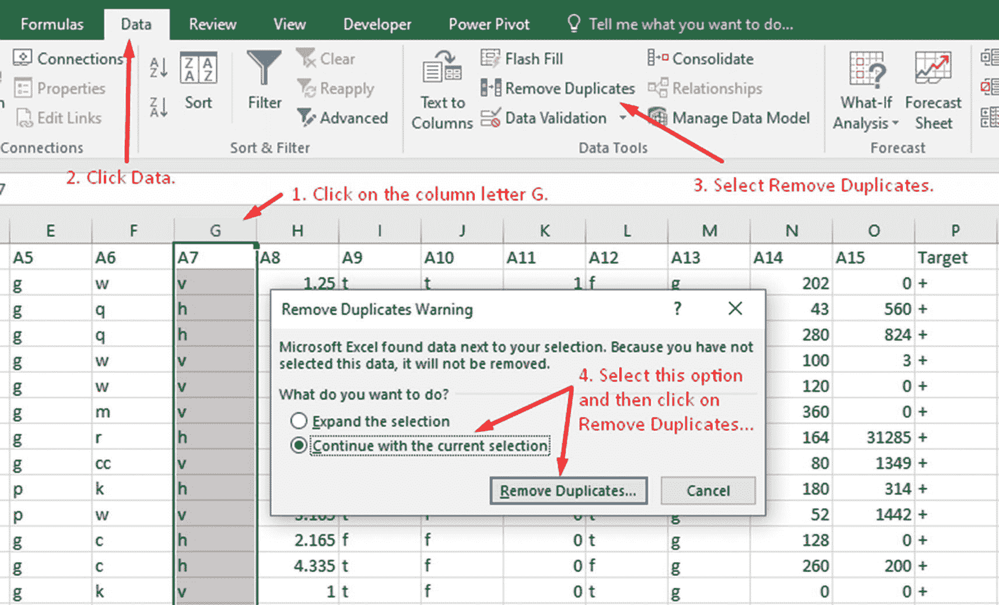

一个 Excel 电子表格解释了如何打开删除重复项警告窗口。步骤如下：数据、列 G、删除重复项，然后选择适当的选项。

图 11-4

选择“删除重复项”

另一个小菜单出现。按照图 11-5 中的说明点击“确定”按钮。最后，出现一个小菜单，提示“已找到并删除 680 个重复项；保留 11 个唯一值。”

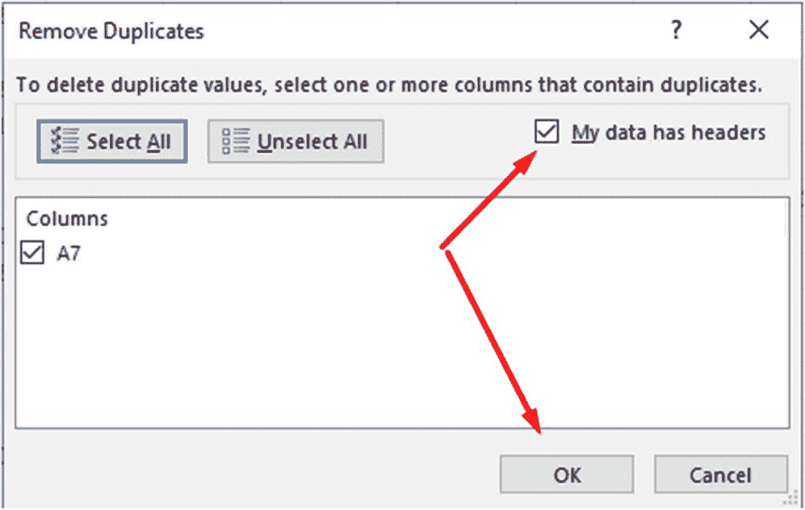

“删除重复项”窗口的截图。已勾选“数据包含标题”复选框。

图 11-5

确保勾选了“数据包含标题”

这些操作删除了属性 A7 的重复项。我们需要对所有其他分类属性和目标重复这些操作。

有趣的是，你会注意到某些属性内部包含值“？”。嗯，问号符号“？”通常用于表示缺失值。因此，crx3 工作表中的那些“？”表示相应属性中存在缺失值。我们稍后将讨论缺失值。

7.  **目标的类别分布：**


一旦我们在工作表 crx3 中获得了目标的唯一值，就可以轻松获取目标的类别分布。在 crx3 工作表中，在 R2 单元格内输入公式 `=COUNTIFS(crx!P2:P691, P2)`，然后自动填充至 R3。我们可以立即看出，“+”和“-”这两个类别分别有 307 个和 383 个数据点。

一个平衡良好的数据集应该具有均衡的类别，也就是说，所有类别的数据点数量应大致相同。在这个具体案例中，两个类别分别占比约 44.5% 和 54.5%，这可以被认为是相当平衡的。

如果数据集存在类别不平衡怎么办？如果发生这种情况，你应该尽力增加代表性不足的类别的数据点。如果数据量足够大，你也可以减少代表性过高的类别的数据点。在最坏的情况下，如果你完全无法改变这种不平衡，那么你应该确保你的机器学习模型对代表性不足的类别足够敏感。

8.  如果存在缺失数据：

缺失值可以以不同形式存在，例如空格或问号“?”。前面删除重复项的操作有助于我们识别出属于缺失值的异常分类值。对于空格，我们可以利用 `COUNTBLANK` 函数来统计它们。

回到工作表 crx，在 A693 单元格内输入 `=COUNTBLANK(A2:A691)`，然后自动填充至 P693。幸运的是，我们的数据集中没有任何空格。

要统计每个属性中由“?”标记的缺失值数量，请在 A694 单元格内输入 `=COUNTIFS(A2:A691, "~?")`，然后自动填充至 P694。请注意，问号“?”在 Excel 中是一个特殊字符。因此，要在此公式中插入字面意义上的“?”，我们必须在其前面加上“~”。

完整结果见 Chapter11-1b.xlsx。请注意，“Variance”、“Blank Cells”和“Missing Data”这些词分别位于单元格 Q692、Q693 和 Q694 中。这些词是为了说明。

9.  数据异常：

数据异常与离群值不同。离群值是有效的，但其值超出了正常范围。是否应该保留或删除离群数据记录是一个难以抉择的问题。

数据异常指的是意外数据或数据不一致，可能是非预期的数据类型或超出范围的数据值。一般来说，在收集数据时，我们应该了解每个属性的预期数据类型和范围；否则，我们将没有标准来识别非预期的数据值。对于数值数据，我们可以使用 IF 函数来识别任何超出预期范围的数值。对于非预期的数据类型，有其他函数可以处理。

为了练习数据异常检测，请打开 Chapter11-2a.xlsx，我特意在其中创建了一些数据异常。假设我们知道每个属性的预期数据类型和范围。具体来说，数值属性的值必须 >= 0。

同样，我们将复制现有的工作表 crx，并将新工作表重命名为 crx2。

在工作表 crx2 中，在 A2 单元格内输入 `=IF(ISNONTEXT(crx!A2), "N", "")`。由于我们知道属性 A1 的数据类型必须是字母，因此使用 `ISNONTEXT` 函数来判断工作表 crx 中对应的值是否为非文本。如果是，则显示“N”；否则，A2 单元格中不显示任何内容。双击 A2 单元格的右下角，从 A2 自动填充至 A691。

对于属性 A2 和 A3，我们知道它们必须是数值且不能小于 0。因此，在 B2 单元格内输入 `=IF(ISTEXT(crx!B2), "T", IF(crx!B2<0, "F", ""))`，并自动填充至 C2，然后一起自动填充至 B691:C691。我们会立即注意到 C6 单元格中的“F”和 C8 单元格中的“T”，因为如果 crx!B2 包含文本，此公式返回“T”；如果 crx!B2 < 0，则返回“F”；否则在 B2 中不显示任何内容。

在 D2 单元格内输入 `=IF(ISNONTEXT(crx!D2), "N", "")`，并自动填充至 D691；我们还会发现 D15 单元格中显示“N”。

我希望你已经意识到复制原始工作表的好处。当然，当工作表 crx2 中的 C6、C8 和 D15 单元格分别出现“F”、“T”或“N”时，我们立即就能知道原始工作表 crx 中完全相同的位置（C6、C8 和 D15）存在数据异常。

此时，我们工作表 crx2 的一部分应该如图 11-6 所示。

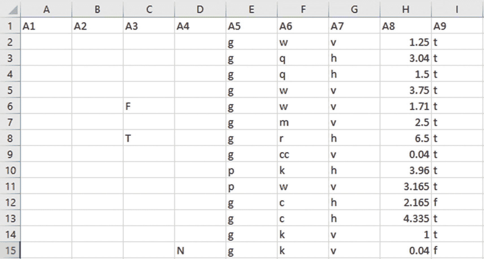

一个 Excel 电子表格在 C6、C8 和 D15 单元格中显示了意外数据。

图 11-6

单元格 C6、C8 和 D15 显示了意外的数据值

工作表中还有更多意外数据。我想留给你来完成其余属性的检查。请注意，你当然可以使用不同的 Excel 函数来实现相同的目的。

完成后的结果见 Chapter11-2b.xlsx。由于上述异常检测过程相当繁琐，还有另一个文件 Chapter11-2c.xlsx，其中所有属性只需要一个公式。请查看一下。


## 通过 Excel 学习数据清洗

数据清洗通常应用于数据记录而非数据属性，即针对行而非列。当一条记录中存在缺失数据或意外数据时，最安全的做法是删除该记录，因为保留它可能会给数据挖掘结果引入误差。著名的“垃圾进，垃圾出”原则指出，如果数据质量不高，无论我们做什么，数据挖掘结果的质量肯定也不会高。尽管如此，数据工程师还可以采用其他数据处理方法，不过如果你的数据量足够大且不包含这些记录，我通常不推荐使用这些方法。

一种常见的技术是用一个常量（如 0），或者该属性的均值、中位数或众数来替换缺失的数值型数据值。在某些情况下，例如，如果数值型数据类型的意外值是“高”，我们可以考虑用大于均值或中位数的数字来替换这个意外值。

对于分类属性，缺失或空值可以用一个常量（如“missing”）来替换。

当一个属性有太多低质量的数据值时，我们应该考虑删除该属性，因为它本身就有问题，并成为数据肿瘤。没有一刀切的阈值来决定何时删除一列，这取决于经验以及反复试验。

一种更高级的方法是开发一个机器学习模型来预测缺失或空值。例如，假设我们有 A1、A2、……、A10 这些属性和标签 T，并且 A1 中存在一些缺失值。然后我们可以开发一个机器学习模型，将 A1 视为目标，而所有其他属性（包括标签 T）作为预测变量。该模型使用完整的记录进行训练，然后用于预测 A1 中缺失的值。

打开 Chapter11-3a.xlsx。你可能会发现它与 Chapter-2b.xlsx 相同。工作表 crx2 已经标记了缺失数据或意外值所在的位置。快速浏览一下，我们应该能意识到，与数据量相比，需要删除的数据记录并不多。因此，我们应该继续删除工作表 crx2 中标记的那些记录。我们可以从工作表 crx2 开始操作，也可以从原始工作表 crx 重新开始。

让我们从原始工作表 crx 重新开始，复制一份并将其重命名为新工作表 crx3。在工作表 crx3 中，请按照以下说明完成我们的数据清洗工作。注意，对于数据清洗，我们必须同时考虑缺失数据和数据异常。

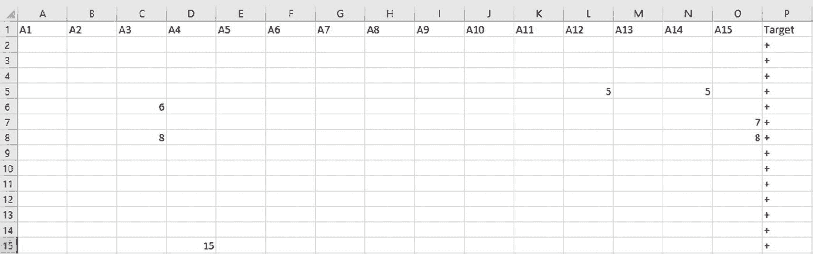

一张 Excel 电子表格的截图，其中包含待删除记录的行号。

图 11-7

标记了待删除记录的行号

1.  在单元格 A2 中，输入以下公式：

```
    =IF(COUNT(crx!A2:A691)/COUNTA(crx!A2:A691)>0.8, IF(ISTEXT(crx!A2), ROW(A2), IF(crx!A2<0, ROW(A2), "")), IF(OR(ISNONTEXT(crx!A2), crx!A2="?"), ROW(A2), ""))
    ```

在此公式中，`COUNT(crx!A2:A691)/COUNTA(crx!A2:A691)>0.8` 用于判断属性是文本还是数值数据。根据数据类型，相应地检查该属性是否存在缺失或意外数据。请注意，函数 ISTEXT 可以检测问号“?”。

从 A2 自动填充到 O691。

此时，我们工作表的一部分应如图 11-7 所示。

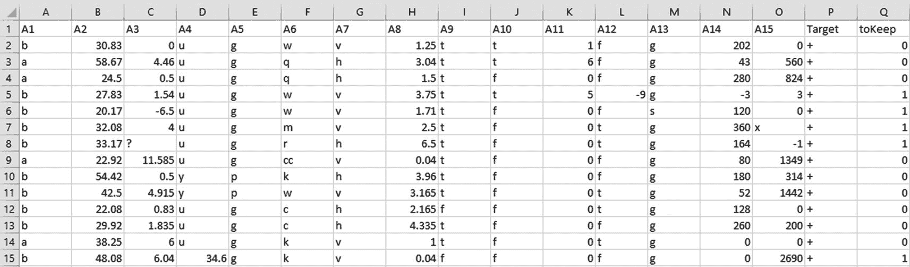

一个用于 crx4 的 Excel 电子表格。

图 11-8

工作表 crx4

1.  在单元格 Q1 中输入“toKeep”，在 Q2 中输入 `=IF(SUM(A2:O2)>0, 1, 0)`，然后自动填充到 Q691。此公式判断 A2:O2 中是否有行号，如果有，则通过将其标记为 1 来表示该行需要删除。这将帮助我们稍后保留那些想要的记录。

2.  再次，复制一份工作表 crx，这样我们就不会直接删除原始工作表中的记录。这在数据清洗中非常重要。将新工作表重命名为 crx4。

3.  复制工作表 crx3 中的单元格 Q1:Q691，并以值的形式粘贴到工作表 crx4 中相同的 Q1:Q691 区域。注意，粘贴操作必须仅以值的形式进行。工作表 crx4 的一部分应如图 11-8 所示。

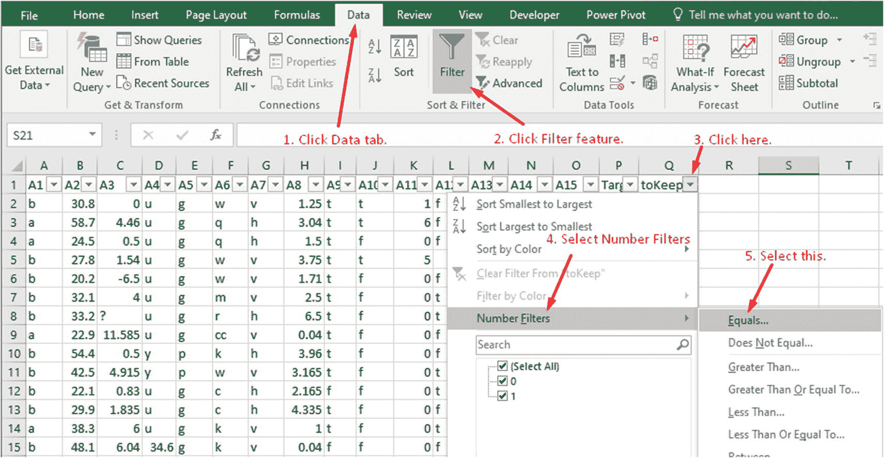

一张 Excel 电子表格演示了选择“等于”选项以准备筛选记录的步骤。步骤如下：数据选项卡、筛选、toKeep、数字筛选、等于。

图 11-9

准备根据“toKeep”列筛选记录

1.  让我们创建一个新的空白工作表，并将其命名为“cleaned-crx”。稍后我们将把清洗后的数据存储在此工作表中。

2.  返回工作表 crx4。选择所有列 A–Q ➤ 单击数据选项卡 ➤ 单击筛选 ➤ 单击单元格 Q1 中的箭头 ➤ 选择数字筛选 ➤ 选择“等于…”选项。如图 11-9 所示。

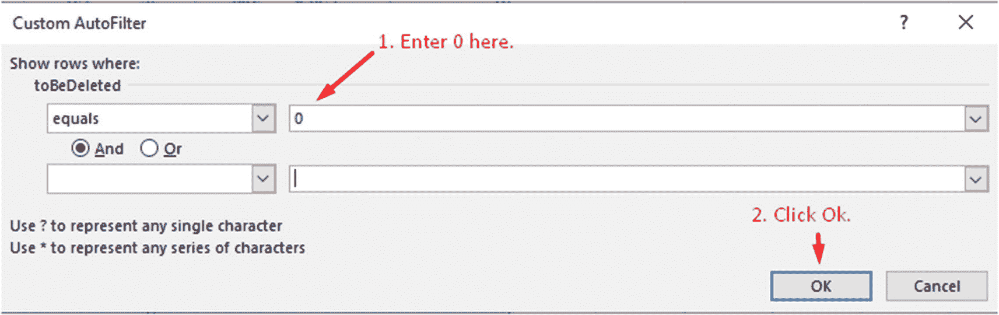

自定义自动筛选窗口的截图。在“等于”选项旁边输入了 0。

图 11-10

设置自定义自动筛选

1.  出现一个自定义自动筛选窗口。按照图 11-10 中的说明进行操作。

1.  现在，在工作表 crx4 中，只显示那些要保留的记录。选择所有数据，并将其复制/粘贴到工作表“cleaned-crx”的单元格 A1 中。就这样！工作表 cleaned-crx 包含了清洗后的数据。

完成的工作包含在工作表 Chapter11-3b.xlsx 中。注意，你可以删除工作表 cleaned-crx 中的 Q 列。

此时，你可能已经意识到，从 Chapter11-2b.xlsx 到 Chapter11-2c.xlsx 和 Chapter11-3b.xlsx，我使用的公式变得更加高级，使得过程更简单。这只是一个简单的演示，说明实践可以提高我们的技能。

## 特征选择

在许多情况下，数据集中会有许多特征/属性可用。对于我们的数据挖掘目的而言，某些特征可能比其他特征更重要，并且多个特征可能密切相关，以至于它们提供相同的信息。因此，特征选择的目的是找到能够根据所选评估指标提供最高预测结果的最佳特征集。

流行词“大数据”可能会给我们一种印象，即在数据挖掘或机器学习中，特征越多越好。事实上，并非如此。更多的特征会带来更大的维度空间，这会使数据挖掘模型复杂化。因此，数据挖掘中的一项关键技能是发现最具决定性的特征或属性。例如，决定客户对信用卡优惠态度的最重要的几个特征是什么？

在机器学习中，有相当多的特征选择技术，例如前向选择和后向消除。前向选择从一个或两个特征开始，然后继续向特征集中添加更多特征，直到无法再做出显著改进为止。后向消除从完整的特征集开始，一次消除一个特征，直到得到一个能够提供可比预测质量的核心特征集。当然，这样的特征选择过程不适合在 Excel 中操作。在本书中，我将向你展示一些可以在 Excel 工作表中实现的基本特征选择原则和技术。

关于特征选择，有三个通用原则：

1.  处于同一量纲的特征效果更好。

2.  方差较大的特征贡献更大。

3.  相关的特征讲述相同的数据故事。

如你所见，第一个原则是选择处于同一量纲的特征。但如果没有任何数值特征处于同一量纲，该怎么办？这是我承诺要详细讨论的问题。


### 归一化与标准化

为了使所有数值属性处于同一量级，有两种常用方法：归一化与标准化。

标准化等同于计算每个值的 Z 分数，即通过公式（11-1）将属性的每个值转换为其对应的 Z 分数：

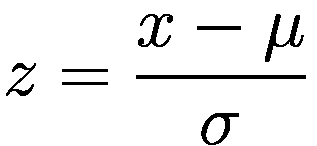

（11-1）

其中 *x* 是属性的单个值，*μ* 是属性的均值，*σ* 是属性的标准差。

归一化，即传统的归一化方法，是将所有数值按比例放大或缩小到同一范围，通常为 0–1 或 0–100。

这两种方法都可用于将数值属性转换到同一量级。然而，它们各有优缺点。此外，我个人认为，当需要保留方差时，另一种归一化方法——中位数归一化——比传统归一化方法和标准化方法都更为合适。中位数归一化常用于基因表达的生物信息学研究。要比较这三种方法，请打开 Excel 文件 `Chapter11-scale-a.xlsx`。图 11-11 将立即呈现在您眼前。

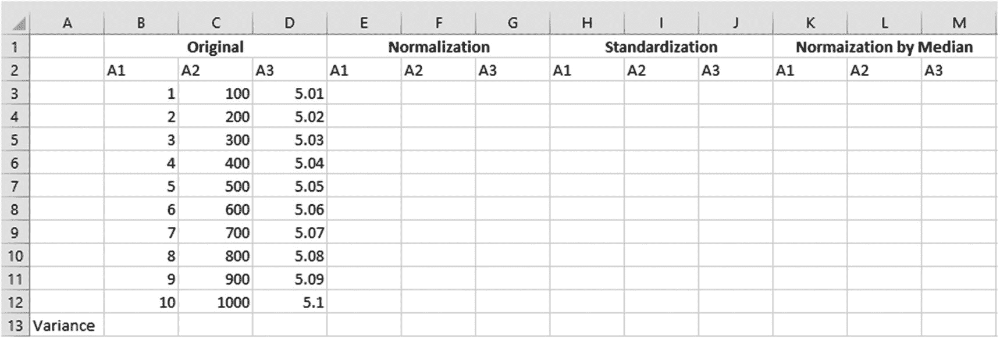

该截图包含三个虚构属性，如 A1、A2 和 A3。

图 11-11
三个虚构属性 A1、A2 和 A3

到目前为止，我们对传统归一化有了一些经验，可以看出属性 A2 很容易被缩放到与 A1 相同。那么属性 A3 呢？好吧，让我们先在“归一化”部分（E–G 列）将这三个属性都归一化到 0–100 的范围。在单元格 E3 中输入以下公式，从 E3 自动填充到 G3，然后一起自动填充到 E12:G12：

```
=(B3-MIN(B$3:B$12))/(MAX(B$3:B$12)-MIN(B$3:B$12))*100
```

一切看起来不错。现在，让我们将公式（11-1）应用于这三个属性，在 H3 中输入以下公式，自动填充到 J3，然后一起自动填充到 H12:J12：

```
=(B3-AVERAGE(B$3:B$12))/STDEV.P(B$3:B$12)
```

这里，我们将这十条记录视为整个总体，因此对属性 A1 应用函数 `STDEV.P`。观察 H3:J12 中的值，既有负值也有正值。

请注意，通过上述两种方法，属性 A1、A2 和 A3 被转换成了相同的值。这种情况在现实中不太可能发生。我这样设计是为了演示目的。

一个好的转换应该保留数据的方差。因此，在 B13 中输入公式 `=VAR.P(B3:B12)`，然后自动填充到 J13。此时，您的工作表应如图 11-12 所示。

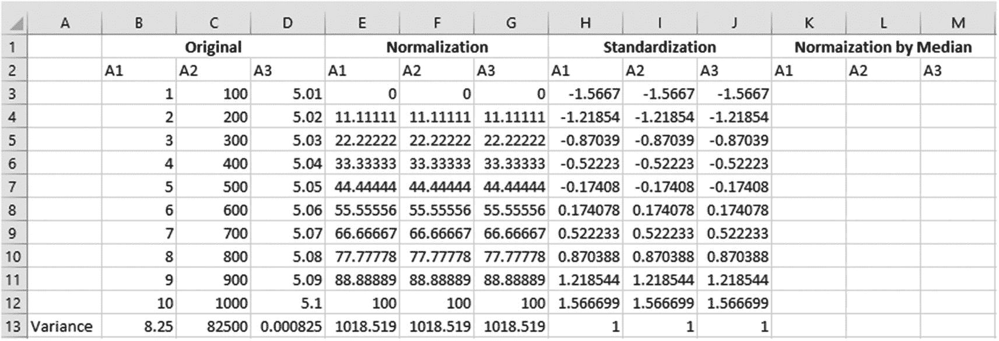

该 Excel 电子表格截图包含原始数据、归一化、标准化以及中位数归一化数据。

图 11-12
归一化和标准化均未能保留某些属性的方差

图 11-12 显示，归一化和标准化都使这三个属性具有相同的方差。由于 A2 = 100 x A1，我们可以认同 A1 和 A2 在经过归一化或标准化后应具有相同的方差。但原始的 A3 似乎方差很小，却被归一化/标准化为与 A1 或 A2 相同的方差。

中位数归一化是一种可以将属性缩放到相同范围并保留方差的方法。它基于中位数对属性进行缩放。该方法首先选择一个参考属性，例如 A1。然后假设所有其他属性应与参考属性具有相同的中位数。最后，根据该属性与参考属性之间的两个中位数的比值，对该属性进行缩放。

因此，在 K3 中输入以下公式，自动填充到 M3，然后一起自动填充到 K12:M12：

```
=B3/(MEDIAN(B$3:B$12)/MEDIAN($B$3:$B$12))
```

同时，从 J13 自动填充到 M13。您的工作表应如图 11-13 所示。

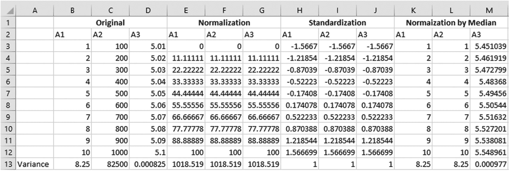

该 Excel 电子表格展示了通过中位数归一化保留了 A3 的方差。

图 11-13
中位数归一化方法保留了属性方差

图 11-13 说明，通过中位数归一化，A3 的方差也得到了保留。

在数据挖掘项目中，是否进行归一化或标准化以及如何进行，始终是一个需要复杂评估的难题。在许多情况下，我们只能通过多轮实验后才能确定。

### 相关性

相关性衡量两个数值变量或属性之间的线性关联强度。该强度由相关系数表示，其取值范围必须在-1 到 1 之间（含端点）。给定两个变量 X 和 Y，如果它们正相关，则 X 和 Y 同向变化。例如，X 是每日气温，Y 是冰淇淋销量。X 越高，Y 越大；或 X 越低，Y 越小。如果 X 和 Y 负相关，则它们反向变化。例如，汽车里程数与汽车重量。当相关系数接近零时，X 和 Y 之间不存在相关性。在 Excel 中，通过函数 `CORREL` 计算相关系数非常简单。如图 11-14 所示。

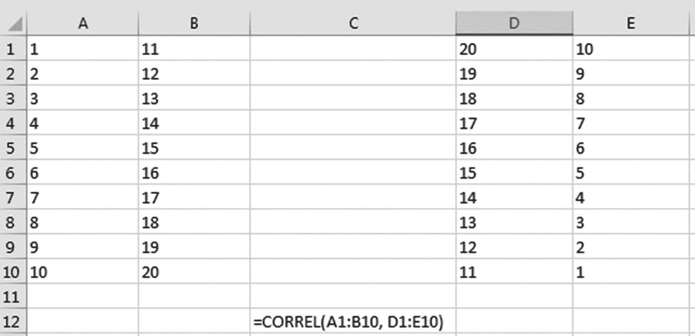

该 Excel 电子表格展示了相关性计算公式。

图 11-14
在 Excel 中计算相关性


### 通过 Excel 学习特征选择

打开文件 Chapter11-4a.xlsx，你会发现其中有两个工作表：“cleaned-crx”和“encoded”。工作表 cleaned-crx 与 Chapter11-3b.xlsx 中的同名工作表相同。不过，我们将从“encoded”工作表开始进行特征选择。如果你比较这两个工作表，会发现工作表 encoded 在 A 列多了一个名为“Customer”的属性。添加此列是为了作为每条记录的 ID。此外，在工作表 encoded 中，所有分类属性都已转换为数值属性（整数）。在这里，我执行了“编码”操作，使数据为特征选择操作做好准备。

某些数据挖掘方法只能处理数值；因此，将分类值转换为数值是非常常见的，这个过程称为“编码”。有两种常用的编码方案：独热编码和序数编码。使用哪一种取决于分类属性的类型。一般来说，所有分类属性可以分为两类：名义型或序数型。名义型分类属性没有特定顺序，例如，眼睛的颜色（黄色、黑色、棕色、蓝色）。序数型分类属性有特定顺序，例如，等级 A、B、C、D、F。

独热编码通常适用于名义型分类属性，它会为每个类别创建一个值为 0 或 1 的新属性。例如，假设我们有一个名为 EyeColor 的属性，它有三个类别：黄色、黑色和蓝色。那么独热编码会将这个 EyeColor 属性替换为三个新属性，可能命名为“yellow”、“black”和“blue”，每个对应一种眼睛颜色。新属性“yellow”中的 1 表示存在黄色眼睛颜色，而 0 表示不存在黄色眼睛颜色。同样的方案适用于“black”和“blue”属性。

序数编码则简单得多。对于等级 A、B、C、D、F，我们可以简单地将它们转换为 4–0 或 0–4。由于我们使用的样本数据集没有提供关于分类属性的任何有意义信息，我对所有分类属性应用了序数编码。

按照以下说明在 Excel 中练习特征选择。

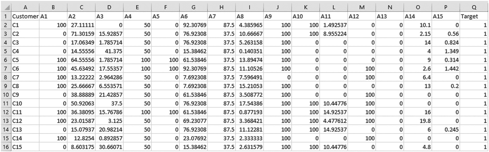

归一化后的 Excel 工作表截图。

图 11-15

归一化属性

1.  复制工作表 encoded，并将新工作表重命名为“normalized”。

2.  在工作表 normalized 的单元格 B2 中，输入以下公式：

```
    =IFERROR((encoded!B2-MIN(encoded!B$2:B$647))/(MAX(encoded!B$2:B$647)-MIN(encoded!B$2:B$647))*100, encoded!B2)
    ```

此公式将属性 A1 中 B2 的值归一化到 0–100 范围。

3.  从 B2 自动填充到 P2，然后从 B2:P2 自动填充到 B647:P647。我们归一化后的工作表部分应如图 11-15 所示。

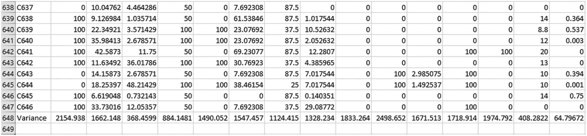

Excel 中每个归一化属性方差的截图。

图 11-16

每个归一化属性的方差

1.  在单元格 A648 中，输入“Variance”。

2.  在 B648 中输入 `=VAR.P(A2:B647)`，然后自动填充到 P648。我们工作表的部分应如图 11-16 所示。

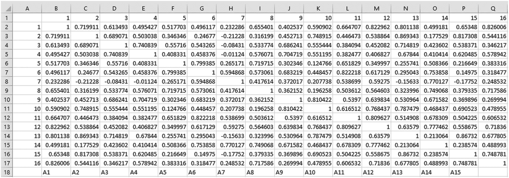

展示计算出的相关矩阵的 Excel 电子表格。

图 11-17

计算出的相关矩阵

1.  从图 11-16 中，我们可以看出，除了 A15 之外，所有属性都有相当数量的方差。显然，A1 的方差最大。

2.  下一步是创建一个相关矩阵，显示每两个属性之间的相关性。两个属性之间的高正或高负相关系数表明这两个属性在讲述相同的数据故事。要创建相关矩阵，请创建一个新工作表并将其重命名为“correlation”。

3.  在工作表 correlation 中，分别在单元格 B1:Q1 中输入整数 1–16。一个快速的方法是自动填充这些数字。

4.  在单元格 A2:A17 中自动填充整数 1–16。

5.  在 B2 中输入以下公式，自动填充到 Q2，然后一起自动填充到 B17:Q17：

`=CORREL(INDEX(normalized!$B$2:$Q$647,$A2,0),INDEX(normalized!$B$2:$Q$647,B$1,0))`

6.  在单元格 B18 中输入“A1”，然后自动填充到 P18。我们的工作表应如图 11-17 所示。

1.  我们首先应该查看的是 Q 列或第 17 行，它们标记了目标属性与其他属性之间的相关系数。我们会发现 A1 与目标属性的相关系数最大，表明 A1 与目标属性共享了大量数据故事，也就是说，A1 可能是目标属性的一个良好指标。由于 A1 也具有最大的方差，我们当然应该将 A1 选入核心特征集。

2.  选择 A1 之后，我们应该寻找与 A1 相关系数较小的独立属性。A7 是一个不错的候选。我们选择它。

3.  下一个候选是 A9。对于 A9，我们必须检查它与 A1 和 A7 的相关系数。

4.  我们应该选择 A4 还是 A14？嗯，它们与 A1 的相关系数处于中等偏高水平，但它们与 A9 或 A7 的相关系数很高（分别为 0.70 和 0.77）。因此，核心特征集可能只是 A1、A7 和 A9。

上述操作记录在 Chapter11-4b.xlsx 中。此时，一个好的练习是尝试使用所有特征或仅使用核心特征来运行数据挖掘方法。记住应用交叉验证来评估核心特征集是否能表现良好。

Chapter11-5a.xlsx 和 Chapter11-6a.xlsx 旨在让你对你选择的数据挖掘方法进行交叉验证，使用所有特征或仅使用核心特征。为此，我应用了逻辑回归，因为与目标高度相关的特征有助于回归模型，如线性回归或逻辑回归（记住特征 A1 与目标具有高正相关性）。我的工作可以在 Chapter11-5b.xlsx 和 Chapter11-6b.xlsx 中找到。注意，由于目标只有两个类别（0, 1），这是应用逻辑回归的完美案例。当然，其他数据挖掘方法如 K-NN 和朴素贝叶斯也是不错的选择。

## 强化练习

共有三组强化练习。

1.  Chapter11-HW-1a.xlsx 用于 EDA 练习。请使用它练习以下内容（必要时可参考 Chapter11-HW-1a-withAnswers.xlsx）：
    *   记录数量

    *   属性数量

    *   每个属性的数据类型

    *   每个数值属性的总和、均值、中位数和方差

    *   每个数值属性的值范围

    *   分类目标和属性的唯一值

    *   目标的类别分布

2.  Chapter11-HW-2a.xlsx 用于数据清洗练习。你可以在 Chapter11-HW-2a-withAnswers.xlsx 中找到标准答案。

3.  Chapter11-HW-3a.xlsx 用于特征选择练习。注意，对于此练习，没有标准答案，我仅在文件 Chapter11-HW-3a-withSuggestions.xlsx 中提供建议。

## 复习要点

请复习以下主题和技能：

1.  EDA 中的初步调查

2.  缺失数据和异常值的检测

3.  数据清洗

4.  编码，包括独热编码和序数编码

5.  归一化、标准化和中位数归一化

6.  数据挖掘的特征选择

7.  Excel 的“删除重复项”功能

8.  Excel 函数 COUNT、COUNTA、MAX、MIN、AVERAGE、MEDIAN、IF、OR、ISNONTEXT、ISTEXT、ROW、CORREL、VAR.P、STDEV.P 和 INDEX


