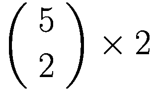
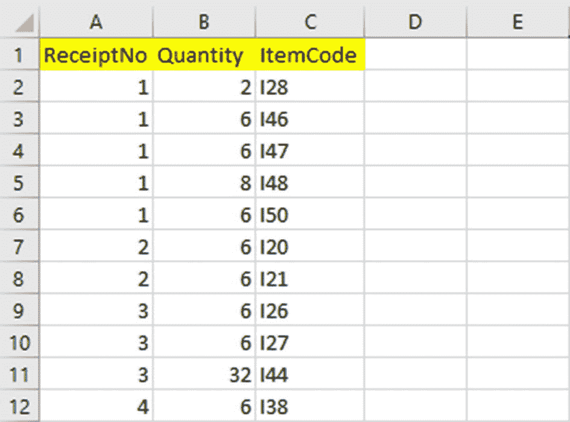
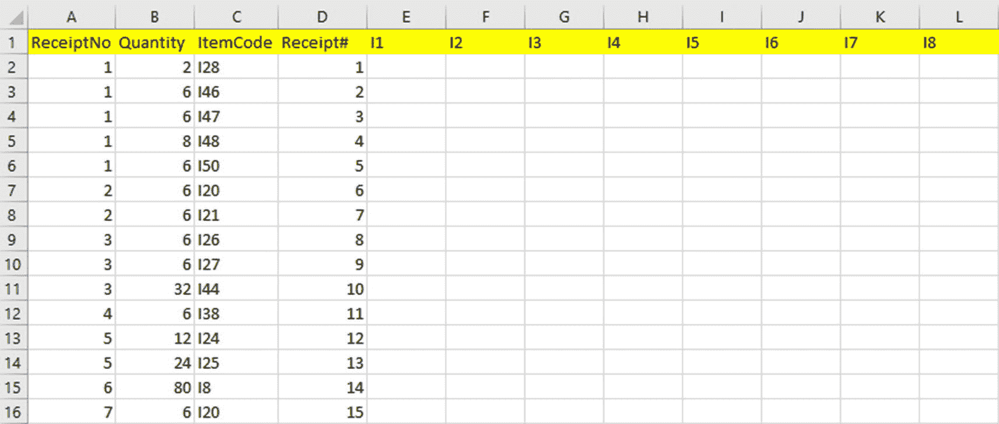
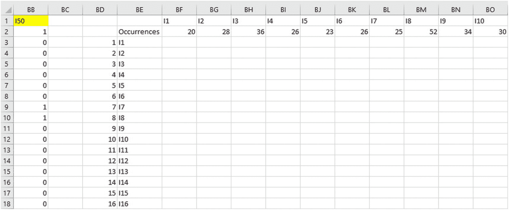
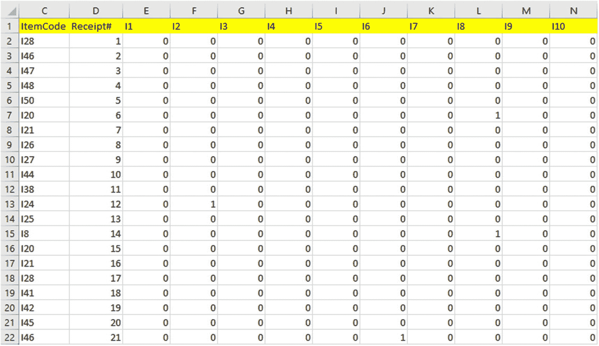
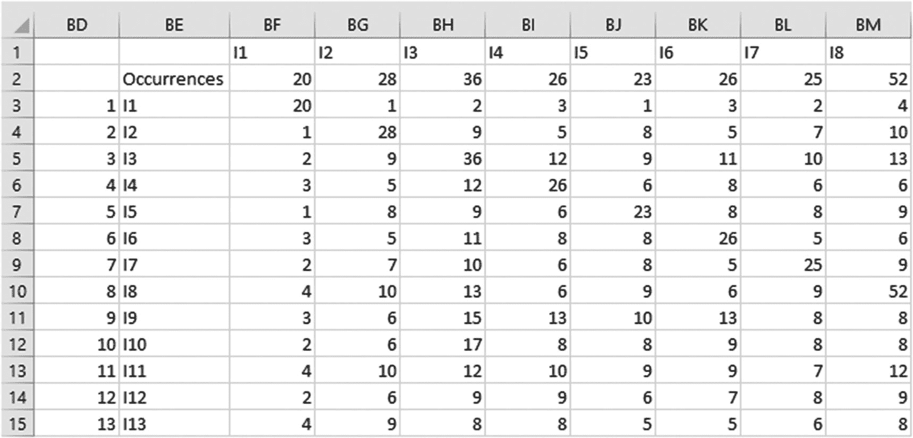
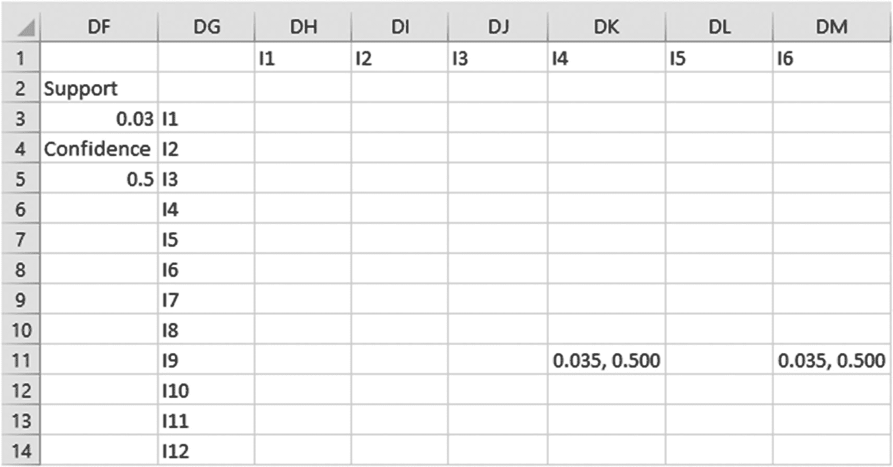
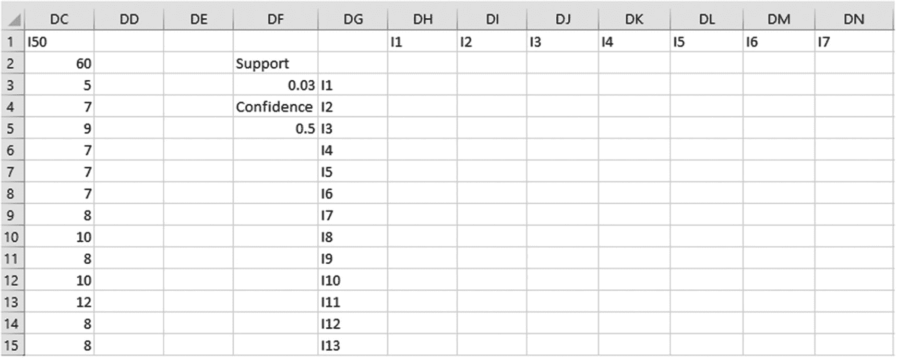
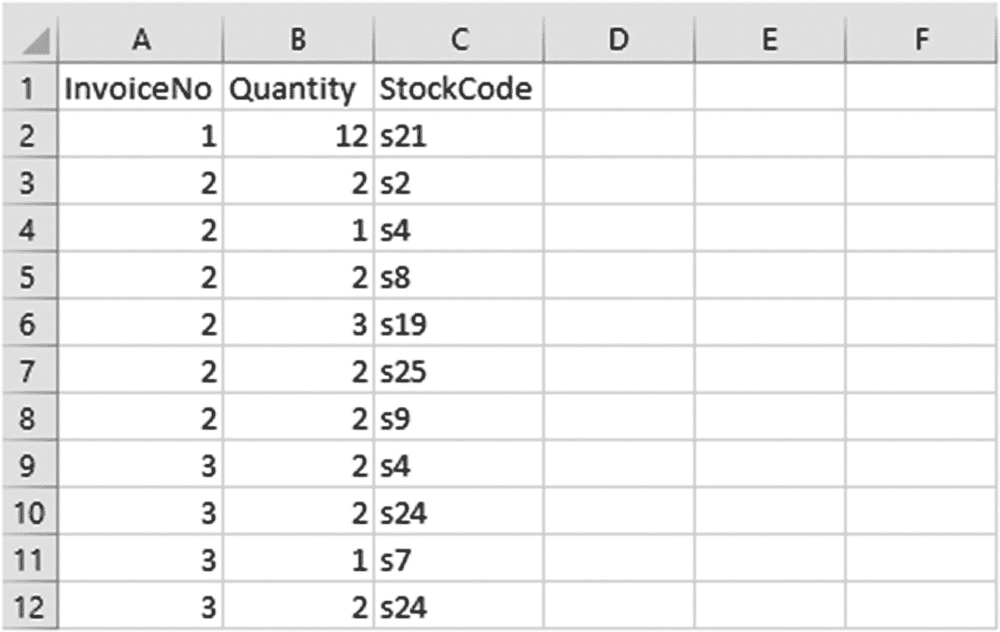

# 12. 关联分析

我们已经了解到，相关性衡量的是两个数值变量之间的线性关联强度。相关性研究要求两个变量必须是数值型，且仅衡量线性关系，而关联分析则没有这种限制。关联分析衡量的是两个或多个变量之间共同出现的强度。它是一种用于交叉销售的有效数据挖掘技术，并且在生物医学研究（如基因网络研究）中也有应用。

请从 [`https://github.com/hhohho/Learn-Data-Mining-through-Excel-2`](https://github.com/hhohho/Learn-Data-Mining-through-Excel-2) 下载本章练习所需的示例 Excel 文件。

## 总体理解

关联分析最著名的应用是所谓的购物篮分析，它找出在同一笔购买交易中一个（或多个）商品与另一个商品共同出现的情况。通过识别哪些商品经常被一起购买，商店（通常是零售店或超市）可以采取相关措施来增加销售额。这些措施包括将某些商品摆放在一起、推广捆绑价格等。

通常的理解是找出那些频繁购买的商品之间的共同出现关系。因此，我们需要理解的第一个概念是“支持度百分比”，或者简单地说，“支持度”。一个商品（或项集）的支持度定义为该商品（或项集）在交易集中出现的频率。我将使用表 12-1 中的数据来帮助解释*支持度*的概念。

表 12-1

一个示例购物篮

| 购物篮 | 啤酒 | 电影 | 尿布 | 笔 | 大米 | 苹果 | 果汁 |
| --- | --- | --- | --- | --- | --- | --- | --- |
| 1 | 1 |   | 1 |   |   |   |   |
| 2 | 1 | 1 |   | 1 |   | 1 |   |
| 3 |   |   |   |   |   | 1 | 1 |
| 4 |   |   | 1 |   |   |   |   |
| 5 | 1 | 1 |   |   |   |   |   |
| 6 | 1 |   | 1 |   | 1 |   |   |
| 7 |   |   |   |   |   |   |   |
| 8 | 1 | 1 | 1 |   |   |   |   |
| 9 | 1 | 1 |   |   |   |   |   |
| 10 |   |   |   |   | 1 | 1 | 1 |
| 11 | 1 |   | 1 |   |   |   |   |
| 12 |   | 1 |   |   |   |   | 1 |

在表 12-1 中，一个购物篮代表一笔购买交易，共有 12 笔交易。数字 1 表示该商品出现在该特定交易中。由于啤酒在 12 笔交易中出现了 7 次，因此啤酒的支持度 = 7/12。类似地，笔的支持度 = 1/12，苹果的支持度 = 3/12。

另一个重要概念是“置信度”。置信度类似于条件概率。例如，当购买啤酒时，同时购买尿布的频率是多少？这个概率表示为置信度 (B → D)（啤酒蕴含尿布）。由于当购买啤酒时，尿布也被购买了 4 次；因此，置信度 (B → D) = 4/7。

请注意，置信度 (D → B) = 4/5，因为尿布被购买了 5 次，其中有 4 次啤酒与尿布一起购买。这表明项集 (B, D) 与项集 (D, B) 是不同的。

请按照以下说明来体验关联分析是如何工作的：

1.  假设最小支持度为 0.25，最小置信度为 0.6。

2.  由于笔和大米的支持度值都低于 0.25，任何包含笔或大米的项集的支持度值也会低于 0.25。那么我们感兴趣的商品就仅限于啤酒、电影、尿布、苹果和果汁。因此，要分析的数据缩减为表 12-2 所示。

表 12-2

应用最小支持度后缩减的购物篮数据

| 购物篮 | 啤酒 | 电影 | 尿布 | 苹果 | 果汁 |
    | --- | --- | --- | --- | --- | --- |
    | 1 | 1 |   | 1 |   |   |
    | 2 | 1 | 1 |   | 1 |   |
    | 3 |   |   |   | 1 | 1 |
    | 4 |   |   | 1 |   |   |
    | 5 | 1 | 1 |   |   |   |
    | 6 | 1 |   | 1 |   |   |
    | 7 |   |   |   |   |   |
    | 8 | 1 | 1 | 1 |   |   |
    | 9 | 1 | 1 |   |   |   |
    | 10 |   |   |   | 1 | 1 |
    | 11 | 1 |   | 1 |   |   |
    | 12 |   | 1 |   |   | 1 |

3.  假设我们只对包含至少两个商品的项集感兴趣。总共有 20 个不同的二元项集，即  。手动评估它们会非常繁琐且容易出错，尽管仍然可行。只有四个项集 (电影, 啤酒)、(尿布, 啤酒)、(苹果, 果汁) 和 (果汁, 苹果) 通过了置信度要求。然而，(苹果, 果汁) 和 (果汁, 苹果) 都未能满足支持度标准，因为它们的支持度值小于 0.25，因此只剩下两个二元项集。结果如表 12-3 所示。

表 12-3

仅限二元项集

| 项集 | 支持度 | 置信度 | 项集 | 支持度 | 置信度 |
    | --- | --- | --- | --- | --- | --- |
    | (B, M) | 4/10 | 4/7 | (M, A) | 1/10 | 1/5 |
    | (M, B) | 4/10 | 4/5 | (A, M) | 1/10 | 1/3 |
    | (B, D) | 4/10 | 4/7 | (M, J) | 1/10 | 1/5 |
    | (D, B) | 4/10 | 4/5 | (J, M) | 1/10 | 1/3 |
    | (B, A) | 1/10 | 1/7 | (D, A) | 0 | 0 |
    | (A, B) | 1/10 | 1/3 | (A, D) | 0 | 0 |
    | (B, J) | 0 | 0 | (D, J) | 0 | 0 |
    | (J, B) | 0 | 0 | (J, D) | 0 | 0 |
    | (M, D) | 1/10 | 1/5 | (A, J) | 2/10 | 2/3 |
    | (D, M) | 1/10 | 1/5 | (J, A) | 2/10 | 2/3 |

4.  现在，只能在这三个商品（啤酒、电影和尿布）内部检查三元项集。共有六个不同的项集：(B, {M, D})、(M, {B, D})、(D, {B, M}) 以及 ({M, D}, B)、({B, D}, M)、({B, M}, D)。然而，啤酒、电影和尿布仅共同出现一次；所有三元项集都将无法满足最小支持度要求，也就是说，不存在满足要求的三元项集。当没有三元项集时，肯定也没有四元或五元项集能通过标准。

结论：根据给定的最小支持度和置信度值，上述关联分析仅识别出两个有意义的项集，即 (电影, 啤酒) 和 (尿布, 啤酒)。


## 通过 Excel 学习关联分析

让我们打开 Chapter12-1a.xlsx 文件，其中包含 371 张收据（交易）的 1831 条记录。这 1831 条记录是从一个更大的在线零售数据集中筛选并预处理得到的，该数据集由 UCI 机器学习库提供，网址为 [`https://doi.org/10.24432/C5BW33`](https://doi.org/10.24432/C5BW33)。部分数据如图 12-1 所示。



一张电子表格截图，显示了收据编号、数量和商品代码的详细信息。共有 11 行，分别表示收据编号 1、2、3 和 4 的详细信息。

图 12-1

购物篮数据

Chapter12-1a.xlsx 中的数据已按收据编号排序。A 列显示收据编号，C 列显示收据上的商品，共有 50 种不同的商品，编号从 I1 到 I50，B 列列出了每张收据上每种商品的购买数量。例如，第 2 至 6 行显示收据 1 上有商品 I28、I46、I47、I48 和 I50。在本研究中，我们忽略购买数量。

对于关联分析，必须将 Chapter12-1a.xlsx 中的数据重新组织成表 12-1 的形式。请按照以下说明组织 Chapter12-1a.xlsx 中的数据：



一张电子表格截图，显示了收据编号、数量和商品代码的详细信息。A 列表示收据编号 1 到 7，而 D 列表示收据数量为 15。

图 12-2

组织数据

1.  在单元格 D1 中输入“收据编号”。

2.  由于共有 371 张收据，编号从 1 到 371，因此在单元格 D2 中输入 1，在单元格 D3 中输入 2。选中单元格 D2 和 D3，然后向下自动填充至单元格 D372。

3.  在单元格 E1 中输入“I1”，然后从单元格 E1 水平自动填充至单元格 BB1。单元格 E1:BB1 包含商品编号 I1、I2、……、I50。工作表的部分内容如图 12-2 所示。



一张电子表格，显示了 BB 列下 I50 的值列表、BE 列下 I1 到 I16 的出现次数，以及 BF 到 BO 列之间 I1 到 I10 的值。

图 12-4

设置关联表

1.  如果某商品出现在某张收据上，则其对应单元格的值应为数值 1。例如，由于商品 I8 在收据 #6 上，单元格 L7 的值应为 1。同理，由于 I28 在收据 #1 上，单元格 AF2 的值也应为 1。单元格 E2、F2 和 G2 内部的值应为 0，因为商品 I1、I2 和 I3 不在收据 #1 上。我们需要一个公式，如果商品在收据上，则在该商品下方分配 1；否则，分配 0。在单元格 E2 中输入以下公式：

```
    =COUNTIFS($A$2:$A$1832,$D2,$C$2:$C$1832,E$1)
    ```

在此公式中，`“$A$2:$A$1832,$D2”` 返回 A2:A6，因为 $D2 匹配 1。但是，A2:A6 内的任何单元格在 C 列中都没有等于 E$1 (I1) 的值。因此，此公式在单元格 E2 中返回 0。

2.  将公式从 E2 自动填充到单元格 BB2，然后一起自动填充到单元格 E372:BB372。部分数据如图 12-3 所示。



一张电子表格截图，显示了商品代码和收据编号的详细信息，以及 I1、I2、I3、I4、I5、I6、I7、I8、I9 和 I10 的值。表格中共有 21 行。

图 12-3

创建用于关联分析的数据表

在本例中，我们将检查所有大小为 2 的项集；因此，我们需要设置一个表格，使得表格的行和列都用每个商品标记。之后，我们还需要计算每个项集的置信度和支持度值。为此，我们需要计算 (1) 两个商品在同一张收据上共同出现的次数，以及 (2) 某个商品出现的收据数量。


3.  在单元格 BF1 中输入文本“I1”，然后向右自动填充至单元格 DC1。

4.  在 BE2 中输入文本“出现次数”，在单元格 BF2 中输入公式 `=COUNTIFS(E2:E372,1)`，并从单元格 BF2 自动填充至单元格 DC2。单元格 BF2:DC2 引用的是“某个商品出现在收据上的次数”。例如，商品 I1 出现在 20 张收据上（如图 12-4 所示）。

5.  在单元格 BD3 中输入 1，在单元格 BD4 中输入 2。同时选中单元格 BD3 和 BD4，然后自动填充至单元格 BD52。此操作会将数字 1, 2, 3, …, 50 填入单元格 BD3, BD4, BD5, …, BD52。这些数字将用于引用数据表 E2:BB372 中的列，因为 E2:BB372 中共有 50 列，每列对应一个商品。

6.  在单元格 BE3 中输入“I1”，然后从单元格 BE3 自动填充至单元格 BE52。

将我们的工作表与图 12-4 进行比较。如果我们的工作表与图 12-4 看起来不同，我们需要 (1) 检查公式，以及 (2) 确保商品名称中没有多余的空格。例如，在单元格 E1 或 BF1 中，如果商品名称输入为“I1 ”，那么针对 I1 的计算将不正确。



一个电子表格，展示了 BE 列下从 I1 到 I13 的出现次数，以及 BF 到 BM 列之间 I1 到 I8 的值列表。这些数据描述了商品共同出现在同一张收据上的次数。

图 12-5
计算出的两个商品的共现次数

1.  让我们计算两个商品在同一张收据上共同出现的次数。在单元格 BF3 中输入以下公式：

```
    =COUNTIFS(INDEX($E$2:$BB$372,0,$BD3),1,E$2:E$372,1)
    ```

BD3 = 1，因此函数 `INDEX($E$2:$BB$372,0,$BD3)` 会从表 E2:BB372 中取出第一列，即商品 I1 所在的列，也就是 E2:E372。因此，单元格 BF3 中的上述公式变为 `=COUNTIFS(E2:E372,1,E$2:E$372,1)`。此公式统计同时满足两个条件的行数：`E2:E372` 中的单元格值为 1，且 E$2:E$372 中的单元格值也为 1。

在这个特定公式中，两个条件恰好相同，因为单元格 BF3 对应的是项集 (I1, I1)。这可能会让人困惑。请继续往下看，我很快就会进一步解释。

2.  从单元格 BF3 自动填充至单元格 DC3，然后一起自动填充至 BF52:DC52。让我们看看单元格 BG3 中的公式。它是：

```
    =COUNTIFS(INDEX($E$2:$BB$372,0,$BD3), 1,F$2:F$372,1)
    ```

`INDEX($E$2:$BB$372,0,$BD3)` 仍然会给出商品 I1 对应的 E2:E372。然而，`F$2:F$372` 对应的是商品 I2。因此，这个公式现在统计的是商品 I1 和商品 I2 在同一张收据上共同出现的次数。

另一个例子是单元格 BJ4 中的公式。它是：

```
    =COUNTIFS(INDEX($E$2:$BB$372,0,$BD4), 1,I$2:I$372,1)
    ```

由于 BD4 = 2，这个公式实际上等同于：

```
    =COUNTIFS(F$2:F$372,1,I$2:I$372,1)
    ```

显然，单元格 BJ4 统计的是商品 I2 和商品 I5 在同一张收据上共同出现的次数。

现在，让我们将我们的工作表与图 12-5 进行比较。



一个电子表格，展示了 DF 列下的支持度值 0.03 和置信度值 0.5。DG 列纵向排列了 I1 到 I13。DH 到 DM 列分别横向排列了 I1 到 I6。单元格 DK11 和 DM11 显示值为 0.035, 0.500。

图 12-7
大小为 2 的项集的关联分析

1.  我们需要构建另一个表格，根据我们的最小支持度值和最小置信度值来显示哪些项集是有效的。
    *   在单元格 DF2 中输入文本“支持度”，在单元格 DF3 中输入数字 0.03，在单元格 DF4 中输入文本“置信度”，在单元格 DF5 中输入数字 0.5。

*   在单元格 DH1 中输入“I1”，然后向右自动填充至单元格 FE1。

*   在单元格 DG3 中输入“I1”，然后向下自动填充至单元格 DG52。

将我们的表格设置与图 12-6 进行比较。



一个电子表格，展示了 DC 列下 I50 的值列表，以及 DF 列下的支持度和置信度值。DG 列纵向排列了 I1 到 I13。DH 到 DN 列分别横向排列了 I1 到 I7。

图 12-6
关联分析表格设置

2.  在单元格 DH3 中输入以下公式，从 DH3 自动填充至 FE3，然后一起从单元格 DH3:FE3 自动填充至单元格 DH52:FE52：

```
    =IF($DG3=DH$1,"",IF(AND(BF$2>0,BF3/371>=$DF$3, BF3/BF$2>=$DF$5),TEXT(BF3/371,"0.000") & ", " &TEXT(BF3/BF$2,"0.000"),""))
    ```

对于这个公式，我们需要理解以下几点：
    1.  注意，单元格 DH3 引用的是项集 (DH1, DG3)，恰好是 (I1, I1)。类似地，单元格 DJ7 引用的是项集 (DJ1, DG7)，即项集 (I3, I5)。

2.  如果 DG3 和 DH1 对应的是同一个商品（本例中正是如此），则无需计算支持度或置信度值。

3.  `BF$2>0` 是为了避免可能的“除以零”错误。

4.  `BF3/371>=$DF$3` 是为了确保项集 (DH1, DG3) 的支持度值不小于最小支持度值。请注意，我在这里硬编码了收据数量 371。更好的方法是使用单元格引用，即将收据数量存储在一个单元格中。稍后在“强化练习”中，您会注意到我将收据数量存储在了单元格中。

5.  `BF3/BF$2>=$DF$5` 是为了确保项集 (DH1, DG3) 的置信度值满足最小置信度要求。

6.  AND 函数确保如果任何要求未满足，单元格 DH3 中不显示任何内容。

7.  TEXT 函数用于格式化结果。

3.  将我们的结果与图 12-7 进行比较。调整最小支持度值和置信度值，以查看找到的项集的变化。

最终结果可在 Chapter12-1b.xlsx 文件中找到。

在第 13 步，我们也可以输入一个非常复杂的公式来生成如图 12-7 所示的关联分析结果。这样做的话，我们就不需要创建第三个表格了。打开 Chapter12-2b.xlsx 文件查看这个复杂公式。

使用 Excel 对大小为 3 或更大的项集进行关联分析变得不切实际，这就是本章在此处结束的原因。请注意，当商品数量和交易数量很大时，关联分析的计算量可能非常大。

## 强化练习

本章为您准备了一个练习。打开 Chapter12-HW.xlsx 文件；您会看到一些从在线零售数据集中提取并预处理过的数据，该数据集可从 UCI 机器学习库的 [`https://doi.org/10.24432/C5BW33`](https://doi.org/10.24432/C5BW33) 下载。请查看图 12-8，这是数据的截图。



一个电子表格，展示了发票号、数量和库存代码下的值列表。共有 11 行，描述了发票号 1、2 和 3 的详细信息。

图 12-8
强化练习的数据

当然，Chapter12-HW.xlsx 中的数据组织方式与 Chapter12-1a.xlsx 中的相同，只是数据名称不同。请记住将发票视为收据，将库存代码视为商品代码。文件 Chapter12-HW-withAnswers.xlsx 包含我对这个练习的答案。请注意，在答案工作表中，不同发票的数量存储在单元格 D2 中，而不是硬编码在公式中。

希望您喜欢这个练习。

## 复习要点

1.  关联性及其潜在应用

2.  商品与项集

3.  最小支持度与最小置信度

4.  函数 IF、AND、COUNTIFS、INDEX 和 TEXT 以及运算符 &


