# 13. 人工神经网络

一本没有人工神经网络的数据挖掘书籍是不完整的。顾名思义，人工神经网络模仿了人类神经元的架构和生物过程。在我们的大脑中，数百万个神经元协同工作，从各种输入中产生相应的输出。这种概念性的理解被用来开发人工神经网络方法，尽管神经元在生物学上如何协同工作仍需大量研究来阐明。

请从 [`https://github.com/hhohho/Learn-Data-Mining-through-Excel-2`](https://github.com/hhohho/Learn-Data-Mining-through-Excel-2) 下载本章练习所需的示例 Excel 文件。

## 总体理解

尽管我们大脑神经元网络的生物架构和过程极其复杂，但神经网络数据挖掘方法却有着清晰的数学基础。在其最简单的形式中，人工神经网络是一个线性函数，类似于线性判别分析。它以属性的形式接收输入，并寻找属性的最优系数（或权重），以生成尽可能接近实验数据的输出。然而，神经网络可以比线性判别分析复杂和灵活得多。当然，它也可以是非线性的。神经网络真正的美妙之处在于它模仿了神经元的学习能力，即输出可以反馈作为输入，以进一步优化权重。

典型神经网络的架构具有多个层。第一层是输入层，最后一层是输出层。在这两层之间，可以有一个或多个隐藏层。进入某一层的数据是该特定层的输入；从该层输出的信息是该层的输出，但却是下一层的输入。在每个隐藏层，数据会经历某些处理动作，包括聚合和转换。图 13-1 描绘了一个简单的神经网络架构。在此架构中，所有数据都会进入每一个节点。

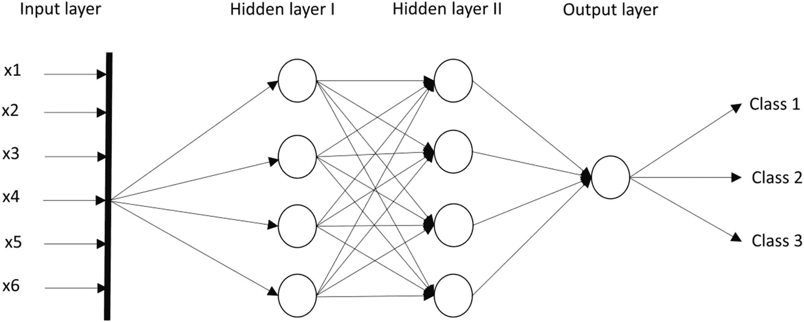

一个人工神经网络。六个输入层节点连接到四个隐藏层节点，该过程以输出层结束。输出层被分类为三个类别，例如 1、2 和 3。

图 13-1

一个简单神经网络的示意图

隐藏层和输出层是活跃层，因为它们会聚合和转换数据。转换函数也称为激活函数。聚合函数可以是线性的或非线性的。两种最常用的激活函数是 Sigmoid 函数和修正线性单元函数，尽管还有其他激活函数，如钟形函数、逻辑函数等。Heaviside 阶跃函数也经常被使用，因为它与神经元产生输出的方式非常相似：要么全有，要么全无。这些激活函数的一个共同特点是，它们都能提供线性变换，无论是针对所有数据还是仅针对特定范围的值。显然，这些激活函数可以通过将多维数据点映射到线性空间来简化数据。

公式 (6-2) 定义了其最简单形式的 Sigmoid 函数。让我们将其作为公式 (13-1) 再次回顾：

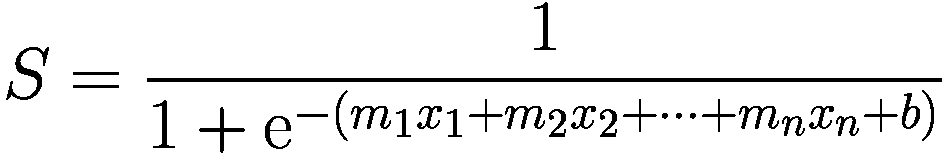

(13-1)

图 13-2 显示了 Sigmoid 函数的图形。请注意，当输入趋向正无穷或负无穷时，Sigmoid 函数收敛于 1 或 -1。更重要的是，如果输入在 -1 和 1 之间，Sigmoid 函数可以将数据转换到线性空间。这就是为什么 Sigmoid 激活函数的数据输入通常被归一化到 -1 和 1 的范围，或者至少是 0 和 1 的范围。

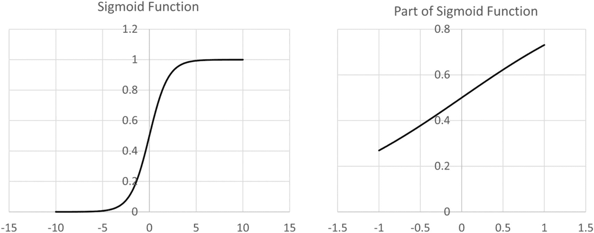

两个图形说明了 Sigmoid 函数。该线大约从 -10 开始，保持稳定，然后对角穿过纵轴。它达到 1 后保持恒定。Sigmoid 函数描绘了 -1 和 1 之间的线性函数。

图 13-2

Sigmoid 函数在 -1 和 1 之间是线性的

## 通过 Excel 学习神经网络

本章我们将进行两个实验。第一个实验要简单得多，它可以帮助我们很好地理解神经网络的工作原理。第二个实验则能巩固并提升我们的理解。


### 实验 1

打开 `Chapter13-1a.xlsx` 文件，其中包含从 UCI 机器学习库（[`https://doi.org/10.24432/C5HP4Z`](https://doi.org/10.24432/C5HP4Z)）下载的威斯康星州乳腺癌（原始）数据集。有关该数据集的详细信息，请访问 [`https://archive.ics.uci.edu/`](https://archive.ics.uci.edu/) 或阅读期刊文章（W.H. Wolberg 和 O.L. Mangasarian：“用于医学诊断的乳腺细胞学模式分离多表面方法”，PNAS，1990，87:9193-9196）。

原始数据包含十个属性和一个名为“Class”的目标变量。该目标变量有两个值：2 表示良性乳腺癌，4 表示恶性乳腺癌。第一个属性是样本编码编号，已在 `Chapter13-1a.xlsx` 中移除。为简化起见，其余九个属性被重命名为 x1, x2, …, x9。下载的数据集最初有 699 个样本。由于 16 个样本缺少一个属性，因此这 16 个样本已被移除。因此，在 `Chapter13-1a.xlsx` 中，只有 683 个样本。

其中 500 个样本用作训练数据集；其余 183 个样本将用作测试数据集，以评估我们的神经网络模型的性能。工作表顶部部分如图 13-3 所示。

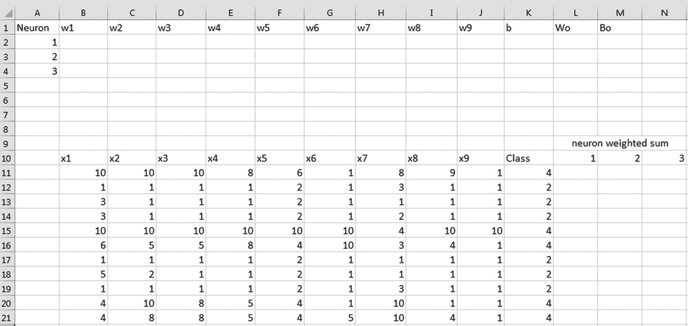

Excel 工作表截图展示了乳腺癌数据集。

图 13-3

从 UCI 下载的乳腺癌数据集

在我们的第一个实验中，为简单起见，我们将只设置一个包含三个神经元（通常称为节点）的隐藏层，如单元格 A1:A4 中所标记。权重 w1, w2, …, w9 是九个属性的权重（系数），而 `b` 是所谓的偏置，即线性函数中的截距。每个神经元都有自己的一组权重和偏置。注意，我们将使用线性聚合函数。`Wo` 和 `Bo` 表示用于输出层的权重和偏置。如果此时感到困惑，不必担心。当这些数据被使用时，我会在每一步详细解释。

请按照以下说明完成此实验：

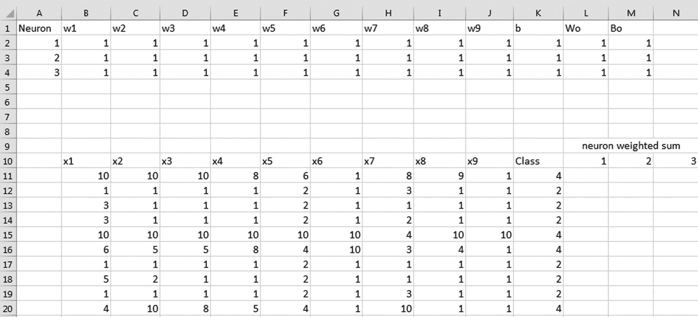

Excel 工作表截图包含权重和截距数据，其值均为 1。

图 13-4

用 1 初始化权重和截距

1.  第一个任务是为权重和截距赋值。我们将它们全部赋值为 1，如图 13-4 所示。

1.  每个神经元将所有训练样本作为输入。训练样本存储在表格 B11:K510 中。对于样本 1（第 11 行），其所有属性值分别在神经元 1、2 和 3 内部聚合成一个单一值。因此，我们需要在单元格 L11 中输入以下公式：

```
    =SUMPRODUCT($B11:$J11,INDEX($B$2:$J$4,L$10,0))+INDEX($K$2:$K$4,L$10,1)
    ```

该公式实现了线性表达式 w1x1 + w2x2 + w3x3 + … + b。在此特定公式中，w1, w2, w3… 和 `b` 对应于神经元 1（B2:K2），而 x1, x2, x3, … 对应于第 11 行的第一个数据点。

函数 SUMPRODUCT 用于计算两个数组（B11:J11 和 B2:J2）的乘积之和。我们可以将函数写为 `SUMPRODUCT($B11:$J11,$B$2:$J$2)`。然而，我们希望在不重复编写公式的情况下，从 L11 自动填充到 N11。因此，应用了 `INDEX($B$2:$J$4,L$10,0)`，以根据单元格 L10 中的值获取数组 B2:J2。由于 L10 = 1，`INDEX($B$2:$J$4,L$10,0)` 从表格 B2:J4 中提取第一行。

`INDEX($K$2:$K$4,L$10,1)` 获取单元格 K2 中的值，即偏置。注意，数组 K2:K4 只有一列；这就是 INDEX 函数中最后一个参数为 1 的原因。

2.  从 L11 自动填充到 N11，然后一起自动填充到 L510:N510。工作表的部分内容如图 13-5 所示。检查单元格 M11 内的公式。由于 M10 = 2，聚合函数使用了神经元 2 的系数。


这一步可以理解为输入层。

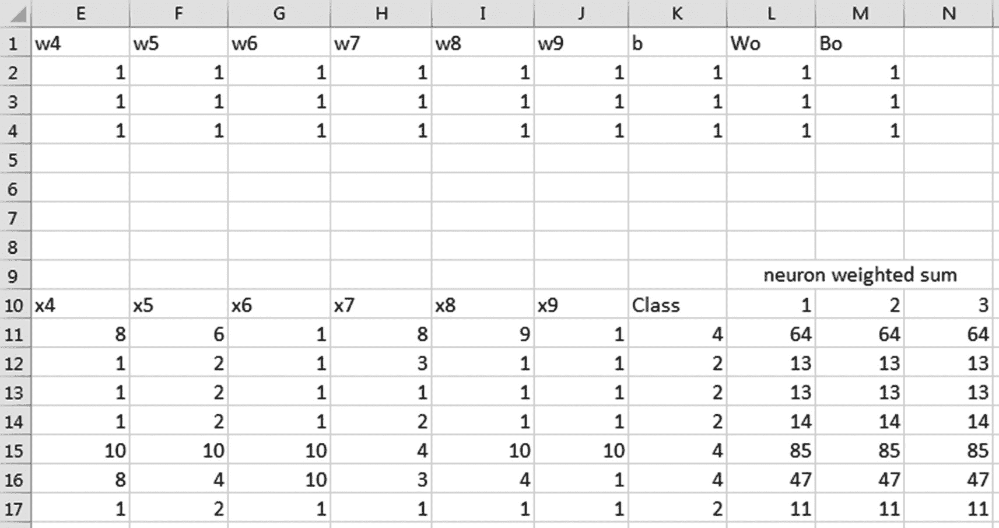

一张 Excel 表格的截图，其中包含权重和截距数据。经过聚合函数处理后，神经元的加权和得到更新。

图 13-5
应用聚合函数

如前所述，在聚合函数之后，需要应用激活函数（Sigmoid 函数）来启动隐藏层。然而，由于 Sigmoid 函数倾向于将其输入数据归一化到 -1 到 1 或 0 到 1 之间，我们需要对 L、M 和 N 列中的值进行归一化。由于此时所有值均为正数，我们只需将这些值归一化到 0 到 1 的范围内。

3.  在单元格 K6 中输入“MAX”，在单元格 K7 中输入“MIN”。

4.  在单元格 L6 中输入公式 `=MAX(L11:L510)`，在单元格 L7 中输入公式 `=MIN(L11:L510)`。

5.  选中单元格 L6 和 L7，然后自动填充至 N6:N7，如图 13-6 所示。

6.  此外，合并单元格 O9:Q9，在合并后的单元格中输入文本“归一化”，并分别在单元格 O10、P10 和 Q10 中输入 1、2 和 3。归一化后的加权和将分别存储在 O、P 和 Q 列中。

将我们的工作表与图 13-6 进行比较。如果发现 L、M 和 N 列中的数字相同，不必惊讶。

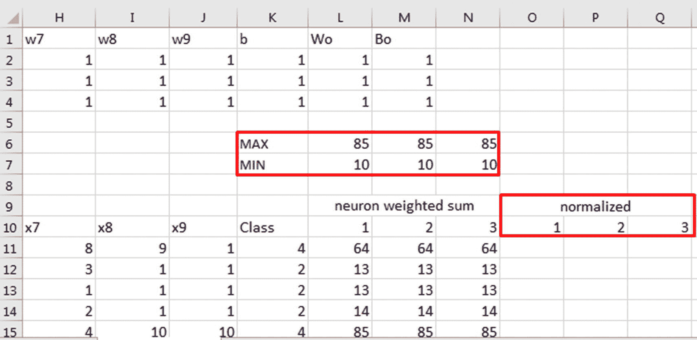

一张 Excel 表格的截图，其中包含权重和截距数据。单元格 L6 和 L7 已被选中。归一化后的加权和分别位于 O、P 和 Q 列。

图 13-6
准备归一化数据

1.  在单元格 O11 中输入公式 `=(L11-L$7)/(L$6-L$7)`。此公式将单元格 L11 中的值归一化到 0 到 1 之间（包含端点）。

2.  从 O11 自动填充至 Q11，然后一起自动填充至 O510:Q510。如果发现 O、P 和 Q 列中的数字相同，不必惊讶。请注意，当 L6（最大值）等于 L7（最小值）时，公式 `=(L11-L$7)/(L$6-L$7)` 会导致错误。不过，这种情况不应发生。如果确实发生了，则意味着该属性没有方差，应予以移除。

3.  是时候通过 Sigmoid 函数转换归一化数据了。合并单元格 R9、S9 和 T9。在合并后的单元格中输入“Sigmoid 转换”。在单元格 R10、S10 和 T10 中分别输入数字 1、2 和 3。工作表的一部分看起来如图 13-7 所示。

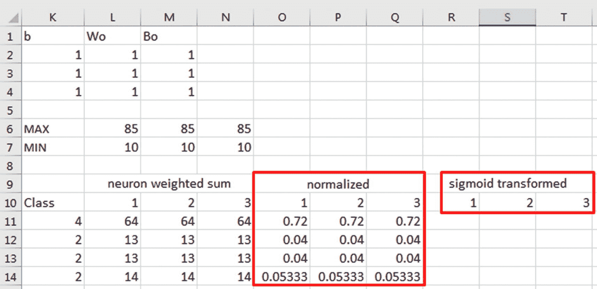

一张 Excel 表格，包含权重和截距数据。归一化列和 Sigmoid 转换列已被高亮显示。

图 13-7
归一化之后，Sigmoid 转换之前

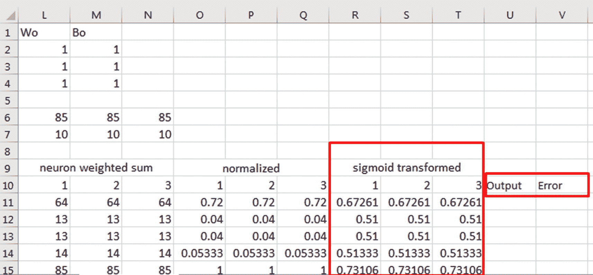

一张 Excel 电子表格，包含神经元加权和、归一化值、Sigmoid 转换值、输出值和误差值。

图 13-8
准备生成输出并计算误差

1.  基于公式 (11-1)，在单元格 R11 中输入公式 `=1/(1+EXP(-O11))`。

2.  从 R11 自动填充至 T11，然后一起自动填充至 R510:T510。

3.  在单元格 U10 和 V10 中，分别输入“输出”和“误差”。至此，工作表的一部分看起来与图 13-8 完全一致。

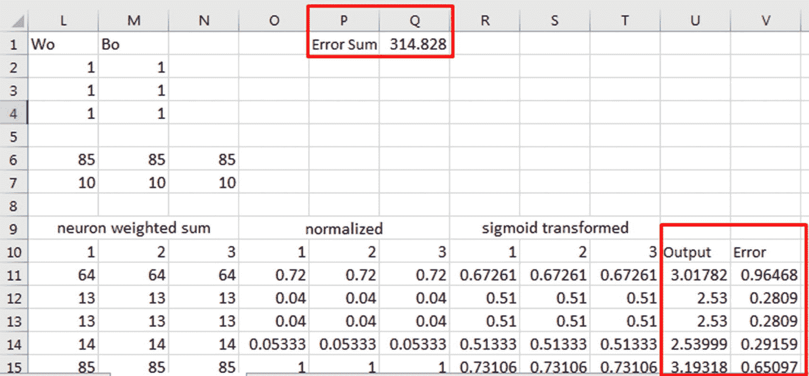

一张 Excel 电子表格，包含生成的输出和计算出的误差。误差总和等于 314.828。

图 13-9
输出已生成，误差已计算

1.  输出是另一个聚合函数，使用了单元格 L2:L4 中的 `Wo` 值和单元格 M2 中的 `Bo` 值。在单元格 U11 中，输入以下公式：

```
    =MMULT(R11:T11,$L$2:$L$4)+$M$2
    ```

请注意，函数 SUMPRODUCT 不适用于数组 R11:T11 和 L2:L4。这是因为 R11:T11 类似于一行，而 L2:L4 类似于一列。然而，函数 MMULT（矩阵乘法）非常适合这种类型的数组乘法。注意单元格 M3 和 M4 未被使用。

2.  从单元格 U11 自动填充至单元格 U510。

3.  在单元格 V11 中，输入公式 `=(U11-K11)²`，该公式计算输出 U11 与原始类别值 K11 之差的平方。我们之前已经在误差计算中见过平方的用法。对差值进行平方的一个原因是使误差为正。

4.  从单元格 V11 自动填充至单元格 V510。

在神经网络中，我们需要搜索权重 w1, w2, …, w9、`Wo`、`b` 和 `Bo` 的最优值，以使误差总和最小化。

5.  在单元格 P1 中输入“误差总和”。

6.  在单元格 Q1 中输入公式 `=SUM(V11:V510)`。

将我们的结果与图 13-9 进行比较。

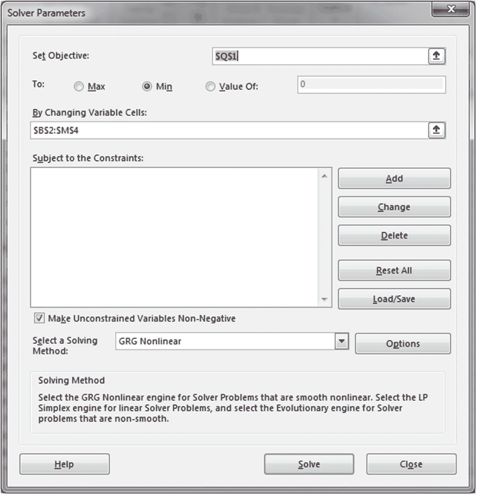

规划求解参数窗口的截图。它包含以下字段：设置目标、通过更改可变单元格、遵守约束、选择求解方法。

图 13-10
使用规划求解寻找最优参数

1.  我们需要再次使用规划求解来寻找最优的权重和偏置。点击“数据”➤“规划求解”；按照图 13-10 设置规划求解的单元格范围。

2.  勾选“使无约束变量为非负数”。如果取消勾选，结果可能会不同（可能更好）。在本实验中，我们勾选它。

规划求解可能需要一些时间来完成最优参数搜索。一旦规划求解完成其工作，我们的工作表应如图 13-11 所示。

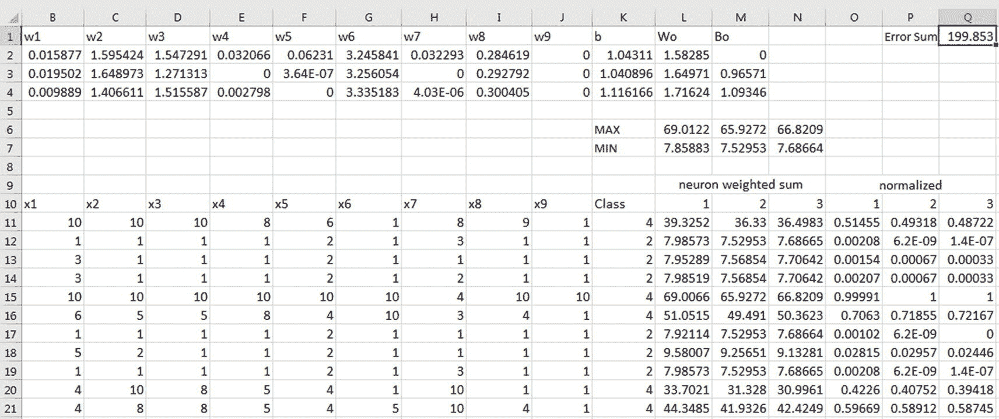

一张 Excel 表格，展示了神经网络的最优参数搜索。

图 13-11
规划求解为具有一个隐藏层的神经网络找到最优参数

有了优化后的权重和偏置，我们的下一个任务是找到一个阈值来区分良性和恶性类别。在神经网络中，通常使用 Softmax 函数（用于多分类）或 Sigmoid 函数（用于二分类）来计算输出层中每个类别的概率。这需要相当大的努力来计算交叉熵。为简单起见，在我们的实验中，我们直接找到一个阈值来完成输出层。按照以下说明计算阈值：

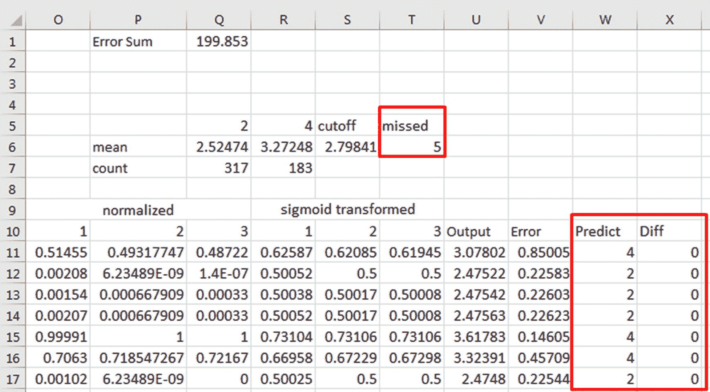

一张 Excel 表格，包含预测测试样本的计算。W 列和 X 列已被高亮显示。

图 13-13
使用测试数据集评估神经网络模型

1.  在单元格 P6 和 P7 中分别输入“平均值”和“计数”。

2.  在单元格 Q5 和 R5 中分别输入数字 2 和 4，在单元格 S5 和 T5 中分别输入“阈值”和“遗漏数”。

3.  在单元格 Q6 中输入公式 `=AVERAGEIFS($U11:$U510,$K11:$K510,Q5)`。此公式计算良性类别的平均输出值。

4.  从 Q6 自动填充至 R6。

5.  在单元格 Q7 中输入公式 `=COUNTIFS($K11:$K510,Q5)`。此公式计算训练数据集中良性类别的数量。

6.  从 Q7 自动填充至 R7。

7.  在单元格 S6 中输入公式 `=(Q6*Q7+R6*R7)/500`。这是区分类别 2 和 4（良性和恶性）的阈值。

工作表的一部分看起来如图 13-12 所示。

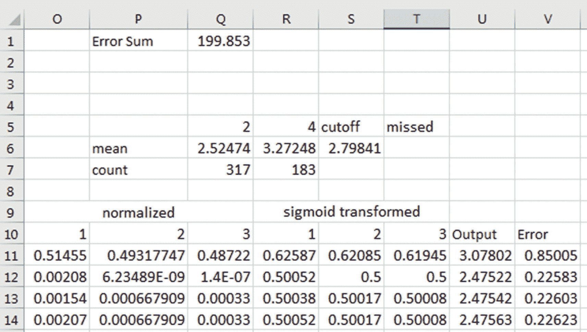

一张 Excel 表格，展示了用于区分类别 2 和 4 的阈值数据。

图 13-12
为具有一个隐藏层的神经网络模型计算出的阈值

现在是时候用测试数据集评估我们的神经网络模型了（再次注意，这个模型只是一组优化后的参数）。按照以下说明操作：

8.  选中单元格 L510:U510；将它们一起向下自动填充至单元格 L693:U693。

9.  在单元格 W10 和 X10 中分别输入“预测”和“差异”。

10. 在单元格 W11 中输入公式 `=IF(U11<=$S$6,2,4)`；从 W11 自动填充至 W693。

11. 在单元格 X11 中输入公式 `=IF(K11=W11,0,1)`；从 X11 自动填充至 X693。


12.  在单元格 T6 中输入公式 `=SUM(X511:X693)`。T6 中的数字表示我们的神经网络模型未能正确预测的测试样本数量。请注意，此公式中的单元格范围是 X511:X693。

我们的工作表部分内容与图 13-13 完全一致。在 183 个测试样本中，有 5 个未能正确预测，准确率为 97.3%。你可以在 Chapter13-1b..xlsx 文件中找到完整结果。

对于这个特定的乳腺癌数据集，良性和恶性类别均能通过这九个属性得到很好的表征。区分这两个类别并不困难。上述 Excel 分步操作指南的目的是剖析神经网络建模过程，让我们清晰地了解一个简单的神经网络模型是如何工作的。

如 Q7:R7 所示，目标类别的分布并不十分均衡。由于我们没有平衡目标类别的分布，因此有必要检查我们的模型在准确预测代表性不足的类别（即 4）方面的表现如何。稍加分析即可证实，我们的模型预测代表性不足类别的准确率为 94.6%，这是一个相当不错的性能。

### 实验 2

让我们开始另一个实验，这次我们将构建一个包含两个隐藏层的神经网络。每个隐藏层仍然有三个神经元。当存在多个隐藏层时，这种神经网络通常被称为深度学习。请注意，真正的深度学习通常包含两个以上的隐藏层和更多的神经元。

打开文件 Chapter13-2a.xlsx。其中的数据是短发夹 RNA (shRNA) 功效预测的实验结果。这些数据经过预处理和简化。共有四个属性用于预测目标类别，该类别有三个不同的值：39 = 低功效，69 = 中功效，84 = 高功效。第 11–182 行是训练数据集，而第 183–190 行是评分数据集。工作表的设置如图 13-14 所示。请注意，不同的神经元以不同的权重和偏置开始。W21、W22、W23 和 B2 是隐藏层 2 中神经元的权重和偏置。此后，我们将这两个隐藏层分别称为“层 1”和“层 2”。

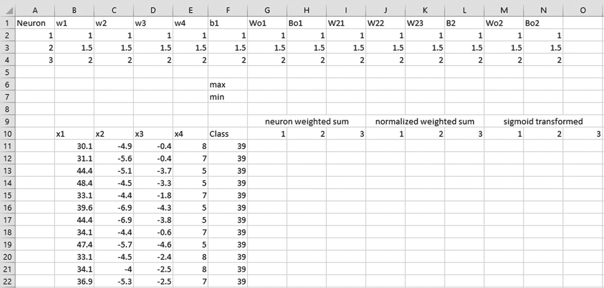

Excel 工作表的截图展示了实验结果。

图 13-14

实验 2 数据设置

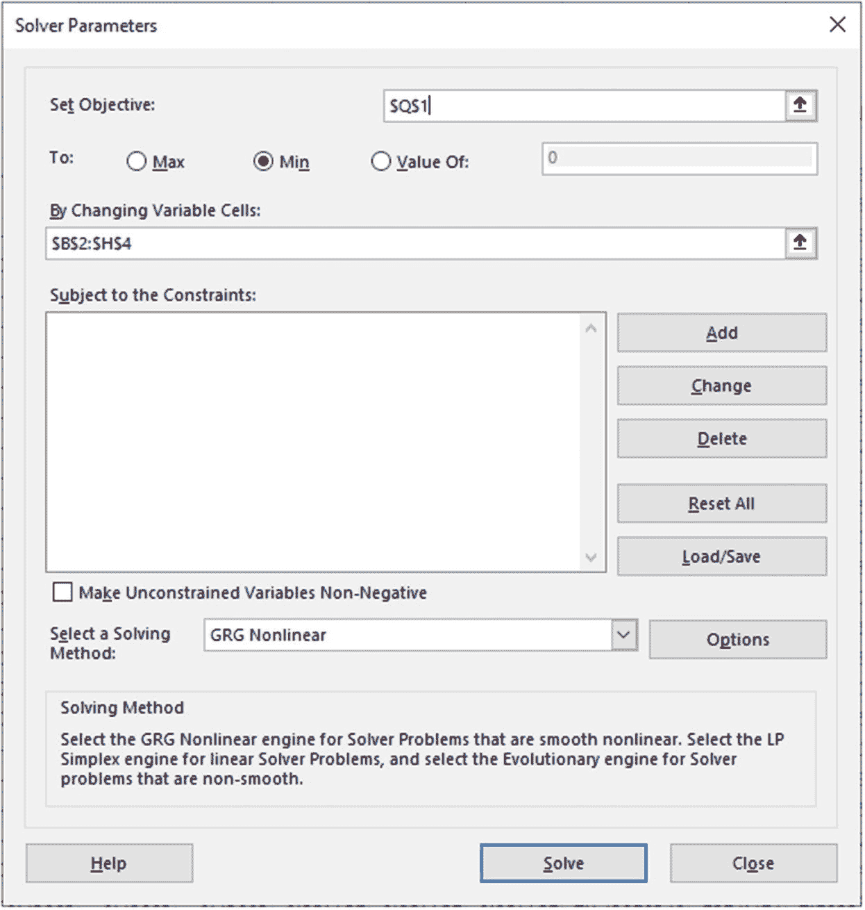

求解器参数窗口的截图。已设置隐藏层 1 的参数。

图 13-17

用于隐藏层 1 参数优化的求解器

1.  在单元格 G11 中输入以下公式：

```
    =SUMPRODUCT($B11:$E11,INDEX($B$2:$E$4,G$10, 0))+INDEX($F$2:$F$4,G$10,1)
    ```

同样，此公式实现了线性表达式 w1x1 + w2x2 + w3x3 + … + b。

2.  从 G11 自动填充到 I11，然后一起自动填充到 G182:I182。

3.  为了将数据归一化到 [-1, 1] 范围，我们需要先将数据归一化到 [0, 1] 范围，乘以 2，然后减去 1。因此，我们需要执行以下操作：
    *   在单元格 G6 中，输入公式 `=MAX(G11:G182)`；从 G6 自动填充到 I6。

*   在单元格 G7 中，输入公式 `=MIN(G11:G182)`；从 G7 自动填充到 I7。

*   在单元格 J11 中，输入公式 `=(G11-G$7)/(G$6-G$7)*2-1`。从单元格 J11 自动填充到单元格 L182。

我们的工作表部分内容如图 13-15 所示。

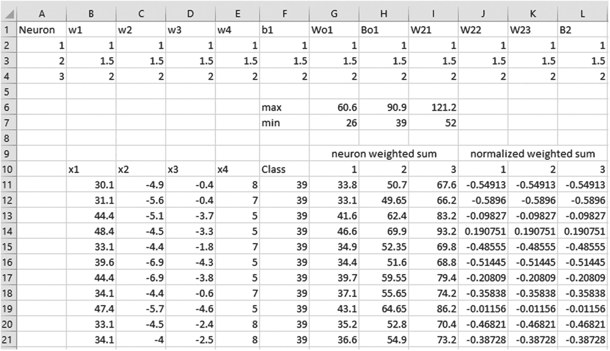

Excel 工作表的截图展示了归一化加权和的计算过程。

图 13-15

聚合数据归一化到 [-1, 1]

按照以下说明完成层 1 的数据转换和输出生成：

4.  在单元格 P10 中输入文本“Output-1”，在单元格 Q10 中输入文本“Error-1”。

5.  在单元格 M11 中输入公式 `=1/(1+EXP(-J11))`。

6.  从单元格 M11 自动填充到单元格 O11，然后从单元格 M11:O11 一起自动填充到单元格 M182:O182。

7.  在单元格 P11 中，输入公式 `=MMULT(M11:O11,$G$2:$G$4)+$H$2`。这是来自隐藏层 1 的输出。

8.  在单元格 Q11 中，输入公式 `=(P11-F11)²`。这是当前参数设置下层 1 的误差。

9.  分别将 P11 和 Q11 自动填充到 P182 和 Q182。

10.  在单元格 P1 中，输入文本“Error Sum1”。

11.  在单元格 Q1 中，输入公式 `=SUM(Q11:Q182)`。

我们的工作表部分内容应如图 13-16 所示。

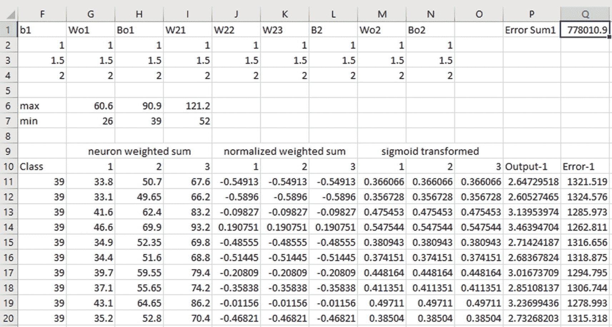

Excel 工作表的截图展示了层 1 输出和计算出的误差数据。

图 13-16

层 1 输出和误差计算

在神经网络中，每一层都应在将其输出作为输入传递给下一层之前，优化其参数集。这就是我们必须计算层 1 的输出和误差总和的原因。我们需要使用求解器，通过最小化层 1 的误差总和来优化层 1 的参数。

12.  单击“数据”➤“求解器”；按图 13-17 所示设置求解器的参数。取消选中“使无约束变量为非负数”。单击“求解”。

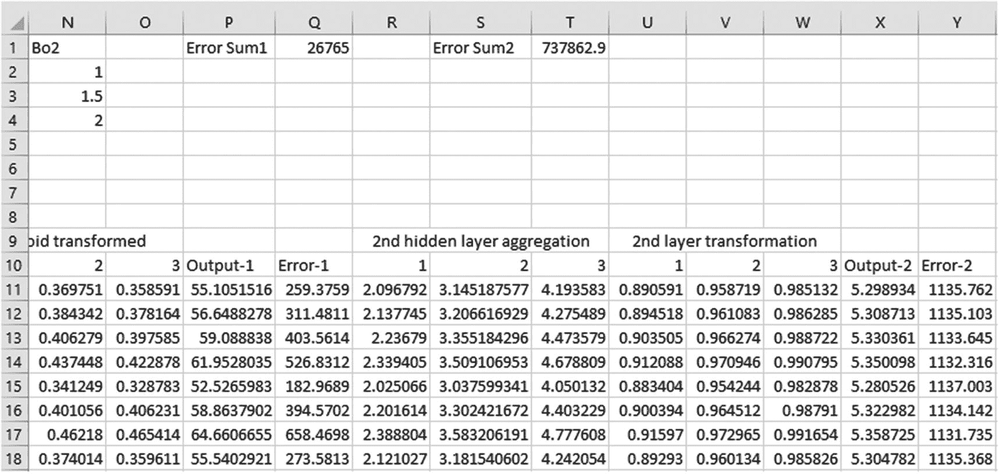


一张 Excel 表格展示了计算出的误差。

图 13-20

计算出的误差

1.  在即将出现的菜单中，确保选中“保留规划求解解”选项。至此，我们的结果应如图 13-18 所示。

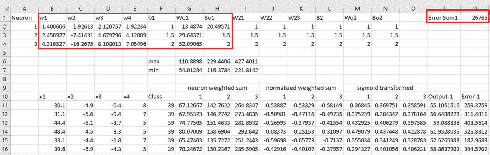

一张 Excel 表格显示了第 1 层参数的优化数据。

图 13-18

仅优化了第 1 层参数

第 1 层的转换数据是第 2 层神经元的输入。请按照以下说明完成第 2 层的输入聚合和数据转换：

2.  合并单元格 R9:T9；在合并后的单元格中输入“第二隐藏层聚合”。

3.  分别在单元格 R10、S10 和 T10 中输入数字 1、2 和 3。

4.  在单元格 R11 中输入以下公式：

```
    =SUMPRODUCT($M11:$O11,INDEX($I$2:$K$4,R$10, 0))+INDEX($L$2:$L$4,R$10,1)
    ```

此公式使用函数 `SUMPRODUCT` 聚合第 1 层的转换数据。其数学方程类似于 y = w1x2 + w2x2 + w3x3 + b。

5.  将单元格 R11 自动填充至单元格 T11，然后一起自动填充至单元格 R182:T182。

6.  我们将再次使用 sigmoid 函数来转换第 2 层数据。但是，我们不想再次对数据进行归一化。当然，如果愿意，我们也可以在应用 sigmoid 转换之前，再次将数据归一化到 [-1, 1] 范围内。合并单元格 U9:W9；在合并后的单元格中输入“第二层转换”。

7.  分别在单元格 U10、V10 和 W10 中输入数字 1、2 和 3。

8.  在单元格 U11 中输入公式 `=1/(1+EXP(-R11))`，自动填充至单元格 W11，然后一起自动填充至单元格 U182:W182。

9.  在单元格 X10 中输入“输出-2”。

10.  在单元格 Y10 中输入“误差-2”。

工作表的一部分应如图 13-19 所示。

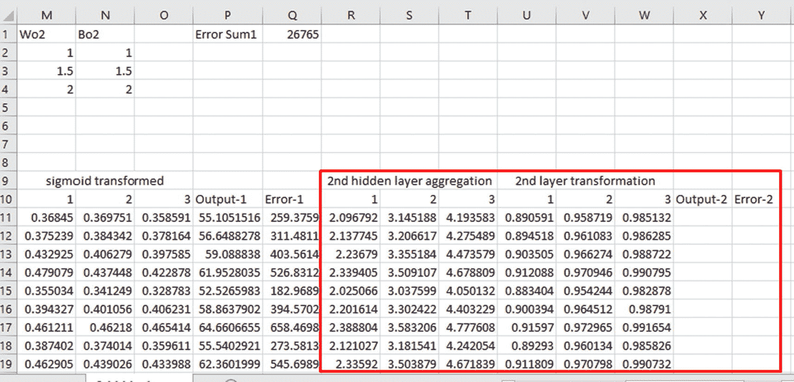

一张包含第 2 层数据转换（未归一化）的 Excel 表格。

图 13-19

第 2 层数据转换（未归一化）

以下说明指导我们如何继续：

11.  在单元格 X11 中输入公式 `=MMULT(U11:W11,$M$2:$M$4)+$N$2` 以生成输出。

12.  从 X11 自动填充至 X182。

13.  在单元格 Y11 中输入公式 `=(F11-X11)²` 以计算误差。

14.  从 Y11 自动填充至 Y182。

15.  在单元格 S1 中输入“误差总和 2”。

16.  在单元格 T1 中输入公式 `=SUM(Y11:Y182)`。

工作表的一部分应如图 13-20 所示。

1.  让我们再次使用规划求解来优化所有权重和偏置。单击“数据”➤“规划求解”启动规划求解，并设置规划求解参数，如图 13-21 所示。

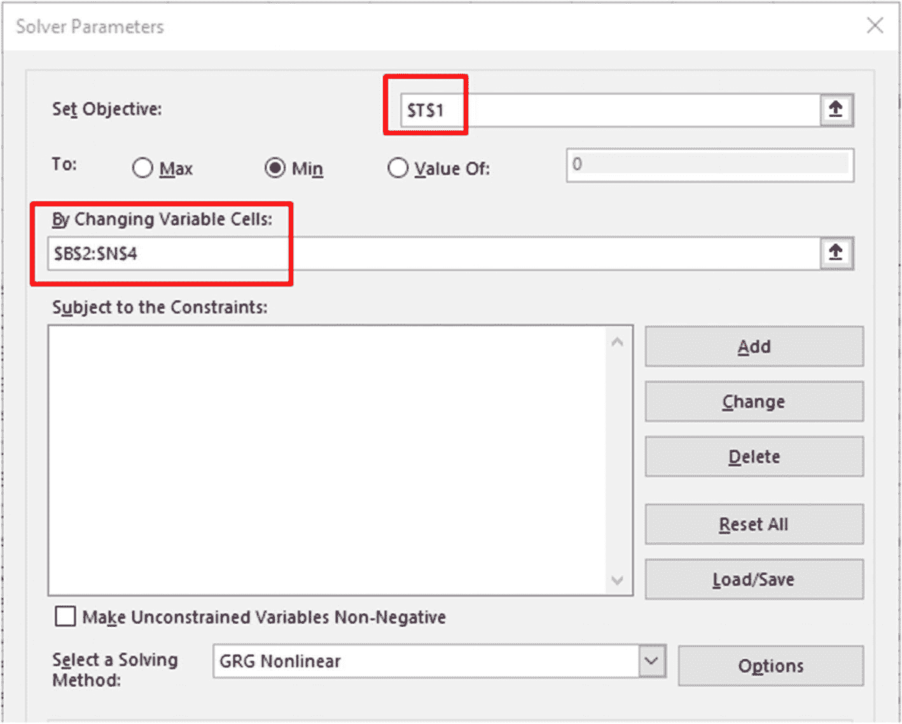

规划求解参数窗口的截图。设置目标包含 $T$1。通过更改可变单元格选项包含 $B$2:$N$4。

图 13-21

再次使用规划求解优化所有层的参数集

经过规划求解对权重和偏置进行优化后，工作表的一部分应如图 13-22 所示。由于模型变得更加复杂，您的结果可能与图 13-22 略有不同。不必感到惊讶。

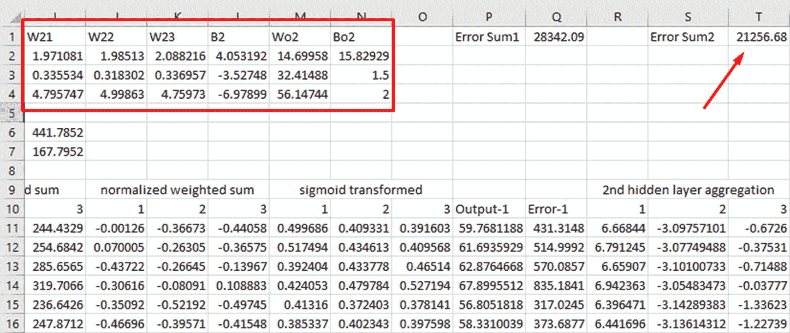

一张 Excel 表格的截图，展示了优化后的数据。

图 13-22

通过规划求解优化所有参数

像往常一样，我们现在需要设置截止点。请遵循以下说明：

2.  在单元格 S6 中输入“平均值”，在单元格 S7 中输入“计数”。

3.  分别在单元格 T5、U5 和 V5 中输入数字 39、69 和 84。

4.  在单元格 W5 中输入“截止点”，在单元格 X5 中输入“错误分类”。

5.  在单元格 T6 中输入公式 `=AVERAGEIFS($X$11:$X$182,$F$11:$F$182,T$5)`。此公式计算那些“类别”值等于 39 的样本的“输出”平均值。从 T6 自动填充至 V6。

6.  在单元格 T7 中输入公式 `=COUNTIFS($F$11:$F$182,T$5)`。这会计算“类别”值等于 39 的样本数量。从 T7 自动填充至 V7。

7.  在单元格 W6 中输入公式 `=(T6*T7+U6*U7)/(T7+U7)`。这是类别 39 和 69 之间的截止点。

8.  在单元格 W7 中输入公式 `=(U6*U7+V6*V7)/(U7+V7)`。这是区分类别 69 和 84 的截止点。

工作表的一部分应完全如图 13-23 所示。

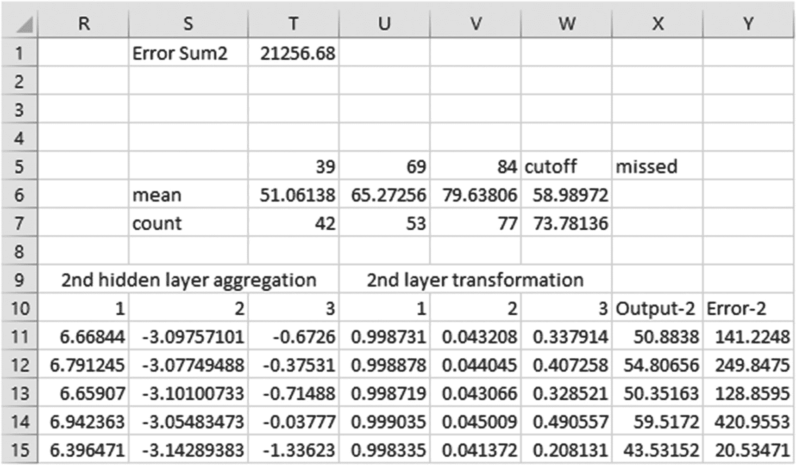

一张 Excel 表格的截图，展示了神经网络的截止点数据。

图 13-23

具有两个隐藏层的神经网络模型的截止点

我们想使用训练数据来评估我们的模型效果如何。由于我们的数据量不大，这里不进行交叉验证。

9.  在单元格 Z10 中输入“预测”，在单元格 AA10 中输入“差异”。

10.  在单元格 Z11 中输入公式 `=IF(X11<$W$6,39,IF(X11<$W$7,69,84))`。此公式根据“输出”值和两个截止点值对每个样本进行分类。从 Z11 自动填充至 Z182。

11.  在单元格 AA11 中输入公式 `=IF(F11=Z11,0,1)`。如果预测的类别类型与现有的类别类型相同，此公式返回 0；否则返回 1。从 AA11 自动填充至 AA182。

12.  在单元格 X6 中输入公式 `=SUM(AA11:AA182)`。此公式计算预测错误的类别类型数量。

我们的结果应类似于图 13-24。我们的具有两个隐藏层的神经网络在 172 个样本中错误预测了 48 个。

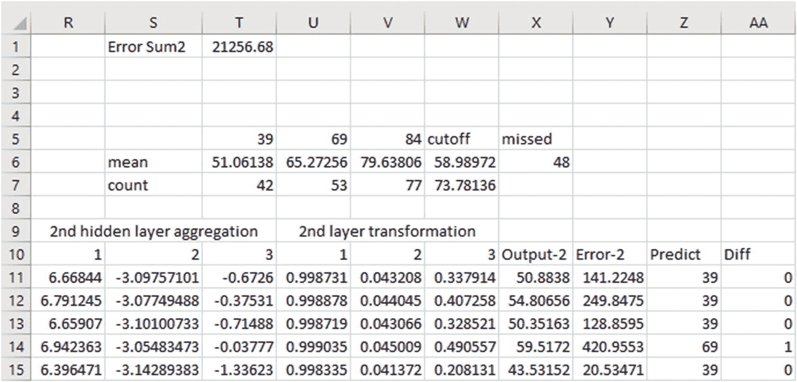

一张 Excel 表格的截图，展示了错误预测的 48 个样本。

图 13-24

神经网络错误预测了 48 个样本

您可能会得到与图 13-24 所示略有不同的结果。如果是这样，不必感到惊讶。这种差异是由规划求解引起的。我们在通过 Excel 学习数据挖掘的过程中一直在使用规划求解。规划求解是一个数学优化工具，由于其内部算法，有时可能会产生略有不同的结果。如果您的 Excel 使用的是更新版本的规划求解，您的模型可能会有更好的性能。

本实验的下一步是对评分数据集进行预测。请遵循以下说明：

13.  选择单元格 G182:X182。自动填充至单元格 G190:X190。

14.  从单元格 Z182 自动填充至 Z190。

预测结果类似于图 13-25。

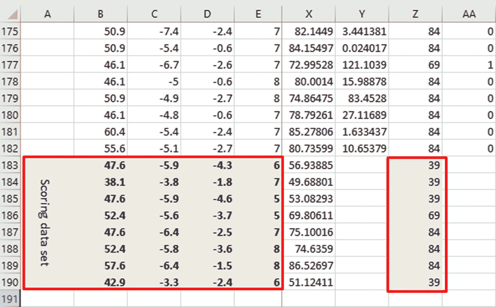

一张预测类别类型的 Excel 表格。评分数据集已高亮显示。

图 13-25

评分数据集的预测类别类型

关于上述实验过程，我们可能会有不少疑问。例如，我们可能会问，为什么需要生成输出-1、误差-1、输出-2 和误差-2 来分别优化第 1 层和第 2 层参数。这是个好问题。我们当然可以稍微不同地实践这个神经网络模型，例如，不先优化第 1 层参数。事实上，我们甚至可能得到更好的结果。这就是使用 Excel 学习数据挖掘方法（尤其是那些复杂方法）的优势所在。因为我们对每一步都有清晰的了解，所以在学习过程中可能会提出各种问题，其中一些问题可能有助于改革和改进某些数据挖掘算法。

我们也可以在隐藏层 2 中使用不同的转换函数。在不同的层中使用不同的转换函数（例如修正线性单元函数）是否能改善模型结果，这在 Excel 中很容易测试。这是一个值得尝试的好练习。

至此，我们在 Excel 中学习人工神经网络的内容就结束了。请在 Chapter13-2b.xlsx 文件中找到最终结果。


## 强化练习

虽然有三项强化练习，但它们都基于我们在实验 2 中使用的数据。

1.  练习 1：从与 Chapter13-2a.xlsx 相同的 Chapter13-HW-1.xlsx 开始；请按照实验 2 所示构建一个 2 隐藏层神经网络。但是，在使用规划求解最小化误差平方和时，请仅优化$H$2:$N$4 范围内的参数。将预测结果与实验 2 的结果进行比较。参考 Chapter13-HW-1-withAnswers.xlsx。

2.  练习 2：从与 Chapter13-2a.xlsx 相同的 Chapter13-HW-2.xlsx 开始；请按照实验 2 所示构建一个 2 隐藏层神经网络。但是，不要先优化第 1 层参数。而是在构建两个隐藏层后，一起优化所有参数。将预测结果与实验 2 的结果进行比较。参考 Chapter13-HW-2-withAnswers.xlsx。

3.  练习 3：从使用了四个神经元的 Chapter13-HW-3.xlsx 开始。请构建一个具有一个或两个隐藏层的神经网络。将预测结果与实验 2 的结果进行比较。参考 Chapter13-HW-3-withAnswers.xlsx。

比较从实验 2、练习 1、练习 2 和练习 3 中获得的结果将会很有趣。

## 复习要点

1.  对神经网络的总体理解

2.  输入层、隐藏层和输出层

3.  聚合函数、转换函数或激活函数，特别是 Sigmoid 函数

4.  Excel 函数：SUMPRODUCT、COUNTIFS、INDEX、AVERAGEIFS、MMULT 和 EXP

5.  什么是深度学习

6.  规划求解

