# 14. 文本挖掘

文本挖掘是数据挖掘中一个庞大的主题，足以成为一个独立的领域。它也非常重要且应用广泛，以至于任何一本典型的数据挖掘书籍都不会遗漏它。到目前为止，我们使用的所有数据都是结构化数据。根据定义，结构化数据是指数据以特定格式排列，以便计算机程序可以轻松处理。我们一直使用的数据已经以表格格式排列，这是我们学过的所有数据挖掘方法所要求的格式。然而，文本数据（文本挖掘方法处理的对象）是一种非结构化数据，通常是序列数据。其他形式的非结构化数据包括音频文件、图像等。

是否有可能应用我们学过的技术来挖掘像文章或网页这样的非结构化数据？答案是肯定的。但有一个前提条件。

## 总体理解

要将我们学过的数据挖掘技术应用于非结构化文本数据，必须对数据进行预处理，使其成为结构化或至少是半结构化数据。有几种典型的预处理（准备）文本数据的技术。这些技术包括大小写转换、分词、停用词移除、词干提取、生成 n-gram、词元替换等。在文本数据以表格格式组织后，我们可以构建一个词项-文档矩阵。由此，可以挖掘出有意义的信息，包括词频和词项模式，用于各种应用，如风险管理、客户服务、欺诈预防、垃圾邮件过滤、社交媒体文本分析等。

假设我们正在阅读大量关于某家酒店的评论。我们的目的是根据正面评论数量与负面评论数量的对比来给酒店评级。首要任务是确定什么是正面或负面评论。这类任务类似于句子情感分析：判断一个短句的情绪或情感。评估句子情感的最简单技术是统计正面关键词和负面关键词的出现次数。当然，应该有一个包含这些关键词（和短语）的词典，代表正面或负面情绪。MPQA 主观性词典正是这样一个词典，并被 Excel Azure 机器学习插件所采用。在 MPQA 主观性词典中，大约有 8000 个词；每个词都被分配了一个强或弱的极性分数。由于本书除了内置的规划求解插件外不使用其他插件，我们不会使用 Azure 或 MPQA。相反，我将通过 Excel 创建一个小型词典来说明如何进行简单的观点（情感）分析。让我们先通过处理一条评论“The hotel it is fantastic”来了解数据准备步骤。

1.  大小写转换：将所有单词转换为小写是一个好主意。我们不希望将“Fantastic”与“fantastic”区别对待。经过大小写转换后，原始评论变为“the hotel it is fantastic”。

2.  分词：通过分词，我们将每个单词分离成一个独立的词元。在分词过程中，我们还会移除标点符号和空白字符。分词后，原始句子变成五个独立的单词：the, hotel, it, is, fantastic。

3.  停用词是在上下文中没有实际意义的词。它们是英语中必要的连词和冠词，例如，then, a, the, it, is, of, for, just, to 等。移除它们可以简化文本。移除停用词后，我们只剩下两个词：hotel 和 fantastic。

4.  假设“fantastic”是我们词典中的一个正面词，极性分数为 1，而“hotel”是一个中性词，极性分数为 0。因此，这条评论被评估为正面（分数=1）。

如果评论变为“The hotel it is not fantastic”，我们知道即使关键词 fantastic 存在，它也不应该是一条正面评论。如何评估这条评论为负面？可以有多种方法。

*   方法 1：将“not”标记为负面关键词。如果采用这种方法，那么像“the hotel is not bad”这样的评论呢？

*   方法 2：将“not fantastic”或“not bad”视为一个短语，并根据短语评估其含义。这就是 n-gram 技术的含义。

*   方法 3：将方法 1 和方法 2 结合起来。将“not”标记为负面关键词，并将“not fantastic”或“not bad”视为一个短语。

在文本挖掘中，n-gram 是`n`个单词的组合。单个单词可能会遗漏一些含义。“Good”是“not good”的反义词，并且在强度上与“very good”不同。应用 gram 可以使我们的文本挖掘活动更精细，但也可能带来更多的复杂性。在本章中，为简单起见，我们只考虑 2-gram。这意味着我们将把“not fantastic”或“not bad”视为一个短语。

在前面的例子中，我们没有使用词干提取技术。人们可能不会写“The hotel it is fantastic”，而是写成“The hotel it is a fantasy”。“fantasy”和“fantastic”具有相同的词源。为了降低文本挖掘的复杂性，词干提取技术会将“fantasy”视为“fantastic”。另一个例子是将“thanks”与“thank”同等对待。

## 通过 Excel 学习文本挖掘

让我们切换到 Excel 来练习一个文本挖掘的示例。打开文件 `Chapter14-1a.xlsx`。其中包含两个工作表。名为“dictionary”的工作表包含一些停用词和一些正面与负面关键词（在工作表中称为极性词）。请注意，这些词汇仅为本次文本挖掘演示而专门收集。图 14-1 展示了“dictionary”工作表的一部分。

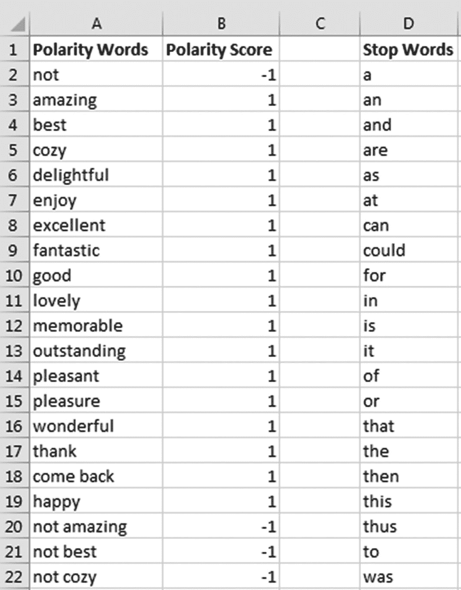

一个包含 3 列 22 行的表格截图。列标题分别为极性词、极性得分和停用词。极性词包括：not、amazing、best、cozy、delightful、enjoy、excellent、fantastic、good、lovely 等。

图 14-1

部分极性关键词及其否定形式，以及部分停用词

如图 14-1 所示，`dictionary` 工作表中的 D 列存储了一些停用词。A 列存储了正面和负面的单个关键词及其否定形式的二元词组。B 列存储了每个关键词对应的得分。请注意，“not”被指定为负面关键词（单元格 `A2`），得分为 -1。除了关键词“not”之外，图 14-1 中所有其他单个关键词都是正面的。它们的否定二元词组都被分配了 -1 的得分。为什么？让我用短句“It is not amazing”为例来解释。对于短句“It is not amazing”，两个单个关键词“not”和“amazing”分别产生 `-1` 和 `1`。二元词组“not amazing”给出 `-1`；因此，这个短句的总得分等于 `−1 + 1 − 1 = −1`：负面。

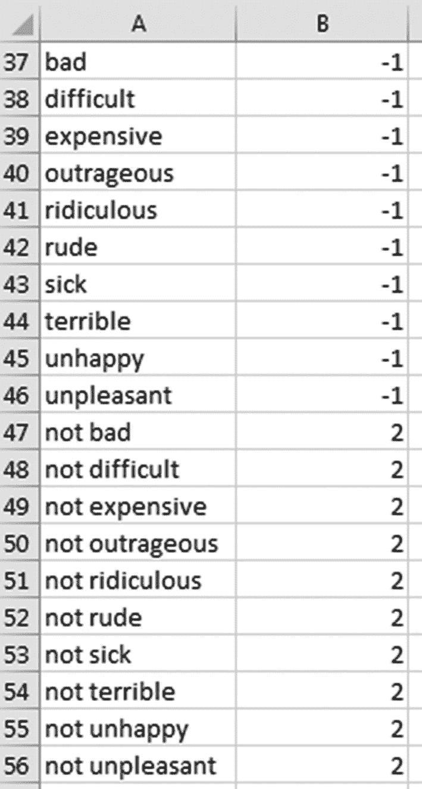

一个表格的截图。该表格包含两列和二十行。行条目为否定二元词组及其得分。否定词组包括：bad、difficult、expensive、outrageous、ridiculous、rude、sick、terrible、unhappy、unpleasant、not bad 等。

图 14-2

单个负面关键词及其否定二元词组

如图 14-2 所示，分配给单个负面关键词的二元词组的得分均为 2。例如，“not bad”的得分为 2。为什么？考虑短句“It is not bad”。“not”和“bad”都返回 `-1`，而“not bad”返回 `2`。因此，这个短句的总得分为 `−1 − 1 + 2 = 0`：中性。

请记住，上述得分分配仅适用于本次文本挖掘任务。我们当然可以根据其他偏好修改“dictionary”。例如，如果我们希望“not bad”是正面的，那么我们可以将二元词组“not bad”的得分设为 3。这里使用的评分系统只是一个示例。

为了方便使用这些关键词和停用词，我们希望对它们进行命名。点击主选项卡“公式”➤ 在出现的菜单中点击“名称管理器”➤ 点击“新建”按钮。此过程在图 14-3 中进行了说明。请注意，名称管理器自 Excel 2010 起可用。

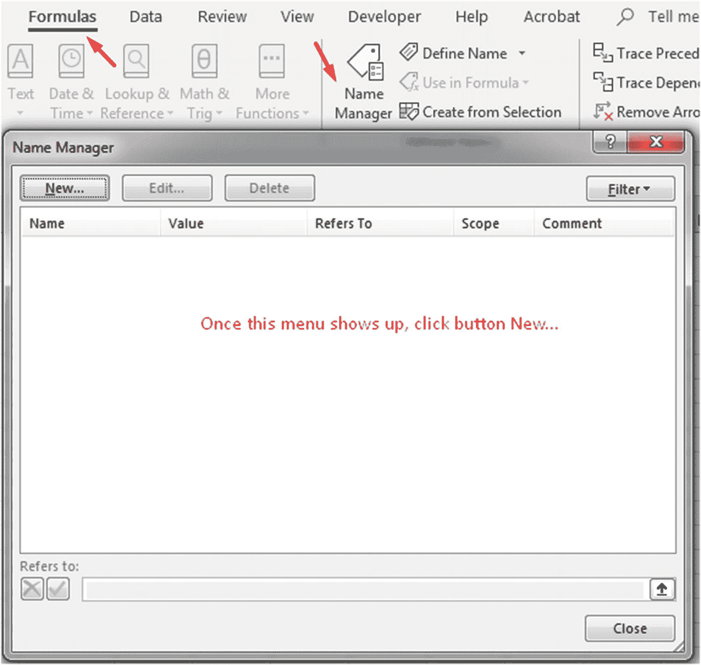

一个 Excel 选项卡的截图，展示了如何为关键词创建名称。点击主选项卡“公式”，然后在出现的菜单中点击“名称管理器”，接着点击“新建”按钮。文本说明：当此菜单出现时，点击“新建”按钮。

图 14-3

为关键词和停用词创建名称

如图 14-3 所示，点击“新建…”按钮会弹出另一个小菜单，如图 14-4 所示。由于关键词位于数组 `A2:A56` 中，“引用位置”设置为 `=dictionary!$A$2:$A$56`。在“名称”中输入“kw”。

请注意，“范围”是工作簿。这表明名称 `kw` 在每个工作表中都可访问。点击“确定”。

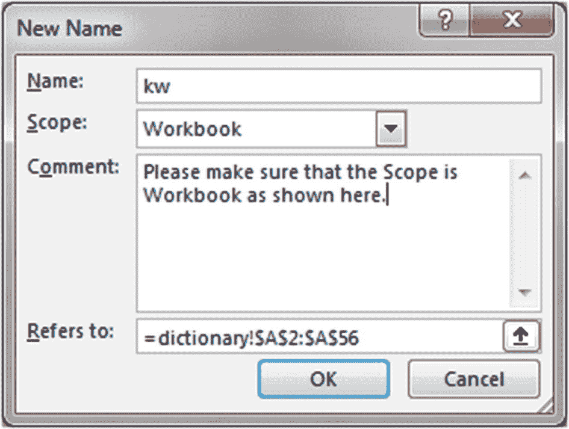

新建名称对话框的截图，其中包含名称（kw）、范围（工作簿）、备注（请确保范围是工作簿，如图所示）和引用位置。右下角是“确定”和“取消”按钮。“确定”按钮高亮显示。

图 14-4

为关键词数组命名

点击“确定”按钮后，图 14-3 中的菜单将更新为图 14-5 所示。

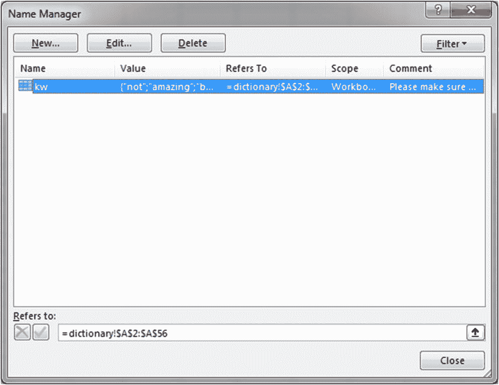

名称管理器选项卡的截图，展示了关键词数组被命名为 kw 后的名称、值、引用位置、范围和备注。底部是“引用位置”选项和一个“关闭”按钮。

图 14-5

关键词数组被命名为 kw 之后

继续分别为关键词得分数组（在工作表中称为“极性得分”）和停用词数组命名，如图 14-6 所示。

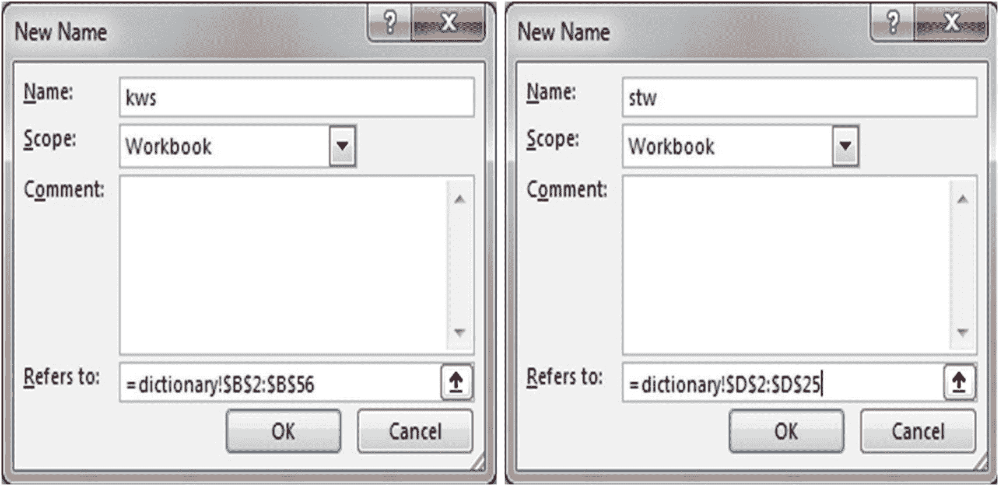

# Excel 文本挖掘：评论数据的预处理

## 新建名称对话框

新建名称对话框`kws`的截图。其范围是工作簿，并带有备注和引用位置窗格。

新建名称对话框`stw`的截图。其范围是工作簿，并带有备注和引用位置窗格。

每个框的右下角都有“确定”和“取消”按钮。“确定”按钮高亮显示。

**图 14-6**

### 为关键词得分和停用词命名

确保关键词得分被命名为“`kws`”，停用词被命名为“`stw`”。名称管理器最终显示的命名情况如图 14-7 所示。

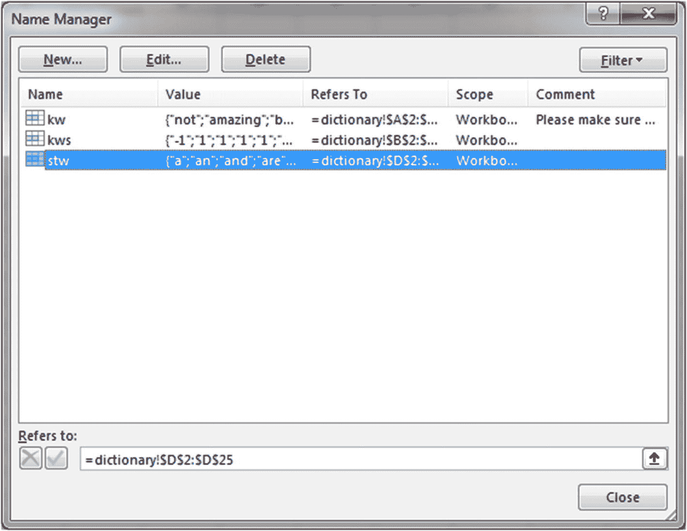

名称管理器选项卡的截图，展示了关键词数组被命名为`kw`、`kws`和`stw`后的名称、值、引用位置、范围和备注。底部是“引用位置”选项和一个“关闭”按钮。

**图 14-7**

### 确认命名

通过命名这些数组，我们现在可以通过名称“`kw`”引用关键词，通过“`kws`”引用关键词得分，通过“`stw`”引用停用词。

名为“`hotelReview`”的工作表中有 34 条评论。它们位于单元格`A1:A34`中。请仔细查看它们。图 14-8 展示了部分评论。

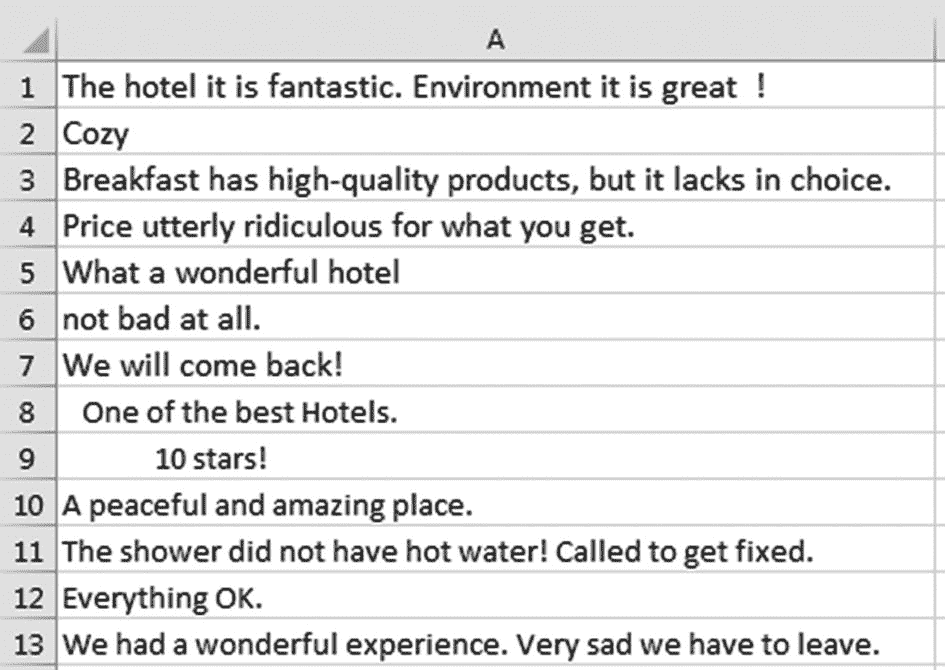

酒店评论的截图，例如：酒店很棒，环境很好，舒适，早餐有高品质的产品但选择不多，价格与你所得到的相比极其荒谬，10 星，一切都好，等等。

**图 14-8**

### 评论概览

按照以下步骤完成我们的文本挖掘练习：

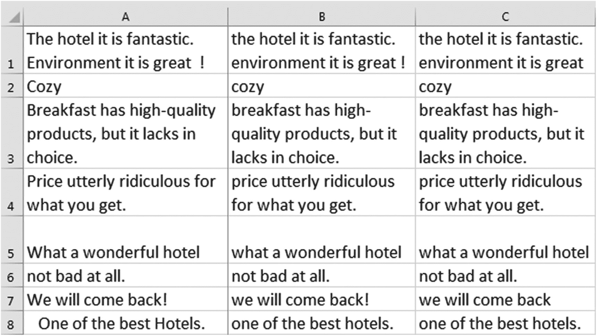

一个包含 3 列 8 行的截图。它展示了相同的酒店评论，例如：酒店很棒，环境很好，舒适，早餐有高品质的产品但选择不多，价格与你所得到的相比极其荒谬，我们会再来的，一点也不差，等等。

**图 14-9**

### 粘贴数值后的工作表

1.  正如我们所学，我们需要将所有单词转换为小写，并修剪每个句子两端的空格。在单元格`B1`中输入公式`=TRIM(LOWER(A1))`，然后自动填充到单元格`B34`。此公式将文本转换为小写，并修剪掉前导和尾随的空白空格。

2.  有些句子以感叹号结尾。为了移除感叹号，请在单元格`C1`中输入以下公式：

    ```excel
    =IF(MID(B1,LEN(B1),1)="!", TRIM(LEFT(B1,LEN(B1)-1)),B1)
    ```

    `LEN(B1)`返回单元格`B1`中文本的长度。`MID(B1,LEN(B1),1)`选取`B1`中文本的最后一个字符。如果最后一个字符是“!”，`LEFT(B1,LEN(B1)-1)`通过取除最后一个字符外的所有字符来移除“!”。如果最后一个字符不是“!”，则取`B1`中的原内容。

    **注意：** 移除“!”后，`TRIM(LEFT(B1,LEN(B1)-1))`会再次修剪可能存在的空格。

3.  在对单词进行分词之前，我们需要通过“选择性粘贴”（粘贴数值）将`C`列中的句子复制到`D`列。如果不这样做，我们即将使用的 Excel 功能“分列”将会拆分`C`列中的公式，而不是文本值。让我们将`C1:C34`单元格的值复制并粘贴到`D`列。工作表的一部分如图 14-9 所示。

### 使用“分列”功能

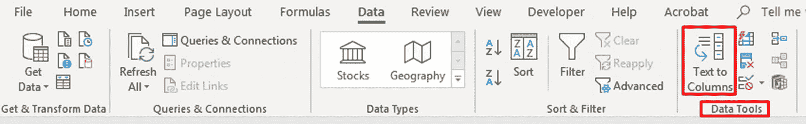

工具选项卡“分列”位于 Excel 的主选项卡“数据”下方。点击主选项卡“数据”后，工具选项卡“分列”会与数据工具一同显示。

**图 14-10**

工具选项卡“分列”位于主选项卡“数据”下方。

1.  选中`D`列，点击工具选项卡“分列”；会弹出一个菜单。如图 14-11 所示，选择“分隔符号”。

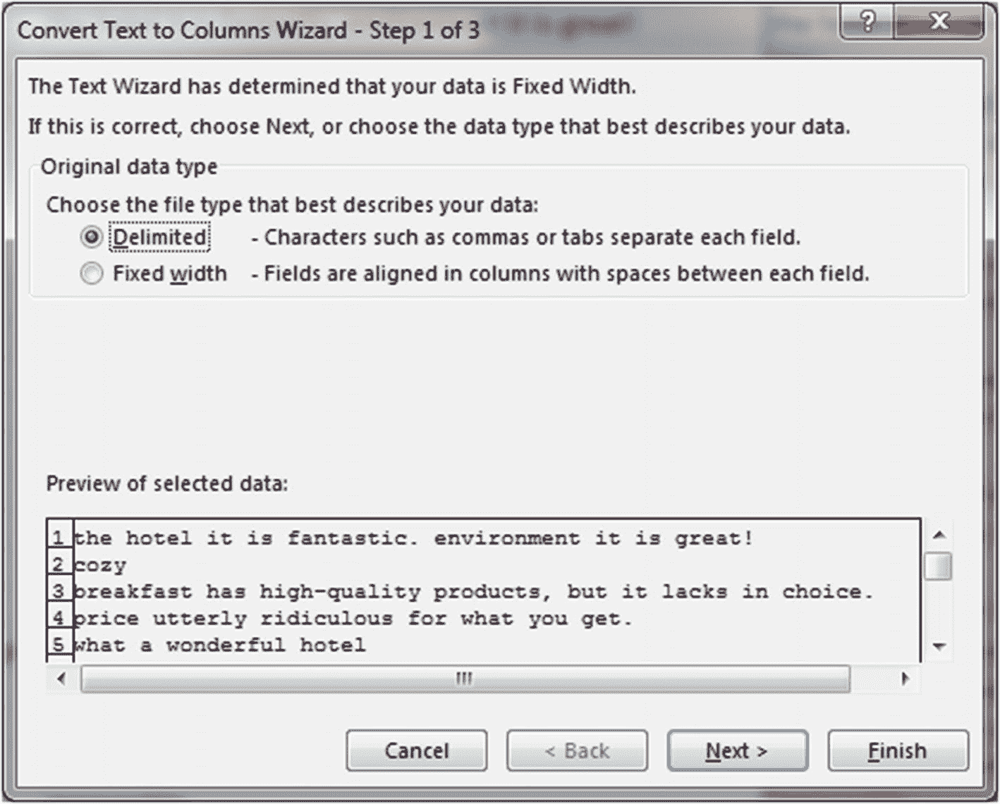

“文本分列向导”步骤 2/3 的截图。选择最能描述数据的分隔符号。下一步按钮被高亮显示。

**图 14-11**

### 选择分隔符号并点击下一步

1.  点击“下一步”；在下一个菜单中，选择所有分隔符，并在“其他”旁边的框中输入句点“.”，如图 14-12 所示。

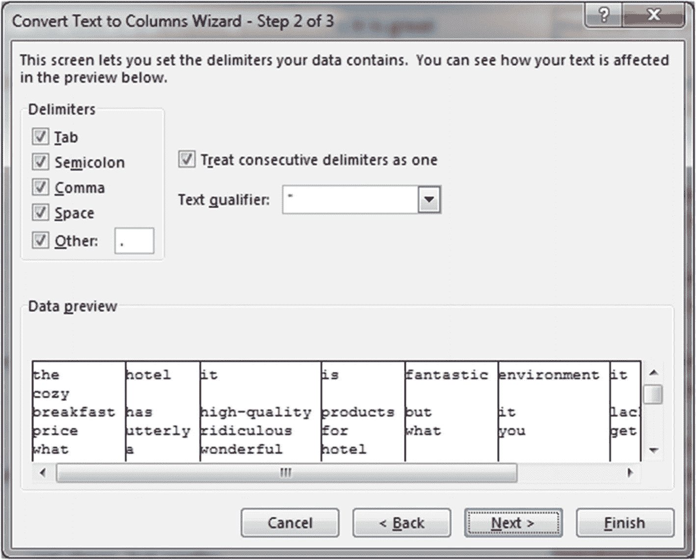

“文本分列向导”步骤 2/3 的截图。选择分隔符号，如制表符、分号、逗号、空格等。勾选“将连续分隔符号视为单个处理”复选框。下一步按钮被高亮显示。

**图 14-12**

### 通过分隔符将句子拆分为单词

1.  在下一个菜单中，点击“完成”，如图 14-13 所示。**注意：** 目标区域是单元格`D1`。通过选择`D1`作为目标区域，分词后的单词将被放置在以`D`列开头的区域。这意味着`D`列中的原始文本将被替换。

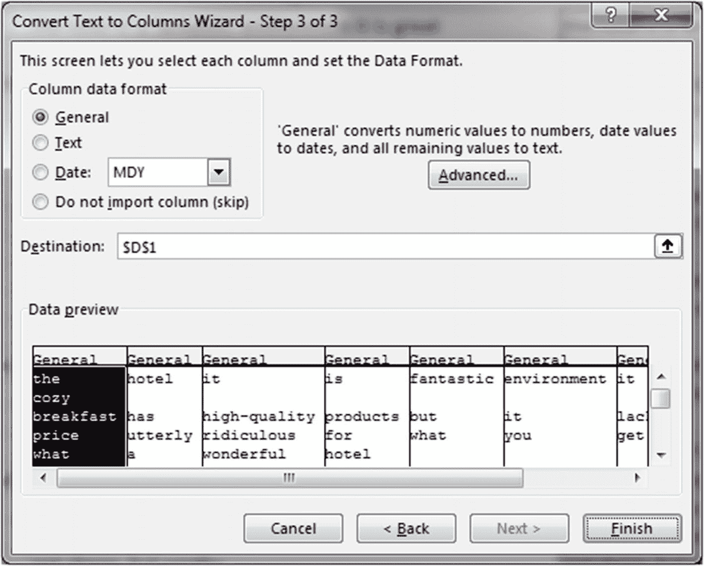

“文本分列向导”步骤 3/3 的截图。选择列数据格式为“常规”，目标区域为`$D$1`。在数据预览中选择“常规”。下一步按钮被高亮显示。

**图 14-13**

### 目标区域为 D1

至此，我们工作表的一部分如图 14-14 所示。

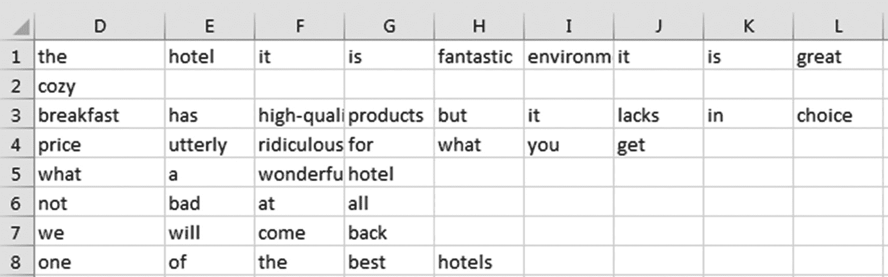

一个包含部分酒店分词单词的表格截图。该表格由十列和八行组成。分词后的单词包括：the, cozy, wonderful, best, back, hotels, fantastic, environment, choice, great, utterly, ridiculous, products, has, a, get 等。

**图 14-14**

### 分词单词一览

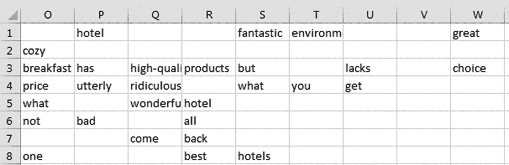

一个包含被替换为空格的停用词表格截图。该表格由十列和八行组成。单词包括：cozy, wonderful, best, back, hotels, fantastic, environment, choice, great, utterly, ridiculous, products, what, you 等。

**图 14-15**

### 停用词被替换为空

1.  我们的下一步是移除停用词。为此，我们需要先将每个停用词替换为空。分词单词的最右侧列是`N`列，因此在单元格`O1`中输入以下公式：

    ```excel
    =IF(OR(ISBLANK(D1),COUNTIFS(stw,D1)>0),"",D1)
    ```

    有些句子较短，有些较长。这会在工作区域中留下一些空白单元格，如图 14-14 所示。

    `ISBLANK(D1)`判断`D1`是否为空白单元格。`COUNTIFS(stw,D1)>0`判断`D1`是否为停用词。`OR(ISBLANK(D1),COUNTIFS(stw,D1)>0)`如果至少有一个判断结果为`TRUE`，则返回`TRUE`。在这种情况下，单元格`O1`被赋值为空。否则，单元格`O1`被赋予单元格`D1`中的内容。

    **注意：** 移除短单词（例如，移除所有长度小于等于 3 的单词）是一种常见技巧。不过，我们在本练习中不采用此技巧。

2.  从单元格`O1`自动填充到`O34`，然后一起自动填充到单元格`Y1:Y34`。工作表的一部分如图 14-15 所示。

### 移除停用词后

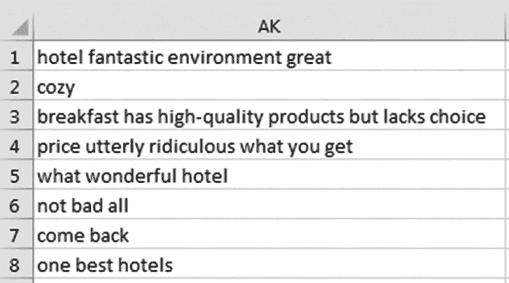

从句子中移除停用词后的酒店评论截图。评论内容为：hotel fantastic, environment great, cozy, breakfast has high-quality products but lacks choice, price utterly ridiculous what you get, what wonderful hotel, not bad all, come back, one best hotels。

**图 14-16**

### 重新连接并分词

1.  为了移除停用词，我们的计划是：将包含停用词的单元格清空，然后为每个句子连接剩余的单词，最后应用“分列”功能重新分词。保持`Z`列不变。在单元格`AA1`中输入以下公式：

    ```excel
    =IF(ISBLANK(O1)=FALSE,TRIM(Z1 & " " & O1), TRIM(Z1 & ""))
    ```

    当我们水平自动填充此公式时，它会累积单元格中的文本，但会跳过空白单元格。由于`Z`列保持不变，`Z`列中的单元格都是空白单元格。如果`ISBLANK(O1)=FALSE`，即单元格`O1`不是空白单元格，则将`AA1`之前的单元格（`Z1`）与`O1`连接起来。否则，单元格`AA1`仅保留其前一个单元格的内容。

    自 Office 2019 或 Office 365 起，Excel 新增了一个名为`TEXTJOIN`的函数，它可以：

    *   连接多个区域中的文本
    *   忽略空单元格
    *   并插入所需的分隔符

    如果你的 Excel 可用，`TEXTJOIN`函数绝对比前面的公式好得多。假设它可用，则：

    *   忽略前面的公式。
    *   在单元格`AK1`中输入公式`=TEXTJOIN(" ",TRUE,O1:Y1)`。
    *   从单元格`AK1`自动填充到单元格`AK34`。
    *   并跳过以下步骤（步骤 11）。

## 从单元格自动填充与文本分词

1.  从单元格`AA1`自动填充到单元格`AK1`，然后一起自动填充到单元格`AA34:AK34`。`AK`列保存了不含停用词的句子。请查看图 14-16。

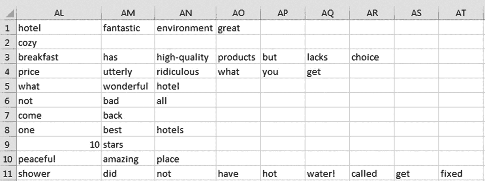

一个包含部分酒店重新分词单词的表格截图。该表格由十列和十一行组成。重新分词后的单词包括：`cozy`, `wonderful`, `best`, `back`, `hotels`, `fantastic`, `environment`, `choice`, `great`, `utterly`, `ridiculous`, `products`, `have`, `all`, `get` 等。

图 14-17

重新分词后的单词

1.  复制单元格`AK1:AK34`，并仅将数值粘贴到`AL`列。

2.  使用工具选项卡“分列”对`AL`列中的文本进行分词。请参考步骤 4-7。工作表的一部分如图 14-17 所示。

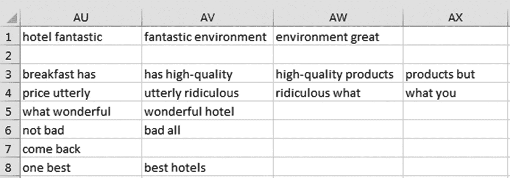

一个包含 2-gram 短语的表格截图。该表格由五列和八行组成。2-gram 短语包括：`hotel fantastic`, `environment great`, `best hotels`, `ridiculous what`, `what you`, `come back`, `price utterly`, `has high quality`, `products but`, `bad all` 等。

图 14-18

2-gram 短语

1.  为了生成 2-gram 短语，在单元格`AU1`中输入以下公式：
    ```
    =IF(AND(ISBLANK(AL1)=FALSE, ISBLANK(AM1)=FALSE),AL1 & " " & AM1,"")
    ```
    此公式确保仅当单元格`AL1`和`AM1`都不是空白单元格时，才会在单元格`AU1`中创建一个 2-gram 短语。

2.  从单元格`AU1`自动填充到`BB1`，然后一起从单元格`AU1:BB1`自动填充到单元格`AU34:BB34`。

我们的 2-gram 短语如图 14-18 所示。请注意，第 2 行没有 2-gram 短语。另请注意，最后一个 2-gram 短语位于`BB`列（图 14-18 中未显示）。

## 计算极性得分

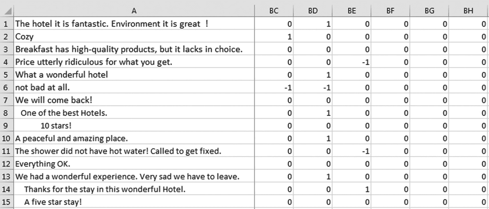

一个包含 15 行 8 列、展示分词后单词极性得分的截图。这些单词包括：`the hotel it is fantastic`, `the environment it is great`, `cozy`, `breakfast has high-quality products but it lacks in choice`, `price utterly ridiculous for what you get`, `10 stars`, `everything ok` 等。

图 14-19

为分词后的单词和二元词组计算的极性得分

1.  所有单词（包括单个单词和二元词组）都已分词并放置在单元格`AL1:BB34`中。现在需要计算每个句子的得分。在单元格`BC1`中，输入以下公式：
    ```
    =IFERROR(INDEX(kws, MATCH(AL1, kw, 0), 1), 0)
    ```
    此公式用于计算单元格`AL1`中单词（“hotel”）的极性得分。

    当`MATCH`函数在关键词数组（由名称`kw`表示）中找不到`AL1`的完全匹配项时，会返回`#NA`错误。因此，`IFERROR`函数确保当不存在此类关键词并因此出现`#NA`错误时，返回 0。当`MATCH`函数成功时，它会返回该单词在数组`kw`中的位置。该位置被传递给`INDEX`函数，以在关键词得分数组（由名称`kws`表示）中找到对应的得分。

    请特别注意表达式 `INDEX(kws, MATCH(AL1, kw, 0), 1)`。`MATCH`函数中的最后一个参数是 0，表示要求精确匹配。`INDEX`函数中的最后一个参数是 1，因为`kws`只有一列。

2.  从单元格`BC1`自动填充到单元格`BS1`，然后一起自动填充到单元格`BC34:BS34`。`BC1:BS34`是一个稀疏矩阵。工作表的一部分如图 14-19 所示。

## 情感分析与最终结果

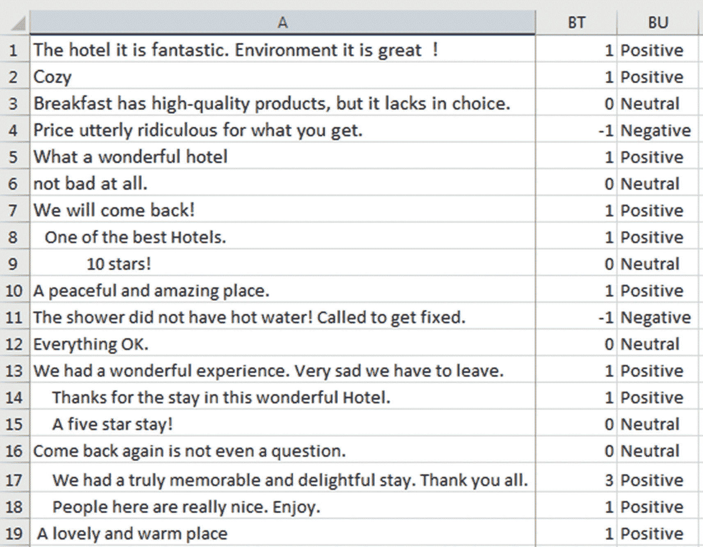

一个包含 19 行 4 列、展示部分酒店评论及其极性得分的截图。这些单词包括：`the hotel it is fantastic`, `the environment it is great`, `cozy`, `breakfast has high-quality products but it lacks in choice`, `price utterly ridiculous for what you get`, `10 stars`, `everything ok` 等。

图 14-20

酒店评论的情感分析

1.  在单元格`BT1`中，输入公式 `=SUM(BC1:BS1)`。此公式对第一个句子的所有得分进行求和。

2.  从单元格`BT1`自动填充到单元格`BT34`。

3.  在单元格`BU1`中，输入公式：
    ```
    =IF(BT1>0,"Positive", IF(BT1=0,"Neutral","Negative"))
    ```
    如果求和得分为正，则该句子被视为正面评价。如果求和得分为 0，则该句子被视为中性评价，否则为负面评价。

4.  从单元格`BU1`自动填充到单元格`BU34`。

5.  通过冻结 B 列（点击 B 列 ➤ 点击“视图” ➤ 点击“冻结窗格” ➤ 选择“冻结窗格”），我们的最终结果如图 14-20 所示。

完整的文本挖掘工作可在`Chapter14-1b.xlsx`和`Chapter14-1c.xlsx`文件中找到。

`Chapter14-1b.xlsx`未使用`TEXTJOIN`函数，而`Chapter14-1c.xlsx`使用了。

仔细检查我们的结果后发现，我们的文本挖掘模型对评论 9、15、16、20 和 26 的效果不佳。但这并不意味着我们的挖掘工作是失败的。评论 9（“10 stars!”）、15（“A five star stay!”）和 20（“Not cheap, but worthy.”）可以通过添加更多关键词来正确评估。评论 26（“want to say ‘Thanks’ to all of you!”）也可以通过应用词干提取技术来正确评估。

有些单词虽然写法不同，但含义相同，例如“thanks”和“thank you”。其他例子包括“book”和“books”、“imply”和“implies”等。“Thanks”、“books”和“implies”都源自它们的基本词干（“thank”、“book”和“imply”）。将单词还原为其基本词干在文本挖掘中称为词干提取。当然，将“thanks”还原为“thank”可以将评论 26 评估为正面评价。

真正具有挑战性的是评论 16（“Come back again is not even a question.”）。我们知道这是一条正面评论，但许多计算机算法无法将其识别为正面评论。正是因为有这样的句子，文本挖掘才成为一项极具挑战性和复杂性的任务。本章仅提供一个教学示例。因此，我不会在本书中解释如何处理这样的句子。

文本挖掘还可以识别评论、反馈和客户支持查询中出现频率最高的单词。高频词可以告知我们客户面临的常见问题。词频（TF）也可以与另一个概念——逆文档频率（IDF）结合使用，用于对网络搜索中的网页进行排名。

当然，Excel 并不适合对网页进行排名。这只是展示 Excel 在数据挖掘中应用局限性的一个例子。然而，通过越来越多的插件，Excel 在数据挖掘或机器学习方面的功能正变得越来越强大，尽管本书试图在不使用额外插件的情况下演示 Excel 的用法。

### 词嵌入与 ChatGPT

不要被本节标题误导。Excel 似乎无法成功模拟词嵌入（也称为文本嵌入），更不用说模拟 ChatGPT 了。然而，由于 ChatGPT 给我们带来了一场令人目眩的 AI 革命，这场革命可能会重塑人类作为智慧物种的进程，因此我想在此简要谈谈它们。

如前所述，要通过计算机处理文本数据，我们需要将数据整理成表格格式。这正是词嵌入所做的。嵌入的精妙之处在于使用一个数值向量来定义一个词，每个数值代表该词的某个未知属性。因此，语料库中的所有单词都可以通过一个矩阵用数值表示。例如，假设我们的语料库是句子“At the most beautiful place remember the most beautiful you”，并且每个单词有七个属性；一旦我们对每个单词进行了分词，我们可能会随机得到一个像表 14-1 这样的矩阵。

表 14-1

一个示例词嵌入矩阵。注意有些单词是重复的

| 单词 | P1 | P2 | P3 | P4 | P5 | P6 | P7 |
| --- | --- | --- | --- | --- | --- | --- | --- |
| at | 0.6 | -0.9 | 0.1 | -0.4 | -0.2 | -0.1 | -0.9 |

# 词嵌入与大型语言模型

| the | 0.2 | -0.9 | 1.0 | 0.9 | -0.8 | 0.5 | 0.0 |
|---|---|---|---|---|---|---|---|
| most | 0.5 | 0.5 | 0.4 | -0.1 | -0.1 | 0.2 | 0.9 |
| beautiful | 0.0 | 0.9 | 0.3 | -1.0 | 0.7 | -0.4 | -0.3 |
| place | -0.6 | 0.7 | -1.0 | -0.9 | 0.0 | -0.3 | 1.0 |
| remember | 0.8 | 1.0 | 0.8 | 0.5 | 0.0 | -0.5 | -0.4 |
| the | 0.2 | -0.9 | 1.0 | 0.9 | -0.8 | 0.5 | 0.0 |
| most | 0.5 | 0.5 | 0.4 | -0.1 | -0.1 | 0.2 | 0.9 |
| beautiful | 0.0 | 0.9 | 0.3 | -1.0 | 0.7 | -0.4 | -0.3 |
| you | 0.6 | -0.1 | 0.5 | -0.4 | 0.0 | 0.8 | -0.5 |

按照惯例，当一个词由一个包含 `N` 个数值的向量表示时，我们说嵌入维度大小为 `N`，或者说词向量的维度是 `N`，而不是说 `N` 个属性。在自然语言处理（`NLP`）中，尤其是对于大型语言模型（`LLM`），嵌入维度大小通常达到数百、数千甚至更大。

### 嵌入技术的精妙之处

当我们在对酒店评论进行情感分析时，我们预定义了停用词和极性词。然而，在词嵌入中，每个词的数值向量并非预定义的；相反，它是通过神经网络训练和优化得到的。这就是嵌入技术的精妙之处！在大型语言模型中，第一个隐藏层始终是嵌入层，这表明嵌入是超大型语言模型的基础。一旦此类模型的训练和测试完成，嵌入矩阵就被优化了，也就是预训练好了。一个成功且预训练良好的嵌入矩阵可以精确定义几乎所有单词，用于其他语言处理任务，例如著名的 `Word2Vec`。

### 预训练嵌入矩阵示例

假设我们的神经网络模型获得了一个预训练良好的嵌入矩阵，其词向量是二维的。我们的嵌入矩阵可能会给出（`king`: -0.2, 0.9）、（`man`: -0.2, 0.5）、（`woman`: 0.3, -0.2）和（`queen`: 0.3, 0.2）。然后我们可以在数学上“证明” `king – man + woman = queen`，这是最初由 `Word2Vec` 得出的一个有趣等式（注意，`Word2Vec` 的嵌入维度未知，但大致在 `100` 到 `1000` 之间）。

### GPT与ChatGPT

`GPT` 代表生成式预训练变换器。你可能会对“生成式”和“变换器”这两个词感到困惑。嗯，我们在本书中学到的数据挖掘方法或机器学习模型只能进行发现，它们本身不能生成任何新东西。然而，`GPT` 模型可以自行进行创造，即“生成”。变换器是一种新型的神经网络模型，可以学习和进化。从某种意义上说，它具有自注意力机制。最后，`ChatGPT` 是由 `OpenAI` 公司开发的一个大型语言模型，经过预训练以执行各种 `NLP` 任务。

### 嵌入维度

嵌入技术在 `ChatGPT` 中扮演着非常重要的角色。尽管 `OpenAI` 公布 `ChatGPT` 3 拥有 `1750` 亿个参数，但其嵌入维度是未知的（至少对我来说是未知的）。但我们可以肯定地说，它的嵌入维度相当大。

## 强化练习

唯一的强化练习在文件 `Chapter14-HW.xlsx` 中。在这个文件中，你会发现已经为你准备了一个字典，当然你也可以自行修改。基于给定的字典，`Chapter14-HW-withAnswers.xlsx` 提供了一个不使用 `TEXTJOIN` 函数的标准解决方案。顾名思义，`Chapter14-HW-withAnswers-UseTEXTJOIN.xlsx` 提供了一个使用 `TEXTJOIN` 函数的解决方案。在我修订本书时，我确信大多数 `Excel` 用户都可以使用 `TEXTJOIN` 函数。

## 复习要点

1.  结构化与非结构化数据

2.  文本挖掘的应用

3.  词频、极性得分、分词、关键词、停用词、词干提取、n-gram

4.  `Excel` 函数 `IF`、`COUNTIFS`、`INDEX`、`MATCH`、`AND`

5.  `Excel` 函数 `IFERROR`、`OR`、`ISBLANK`、`MID`、`TRIM`、`LEN`、`LOWER`

6.  名称管理器

7.  分列

8.  `Excel` 函数 `TEXTJOIN`

9.  词嵌入