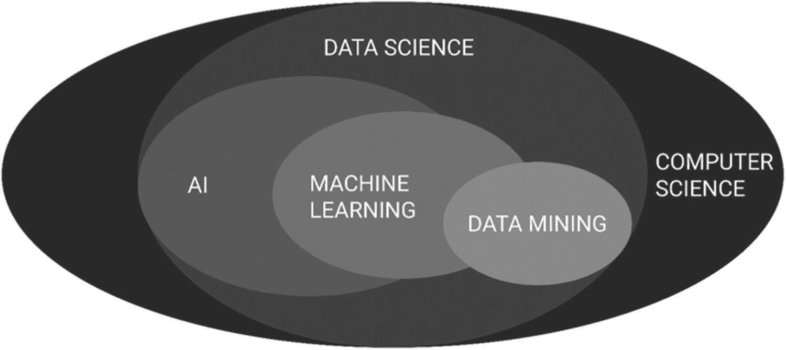
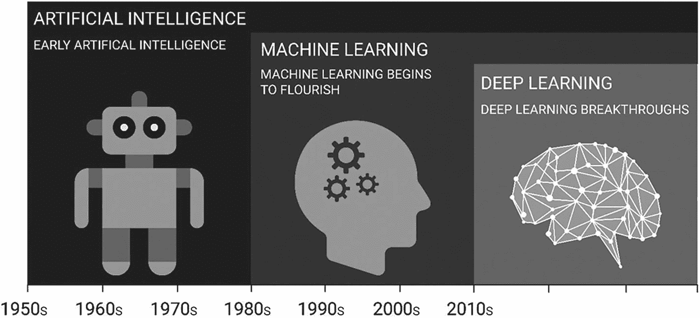
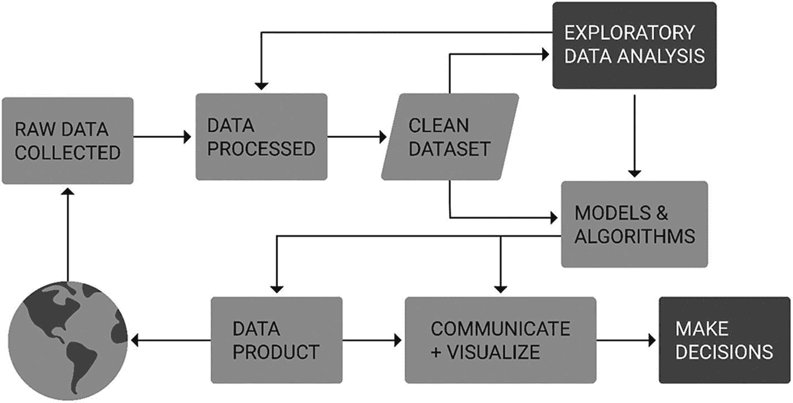
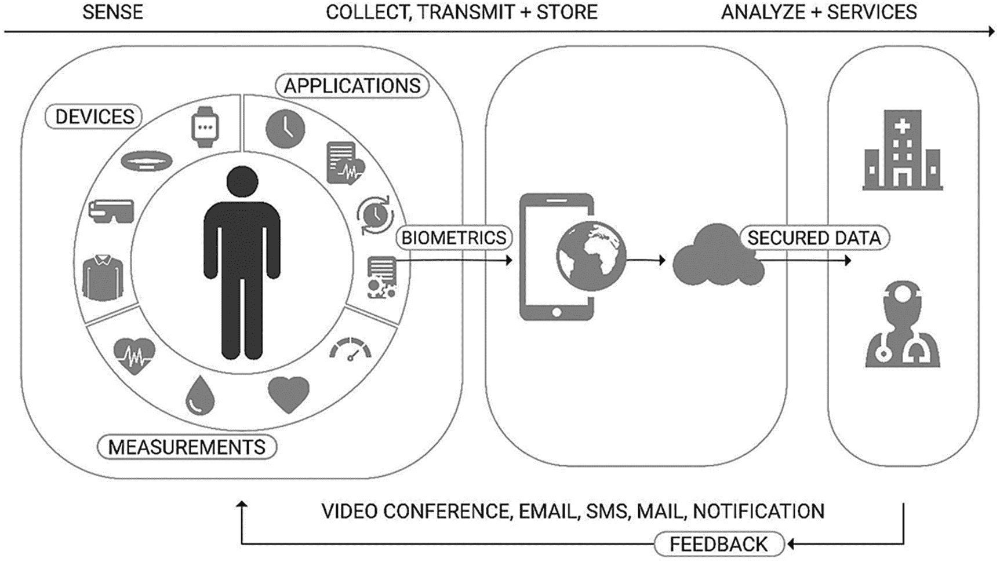

# 1. 什么是人工智能？

> *知识本身毫无价值，但有用知识的应用？那才强大。*
> 
> ——奥修

人工智能（AI）再次被视为我们这个时代最激动人心的进步之一。虚拟助手能够以惊人的准确性判断我们的音乐品味，汽车现在可以自动驾驶，移动应用则有助于逆转那些曾被认为是慢性和进行性的疾病。

许多人惊讶地发现，人工智能并非新鲜事物。人工智能技术已经存在了几十年。事实上，它正在经历一场复兴——这得益于数据的可用性和计算成本呈指数级下降。

## 多学科交叉的领域

人工智能是计算机科学的一个子集，其起源涉及数学、逻辑学、哲学、心理学、认知科学和生物学等多个学科（图 1-1）。

图 1-1

人工智能、机器学习及其在计算机科学中的位置

最早的人工智能研究源于 20 世纪 30 年代末开始的一系列思想，并在 1950 年达到顶峰，当时英国先驱艾伦·图灵发表了《计算机器与智能》，文中他问道：“机器能思考吗？”图灵测试提出了一种测试机器展示“人工”智能能力的方法，评估机器的行为是否与人类无法区分。图灵提出，如果人类评估者能与计算机和人类进行自然语言对话，且无法区分两者（即成功模仿人类行为的智能体或系统），那么这台计算机就可以被认为能够思考。

“人工智能”一词最早于 1956 年由达特茅斯学院的约翰·麦卡锡教授提出。麦卡锡教授提出了一项夏季研究项目，其基础理念是“原则上，学习的每个方面或智能的任何其他特征都可以被精确地描述，以至于可以制造一台机器来模拟它”[6]。

事实上，人工智能的核心仅仅是编程。如图 1-1 所示，人工智能可以被理解为计算机科学的一种抽象。其受欢迎程度以及能力的激增，很大程度上与通过移动设备、智能手表、可穿戴设备产生的数据爆炸，以及以比以往更低的成本获取计算能力有关。据 IBM 估计，全球 90%的数据是在过去两年内产生的[7]。

据估计，未来十年将会有 1500 亿个联网测量传感器——这是全球人口的 20 倍[8]。这种呈指数级增长的数据正在使一切变得智能。从智能手机到智能洗车机、智能家居、智慧城市和智慧社区，都即将到来。

这些数据带来了大量的学习机会，因此，现在的焦点已转向从可用数据中学习以及开发智能系统。系统获得的数据越多，其学习能力就越强，从而使其变得更加精确。

人工智能和机器学习在企业中的使用和应用仍然相对较新，在医疗健康领域更是如此。高德纳的“新兴技术成熟度曲线”将机器学习置于期望膨胀期的顶峰，预计还需 5 到 10 年才能达到成熟期[9]。

因此，机器学习在医疗环境中的应用是新颖、令人兴奋且富有创新性的。如今移动设备的数量已超过人口总数，健康的未来充满了来自患者、环境和医生的数据[31]。因此，利用人工智能和机器学习优化健康的机会正在成熟。

在当前生态系统中，人工智能和机器学习在医疗健康领域的实现再受欢迎不过了，因为全球医疗成本正在上升，政府和私人支付方正对服务施加越来越大的压力，要求其更具成本效益。成本管理通常不能对患者就医、患者护理和健康结果产生负面影响。

但是，人工智能和机器学习如何应用于日常医疗环境呢？本书旨在帮助那些希望了解人工智能和机器学习是什么，以及如何在其健康生态系统中开发、评估和部署智能系统的人。书中包含了健康智能领域的真实案例研究，展示了人工智能和机器学习如何改善患者健康和人群健康，并促进显著的成本节约和效率提升。

到本书结尾，读者应能自信地掌握人工智能和机器学习的关键主题。读者将能够描述机器学习的方法和局限性、基本算法、数据的用途和要求、学习的伦理与治理，以及如何评估此类系统的成功。最重要的是，读者将学习如何规划一个真实的机器学习项目——从准备数据和选择模型，到验证准确性和评估性能。

本书并非侧重于令人望而生畏的统计学和代数，而是探讨人工智能和机器学习在医疗健康领域的理论与实践应用——并提供评估人工智能和机器学习应用的有效性、适用性和成功与否的方法与技巧。

## 审视人工智能

从核心上讲，人工智能可以被定义为在智能体（计算机）中模拟智能行为，其方式使我们人类认为其是聪明或类人的[10]。人工智能的核心概念包括智能体发展出知识、推理、问题解决、感知、学习、规划以及操纵和移动的能力等特质。

具体而言，人工智能可以被认为包含以下内容：

*   让系统进行理性推理：技术包括自动推理、证明规划、约束求解和基于案例的推理。

*   让程序学习、发现和预测：技术包括机器学习、数据挖掘（搜索）和科学知识发现。

*   让程序玩游戏：技术包括极小化极大搜索和阿尔法-贝塔剪枝。

*   让程序与人类交流：技术包括自然语言处理（NLP）。

*   让程序展现生命迹象：技术包括遗传算法（GA）。

*   使机器能够在世界中智能导航：这涉及机器人技术，如规划和视觉。

关于人工智能存在许多误解，主要是因为它仍然是一门相当年轻的学科。事实上，关于它将如何发展也有许多观点。有趣的专家意见包括凯文·沃里克的观点，他认为机器人将接管地球。罗杰·彭罗斯则认为计算机永远无法真正拥有智能。与此同时，马克·杰弗里甚至提出计算机将进化成人类。人工智能是否会在下一代接管地球不太可能，但人工智能及其应用将会持续存在。

过去，由于数据集有限、数据样本代表性不足，以及无法存储、索引和分析大量数据，人工智能的智能方面受到了限制。如今，数据是实时到来的，这得益于手机使用、数字设备、日益数字化的系统、可穿戴设备和物联网（IoT）的指数级增长。

现在，数据不仅实时流入，而且来源多样、速度飞快，并且要求这些数据必须可用于分析，并且从根本上可解释，以便做出更好的决策。

人工智能有四个不同的类别。

### 反应式机器

这是最基本的人工智能。反应式系统在当前场景下做出响应，依靠已教授或已记忆的数据在当前状态下做出决策。反应式机器能很好地执行它们被设计来执行的任务，但除此之外什么也做不了。这是因为这些系统无法利用过去的经验来影响未来的决策。但这并不意味着反应式机器毫无用处。

IBM 的超级计算机“深蓝”是一台用于下棋的反应式机器，它能够根据当时的棋盘局势做出预测。深蓝在 1996 年击败了国际象棋世界冠军加里·卡斯帕罗夫。一个鲜为人知的事实是，卡斯帕罗夫赢得了剩余五局中的三局，最终以四比二的总比分击败了深蓝 [11]。最近，谷歌的 AlphaGo 战胜了世界顶尖的人类围棋选手 [73]。

### 有限记忆：能理性思考与行动的系统

这种人工智能基于有限记忆原理运作，同时使用预先编程的知识和随时间推移进行的后续观察。在观察过程中，系统会查看其环境中的对象，检测它们如何变化，然后做出必要的调整。这项技术被用于自动驾驶汽车。无处不在的互联网接入和物联网为有限记忆系统提供了无限的知识来源。

### 心智理论：像人类一样思考的系统

心智理论型人工智能代表了那些能够解读其世界以及其中行动者（或人）的系统。这类人工智能需要理解环境中的事物和人也能改变他们的感受和行为。尽管目前这类人工智能还很有限，但它可以用于护理角色，例如协助老年人或残疾人完成日常任务。

因此，一个采用心智理论型人工智能的机器人将能够评估其世界中的事物，并认识到环境中的人拥有自己的思想、独特的情绪、习得的经验等等。心智理论型人工智能可以尝试理解人们的意图并预测他们可能的行为。

### 自我意识型人工智能：像人类一样的系统

这种最先进的人工智能涉及拥有意识并能识别人类之外世界的机器。这种人工智能目前还不存在，但已有软件展示出对某些事物的渴望以及对其自身内部感受的认知。伦斯勒理工学院的研究人员给三个机器人提供了一个更新版本的“智者谜题”（一种归纳性自我意识测试），其中一个通过了测试。该测试要求人工智能能够倾听并理解非结构化文本，同时能够识别自己的声音以及与其他机器人的区别 [12]。

如今的技术已经足够敏捷，可以实时访问海量数据集并随时学习。归根结底，人工智能的好坏取决于用于创建它的数据——有了强大且海量的数据，我们就能对自己的决策更有信心。

与交通、能源和金融领域相比，医疗保健领域在采用大数据和人工智能的优势方面进展缓慢。尽管原因有很多，但医疗健康部门的僵化在很大程度上是因为人命关天。医疗服务更像是一种必需品而非消费者的选择；因此，历史上医疗行业几乎没有或根本没有通常驱动其他行业寻求创新的威胁。

这加剧了医疗机构所能提供的与患者所期望之间的差距——这随后导致了护理和健康结果的差异，以及全球公认的“药物优先”的疾病治疗方法。

数据的爆炸式增长通过实现以数据为导向的智能方法推动了人工智能的发展。过去五年对医疗保健领域的颠覆尤为显著，数据驱动的人工智能应用不仅帮助智能系统预测、诊断和管理疾病，还能主动逆转和预防疾病——并实现了数字疗法。

图像识别和分类方面的最新进展也开始渗透到工业领域，深度神经网络在视觉识别任务中取得了显著成功，通常能达到或超越人类的表现（图 1-2）。

图 1-2

人工智能及其发展

人工智能的类型也可以根据其能执行的任务来解释，并分为弱人工智能和强人工智能。

### 弱人工智能

## 弱人工智能与强人工智能

弱人工智能或狭义人工智能指的是执行单一（狭义）任务的人工智能。弱人工智能系统不像人类，但如果经过正确训练，会显得很智能。一个例子是国际象棋游戏，其中所有规则和走法都由人工智能计算，并确定所有可能的场景。

### 强人工智能

强人工智能能够像人类一样思考和执行任务。目前还没有突出的强人工智能实例。弱人工智能有助于构建强人工智能系统。

## 什么是机器学习？

机器学习这个术语归功于 IBM 的阿瑟·塞缪尔，他在 1959 年提出，或许可以教会计算机学习它们需要了解的关于世界的一切，以及如何自行执行任务。机器学习可以被理解为人工智能的一种形式。

机器学习诞生于模式识别以及计算机无需编程即可学习执行特定任务的理论。这包括贝叶斯方法、神经网络、归纳逻辑编程、基于解释的自然语言处理、决策树和强化学习等技术。

拥有硬编码知识库的系统通常会在新环境中遇到困难。某些困难可以通过能够自行获取知识的系统来克服。这种能力被称为机器学习。这需要知识获取、推理、更新和优化知识库、获取启发式知识等等。

机器学习将在第 3 章中更深入地介绍。

## 什么是数据科学？

所有人工智能任务都会使用某种形式的数据。数据科学是一门不断发展的学科，涵盖与数据清洗、提取、准备和分析相关的所有内容。数据科学是一个通用术语，指代试图从数据中提取洞察（即试图理解）和信息时所使用的一系列技术。

数据科学这个术语由威廉·克利夫兰于 2001 年提出，用以描述一门将统计学、商业和计算机科学更紧密结合在一起的学科。

从事人工智能项目的团队无疑会与数据打交道，无论数据量大小。在大数据的情况下，实时数据通常需要实时分析。在大多数商业案例中，需要数据科学家或数据工程师来执行许多与数据相关的技术角色，包括查找、解释和管理数据；确保数据的一致性；使用数据构建数学模型；以及向利益相关者展示和传达数据洞察/发现。虽然没有数据科学就无法处理大数据，但可以在没有大数据的情况下进行数据科学——所需要的只是数据。

由于数据探索需要统计分析，许多学者认为数据科学和统计学没有区别。一个数据科学团队（即使只有一个人）对于成功部署项目至关重要。

数据科学团队通常扮演两个关键角色。首先，从一个问题或疑问开始，试图用数据来解决它；其次，利用数据通过分析来提取洞察和智能（图 1-3）。

图 1-3 数据科学流程

## 从实时大数据中学习

人工智能此前一直受限于其可用的技术和数据。在智能手机和更廉价的计算设备爆发之前，数据集在规模、有效性以及代表性（而非实时性）方面仍然有限。

如今，我们拥有实时、可即时访问的数据和能够进行快速分析的工具。现代生活的数据化正在推动机器学习的成熟，并促进向基于证据、数据驱动的方法转变。数据化指的是将生活的方方面面数字化（或数据化）的现代趋势。如今的技术已经足够敏捷，能够访问这些庞大的数据集，以快速演进机器学习应用。

患者和医疗专业人员都会产生海量数据。手机收集诸如血压、地理位置、步行步数、营养日记等指标，以及其他非结构化数据，如对话、反应和图像。

这些数据也不仅仅是数字或临床数据。数据提取技术可以应用于纸质文档或扫描的图像，以处理这些文档用于综合分析和检索。

医疗专业人员收集健康生物标志物以及其他结构化指标。无论数据来源如何，为了进行学习，数据必须转化为信息。例如，当一位糖尿病患者将血糖读数输入应用程序时，如果系统已知血糖水平目标范围，就能理解该输入是否达到了建议的目标范围，这样该输入就具有了更大的相关性。

在二十一世纪，几乎每一个行为都会留下某种形式的交易足迹。苹果 iPhone 6 的速度比阿波罗时代将人类送上月球的 NASA 计算机快 32,000 倍以上。事实上，一个简单的 Wi-Fi 路由器甚至一个 USB-C 充电器，其计算能力都足以将宇航员送上月球 [13]。设备不仅比以往任何时候都更小巧，而且也比以往任何时候都更强大。随着各组织利用大数据源，已经出现了一种趋势，即将从数据中获得的洞察嵌入到用户体验的方方面面——从购买产品或服务，到应用程序内的用户体验，并以多种不同方式进行交互。

当数据以其原始形式被获取并转化为能够改变实践的知识时，数据的价值才得以体现。这种价值由项目和具体情境驱动。例如，其价值可能体现在更快地识别出在依从性、合规性和循证护理方面的不足。也可能体现在医院或组织内部更好地共享数据和洞察，或者与患者建立更个性化的关系，以提高依从性和合规性，并促进自我护理。同样，它也可能有助于避免更昂贵的治疗或代价高昂的错误。

## 人工智能在医疗保健中的应用

人工智能代理完全取代医生和护士的可能性极低，但机器学习和人工智能正在改变医疗保健行业并改善治疗效果。而且这一趋势将持续下去。

机器学习正在改进诊断、预测结果，并开始触及个性化护理的皮毛（图 1-4）。

图 1-4 一种数据驱动的患者-医疗专业人员关系

想象一下这样一个场景：你因心脏周围疼痛去看医生（或通过远程会议应用程序）。在听取了你的症状（可能通过视频或健康物联网设备分享）后，医生将其输入电脑，电脑会调出医生应参考的最新证据库，以便有效诊断和治疗你的问题。你做了核磁共振扫描，一个智能计算机系统协助放射科医生检测任何可能因太小而无法被人眼察觉的异常。他们甚至可能建议使用特定的智能手机应用程序，配合你佩戴或可使用的设备，来测量心脏指标和多种潜在健康状况的风险。

你的手表可能一直在持续收集你的血压和脉搏，而一个连续血糖监测仪则实时记录你的血糖读数。你的戒指可能正在测量你的体温。最后，你的医疗记录和家族病史由一个计算机系统进行评估，该系统会为你精确推荐治疗方案。撇开数据隐私和治理不谈，我们从整合不同数据池中能学到什么，其前景令人兴奋。

### 预测

已有技术可以监测数据以预测疾病爆发。这通常利用实时数据源（如社交媒体）以及来自网络和其他来源的历史信息来完成。通过分析降雨量、温度、病例数等各种数据点，已使用人工神经网络（`ANNs`）成功预测了疟疾爆发 [14]。

### 诊断

许多数字技术为非紧急医疗系统提供了替代方案。展望未来，将基因组与机器学习算法相结合，为学习疾病风险、改进药物遗传学以及为患者提供更好的治疗路径提供了机会 [15]。

### 个性化治疗与行为矫正

数字疗法是数字健康的一个新兴领域。数字医疗保健可以根据用户体验进行个性化设置，以促使人们做出可持续的行为改变 [16]。

来自 `Diabetes Digital Media` 的数字疗法 `Gro Health` 是一个屡获殊荣、基于证据的行为改变平台，它通过解决健康的四个关键支柱（可改变的风险因素）来应对非传染性疾病。在营养、活动、睡眠和心理健康领域的教育和支持由人工智能驱动，以根据用户目标与关注点、疾病概况、种族、年龄、性别和地理位置来定制体验，并在人口健康管理中提供远程监测支持。该应用程序提供个性化教育和集成健康追踪，从用户自身及更广泛社区的进展中学习。

在 8 周结束时，`Gro Health` 显示出心理健康的改善，包括感知压力在 8 周内降低 23%，广泛性焦虑降低 32%，抑郁降低 31% [17]。

### 药物发现

机器学习在初步药物发现中具有多种潜在用途，从药物化合物的初步筛选到基于生物因素预测成功率。这包括像下一代测序这样的研发发现技术。

药物在外观上不一定必须是药理学的。数字疗法的使用和真实世界患者数据的聚合，正在为那些曾被认为是慢性和进行性的疾病提供解决方案。例如，超过 30 万 2 型糖尿病患者使用的 `Low Carb Program (LCP)` 应用程序，在完成该计划一年的患者中，有 26% 实现了病情缓解 [16, 18]。

### 后续护理

患者再次入院是医疗保健领域的一大难题。医生和政府都在努力维持患者的健康，尤其是在患者接受医院治疗后返回家中时。数字健康教练能够辅助护理，类似于电商网站上的虚拟客服代表。这些助手可以询问患者的用药情况，提醒他们服药，询问他们的症状，并将相关信息传达给医生 [16]。在印度等一些地方，存在一种“管家”或精通技术的健康教练的市场，他们为老年人或行动不便的患者建立数字护理。通过设置 `Zoom` 通话或其他服务，这些管家使患者能够与他们的医疗团队互动，消除了过程中的任何惰性。

## 释放人工智能在医疗保健领域的潜力

要让人工智能和机器学习在医疗保健系统中得到全面接受和整合，必须解决几个关键挑战。

### 理解差距

利益相关者对人工智能和机器学习的理解与其应用之间存在巨大差距。思想、方法和评估的沟通对于推动人工智能和机器学习在医疗保健领域发展所需的创新至关重要。数据，包括数据的共享和整合，是推动医疗保健向实现精准医学转变的基础。

培养专注于从数据中学习的数据科学团队，是成功医疗战略的关键。所需的方法是投资于数据。为患者和医疗服务提供者双方提升价值都需要数据，因此也需要数据科学专业人士。

### 数据碎片化

# 医疗AI与数据整合：挑战与展望

有许多障碍需要克服。目前数据是碎片化的，难以整合。患者在手机、Fitbit 和手表上收集数据，而医生则收集常规的生物标志物和人口统计数据。在患者的整个就医过程中，这些数据从未被整合过。也不存在能够以有意义且稳健的方式解析和分析这组更大数据集的基础设施。此外，电子健康记录（EHR）目前在各数据库中仍然混乱且碎片化，需要以一种方便患者和医疗服务提供者随时获取的机制进行数字化。

COVID-19 无疑加速了数据源的连接；然而，朝着实现一个真实、有用的数据结构（Data Fabric）的进展仍处于初期阶段。数据结构是指一个包含架构、技术和服务在内的统一环境，旨在帮助组织进行管理并改进决策。例如，某个特定国家的健康数据结构可能允许所有人通过一个通用途径访问与患者相关的所有健康数据。

尽管这听起来像乌托邦，但大多数健康应用和服务都使用安全的、基于云的托管提供商，如亚马逊云服务（AWS）、微软 Azure 云和谷歌云。供应商之间为创建数据结构而进行的连接，可能比我们想象的更近。

## 适当的安全性

与此同时，组织面临着安全挑战以及满足政府法规的要求，特别是在患者数据管理以及确保其随时可访问性方面。此外，许多医疗机构使用的是旧版软件，这些软件更容易受到攻击。英国国家医疗服务体系（NHS）的数字基础设施曾因勒索软件“WannaCry”的肆虐而瘫痪。这种源自美国的勒索软件加密了计算机上的数据，并要求支付 300 至 600 美元以恢复访问权限[19]。

英格兰和苏格兰的医院及全科医生诊所是遭受此次“勒索软件”攻击的超过 16 个医疗服务组织中的一部分。此次攻击的影响不仅仅是技术故障的成本；它还影响了患者的生命。英格兰部分地区的医生诊所和医院不得不取消预约并拒绝手术。在一些地区，人们被建议仅在紧急情况下寻求医疗护理。NHS 只是众多因黑客工具而瘫痪的全球组织之一；该勒索软件声称已感染了 150 个国家的计算机。

在 COVID-19 期间，NHS 因拒绝苹果和谷歌的 COVID-19 追踪方案，转而自行开发存在严重安全缺陷的方案而受到嘲笑[20]。

无论数字技术还是其他技术，安全性和可靠性都是健康技术的首要考虑因素。

## 数据治理

数据安全引出了数据治理的概念。医疗数据是个人化的，不易获取。人们普遍认为，出于隐私考虑，公众不愿分享他们的数据。然而，Wellcome 基金会一项关于英国公众对商业获取健康数据态度的调查发现，17%的人永远不会同意将其匿名数据与第三方共享[21]。

遵守多套法规意味着灾难恢复和安全性至关重要，而网络基础设施在确保满足这些要求方面发挥着关键作用。

医疗机构需要实现网络基础设施的现代化，以确保它们做好充分准备，提供尽可能最好的患者护理。

在 COVID-19 期间，一些医疗机构能够联系到患者。这听起来可能很简单，但它改变了全世界的护理模式[22]。

医疗专业人员认为，如果看到医疗数据，就有义务采取行动。这导致他们不愿查看可识别身份的患者数据，尤其是在非工作时间。因此，对于患者给其医疗团队发送电子邮件这一行为，能够收到回复这一事实改变了护理服务的提供方式。COVID-19 使得每个人在自己的时间内完成任务变得可以接受——将期望从基于时间转变为基于任务。

## 偏见

学习的一个重大问题是偏见。随着人工智能日益融入我们的日常生活——与我们在家、工作和路上的经历相结合——我们必须质疑机器为何以及如何做它们所做的事情。在机器学习中，学会学习会基于先前的经验产生自身的归纳偏差。本质上，系统可能会根据其所接触的数据环境而产生偏见。

直到算法在真实环境中被使用时，人们才会发现其内置的偏见，而这些偏见往往通过现实世界的互动被放大。

这加速了对更透明算法的日益增长的需求，以满足药物开发和预期方面的严格规定。透明度不是唯一的标准；确保决策无偏见以完全信任其能力至关重要。人们通过能够看透“黑箱”并理解机器结论背后的因果推理而获得信心。

偏见可能导致健康不平等。可怕的是，有些偏见只有在偶然、反思和/或灵感出现时才会显现。

直到 2020 年，伦敦大学圣乔治学院的一名医学生才编写了一本基于黑人和亚洲人肤色的医学诊断手册，因为此前没有使用非白人肤色的此类手册[23]。

## 软件

传统的人工智能系统是用 Prolog、Lisp 和 ML 开发的。如今，大多数机器学习系统都是用 Python 编写的，因为机器学习的许多数学基础都可以作为库使用。

能够“学习”的算法可以用大多数语言开发，包括 Perl、C++、Java 和 C。这将在后续章节中更深入地讨论。

## 结论

机器学习在医疗保健领域的潜在应用广阔且令人振奋。其中一些已在传统医疗服务中初现端倪，但未来才刚刚开始。

能够帮助我们逆转疾病、检测癌症风险、并根据实时生物标志物建议用药方案的智能系统，目前仍各自独立存在。人工智能的潜力是无限的——尤其是当各类服务被统一整合，形成无处不在的数据网络时。这将改变任何行业，但健康从未像现在这样重要。年龄、肥胖和种族已被证明是 COVID-19 期间的关键风险因素[24, 25, 26]。从未有过比现在更好的理由去好好生活。为老年人群、肥胖人群以及通常被认为“难以触及”的人群提供个性化数字治疗，才能真正改变医疗保健格局。

与此同时，这也带来了巨大的责任和更广泛的道德问题。我们尚未完全理解能从健康数据中学到什么。因此，学习的伦理是一个需要深思的基本议题。

基于智能系统能够检测疾病风险这一前提，系统是否应该告知患者它正在追踪即将发生的结果？如果一种算法能根据你的血糖和体重测量值检测出胰腺癌（一种通常致命的疾病）的风险，那么向相关患者披露这一信息是否符合伦理？如此敏感的患者数据是否应该与医疗团队共享——而这样做又会带来哪些意想不到的后果？

数字连接设备的激增和机器学习的应用，正在使这些曾经未来主义的概念成为现实，而围绕这些话题的讨论是取得进展的关键。

如果患者选择不共享数据，那么基于已知数据进行归纳以预测相同的疾病风险，这在伦理上是否可行？如果我不接受胰腺癌检查就无法获得人寿保险，又该怎么办？使用个人数据涉及相当大的隐私问题，什么应该保密、什么不应该，以及哪些数据有用，都是问题。

毋庸置疑，可用的数据越多，做出的决策就越精确——但究竟多少才算过多，则是另一个问题。驱动因素在于确定数据的价值。

目前，人工智能的伦理缺乏关于如何管理这一巨大数据与机会宝库的重要指南、法规或参数。

许多人认为人工智能具有客观性，使其超越道德问题，但事实并非如此。人工智能算法的公平性和无偏见程度，完全取决于其从环境数据中学习的内容。正如社会关系、政治和宗教信仰以及性取向可以从数据中揭示一样，健康数据的学习也正在揭示新的伦理困境，有待深思。

在国家和国际层面，数据治理和此类数据的披露仍然需要政策支持。未来，无人驾驶汽车将能够实时利用海量数据，预测发生碰撞时的生存概率。如果系统选择谁生谁死，或者医生根据两位患者的 Apple Watch 读数来决定治疗谁，这符合伦理吗？人们又该在哪里接受医疗服务——是在当地诊所或医院，还是在当地外卖店、超市或便利店？

这仅仅是个开始。

随着技术的发展，新的、改进的治疗方法和诊断手段将拯救更多生命，治愈更多疾病。当循证医学的未来建立在数据和分析之上时，这就引出了一个问题：是否会有足够的数据？即使如此，人们也不禁要问，收集这些数据的后果究竟是什么。