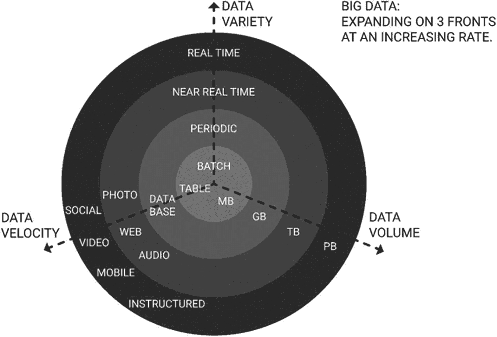
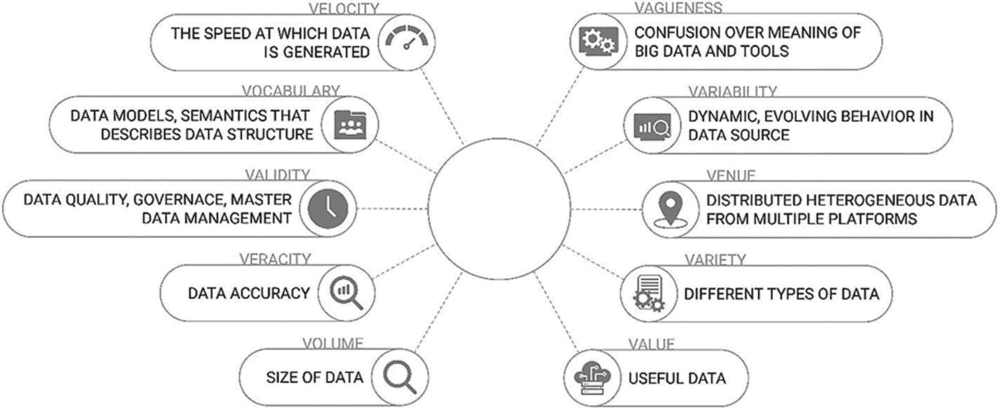
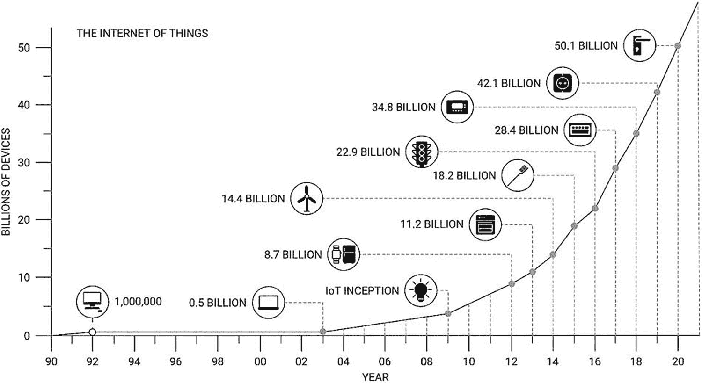
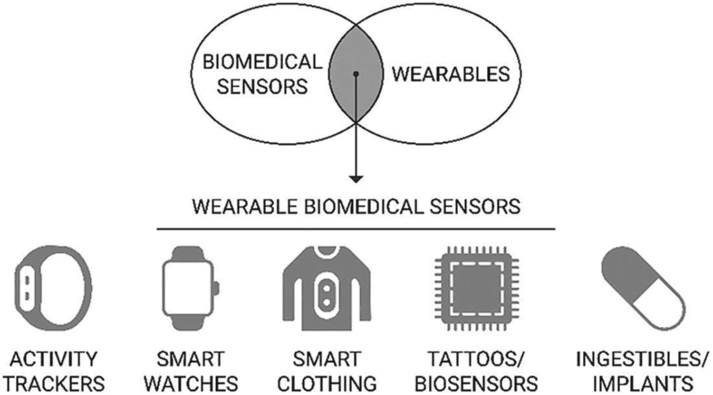
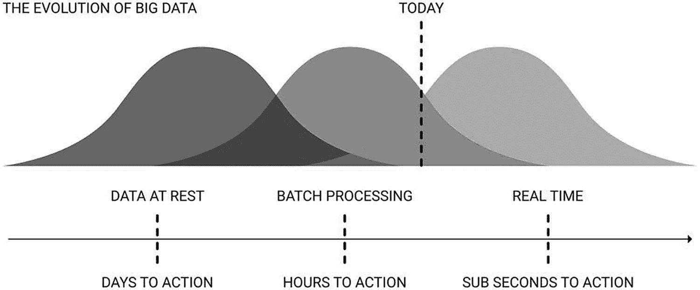
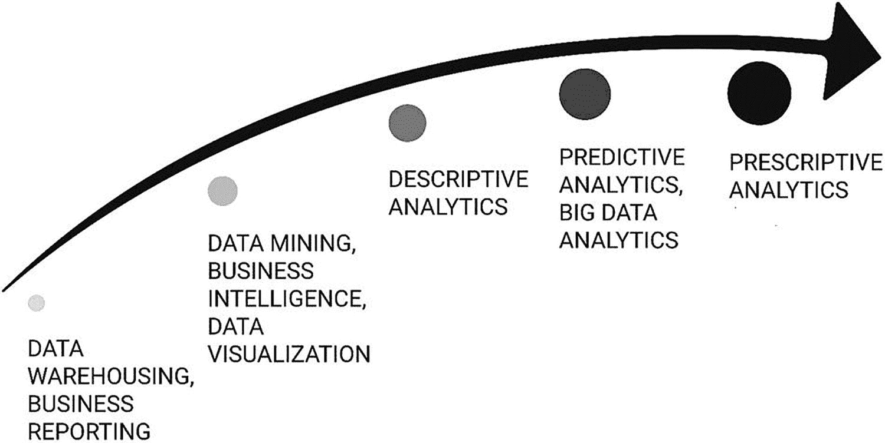
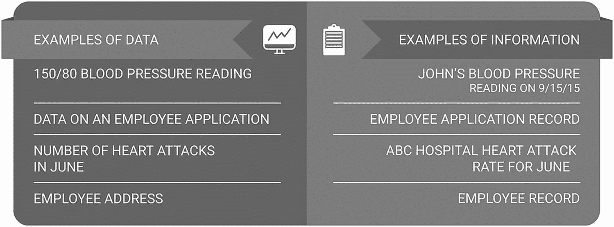

# 2. 数据

> *轶事的复数形式就是数据。*
> 
> ——雷蒙德·沃尔芬格

数据无处不在。全球性的颠覆和国际倡议正在推动数据化。数据化指的是将生活的方方面面数字化（或数据化）的现代趋势[27]。这种数据的产生正在将数据转化为新的、潜在有价值的形式。整个城市都在被激励着变得更加智能。在不久的将来，我们的城镇将实时收集数千个变量，以优化、维持和提高全体居民的生活质量。随着人机交互进一步融入智能护理，这些数据甚至可能连接到你的亚马逊或谷歌账户，并了解我们健康和日常生活中的所有重大事件。

人们有理由期待，除了管理交通，交通灯可能还会收集其他数据，例如空气质量、能见度和交通速度。人们不禁要问，一张超速罚单是否可以根据某人智能手表上的温度或智能戒指上的平均心率来提出异议。

数据无处不在。可能性是无限的。来自互联设备、嵌入式传感器和物联网的大数据，推动了全球对数据分析、解读和可视化的需求。COVID-19 本身就是一个国家与临床医生之间数据共享的绝佳范例——尤其是在关于新型冠状病 du 的风险因素、合并症和并发症方面。

## 什么是数据？

数据本身可以呈现多种形式——字符、文本、词语、数字、图片、声音或视频。每一条数据都归属于两大主要类型：结构化数据和非结构化数据。

从本质上讲，数据是一组定性或定量变量的值。要成为信息，数据需要经过解读。信息是经过组织或分类的数据，对接收者而言具有某种（或多种）有意义的价值。信息是经过处理的数据，决策和行动应以此为基础。

医疗保健领域正在经历一场数据革命，这得益于两大巨变：一是需要控制日益增长的成本压力，这催生了新的激励机制和报销结构；二是数字健康，它通过数字设备和创新技术赋予人们力量，使医疗保健变得大众化。

临床趋势正在发生变化。社交媒体的兴起，以及通过互联网和健康社区即时获取信息，意味着患者对自己的健康状况了如指掌。患者不断生成数据，并希望拥有这些数据，且能在不同服务之间传输数据。与此同时，循证医学正以基于证据的决策方法为导向，追求个性化护理。

患者和医疗保健专业人员都强烈渴望获取所有可用的临床数据，以便根据当前证据做出更有效的治疗决策。2019 年 Diabetes.co.uk 的一项研究表明，三分之一的患者希望与他们的医疗保健专业人员共享数据，但只有五分之一的患者能够做到这一点[9]。

将个体数据集汇总到更大的人群中也能提供更有力的证据，因为亚群体中的细微差别可能不常见，以至于在小样本中不易显现。例如，汇总患有心血管疾病和高血压的患者数据，可能比单独的数据集更能可靠地揭示高胆固醇等健康状况。

在现代医疗保健中融入数据，为众多领域的重大改进提供了机会。随着医学向循证和个性化方向发展，数据可用于改善：

*   患者和人群的健康状况
*   患者教育和参与度
*   疾病和护理风险的预测
*   用药依从性
*   远程监控
*   疾病管理
*   疾病逆转/缓解
*   治疗的个体化和个性化
*   以及护理
*   财务、交易和环境方面的预测、规划及准确性（尤其与医疗保健组织内的运营和财务团队相关）
*   用户体验，可用于加速上述所有事项

数据促进信息。信息驱动洞察，洞察则引领做出更优决策。

## 数据类型

结构化数据通常指存储在数据库中的数据——其结构遵循某种模型或模式。几乎每个组织都会熟悉这种数据形式，并且可能已经在有效使用它。例如，大多数组织至少会将某种形式的数据存储在 Excel 电子表格中。在临床环境中，电子健康记录（EHR）也可能采用类似的结构化形式。

来自嵌入式传感器、智能手机、智能手表和物联网设备的读数通常是结构化数据的形式——无论是提供血糖读数、步数、卡路里消耗、心率还是血压。

结构化数据类似于机器语言。其格式高度组织化，便于进行简单、直接的搜索和信息检索操作。为此，结构化数据通常存储在关系数据库中。

非结构化数据指的是其他所有数据。非结构化数据没有预定义的模型或模式。非结构化数据内部没有可识别的结构，这给查询和信息检索带来了问题。电子邮件、短信、Facebook 帖子、Twitter 推文以及其他社交媒体帖子都是非结构化数据的典型例子。非结构化数据可以释放出信息和洞察的宝库。

Gartner 报告指出，未来 5 年数据量将增长 800%，其中 80%的数据将以非结构化数据的形式存在[29]。

非结构化数据带来的问题是数据量庞大。缺乏结构使得编译和解读成为一项耗费时间和精力的资源密集型任务。任何组织都将受益于非结构化数据分析机制，以减少非结构化数据带来的资源成本。除非对数据有充分理解，否则可能需要领域专家的参与。

传统上，由于非结构化数据原始且无组织的形式，结构化数据比非结构化数据更容易分析。然而，随着数据科学和机器学习方法（如自然语言处理（NLP））的使用，非结构化、非正式数据集的分析能力正在提高，这些方法有助于理解和分类情感倾向。

将非结构化数据转换为结构化模型可能并不总是可行的。例如，通过电子邮件或通知传输的信息，其发送时间、主题和发件人作为统一字段存在。然而，消息的内容却不容易被解析和分类。

半结构化数据介于结构化数据和非结构化数据之间。半结构化数据不一定符合与关系数据库或数据表相关的数据模式的正式结构。然而，半结构化数据可能包含标签或标记，用于分隔语义元素，并在数据内强制执行记录和字段的分组。

诸如 JSON（JavaScript 对象表示法）和 XML（可扩展标记语言）之类的语言都是半结构化数据的形式。两者在促进数据交换方面都发挥了重要作用。

数据是智能系统学习的燃料，是成功实现人工智能最关键的部分。

数据分为五个来源：

*   网络和社交媒体数据：点击、历史记录、健康论坛
*   机器对机器数据：传感器、可穿戴设备
*   大型交易数据：健康索赔数据、账单数据
*   生物识别数据：指纹、基因、来自可穿戴设备的生物标志物
*   人类生成的数据：电子邮件、纸质文档、电子病历

在考虑典型的 Excel 电子表格以及机器学习领域时，以下定义也很有用：

*   实例：单行数据或观测值。
*   特征：单列数据。它是观测值的一个组成部分。
*   数据类型：指特征所代表的数据种类（例如，布尔型、字符串型、数值型）。
*   数据集：用于训练和测试机器学习模型的实例集合。
*   训练数据集：用于训练机器学习模型的数据集。
*   测试数据集：用于确定机器学习模型准确性/性能的数据集。

## 大数据

大数据这一术语指的是海量的、传统的和数字化的数据集合，这些数据是发现和分析的源泉。

大数据是一个流行术语，它定义了那些过于庞大、无法在传统关系数据库系统中存储和处理的数据集。从这个意义上说，大数据这个术语是模糊的——虽然规模无疑是大数据的一部分，但仅凭规模并不能完全说明大数据为何真正“大”。

通过大数据分析，我们可以发现隐藏的模式、未知的关联、趋势和偏好，以及其他有助于利益相关者做出更明智决策的信息。机器学习提供了一套技术工具箱，正是为了这个目的而应用于数据集。

大数据最早由 Laney 在 2001 年描述，其具有以下特征，也称为“三 V”（图 2-1）[30]：

图 2-1

数据的三个 V

*   **容量**：生成和存储的数据量。大数据通常容量很大。数据的庞大规模本身就带来了存储、索引和检索方面的复杂性。

*   **多样性**：大数据在数据类型和性质上多种多样，需要高效的存储和分析，以及处理此类数据的系统。

*   **速度**：大数据以一定的速度被接收，这带来了其自身的要求和挑战。

数据科学界讨论大数据的“三 V”已有一段时间。然而，还有另外两个数据方面需要考虑，它们可能比大数据的“三 V”更重要：数据真实性和数据价值的概念。Mark van Rijmenam 提出了另外四个 V，以进一步理解大数据极其复杂的本质 [31]。

更进一步，总共有十个 V（图 2-2）[32]。实际上，组织在制定数据策略时，需要牢记不同的 V 子集。

图 2-2

数据的十个 V

这里包含了目前提出的众多 V 中的一个子集。

Gartner 对 199 名成员进行的一项调查显示，对大数据的投资正在增加；但调查也显示出增长放缓的迹象，未来有意投资大数据计划的公司减少了。只有 15% 的企业报告称已部署其大数据项目，这表明采用曲线仍在成熟中，对人才和专业知识的市场需求很高 [33]。

患者和医生正在推动大数据的采用。患者通过临床数据、可穿戴设备、移动健康应用程序以及远程医疗/远程医疗服务来驱动数据。与此同时，医生则留下了临床数据（如书面记录、影像和保险数据）、患者记录和机器生成的数据。

### 容量

Laney 在 2001 年定义了大数据的第一个关键特征，即第一个 V——即数据量很大的命题。

历史上，大数据采用的主要障碍一直是对存储的相关需求及其相应成本。数据中心从本地托管转向云端，消除了这一担忧。更棒的是，它还带来了好处——主要是安全性和可扩展性。这显著降低了存储成本，同时在数据存储、协作和灾难恢复方面提供了灵活性。云，或云计算，指的是通过互联网提供的分布式计算。

摩尔定律不仅影响了存储容量，也降低了成本。摩尔定律是英特尔联合创始人戈登·摩尔在 1965 年提出的一个论断。摩尔指出，集成电路上可容纳的晶体管数量大约每 18 个月翻一番。1981 年，1 GB 存储的价格是 30 万美元。2004 年，这个价格是 1 美元；2010 年则是 0.10 美元。如今，1 GB 的云存储每月租金为 0.023 美元，并且第一年存储免费 [34]。

医疗保健领域，无论是通过公共卫生服务、政府、制药组织还是企业提供，对大数据都不陌生。数据以数字和非数字形式持续收集，涵盖各种患者、行为、流行病学、环境和医疗信息。

数据被消费、管理和生成，用于患者护理、交易记录、研究、合规、流程和监管要求。

截至 2020 年，患者的电子健康记录还不能以安全透明的方式通过数字手段轻易获取。许多组织正努力将这些信息放在区块链上，通过创建去中心化的网络系统，彻底改变健康数据的访问方式。

患者和医疗保健组织正在其环境中采用智能手机、可穿戴设备（如智能手表和健身追踪器）、家庭传感器、智能个人助理和社交网络。数据丰富、可访问且被认为是可靠的。然而，目前大多数医疗保健提供者并未使用这些数据，这凸显了以下几点：

*   患者数据的生成发生在医疗保健系统之外。
*   患者生成的数据需要在更广泛的患者记录或健康时间线中进行整合和探索。
*   患者数据超越了医学指标，扩展到更全面的指标，包括行为和环境健康。
*   医疗保健组织仍有巨大的兴趣，有待从机会和成本效益中实现。

英国最近的一项倡议通过使用社交媒体标签 `#facesofdiabetes` 和 `#letstalk`，对儿童 1 型糖尿病的患病率进行了地理映射。用户的情感也被分析，并通过使用机器学习工具对帖子类型进行分类，向用户提供了适当的支持 [35]。

由人产生的数据及其近乎实时的使用，是实现个性化护理的圣杯。数据化在金融、能源和零售领域已全面展开。随着健康可穿戴设备和移动医疗的普及，每个个人和组织都有潜力利用这一不断增长的数据量。

#### 应对数据容量

为了让大数据为您的组织发挥作用，存储的高效性和成本效益至关重要。选择最合适的存储解决方案取决于以下几个因素：

*   **方法**：数据存储成本随存储需求增加而增加。因此，确定是收集特定数据还是采用“一网打尽”的方法，取决于项目和监管要求。低成本的云存储提供商使“一网打尽”的方法变得可行。数据科学和机器学习的初学者可能希望为简化起见，确定一组用于评估的关键数据指标。
*   **数据类型**：考虑存储的是结构化数据还是非结构化数据，以及数据来源——例如，音频或视频内容、文本、图像等。与文本相比，视频、音频或图像存储需要更多资源。
*   **部署**：确定解决方案将如何部署，可能包括本地部署、内部部署或基于云的部署。
*   **访问**：确定解决方案将如何被访问——通过应用程序、Web 界面、内联网等。
*   **运维**：这包括数据结构、架构、归档、恢复、事件日志记录和法律要求。
*   **未来用途**：这涉及为未来的数据源、系统扩展以及潜在的未来用例进行规划。

数据集的分布式特性意味着，此前大数据采用中的障碍通常指的是此类系统的碎片化性质。

### 多样性

数据的第二个“V”是多样性。这不仅指数据类型的多样化，还包括数据来源和用例的多样化。二十年前，我们通常以电子表格和数据库的形式存储数据。如今，数据可能以照片、传感器数据、推文、加密文件等形式存在。这种非结构化数据的多样性给数据的存储、挖掘和分析带来了挑战。这也是机器学习能够显著帮助人类的一个领域。

数据以结构化数据（如临床记录和结果）、非结构化数据（如通信和交互数据）以及半结构化数据（如带有书面注释的 X 光片）的形式存在。

服务日益增长的数字化趋势，以及可穿戴设备和网络物理设备的广泛采用，正不断为发现和分析提供令人兴奋的新数据源。这使得能够创建由传感器数据、临床记录、通信与互动、人口统计以及账单记录驱动的新型风险模型——这些模型可以做出准确的预测，并节省宝贵的时间和资源。

#### 物联网

物联网指的是智能互联设备和传感器的种类及其产生的数据量正在迅速增长（图 2-3）。

图 2-3

物联网的演进

数据在设备、服务以及最终在人与人之间传输。你可能还听说过类似术语，如工业物联网和医疗物联网，它们分别指代物联网中的特定垂直领域或行业。

如今，各种设备监测着患者方方面面的行为——从血糖监测仪到胎儿监护仪，再到心电图和血压监测仪。这些测量中的许多都需要后续的医疗专业人员随访。

更智能的监测设备与其他设备、服务和系统进行通信，可以极大地优化这一过程，可能减少直接临床干预的需求，甚至用护士的一通电话来替代。当前智能设备的创新包括能够检测药物是否已被服用的智能药盒——通过蓝牙进行数据传输。如果确定用户未服药，则会通过电话联系他们，讨论并鼓励其坚持服药方案。还有用于检测皮肤癌和提供尿液分析服务的应用程序。物联网带来了大量机遇，不仅能改善患者护理，还能同时降低医疗成本。

大数据的多样性既包括传统数据源，也包括较新的结构化和非结构化数据源。随着数据多样性的增长，部署在医疗领域的算法和机器学习工具所能实现的潜力也在增长。

与数据源的多样性一样，大数据的多样性可以表现为以下几种形式：

*   数据类型：文本、数字、音频、视频、图像等。
*   功能：用例和用户需求。
*   数据价值：数据是否适合特定目的？这将是关注数据使用背景下的质量。更多的数据并不一定意味着更好的数据。

正如存在多样化的数据源、价值、类型和用例一样，数据也有多样化的应用。这些包括访问点（即 Web、移动端、SaaS [软件即服务]，有时也称为 MDaaS [医疗设备即服务]、API [应用程序编程接口]）和用户（通常是人或机器）。

数据多样性正在呈指数级增长。随着新的医疗物联网设备的发展，从噪声中识别出有用的数据特征将变得至关重要。

#### 遗留数据

遗留数据，无论是基于计算机的还是非基于计算机的，也可以用于你的项目中。越来越多的服务支持数字化，用于自然语言处理或分类目的。通过使用遗留数据，利益相关者可以最大化利用不足的数据中的洞察。遗留数据，或称传统数据，也可能被称为小数据，本章稍后会讨论。

通常，遗留数据是零散且不完整的，尤其是对于当今所需的标准而言。例如，许多超过 10 年前的记录可能没有关联的电子邮件地址或正确的电话号码。

### 速度

大数据的第三个 V 是速度，指数据创建、存储以及为分析和可视化做准备的速度。数据速度对底层计算机硬件基础设施提出了独特的要求。

云计算的一个优势在于能够快速存储和处理通常会使传统服务器不堪重负的大数据量和大数据种类。由于在存储和成本方面具有灵活性，云计算成为大数据项目的首选途径。云提供商可以存储 PB 级的数据，并根据需求实时扩展数千台服务器。或许更有价值的是，计算能力也价格低廉且易于分配。

2010 年海地地震后，与传统方法相比，Twitter 数据是检测和追踪致命霍乱爆发的更快捷方式。随后的一项研究确定，在检测霍乱进展的速度和准确性方面，社交媒体平台优于官方的疾病流行监测方法[36]。

在大数据时代，数据是实时或近乎实时创建的。网络物理设备、嵌入式传感器和其他设备的普及意味着，除了 MAC 地址和互联网接入外，数据可以在创建的那一刻进行传输。

数据创建的速度是难以想象的。人们普遍认为，过去两年生成的数据比从时间开始到那时为止创建的数据还要多[37]。组织面临的挑战是应对数据实时创建和消费的巨大速度。

随着可穿戴设备和传感器的普及，它们在临床医疗中的应用也将继续增加（图 2-4）。实现最大临床价值的关键在于整合各种异构数据源。

图 2-4

可穿戴生物医学传感器

| **类型** | **示例** | **特征** |
| --- | --- | --- |
| 患者行为与情绪 | 社交媒体 智能手机 网络论坛 | 大多数数据是非结构化或半结构化的。数据量大且实时。提供学习、参与和理解的机会。通常是开源的。 |
| 患者健康数据 | 传感器 血糖仪 智能手机 健身追踪器 图像 | 由患者拥有。数据通常由设备报告。存储需求通常较低。图像存储需求因所需存储的数据而异。传感器数据速度高。结构化数据便于分类和模式检测。某些项目可能需要数字化。 |
| 制药与研发数据 | 临床试验数据 人群数据 | 包含由制药公司、研究机构、学术界和政府拥有的人群和疾病数据。 |
| 网络健康数据 | 患者门户网站（Diabetes.co.uk） 数字干预措施（例如，低碳水计划、Gro Health、低血糖计划） | 有用的元数据。通常由设备报告而非临床报告。 |
| 临床数据 | 电子健康记录 患者登记册 医生数据 图像（扫描等） | 本质上是结构化的。由医疗服务提供者拥有。 |
| 索赔、成本、管理数据 | 索赔数据 费用数据 | 本质上是结构化的。包含与报销相关的任何数据集。 |
| 交易数据 | 健康信息交换 | 可能需要预处理才能成为有用数据。 |

传统的三个 V 让我们得以洞察数据的规模以及这些庞大数据集增长和倍增的快速速度。然而，数据多样性仅仅触及了大数据深度和挑战的表面。

大数据的力量在 2009 年由巨头谷歌得到了最好的证明，当时它通过分析相关的搜索词，能够仅以一天的延迟追踪流感在美国的传播，比美国疾病控制与预防中心（CDC）还要快[38]。

然而，在 2013 年，谷歌流感趋势出错了——这引发了关于数据价值和有效性的质疑[39]。

在临床环境中，数据价值和真实性将占据更重要的位置，因为临床决策是基于数据做出的，关乎生命安危，其影响远不止于交易层面。

### 价值

价值指的是数据的实用性。建立对数据信任的关键在于确保其准确性和可用性。在医疗保健领域，这将通过定性和定量分析来评估。价值可以通过多种因素来界定，主要包括对患者结果或行为改变的临床影响、患者和利益相关者的参与度、对流程和工作流程的影响，以及货币化（成本节约、成本效益等）。

麦肯锡指出，大数据对美国医疗保健的潜在年价值为 3000 亿美元。他们还提到，大数据对欧洲公共部门行政管理的潜在年价值为 2500 亿欧元[40]。

数据的价值来自于对其进行的分析。正是这种对数据的分析使其能够转化为信息，并最终旨在转化为知识。价值在于组织如何使用可用数据，并以信息为中心、以数据为驱动来进行决策。价值不是被发现的，而是被创造出来的。关键在于通过良好的管理，使数据对你的用户和组织具有意义。

谷歌在 2013 年追踪流感症状搜索方面做得非常出色。然而，它无法知道其结果在预测流感流行方面是否有效。至少在这个案例中，谷歌流感趋势并未为此用例提供有价值的结果。雪上加霜的是，谷歌永远无法知道现实世界中的流感病例与搜索分布和频率并不匹配——因此它对此无能为力。也许如果这个项目得以扩展，分析社交媒体帖子在确定流感流行方面可能会更有价值。社交媒体和更广泛的非结构化数据源提供了大量通常未被探索的信息。

识别 2 型糖尿病风险人群、预测心房颤动、协助患者从健康事件中恢复，以及向患者推荐最新的循证医学疗法，这些都是具有明确且有价值投资回报的任务。

### 真实性

毫无价值的数据，无论数量多么庞大，始终都是毫无价值的。真实性指的是数据的真实可靠程度，以及数据在其使用情境中（涉及偏差、噪声和异常）是否具有最佳质量和适用性。

多种因素会影响数据的真实性，包括以下方面：

*   **数据录入**：数据是否正确录入？是否存在任何错误或事件？是否有数据录入的审计追踪？
*   **数据管理**：在系统中流转的数据其完整性如何？
*   **集成质量**：数据是否被恰当地引用、注释，并具有唯一性？
*   **时效性**：数据是否适合使用？是否及时且相关？
*   **使用方式**：数据是否以可操作的方式提供？数据是否有助于实现业务目标？使用这些数据是否符合伦理？

可信数据的六个“C”标准有助于评估你用于项目的数据是否具有真实性。确保你的数据集是**干净、完整、最新、一致且合规**的至关重要。

*   **干净的数据**：这是良好数据质量流程（如去重、标准化、验证、匹配和处理）的结果。干净的数据能够基于高质量、无污染的数据做出稳健的决策。干净的数据是用户信任面临的最大挑战。干净的数据是彻底数据准备的产物。
*   **完整的数据**：这是整合了数据基础设施、技术和流程的结果，能够支持稳健的决策制定。
*   **最新的数据**：新鲜的数据通常被认为比过时的数据更可靠。那么问题就变成了：数据在什么时候算是不再最新？随着实时、最新数据的增长，从噪声中辨别信号可能成为一项更具挑战性的任务。
*   **一致的数据**：数据必须保持一致（从而支持机器可读性）。这是系统间交叉兼容性的要求，也适用于元数据。
*   **合规的数据**：合规性法规可能来自各种来源，例如利益相关者、客户、法律法规，或新政策的出台。尽管存在许多数据基础设施和标准，但数据科学作为一个类别，仍在不断遇到需要治理和立法的全新问题。合规性对内外部利益相关者可能意味着不同的事情。在内部，会有标准来确保数据符合质量、安全和隐私流程。所有利益相关者都需要相信数据是按照内外部规定被访问和分发的。通常，组织可能会设立一个数据和信息治理委员会。

第六个 C 是**协作数据**，指的是围绕数据进行协作，以确保数据管理和业务管理目标保持一致。第六个 C 更多指的是处理数据的方法，而非数据本身。虽然可信数据需要满足所有这六个 C，但其目的是拥有能够真实反映现实世界、理想情况下没有或只有极少偏差的干净数据。

虽然大多数人都主张临床护理数据应具有完全的真实性，但在现实世界中，面对如此多样化的数据输入，临床护理的黄金标准更难实现。有人会质疑，如果数据尚未被有效利用，为什么还需要添加更多数据。强制执行数据质量可能被认为难以经济高效地实现。在这种情况下，训练一个智能系统来学习估计未见过的参数可能会有所帮助。真实性也可以指确保拥有足够大的训练样本，用于构建丰富的模型和进行验证，从而支持全人群分析。

真实性可以应用于对数据执行的分析，确保这些分析是正确的。不仅数据需要可信，解读数据的算法和系统也需要可信。

如果没有良好的数据科学，数据录入可能成为一个被忽视的风险点。这通常是一个基于人的问题。即使在数据量较小的情况下，人类也会犯错。为了具有临床相关性，数据需要最大程度的真实性。随着数据真实性的提高，基于这些数据的机器学习能够得出更真实的结论。

### 有效性

与大数据的真实性类似，还存在数据有效性的问题，它指的是数据对于其预期用途是否正确和准确。在临床应用中，有效性可能被视为优先考虑的“V”——确保只使用有用且相关的数据。

数据的真实性是绝对的，而有效性是情境相关的。有效的数据能够无偏差地代表现实世界。

### 变异性

大数据是可变的。变异性定义了其含义经常变化的数据。变异性在进行情感分析时非常相关。例如，在一系列推文中，同一个词可能具有完全不同的含义。

变异性经常与多样性混淆。举例来说，一个花商可能出售五种玫瑰。这是多样性。现在，如果你连续两周每天都去那个花商那里买同样的白玫瑰，你会发现每一天的玫瑰在形态和香气上都有细微的差别。这就是变异性。

为了进行正确的情感分析，算法需要能够理解文本的上下文，并能够解读某个词在特定上下文中的确切含义。即使在自然语言处理能力取得进展的情况下，这仍然非常困难。

### 可视化

可视化是八个“V”中的最后一个，指的是对大数据进行适当的分析和可视化，使其变得可读、可理解和可操作。

可视化听起来可能并不复杂；然而，克服可视化复杂数据集的挑战对于利益相关者的理解和项目进展至关重要。通常情况下，数据可视化正是将数据集中学到的知识传递给利益相关者的主要组成部分。

## 海量数据

海量数据这个术语指的是那些包含海量记录的数据集。电子健康档案（EHRs）被认为是海量数据。海量数据集可能是简单的二维关系表。处理海量数据所需的资源超出了简单的电子表格分析，并且由于计算中涉及巨大的矩阵，计算量非常大。

## 小数据

小数据与大数据的直接对比。大数据是分布式的、多样化的、实时的，而小数据则因其格式和体量而具有可访问性、信息性和可操作性。

小数据的例子包括患者病历、处方数据、生物特征测量值、扫描结果，甚至互联网搜索历史。与谷歌和亚马逊等组织和服务相比，其数据量要小得多。

分析学已经经历了由大数据的采用和需求所推动的快速演变。回归传统数据集并应用更现代的技术（如机器学习）不应被忽视，并且是数据科学家起步的好地方。重要的不是数据的大小，而是你用它做了什么。

## 元数据

元数据是关于数据的数据——即描述每个数据资产或单个数据片段的描述性信息。元数据提供关于单个文件的详细信息，支持从元数据及其所支持的数据中发现模式和趋势。

元数据提供有关文件来源、日期、时间和格式的信息；还可能包含注释或评论。在战略信息管理中投入资源（主要是时间）至关重要，以确保资产按照与集合中其他资产一致的分类法正确命名、标记、存储和归档。这有助于加快数据集链接，并保持资产管理方法的一致性，确保文件易于查找、检索和分发。

大数据的热潮曾让元数据黯然失色。然而，大数据伴随着大元数据，使组织能够生成知识并利用价值。例如，谷歌和 Facebook 使用诸如 Open Graph [41]之类的分类语言，帮助构建更具结构化的网络，从而能够向用户提供更强大、更具描述性的信息。这反过来又为用户提供人性化的结果，优化点击率和转化率。

元数据在任何以数据为主导的项目中都可能非常有用。例如，机器学习算法可以使用属于某段音乐的元数据，而不是（或同时使用）实际音乐本身，来推荐更多相关音乐。音乐的流派、艺术家、歌曲标题和发行年份等特征可以从元数据中获取，以提供相关结果。

## 医疗数据：小型与大型用例

医疗保健利益相关者明白，他们被来自患者、专业人士和交易的海量数据所包围。关键是要知道如何驱动价值并达成关键绩效指标（KPI）。以下是一些令人兴奋的医疗数据用例。

### 预测等待时间

在法国巴黎，组成巴黎公立医院集团（AP-HP）的四家医院与英特尔合作，利用内部和外部来源的数据（包括 10 年的住院记录），来确定基于日期和小时的预期入院患者数量预测 [42]。

使用时间序列分析技术来预测不同时间的入院率。这些数据可供所有外科和诊所使用，展示了数据可以立即用于提高效率和赋能利益相关者的方式。

世界上大多数（如果不是全部）诊所都能获取类似的数据，这表明医疗保健领域才刚刚开始触及数据应用的表层。

### 降低再入院率

与等待时间相同的方法可用于帮助管理医院成本。利用数据分析，可以根据病史、人口统计数据和行为数据识别高风险患者群体。这可用于提供必要的护理，以降低再入院率。

在美国德克萨斯大学西南医学中心医院，通过成功识别高风险患者，电子健康记录分析使心脏病患者的再入院率从 26.2%降至 21.2% [23]。

### 预测分析

前面的例子很可能使用静态数据（即非实时的小数据），并且在预测等待时间和再入院间隔方面相当准确。同样的数据分析概念可以大规模用于疾病预测和护理普及化。

在美国，Optum Labs 已经收集了超过 3000 万患者的电子健康记录，创建了一个用于预测分析工具的数据库，以改善护理服务。其目的是让医生能够基于数据做出近在咫尺的、明智的决策，从而改善患者的治疗 [44]。

3000 万份健康记录提供的稳健性使得模型可以被训练和验证，以找到符合某些疾病（如高血压、心血管疾病、中风、2 型糖尿病、心脏病和代谢综合征）预测风险趋势的人群。

通过分析包括年龄、社会和经济人口统计数据、健康状况及其他健康生物标志物在内的患者数据，医疗服务提供者不仅可以通过预测风险，还可以通过提供最佳患者预后的治疗，在个体和群体层面改善护理。

### 电子健康记录

电子健康记录尚未完全实现其潜力。这个想法在理论上很简单：每个患者都有一个数字健康记录，包含他们的详细信息、人口统计数据、病史、过敏史、临床结果等。在患者同意的情况下，记录可以通过安全的计算机系统共享，并可供公共和私营部门的医疗服务提供者使用。每条记录包含一个可修改的文件，这意味着医生可以随着时间的推移进行更改，而不会有数据复制或不一致的风险。

电子健康记录完全合理；然而，在全国范围内完全实施被证明是一项艰巨的任务。根据 HITECH 研究，在美国，高达 94%的符合条件的医院使用电子健康记录。欧洲则更为落后。欧盟委员会的一项指令设定了到 2020 年创建一个集中的欧洲健康记录系统的任务 [46]。

在美国，凯撒医疗机构已经实施了一个在其所有设施间共享数据的系统，并使电子健康记录的使用更加便捷。麦肯锡的一份报告强调，由于减少了办公室就诊和实验室测试，该数据共享系统估计节省了 10 亿美元。该数据共享系统改善了心血管疾病的预后 [47]。

电子健康记录正在向区块链演进，区块链旨在实现数据访问的去中心化和分布式。

### 基于价值的护理/患者参与

患者不再被视为被动的护理接受者。医疗保健现在有义务让患者参与到他们的健康、医疗决策、护理和治疗中。可以通过数字手段维持患者参与。请注意，患者参与不应与患者体验混淆，后者是患者可能经历的路径（旅程）。

财务驱动因素已经促使医疗实践越来越有动力与每位患者进行最佳互动，以确保所接受的服务令人满意且质量上乘。

数据驱动解决方案的关键驱动因素之一是对患者参与的需求以及向基于价值的护理的转变。更好的患者参与能增强患者、治疗提供者和支付方之间的信任。此外，它还能带来更好的健康结果，并为提供者节省成本（或带来其他好处）。

开创性的健康保险计划旨在通过将保费与良好健康挂钩来吸引患者参与，以实现更好的健康结果。位于英国沃里克的糖尿病数字媒体公司的健康创新者正与全球保险提供商和健康组织合作，为用户提供可扩展的数字健康技术，以优化他们的健康和福祉 [18]。

加利福尼亚蓝盾公司正在通过开发一个集成系统来改善患者预后，该系统将医生、医院和健康保险与患者更广泛的健康数据连接起来，以提供基于证据的、个性化的护理 [48]。其目标是帮助改善疾病预防和护理协调方面的绩效。

### 医疗物联网：实时通知、警报与自动化

数百万人使用设备将生活数据化，迈向量化自我。当前连接到互联网的设备包括：体重秤；测量心率、运动和睡眠的活动监测器（如 Fitbit、Apple Watch、Microsoft Band）；以及血糖仪。所有这些设备都能实时发送指标，并以秒级精度追踪用户行为。甚至还有一款可穿戴的胎儿心跳监测器 [50]。

记录的数据可用于检测疾病风险、提醒医生，或根据接收到的生物特征信息请求紧急服务。许多集成设备已超越脉搏和运动监测，开始测量汗液、氧化水平、血糖、尼古丁摄入量等指标。

精密的设备带来了针对新问题的精密解决方案。例如，由于心率监测变得更便宜、更普及，像房颤这样的病症现在比以往任何时候都更容易、更早地被检测到。心率超过 300 bpm（而非 60–80 bpm）的颤动可能是房颤的症状。被诊断患有房颤的患者患痴呆症的可能性高出 33%；超过 70% 的患者将死于中风 [51, 52]。治疗通常很简单：抗凝剂和血液稀释剂，其有效率高达 80%。

医疗服务提供者正缓慢地转向复杂的工具包，以利用患者产生的大量数据流，并在每次出现令人不安的结果时做出反应。这种采用是由成熟的数字组织和初创公司，与健康保险支付方共同推动的。

在另一个用例中，加州大学尔湾分校的一项创新项目让心脏病患者有机会带着无线体重秤回家，并定期称重。预测分析算法确定了不安全的体重增加阈值，并在需要紧急再次入院之前，主动提醒医生对患者进行诊治 [31]。

值得注意的有趣一点是，这些互联健康设备并不一定能激励那些最易发生不良健康事件的受众或人群。根据几项随机试验，Fitbit 佩戴者确实锻炼得更多，但不足以保证减肥和改善体质。

事实上，一些研究确定它们可能会打击积极性 [55]。此外还有准确性的问题。克利夫兰诊所的一项研究发现，市场上四个品牌的心率监测器有 10% 到 20% 的时间报告不准确的读数，这表明该技术的精度还有待提高 [56]。

尽管这些设备显示出潜力，但仍存在一个问题：在持续使用一段时间后，平均放弃率超过 30%。软件应用程序现在成为了参与互动的渠道，作为设备和物联网之上的智能层，它们还可以引入行为改变心理学，以实现可持续的行为改变和持续使用。

为这类设备的用户提供切实的激励措施，例如健康或人寿保险折扣，可能会变得更加主流，并推动预防许多与生活方式相关的慢性疾病，类似于带有嵌入式黑匣子传感器的激励型汽车保险。

实时警报也可用于通知患者其所服用药物的不良反应。目前，除非患者向治疗提供者注册，否则不会收到任何通知。医疗服务提供者可以利用公共信息源通知患者潜在的不良反应。电子邮件或短信足以作为一种互动形式，并能提供所需的所有指导，从而减少与临床医生的会诊时间。

电子健康记录（EHR）还可以触发警告、警报和提醒，告知患者何时应进行新的实验室检测，或追踪处方以查看患者是否遵循了治疗指示。

### 迈向循证医学

循证医学是一个术语，指基于经过验证的科学方法进行治疗，以追求最佳结果。临床试验在小范围内进行，在具有内部效度（即，除指定条件外无其他状况或问题）的小组中测试新疗法，观察治疗效果如何，并确定是否存在任何副作用。

随着数据化的日益增长，“真实世界证据”或数据也在增加。这些数据可以在个体层面进行分析，以创建患者数据模型，并在群体层面进行汇总，以得出关于疾病流行率、治疗、参与度和结果的更广泛见解。这种方法提高了护理质量、透明度、结果和价值，其核心是使医疗服务民主化。

利用相似患者群体的数据，我们可以了解具有相似特征的患者所采取的治疗方案，从而根据人群中其他人对任何给定治疗的反应，推荐最佳治疗方案。推荐的治疗路径对患者来说是最好的，并且可以向患者和医疗专业人员解释为什么这是最佳路径。这源于预测分析，并且超越了识别群体和治疗方案的范畴。

通过挖掘真实世界的患者数据，包括临床患者记录和实时的个人患者健康数据——并结合关于疾病流行率、治疗路径和结果的人口统计学和健康数据——我们可以了解针对个体的最佳治疗方案，从而促进精准医学，这是循证医学的顶峰。

通过将真实世界的患者和临床数据与基因组联系起来，可以针对患者和人群的基因构成进行个性化定制，用于以下方面：

*   药物处方
*   不良反应和反应
*   预防策略
*   未来疾病的可能风险

### 公共卫生

通过对疾病模式和暴发进行分析，可以通过分析驱动的方法显著改善公共卫生。

大数据可以帮助确定需求、所需服务或治疗；并且可以预测和预防未来的危机，从而造福人群。通过绘制患者位置图，可以预测可能在某个区域内传播的疾病暴发（如流感），从而更容易制定应对患者、疫苗接种和护理服务的计划。

在西非，手机位置数据在追踪人口流动方面被证明是无价的，并因此帮助预测了埃博拉病毒的蔓延范围 [57]。

在 2010 年海地地震后，一个由瑞典卡罗林斯卡学院和美国哥伦比亚大学组成的研究团队分析了 Digicel 海地网络上 200 万部手机的通话数据 [58]。通话记录被用于了解人口流动情况，并帮助联合国更有效地分配资源。这些数据还被用于识别随后霍乱暴发的风险区域。

## 数据及其分析的演变

近在咫尺正在驱动未来。作为数字世界中的人、患者或代理，我们期望所提供的数据与所收到的反馈之间在时间上具有邻近性。随着数据规模的增加，从数据创建到洞察和行动之间的时间缩短的需求也随之增长。缩短从检测事件到自动响应的时间具有巨大的经济价值。这有助于在交易完成前发现欺诈交易，甚至提供与兴趣或需求相匹配的信息。

正如数据本身在演变，数据的分析方式也在演变（图 2-5）。

图 2-5

大数据及其分析的演变

作为一个概念，数据分析或分析学，已经历了多次迭代，其驱动力来自于对获取数据以支持决策的需求。

分析 1.0 表现为对小型、低速数据集的传统分析，通常采用电子表格和静态文档的形式。这适用于小数据。典型的分析是描述性的，并且基于报告。

数据通常本质上是结构化的。这在 20 世纪 90 年代推动了商业智能的发展，其特点是预定义的查询以及详细或历史的视图——通常由利用结构化数据（如客户数据、行为数据、销售数据、患者记录等）的 Web 仪表板驱动。关于生产过程、销售、交互和交易的数据在传统关系数据库中被收集、聚合和分析。在分析 1.0 时代，数据科学家花费大量时间准备数据以供分析，而不是亲自进行分析。

分析 2.0 标志着大数据与传统分析的整合，并提供了支持实时查询大数据集的接口。大数据分析始于 21 世纪初，它通过结合结构化数据和非结构化数据（如社交媒体、行为数据以及日益多样化的用户数据）的复杂查询与预测视图，促进了竞争洞察。那些无法在集中式平台上容纳或无法被快速分析的大数据，将通过诸如 Hadoop 之类的框架进行处理。Hadoop 是一个开源软件框架，用于在云端或本地的并行服务器上进行快速批数据处理。

非结构化数据不仅通过 SQL（结构化查询语言）数据库得到支持，还支持键值、文档、图、列式和地理空间数据。这一时期引入的其他大数据技术包括用于快速分析的“内存中”分析，即数据在内存中而非磁盘上进行管理和处理。

如今，海量数据正在网络边缘产生，传统的分析方式已不再可行。与消费者打交道的组织——无论是制造物品、运输物品、消费物品还是与客户合作——在这些设备和活动中拥有越来越多的数据。每个设备、每批货物和每个人都会留下一条被称为“数据尾气”的轨迹。

分析 3.0 标志着一个成熟阶段，在此阶段，组织通过结合传统分析和大数据，实现了可衡量的业务影响。该方法支持在决策点进行敏捷的洞察发现和实时分析。分析 3.0 主要是传统商业智能、大数据和分布在整个网络中的物联网的结合。组织可以分析这些数据集，以造福特定受众，实现其目标——无论是改善健康结果还是实现货币化。他们还可以将高级分析和优化近乎实时地嵌入到其运营一线做出的每一个产品或服务决策中。

## 将数据转化为信息：利用大数据

数据的价值体现在将其转化为信息的能力上，这些信息可以驱动可操作的洞察，进而引导行为和流程。数据分析/分析学是数据科学的一个子集，旨在从原始数据源中提取洞察。

当今大数据分析的进步使研究人员能够在几分钟内解码人类 DNA，预测恐怖分子计划攻击的地点，确定哪个基因最可能导致特定疾病，当然，还能确定你在 Facebook 上最可能对哪些广告做出反应。

大数据分析可以帮助组织理解其数据中包含的信息，并识别出对业务目标、成果和决策最重要的数据。利益相关者通常希望获得来自数据分析的知识，这取决于所产生的结果类型和推理方法。

大多数大数据是非结构化的。IBM 估计，全球 80% 的大数据是非结构化的，包括照片、音频、视频、文档和交互 [59]。

数据需要经过处理才能产生价值。要实现这一点，需要资源——以时间、人才和资金的形式。这是采用大数据方法的一个惯性所在：将数据处理成具有可用洞察力的东西，是否值得为此投入资本并承担风险？

数据科学分析分类中有四个流（图 2-6）。分类基于所产生的结果类型。

图 2-6

分析的流

### 描述性分析

描述性分析通过分析历史数据，为过去提供洞察，重点关注“发生了什么”这个问题。描述性分析使用数据聚合和数据挖掘等技术来提供历史理解。从描述性分析中可以学到很多东西。

描述性分析的常见例子是提供以下问题答案的报告：去年七月有多少患者入院？有多少患者在 30 天内再次入院？有多少患者感染或遭受了护理失误？描述性分析是大数据分析的第一种形式。

对于许多组织来说，这种基本的报告水平仍然欠缺。专有数据标准维护着无益的信息孤岛；缺乏可用的人类专业知识或适当的组织支持可能导致数据被收集后闲置不用。

通过数据集链接，数据可以变得更有价值。例如，将医生预约与住院、教育出勤、用药依从性和服务获取联系起来，可以为优化医疗服务和节省成本提供重要的洞察和理解。

描述性分析的局限性在于，它基于过去的快照，指导决策的能力有限。虽然这很有用，但并不总能预示未来。

### 诊断性分析

诊断性分析是一种检查数据以回答“为什么某事会发生”这一问题的分析形式。诊断性分析包括决策树、数据发现、数据挖掘和相关性等技术。

接下来的两种分析类型，预测性分析和规范性分析，需要使用学习算法，并将在后续章节中进行更深入的介绍。

### 预测性分析

预测性分析使我们能够了解未来并预测未来结果的可能性。它利用手头已有的数据，并尝试通过最佳估算来填补缺失的数据。

预测性分析的特点包括回归分析、多元统计、数据挖掘、模式匹配、预测建模和机器学习等技术。它利用历史数据和当前数据来预测未来事件或可执行结果的可能性。

随着医疗保健提供者寻求基于证据的方法来降低成本、利用基于价值的报销模式，并避免因未能控制其能力范围内的慢性疾病和不良事件而受到处罚，预测性分析技能的需求日益增长。预测性分析正处于变革之中。过去五年的创新取得了显著进展，对患者生活产生了可衡量的影响。可穿戴技术和移动应用如今已能识别哮喘、房颤和慢性阻塞性肺疾病（COPD）等病症[60]。

预测性分析仍然难以实现，因为它需要获取实时数据以支持近乎实时的临床决策。为此，医疗传感器和连接设备必须完全集成，以提供患者健康状况的最新信息。

此外，临床医生需要具备使用此类数据的经验。除了利用单个患者的数据外，更准确的诊断和治疗还必须尽可能多地参考可用的患者数据，包括人群层面的数据。

随着数据源和技术的发展，来自认知计算引擎、自然语言处理和预测性分析的高级决策支持，可以帮助医疗提供者精准定位那些可能被遗漏的诊断。人群健康管理工具可以识别出那些再入院风险最高、易患高成本慢性疾病或对药物产生不良反应的人群。

#### 应用案例：实现个性化护理

代谢健康已被证明会影响多种健康状况的风险，包括 2 型糖尿病、高血压、某些痴呆症和某些癌症。作为针对 2 型糖尿病的数字干预手段，低碳水计划应用利用多种特征（以健康生物标志物和人口统计数据的形式，包括血糖、体重、性别和种族）来评估患者的代谢健康评分。随着该应用扩展到与可穿戴健康设备集成，增加的体重和血糖数据使算法能够进一步扩展，以确定胰腺癌的潜在风险。这些信息会在相关情况下与患者的医疗团队沟通，并通过队列数据比较进行参考[16]。

用户会收到支持性通知，告知其数据似乎不符合预期的人口统计特征，并提示用户与其医疗专业人员沟通。如本例所示，随着更多生物传感器和算法的开发，预测性分析的伦理影响变得十分重大。

#### 应用案例：实时患者监测

在典型的医院病房中，病房护士会手动巡视患者，监测并确认关键生命体征。然而，无法保证在预定巡视间隔期间，患者的健康状况不会发生好转或恶化。因此，护理人员往往是在不良事件发生后被动应对问题，而如果能更早介入，则会对患者的健康产生显著影响。无线传感器可以比人工巡视更频繁地捕捉和传输患者的生命体征数据。

随着时间的推移，同样的数据可以应用于预测性分析技术，以便在通过床边巡视发现紧急情况之前，就判断其发生的可能性。

### 规范性分析

规范性分析致力于为获得最佳结果而做出决策，即利用所有可用数据和分析来告知并优化行动决策——也就是更智能的决策。规范性分析试图量化未来决策的影响，以便在决策前就可能的结果提供建议。

在最佳状态下，规范性分析不仅能预测将要发生什么，还能预测其发生的原因，从而提供关于如何利用这些预测采取行动的建议。

规范性分析结合了多种人工智能技术和工具，如机器学习、数据挖掘和计算建模程序。这些技术应用于来自许多不同数据集的输入，包括历史数据和交易数据、实时数据流以及大数据集。

规范性分析会考虑现有证据，进行情境化预测。例如，典型的医院再入院分析会显示未来 14-30 天内可能返回医院的患者预测。一个更有用的预测器可能会将同一仪表板与预计成本、实时床位数量、可用教育材料和后续护理信息整合。有了这些额外信息，临床医生可以识别出再入院风险高的患者，并采取措施将风险降至最低，从而改善患者预后并减少医院资源消耗。人群管理方法可以考虑肥胖患者，并添加高胆固醇或心脏病风险等因素的筛选条件，以确定治疗重点和应针对哪些治疗方案。制药公司可以利用规范性分析，通过识别最适合临床试验的人群来加快药物开发。这包括预计依从性好的患者以及预计不会出现并发症的患者。

规范性分析通过从风险分层人群中识别适合个体的干预模型，结合临床数据、患者数据和更广泛的可用健康数据，实现了人群健康管理的优化。

分析学正在经历进一步的转型，从规范性分析转向情境化分析。情境化分析在推荐最佳行动方案时，会考虑更广泛的数据——例如环境、位置和情境数据。

#### 应用案例：从数字疗法到药理学

不同的治疗路径对不同的人效果不同。通过大规模收集数据，医生可以根据对患者人群的最新循证分析、预测性分析和规范性分析来开具治疗方案。

通过整合数字教育和药理学疗法，利用此类资源提供治疗，可以确保始终开具最精确的治疗方案，同时提供可追踪的依从性和进展洞察，并确保资源集中在需要的地方，从而民主化医疗保健的获取。

## 推理

系统可以利用知识库中的可用信息，通过三种主要方法得出结论：演绎、归纳和溯因。虽然不需要逻辑学背景，但了解不同推理方法之间的差异是有益的。任何数据科学家都应熟悉这些推理技术。

### 演绎

演绎推理允许你根据已知事实做出必然成立的陈述。例如，你已知两个事实：

1.  每个星期六都下雨。
2.  今天是星期六。

演绎推理允许你确定一个真实的陈述：如果今天是星期六，那么今天会下雨。

在演绎推理中，人们从前提 p 推断出逻辑上合理的命题 q。大多数报告系统和商业智能软件都是演绎性的。

### 归纳

归纳推理使你能够根据迄今为止积累的证据做出陈述。然而，关键在于证据并不等同于事实。某事物的充分证据，无论多么有力，都只是暗示某个“事物”是一个事实。因此，在归纳方法中，所确定的陈述只是极有可能为真，而非绝对真理。

通过归纳推理，人们试图推断出一个命题 q，该命题由 p 推导而来，但不一定是 p 的逻辑推论。

例如，如果英格兰沃里克郡在 12 月份有超过 50 年的降雨记录，那么你就有强有力的证据（数据）支持一个归纳性陈述：沃里克郡即将到来的 12 月份会下雨。然而，这并不意味着它一定会发生；它不是一个事实。

统计学习关乎归纳推理：观察一些数据，科学地猜测一个总体假设，并基于此前提对测试数据做出陈述或预测。

### 溯因推理

溯因推理是归纳推理的一种变体。溯因推理试图使用一个假设 p 来解释一个命题 q。在溯因推理中，推理的方向与演绎推理相反。最佳假设，即最能有效解释数据的假设，被推断为最可能是正确的假设。

一个经典的例子如下：

*   (q) 观察：当我醒来时，窗外的草地是湿的。
*   (p) 知识库包含信息：雨水能使草地变湿。
*   溯因推理：昨晚可能下雨了。

通常可能存在多达成千上万种可能的结果，因此溯因推理有助于确定如何优先安排需要调查的解释。大数据集通过机器学习为归纳和推理提供了机会。

## 我的项目需要多少数据？

尽管大数据的定义在于其存储在分布式系统中，但在创建机器学习算法时，关键在于质量而非数量。例如，如果你有超过 1000 个关于某位患者的数据点，你如何从噪声中理解最重要的属性？更进一步，从 5000、10000 或 100000 个数据点中，你是否更有可能获得更好的结果？这个问题最好通过数据科学来解决，并且完全取决于领域和数据样本的质量。

循证医学的未来在于实现数据驱动的个性化医疗。当医疗服务提供者、患者以及从所有临床文档中获得的数据之间形成协同伙伴关系时，数据驱动的医疗便得以实现。这会产生能够实时驱动可操作洞察的分析结果，从而提升患者体验，并简化临床和行政工作流程。

## 大数据的挑战

在大数据项目的推进过程中，存在若干挑战。

### 数据增长

从大数据的本质来看，存储就是一个挑战。人们普遍认为，数字宇宙的规模每两年将翻一番，这意味着从 2010 年到 2020 年将增长 50 倍。

大多数大数据是非结构化的，这意味着它们不驻留在传统的数据库模式中。文档、照片、音频、视频和其他非结构化数据可能难以搜索、分析和检索。因此，非结构化数据的管理是一个日益严峻的挑战。大数据项目的发展速度可能与其中使用的数据一样快。

### 基础设施

大数据以基础设施、存储、带宽、数据库等形式消耗技术资源。挑战与其说是技术性的，不如说是寻找可靠的服务和支持供应商，以及建立正确的经济报酬模式。

与本地部署的解决方案相比，云端提供的解决方案将具有更强的可扩展性、成本效益和效率。

### 专业知识

许多组织面临的挑战是，在数据分析和数据科学领域难以找到高质量的专业知识（或深层次的专业知识）。与产生的数据量相比，数据科学家的比例非常低。

### 数据源

大数据的一个重大挑战是数据生成和交付的体量和速度。管理大量涌入的数据源本身就是一项任务。

### 数据质量

数据质量当然不是一个新问题，但能够存储实时生成的每一条数据加剧了这个问题。必须解决导致脏数据的常见原因，包括用户输入错误、重复数据和错误的数据链接。除了维护数据，大数据算法也可用于帮助清理数据。

### 安全性

患者数据的安全和隐私存在重大风险。对于敏感的健康数据，对安全和隐私问题的敏感性自然会增加。用于数据分析、存储、管理和利用的工具来自各种来源，这使数据面临风险。网络安全是一个令人担忧的问题。医疗行业曾发生过重大的数据泄露事件。在英国，信息专员办公室（ICO）对布莱顿和苏塞克斯大学医院 NHS 信托基金处以罚款，原因是发现数千人的敏感数据存放在硬盘上，而这些硬盘被放在 eBay 上拍卖[61, 62]。

迄今为止，记录在案的最严重的医疗数据泄露事件是美国健康保险公司 Anthem [63]。此次泄露暴露了超过 7000 万现任和前任会员的个人记录，包括家庭住址和个人信息。数据丢失，包括数据盗窃，是一个真实存在的问题，并且不断受到极限考验。

安全挑战包括：对每个访问数据集的团队和团队成员进行身份验证、根据用户需求限制访问、记录数据访问历史、满足合规性要求，以及确保数据加密以防止窥探者和任何恶意行为。

医疗设备的安全性因其技术多样性而构成独特威胁。从智能手机上的健康应用程序到胰岛素泵，医疗设备正变得越来越网络化，为黑客留下了独特的可乘之机[64]。这种行为被认为是危险的，尽管对于更懂技术的人来说，他们明白这也可以被用于积极的目的。在制药公司或数字公司之前，爱好者们就已经“破解”了胰岛素泵和连续血糖监测仪，使其充当人工胰腺。然而，关键的担忧在于，如果被利用，类似的设备漏洞不仅可能导致数据泄露，还可能导致依赖医疗设备的人死亡。如今，颠覆与进步之间的平衡是一种现实世界的经验。昨日的颠覆者，是今日的创新者。

接下来是第三方服务和供应商的话题。大多数健康设备和健康应用程序都提供 API 访问。有必要记住，外部供应商服务和 API 的好坏取决于开发它们的开发者。经证实的信任和声誉才是人们真正依赖的全部。

## 阻力

对机器学习项目的价值和成果缺乏理解，可能会招致内部利益相关者的阻力。只有当你能够为结果赋予明确的价值，并优先向利益相关者清晰解释产出时，你才能有效地管理项目。

除了惯性之外，一旦识别出关键模式，组织必须准备好采取必要行动并实施变革，以从中获取价值。这通常是首要的惯性，因此，精确且无术语的文档和治理对于理解项目和治理目的非常有用。

## 政策与治理

通过可穿戴设备和传感器捕获的海量大数据引发了一系列问题：数据如何收集、如何处理、如何分析，以及数据应如何影响政策制定过程。此外，数据隐私和安全是处于持续发展和演变状态的法律领域。

## 数据碎片化

大多数组织的数据高度碎片化。医院团队拥有自己的患者数据，医生和三级护理团队也是如此。这在多个层面带来了挑战：句法层面（即跨团队、站点和组织定义通用格式）、语义层面（就通用定义达成一致）以及政治层面（确定并确认所有权和责任）。这还尚未涉及患者通过手机、健康应用、可穿戴设备等自行收集的数据。

## 缺乏数据战略

要从数据科学投资中获益，组织必须拥有连贯的数据战略。明确数据需求并识别正确的数据类型和数据来源以供使用至关重要。使用数据的期望目标是什么？目标又是什么？确立数据需求非常重要，以避免浪费资源和精力去收集无用的数据。

例如，在医院急诊科，需要收集患者入院、分诊和会诊的时间，以了解患者需要等待多久才能就诊，但这对于确定护理质量或结果而言几乎毫无用处。

## 可视化

要真正从数据科学投资中获益，利益相关者必须理解数据分析和探索的输出结果。数据可视化效果不佳与缺乏数据战略有关：如果未确定具体的用例和目标，由于缺乏明确方向，数据结果的可视化可能会面临挑战。

## 分析的时效性

与接近性相关，数据的价值可能会随时间推移而降低。与银行业一样，医疗保健中的欺诈检测等应用要求数据尽可能接近实时地交付，才能有效发挥作用。

## 伦理

随着数据集变得足够庞大，引发了关于伦理的实际而非理论上的担忧，数据伦理正成为一个新兴话题。患者通过传感器、可穿戴设备、交易、社交媒体和交通出行留下了持续的数据轨迹。例如，基因检测公司 23andMe 出售关于十多种疾病（包括阿尔茨海默病和帕金森病）的遗传风险倾向报告。这引发了关于什么合适、什么不合适的具有挑战性的讨论，更多内容将在第 8 章中探讨。

## 数据与信息治理

数据对任何企业或组织而言都是宝贵的资产；但在医疗保健领域，数据治理对于确保任何组织在向数据驱动和分析驱动转型过程中的一致性、安全性和进步性至关重要。

数据治理的需求主要源于在规避风险的行业中对问责制的要求。随着数据价值的实现，数据治理也在不断发展，以定义组织中数据的方法、管理和利用。诸如 ISO（国际标准化组织）10027 和 GDPR（通用数据保护条例）等流程和标准已被用于使整个数据行业符合最佳实践。

数据治理和信息治理这两个术语经常互换使用，但确实存在差异。

数据治理是指在数据整个生命周期内管理数据资产，以确保其符合质量和完整性标准的实践。数据治理的目标是通过最佳的数据有效性和问责制，让用户信任数据。它为创建高质量数据以及以安全、合乎道德且经同意的方式使用数据设定了框架。医疗保健领域的数据治理旨在提高效率、建立问责制，并建立一个提供者和患者可以用来做出正确健康决策的数据池。

通常，数据治理的最佳方法是以实现最大公共利益所需的最小程度进行治理。在许多情况下，治理是针对尚不需要治理的情况而设定的。

组织可能会在管理和决策上浪费大量时间，包括对数据的限制，这可能会阻碍项目的发展和方向。医疗保健组织应受到获取更多数据以进行学习的激励——收集信息以更好地管理风险并改善结果。

数据治理需要维护各种标准，以返回高质量的信息。

### 数据管理

数据管理者对所定义的数据及其适当使用负责。数据治理这一方面的目标是确保数据准确性、数据可访问性、数据一致性、完整性和更新方面的质量。这通常是运行项目的组织。此外，大多数组织会任命一名或多名官员，负责访问数据，并拥有更高的权限。

### 数据质量

确保数据质量可以说是数据治理除安全性之外最重要的功能。数据质量差会对准确性产生不利影响，尤其是对于学习项目而言。治理应致力于强制执行数据的质量、准确性和时效性。

### 数据安全

数据安全至关重要。首先，数据治理规定了数据如何受到保护，通常是数据如何加密、谁有权访问、数据处理流程（包括数据可能如何使用）以及在发生泄露时应采取的措施。这受到几个驱动因素的推动：要求采取行动的监管要求（例如在欧洲实施的 GDPR）、日益增长的网络安全风险，以及数字弱点认知可能损害声誉和信任的事实。自 2012 年以来，使用安全 https:// 协议运营的网站数量增长了 4,000% [65]，这证明了这一点。患者期望他们的数据是安全的。

话虽如此，2020 年的 Garmin 勒索软件攻击表明，人们会对他们依赖的服务保持耐心，当服务恢复上线时，会收到支持和欢呼的信息 [66]。Babylon Health 的情况类似，该平台公开分享了其他全科医生咨询的录音，并导致少数患者用户能够访问 [67]。

人们意识到数据安全是所有相关方持续关注的问题，而 Garmin 网络攻击表明，人们会对他们偏好的、或能给他们带来用途或价值的服务和品牌保持耐心。值得注意的是，即使科技公司的创始人和高管被带到管理者面前，时间也表明，负责质询的人对所涉及的技术或使用的复杂性知之甚少。

### 数据可用性

数据碎片化是医疗保健组织面临的最大问题之一。确保利益相关者、提供者和患者的数据访问至关重要。

人们“拥有”自己的数据；因此，对所有人来说，访问需要透明、快速且高效。数据访问治理可以为系统设置用户角色的权限和身份验证级别。

### 数据内容

项目的数据和信息治理可以说明收集的数据类型，包括健康数据、元数据以及位置、个人资料和行为数据。数据治理还可以详细说明数据的用途。

### 主数据管理 (MDM)

随着数据传输成为优先事项，MDM 充当主参考，以确保跨组织一致地使用数据。MDM 的目标是创建一个可以在组织内共享的通用参考点。

### 使用场景

在几乎所有情况下，数据治理策略都会包含数据访问以及“如果……会怎样”场景的用例。让所有需要参与行动的团队成员都参与模拟演练是很有用的，这可以确保数据访问或访问请求不会遭遇长时间的沉默。

用例将包括一系列流程，这些流程会因应患者的数据请求、删除请求、确保合适角色能够访问数据、确保保留适当的交易日志等情况而启动。

数据治理除了内部效益外，还提供了若干额外优势，包括：

*   保护数据利益相关者——尤其是数据“提供者”的利益
*   标准化流程与程序，以实现简化的重复操作并最大程度减少错误
*   降低成本并提高效率
*   提高数据传输各方之间的透明度和问责制

信息治理的目的略有不同。信息治理是对信息的管理和控制。这些信息是通过使用数据资产形成的（图 2-7）。

图 2-7

数据与信息——有何区别？

单个数据点，例如一次血糖读数，如果没有额外的背景信息或元数据，其价值非常有限。然而，过去 3 个月的一系列血糖读数可以显示患者的血糖控制情况是好是坏，例如，这可能是合并症的风险因素。它关注与患者和员工相关的个人及敏感信息。

在大多数组织中，数据与信息治理是合并进行的；但理解其区别仍然很有用。

一个坚定的数据治理项目将涉及一个治理机构或委员会、一套明确的程序，以及这些程序得以维护和验证的方式。

随着学习系统的发展，信息治理正变得越来越关键。随着数据集变得无限庞大，数字健康应用和集成的生物-人体健康设备很快将能够预测并确定疾病风险和发病时间。

无论准确性问题如何，都需要立法来规定这些信息可以做什么、不可以做什么。

## 开展大数据项目

启动任何大数据项目都涉及三个步骤。大数据项目不一定是更大机器学习项目的一部分：

1.  理解项目将如何影响你的组织。

    这包括确定业务案例；目标（我想要实现什么？）；当前和所需的基础设施；数据源；以及质量、工具和衡量成功的 KPI。确定量化目标是衡量成功和绩效的关键。确定可衡量的 ROI 以判断项目成功与否，有助于向利益相关者展示价值。与来自技术、医疗和运营团队的成员一起确定目标，有助于保持重点和方向的清晰。确定潜在的用例，如果时间和条件允许，还可以创建用例场景和用户画像。

2.  找到你所需的技能和技术。

    确定项目的用例有助于定义项目所需的技术、基础设施和能力。很可能需要掌握 Python 和 R（开源编程语言）的技能，数据科学领域还需要分析技能。这些技能可以外包、以合同形式引入，或发展为全职岗位。

3.  实施项目。

    确定你希望包含的数据，并专门识别那些将被排除在用例之外的数据。确定需要对数据执行的分析类型，以从项目中收集所需的输出。探索收集数据并将其准备成算法可用格式所需的要求；持有和使用数据所需的治理；以及数据将如何呈现给利益相关者，最重要的是，呈现给最终用户。此时可以做出架构决策，例如数据库结构、平台提供商和模型类型。正是在这个阶段，你可以考虑应用于数据的分析类型。

你可能需要考虑项目的分阶段实施，以及当前能力与未来需要解决的能力之间的差距。

在测试环境中开发项目，并以有意义的方式向用户展示结果。

## 大数据工具

有多种开源和付费工具可用于大数据收集和机器学习项目。基础始于 Hadoop 和 NoSQL（非关系型）数据库。

Hadoop 是大数据的代名词，它是一个基于 Java 的开源软件框架或软件生态系统，用于在计算机集群上分布式存储大型数据集。Hadoop 可以处理庞大而复杂的数据集以获取洞察和答案。Hadoop 分布式文件系统（HDFS）是 Hadoop 使用的存储系统，它将大数据分离并分布到集群内的各个节点上。这还可以在集群内复制数据，提供高可用性。对于那些不想自己深入研究 Java 的人，Microsoft Azure、Cloudera、Google Cloud Platform 和 Amazon Web Services 都提供由 Hadoop 驱动的大数据托管服务。

MongoDB 是一种现代化的数据库方法，对于管理频繁变化的数据或本质上是非结构化或半结构化的数据非常有用。其架构具有更好的写入性能，通过压缩占用更少的存储空间，并减少了运营开销。MongoDB 是日益增长的 NoSQL 数据库运动的一部分，NoSQL 数据库用于存储没有特定模式的非结构化数据。行可以各自拥有一组独特的列值。NoSQL 的发展是由提供更好的大数据存储性能的需求所驱动的。

R 是一种用于数据挖掘、统计分析和图形技术的开源软件和编程语言。

Python 是另一种流行的开源编程语言，用于机器学习和数据挖掘中的数据预处理、计算和建模。

## 结论

大数据与医疗保健意味着在实现众多机遇方面取得了重大进展，这包括远程患者监护、精准医疗、预防再入院以及深化对疾病的理解。

从数据录入和记录保存等日常琐事，到观察和理解人们血糖模式等高级功能性应用，数据正日益成为我们日常生活的一部分。

大数据驱动解决方案所能带来的积极影响潜力，似乎超过了任何负面情绪。医疗数据日益集中化、由患者保管的趋势引发了担忧；然而，只要隐私和安全得到保障，这很可能促进新疗法的开发，并推动医学认知的演进。医疗行业在利用大数据服务于临床和商业用途方面仍处于起步阶段。可穿戴设备和健康物联网的爆发式增长，使得测量心率或每日步数成为可能，这看似是一组相对普通的数据集，但其对预防医学和整个人群健康的潜在影响却是巨大的。

大数据通过提供数据驱动、循证医学的方式，为精准医疗创造了机会。其益处众多，首要的是为患者提供更精准的治疗。

由此带来的成本节约体现在：减少医疗差错、降低住院率、降低死亡率以及提高患者满意度。同时，通过优化医生和更广泛的医疗团队的时间利用（将更多时间用于有需要的患者），也能节省开支。

