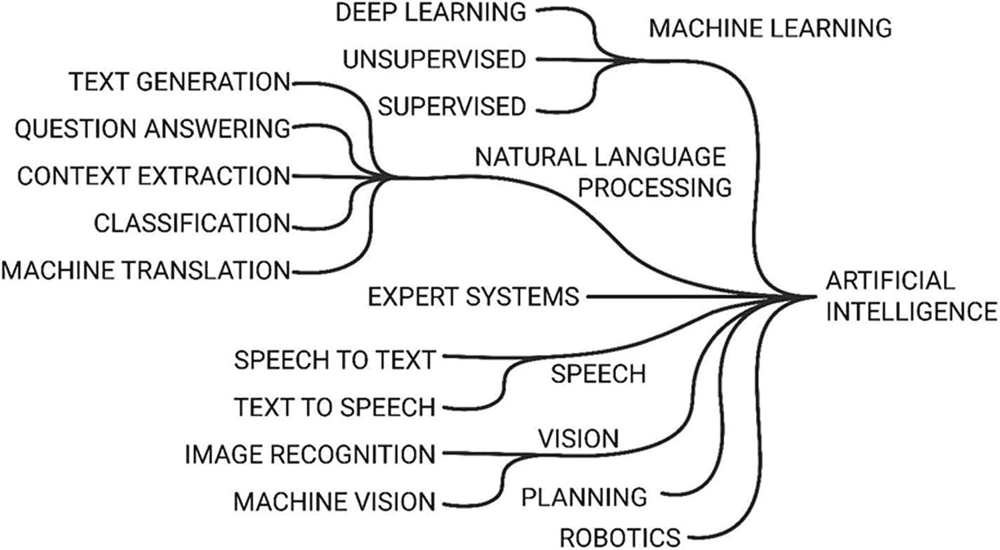
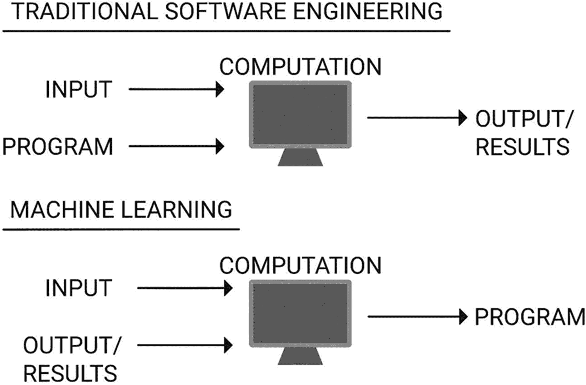
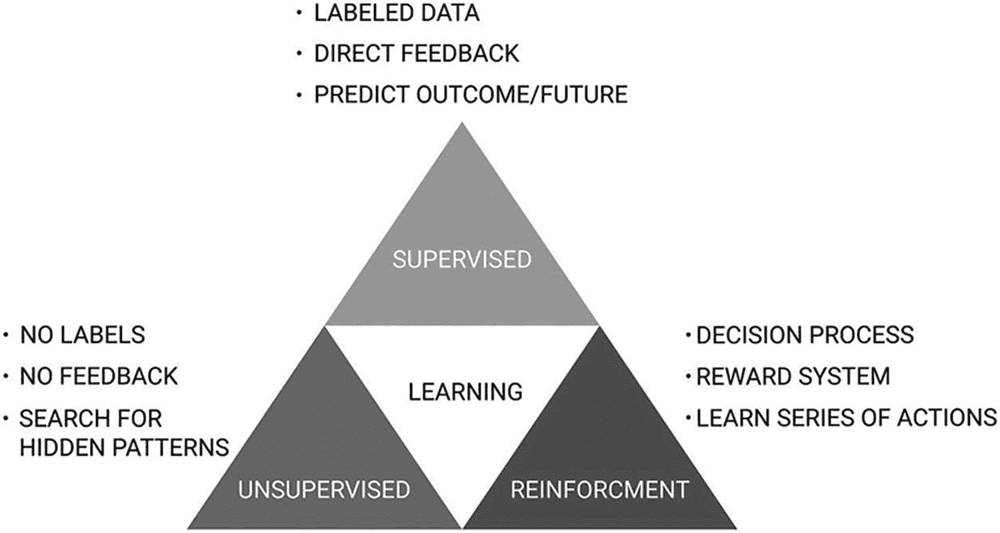
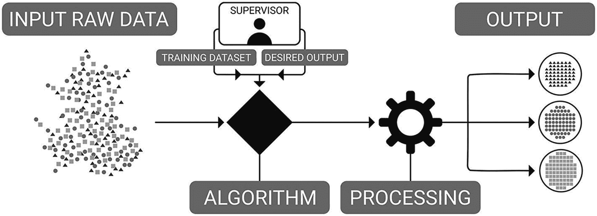
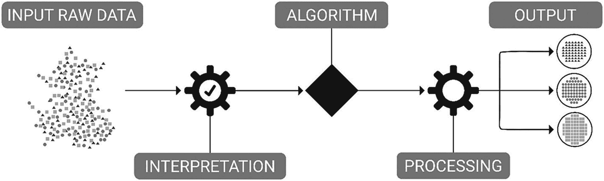
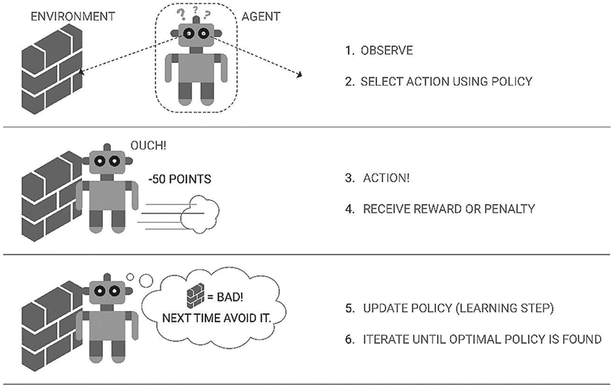
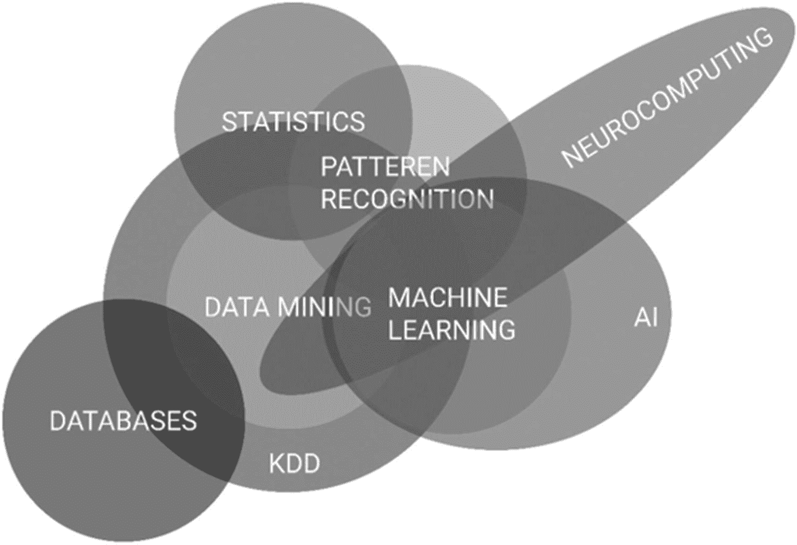
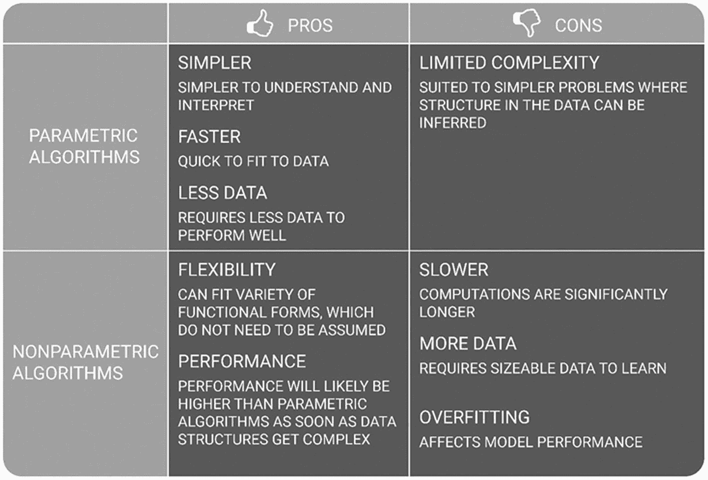

# 3. 什么是机器学习？

> *傻瓜也能知道，关键在于理解。*
> ——阿尔伯特·爱因斯坦

机器学习先驱亚瑟·塞缪尔于 1956 年推出了第一个跳棋程序，展示了人工“智能”的能力[68]。
自那时起，不仅人工智能的应用得到了发展，如今数据的产生速度、体量和多样性也前所未有。塞缪尔的软件运行在 IBM 701 上，那是一台双人床大小的计算机。当时的数据通常是离散的。
近 70 年后，数据无处不在，计算机变得更加强大，以至于 100 台 IBM 701 可以握在我们的手掌之中。这促进了人工智能领域中机器学习和深度学习的发展（见图 3-1）。

图 3-1
人工智能的组成部分

我们在日常生活中都能看到并接触到“人工”智能（无论其是通过机器学习还是其他方式开发的）：比如叫 Uber、在数字菜单上点餐、寻找 Airbnb、在 eBay 上搜索、向 Alexa 提问、刷 Facebook 以及参与数字疗法。
关于人工智能驱动的数字疗法应用的案例研究，将在第 10 章中进一步详述。
人类所能开发的人工智能，其想象力仅受限于人类自身。新颖创新的设备越来越多地连接到云端，增加了医疗保健领域的机遇。
作为一个拥有海量数据的行业，人工智能正将焦点转向机器学习和深度学习的力量，即机器可以自我学习——这正在加速当前人工智能领域的突破性进展。
如果说塞缪尔的跳棋程序展示了简单的人工智能，那么机器学习的最佳体现则是 AlphaGo Zero，它通过与自己下棋学会了玩跳棋，超越了人类水平，并以 100 比 0 的战绩击败了上一版本的 AlphaGo[69]。
机器学习系统在医疗保健领域并不罕见。德克萨斯州休斯顿卫理公会研究所的研究人员开发了一种智能体，其审查和翻译乳房 X 光照片的速度比人类医生快 30 倍，准确率高达 99%[70]。
根据美国癌症协会的数据，每年进行的 1210 万次乳房 X 光检查中，有 50%会产生假阳性结果，这意味着健康的女性被告知患有癌症[70]。该软件可以被理解为一个自主实体，它从数百万份乳房 X 光记录中学习，从而降低了假阳性的风险。
关于人工智能和机器学习领域有许多书籍和资源。尽管这是一个需要扎实数学基础的学科，但本书旨在为有辨别力的读者介绍该主题，而不会深入探讨线性代数、概率论和统计学的细节。
本章将涵盖机器学习中的许多主题，从人工智能基础知识和术语的介绍开始，然后过渡到各种形式的学习和数据挖掘。
算法将在下一章中介绍。

## 基础知识

在深入探讨人工智能和机器学习之前，了解几个关键定义是很有用的。以下是一些有用术语的简要指南，本书末尾附有更详细的词汇表。

### 智能体

智能体是指任何可以通过传感器感知其环境，并通过效应器对环境采取行动的事物。这采用了罗素和诺维格对智能体的定义。因此，这包括机器人、人类和软件程序。
智能体有许多不同类型，可以根据其特征进行分类。《人工智能：一种现代方法》（AIMA）是由人工智能专家斯图尔特·J·罗素和彼得·诺维格撰写的一本综合性人工智能教科书[71]。
智能体应该如何行动？理性智能体是指做正确事情的智能体。这可以通过一个数学度量或对智能体性能的评估来表示，智能体可以寻求最大化该度量。
智能体可以被理解为感知序列与行动之间的映射。例如，一个医疗诊断系统可能将医院中的患者视为其环境：感知症状、检查结果和患者的回答。然后，它可能通过提问、测试和治疗来对这些信息采取行动，目标是让患者恢复健康。
智能体的定义适用于软件程序或算法。

### 自主性

在人工智能中，自主性指的是智能体的行为由其自身经验决定的程度。
如果没有自主性，所有决策都基于静态数据集或知识库。在完全自主的情况下，智能体会随机做出决策。智能体具有随着时间的推移变得更加自主的明确能力。
软件，就像人类一样，可以随着时间的推移从经验中学习。系统可以从其环境中的经验（最基本的是从一些新数据中“学习”）中学习，从而在其环境中变得更加自主。

### 接口

接口智能体是指为复杂系统提供接口的智能体。

### 性能

性能是用于评估智能体在环境中行为的度量。它回答了这个问题：“智能体在环境中是否做了它应该做的事情？”

### 目标

目标指的是智能体试图实现的目标。在机器学习领域，目标不是让智能体“学习”。相反，这指的是总体目标或目的。
目标可以分解为更小的任务。例如，为了实现剖腹产的目标，任务可能包括切开腹部、取出婴儿、检查婴儿是否健康以及重新缝合腹部。

### 效用

效用指的是智能体自身的内部性能评估——即智能体在任意给定状态下对自身性能的度量。这可能与智能体的实际表现有所不同。值得注意的是，效用函数不一定等同于性能度量，尽管两者可以相同。
智能体可能没有明确的效用函数，而性能度量则始终存在。效用函数用于将状态映射为一个实数，该实数描述了与目标或目的相关的幸福程度或进展程度。
这使得在存在多条路径通向同一目标的情况下能够做出理性决策，从而让智能体能够区分出更优的路径。

### 知识

知识是智能体通过其传感器或对环境的知识所获取的。
知识可用于决定如何行动；如果被存储，它可以用来保存先前的知识状态（换言之，即历史记录）；它还可以用来确定行动如何影响环境。
机器学习是数据驱动的。因此，无处不在的数据和普适计算的兴起，对于开发具有实际应用价值的系统而言意义非凡。

### 环境

环境是智能体所处的世界状态。根据罗素和诺维格的引导，环境具有若干特征。

#### 可访问性

这指的是智能体能够访问环境的程度。在信息缺失的情况下，智能体可能需要做出有依据的猜测才能理性行动。

#### 确定性

环境可以是确定性的或非确定性的。确定性环境是指世界的确切状态可以被理解的环境。在这种情况下，效用函数可以了解自身的性能。在非确定性环境中，世界的确切状态无法确定，这使得效用函数需要依赖最佳猜测决策。

#### 片段性

片段式环境是指智能体当前的行动选择不依赖于其过去的行动。非片段式环境则要求智能体为其当前行动的效果进行规划。

#### 环境类型

静态环境是指智能体在做决策时环境不会发生变化。动态环境则可能在处理过程中发生变化，因此智能体可能需要向环境反馈信息，或在输入与输出之间预测变化。

#### 数据流向环境

智能体设计的一个关键方面是数据如何被接收。例如，在国际象棋游戏中，智能体只能选择有限数量的走法。这是一个离散环境，因为可执行的走法数量是有限的。另一方面，例如在手术台上，情况可能在最后一毫秒发生变化。连续数据环境是指数据看似无限或没有穷尽的环境。
智能体从根本上说，是能够展现学习、自主性、适应性、推理能力以及一定程度的独创性等特征的实体。
要实现这一点，智能体必须能够通过搜索、规划、适应环境变化以及从过往经验的反馈中，自主地确定行动序列。在机器学习领域，还有进一步的术语。

### 训练数据

训练数据是学习算法将用来学习可能假设的数据。一个样本是包含其目标函数输出的`x`的一个实例。

### 目标函数

这是从`x`到`f(x)`的映射函数`f`。

### 假设

这是对`f`的近似。在数据科学中，机器学习模型近似一个目标函数，用于将输入`x`映射到输出`y`。

### 学习器

学习器是创建分类器的学习算法或过程。

### 验证

验证包括机器学习开发中使用的各种方法，这些方法提供了评估模型性能的手段。

### 数据集

数据集是样本的集合。

### 特征

特征是一个数据属性及其值。例如，肤色是棕色是一个特征，其中`肤色`是属性，`棕色`是值。

### 特征选择

这是选择解释统计模型输出所需的特征，同时排除无关特征的过程。

## 什么是机器学习？

机器学习是人工智能的一个子集，其中计算机模型被训练来随着时间的推移从自身行动和环境中学习，以期表现得更好。
1959 年，跳棋程序的创造者阿瑟·塞缪尔将机器学习定义为“一个赋予计算机无需明确编程就能学习的能力的研究领域”[72]。
机器学习源于模式识别以及计算机无需被编程执行特定任务就能学习的理论——即系统无需被明确编程就能学习。因此，学习是由数据驱动的——智能是通过基于学习信号或反馈的性质做出有效决策的能力而获得的。这些决策的效用会根据目标进行评估。
机器学习专注于开发能够适应新数据呈现和发现的算法。机器学习体现了数据挖掘的原则，但也能够推断相关性并从中学习，以应用于新算法。其目标是模仿人类通过经验学习的能力，并在没有或仅有最少外部（人类）协助的情况下完成指定任务。
就像人类的学习一样，机器学习由多种方法组成。在最基本的层面上，首先是记忆。其次，我们通过提取信息（通过阅读、倾听、学习新事物）来学习。第三，我们通过示例来学习。
例如，如果我们被教授平方数，并且向学生展示一组数字`Y = {1, 4, 9, 16, …}`，并告诉他们`Y = n*n`，他们通常就能理解平方数的概念，而无需被明确教授每一个平方数。

## 机器学习与传统软件工程有何不同？

传统软件工程与机器学习都旨在解决一个或一组问题。两者之间的区别在于解决问题的方法。

传统软件工程或编程，指的是将某项任务计算机化或自动化的过程，即编写一个函数或程序，给定输入，就能提供输出。换句话说，就是编写一个函数`f`，使得给定输入`x`时，输出`y = f(x)`。

这通常通过逻辑来实现，例如`if-else`语句、`while`循环和布尔运算符。

机器学习与传统编程的不同之处在于，它不是提供关于函数`f`的指令，而是向计算机提供输入`x`和输出`y`，并期望其确定或预测函数`f`（见图3-2）。

图 3-2 机器学习的工作原理

传统程序由人类编写以解决问题，而机器学习程序则通过推理，从示例、规则和信息中学习来解决问题。机器学习中的许多分类器有助于进行预测。

机器学习程序还能学会泛化，并借助基于统计和概率驱动的技术来处理不确定性问题。模型可以从先前的计算或经验中学习，从而产生可靠、可重复的决策和结果。

数据的可用性、互联网上的信息，以及正在产生、存储并可供分析的数字数据量的飞跃，使得工程师能够实现让机器了解我们的偏好，并根据我们的需求进行个性化定制。

只要你留心观察，机器学习无处不在——在网页搜索排名、药物设计、偏好个性化与社交网络推送、音乐推荐、物流、网页设计、自动驾驶汽车、冰箱、洗衣机、电视以及虚拟助手中都能看到它的身影。

## 机器学习基础

机器学习算法的任务大致可分为以下几类（见图3-3）：

图 3-3 学习方法

*   监督学习（也称为归纳学习）
*   无监督学习
*   半监督学习
*   强化学习

### 监督学习

在监督学习中，算法会接收到示例输入及其对应的期望输出（以训练数据的形式），其目标是学习将输入映射到输出的一般规则（见图3-4）。输入数据被称为训练数据，并且关联着已知的输出（结果）。

图 3-4 监督学习：工作原理

训练数据指导着算法的开发。通过一个训练过程来创建模型，在此过程中，模型进行预测，并在预测错误时得到纠正。

训练会持续进行，直到模型在训练数据上达到所需的准确度水平。监督算法包括逻辑回归。监督式机器学习算法可以利用带标签的数据示例，将过去学到的知识应用于新数据，以预测未来事件。

学习算法还可以将输出与正确输出进行比较，以发现任何错误，并相应地修改模型。

监督学习问题可以应用于以下几种形式。

#### 分类

这是基于训练数据集来预测结果，其中输出变量以不同类别的形式呈现。通过输入预先标记好的训练数据来构建模型。

分类技术定义了决策边界，包括：

*   支持向量机
*   朴素贝叶斯
*   高斯贝叶斯
*   k-近邻算法
*   逻辑回归

分类的一个例子是根据一组症状，将某人标记为（或在现实应用中，诊断为）生病或不健康。

#### 回归

回归与分类非常相似。分类和回归之间的唯一区别在于，回归是针对给定样本的输出结果，其中输出变量以实数值的形式呈现（例如，温度是一个数值，而不是“热”或“冷”的分类）。

例子包括身高、体温和体重。线性回归、多项式回归、支持向量机、集成方法、决策树和神经网络都是回归模型的例子。

#### 预测

这是一种基于过去和当前数据进行预测的方法。这也被称为时间序列预测。集成学习是一种监督学习类型，它结合多个不同的机器学习模型来预测新样本的结果。在集成学习中，模型本身成为了特征。

### 无监督学习

当人们提到能够自主学习的系统时，实际上指的是无监督学习（见图3-5）。在无监督学习中，学习算法不会收到数据的标签，而是由算法自行从输入中寻找结构。

图 3-5 无监督学习：工作原理

由于数据未标记，因此无法评估算法输出结构的准确性。

数据可能同时缺少分类和标签。因此，模型是通过解释来开发的：通过寻找输入数据中的隐藏结构和推断。这可以通过提取规则、减少数据冗余或组织数据的结果来实现。

这包括聚类、降维和关联规则学习。算法可能永远找不到正确的输出，而是对数据的底层结构进行建模。

以下定义了三种类型的无监督学习问题。

#### 关联

关联是发现集合中项目共现的概率。这在市场营销和医疗保健领域被广泛用于辅助决策。

例如，这表示如果被诊断为肥胖，则患任何形式癌症的可能性百分比。关联类似于分类；然而，在关联中可以预测任何属性，而分类是二元的。

#### 聚类

聚类是指将项目分组，使得同一聚类中的项目彼此之间的相似度高于与另一聚类中项目的相似度。

#### 降维

降维可以通过特征选择和特征提取来实现。降维可以在数学上重新表示或转换数据。

##### 特征提取

特征执行从高维空间到低维空间的数据转换。这可以包括减少数据集的变量，同时保持数据完整性并确保最重要的信息得到表示。

特征提取方法可用于降维。通常，会从原始特征集中创建一组新的特征。一个例子是将患者的所有临床测试结果组合成一个健康风险评分，该评分基于被证明会影响死亡率的测试结果。

减少维度数量有助于更轻松地可视化，尤其是在二维或三维空间中，同时还能减少存储所需的时间和空间。算法包括：

*   Apriori 算法
*   FP 增长（也称为频繁模式增长）
*   隐马尔可夫模型
*   主成分分析（PCA）
*   奇异值分解（SVD）
*   k-Means
*   神经网络
*   深度学习

深度学习利用深度神经网络架构，这是一种机器学习算法。

### 半监督学习

半监督学习是一种混合方法，其中输入数据包含标记和未标记数据的混合。尽管可能存在期望的结果，但模型也会学习组织数据和进行预测的结构。示例问题包括分类和回归。

### 强化学习

这是系统与动态环境交互的地方，其中智能体必须执行特定目标。强化学习是机器学习、行为心理学、伦理学和信息论之间的交叉点。

算法在解决问题时会收到关于奖励和惩罚的反馈。强化学习允许智能体根据其当前状态以及通过学习能够最大化奖励的行为来决定下一个最佳行动。最优行动（或最优策略）通常通过试错和反馈来学习。这使得算法能够在上下文中确定理想的行为。

强化学习通常用于机器人技术，例如，一个机器人吸尘器通过碰撞桌子、椅子等接收负面反馈来学习避免碰撞——尽管如今这也涉及计算机视觉技术。

强化学习与标准监督学习的不同之处在于，它从不呈现正确的示例，也从不明确纠正次优决策。其重点在于现实世界中的表现。

类似于人类的学习方式，强化学习假设了关于从自身经验中学习的理性行为，因此有助于理解人类如何从经验中学习以做出良好决策（见图3-6）。

图 3-6 强化学习：工作原理

例如，DeepMind 让他们的 AlphaGo 智能体通过展示“大量强业余棋手的棋局来帮助它发展自己对合理人类棋局的理解，从而掌握中国古代围棋游戏。然后我们让它与不同版本的自己对弈数千次，每次从错误中学习并逐步改进，直到变得极其强大”[73]。

强化学习用于自动驾驶汽车。在现实世界中，智能体需要考虑环境的各个方面，包括当前速度、道路障碍物、周围交通、道路信息和操作员控制。

智能体学会以适合环境特定状态的方式行动（或制定策略）。这引发了由人工智能和机器学习带来的、针对具有奖励驱动编程的智能体的新伦理困境。

### 数据挖掘

数据挖掘，又称数据库知识发现，被定义为使用复杂算法探索数据以提取新信息（包括模式和关系）的过程。这可以应用于生活和工业的方方面面，并实现以下功能：

*   基于趋势和行为的模式预测
*   基于可能结果的预测
*   大型数据集（尤其是非结构化数据）的分析
*   通过识别先前未知的事实进行聚类

数据挖掘利用机器学习、统计学和数据库技术的力量，是分析工作的核心（见图3-7）。数据挖掘通常使用大量数据，也能提供更简单的描述性分析。例如，在医疗保健领域，数据挖掘应用可用于识别经常同时出现的病症或医疗程序。

图 3-7 数据挖掘及其更广泛的协同作用

数据挖掘最常见于对用户、客户或患者反馈的日常情感分析。

数据挖掘还能通过识别数据内部的关系来进行预测。这可以帮助保险公司检测出有风险的客户行为模式。

机器学习可用于数据挖掘。数据挖掘将为决策提供信息，例如哪种学习模型最适合解决当前问题。然而，数据挖掘所涵盖的技术并不仅限于机器学习中的那些。在数据挖掘中，任务是发现未知知识，而机器学习的性能则是根据再现已知知识来评估的。

例如，如果你有一个患者血压的数据集，你可以进行异常检测，这被视为一项数据挖掘任务，用于识别先前未知的异常值。该任务可能会利用机器学习技术，也许是用于聚类分析的`k-means`算法，来识别异常数据并辅助算法的学习。

数据挖掘与自然语言处理（NLP）不同。NLP可能是数据挖掘中使用的一种技术，用于帮助智能体理解或“阅读”文本。数据挖掘算法包括：

*   `C4.5`

*   `k-Means`

*   `支持向量机`

*   `Apriori`

*   `EM（期望最大化）`

*   `PageRank`

*   `AdaBoost`

*   `kNN`

*   `朴素贝叶斯`

*   `CART（分类与回归树）`

### 参数化算法与非参数化算法

算法在形式上可以是参数化的或非参数化的。可以简化为已知有限形式的算法被称为参数化算法，而非参数化算法则从训练数据中学习函数形式。

换句话说，对于非参数化算法，模型的复杂度会随着训练数据量的增加而增加。对于参数化模型，存在固定的结构或参数集，这使得参数化模型比非参数化模型更快。

如果非参数化模型在训练数据和训练时间方面获得了足够的训练资源，它们可以提供更好的准确性（见图3-8）。

**图 3-8** 参数化算法与非参数化算法

#### 何时使用参数化算法与非参数化算法

参数化算法将函数简化为已知形式，并从训练数据中学习函数系数。因此，它们对数据做出了很强的假设。参数化算法的优势在于它们能快速从数据中学习，且不需要大量数据，可用于需要易于解释结果的场景。

非参数化算法使用数量可变的参数。`k-近邻`、神经网络和决策树都是非参数化算法，适用于数据量更大且对性能要求更高的场景。

## 机器学习算法如何工作

监督学习是从带标签的训练数据中推断函数的计算机化任务。

*   `Y = f(x)`，

可以理解为：

*   输出 = 函数(输入)。

输入和输出可被称为变量，通常采用向量格式：`f`指的是你试图从输入中推断出的函数。

以一位即将接受特定治疗的患者为例。在现实生活中，这个过程可能包括患者查看描述他们所推荐的药物或治疗特性的研究。

例如，如果他们看到研究主要由“好”、“棒”、“安全”等词语组成，那么我们会从情感分析中得出结论：该治疗是好的治疗，我们可以放心地接受它。而如果像“差”、“质量不好”、“不安全”这样的词语经常出现，那么我们会得出结论：最好寻找另一种治疗方法。这项研究帮助我们根据治疗研究中存在的词语模式来执行行动。

机器学习试图通过算法来理解这种人类决策过程。它专注于开发能够访问数据并利用数据自我学习的算法（或程序）。机器学习非常擅长分类和预测任务。

机器学习最常用于预测分析——学习`Y = f(X)`的映射关系，以便对新的`X`值预测`Y`值。

机器学习的实际例子如下：

*   **欺诈检测**：`x`是交易的属性，`f(x)`是交易是否存在欺诈。

*   **疾病诊断**：`x`是患者的属性，`f(x)`是患者是否患有疾病。

*   **语音识别**：`x`是语音输入的属性，`f(x)`是对语音输入中包含的指令所给出的响应。

机器学习的过程始于以示例、直接经验或指令形式提供的输入数据——目的是识别数据中的模式，并根据所提供的数据在未来做出更好的决策。

其目标是使程序能够在没有人工干预或协助的情况下自动学习，并相应地调整理性行动。

## 结论

读者应了解机器学习和数据挖掘、执行学习任务的方法以及使用这些技术时的关键考量。最重要的是，本章涵盖了机器学习算法的工作原理。

下一章将利用这些基础知识，重点讨论算法的选择与设计、模型考量以及最佳实践。