# 4. 机器学习算法

> *大自然并不觉得有必要遵循数学上精确的算法；事实上，大自然可能根本无法遵循算法。*
> 
> —玛格丽特·韦特海姆

你不需要代数和统计学背景就能开始学习机器学习。前一章介绍了关键的 foundational 原则。但不要抱有幻想；数学是机器学习中极其重要的一部分。数学是理解算法如何运作的关键，也是从头开始编写机器学习项目是提升你数学和统计技能绝佳途径的原因。

不理解算法背后的基本原理，可能会导致对方法的理解有限，或对算法采取狭隘的解释。至少，理解算法所基于的数学原理是有用的，从而能更好地理解哪些机器学习技术最为合适。

公共领域中有数量庞大的机器学习算法。许多算法都是几个主要主题的变体（通常速度更快或计算成本更低）。学习器是任何机器学习算法的核心，它试图在训练和测试数据上最小化一个成本函数——也称为误差函数或损失函数。

你的许多机器学习项目将使用来自流行库（如 numpy、pandas、Matplotlib、SciPy、scikit-learn、scrapy、NLTK（自然语言工具包）等）的既定方法。

最常见的机器学习任务是分类、回归和聚类。

有几种算法可用于离散预测函数，例如 k-近邻、支持向量机、决策树、贝叶斯网络和线性判别分析。

本章对机器学习算法进行了全面分析，包括相关的编程库以及这些技术在现实世界中的应用示例。

## 定义你的机器学习项目

汤姆·米切尔对机器学习给出了一个简洁的定义：“如果一个计算机程序在任务 T 上的性能（由 P 衡量）随着经验 E 的增加而提高，那么可以说该程序从关于某类任务 T 和性能度量 P 的经验 E 中学习” [75]。

这个定义可用于辅助机器学习项目，帮助我们清晰地思考需要收集和利用哪些数据（E）、手头的任务是什么（T），以及我们将如何评估结果（P）。

### 任务 (T)

任务指的是我们希望机器学习模型做什么。模型学习到的函数就是任务。这并非指实际学习的过程，而是指手头的任务。例如，一个机器人吸尘器的任务可能是清洁某个表面。通常，一个任务会被分解成更小的子任务。

### 性能 (P)

性能是对机器学习模型能力的一种量化度量。性能通过成本函数来衡量，该函数通常计算模型在任务上的准确率。

性能可以通过错误率来衡量，错误率是模型给出错误输出的样本比例。学习方法旨在最小化错误率，理想情况下避免陷入局部最小值或最大值。

### 经验 (E)

经验指的是可用的标记数据量，以及机器学习模型所需的监督程度。

米切尔的定义在定义机器学习项目时被证明非常有用。这个定义有助于理解需要收集的数据（E），这些数据会发展成知识库；需要决策的手头问题（T）；以及如何评估输出（P）。

例如，一个预测算法可能被分配任务 T，即根据过去医院入院记录及其各自日期和时间的经验数据 E，来预测急诊入院高峰。性能度量 P 可以是预测的准确率；随着模型获得更多经验数据，其预测能力理想情况下会变得更好。值得注意的是，单一标准并不一定能决定性能。

除了预测的准确率之外，一个高峰入院预测方法还可以通过预测那些成本最高或资源最密集的高峰期来提供额外信息。表 4-1 给出了任务和将创建的经验以及性能指标的示例。

表 4-1

通过其组成部分理解学习问题

| 问题 | 任务 | 性能 | 经验 |
| --- | --- | --- | --- |
| **学习如何进行外科缝合** | 缝合患者头部 | 准确率（感知到的疼痛和/或时间可能是一个特征） | 缝合患者头部及对性能指标的反馈 |
| **图像识别** | 从图像中识别一个人的体重 | 体重预测的准确率 | 包含人物图像及其各自体重的训练数据集 |
| **用于患者药物配送的机械臂** | 将正确的药物放入正确的患者药包中 | 正确放置药物的百分比 | 训练示例，真实经验 |
| **预测疾病风险** | 诊断患 2 型糖尿病的可能性 | 正确诊断患者的百分比 | 患者健康记录的训练数据集，预测和反馈的真实经验 |

机器学习用于回答诸如“我是否可能患有 2 型糖尿病？”、“这张图片中的物体是什么？”、“我能避开交通拥堵吗？”以及“这个推荐适合我吗？”等问题。

机器学习在这些问题领域中都得到了很好的应用，然而现实世界问题的复杂性意味着，目前不可能有一个专门的算法能在每种情况下、为每个人、每次都完美无瑕地工作——无论是在医疗保健还是任何其他行业。

数学中一个常见的格言来自英国统计学家乔治·博克斯：“所有模型都是错的，但有些是有用的。”机器学习的目的不是做出完美的猜测，因为根本不存在理想的模型。相反，机器学习建立在统计学基础之上，以提供有用、准确的预测，这些预测可以推广到现实世界。

在训练机器学习算法时，训练数据集必须是一个统计上显著的随机样本。如果不是这样，就存在发现不存在的模式（即噪声）的风险。对训练数据的记忆被称为过拟合。模型记住了训练数据，在训练中表现良好，但在面对未知数据时则表现不佳。同样，如果训练数据太少，模型可能会做出不准确的预测。

机器学习的目标，无论是有监督还是无监督，都是泛化——即基于过去经验表现良好的能力。


## 机器学习的常用库

Python 在数据科学和机器学习行业中日益流行。所有库都在 GitHub 上开源，这也提供了衡量其流行度和稳健性的指标：

*   GitHub 是一项基于 Git 版本控制系统的服务。Git 存储数据的方式是流式的。Git 会为你的文件拍摄快照，并存储对这些快照的引用。Git 有三种状态：已提交、已修改和已暂存，它们分别指代数据存储在本地文件系统中、本地文件发生更改以及标记为待提交的文件。使用元数据的好处在使用 GitHub 时显而易见。

*   Numerical Python，即 numpy，是一个重要的 Python 扩展库。它提供了快速的 N 维数组对象，用于向量运算、数学函数、线性代数和随机数生成。如果没有这个库，基本的数组运算性能会明显变慢。

*   SciPy 是一个基于 numpy 构建的科学处理库。它支持线性代数例程，以及信号和图像处理、常微分方程方法和特殊函数。

*   Matplotlib 是一个提供类似数据绘图和可视化技术的 Python 库。Matlab 是用于数据处理的标准工具。然而，Matplotlib 的简洁性和实用性帮助 Python 成为了 Matlab 的可行替代方案。

*   Pandas 是一个用于数据聚合、数据操作和数据可视化的工具。在 pandas 中，一维数组被称为序列，多维数组则被称为数据框。

*   Scikit-learn 包含图像处理和机器学习技术。该库基于 SciPy 构建，支持聚类、分类和回归算法。这包括本章讨论的许多算法，例如朴素贝叶斯、决策树、随机森林、k-means 和支持向量机。

*   NLTK，即自然语言工具包，是一个用于自然语言处理的库集合。NLTK 为专家系统提供了基础，例如分词、词干提取、词性标注、句法分析和分类——这些对于情感分析和文本摘要至关重要。

*   Genism 是一个用于处理非结构化文本的库。

*   Scrapy 是一个最初为抓取网站而设计的开源数据挖掘和统计工具。

*   TensorFlow 是一个由 Google Alphabet 支持的开源数据计算库，针对机器学习进行了优化。它支持多层神经网络和快速训练。TensorFlow 被用于谷歌的许多智能平台。

*   Keras 是一个基于 TensorFlow 构建的用于构建神经网络的库。

## 监督学习算法

在许多监督学习场景中，目标是微调一个预测函数 f(x)，即假设。学习过程包括使用数学算法在特定领域内表示输入数据 x。例如，x 可以取一天中的时间值，而 f(x) 可以是对某家医院等待时间的预测。

实际上，x 通常代表多个数据点。因此，输入被表示为一个向量。

例如，在前面的例子中，f(x) 将输入 x 作为一周中的时间。为了改进预测器，我们可以不仅使用日期 (x[1])，还可以使用一天中的时间 (x[2])、天气 (x[3])、队列中的位置 (x[4]) 等等——前提是这些数据可用。决定使用哪些输入是机器学习设计过程中不可或缺的一部分。

数据集中的每条记录 i 都是一个特征向量 x(i)。在监督学习的情况下，每个实例还会有一个目标标签 y(i)。模型以 (x(i), y(i)) 的形式输入进行训练。训练数据集可以表示为 {(x(i), y(i)); i = 1, … , N}，其中 x 代表输入，y 代表输出。

该模型具有简单的形式：

*   f(x) = ax + b，其中 a 和 b 是常数，b 指代数据中的噪声。

机器学习旨在找到 a 和 b 的最优值，使得预测 f(x) 尽可能准确。学习方法是归纳式的。模型遍历训练数据集以学习数据中的模式。模型从一组示例中归纳出一个模式或假设。机器学习预测模型的输出与函数的实际值存在差异，这是由于偏差、噪声和方差造成的，如第 3 章所述。

f(x) 的优化通过训练示例进行。每个训练示例 {x[1] … x[n]} 都有一个输入值 x_training 和一个对应的输出 Y。

处理每个示例，并计算已知正确值 y（其中 y ∈ Y）与预测值 f(h_training) 之间的差异。在处理完训练数据集中适当数量的样本后，计算 f(x) 的错误率，并使用 a 和 b 的值作为因子来提高预测的正确性。

这也解决了数据中固有的随机性或噪声，也称为不可约误差。

### 选择合适的特征

在特征选择方面，有两种不同的主要方法。第一种是基于数据一般特征的独立评估。属于这种方法的方法称为过滤方法，因为在模型构建之前，特征集就被过滤掉了。

第二种方法是使用机器学习算法来评估不同的特征子集，并最终选择在分类准确性上表现最好的那个。最终将使用后一种算法来构建预测模型。这类方法称为包装方法，因为生成的算法包装了整个特征选择过程。

大数定律适用于机器学习预测。该定理描述了大量相同实验的结果最终会收敛或趋于平均。

这个过程会迭代，直到系统收敛到 a 和 b 的最佳值。这样，机器通过经验学习，并准备好进行部署。通常，我们关注的是最小化模型的误差，或做出尽可能准确的预测。

在监督机器学习中，有两种主要方法：基于回归的系统和基于分类的系统。

### 分类

分类是通过逼近一个映射函数 f，从一组离散的预定义类别（或标签 y）中确定一个项目（或多个项目 x）所属类别的过程。分类算法使用特征（或属性）来确定如何将项目分类到至少一个二元类或两个及以上的类中。

训练数据以输入向量的形式提供。输入向量由项目特征的标签组成。例如，一个项目可能如下所示：

```
{"HbA1c, 7.8%", "Diabetic"} 形式为 {x_training, output}
```

分类算法正是从这些数据中学习如何分类。分类问题需要对示例进行标记以确定模式；因此，模型分类准确性的最佳验证方式是通过所有预测中正确分类的示例数量。

执行分类的算法包括决策树、朴素贝叶斯、逻辑回归、kNN（k-最近邻）、支持向量机等。

分类算法的常见用例包括：

*   根据健康档案建议患者诊断——即，患者是否患有视网膜病变？
*   为患者推荐最合适的治疗方案
*   确定诊所一天中就诊高峰的时段
*   确定患者再次入院的风险
*   对图像进行分类以识别疾病——例如，根据照片判断患者是否超重


### 回归

回归涉及预测一个连续变量的输出。由于基于回归的系统预测的是一个数值，因此性能通过评估预测误差的数量来衡量。

决定系数、平均绝对误差、相对绝对误差和均方根误差是用于评估回归模型的统计方法。

回归算法包括线性回归、回归树、支持向量机、K 近邻和感知机。

通常可以在分类和回归问题之间进行转换。例如，患者的 HbA1c 值如果以连续数值形式存储，也同样有用。一个连续的 HbA1c 值（如 6.9%）可以根据基于 HbA1c 定义的规则分类为离散类别：糖尿病（集合 1，HbA1c ≥ 6.5%）和非糖尿病（集合 2，HbA1c < 6.5%）。

时间序列是指按时间顺序提供的输入数据。数据的顺序性增加了一个信息维度。时间序列回归问题非常常见。

回归算法的常见用例包括：

*   根据既往血糖读数估算患者 HbA1c（时间序列预测）
*   预测患者再次入院前的天数（可视为时间序列回归问题）
*   基于临床数据估算患者死亡风险
*   预测出现健康并发症的风险
*   预测办公室打印机何时会因其他员工的请求而排队

## 决策树

决策树是流程图，将决策过程表示为执行分类的规则。决策树从根节点开始，包含代表特征的内部节点和代表结果的分支。因此，决策树是分类问题的一种表示形式。

决策树可以被利用来使其更易于理解。每个决策树都是蕴含式（即 if-then 语句）的析取，而这些蕴含式是对于逻辑编程非常有用的霍恩子句。霍恩子句是文字的析取。

假设数据中没有不一致形式的错误，我们总是可以为训练数据集构建一个 100%准确率的决策树。然而，这在现实世界中可能无法实现，并且可能表明过拟合，我们将在后面讨论。

例如，以表 4-2 中的简化数据集为例，它可以表示为图 4-1 所示的决策树。

表 4-2

2 型糖尿病风险

| 记录 | 不健康 | BMI | 种族 | 结果 |
| --- | --- | --- | --- | --- |
| **人员 1** | 是 | >25 | 印度裔 | *高风险* |
| **人员 2** | 是 | <25 | 印度裔 | *低风险* |
| **人员 3** | 是 | >25 | 白种人 | *高风险* |
| **人员 4** | 否 | <25 | 白种人 | *低风险* |
| **人员 5** | 否 | >25 | 华裔 | *中风险* |

对样本进行分类涉及将数据经过一系列有组织的测试以确定标签。树的构建和测试自上而下进行，如下所示：

1.  从模型的根节点开始。
2.  等待直到所有样本都属于同一类别。
3.  测试特征以基于成本函数确定最佳分割点。
4.  沿着分支值到达结果。
5.  重复步骤 2。
6.  输出叶节点。

决策树学习的核心问题是将哪些节点放置在哪些位置，包括根节点和决策节点。

主要有三种决策树算法。每种算法的区别在于选择节点或特征时所使用的度量或成本函数不同。根节点是顶部的节点。树被分割成多个分支，通过成本函数进行评估；不再分割的分支是终端节点、决策节点或叶节点。

决策树的有用之处在于，获取的知识可以以易于阅读和理解的格式表达（见图 4-1）。它模仿了人类的决策过程，其中由特征重要性、关系和决策决定的优先级是清晰的。它很简单，因为结果可以表示为一组规则。

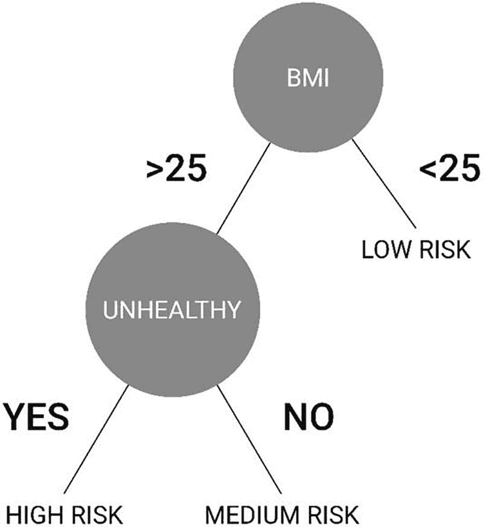

图 4-1

n = 2 个节点的决策树

决策树在表示大数据集和优先考虑最具区分度的特征方面具有优势。如果未设置决策树深度，它最终会学习所呈现的数据并导致过拟合。建议为决策树建模设置较小的深度。或者，可以对决策树进行剪枝，通常从最不重要的特征开始，或者结合使用降维技术。

过拟合是机器学习中常见的障碍，并且不仅限于决策树。所有算法都存在过拟合的风险，并且有多种技术可以克服这个问题。随机森林或丛林决策树在这方面非常有用。

剪枝通过移除提供信息最少的特征来减小决策树的大小。因此，最终的分类规则不那么复杂，并提高了预测准确性。

模型的准确性计算为测试数据集中被正确分类的样本百分比：

*   真正例/TP：实际类别为“是”，预测类别也为“是”。
*   假正例/FP：实际类别为“否”，预测类别为“是”。
*   真负例/TN：实际类别为“否”，预测类别也为“否”。
*   假负例/FN：实际类别为“是”，但预测类别为“否”。
*   准确率：(正确预测的观测数)/(总观测数) = (TP + TN)/(TP + TN + FP + FN)。
*   精确率：(正确预测的正例)/(总预测的正例) = TP/(TP + FP)。
*   召回率：(正确预测的正例)/(总正确的正例观测数) = TP/(TP + FN)。

分类是机器学习中常用的方法；而 ID3（迭代二分器 3）、C4.5（分类 4.5）和 CART（分类与回归树）是常见的决策树方法，生成的树可用于对未来的样本进行分类。


### 迭代二分器 3（ID3）

Python, scikit-learn；方法，decision-tree-id3

罗斯·昆兰对决策树学习领域做出了重大贡献，开发了 ID3 和 C4.5 [76] 算法。ID3 算法使用信息增益作为代价函数，其理论基础源于“信息论之父”克劳德·香农的研究。信息增益通过一种称为熵的度量来计算。

熵用于衡量数据集的混乱程度或不纯度。给定一个任意分类 C，其类别为 {c1, … cn}，以及一组样本 S，其中 ci 的比例为 pi，则样本 S 的熵计算如下：

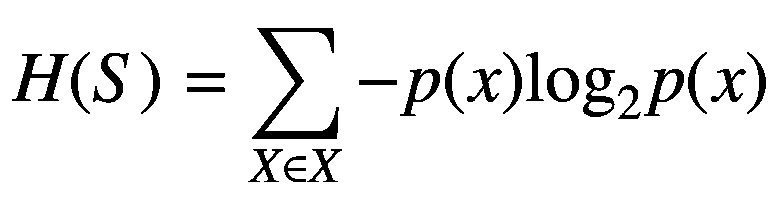

信息增益通过熵来计算。该值针对属性 A 相对于样本 S 给出。属性 A 可以取的值 {t1, … tn} 代表了集合 T 的全部。

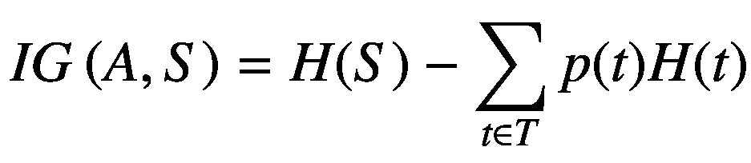

ID3 选择信息增益最高的节点来生成数据子集，然后对这些子集递归地应用 ID3 算法。一个属性的信息增益可以理解为学习属性 A 的值后所期望的熵减。当所有属性用完或决策树能完全分类所有样本时，算法终止。ID3 是一种分类算法，无法处理缺失值。

例如，如果收到以下行，模型会将结果归类为高风险。种族可能是影响结果的一个决定因素。然而，没有足够的数据让模型学习潜在的结果。

| **记录** | **不健康** | **BMI** | **种族** | **结果** |
| --- | --- | --- | --- | --- |
| **人员 5** | 否 | <25 | 华人 | ? |

### C4.5

Python, scikit-learn；方法，C45algorithm

C4.5 是建立在 ID3 基础上的增强算法，在选择属性时会考虑分支的数量和大小。C4.5 可以处理连续和离散标签，并使用增益率作为其分裂标准。随着数据集规模的增大，它在执行时间和准确性上都有所提升。

C4.5 引入了剪枝——一种也称为子树提升的自底向上技术——以及子树替换，以确保模型不会过拟合数据。

### CART

Python, scikit-learn；方法，cart

CART，全称为分类与回归树，是一种使用基尼指数作为代价函数的决策树算法。与 C4.5 一样，CART 以二叉树形式表示，可用于回归和分类问题。熵用于探索性分析，而基尼指数则用于最小化误分类。根节点代表输入变量 (x)，叶节点包含用于进行预测的输出变量 (y)。

## 集成方法

集成是一种机器学习算法形式，是机器学习领域中广泛使用的一种技术。集成方法使用一组机器学习模型或学习器。通过这种方式，一组弱学习模型被组合起来，以创建一个更精确的学习模型。

有两种类型的集成技术——装袋和提升。

### 装袋

装袋是一种集成技术，涉及使用自助采样技术（见图 4-2）从数据集中创建多个独立的模型。该技术通过减少方差来帮助降低误差。通常，由于异常行为被平均化，装袋可以改进预测。相比之下，一组迭代预测模型被称为提升。

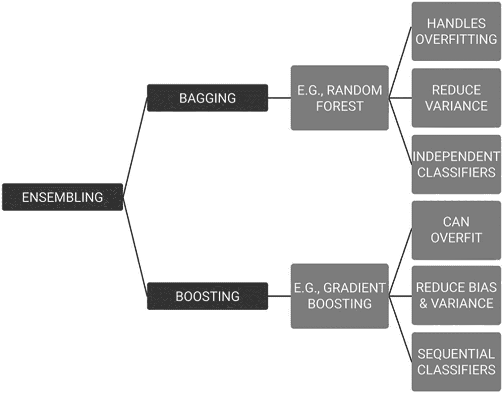

图 4-2

装袋 vs. 提升

在装袋中，从数据集 D 中有放回地抽取 n′ < n 个样本。每次都会随机选择特征来构建最佳分裂。

使用平均值、多数投票或统计方法来确定模型的平均预测。随机森林决策树（见图 4-3）扩展了装袋的概念，因为它们也使用特征的随机子集，从而减少了学习器之间预测的相关性。

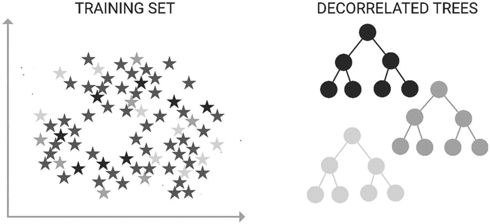

图 4-3

随机森林决策树

#### 随机森林决策树

Python, scikit-learn；方法，RandomForestClassifier

随机森林决策树是装袋的一个例子。随机森林通过同时训练多个决策树来创建，指的是一组决策树学习器的集合（因此得名“森林”）。随机森林的目的是防止过拟合。随机森林中的决策树越多，结果就越准确。

每个随机森林都会对数据集进行抽样，并随机选择特征子集进行决策。

随机森林决策树可用于分类和回归问题。对于回归问题，取结果的平均值；而对于分类问题，则取多数类别。随机森林决策树是不同模型的集成。由于该过程通过结合多个模型的预测来减少算法中的方差，因此它是一种集成方法。

当数据通过自助法局限于分类或决策问题时，随机森林模型似乎表现得特别好。随机森林分类器的一个优点是它们也能处理缺失值。


### 提升法

提升法是一种集成方法，通过迭代方式生成一系列预测模型。其核心理念是让每个新模型从先前模型的错误中学习。

当有大量数据可用于预测时，通常会采用提升方法。

通过迭代创建新模型来补偿误差，这一过程“提升”了模型性能，将弱学习器转化为强学习器——从而降低其偏差和方差。该技术的每次迭代都会学习数据中的关系，随后分析误差，并对错误分类赋予权重。其目标是最大限度地减少前一个模型的误差。用于提升算法的底层机器学习方法可以是任何算法。

提升法通过以下过程实现：

1.  数据被呈现。
2.  在特征的最显著切分点上生成决策树桩。
3.  对错误分类的观测值赋予权重。
4.  重复此过程，并将所有树桩组合起来得到最终的分类器。

#### 梯度提升

Python, scikit-learn; 方法, GradientBoostingClassifier, GradientBoostingRegressor

梯度提升有许多名称，包括多重加性回归树、随机梯度提升和梯度提升机。梯度提升是一种源自决策树的技术，由杰罗姆·弗里德曼在 2001 年将梯度提升概念应用于决策树时提出[77]。AdaBoost（Freund 和 Shapire, 2001）是梯度提升的一个变体。在梯度提升中，模型是顺序训练的。每个迭代模型都致力于最小化损失函数[78]。

与随机森林决策树类似，梯度提升由弱预测器构成。每个新树随后会使用前一个树先前错误分类的数据进行训练。这种迭代过程通过在学习早期完成较简单的预测后，专注于更具挑战性的数据，从而加速模型训练。

XGBoost，即极端梯度提升，是梯度提升的一个变体。XGBoost 增加了正则化，并利用分布式、多线程处理的计算能力，以获得更高的速度和效率。

#### 自适应提升

Python, scikit-learn, numpy; 方法, AdaBoostClassifier, AdaBoostRegressor

自适应提升是一种通过迭代从错误中学习的流行方法。决策树桩是弱学习器，仅通过一个规则来分割数据。通过关注被错误分类的样本，决策树桩得以改进。这些样本通过数据关联的权重来识别。模型可以从错误中学习，并提供比单个决策树偏差更低的最终解决方案。

## 线性回归

Python, scikit-learn; 方法, linear_model.LinearRegression

线性回归是一种连续的统计技术，用于理解输入（x：预测变量、解释变量或自变量）和输出（y：响应变量或因变量）之间的关系。顾名思义，线性回归（见图 4-4）要求 y 由输入变量的线性组合计算得出。

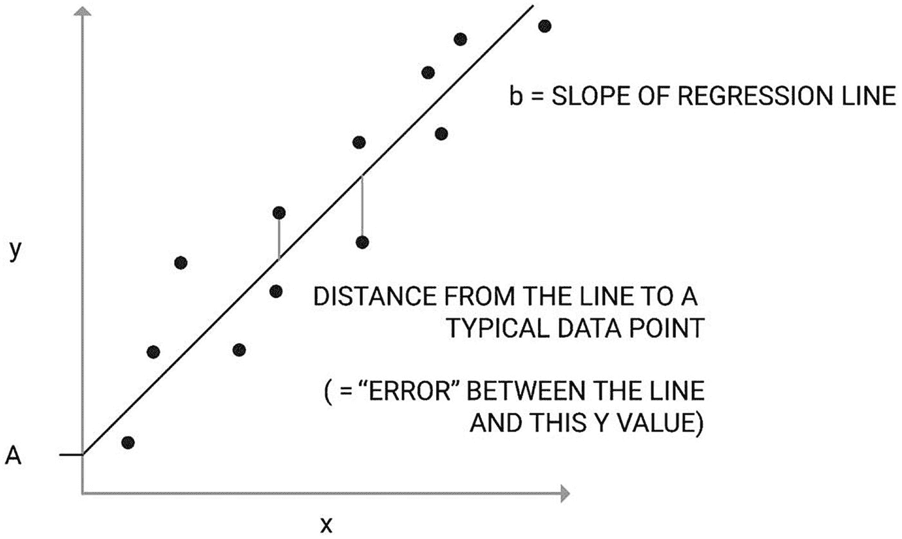

图 4-4

线性回归

线性回归的目标是通过所有数据点放置一条最佳拟合线，通过最小化边际或残差变异，从而便于理解预测结果。

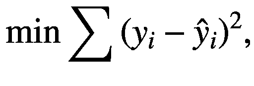

其中 y[i] 是实际观测到的响应值，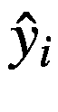 是响应变量的预测值，它们的差值是 y 的观测值与预测值之间的残差变异或差异。

*   准则变量：我们正在预测的结果变量
*   预测变量：预测所依据的变量
*   截距：最佳拟合线与 y 轴的交点

当只有一个输入变量 x 时，这种技术称为简单线性回归。多元线性回归则评估两个或更多预测变量。


其中 y 是输出变量，x 是预测变量，B0 和 B1 是用于移动最佳拟合线而估计的系数， 指 x 的均值，B0 是偏差或截距（与 y 轴的交点），B1 是斜率或 y 每单位 x 增加/减少的速率。

一旦模型学习了这些参数，它们就被用于根据新的、未见过的输入 X 来预测 y 的值。

用于估计系数的流行技术包括普通最小二乘法和梯度下降法。给定一条通过具有线性关系的样本数据集放置的最佳拟合线，普通最小二乘法试图最小化每个数据点到回归线的平方距离之和。其目的是最小化残差平方和。通过迭代优化系数值来减少模型的误差。

普通最小二乘法从 B0 和 B1 的随机值开始。为每个（输入，输出）对计算误差平方和。选择一个学习率，它充当比例因子；然后优化系数以最小化误差，直到无法进一步改进为止。

学习率是一个超参数，其值通过实验确定。尝试不同的值，并使用产生最佳结果的值。

对线性回归的批评主要集中在其简单性上，导致其无法捕捉数据中的复杂关系。模型也可能学习数据中的噪声，从而导致过拟合。

变量之间的关系并不总是线性的，因此，线性回归模型在处理具有非线性关系的数据时可能表现不佳。然而，有时可以通过变换变量来拟合线性回归模型。线性回归还假设变量是同方差的，这意味着向量中的所有变量都具有相同的方差。

以上内容完美地说明了为什么在训练模型时，应该使用多种机器学习算法。


## 逻辑回归

Python, scikit-learn; 方法, linear_model.LogisiticRegression

线性回归适用于连续变量，而逻辑回归的预测则是在应用转换函数后，适用于离散值或分类问题。

逻辑回归（或称 logit 回归）由统计学家戴维·考克斯于 1958 年提出，常用于二分类问题。例如，逻辑回归可用于预测患者在服用特定药物后是否会出现不良事件、患者是否可能再次入院，或者患者是否患有某种特定疾病。

与线性回归不同，该模型的输出形式是介于 0 和 1 之间的概率。预测输出是通过对输入 x 进行对数转换，并使用逻辑函数 h(x) = 1/(1 + e^–x) 生成的。一个指定的阈值用于将此概率转换为二分类结果。

逻辑回归使用 S 型函数，这是一种 S 形曲线（见图 4-5），它可以接受任何连续值，并将其映射为默认类别的介于 0 和 1 之间的概率值。

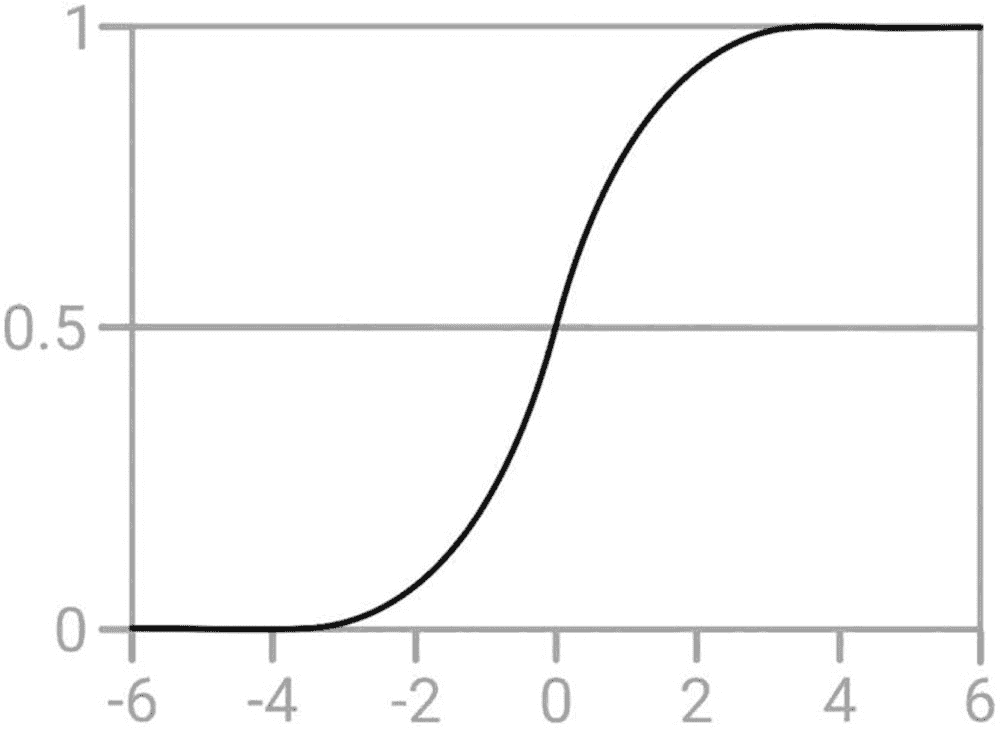

图 4-5

逻辑函数

S 型函数：1/(1 + e^–value)，其中 e 是欧拉数，value 是需要转换的值。

逻辑回归使用方程 P(x) = e ^ (b0 + b1*x)/(1 + e^(b0 + b1*x))，该方程可转换为 ln(p(x)/1–p(x)) = b0 + b1*x)。与线性回归一样，b0 和 b1 是从训练数据中学习到的值。

举个例子，假设有一个模型用于判断皮肤表面的增生是否为良性。输入变量 x 可以是增生的大小、深度或纹理；默认变量 y = 1 表示良性增生。如图所示，逻辑函数将各个实例的 x 值转换为介于 0 和 1 之间的概率值。如果概率超过 0.5 的阈值，则该肿瘤被归类为良性。

逻辑回归旨在通过训练学习 b0 和 b1 的值，以最小化预测结果与实际结果之间的误差。最大似然估计是用于此目的的迭代过程。

最大似然估计首先为每个预测变量随机分配一个最佳权重值，然后迭代调整这些系数，直到预测结果的能力不再提升。最终的系数值能够最小化预测概率中的误差。

与线性回归一样，逻辑回归假设输入变量和输出之间存在线性关系。可能需要进行特征降维，以将数据转换为线性模型。逻辑回归模型也容易过拟合，这可以通过移除高度相关的输入来克服。

最后，系数可能无法收敛，这在数据稀疏或高度相关时可能发生。

## 支持向量机

Python, scikit-learn; 方法, svm.SVC, svm.LinearSVC

支持向量机是一种非概率性的二分类线性分类器，可用于分类和回归问题。SVM 常与 NLP 方法一起用于分析文本，进行主题建模和情感分析。它也用于图像识别问题和手写数字识别。

该算法通过支持向量确定两个类别之间的超平面或最佳拟合线。支持向量是距离超平面最近的数据点，如果移除它们，超平面的位置将会改变。间隔值（即数据点到超平面的距离）越大，数据被正确分类的置信度就越高。最佳拟合线是通过一个旨在最大化间隔的优化过程学习到的。

SVM 使用一种称为核技巧的方法将数据映射到更高维的特征空间。数据通过核技巧被迭代地映射到更多维度，直到可以形成一个超平面来对其进行分类。

以图 4-6 中的问题为例。在左侧，我们看到在二维空间中不可能找到一条最佳拟合线。SVM 使用核技巧将数据映射到三维空间，并可以定义一个超平面来对数据进行分类。

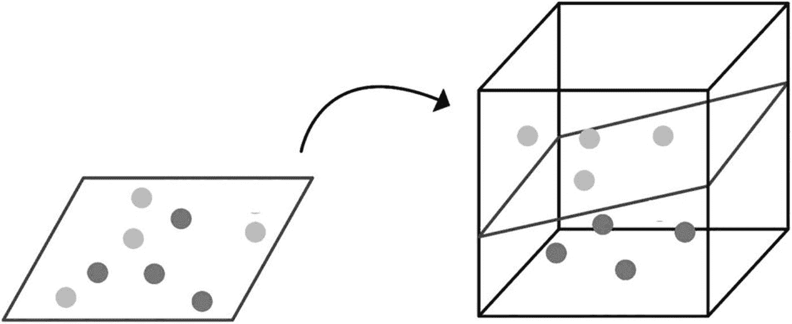

图 4-6

SVM 可视化

SVM 接受数值输入，并且在小型数据集上表现良好。然而，随着维度的增加，理解和解释模型的能力会降低。随着数据集规模的增大，训练时间也会增加。SVM 在处理噪声数据时能力也较弱。

SVM 可以表示为支持向量的总和（见图 4-7）。

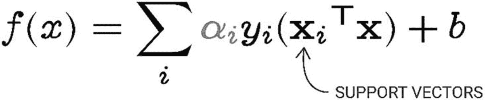

图 4-7

SVM 表示为支持向量的总和

## 朴素贝叶斯

Python, scikit-learn; 方法, GaussianNB, MultinomialNB, BernoulliNB

朴素贝叶斯使用贝叶斯定理来计算在另一个事件已经发生的情况下，某个事件发生的概率。该算法之所以被认为是“朴素”的，是因为它假设所有变量彼此独立，这在现实世界的例子中并不典型。贝叶斯分类器通常在输入维度较高时使用。

例如，给定一个指定的阈值，该方法可用于概率性地判断一个向量属于某一类还是另一类：

P(B|A) = (P(A|B) * P(B))/P(A)

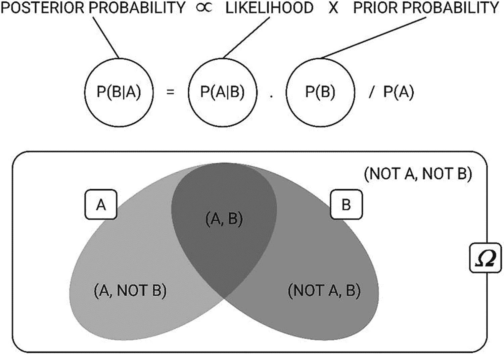

图 4-8

后验概率

*   **P(B|A) =** 后验概率（图 4-8）：在给定数据 A 的情况下，假设 B 为真的概率，其中 P(B|A)= P(a1|b) * P(a2|b) * … * P(an|b) * P(A)

*   **P(A|B) =** 似然：在假设 B 为真的情况下，数据 A 的概率

*   **P(A) =** 类别先验概率

*   **P(B) =** 预测变量先验概率

先验分布 P(B) 和似然概率 P(B|A) 可以从训练数据中估计出来。为了计算一个样本属于哪个类别，需要计算其属于每个类别的概率。分配给样本的类别是能为其产生最高概率的类别。

以表 4-3 作为一个简单示例，我们可以根据患者是否不健康来了解其患病风险的概率。为了确定 unhealthy = yes 的结果，我们计算 P(高风险|不健康) 和 P(低风险|不健康)，并选择概率最高的结果。

表 4-3

结果似然

| 记录 | 不健康 | 结果 |
| --- | --- | --- |
| **人员 1** | 是 | *高风险* |
| **人员 2** | 是 | *低风险* |
| **人员 3** | 是 | *高风险* |
| **人员 4** | 否 | *低风险* |

*   P(高风险|不健康)

*   = (P(高风险|不健康) * P(高风险))/P(不健康) = (2/2 * 2/4)/(3/4) = 0.66

朴素贝叶斯模型易于构建，并且对于大型数据集特别有用。除了其简单性（以及由此而来的“朴素性”）之外，朴素贝叶斯已知其性能甚至优于高度复杂的分类方法。


## kNN：k-最近邻算法

Python, scikit-learn; 方法, neighbors.KNeighborsClassifier

不要与 k-means 聚类混淆，kNN 方法通过将未知对象 O 标记为其 k 个最近邻中多数样本的标签来进行分类。kNN 用于分类和回归问题，是一种非参数技术。它们不学习模型，而是将训练数据集存储为其表示形式，并通过类比学习对新样本进行分类。

由于不进行模型学习，kNN 被认为是懒惰学习器。

每个对象代表 N 维空间中的一个点。如果某个邻居在特征空间中的距离最小，则将其定义为最近邻。计算未知对象与其邻居之间距离的方法之一，是使用 A = (a1 … an) 和 B = (b1 … bn) 之间的欧几里得距离，公式如下：

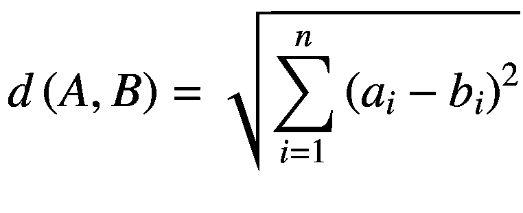

该算法的工作原理如下：

1.  计算任意两点之间的距离。
2.  基于这些成对距离找到最近邻。
3.  根据最近邻列表对类别标签进行多数投票。

预测是在请求时进行的。在回归问题中，使用 k 个最相似实例的均值或中位数。在分类问题中，则从 k 个最相似实例中选择出现频率最高的类别。

与大多数算法一样，距离度量方法可以有所不同。二进制向量之间的距离（汉明距离）以及实数向量之间绝对差的总和（曼哈顿距离）也常被使用。

kNN 的一个缺点是分类对象时需要大量的计算，因为必须计算训练数据集中所有邻居的距离。它不太适合高维数据。每个预测变量都可以被视为 N 维输入空间的一个维度。例如，x1 是一维，x1、x2 是二维，以此类推。维度的增加会呈指数级扩大输入空间的体积。

kNN 也不适合含有缺失值的数据，因为无法在缺失数据上计算向量之间的距离。

## 神经网络

大脑工作的生物机制启发了人工神经网络，这是一种基于动物大脑并行架构的不同计算范式。

神经网络因其能够对多维数据进行建模，并能高效地发现数据中的隐藏模式，非常适合数据挖掘任务。神经网络可应用于预测和分类问题。估计结果并将其与实际输出进行比较的过程称为前向传播。

神经网络是机器学习算法的一个子集，包括感知机、全连接神经网络、卷积神经网络、循环神经网络（RNN）、长短期记忆神经网络、自编码器、深度信念网络、生成对抗网络等等。其中大多数使用一种称为反向传播的算法进行训练。

人工神经网络（ANN）被广泛应用于众多任务：

*   疾病分类——计算机可以学习患病器官（如肾脏、眼睛和肝脏）的图像特征，以预测疾病的可能性
*   语音识别
*   文本翻译与数字化
*   人脸识别

神经网络可以像人脑一样学习如何完成任务——通过监督学习、无监督学习以及强化学习。

### 感知机

感知机是人工神经网络的基本单元。在人工智能中，感知机是一个节点或单元，它接收多个输入并产生单个输出，通常为 1 或-1。感知机对输入进行加权求和得到 S，然后通过一个单元函数计算该节点的输出（见图 4-9）。单元函数可以是以下形式：

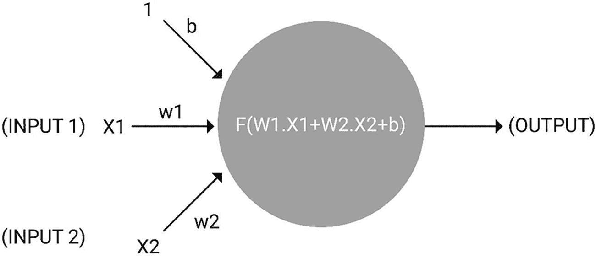

图 4-9

人工神经元的配置

*   线性函数——例如加权求和
*   阈值函数——仅当加权和超过阈值时才触发
*   阶跃函数——如果 S 小于阈值，则输出相反值，通常为-1
*   Sigma 函数（1/(1 + e^–s)），该函数支持反向传播

感知机模仿生物神经元（见图 4-10），其中树突接收输入。如果在设定的时间范围内信号足够强，神经元就会向末梢发送电脉冲，然后被其他神经元的树突接收。每个感知机都有一个偏置，类似于线性函数 y = ax + b 中的 b。它通过上下移动直线来使预测更好地拟合数据。

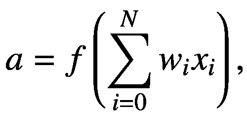

其中 1 是 x[0]，b = w[0]。

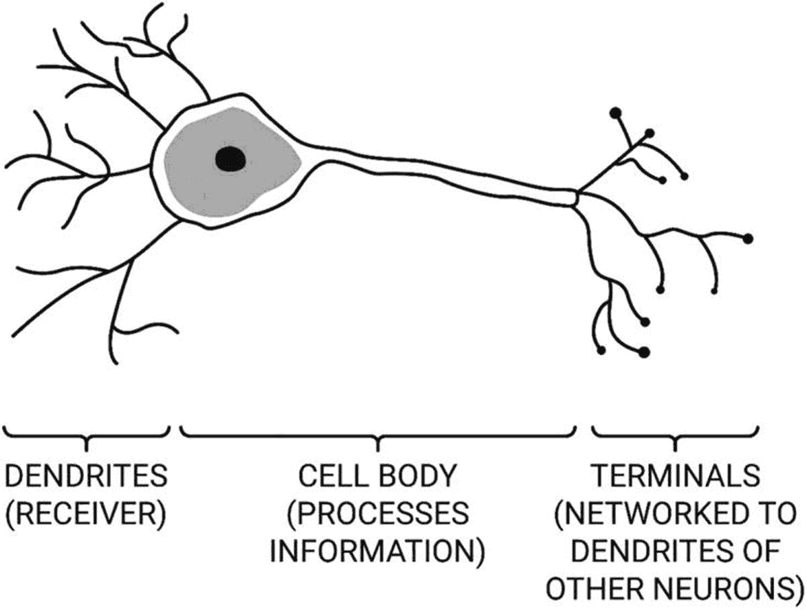

图 4-10

生物神经元的配置

### 人工神经网络

Python, scikit-learn; 方法, linear_model.Perceptron

人工神经网络由感知机构成，并包含一个或多个隐藏层（见图 4-11）。存在多种拓扑结构，其中最简单的是前馈网络。

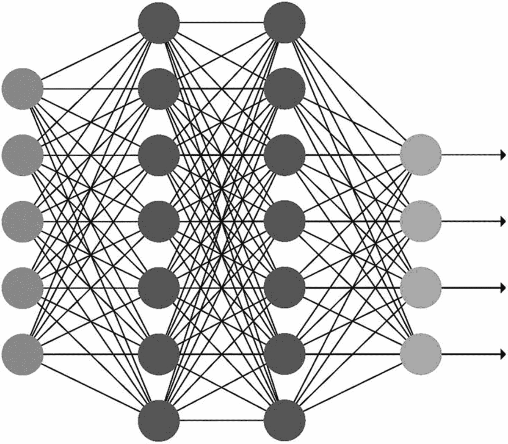

图 4-11

人工神经网络的组织结构

反向传播是一种确定输出端误差（或损失）并将其传播回网络的方法。每个节点的权重都会被更新，以最小化每个神经元相应的误差输出。反向传播旨在通过更新各个神经元的权重，来最小化神经元的误差，从而最小化整个模型的误差。

神经网络模型需要完成的主要学习任务是训练神经元何时触发。一个 epoch 指的是前向传播和反向传播的一次训练迭代。在学习阶段，神经网络中的节点会根据上一次测试结果的误差来调整其权重。学习率控制着网络学习的速度。

模型中感知机或神经元的数量等于数据中变量的数量。某些表示形式还可能包含一个偏置节点。

通常，人工神经网络中的神经元按层组织。每一层都可以对其接收的输入数据执行不同的变换。

## 深度学习

深度学习是一种采用深层神经网络架构的过程。与其他类型的模型相比，训练深度人工神经网络模型需要更多的时间和 CPU 算力。值得注意的是，人工神经网络模型的性能不一定优于典型的监督学习技术。

深度学习并非一项新技术；然而，随着硬件（主要是算力和成本）的进步，使得此类计算变得可行，它正变得越来越普遍。

深度神经网络（DNN）曾被 Alphabet 公司用于打造史上最强的围棋选手，该选手在 2017 年击败了多位人类围棋冠军[74]。古老的围棋游戏历来被视为人工智能的挑战，它展示了深度学习的能力（见图 4-12）。

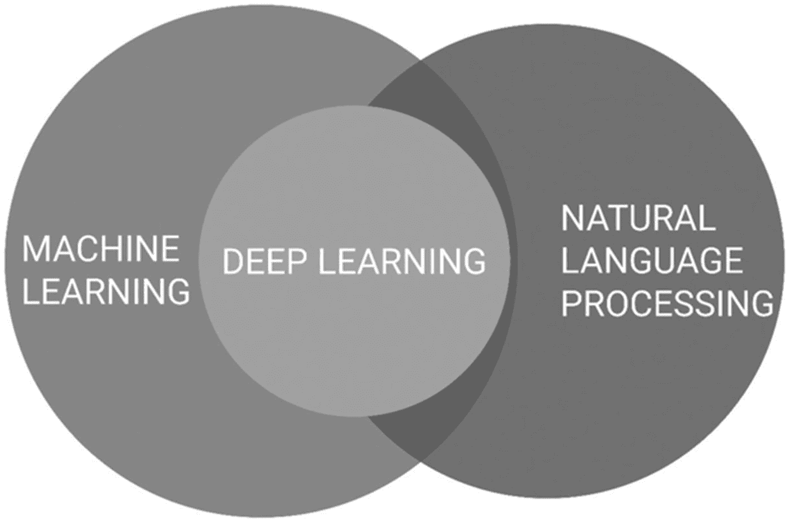

图 4-12

深度学习：它处于什么位置？

人工神经网络有多种类型，包括以下几种。


### 前馈神经网络

在前馈神经网络中，加权输入的总和被传递到输出层（见图 4-13）。当总和超过单位函数阈值时，输出被激活（通常为 1）。若未激活，则通常输出 –1。

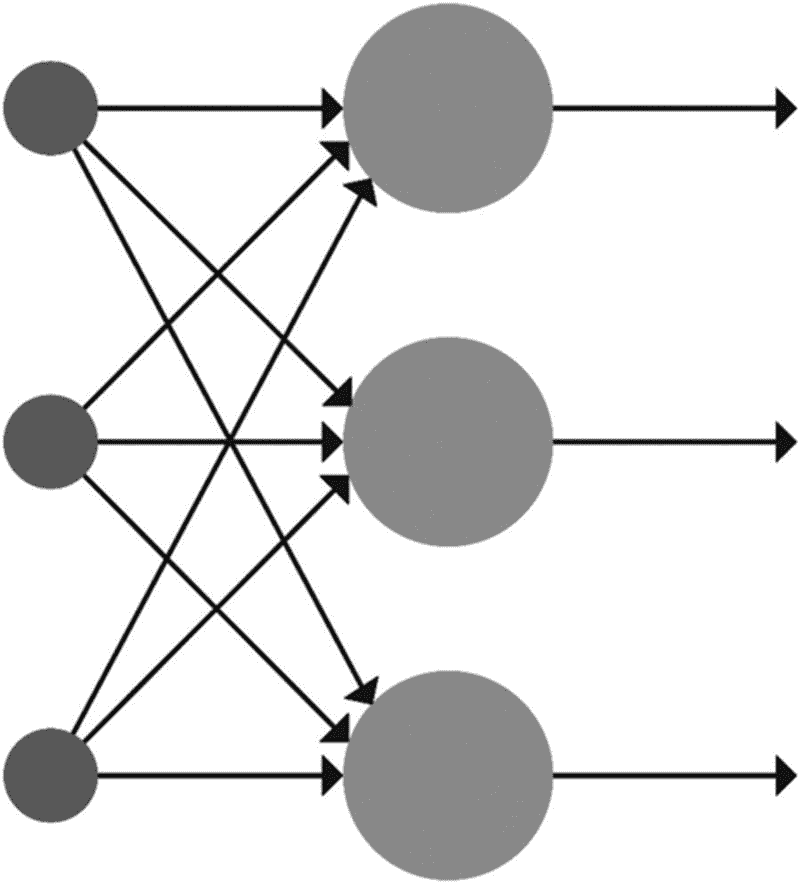

图 4-13

前馈神经网络

### 循环神经网络：长短期记忆

循环神经网络（RNN）会保存某一层的输出，并将其反馈回输入层，以改进输出层的预测结果（见图 4-14）。因此，每个节点在执行计算时都具备记忆能力，并能利用序列信息。由此，节点被认为具有记忆功能。

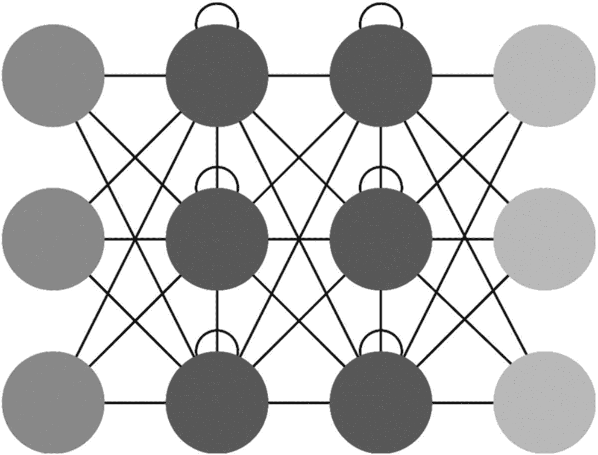

图 4-14

循环神经网络

### 卷积神经网络

卷积神经网络是一种深层的前馈神经网络。其网络层被称为卷积层，常用于语音识别、空间数据处理、自然语言处理和计算机视觉问题。不同的卷积层通常针对特定问题的不同方面。

例如，在判断一张照片中是否包含人脸时，深度神经网络中的不同卷积层可用于识别人脸的不同特征——如眼睛、鼻子、耳朵、嘴巴等。

### 模块化神经网络

与人类大脑类似，模块化神经网络的概念是多个神经网络协同工作。

### 径向基神经网络

这是一种使用径向基激活函数的神经网络，其函数值取决于与原点之间的距离（见图 4-15）。

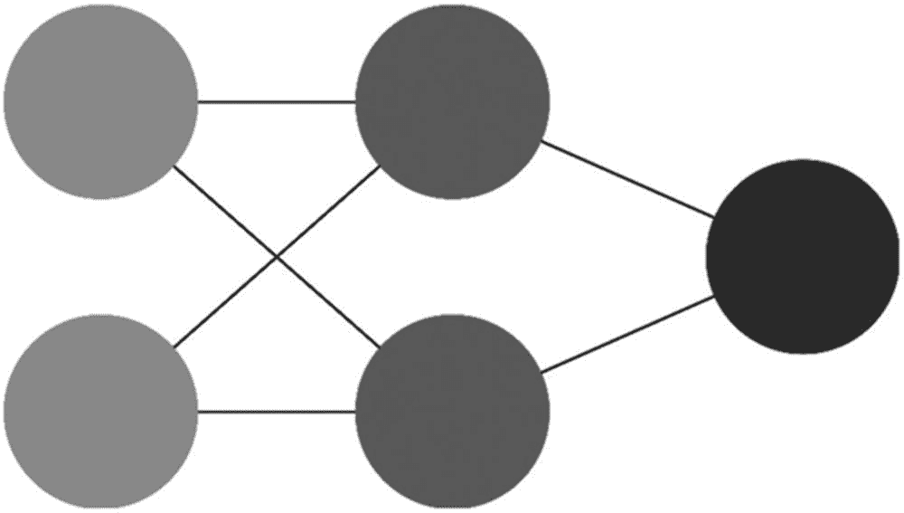

图 4-15

径向基神经网络

人工神经网络和深度学习的关键优势在于能够从训练数据集中生成复杂的线性和非线性模型。

深度神经网络（即深层、多层的 ANN）可以仅从训练数据中学习数据间的复杂关系，这通常能提升模型的泛化能力。然而，深度神经网络仍可能出现过拟合问题，因此可能需要进行适当的剪枝。顾名思义，深层网络也可能需要很长的训练时间，并且需要大量的训练样本。

神经网络的一个常见问题（尤其在医疗保健领域）是，它们像一个“黑箱”，没有为用户提供清晰的界面来理解其发现。实际上，人工神经网络模型难以解释，其权重和偏差并不能直观地反映模型中哪些因素重要。

通常认为，对于监督学习问题，防止过拟合的神经元数量上限为：

N[h] = N[s] / (α * (N[i] + N[o]))

其中：

*   N[i] = 输入神经元数量
*   N[o] = 输出神经元数量
*   N[s] = 训练数据集中的样本数量
*   α = 任意缩放因子

## 无监督学习

无监督学习是指从未标记数据中学习模型的过程。这意味着只提供输入数据 (x)，而不提供输出数据 (y)。算法需要自行发现数据中的模式，因此没有绝对的正确或错误答案。

当提供了部分输出标签 (y) 时，则称为半监督学习。例如，在利用部分标记的患者眼部扫描数据来学习预测青光眼的模型中，学习过程就是半监督的。如果只有一部分眼部扫描数据带有正确的输出标签（例如，青光眼、非青光眼），模型可能没有足够合适的数据来学习。随着更多标记数据提供给模型进行训练，系统的准确性可能会提高。

无监督学习在时间、资金和专业知识方面可能消耗较大。通常，通过改进数据标记可以大幅提升模型的准确性。

无监督学习主要包含两个核心概念：聚类和关联。

### 聚类

聚类是指发现数据内部关系的过程。聚类在医疗保健领域有多种用途，包括：

*   将具有相似特征的患者分组以进行监测
*   检测索赔或交易中的异常值或离群点
*   根据药物或病情定义治疗组
*   通过运动传感器检测活动

### K-Means 算法

Python, scikit-learn; 方法, cluster.KMeans

K-Means 聚类（见图 4-16）旨在数据中找到 k 个相似的组。K-Means 是一种迭代算法，它计算所定义的 k 个簇的质心，并将所有训练数据分配到相应的簇中。

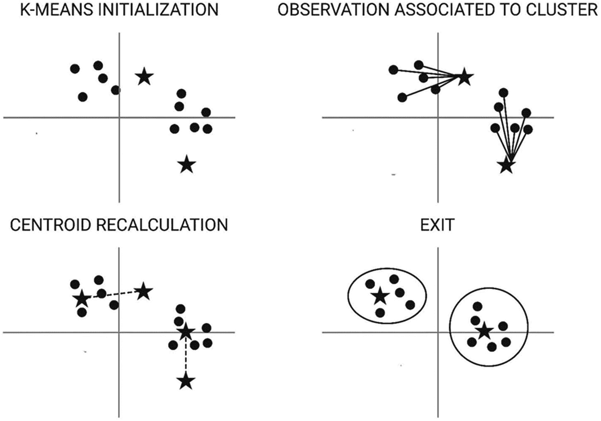

图 4-16

K-Means 聚类

数据点的分配依据是该数据点与其质心之间的距离。簇质心是一组定义最终簇的属性值的集合。

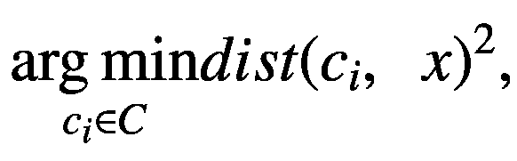

其中 c[i] 是集合 C 中的质心集合，距离 (dist) 为标准欧几里得距离。

与在数据探索之前预先定义分组不同，聚类使模型能够自行发现自然形成的分组。

K-Means 算法的步骤如下：

*   步骤 1：设定 k 值。此处，我们设 k = 2。
    *   将每个数据点随机分配到 k = 2 个簇中的任意一个。
    *   确定每个簇的质心。
*   步骤 2：对于每个数据点，将其分配到最近的簇质心。
*   步骤 3：为新的簇重新计算质心。
*   步骤 4：重复此过程，直到簇质心不再变化。


### 关联规则

关联规则学习方法能够提取出最能解释数据中变量间感知关系的规则。这些规则可以在大型多维数据集中发现有用的关联，从而用于驱动和优化决策。

关联规则学习在历史上最经典的应用场景是分析在线购物结账时收集的用户购买习惯数据集。例如，当有人购买披萨时，他们可能也会倾向于购买葡萄酒，就像购买生菜的人可能也会倾向于购买西红柿、黄瓜和洋葱一样。通过分析交易数据集，可以预测商品之间关联的概率。我们知道某些物品（无论是食品、衣物，甚至是疾病）经常同时出现，而关联规则学习正是为了理解这些关系。

特别是在医疗保健领域，理解关联性症状有助于更好地预测和诊断疾病及不良事件。根据药物和相关的患者合并症路径来确定潜在的不良反应，可以改善护理和治疗路径。

需要熟悉三个重要的度量指标。

#### 支持度

支持度是绝对频率的值。如果数据集 T 中有 sup% 的交易包含 X U Y，则关联规则在数据集 T 中以支持度 sup 成立。这表示一个项集的流行程度，通过该项集出现的交易比例来衡量：

*   sup = Pr(X U Y) = count(X U Y) / 总交易数

#### 置信度

置信度度量表示相关频率。如果包含 X 的交易中有 conf% 也包含 Y，则关联规则在数据集 T 中以置信度 conf 成立。这估计了当项 X 出现时，项 Y 在交易数据集中出现或存在的可能性。这表示为 {X → Y}，并衡量了包含项 X 的交易中，项 Y 也同时出现的比例：

*   conf = Pr(Y|X) = count(X U Y) / count(X)

#### 提升度

提升度在考虑 Y 的流行程度的同时，确定了在 X 出现的情况下 Y 出现的可能性：

*   提升度 = 支持度 (X U Y) / (支持度 (X) * 支持度 (Y))

关联规则确定了在 X 出现的情况下 Y 出现的概率。这些关联的优势在各行各业都有应用。有许多关联规则挖掘算法采用不同的策略来理解关联，并使用不同的数据结构。

### Apriori 算法

Apriori 是最流行的关联规则挖掘算法。Apriori 算法常用于模式挖掘以及识别经常同时出现的特征和项。它被广泛用于购物篮分析，是发现隐藏特征模式的强大工具。它通常应用于交易数据库，以挖掘频繁关系并生成关联规则。

Apriori 算法从一组 n 个项开始。该算法计算所有可能的候选项集（或称频繁项集），这些项集满足指定的支持度和置信度阈值。Apriori 性质指出，对于一个项集是频繁的，其所有子集也必须是频繁的。Apriori 算法采用自底向上的方法；先识别频繁子集，然后每次增加一个项。

Apriori 方法相对简单（见图 4-17）：

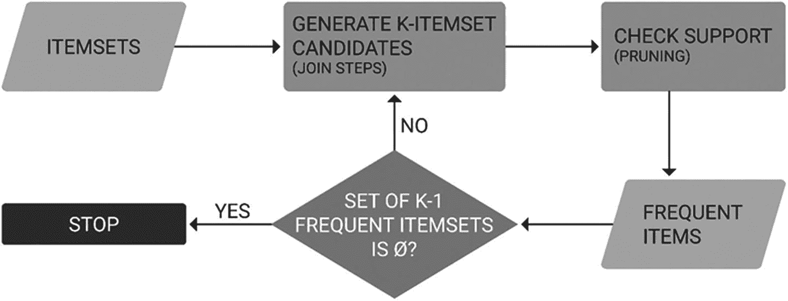

图 4-17

Apriori 算法

*   应用最小支持度，在数据集 T 中找到所有包含 k 个项的频繁项集，其中频繁项集的支持度 ≥ min(sup)。

*   使用频繁 k-项集，扩展选择范围以找到包含 k + 1 个项的频繁项集。

一个项集的最大大小为 k，即项的数量。

## 降维算法

尽管普遍认为数据越多越好，但数据集通常包含大量变量，这使得捕捉数据中的信号成为一项更费力的任务。无论是处理稀疏值、缺失值、识别相关特征、提高资源效率，还是为了更直观的解释，降维算法对数据科学家来说都非常有用。

顾名思义，降维算法（DRAs）减少了数据集中存在的维度数量。当你考虑到用于做出精确决策的丰富数据时，降维的必要性就显而易见了：

*   手机收集了数百个数据点，包括通话、短信、步数、消耗的卡路里、爬楼梯层数、互联网使用情况等等。哪些数据最能用于理解手机使用情况？

*   社交媒体上的品牌正在收集关于参与度和互动的数据，例如评论、点赞、关注者、情感和情绪。哪些数据最能用于理解对健康的态度？

*   医疗健康记录包含大量信息，但只有部分信息与预测疾病风险或病情进展相关。哪些数据与理解未来的疾病或不良事件风险相关？

降维指的是将包含多个维度的数据集转换为更少的维度，同时简洁地表示相似的数据。

图 4-18 中的图表显示了数据集中厘米和英寸之间的关系。这种二维表示可以简洁地转换为一维表示，从而改善可视化效果以便于理解。N 维数据可以降为 k 维，其中 k < N。

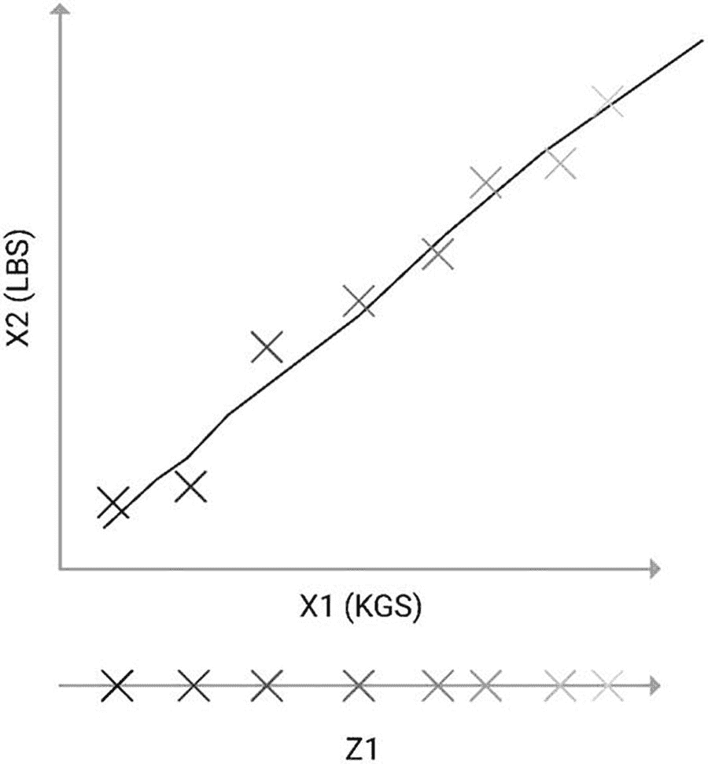

图 4-18

降维

可以识别或组合有价值的维度，或者创建新的维度来表示内在关系。

降维在机器学习任务中极其有用，具有众多优点：

*   与原始数据集相比，更少的维度意味着更快的计算速度。

*   默认情况下，降维算法减少了所需的存储空间。

*   将数据减少到三个维度以下，便于可视化和更容易理解。

*   移除了冗余数据，从而提高了机器学习模型的性能。

*   移除了噪声，从而提高了模型性能。

## 降维技术

可以通过多种方式实现降维。

### 缺失/空值

孤立来看，缺失数据和空值并不是一个大问题，但不断增长的空值数量可能有助于决定是删除变量、忽略缺失值，还是计算一个预测值。

大多数数据科学家支持，如果一个属性有超过 50% 的空值或缺失值，则删除该变量。这个阈值会有所不同。

### 低方差

彼此非常相似的数据属性携带的信息不多。因此，数据内部的方差很小。因此，可以设置一个较低的方差阈值，并据此移除维度。

由于方差依赖于取值范围，因此应首先进行数据归一化。

### 高相关性

具有相似数据趋势的属性很可能携带相似的信息。多重共线性是指携带相似信息，这会降低模型的性能。连续数据之间的相关性由皮尔逊积矩相关系数确定，该系数衡量两个变量 X 和 Y 之间的线性相关性。

对于离散数据，皮尔逊卡方值用于确定数据集之间观察到的任何差异是由偶然因素引起的可能性有多大。


### 随机森林决策树

随机森林决策树集成方法有助于识别关键特征。随机森林决策树使用特征子集来识别最佳分裂属性。

如果某个属性经常被选为最佳分裂节点，那么它很可能是一个值得保留的特征。决策树在可视化降维方面也特别有用。

### 反向特征消除

在反向特征消除中，模型对 n 个属性进行训练。从 n 个属性开始，在每次迭代中，模型都会对 n-1 个属性进行 n 次训练。导致错误率增幅最小的属性被移除，然后算法对 n-1 个属性执行下一次迭代。

在每次迭代 k 中，都会训练一个具有 n-k 个属性的模型。这种方法计算成本很高。

### 前向特征构建

前向特征构建与反向特征消除相反。模型从一个属性开始，评估哪个属性带来的性能提升最大。与其相反的方法反向特征消除类似，除非在较低维度范围内操作，否则此方法的计算成本也很高。

### 主成分分析（PCA）

主成分分析通过将原始变量集转换为一组新变量（即主成分）来减少变量（轴）的数量（见图 4-19）。此过程迭代计算数据中特征内的最大方差。

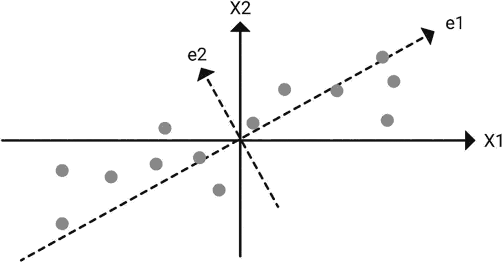

图 4-19

PCA

每个主成分都是正交的，并且是原始变量的线性组合。正交性表明各主成分之间的相关性为零。

第一主成分是具有最大方差的原始维度的线性组合；第 n 个主成分是具有最高方差的线性组合，并且与第 n-1 个主成分正交。

## 自然语言处理（NLP）

自然语言处理是专注于语言的人工智能领域。自然语言处理（NLP）被定义为系统分析、理解和生成人类语言（包括语音和文本）的能力。

NLP 是计算语言学（使用计算机科学研究语言学）的一个方面，在以下方面非常有用：

*   在数据集中检索结构化和非结构化数据，例如，通过关键词或短语搜索临床笔记
*   社交媒体监控
*   问答：解释来自人类的自然语言以进行适当交互，例如，与虚拟助手或语音识别软件交互
*   分析文档以确定关键发现
*   能够解析和解释文本以理解情感和情绪
*   识别诊断和关系之间的区别
*   图像到文本识别，例如，读取标志或菜单
*   机器翻译——NLP 用于机器翻译程序，其中一种人类语言被自动翻译成另一种人类语言
*   主题建模——这份文档在谈论什么？
*   理解来自社交媒体或讨论帖子的情感

解释自然语言充满挑战，因为人类语言天生具有歧义性——语言、发音、表达和感知。

尽管人类语言有规则，但它们经常被误解和误用。NLP 考虑语言的结构来推导含义。单词构成短语；短语构成句子；句子构成文档；所有上述内容都传达思想。

NLP 拥有一套文本处理程序工具包，包括一系列可用于模型开发的数据挖掘方法。由于非结构化数据的性质，NLP 任务在计算资源和时间方面可能成本高昂。神经网络和深度学习也可用于 NLP 任务。

由于生成的大部分数据以非结构化数据的形式存在，NLP 是解释和理解自然语言的强大工具。

与计算的任何方面一样，在继续之前需要理解几个术语：

*   **分词**：将文本语料库转换为更小单元（即标记）的过程。有许多算法可用于将文本分解为标记。
*   **标记**：文本中存在的单词或实体。
*   **文本对象**：一个句子、短语、单词或一篇文章。
*   **词干提取**：一种基本的基于规则的过程，用于去除单词的后缀（“ing”、“ly”、“es”、“s”等）。
*   **词干**：词干提取后创建的文本。
*   **词形还原**：根据词典和词法分析确定单词的词根。
*   **语素**：语言中的意义单位。
*   **句法**：排列符号（单词）以构成句子。它涉及确定单词在句子和短语中的结构作用。
*   **语义学**：单词的含义以及如何将单词组合成有意义的短语和句子。
*   **语用学**：在不同情境下使用和理解句子，以及解释如何受到影响。

在本节中，我旨在介绍 NLP 的关键概念和方法，并演示可应用于数据集以产生定义价值的技术。

### NLP 入门

为 NLP 模型提供一个输入句子并接收有用的输出需要几个关键组件（见图 4-20）。

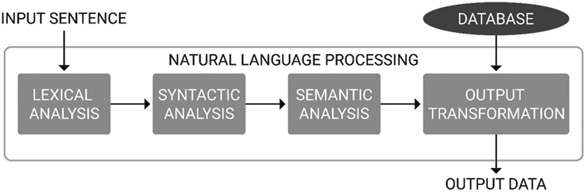

图 4-20

NLP 的工作原理

## 预处理：词法分析

与任何数据集一样，与数据上下文无关的文本语料库可以被理解为噪声。NLP 的第一阶段是清理和标准化输入文本，确保其无噪声并准备好进行分析。

除了拼写纠正和语法纠正之外，以下技术用于减少噪声。

### 噪声去除

噪声去除涉及准备一个噪声标记（即单词）词典，并解析文本，移除在噪声词典中找到的标记。例如，像 the、a、of、this、that 等单词将被移除。

### 词汇规范化

Follow、following、followed 和 follower 都是单词 follow 的变体。在上下文上，这些单词是相似的。词汇规范化通过词干提取（去除前缀和后缀）和词形还原（一种使用单词结构和语法关系的定义过程）来降低维度。

### Porter 词干提取器

Python，NLTK；方法，PorterStemmer

Porter 词干提取算法是一种流行且有用的方法，用于提高信息检索的效率 [81]。该算法的工作原理基于英语中许多单词共享一个共同词根。词干提取作用于后缀，并去除单词中常见的形态和屈折词尾。因此，词干提取允许将相似的单词归约为一个共同的词根形式。

例如，以文本“I felt troubled by the fact that my best friend was in trouble. Not only that, but the issues I had dealt with yesterday were still troubling me.”为例。

单词 troubled、trouble 和 troubling 都共享共同的词根 trouble。因此，根据 Porter 词干提取算法，不是将这三个单词各计数一次，而是将词干 trouble 计数三次。词干提取的好处在于，可以将常见单词聚类在一个共同的词干下，从而更准确地统计某个单词的出现次数。然而，词干提取的一个缺点是单词的语义含义可能会丢失。

词干提取和词形还原用于将单词的屈折形式，有时也包括派生相关形式，归约为一个共同的基式。


### 对象标准化

文本语料库中可能包含词典中查不到的词。例如，在推特上，有人可能会提到“DM’ing someone”（给某人发私信），或者另一个人可能会点赞别人的“RT”（转发推文）。缩写词、话题标签、俚语和口语化表达可以通过预先准备好的词典或使用正则表达式来移除。

## 句法分析

为了进行分析，文本需要被转换成特征。文本的句法分析涉及分析句子以理解词语之间的关系，并为其分配一个句法结构。句法分析有多种算法；然而，**上下文无关文法**因其是最简单的文法形式而被广泛使用，因此也最为流行。

以句子“David saw a patient with uncontrolled type 2 diabetes.”（大卫看到一位患有未受控制的 2 型糖尿病的病人。）为例。

在句子中，我们需要识别主语、宾语、噪声和属性，以理解词语的顺序及其依赖关系。

### 依存句法分析

工具包：NLTK；方法：StanfordDependencyParser

句子由词语按结构组成。基础语法可以确定结构之间的关系或依存关系。依存句法分析以树状结构表示这种关系，并呈现语法和词语的排列（见图 4-21）。

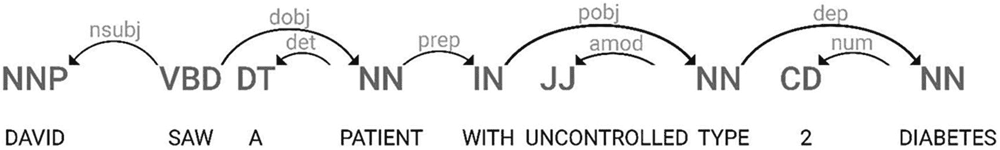

图 4-21

依存句法分析

依存语法分析的是词元之间的非对称二元关系。来自 NLTK 的 Stanford 解析器常用于此目的。

使用图 4-21 中的示例，解析树确定句子的根词为“saw”（看见），然后由子树连接。子树按主语和宾语划分，每个子树也显示了依存关系。

### 词性标注

工具包：NLTK；方法：word_tokenize

词性标注涉及将句子中的每个词或词元与一个词性标签关联起来。这些标签是你在小学学到的基本英语标签，用于确定名词、动词、形容词、副词、数词等。

这对于构建解析树等任务特别有用——解析树反过来又可用于确定某物是什么、情感分析、确定问题的合适答案或理解相似实体（见图 4-22）。

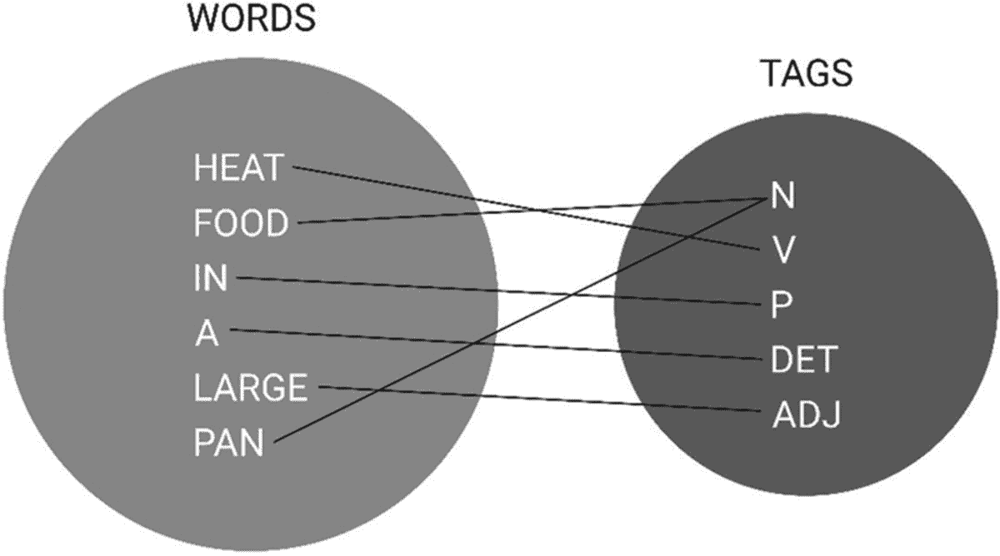

图 4-22

词性标注

词性标注是多个领域辅助工作的基础。

#### 减少歧义

有些句子因结构不同而有多种含义；例如，以下两个句子：

“I managed to read my book on the train.”（我设法在火车上读了我的书。）
“Can you please book my train tickets?”（你能帮我订火车票吗？）

词性标注将第一个句子中的“book”识别为名词，将第二个句子中的“book”识别为动词。

#### 识别特征

通过识别词语在不同上下文中的词性类型，词性标注可以区分不同用法，并为后续使用创建更强的特征。

#### 规范化

词性标签是规范化和词形还原的基础，用于理解句子结构和依存关系。

#### 停用词移除

词性标注在从文本中移除常用词（即停用词）方面很有用。

## 语义分析

语义分析是自然语言处理中最复杂的阶段。它从文本中提取确切的含义或字典含义。利用关于上下文中的词语和句子结构的知识，规定词语、短语、句子和文本的含义，进而规定其目的和后果。

## 自然语言处理中使用的技术

在对语料库进行数据预处理、词汇分析、句法分析和语义分析之后，我们需要将文本转换为数学表示形式，以便进行评估、比较和检索。例如，在患者档案集合中搜索患有“hypertension”（高血压）的用户，应该只找出那些患有高血压的用户。这是通过将文档转换为向量空间模型来实现的，其中评分和词项权重对于查询排序和搜索检索至关重要。

文档可以是患者记录、网页、数字化书籍等形式。以下算法在比较和评估过程中很典型。

### N-gram

Python：NLTK；方法：ngrams

N-gram 用于许多自然语言处理问题。如果 X = 给定句子 K 中的词数，那么句子 K 的 n-gram 数量为

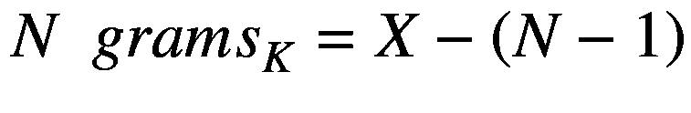

例如，如果 N = 2（二元组），句子“David reversed his metabolic syndrome”（大卫逆转了他的代谢综合征）将产生以下 n-gram：

*   David reversed
*   Reversed his
*   His metabolic
*   Metabolic syndrome

N-gram 保留了文本输入中 N 个项目的序列。N-gram 可以有不同的 N 值：当 N = 1 时称为一元组，N = 2 时称为二元组，N = 3 时称为三元组。

N-gram 广泛用于拼写纠正、词语分解和文本摘要。

### TF–IDF 向量

一个文档可以表示为词语空间中的一个高维向量。向量中的每个条目对应文档中的一个不同词项及其出现次数。TF–IDF（词频-逆文档频率）向量方案使用以下公式为文档中的每个词项分配权重：

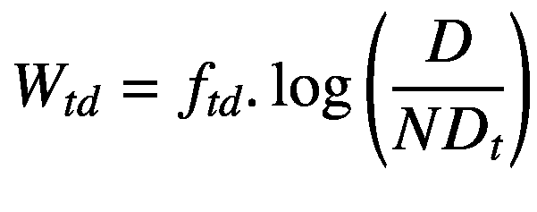

每个词项的权重（W[td]）通过将词项频率（f[td]）乘以文档总数（D）除以包含该词项至少一次的文档数（ND[t]）的对数来计算。词项的排列顺序不一定保持不变。

收集到的词项权重随后可用于确定包含特定词项频率较高的文档。一组 TF–IDF 向量可用于表示用户的兴趣。

### 潜在语义分析

当存在包含大量文档的语料库时，对于每个文档 d，表示每个文档的向量的维度通常可能超过数千。潜在语义分析依赖于这样一个直觉：文档中的词项通常可能是相关的。例如，如果文档 d 包含词项“sea”（大海），它通常也会包含词“beach”（海滩）。

同样地，如果表示 d 的向量在“sea”条目中有一个非零分量，那么它在“beach”条目中也会有一个非零分量。如果能够检测到这种结构，就可以从数据中自动学习词语之间的关系。

词-文档矩阵由矩阵 A 表示，该矩阵使用奇异值分解进行分解，以给出最显著相关性的强度及其方向。

对 A 的分解使得人们能够通过词项之间的相关性及其在文档中的重要性来发现文档的语义。潜在语义分析方法可用于确定各种材料的上下文，从而向网络用户呈现上下文相关的结果。


### 余弦相似度

Python, SciPy；方法，余弦

余弦相似度是一种衡量两个向量之间相似度的指标。因此，它既可以用于定义两个文档之间的相似度，也可以用于定义文档与查询之间的相似度。

两个向量之间的余弦相似度可以定义如下：

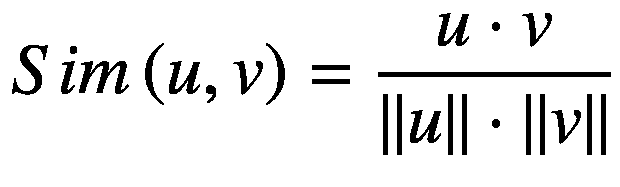

两个向量之间的相似度是通过计算向量的内积，再除以这两个向量长度的乘积得到的。直观上，两个文档之间的夹角越大，它们的相似度就越低。这适用于任何 N 维空间中的向量。

此外，TF–IDF 向量方案可以与余弦相似度指标相结合，以确定搜索查询与大量文档之间的相似度：

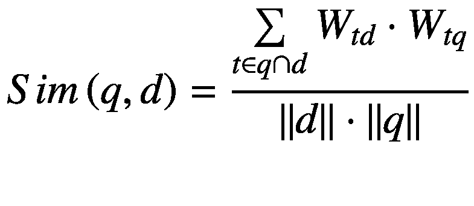

查询 q 与文档 d 之间的相似度计算方式为：对查询和文档中所有共现的词项，将其在文档和查询中的 TF–IDF 权重相乘后求和，再除以文档长度与查询长度的乘积。然而，在实际应用中，随着文档数量的增长，计算 Sim(q,d)的计算开销会变得非常昂贵。

### 朴素贝叶斯分类器

贝叶斯分类器基于贝叶斯定理，特别适用于输入维度较高的情况。尽管朴素贝叶斯方法简单，但它通常能胜过更复杂的分类方法。

在给定阈值的情况下，该方法可用于分类表示文档的向量是否对用户感兴趣的概率。给定一个属性 d，我们可以通过以下公式计算该样本是否属于类别 C：

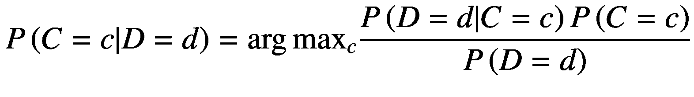

其他技术，如 kNN 和 ANN，也可用于分类和信息检索。

## 遗传算法

遗传算法是机器学习中一个引人入胜的主题。GA 从进化中汲取灵感以最小化错误率，试图模仿染色体的功能，就像神经网络试图模仿人脑一样。

进化被认为是最优的学习算法。在机器学习中，其应用体现在某些模型中：生成多个候选答案（称为染色体或基因型），并对所有候选答案应用成本函数。

在 GA 中，定义了一个适应度函数，用于判断染色体是否足够适应以进行交配。远离最优结果的染色体将被移除。染色体也会发生突变。GA 是一种搜索和优化学习器，适用于离散和连续问题。

接近最优解的染色体可以组合。染色体的组合或交配称为交叉。适者生存的方法识别出旨在表达符合自然选择特征的染色体——即后代比亲本更优。

突变有助于克服过拟合。这是一个随机过程，用于跳出局部最优解并找到全局最优解。突变有助于确保子代染色体与亲本不同，并继续进化。

染色体突变和交配的程度是一个参数，可以人为控制，也可以让模型自行学习。

GA 有多种应用：

*   眼科成像中的血管检测
*   RNA 结构检测
*   金融建模
*   车辆路径规划

一组染色体被称为一个种群。尽管种群大小保持恒定，但它通常会在世代或时间推移中进化，以产生更好的平均预测。

染色体 c 的评估值计算为其评估函数值除以该世代的平均值，表示如下：

*   **fitness(c)** = g(c) / (整个种群中 g 的平均值)

John Holland 在 20 世纪 70 年代早期发明了 GA 方法（见图 4-23）[81]。染色体选择的自动化被称为遗传编程。

## 最佳实践与注意事项

掌握机器学习的艺术需要时间和经验。然而，有几个值得考虑的领域，特别是对于机器学习初学者，以确保最佳的时间利用和最优的模型效率。

### 良好的数据管理

鉴于机器学习任务中数据的数量和复杂性，恰当的数据管理至关重要。这不仅涉及数据管理所需的过程、策略、程序、权限和认证，还包括管理和转换训练数据以学习最优模型。

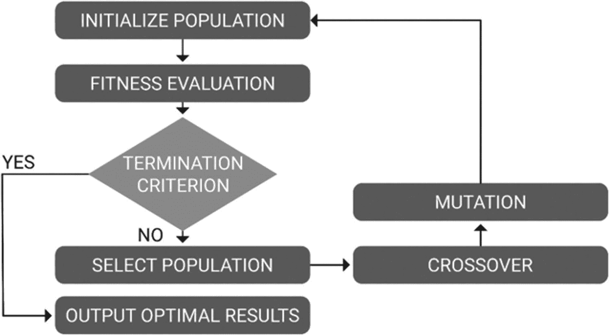

图 4-23
遗传算法的基本结构

### 建立性能基线

建立一个基线来衡量你的算法相对于其他迭代和模型类型的性能至关重要。由于没有一种算法能完美解决所有问题，应尝试多种算法以识别模型的相对性能。

### 花时间清洗数据

训练机器学习模型所需的时间在不同算法之间差异很大。数据的准确性和训练模型所花费的时间对模型精度有积极影响。花时间清洗数据，以确保预测结果尽可能稳健。

通常情况下，并非所有输入变量都会影响因变量或结果。确保模型使用的变量不包括那些无关的变量。

### 训练时间

如果数据维度很高且计算能力有限，训练时间将会很长。当时间紧迫时，考虑那些不需要大量训练的机器学习算法会很有用。例如，神经网络可能不适合时间受限的任务。

### 选择合适的模型

一些机器学习算法对数据结构或期望输出有特定的假设。因此，考虑模型选择及其是否是一种合适的方法会很有帮助。使用正确的模型有很多好处，包括更准确的预测、更快的训练时间和更有用的结果。

一些机器学习模型对异常值或非参数检验具有鲁棒性。例如，基于决策树的方法通常根据阈值将节点分为两类。因此，数据异常值在基于树的方法中影响较小。

评估一系列模型是机器学习的一种有用方法。奥卡姆剃刀通常被应用于选择模型。奥卡姆剃刀旨在在所有其他条件相同的情况下，找到能够实现期望输出的最直接模型。

### 选择合适的变量

尽管在机器学习问题中通常欢迎更多的数据，但出于多种原因，使用较少的预测变量通常更可取。

### 冗余

增加训练数据集中的变量数量会增加模型学习变量之间隐藏关系的可能性。识别不必要的变量并仅在模型中使用非冗余的预测变量至关重要。学习冗余连接的模型会影响模型的准确性。


### 过拟合

即使模型中的预测变量之间不存在任何关系，使用较少的变量仍然是有益的。复杂的模型，或使用了大量预测变量的模型，通常会遭受过拟合问题。

这些模型在训练数据集上表现良好，但在验证集和现实场景中准确性较低，因为它们学习的是数据中的误差（即噪声），而非变量之间的信号或关系。

### 生产力

即使一个复杂的机器学习模型中的所有变量都是相关的，使用大量预测变量也会对生产力产生实际影响。

实际考量因素包括：可用数据量、对存储和计算资源的后续影响、相关成本、项目分配的时间，以及学习和验证所需的时间。预测变量可以通过特征选择来识别，或通过特征提取进行转换。在数据维度增加的情况下，支持向量机（SVM）非常有用。

帕累托原则（或称 80/20 法则、关键少数法则）是机器学习项目中一个有用的衡量标准。运用帕累托原则，专注于最重要的 20%的预测变量，应有助于在合理时间内构建相对成功的模型。微软发现，Windows 和 Office 中 80%的错误和崩溃是由检测到的全部错误中的 20%引起的[82]。

帕累托原则

“帕累托原则”是指观察到大约 80%的后果源于 20%的原因。许多自然现象已被经验证明呈现出这种分布。

### 可理解性

预测变量较少的模型更容易可视化、理解和解释。一个成功的机器学习项目的关键方面是所有利益相关者都能理解该模型。这通常需要数据科学家进行权衡。

通过减少预测变量的数量，机器学习模型成功的可能性可能会降低。然而，这同时也使模型更易于解释和理解。

这种方法的有用性只有在项目接近尾声，需要分享模型的性能及其工作原理时才会显现出来。这在医疗保健领域尤其重要，因为人们对使用黑盒模型存在担忧。

### 准确性

任何机器学习模型的目标都是实现良好的泛化。根据具体用例，近似值可能比精确、准确的输出更有益。通过近似值，模型往往能避免过拟合，并减少处理时间。

### 假阴性的影响

在将模型部署到实际环境之前评估其影响时，需要考虑假阴性的影响。例如，以一个预测乳腺癌风险的模型为例。假阳性意味着患者被告知患有乳腺癌而实际上并未患病，这应在后续治疗路径中被识别出来。然而，假阴性则意味着患有乳腺癌的患者不会被通知——这潜在后果要严重得多，代价也高得多。

### 线性

许多机器学习算法假设关系是线性的——换句话说，即类别可以通过一条最佳拟合直线或其高维表示来分隔。在某些情况下，关系并非线性。在存在非线性类别边界的情况下依赖线性分类算法将导致低准确性。

例如，线性回归假设输入和输出变量都不包含噪声。揭示数据中的信号至关重要，以确保模型学习到数据中的信号或正确关系。识别并移除输出变量中的异常值尤其有利，可以减少学习噪声的机会。

对于具有非线性趋势的数据，可能需要进行变换以使关系线性化，例如，对呈指数关系的数据进行对数变换。

线性算法通常是机器学习场景中首先尝试的方法。由于线性特性，这些算法简单且训练速度快。

### 参数

每个机器学习模型都受参数和超参数的影响。训练模型所需的时间和资源会随着参数数量的增加而增加。算法的参数是模型使用的一个变量，其值可以从数据集中估计出来。

算法的超参数是模型外部的变量，用于估计参数。超参数的值无法从数据中估计。相反，它由数据科学家设定（随机或其他方式），或通过启发式方法设定。

### 集成方法

在特定的机器学习问题中，使用投票、加权和组合等技术将分类器分组，以识别出可能最准确的分类器，这被证明是更有用的。集成学习器在这方面非常有用。

## 用例：迈向糖尿病的智能护理

2 型糖尿病是全球人口面临的最重大的健康和经济负担之一，每 6 秒钟就有六分之一的人死于糖尿病或其相关并发症[83, 84]。

疾病进展涉及许多因素，如果能够解决这些因素，可以通过有针对性的治疗分析来帮助预防其进展，从而降低患者的发病率和死亡率。以健康生物标志物形式存在的数据——通常是血糖、糖化血红蛋白（HbA1c）、空腹血糖、胰岛素敏感性和酮体——被用来理解和监测疾病负担以及对治疗的反应。

由于 2 型糖尿病的巨大负担，该领域在开发智能模型方面投入了大量资金，重点是通过机器学习和数据挖掘来诊断、预测和管理该疾病。

许多机器学习技术已被应用于 2 型糖尿病数据集。传统技术、集成技术和无监督学习——特别是关联规则挖掘——已被用于识别具有最佳准确性的预测模型。

### 预测血糖

Georga, E. I. 等人使用随机森林决策树，基于从 15 名 1 型糖尿病患者收集的许多特征，来预测短期皮下葡萄糖浓度[85]。通过使用支持向量机（SVM）预测葡萄糖浓度。

研究得出结论，纳入两个生物标志物特征——8-羟基-2-脱氧鸟苷（一种氧化应激标志物）和白细胞介素-6——提高了分类准确性。


### 预测风险

Farideh Bagherzadeh-Khiabani 等人利用来自 803 名女性糖尿病前期患者的临床数据集（包含 55 项特征，数据收集跨度超过十年），开发了多种用于预测 2 型糖尿病风险的模型[86]。该研究构建了一个逻辑回归模型，展示了包装模型（即考虑特征子集并提升临床预测模型性能的模型）的效果。该模型被开发成一个 R 程序，用于可视化输出结果。

Summers、Panesar 等人开发了一个包含 34 项特征的模型，这些特征针对糖尿病前期和肥胖人群收集，基于超过 20 万名使用低碳水计划数字健康干预措施用户的健康与参与结果，来预测 2 型糖尿病的发生风险。该模型使用 Python 开发，并部署在云端，用于评估患者风险及其是否适合使用这一屡获殊荣的数字疗法[16, 58]。

Razavian 等人进行了另一项大规模研究，确定 2 型糖尿病预测模型可以从人群规模的数据集中准确推导出来[87]。研究收集了 2005 年至 2009 年间超过 400 万名患者的 4.2 万多个变量。通过机器学习确定了相关特征，最终筛选出约 900 个特征。研究还发现了 2 型糖尿病的新型风险因素，例如慢性肝病、高丙氨酸氨基转移酶、食管反流以及急性支气管炎病史。

Duygu Çalişir 等人开发了一种 2 型糖尿病自动诊断系统，通过使用线性判别分析和支持向量机分类器，分类准确率接近 90%[86]。研究采用潜在狄利克雷分配来区分健康患者与 2 型糖尿病患者之间的特征，随后将这些特征作为支持向量机分类器的输入。在确定输出结果之前，第三阶段评估了敏感性、分类效果和混淆程度。

### 预测其他疾病的风险

机器学习同样被应用于诊断与糖尿病相关的其他疾病风险。

Lagani 等人确定了以最少临床变量实现最佳预测准确性的特征集，用于预测心血管疾病（心脏病或中风）、低血糖、酮症酸中毒、蛋白尿、神经病变和视网膜病变等并发症[88]。

Huang 等人使用基于决策树的预测模型来识别糖尿病肾病患者[89]。Leung 等人比较了多种方法：偏最小二乘回归、回归树、随机森林决策树、朴素贝叶斯、神经网络以及支持向量机，这些方法应用于遗传和临床特征[90]。患者年龄、确诊年限、血压、子宫珠蛋白基因多态性以及脂质代谢被确定为 2 型糖尿病最有效的预测因子。

Summers 等人开发了一个预测模型，利用包含 120 多项特征的数据集来识别共病抑郁症和糖尿病相关困扰。Summers 等人探索了多种技术，包括随机森林决策树、支持向量机、朴素贝叶斯和神经网络。患者年龄和就业状态被定义为最可能影响预测准确性的变量[16, 86]。

无监督学习主要集中在关联规则挖掘上，用于识别糖尿病患者风险因素之间的关联。Simon 等人提出了一种关联规则挖掘的扩展方法，称为生存关联规则挖掘，该方法包含了生存结局，并对混杂变量和剂量效应进行了调整[86]。

### 逆转疾病

过去 15 年间，真实世界证据的生成从根本上颠覆了对 2 型糖尿病的认知。此前，2 型糖尿病被视为一种慢性、进行性疾病。

低碳水计划数字健康干预措施在证明通过可扩展的数字疗法实现可持续减重是可行的方面发挥了关键作用，支持糖尿病前期和 2 型糖尿病的缓解。该平台经过同行评审的证据显示，54%的患者减少或停用了糖尿病药物，一年留存率为 71%。

低碳水计划成功的一个关键驱动因素是实施了一个预测模型，用于识别最有可能吸引患者参与的教育模块、资源、食谱和讨论话题。这使得应用程序本身根据关键特征（包括种族、年龄、性别、地点、语言、每周食品预算、饮食偏好、健康状况和合并症）为每位患者提供不同的体验。

该模型利用患者数据提供个性化、量身定制的护理，以最佳方式赋能患者决策并提供全天候支持。这种方法的好处不言而喻，四分之一的患者在一年内实现了 2 型糖尿病缓解。低碳水计划的成果已被用于影响公共营养政策和指南。该应用程序在英国国家医疗服务体系中被评为糖尿病类排名第一的应用[91, 92]。

机器学习通常侧重于预测和诊断疾病。将机器学习应用于逆转疾病，为我们提供了支持改善行为、重新定义过时范式的希望。

