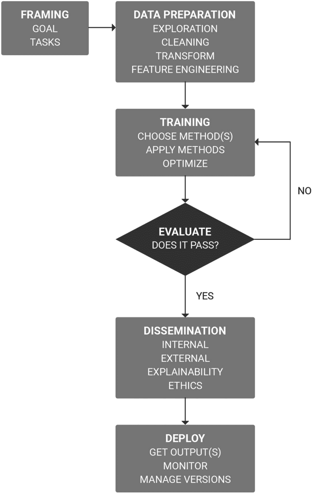
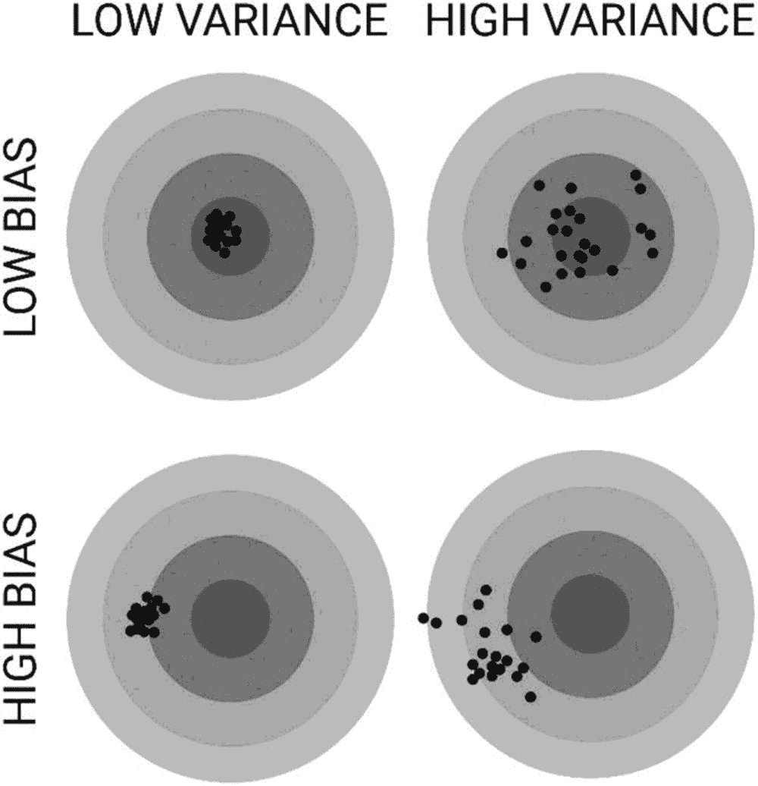
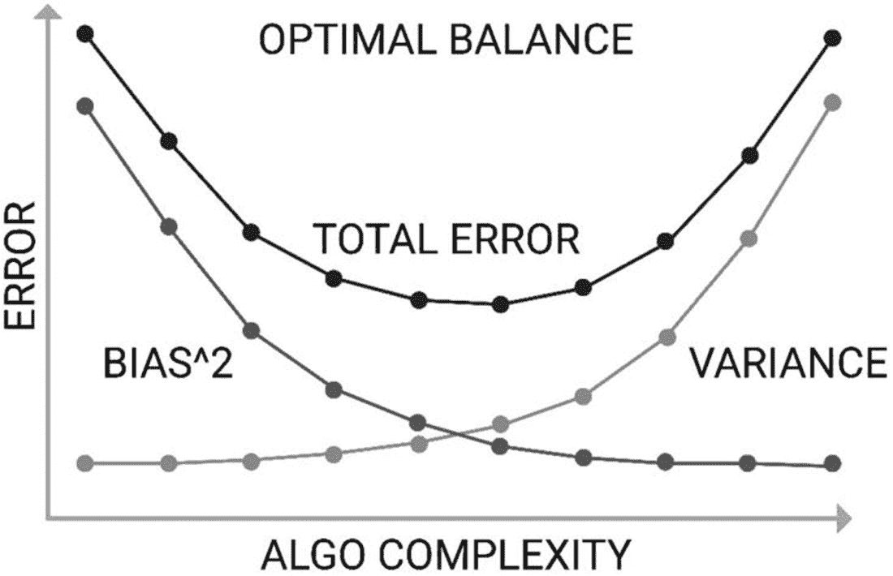
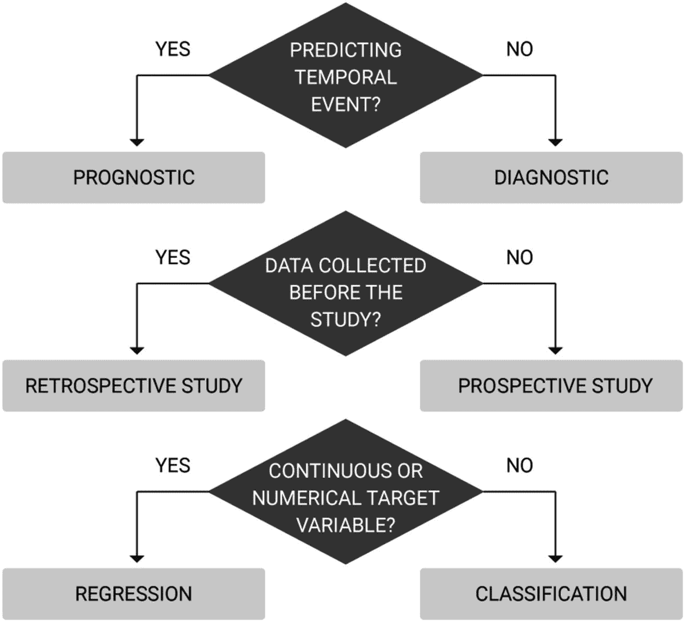

# 5. 如何执行机器学习

> *机器学习可以拓展我们的生命、能力和潜力。*
> 
> ——Harkrishan Panesar

机器学习是计算机科学中一个快速发展的、令人兴奋的学科，融合了探索与发现、工程和分析等一系列技能。机器学习利用大量事实性的历史数据来帮助我们更好地理解行为。

虽然一开始可能令人生畏，但通过分步骤的方法来执行机器学习及其先决条件，即使不是统计学家或程序员专家，也能成功完成项目。尽管数学和编程知识无疑是有利的，但许多机器学习算法都是现成的，并使用预先存在的库，因此很少需要从头开发全新的算法。

机器学习项目的方法与其试图解决的问题一样独特。然而，机器学习或数据科学生命周期中涉及的工作流程被详细阐述，可作为方法论使用。

## 执行机器学习项目

了解执行机器学习项目所涉及的工作流程，有助于明确项目团队所需的技能，并有助于与他人沟通这些内容。

机器学习项目的目标是开发能够从训练数据中的信号进行学习的算法。

在用于开发机器学习模型的方法论中，定义了七个工作流程（图 5-1）。这些阶段中的每一个都可以迭代执行，这意味着工作流程可以在过程中的任何步骤重复进行。

图 5-1

执行机器学习项目所涉及的工作流程

1.  问题框架：将手头的问题具体化为一个学习任务（并在继续之前确定它是否是一个机器学习问题）

2.  数据准备：涉及数据探索、分析、洞察和清洗

3.  训练模型：选择学习方法，将其应用于创建模型，并尝试优化所创建的模型

4.  评估：对方法和结果进行客观评估

5.  传播：向利益相关者报告评估结果，并确保可解释性

6.  部署：发布训练好的机器学习模型，监控持续的使用情况和准确性

### 框架构建：明确问题

机器学习的第一步是明确问题。这包括理解问题是什么、机器学习项目的目标，以及如何评估实现目标的尝试。了解你为何要解决这个问题很有帮助，尤其是在为机器学习项目制定预算方案时。这需要评估以下内容：

*   为什么这个问题很重要？
*   你希望达成什么目标？你最大的期望是什么？
*   当前任务的输入和输出是什么？
*   这些数据是否可用？
*   结果将如何带来益处？
*   这是探索性的工作吗？
*   关键绩效指标（KPI）是什么？如何衡量性能？
*   成功的标准是什么？
*   我们手头是否有完成这项任务的人才？
*   当前任务存在哪些限制？这可能包括时间、资金、技能组合、经验、领域知识、数据可用性等。

要解决问题，你可用的数据将包括示例和背景信息。

#### 收集示例

分类是一项可以通过示例学习的技能。它可用于预测性任务，例如疾病风险或资源需求预测。

某些问题会出现在传统的医疗场景中，例如来自医疗预约的数据以及某些诊断附带的补充手写笔记。糟糕的示例有助于引入错误。对于分类任务，示例通常以正例和反例的形式提供。

#### 背景信息

这指的是与机器学习问题相关的知识和公理。这可能包括元数据、属性或概念之间的关系。

例如，在高血压预测工具中，根据医学证据和数据，2 型糖尿病的诊断将与高血压的可能性相关。这些信息被用于学习的概念中，以实现分类。

#### 数据中的错误

请注意，现实世界中的错误可能会潜入数据，例如人为错误、错误分类、数据缺失、错误的背景信息以及重复数据。

错误可能通过多种方式潜入，例如纸质文档的数字化以及机器对书面文字的读取。务必记住，模型的质量取决于它所获得的数据。值得花时间验证数据，以确保人为错误降至最低。

### 数据准备

机器学习算法从它们所训练的数据中学习。为模型提供有效且稳健的数据以供学习至关重要。

数据必须以可用的格式进行准备。在现实场景中，这涉及理解用于建模问题的数据并导出数据。然后必须对数据进行处理，以确保格式正确、删除错误数据并修复任何缺失数据。数据集的大小可能超出所需，因此可能还需要进行数据集采样。

每位机器学习从业者都需要掌握数据准备的技能。数据预处理对于获得整洁、有效的数据至关重要。整洁、有效的数据是获得稳健、真实结果的关键。为了开发一个高度适用于特定领域的机器学习模型，能够高效实现算法的技术专家必须与能够理解数据、对其进行分类并找出趋势和模式的领域专家合作。

数据准备是机器学习中迄今为止最重要的方面。

#### 我需要多少数据？

遗憾的是，这个问题没有明确的答案——这取决于具体情况。这是你在训练模型并将其部署到现实世界的过程中需要探索的问题。

有几个因素会影响“学习曲线”。这些因素包括问题的复杂性和算法的复杂性。这反过来又会影响所需的数据量。模型能否输出在现实世界中具有真实性的结果，将取决于算法的复杂度和所提供数据的质量。

评估更多数据的可用性和有用性。在医疗场景中，关于药物的随机对照试验在任何特定场景下很少评估超过 1000 名患者。在外科场景中，获取更大的数据集是可能的，但训练模型可能并不需要。

非线性、非参数算法需要更多数据才能提高其准确性。这些通常是更强大的机器学习方法。然而，由于数据的有效性会影响偏差和方差，因此关键是要在尽可能多的数据上高效地对模型进行稳健的训练和验证。

### 训练机器学习模型

任何机器学习新手都会问的标准问题是：“我应该使用哪种算法？”算法的选择取决于几个因素，包括数据的大小、质量和性质；任务截止日期；以及使用数据的可用资源和动机。学习技术也被称为“解决方案的表示”，因为每种机器学习方法都以不同的方式表示数据。算法本身是现成的，不需要从头开始编码。

话虽如此，某些算法比其他算法更适合特定问题，这有助于决定尝试哪些算法：

*   分类：逻辑回归、支持向量机、随机森林、朴素贝叶斯
*   回归：线性回归
*   特征降维：主成分分析（PCA）、线性判别分析（LDA）
*   聚类：K 均值算法、线性判别分析（LDA）
*   协同过滤：交替最小二乘法

几乎不可能预测哪种方法在数据上表现最佳。即使模型在训练和验证期间表现良好，也不能保证它在现实世界中也能表现良好。

没有免费的午餐

机器学习中的“没有免费的午餐”定理指出，没有一种算法能对所有问题都表现最佳。这对于监督学习尤其相关，因为有许多因素会影响算法的性能。

#### 我应该使用哪种编程语言？

机器学习任务通常使用多种编程语言进行：主要是 R、Python、Matlab 和 SQL。Java 和 C 也常被使用。

*   R 通常用于统计分析。它允许你使用统计方法和图表来理解和探索数据，并包含广泛的机器学习算法。
*   Python 是一种非常适合机器学习的语言。像 numpy 和 SciPy 这样的扩展对于机器学习和数据分析特别有用。
*   Matlab 是许多大学生入门时使用的语言。它对于快速原型设计很有用，因为它包含一个大型的机器学习库。
*   SQL 是一种用于管理传统数据库管理系统（DBMS）中数据的语言。

#### 我应该从零开始编写机器学习算法吗？

从资源和价值角度出发，需要做出多项决策，这些决策会影响所采用的方法。概念验证项目可能时间紧迫，而高度具体且复杂的任务则会包含多种方法的组合。

完全可以通过实现学习库（如 scikit-learn、SciPy、pandas、Matplotlib、TensorFlow、Keras 等）提供的现成算法来运行机器学习算法。

这曾是机器学习的传统方法：组建一个数据科学团队，其中包含精通 Python 和 R 等语言的成员。拥有机器学习经验的成员通常比机器学习概念的初学者更具影响力。

工程师通过经验积累，能够理解针对特定问题应采用的适当机器学习技术。这种经验对于避免浪费时间、资源和探索至关重要。

具备计算机科学基础的工程师通常熟悉机器学习中的许多概念。选择编程语言会影响你在实现中可使用的 API 和标准库。爱好者可能希望避免使用现成算法，而是自己编写实现代码，以更深入地理解其中涉及的数学、统计学和逻辑。

在许多时间受限的情况下，用于工程热情的时间是有限的。诸如 Google AI、Microsoft Azure、IBM Watson 以及众多其他提供商提供的基于云的服务，允许提供商负责算法部分；许多服务还提供可视化界面，使用户能够对上传的数据尝试特定的机器学习技术。

提供数据挖掘和机器学习应用的云服务商正在增长，且成本低廉。使用此类服务商的好处之一是能够为实验尝试多种模型并比较结果，从而为你的问题任务找到最佳解决方案。

对于拥有更传统编程经验的人来说，几乎所有服务商都提供 API 或 Web 服务创建工具，允许你创建接口来与托管的模型进行交互。与 API 集成所需的全部条件就是一位高效的传统程序员或 Web 开发者。

随着世界拥抱开源，可以考虑通过 GitHub、Reddit 和其他机器学习论坛浏览已经存在的实现。

API 代表应用程序编程接口。API 能够实现软件组件之间的通信，尤其可用于连接基于云的机器学习提供商和内部开发团队。有许多公共 API 可用于辅助你的机器学习任务。

嵌入机器学习 API 应谨慎且明智地进行。在日益开源的环境中，除了良好的文档和功能外，还要确保有可见的流行度和稳健性指标，例如 GitHub 状态、搜索引擎流行度和相关讨论。

#### 训练数据和测试数据

从准备好的数据中选出测试集和训练集。算法在训练数据集上进行训练，并在测试数据集上进行评估。

在许多情况下，需要尝试多种机器学习方法。在机器学习建模方面，理解两个术语很有用：

*   **信号**：数据集中真实的底层模式
*   **噪声**：数据集中随机或无关的模式

某些机器学习技术可能只返回一个解决方案，而其他技术可能产生多个解决方案。通常的做法是收集它们的输出（也称为假设或学习模型）并评估其输出。

假设的评估通过评估预测准确性、可理解性或实用性来进行。在大多数情况下，会使用奥卡姆剃刀原则，即在其他条件相同的情况下选择最简单的解决方案。评估完成后，会选择一个候选假设。

有多种方法可以将数据划分为训练集和测试集，以训练机器学习模型。

##### 预测准确性

预测准确性指的是智能体执行分类任务的准确程度。

##### 可理解性

可理解性指的是我们人类理解输出的程度。在现实世界中，这可以转化为许多不同的场景。

最近，两个 Facebook 机器人开始用它们自己创造的语言互相交谈，这种语言人类无法理解 [93]。

##### 实用性

实用性指的是针对特定问题的价值衡量标准。例如，在药物合成中，对人体食用不安全的化合物组合可能是最佳组合。但这并不具有最大的实用性。同样，实用性可能会优先于准确性和可理解性。

#### 留出法

留出法是一种可以采用的简单训练方法，它涉及保留一部分数据用于测试，将剩余数据用于训练和验证模型。

测试通常能给出模型有效性或准确性的指标。

#### n 折交叉验证

n 折交叉验证涉及将数据集分成大小相等的实例组（或折）。然后，模型在所有折上训练，但留出一折，并在最后留出的那一折上进行测试。这个过程会重复进行，每次迭代都会留出不同的折。

折的数量可以根据数据集的大小而变化。常见的折数包括三折、五折、七折和十折。其目的是在训练集和测试集中数据的大小和代表性之间取得平衡。它使得模型能够在不同的数据集上被测试 n 次。这使我们能够充分利用数据，在其上训练 n 次。

一些机器学习文献可能将交叉验证称为机器学习过程中的交叉验证阶段。这是因为机器学习工程师经常使用这种方法来降低过拟合的可能性。

#### 蒙特卡洛交叉验证

蒙特卡洛交叉验证类似于 n 折交叉验证。它涉及将数据集随机分成训练数据和测试数据。模型根据训练数据进行调优，并使用测试数据评估预测准确性。然后对多次分割的结果进行平均。

#### 我应该使用哪些算法？

通常无法从一开始就确定要使用的算法。尝试多种与你的问题相关的技术。这使你能够比较并根据准确性、可理解性和实用性来选择解决方案。即使是最有经验的数据工程师，在尝试各种算法之前也无法判断哪种算法表现最好。

所有机器学习软件都支持多种算法。通过尽可能多地尝试可行的算法，为任务找到最佳算法。

### 方法与结果的评估与优化

机器学习任务的性能因所给数据的表示方式而异。例如，由 AI 系统分析的患者记录并非直接检查患者。相反，数据被输入系统，每条与患者表示相关的信息被称为一个特征。作为表示的一部分，并不需要完整的特征集才能获得高置信度的输出。

机器学习算法的目标是良好地泛化，既不过拟合也不欠拟合。泛化指的是模型在训练期间未见过的实例上以最大准确性执行。

关于机器学习项目评估方法的更详细讨论，请参见第 7 章。

#### 算法准确度评估

许多监督学习问题涉及二元分类，其任务是学习一种方法，将未见过的数据分类到两个类别之一。这两个类别通常被称为正类和负类：

*   如果二元分类器在处理新数据时，本应被归类为负类，却被错误地归类为正类，则称为**假正例**。

*   **假负例**则是指分类器将新数据归类为负类，但该判断是错误的。

在许多医疗场景中，假正例的危害通常小于假负例。例如，在此类场景中，假正例可能包括根据一组特定症状对患者做出疾病诊断。显然，被告知患有某种疾病而实际上并未患病，要好过被告知没有患病，结果却发现事实恰恰相反。假负例意味着某人未被诊断出疾病，这或许更令人担忧。

衡量特定假设在测试数据集上预测准确度的一个简单方法是，计算正确识别出的结果（包括正类和负类）的数量。

例如，如果一个心脏病诊断工具学习了一个假设，并用它对 250 名新候选者进行分类，判断其是否患有心脏病。该工具正确地将 150 名正类中的 133 名和 100 名负类中的 98 名进行了分类，那么它的准确率为：

*   (133 + 98) / 250 = 92.4%

这意味着，对于未见过的样本，该工具有 92%的概率能正确分类。

泛化能力通过准确度来衡量。欠拟合和过拟合都会导致模型性能不佳，并对准确度产生不利影响。如果一个模型在测试中的分类准确率为 92%，但在未见过的数据上只有 30%，我们就说该模型从训练数据到未见数据的泛化能力不佳。

这就是过拟合。过拟合是指模型对训练数据拟合得过于完美。它记住了答案，而不是从数据中学习概念。在这种情况下，模型无法区分信号和噪声，而是学习了数据中存在的噪声。因此，模型无法理解数据中的实际模式（即信号）。该模型无法应用于新数据，这损害了模型的泛化能力，使得模型毫无用处。决策树就是可能对训练数据过拟合的算法示例。这可以通过剪枝来改善。在许多情况下，保持模型简单反而效果惊人。

如果一个模型在训练数据集上的表现优于在未见过的测试集上的表现，那么该模型很可能存在过拟合。交叉验证是一种用于衡量过拟合程度的技术。此外，使用更多数据进行训练可能有助于算法推断出更好的假设。

“更多数据带来更好结果”这一概念具有误导性。在许多情况下，更多数据确实可能有帮助。然而，更多数据并不意味着数据质量好。如果添加的是带有噪声的数据，则无助于减少过拟合。因此，确保数据干净且合适至关重要。

数据泄露发生在你用于训练机器学习模型的数据包含了你试图预测的信息时。这会导致泛化能力差，并加剧过拟合。数据泄露可能源于测试数据泄露到训练数据中，或者引入了额外的特征。一个简单的数据泄露例子是，模型将响应变量本身用作预测变量，从而得出诸如“患有结膜炎的患者患有结膜炎”这样的结论。

如果你机器学习算法的性能好到令人难以置信，那么数据泄露可能就是原因所在。n 折交叉验证有助于减少数据泄露。

欠拟合很容易检测，因为它会表现出较差的性能。它指的是一个模型既无法对训练数据进行建模，也无法泛化到新数据。通常，这表现为特征过少的简单模型。结果往往倾向于偏差大于方差（即，得出错误的结果）。

#### 偏差与方差

监督式机器学习的目标是理解数据集中的信号，同时忽略噪声。

机器学习面临一个难题，即如何最小化两种导致预测误差的来源，这些误差阻碍了监督学习算法超越其训练集进行泛化。在模型最小化偏差和方差的能力之间存在一种权衡（也称为偏差-方差权衡）。

#### 偏差

偏差指的是模型因从错误数据中学习而产生的误差。虽然这听起来很奇怪，但数据集可能呈现随机性。偏差衡量的是这些模型的预测值与实际正确值（或真实信号）之间的总体偏离程度：

*   **低偏差**：对数据集中的真实信号理解得更好

*   **高偏差**：对数据集中的真实信号理解得更差

高偏差通常表明可能存在更好的机器学习技术。

#### 方差

方差指的是因对训练集波动敏感而产生的误差：

*   **低方差**算法基于数据集输出相似的模型。

*   **高方差**算法基于数据集输出差异显著的模型。

偏差和方差可以用飞镖盘的类比来最好地说明（见图 5-2）。想象一个飞镖盘，其靶心代表一个能完美预测正确值的模型。

图 5-2

偏差与方差示意图

当你离靶心越远，预测结果就越差。如果每个新模型都由一支新飞镖代表，那么每次投掷都代表了在给定训练数据可变性的情况下模型的一次实现。有了良好的数据分布用于训练，模型就能做出很好的预测。

包含异常值和冗余数据的数据会导致预测结果不佳。这可以在飞镖盘上直观地体现出来。

工程师在使用机器学习算法时必须做出的权衡是：低偏差算法必须足够灵活，以便很好地拟合数据。然而，如果灵活性过大，每个数据集都会被不同地解释，从而导致高方差。有几种方法可以降低算法复杂度，这些将在第 4 章中讨论。

许多监督学习工具包提供了控制偏差-方差权衡的方法，要么是自动进行，要么是通过提供一个可调节的参数。

与低偏差算法相比，低方差算法往往具有较低的复杂度。低方差算法具有简单或刚性的结构，导致生成的模型虽然一致，但平均而言不准确。这包括诸如回归、朴素贝叶斯等算法。

低偏差算法往往更复杂，结构更灵活。因此，它们平均而言是准确的；然而，它们可能不一致。这包括非参数算法，如决策树和 k 近邻。

在你的项目中，关键在于找到偏差和方差之间的平衡点，以最小化总误差（见图 5-3）。

图 5-3

寻找最优算法平衡点

*   总误差 = 偏差² + 方差 + 不可约误差

不可约误差指的是无论使用何种模型或数据集都存在的误差。这是来自训练数据的噪声。它是一个常数，因为现实世界的数据总是存在一定程度的噪声。

#### 性能度量

评估算法的方法示例包括：准确度、查准率与查全率、平方误差、似然、后验概率、成本以及熵（K-L 散度）。

#### 优化

模型表现良好并不意味着它就是最佳且唯一的模型。关键在于从结果中获得最大准确性。诸如交叉验证之类的技术有助于确定模型结果的置信度。然而，我们还可以进一步优化机器学习算法。

此外，我们可能希望提升输出结果所需的时间性能。

算法可以通过以下方式进行优化。

##### 算法调优

调优可以理解为优化影响模型的参数的过程，以使算法能够根据所定义的“最佳”标准，实现“最佳”性能。

##### 训练与验证数据

采用 n 折交叉验证技术来处理机器学习问题，可以让你验证结果；而保留法（hold-back methodology）则采用一种瀑布式的方法进行学习。

##### 评估多种方法

尝试多种机器学习方法有助于确定哪种方法能获得最准确的结果。

#### 通过更好的数据改进结果

有几种方法可以通过数据来提升性能，包括以下几种。

##### 获取更多数据

如果你能获取更多数据，这可能有助于模型提升其性能。

##### 获取更高质量的数据

在可能的情况下，获取更高质量的数据通常比获取更多数据更好。这通常会改善数据中的信号，并减少噪声。你还可以通过清洗数据来提高数据质量。

##### 重新采样数据

将样本数据划分为不同的大小或分布，可能能更好地表达概念，或通过减少属性（特征）来帮助提升性能。

##### 数据表示

通过不同的机器学习方法，数据可以以不同的方式表示。改变所应用的机器学习方法类型并重新评估问题，可能会优化你的模型。

##### 特征选择

处理重要和不重要的特征，可以为你的模型提供新的推理依据。增加特征数量并不总是有益的。然而，在无监督学习的情况下，包含所有特征以确保没有任何遗漏可能是有益的。

##### 特征工程

成功的关键在于数据的表示。特征工程涉及通过分解和聚合以其他方式展现数据。

关于数据力量最著名的引述之一来自谷歌研究总监兼机器学习先驱彼得·诺维格，他声称：“我们并没有更好的算法。我们只是拥有更多的数据。”

#### 我应该选择监督学习还是无监督学习算法？

在开发模型时，很少是单纯选择监督学习或无监督学习的情况。事实上，它们通常可以结合使用。无监督学习是用于降维和特征工程的有用技术，这些技术可以用于监督学习问题。

#### 集成方法

当多个分类器专门处理问题的不同方面时，就形成了集成方法。集成方法将模型转化为一个特征。有三种类型的集成算法，即装袋法、提升法和堆叠法，详见第 4 章。

集成方法适用于机器学习的高级实践者。

#### 问题分布

另一种优化方法是分布处理机器学习任务所使用的计算资源。微软的 Azure 和谷歌的 AI.io 等工具就是能够大规模分布问题的仓库示例。实际上，大多数问题都可以在单台多核机器上处理。

#### 实现问题

用户界面（UI）是涉及人机交互的机器学习应用中的关键组件。这不仅是显示结果的地方，也是收集最多智能信息的地方。在与用户互动时，重新思考用户界面和用户体验是值得考虑的。

### 传播结果

在许多情况下，这是确保内部利益相关者支持机器学习项目的最关键方面。机器学习项目是否成功并不重要；如果人们不理解事件背后的原因，就可能失去对采用创新技术的支持。通常，在组织内部，一份 PowerPoint 演示文稿和白皮书就足以展示成果。

报告结果的方式有很多种，评估的程度也各不相同。例如，一份内部白皮书可能已经过组织内部利益相关者的审阅，而在同行评审期刊上发表一篇评估创新的文章可能更受欢迎。随着医疗保健领域迅速拥抱大数据和机器学习，强有力的证据来证明人工智能的益处和影响至关重要，以确保只有基于证据、经过临床验证的框架和技术才能被使用和进一步发展。

就像你不会想要服用假药一样，你也不会想要使用那些未经评估、没有公开可查数据的、会影响你健康的技术。

将问题视为一个科学实验，评估以下内容：

*   **原因**：定义问题的背景以及解决问题的动机。

*   **问题**：将问题描述为一个疑问。

*   **解决方案**：解释所提出问题的答案。

*   **发现**：描述数据中的发现以及模型得出的推论。

*   **结论**：评估从项目中学到的东西，并讨论其局限性、伦理问题、隐私和数据敏感性（特别是涉及 CCPA 和 GDPR 等数据法规时）。

*   **监控**：如果计划部署模型，如何通过使用过程来监控和评估预测结果？

一旦你报告了你的发现，就由你的利益相关者来决定项目在部署前的价值，甚至是否要部署。

讨论的主题包括如何处理假阴性和假阳性的报告，以及预测性声明的准确性。预测的影响是一个关键的考虑因素。有些问题可能是首次遇到。例如，使用所涉及的数据有哪些法律问题？机器学习模型何时是真正具有预测性的，还是仅仅是巧合？能够精确诊断某人患癌风险的影响是什么？

诸如可穿戴设备、追踪器和电子健康记录（EHR）等新颖的信息来源，将机器学习置于创新和伦理探索的领域。这对更广泛的医疗保健和保险业影响巨大，应在机器学习研究项目中予以考虑。

机器学习预测模型领域已经取得了进展，特别是在生物医学研究中，已经发布了模型报告指南，包括识别预测问题、确保 n 折交叉验证以及结果校准的步骤（见图 5-4）。

图 5-4

理解手头的任务

校准在临床实践中具有重要意义，它指的是模型做出的预测与观察到的结果之间的关系。

例如，如果预测模型“预测一名肺癌患者在未来一年内有 70% 的死亡风险，那么如果在我们数据集中，大约 70% 的肺癌患者在未来一年内死亡，则该模型校准良好。”

#### 部署前是否需要向利益相关者传播项目成果？

最终，在向更广泛的利益相关者传播项目成果之前部署机器学习模型，是一个组织层面的决策。这种做法存在若干固有风险，包括团队或组织内部缺乏治理和理解。管理和监控部署需要投入资源，最好提前规划，而非事后应对。

在部署公共项目之前，应进行多种形式的独立评估。除了预测评估，还必须解决网络安全问题，包括渗透测试和网络事件响应评估。机器学习模型可能引发意外后果——这可能会让那些既不了解也未参与相关影响的团队措手不及。

### 部署

部署机器学习模型，是将模型从测试或预发布环境迁移到生产环境的过程。此后，模型可供他人访问，并向其他代理（无论是人类还是计算机）提供输出。

机器学习模型只有在可被访问时才能提供价值，因此部署是机器学习项目生命周期中至关重要的最终阶段。

部署还应包含一个记录所有观测值和预测结果的机制，以及一个流程，用于监控和定期评估不断增长的日志，以确保其相关性和无害性。大多数已部署的项目将托管在云服务器上，这使得审计相对简单。此外，云服务器还支持可扩展性，这是一项额外优势。

应实施一个流程来监控和管理已部署模型的使用情况，并对相关数据进行分类处理。

### 结论

机器学习始于提出正确的问题。通常情况下，问题框架的构建是过程中最困难的部分。而迄今为止，最耗费资源的环节是数据准备。

构建正确的问题能提供一个明确定义的目标函数，使利益相关者能够识别所需数据、解决问题的方法、潜在影响以及所需资源。最初提出的问题可能并非正确的问题，但通过迭代式地修正问题，可以逐步朝着更清晰、更明确的目标前进。如果没有提出正确的问题，数据科学团队可能会在收集数据和训练模型上浪费无数时间，而这些模型最终对预期目标毫无用处。

要做好准备，你提出的假设或问题可能无法从数据中的信号得到答案——并探索这种可能性带来的后果。

随着组织利用机器学习，如果不能完全理解感知到的失败的真实原因，可能会降低人工智能的感知价值，并导致未来支持减少。

追求简洁。只要可能，保持简单总比过度设计、构建复杂且昂贵的机器学习模型要好，因为后者难以解释和传播。

