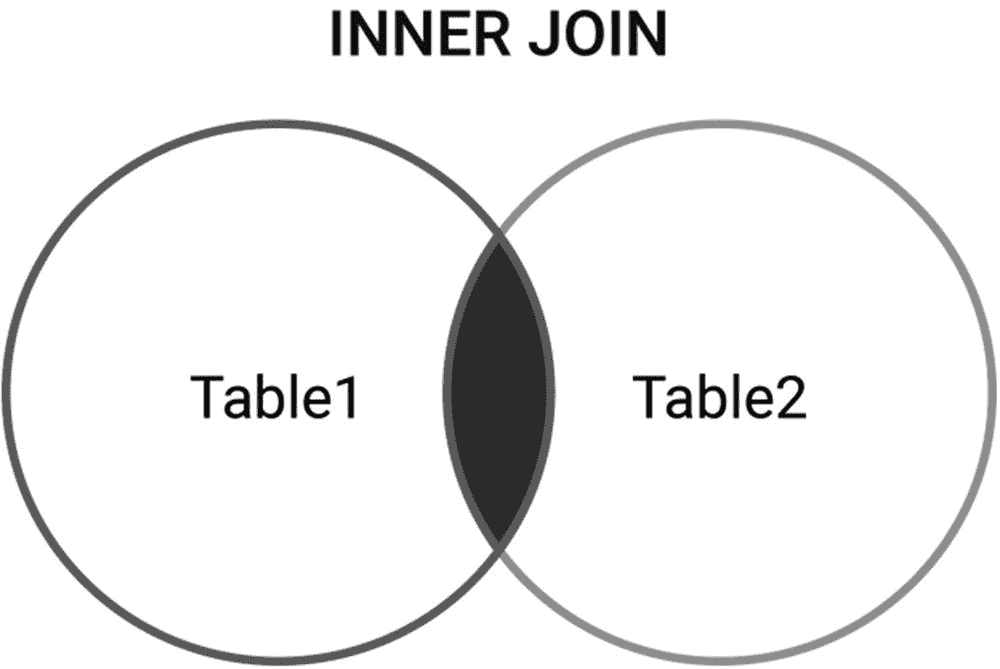
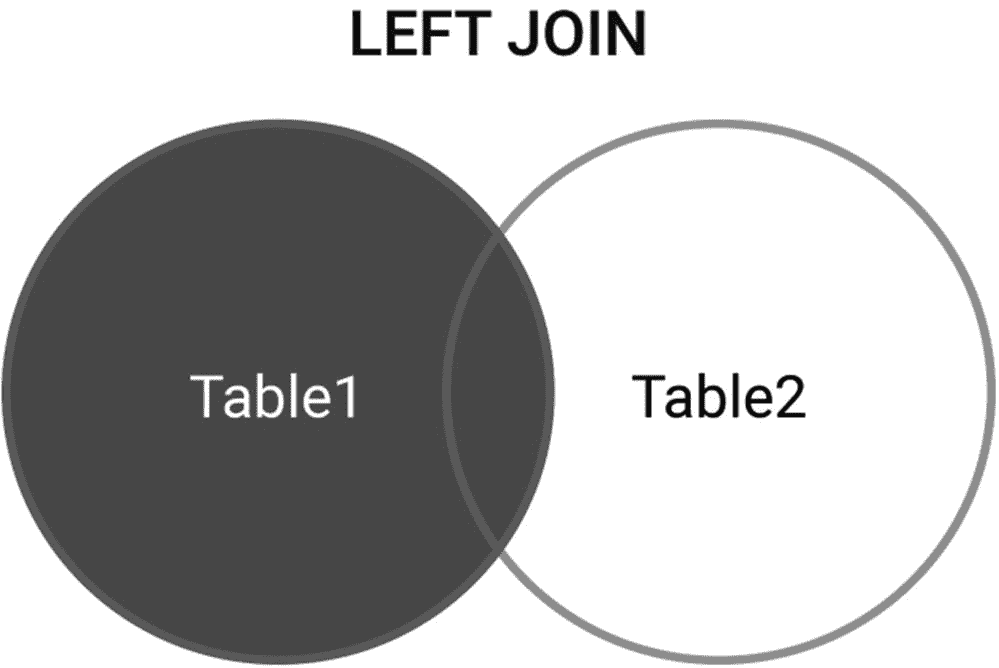
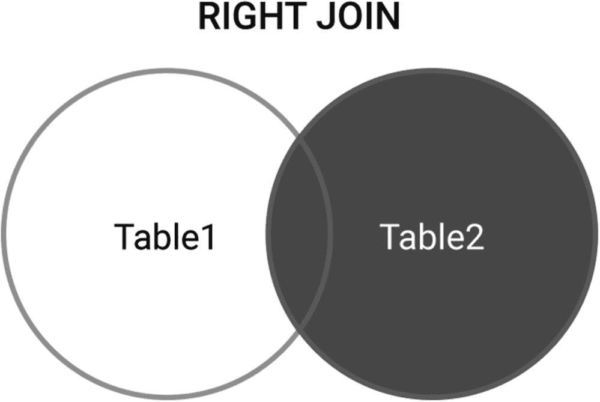
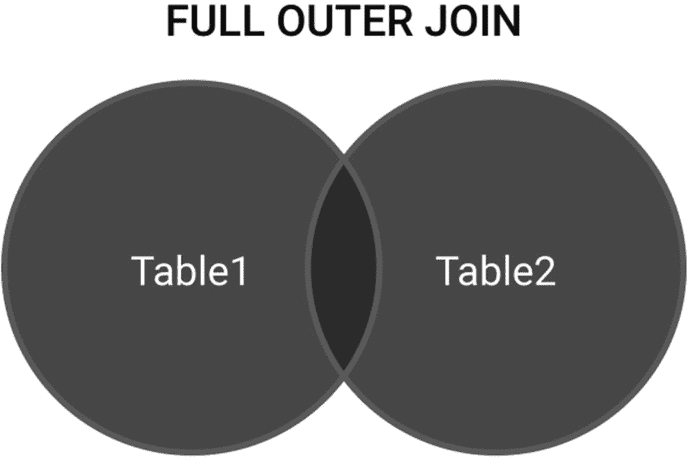

# 6. 准备数据

> *成功取决于事先的准备，没有这样的准备，失败就不可避免。*
> 
> ——孔子

机器学习围绕训练算法以执行各种计算密集型任务展开。算法的训练是通过向模型输入数据来完成的，因此，数据清洗和准备是任何数据或机器学习项目中最关键的步骤。再怎么强调也不为过：即使将糟糕的数据输入世界上最先进的机器学习模型，也会产生糟糕的结果。

这一切都是有充分理由的。无论是前往餐厅的路线、叫出租车、导航飞机，还是接受在线购物篮中的替代品，相信数据和算法胜过我们自己的判断，这种做法既有优点也有缺点。人非圣贤，孰能无过，但当算法犯错时，我们很可能不会再信任它。

现实世界中的数据本质上是碎片化的。在医疗保健领域，电子健康记录（EHR）分布在多个分布式数据库系统中。入院数据、处方数据、可穿戴设备数据和行为数据都各自孤立地存在。将数据汇集在一起的行为，即数据链接，通常会创建新的数据表，这些表中可能包含存在缺失、不完整或已转换值的变量。

人们对机器学习工程师有许多看法。现实情况是，大多数优秀的工程师将大部分时间花在清洗和准备数据上。

制定适当的数据准备计划、填补缺失值、删除行和不必要的变量、以及转换特征，是一些最常见的数据准备实践。

## 数据准备的阶段

在项目的数据准备阶段，目标是确保数据集处于最适合机器学习的状态。

数据准备有五个不同的阶段，如图 6-1 所示：


图 6-1

数据准备的五个阶段

1.  收集

2.  探索

3.  清洗

4.  转换

5.  扩展（主要通过特征工程）

数据的审查和分析需要理解数据库和结构化查询语言（SQL），这是任何机器学习工程师或数据科学家必备的技能。

## 什么是数据库？

数据库是数据的结构化集合，通常以表格形式电子存储，表格由行和列构成。

作为一种持久化存储机制，数据库允许存储数据并实现诸如 CRUD（创建、读取、更新、删除）等功能。数据库管理系统（DBMS）是用于控制数据的软件。一些流行的 DBMS 示例包括 Microsoft Access、Microsoft SQL Server、MySQL、Oracle Database 和 Ingres。

数据库有多种类型，其中最常见的有以下几种：

*   **关系型数据库**是最流行且使用最广泛的数据库类型。关系型数据库将数据存储在结构化的表中，包含行（记录）和列（变量或特征）。结构化查询语言（SQL）是用于查询关系型数据库的语言。

*   **层次型数据库**结构类似于树，以父子关系存储数据。每个子记录只有一个父记录。父记录可以有多个子记录。层次型数据库的示例包括 IBM 信息管理系统（IMS）和 Windows 注册表，检索数据需要遍历每个树直到找到记录。网状数据库是层次型数据库的扩展，其中子节点可以有多个父节点，因此存在多对多关系。

*   **面向对象数据库**将数据存储为对象，为面向对象编程语言提供数据库功能。

*   **NoSQL 数据库**是非关系型的，意味着它们没有预定义的模式，因此允许存储和操作半结构化和非结构化数据。NoSQL 数据库分为五类：列、文档、图、键和对象。

虽然大多数人对关系型数据库比较熟悉，但受网络和移动应用程序的使用、存储和处理非结构化数据的需求，以及永恒的速度提升要求所驱动，NoSQL 数据库的使用量激增。


### 数据库面临的挑战

针对特定场景的最佳数据库类型，取决于个人或组织希望如何使用所存储的数据。在大多数情况下，数据库需要近乎实时地返回复杂查询的结果。这使得性能提升成为数据库维护工作的核心焦点。

#### 应对不断增长的数据量

随着数据来自可穿戴设备、传感器、联网设备、用户行为以及各种其他来源，应对高速数据源和不断增大的文件体积，是大多数数据库管理员（从新手到经验最丰富者）面临的主要难题。

#### 可扩展性

很难准确预测需要多少存储空间。由于存储需要真金白银，一个能够根据所有者需求进行伸缩和调整的数据库更受青睐。

#### 可访问性

对数据库的要求日益增长。在当今世界，各种利益相关者需要实时访问数据，以支持决策、抓住新机遇并理解趋势。

#### 数据库管理与维护

必须对数据库进行维护，以防止问题并确保遵循行业最佳实践。随着数据复杂性和数据量的增长，需要投入更多时间资源来监控和优化数据库。这可能包括定期备份、检查数据库是否损坏、确保安全措施到位、监控性能以及为预期需求进行规划。

#### 维护数据安全

随着数据量和可访问性要求的提高，保护数据免受入侵者攻击变得越来越困难。随着技术的创新，网络犯罪分子也在不断进化。

### 数据库与电子表格有何区别？

数据库和电子表格都能存储数据。然而，主要区别在于数据的存储方式、可存储的数据量以及数据的访问方式。

电子表格最初是为单个用户设计的，该用户不希望执行过于复杂的操作。因此，电子表格的功能有限，其特性也反映了这一点。例如，需要仔细考虑如何最好地衡量对电子表格的并发访问。

而数据库则旨在容纳更大的数据集合，并允许多个用户通过编程语言安全地查询数据。

## 什么是结构化查询语言（SQL）？

无论是在项目的数据准备阶段还是数据分析阶段，对 SQL 的良好理解都将有助于处理大部分数据和机器学习任务。

结构化查询语言（SQL）是用于与关系型数据库通信的编程语言，也是数据准备的首选语言。

使用 SQL 的常见数据库管理系统包括 MySQL、Microsoft SQL Server、Access 和 PostgreSQL。MySQL 是免费使用的，是业余爱好者和企业用户的热门选择。

尽管存在多个版本的 SQL，但它们在结构上非常相似，这意味着如果你了解如何使用一个版本的 SQL，你几乎就学会了所有版本。

本章将介绍最重要的命令和概念。

### 常见 SQL 命令与概念

常见的 SQL 命令包括 select、insert、update、delete、create 和 drop。

SQL 包含一组称为保留字的词汇，这些词汇被用作命令并被解释执行。因此，这些词不能用于命名表或变量。完整列表可在补充材料中找到。

#### 创建表

关系型数据库将数据存储在称为表的对象中。表由行和列组成，用于存储数据，并通过名称进行唯一标识。行指代记录，列指代特征或属性。

***create table*** 命令用于在 SQL 中创建表。创建表需要指定表名、字段及其各自的数据类型。语法如下：

```
create table Example_Table {
column1_name datatype
column2_name datatype
column3_name datatype
...
};
```

其中 columnX_name 指列的名称，datatype 指该列所保存的数据类型。常见的数据类型包括以下几种：

| char(n) | 一个固定长度的字符串，长度 *n* 在括号中指定。最大大小为 255 字节。 |
| --- | --- |
| varchar(n) | 一个可变长度的字符串，最大长度 n 在括号中指定。 |
| number(n) | 一个数值，最大位数在括号中指定。 |
| date | 一个日期值。 |
| number(n,i) | 一个数值，总位数最大为 "n"，小数点后最多有 "i" 位数字。 |

数据类型的完整参考列表可在随附材料中找到。

假设我们要创建一个小型数据库系统，用于管理一个医院网络的急诊入院情况，该系统主要关注三个实体：入院记录、地点和患者。每个实体都需要一个对应的表。每个表将描述这些实体的特征。每个特征将是表中的一个独立列。

为了便于说明，一个可用于记录医院急诊病房入院情况的表可以定义如下：

```
create table Emergency_Admissions {
[ADMISSION_ID] INT IDENTITY(1,1) PRIMARY KEY
[LOCATION_ID] INT,
[PATIENT_ID] INT,
[ADMISSION_DATE] DATE,
[PRESENTING_WITH] TEXT,
[CONTACT_TELEPHONE] INT
[EMAIL] CHAR(50),
[PRIORITY] BIT
}
```

在该示例中，入院记录实体有七个属性：入院 ID、地点 ID、患者 ID、入院日期和时间、呈现症状、联系电话号码以及是否为优先入院。每次入院都有一个唯一的 ID，并通过地点 ID 和患者 ID 来标识相关的医院和患者。

#### 向表中插入数据

***insert into*** 语句用于向表中插入记录：

```
insert into Example_Table {column1_name, column2_name, column3_name, ...)
values (value1, value2, value3, ...)
};
```

其中列名指实体的特征或属性。例如，以下命令可用于向表 6-1 中插入数据：

表 6-1

医院急诊入院记录

| ADMISSION_ID | LOCATION_ID | PATIENT_ID | ADMISSION_DATE | PRESENTING_WITH | CONTACT_TELEPHONE | PRIORITY |
| --- | --- | --- | --- | --- | --- | --- |
| 594 | 11 | 1453 | 08/08/2020 | 脑震荡 | 447755366555 | 0 |
| 595 | 11 | 1225 | 08/07/2020 | 头部创伤 | 447733366552 | 1 |
| 596 | 6 | 997 | 08/13/2020 | 心脏病发作 | 447709366550 | 1 |

```
insert into Emergency_Admissions (LOCATION_ID, PATIENT_ID, ADMISSION_DATE, PRESENTING_WITH, CONTACT_TELEPHONE, PRIORITY)
values ('6','997',Date(), 'Heart attack', '447709366550', '1')
```

#### 主键与外键

表中至少有一个字段是主键。主键作为表中每条记录或每行数据的唯一标识符。表中的每一列都描述了与主键相关的某些信息。在我们的入院记录示例中，主键是入院 ID。

外键是指用于链接两个或多个表之间数据的主键。例如，在我们的急诊入院表中，地点 ID 和患者 ID 都是各自独立表或实体的主键。外键有助于数据库最大限度地减少重复并提高效率。数据库管理的一个重点是节省空间，因此存储所需的最少数据量有助于实现这一目标。


#### Select、From 和 Where 命令

***select*** 命令用于查询数据库并检索符合命令指定条件的数据。***from*** 关键字后的表名指定了要从中检索数据的表。可选地，可以使用 where 子句来指定数据返回所依据的条件：

```
select column1_name, column2_name, column3_name, …
from Table_Name
where condition;
```

要提取我们工作示例中所有入院到位置 11 的记录，我们可以使用以下命令，该命令将仅返回入院表的前两行：

```
select *
from Emergency_Admissions
where LOCATION_ID = 11;
```

***where*** 命令与 SQL 语句一起使用，用于仅识别那些满足指定条件的记录。

***distinct*** 语句通常与 select 语句结合使用，以仅从表中提取非重复值。以下语句将输出表 6-2 中的结果：

表 6-2

不同的急诊入院位置 ID

| Location_ID |
| 11 |
| 6 |

```
select distinct location_id
from Emergency_Admissions;
```

select top 命令可用于指定要返回的行数。此命令对于大型数据集特别有用，因为可能只对其中一小部分结果感兴趣：

```
select top number | percent column_name(s)
from Table_Name
where condition;
```

#### AND、OR、NOT 运算符

逻辑运算符 AND、OR 和 NOT 可以与 where 子句一起使用，根据条件过滤检索到的数据：

*   AND：如果所有由 AND 分隔的条件都为 TRUE，则显示记录。

*   OR：如果由 OR 分隔的条件之一为 TRUE，则显示记录。

*   NOT：如果条件不为 TRUE，则显示记录。

#### Group By

***group by*** 命令将具有相同值的记录分组到聚合行中。因此，它通常与 COUNT、MAX、MIN、AVG 和 SUM 等聚合函数一起使用，以按列对结果集进行分组。使用我们的工作示例，以下语句将输出表 6-3 中所示的结果：

表 6-3

按优先级分组的急诊入院记录

| Count(Admission_ID) | PRIORITY |
| --- | --- |
| 1 | 0 |
| 2 | 1 |
| 596 | 6 |

```
select count(Admission_ID), Priority
from Emergency_Admissions
group by Priority;
```

#### Update 命令

***update*** 语句用于更新表中已存在的数据：

```
update Table_Name
set column1_name = 'value'
where condition;
```

在此示例中，column1_name 指的是其值将被更新的数据库表列。例如，要将我们工作示例中 admission_id = 594 的优先级更新为 1，可以使用以下语法：

```
update Emergency_Admissions
set priority = 1
where admission_id = 594;
```

#### Delete 和 Truncate 命令

***delete*** 语句从表中删除一条或多条记录：

```
delete from table_name
where condition;
```

***truncate*** 命令删除表中的所有行，但保留列和约束。truncate 命令删除表中的所有行，而 delete 命令允许过滤行。

#### 删除表

***drop table*** 命令用于删除表及其包含的数据。语法很简单：

```
drop table Table_Name;
```

其中 Table_Name 是要删除的表的名称。

#### 类型转换

类型转换在准备数据时非常有用，例如，当需要将字符串转换为日期或将整数转换为字符串时。***cast()*** 函数将值更改为指定的数据类型：

```
cast (valuetoconvert AS datatype(size))
```

#### NULL 值

NULL 值指的是没有值的字段。或者，另一种理解 NULL 值的方式是将其视为空白。例如，如果某个表具有某些可选字段，在创建新行时这些字段不是必需的，则可能会出现 NULL 值。NULL 值与包含空格或零值的字段不同。

#### 连接

存储在多个表中的数据需要先合并才能进行查询和分析。连接两个表主要有五种方式，它们都会影响结果表的大小。

##### 内连接

INNER JOIN 命令是最常用的连接命令，用于选择两个表中具有匹配记录的行。该命令仅当列之间存在匹配时才选择行。INNER JOIN 的表示见图 6-2。



图 6-2

INNER JOIN 的集合表示

***on*** 语句用于标识要连接表的列。

例如，表 6-1 和 6-4 可以使用以下 SQL 语句进行连接，以输出表 6-5 中显示的患者姓名列表：

表 6-5

内连接结果

| ADMISSION_ID | ADMISSION_DATE | PATIENT_ID | FIRSTNAME | SURNAME |
| --- | --- | --- | --- | --- |
| 594 | 08/08/2020 | 845 | Susan | Riley |
| 595 | 08/07/2020 | 36 | Ahmed | Ali |
| 596 | 08/13/2020 | 663 | Anupam | Sanyal |

表 6-4

患者联系表

| PATIENT_ID | GP_ID | FIRSTNAME | SURNAME | DOB | CITY |
| --- | --- | --- | --- | --- | --- |
| 1453 | 845 | Susan | Riley | 06/04/1984 | Warwick |
| 1225 | 36 | Ahmed | Ali | 14/03/1955 | Wrexham |
| 997 | 663 | Anupam | Sanyal | 04/04/1938 | Crewe |

```
select ADMISSION_ID, ADMISSION_DATE, FIRSTNAME, SURNAME,
from Emergency_Admissions
inner join Patient_Details
on Emergency_Admissions.PATIENT_ID = Patient_Details.PATIENT_ID;
```

##### 左连接和右连接

LEFT JOIN 命令将返回左表中的所有记录以及右表中匹配的记录。如果右表中没有匹配项，则输出 NULL。集合表示见图 6-3。



图 6-3

LEFT JOIN 的集合表示

类似地，RIGHT JOIN 以相反的方式操作，返回右表中的所有记录以及左表中匹配的记录（如果存在匹配），否则输出 NULL。图 6-4 显示了其集合表示。



图 6-4

RIGHT JOIN 的集合表示

##### 全连接

FULL JOIN 命令，也称为 FULL OUTER JOIN 命令，当左表或右表行中存在匹配时，返回所有记录。

因此，这可能会输出大型数据集，并且计算成本高昂，因为无论另一个表是否匹配，都会检索两个表中的所有匹配记录。图 6-5 显示了其集合表示。



图 6-5

FULL OUTER JOIN 的集合表示


#### SQL 日期函数

每一条健康记录，无论是来自电子健康档案还是可穿戴设备，都带有日期和时间戳。

日期对于评估随时间变化的健康状况至关重要。例如，特定治疗后出现的症状可能被视为副作用，而并发症后的状况则属于后续病症。SQL 提供了几个有用的内置日期函数，可用于操作日期：

*   `GetDate()`：此函数输出当前日期，且不接受任何输入。

*   `DateAdd(period, number, date)`：此函数将给定的时间量（由 period 指定，如小时、天、月、年）添加到所提供的日期上。提供的数字可以创建未来的日期，若为负数则可提供过去的日期。

*   `DatePart(part_of_date, date)`：此函数返回日期时间中的单个部分（如分钟、小时、天、季度、年等）。

*   `DateDiff(part_of_date, date1, date2)`：此函数返回两个给定日期之间的差值。`part_of_date` 指明了输出结果的时间单位。

## 数据收集

机器学习项目的第一个阶段涉及收集项目将要使用的数据集。由于我们处理的是电子健康档案数据，并且出于本章的目的，我们假设机器学习项目中要使用的数据集已经存在。

## 数据探索

一旦收集到数据集，就需要对其进行探索。数据准备的发现阶段使工程师能够理解可用数据及其约束条件和细微差别。

活动包括：

*   有多少数据可用？
*   数据以何种格式提供？
*   数据以何种数据类型提供？
*   日期以何种格式提供？
*   是否存在缺失值？
*   是否存在明显的重复？
*   NULL 值是空值还是 NULL？
*   异常值：离群值是否有效？
*   数据是否平衡？
*   数据中是否存在偏差？
*   是否存在拼写错误？
*   是否存在多个字符串代表相同类别的情况？

一旦审查完可用数据，项目便进入数据清洗阶段。

### 不平衡数据

需要注意的一点是，数据可能是不平衡的。不平衡的特征可能会阻止机器学习模型学习类别如何影响输出。例如，一个主要在白人皮肤上训练的皮肤癌预测算法，对于黑人、棕色人种或任何其他肤色的人来说几乎毫无用处。为了防止这种形式的偏差，你应该为不同的类别计算准确率指标。

## 数据清洗

数据清洗处理不完整、重复、缺失或不正确的值。数据清洗的目的是提高可用于训练模型、提供分析或做出决策的数据质量。机器学习项目的这个阶段最为艰巨，并且会消耗大量时间。数据清洗阶段涉及以下任务。

### 处理缺失值

缺失值是一个常见问题。大多数机器学习模型需要完整的特征集，因此这个活动已被充分研究。缺失值可以被假定为数据集中最常见的值，从其他可用数据中推断出来，或者直接删除包含缺失值的行。

假设一个包含一组患者健康数据的数据表，其中有高血压、心脏病发作和中风诊断的列。如果高血压诊断值为 NULL，则该字段可以被假定为该单元格最常见的诊断值。或者，也可以根据附近的其他值来估算。

例如，心脏病发作和中风诊断可能有助于估算高血压诊断。此外，如果有更多数据可用，高血压诊断也可以从用药数据中推断出来。删除数据通常是最后的手段，以确保重要数据不会丢失或引入任何形式的偏差。

### 矛盾数据和重复数据

如果数据与现实世界相似，则应探究矛盾数据，以确定事件是合理的还是随机的。例如，数据显示患者在出生日期之前入院，这突显了日期格式或表示方式可能存在问题。重复数据最好始终予以删除。

### 探索数据中的异常值

需要探索数据中的异常值，以了解它们是错误的还是重要的。从数据集中移除异常值（或离群值）被称为数据修剪。如果数据与现实世界相似，异常值很可能是合理的。

机器学习的质量取决于你用来训练它的数据。如果数据存在偏差（即不具有代表性），那么学习结果也会有偏差。同时，在探索数据集时，要注意避免引入人为错误。这通常通过确保良好的版本控制来实现。

### 纠正拼写错误、清理值和格式化

确保数据集中没有拼写错误。数字化文本（例如手写文本）可能存在错误。检查你的数据集是否存在错误、偏差和不一致之处。这是一个非常常见的问题。

将文本的大小写规范化为全小写或全大写。遍历数据，评估是否存在唯一项有多个表示形式的情况，并纠正任何拼写错误的字符串或分类。例如，高血压在数据表中可能表示为“high blood pressure”、“hypertension”和“arterial hypertension”，所有这些类别都是正确的，但需要统一以确保数据准确性。

审查所有列的格式，特别注意日期和整数，确保它们采用首选的格式和编码。这可能涉及将列转换为不同的数据类型。

格式可能需要更改；例如，你可能需要将数据导出为平面文件，而不是传统的关系数据库。你可能只想处理样本数据的一个子集。

### 对结果组进行分类

数据集中的列通常具有较大的值分布，其中一些值的频率较低。当输入自由文本时尤其如此。在某些情况下，将这些记录分类到不同类别中可能会有所帮助。

## 数据转换

数据准备的下一阶段是数据转换。收集到的数据恰好符合你的要求是罕见的情况。为了使数据更有用，可以应用数据转换技术。

这通常由你使用的算法和可用的数据来指导。例如，如果一个机器学习算法将 2 型糖尿病的诊断作为整数输入——“[0 表示假]”和“[1 表示确诊 2 型糖尿病]”——但医疗记录中写的是“type 2 diabetes”或“no type 2 diabetes”，那么数据就需要从文本转换为整数，以便机器可读。

也可能使用缩放——例如，将公制单位转换为英制单位。

转换可以包括以下内容。

### 聚合

聚合是指可以将多个属性聚合为单个属性。例如，可以将特定患者参加健康教育的日志聚合为参加总次数的计数，而不是分别表示每次参加。

### 分解

分解是指对属性进行划分，使其对机器学习技术更有用。例如，患者的记录可能将其种族列为“亚洲人”。然而，为了更准确地预测肥胖风险等标准，了解患者的出生国和主要语言可能会更好。

### 编码

编码将分类变量更改为数值型的、机器可读的表示形式。有序分类需要一个排名作为输入。无序分类可以使用一个列来标记该记录中某个类别是否为真。


### 缩放

数据可能包含量级各异的属性。例如，以千克为单位的体重、以厘米为单位的身高以及临床指标可能使用完全不同的量纲。缩放将数据转换到特定的公共范围。缩放可以通过归一化或标准化来实现。

### 偏态数据

偏态数据可以通过统计技术进行归一化，以近似更对称的分布。方法包括对数变换、根变换和倒数变换。

### 偏差缓解

如果数据中存在偏差，可以通过多种预处理技术来缓解。偏差缓解预处理算法包括重新加权、学习公平表示、消除差异性影响以及优化预处理。

偏差缓解与数据不平衡不同。数据不平衡是指数据集中每个类别的样本数量不相似。

### 权重

权重指的是特定特征的重要性或影响力。通常，正权重会增加预测值，而负权重则会降低预测值。

## 扩充

现有的数据集可以通过特征工程进行扩充和丰富，基于当前特征的数据和任务目标来生成新特征。

在执行特征工程时，对当前数据的理解至关重要——无论这种理解是由团队提供还是由领域专家提供。特征工程涉及提取特征和识别关系。

### 特征提取

特征提取从原始数据字符串中创建新列。例如，这可能是一个基于短语、值或频率的新列。

例如，聚合可能涉及将患者年龄按 10 年为一个区间进行分类，而不是指定一个连续的数字。分解则涉及减少数据内部的依赖性。这甚至可能包括在数据准备期间将之前被排除且模型未见过的属性纳入其中。

### 识别特征关系

可以明确突出特征之间的关系，以帮助机器学习模型了解哪些是重要的。例如，一个模型可能难以轻易地将多个地址的纬度和经度联系起来，但通过指定城市，它可能能更好地识别模式。

### 特征缩减

如果数据过多，过多的特征会使机器学习模型难以从噪声中识别信号。减少特征数量有助于避免“维度灾难”，即在高维空间中分析和组织数据时出现的、在低维设置中不会发生的现象。

## 结论

机器学习模型需要数据以特定方式格式化才能进行学习。良好的数据准备能够生成清晰准确的数据，从而产生更有用、更准确的机器学习模型和预测。本章探讨了数据准备所涉及的阶段、所需技能以及注意事项。

正如所强调的，数据准备是成功机器学习项目的基础，也是不可跳过的重要步骤。

即使是好的数据也必须经过审查，以确保其格式正确、量纲合适并保留了有意义的特征。高质量的数据将提供高质量的信息，使每一个决策都更加明智。

