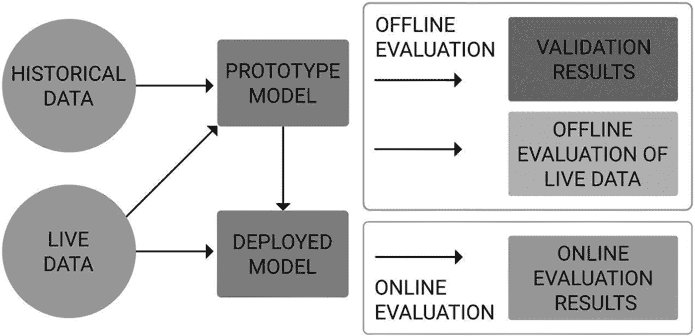
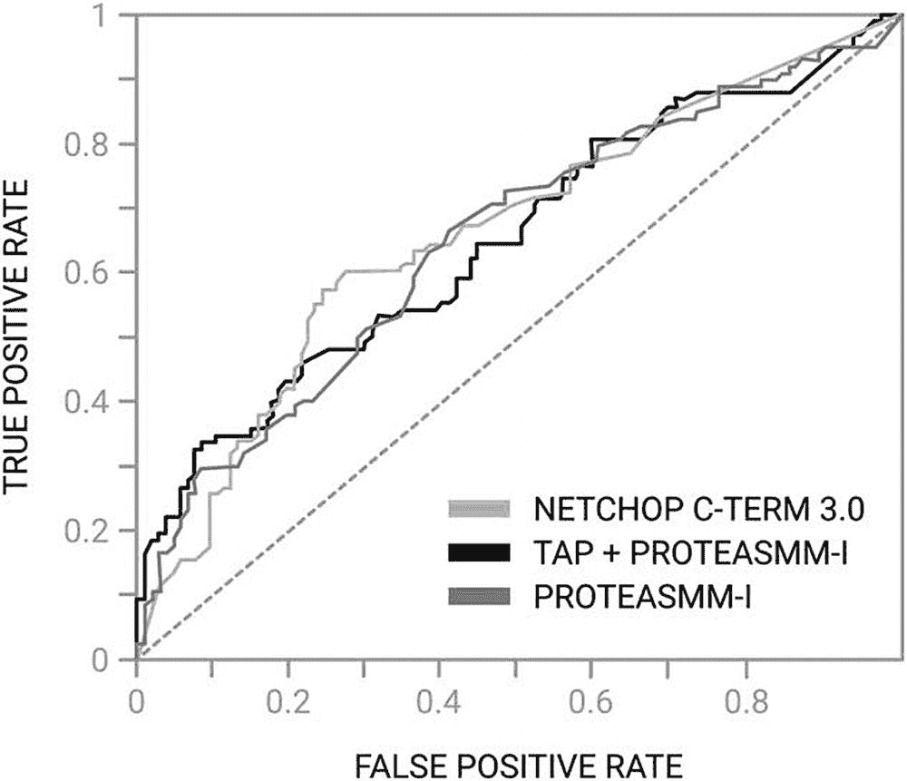
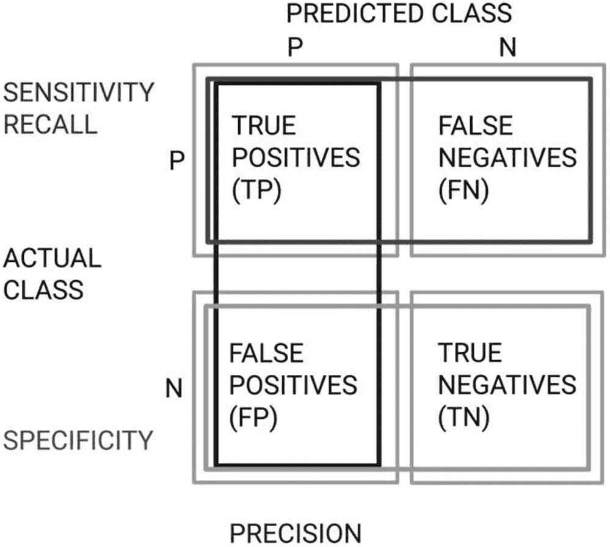
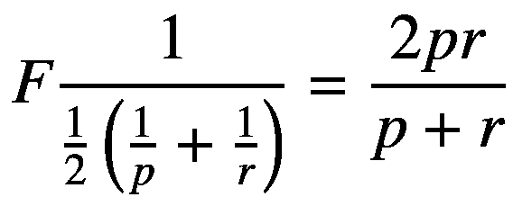
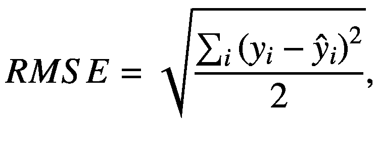

# 7. 评估机器学习模型

> 智力是适应变化的能力。
> 
> ——斯蒂芬·霍金

作为一个领域，机器学习仍处于起步阶段。先进的机器学习在过去 25 年间才得到探索，这也推动了数据科学成为一种职业。因此，数据科学行业仍处于对人工智能和机器学习无限潜力的惊叹阶段。随之而来的是兴奋与困惑——以及一个正在积累知识、经验和首次遇到问题的行业。

通常，机器学习项目中最费力的任务是识别合适的模型和工程化特征，这对模型的输出有着实质性的影响。事实上，与模型选择本身相比，所选特征对模型质量的影响往往更大。

因此，评估将决定模型智能程度、用于预测未知样本输出的学习算法非常重要。这通常通过使用各种指标来完成，下文将进一步讨论。

## 模型开发与工作流程

要成功部署和维护一个机器学习模型，需要经历几个开发和评估阶段，如图 7-1 所示。



图 7-1 模型开发与工作流程

第一阶段是原型阶段。在此阶段，通过在历史数据上测试各种方法来创建原型机器学习模型，以确定最佳拟合模型。超参数调优（本章后续会讨论）是模型训练的一个要求。一旦选定了最佳原型模型，就需要对其进行测试和验证。验证模型需要将数据集拆分为训练集、测试集和验证集，如第 3 章所述。

请考虑这样一个事实：不存在所谓的随机数据集，随机性实际上适用于数据集的拆分。要注意数据中可能出现的偏差。一旦模型成功验证，它就会被部署到生产环境。然后，模型通常会通过一个或多个性能指标进行评估，并在其整个生命周期中进行监控。

评估机器学习模型有两种方式：离线评估和在线（或实时）评估。

### 为什么有两种评估模型的方法？

一个已部署的机器学习模型会从两个来源消费数据：历史数据（即用作学习经验的数据）和实时数据。许多机器学习模型假设数据是平稳分布的——即数据分布随时间保持不变。然而，这在现实生活中并不典型，因为数据的分布通常会随时间变化——这被称为分布漂移。

考虑一个根据患者健康档案预测药物副作用的系统。药物副作用可能会根据人群因素（如种族、疾病特征、地域、药物流行程度和新药物）而变化。基于患者数据的相关副作用分布可能会随时间快速变化，因此，模型必须能够检测到分布漂移并相应地进化模型。

模型通过其在实时数据上的表现进行评估，同时也根据在历史数据的测试和验证阶段使用的验证指标进行评估。

当在实时数据上评估时，性能与验证指标相似或处于可接受阈值内的模型，被认为是持续拟合数据的模型。模型性能下降表明模型不再拟合数据，需要重新训练。组织还应考虑，如果实时机器学习模型性能下降、变得不适合使用或在临床上不安全，所需采取的缓解措施。

#### 离线评估

离线评估基于从历史、平稳分布数据集中学习和评估的指标来衡量模型。准确率和精确率-召回率等指标通常用于离线训练阶段。离线评估技术包括留出法和 `n` 折交叉验证。

#### 在线（实时）评估

在线评估是指在模型部署后对其预测指标进行的评估。关键在于，这些指标可能与模型实际上线时用于评估性能的指标有所不同。例如，一个正在学习新药物治疗方案的模型，在训练和验证阶段可能追求尽可能高的精确度；但上线后，它可能需要考虑预算或治疗价值等业务目标。同一个模型可能会找到一种完美的药物治疗方案，能够解决问题，但在临床上可能仍不安全。评估指标必须结合用例来设定，以确保项目所涉及的所有相关方都能得到体现。

在线评估的优势，尤其是在数字时代，在于它能够通过专门的反馈循环，支持多变量测试，从而实时了解性能最佳的模型。

反馈循环是确保系统按预期运行的关键，有助于更好地理解模型在实际使用环境中的表现。这可以由人工代理执行，也可以通过上下文智能代理或模型用户自动完成。

实时评估可以定期进行，使用已生成但未标记的、之前见过的数据子集，以在约定的容差阈值内保持准确性。

#### 寻找统计独立的数据集

重要的是，机器学习模型的评估应基于一个统计独立的数据集，而不是其训练所用的数据集。这是因为，由于模型会适应训练数据集，因此对训练数据集的评估会对其真实性能过于乐观。通过使用模型从未见过的数据来评估模型，可以更好地估计其泛化误差。

新数据可能难以获取；因此，能够从现有数据集中获得新的、未见过的数据就显得尤为重要。诸如 `n` 折交叉验证之类的方法就是实现此目的的有效技术。通常，所使用的数据比算法选择更为重要；使用的特征越好，模型的性能就越高。所讨论的评估指标可以在 R 语言的`metrics`包和 Python 的`scikit-learn`中找到。

如果安全可行，机器学习模型可以面向 BETA 测试参与者或感兴趣的利益相关者开放，以生成数据。

### 评估指标

针对机器学习问题，有大量的评估指标可供使用。这些指标涵盖了各种机器学习任务——分类、回归、聚类、关联规则挖掘、自然语言处理、数据挖掘等等。

你选择的评估指标将根据你的机器学习模型试图解决的问题以及所使用的技术而量身定制。

#### 分类

分类问题旨在为输入数据赋予一个标签或类别。有多种衡量性能的方法，包括准确率、精确率-召回率、混淆矩阵、对数损失和 `AUC`（曲线下面积）。

##### 准确率

准确率是判断模型预测是否正确的最简单方法。其计算方式为正确预测数占总预测数的百分比。

`准确率 = 正确预测数 / 总预测数`

##### 混淆矩阵

准确率是一个通用指标，它不考虑类别之间的划分。因此，它不考虑错误分类或与错误分类相关的代价。

例如，一个假阳性的医疗误诊（例如，将没有患乳腺癌的患者诊断为患有乳腺癌）与一个假阴性的情况（即，告知患者没有患乳腺癌，而实际上患者患有乳腺癌）相比，后果截然不同。

混淆矩阵分解了模型做出的正确和错误分类，并将其归因于相应的标签：

- `真正例`：实际类别为“是”，预测类别也为“是”。
- `假正例`：实际类别为“否”，预测类别为“是”。
- `真负例`：实际类别为“否”，预测类别也为“否”。
- `假负例`：实际类别为“是”，但预测类别为“否”。

举个例子，假设一个模型根据测试数据集中的 50 个样本输入来预测患者是否患有乳腺癌，其中正例和负例样本各占一半。那么混淆矩阵将如表 7-1 所示。

表 7-1 混淆矩阵

```
      预测：阳性  预测：阴性
标签为阳性      20        5
标签为阴性      15       10
```

从混淆矩阵可以确定，阳性类别的准确率高于阴性类别。阳性分类的准确率为 `20/25 = 80%`。阴性类别的准确率为 `10/25 = 40%`。这两个指标都与模型的整体准确率不同，整体准确率计算为 `(20 + 10)/50 = 60%`。由此可见，混淆矩阵如何为机器学习模型的整体准确率增加了更多细节。

因此，准确率可以重写为以下形式：

`准确率 = (正确预测的观测数) / (总观测数)`
` = (TP + TN) / (TP + TN + FP + FN)`

##### 每类准确率

每类准确率是准确率的一种扩展，它考虑了每个类别的准确率。因此，前面的例子中，每类准确率为 `(80% + 40%) / 2 = 60%`。

在某个类别的样本数量远多于其他类别的偏斜问题中，每类准确率非常有用。样本数量多的类别在计算中占主导地位，因此仅靠准确率可能不足以反映模型的特性；因此，同时评估每类准确率也很有用。

##### 对数损失

对数损失用于预测连续概率而非类别标签的问题。对数损失提供了准确率置信度的概率度量，并考虑了真实标签分布与预测分布之间的熵。

对于二分类问题，对数损失的计算方式如下：

```
Log-loss = - (1/N) * Σ [i=1 to N] { y_i * log(p_i) + (1 - y_i) * log(1 - p_i) }
```

其中 `p_i` 是第 `i` 个数据点属于某个类别的概率，`y_i` 是真实标签（0 或 1）。

##### 曲线下面积 (`AUC`)

`AUC` 绘制了真正例率与假正例率的关系曲线。`AUC` 能够直观地展示分类器的灵敏度和特异度。它突出了在允许假正例的情况下，可以获得多少正确的正分类。

该曲线被称为接收者操作特征曲线，或称 `ROC`，如图 7-2 所示。`AUC` 值高或曲线下方面积大是好的，而曲线下方面积小则是不理想的。



图 7-2 ROC 曲线

在图 7-2 中，测试 A 的 `AUC` 优于测试 B，因为测试 A 的 `AUC` 大于测试 B。`ROC` 曲线直观地展示了模型特异度与灵敏度之间的权衡关系。

##### 精确率、召回率、特异度与 F1 分数

精确率和召回率是两种常结合使用的模型性能评估指标。精确率评估在所有被正确分类的样本中，真正相关的样本有多少。召回率评估在所有相关样本中，被模型预测为相关的样本有多少：

## 分类

*   精确率：正确预测的正例数 / 预测为正例的总数 = `TP` / (`TP` + `FP`)
*   召回率：正确预测的正例数 / 实际正例的总数 = `TP` / (`TP` + `FN`)

特异度衡量模型正确识别负例的能力，其计算公式如图 7-3 所示。



图 7-3 特异度分类示意图

*   特异度：正确预测的负例数 / 实际负例的总数 = `TN` / (`TN` + `FP`)

F1 分数超越了算术平均，计算的是精确率和召回率的调和平均数：



其中，`p` 表示精确率，`r` 表示召回率。

## 回归

回归机器学习模型输出连续变量，而均方根误差（RMSE）是这类问题最常用的评估指标。

### 均方根误差（RMSE）

RMSE 计算的是预测值与实际值之间平均距离的平方和的平方根。这也可以理解为真实值向量与预测值向量之间的平均欧几里得距离。RMSE 的一个缺点是它对异常值敏感。



其中，`y[i]` 表示实际值， 表示预测值。

### 误差百分位数

误差的百分位数（或分位数）由于对异常值不那么敏感，因此更为稳健。现实世界的数据很可能包含异常值，因此，查看中位数绝对百分比误差（MAPE）而非平均值通常更有用。


其中，`y[i]` 表示实际值， 表示预测值。

MAPE 通过使用数据集的中位数，受异常值的影响较小。可以为特定问题设定预测的阈值或百分比差异，以了解回归估计的精确度。该阈值取决于问题的性质。

## 偏斜数据集、异常值与稀有数据

经验丰富的数据科学家会以审慎的态度对待所有数据。数据可能不一致；因此，偏斜数据集、类别样本不平衡以及异常值都可能显著影响模型的性能。某个类别的样本数量远多于另一个类别，可能导致模型性能不佳。如果模型出现问题，应回溯到数据本身，确保机器学习项目数据准备阶段的所有步骤都已正确执行。

异常值或数据异常会进一步扭曲性能评估指标。使用误差百分位数可以减轻大异常值的影响。然而，如果这些异常值代表了真实的患者数据，则应考虑保留它们。在实践中，良好的数据清洗、异常值剔除以及变量归一化可以降低对异常值的敏感度。

## 参数与超参数

超参数和参数这两个术语经常互换使用，但两者之间存在区别。机器学习模型可以理解为表示数据各方面之间关系的数学模型。

### 模型参数

模型参数是训练数据集的属性，在训练过程中由机器学习模型学习和调整。模型参数因模型、数据集属性和具体任务而异。例如，对于一个输出文本语料复杂度的 `NLP` 预测器，诸如词频、句子长度、每个句子中名词或动词的分布等参数，都将被视为模型参数。

### 模型超参数

模型超参数是模型构建过程中的参数，在训练过程中不会被学习。超参数对机器学习模型的性能有显著影响。超参数定义了模型架构，并影响模型的容量，从而影响模型的灵活性。超参数也可以在训练过程中提供给损失优化算法。

超参数的最优设置会对预测结果产生显著影响，并有助于防止模型过拟合。最优超参数通常因数据集和模型而异。

例如，对于神经网络，超参数将包括隐藏层的数量和大小、权重、学习率等。决策树的超参数将包括期望的树深度和叶子节点数量。支持向量机的超参数则包括误分类惩罚项。

### 调优超参数

超参数调优或优化是指为机器学习模型选择一组最优超参数的任务。优化后的超参数值能够最大化模型的预测准确率。

超参数通过以下过程进行优化：训练模型、评估整体准确率，并适当调整超参数。通过尝试多种超参数值，可以确定针对该问题的最佳超参数，从而提升模型的整体准确率。

#### 超参数调优算法

超参数调优类似于训练机器学习模型。其核心任务属于优化问题。模型参数可以用损失函数来表示，而超参数则无法如此表达，因为它完全依赖于模型训练过程。超参数调优有几种方法，最常见的是网格搜索和随机搜索。

##### 网格搜索

网格搜索是一种简单、有效但资源消耗较大的超参数优化技术，它会评估一个超参数网格。

该方法会评估每个超参数并确定最优值。例如，如果超参数是决策树的叶子节点数量，其取值范围可能是 `n = 2` 到 `100`，网格搜索会评估 `n` 的每个值（即网格上的点），以确定最有效的超参数。

通常，超参数的起始点（包括最小值和最大值）需要凭经验猜测。这种方法典型地属于试错法：如果最优值靠近最大值或最小值，网格就会向相应方向扩展，以进一步优化模型的超参数。

##### 随机搜索

随机搜索是网格搜索的一种变体，它会评估网格点的随机样本。从计算角度来看，这比标准网格搜索要节省大量资源。虽然乍看之下，这种方法在寻找最优超参数方面似乎不那么有效，但 Bergstra 等人证明，在数量惊人的实例中，随机搜索的表现与网格搜索大致相当 [94]。

随机搜索的简单性和超出预期的性能意味着它常常被优先选择，而非网格搜索。网格搜索和随机搜索都可以并行化。

还有一些更智能的超参数调优算法，由于需要评估接下来尝试哪些样本，因此计算成本较高。这些算法通常也有自己的超参数。贝叶斯优化、随机森林智能调优和无导数优化是这类算法的三个例子。

## 统计假设检验（多元检验）

统计假设检验或多元检验是一种极其有用的方法，用于确定哪个模型最适合当前的具体问题。统计假设检验用于判断零假设与备择假设之间的差异。

零假设定义为新模型不影响性能指标的平均值，而备择假设则定义为新模型确实改变了性能指标的平均值。

多元检验通过比较相似模型来了解哪个模型表现最佳，或者将新模型与旧的遗留模型进行比较。比较各自的性能指标，然后决定采用哪个模型。

测试过程如下：
1.  将总体人群随机分为对照组和实验组。
2.  记录各组人群在提出的假设下的行为表现。
3.  计算性能指标及相关的 `p` 值。
4.  决定采用哪个模型。

统计假设检验方法使团队能够通过学术交流传播项目成果，并提供了一个报告框架。

尽管这个过程看起来相对简单，但仍有一些关键方面需要考虑。

### 应该使用哪个指标进行评估？

选择适当的指标来评估模型取决于具体的应用场景。需要考虑误报（假阳性）、漏报（假阴性）的影响以及此类预测的后果。错误结果的影响可能非常显著。

构建模型时应使其适应相应的指标。如果一个模型试图预测一个仅发生 `0.001%` 的事件，可以报告 `99.999%` 的准确率，但这无法得到确认。

一种方法是重复实验，即进行多次重复评估。虽然这不是万无一失的方法，但这可以减少出现虚幻结果的可能性。如果零假设和备择假设之间确实存在差异，那么这种差异将得到直观的确认。同样，如果一个模型似乎能正确预测输出，请确保结果具有统计显著性。

### 相关性不等于因果性

“相关性不等于因果性”这句话用于强调两个变量之间的相关性并不意味着一个变量导致另一个变量。相关性指的是两个或多个变量之间关系的大小和方向。

因果性，也称为因果关系，强调一个事件的发生与另一个事件的存在有关。人们可能很容易假设一个变量导致了另一个变量；然而，在具有多个特征的模型中，可能存在隐藏因素导致两个变量同步变化。

例如，吸烟是增加患多种癌症风险的一个原因。然而，它可能与酗酒相关，但并不会导致酗酒。

### 多大的变化才算真正的变化？

在拒绝零假设之前所需的变化量，同样取决于具体的应用场景。在项目开始时指定一个令人满意的值，并严格遵守。确保结果具有统计显著性。

### 检验类型、统计功效和效应量

主要有两种检验类型：单尾检验和双尾检验。单尾检验评估新模型是否优于原始模型。然而，这种检验无法说明模型是否比基线模型更差。

因此，单尾检验天生就存在偏差。使用双尾检验时，模型会针对两个方向（正向和负向）的变化可能性进行测试。

统计功效指的是在测试中检测到的差异反映真实世界差异的概率。

效应量通过评估两组数据之间的标准化均值差异来确定两组之间的差异。效应量的计算公式如下：

*   **效应量** = ((实验组均值) – (对照组均值)) / 标准差

### 检查指标的分布

许多多元检验使用 `t` 检验来分析均值之间的统计差异。`t` 值评估的是差异大小相对于样本数据变异性的程度。然而，`t` 检验所做出的假设并非所有指标都能满足。例如，`t` 检验假设两组数据都具有正态分布（或高斯分布）。

如果分布看起来不是高斯分布，则应选择不假设高斯分布的非参数检验，例如 `Wilcoxon–Mann–Whitney` 检验。

### 确定合适的 `p` 值

从统计学角度来说，`p` 值是假设检验中使用的一种计算指标，用于表示证据的强度。`p` 值衡量的是统计显著性，或者说概率，即当两个总体之间不存在真实差异时，出现差异是由偶然因素引起的可能性。换句话说，假设零假设为真，数据出现的可能性有多大？它提供了反对零假设的证据，是利益相关者得出结论的一个有用指标。

`p` 值介于 0 和 1 之间，其解释如下 [95]：

*   `p` 值 ≤ 0.05 表示有强有力的证据反对零假设，因此拒绝零假设。
*   `p` 值 > 0.05 表示反对零假设的证据较弱，因此维持零假设。
*   `p` 值接近 0.05 被认为是临界值，可能向任一方向倾斜。

`p` 值越小，结果由偶然因素造成的概率就越小。

一些医疗保健研究人员建议，对于涉及计算机算法的研究，应采用小于 0.01 的 `p` 值，以证明存在实质性证据反对零假设。

### 需要多少观测值？

所需的观测值数量由项目要求的统计功效决定。理想情况下，这应在项目开始时确定。

### 多变量测试应运行多久？

多变量测试所需的持续时间，理想情况下是捕获足够观测值以满足既定统计功效所需的时间。通常，随着时间的推移进行测试有助于捕获具有代表性且可变的样本。

在确定测试阶段的持续时间时，需考虑新奇效应，它描述了用户的短期反应如何不能代表长期反应。例如，每当 Facebook 更新其信息流布局或设计时，都会引起一片哗然。一旦新奇效应消退，这种反应很快就会平息。因此，将实验运行足够长的时间以克服这种偏差是很有用的。在模型优化中，长时间运行多变量测试通常不是问题。

### 发现数据变异和漂移

一旦部署，持续监控机器学习模型的性能至关重要。数据变异、漂移以及系统开发要求定期对照基线确认模型。这是确保医疗保健 AI 安全部署的关键要求。

变异指的是由于训练数据集的微小变化而产生的误差敏感性。例如，对照组和实验组可能因非随机分割而产生偏差。这可能导致样本数据出现偏差。如果是这种情况，可以使用其他检验方法，例如不假设方差相等的 `Welch t-test`。

通常，发现变异和漂移涉及将离线性能（或验证指标）与来自已部署的实时模型的数据进行对比。如果验证指标发生显著变化，则表明需要通过使用新数据重新训练来修订模型。这可以手动完成，也可以自动完成，以确保模型报告的一致性和对模型的信心。

## 记录模型变更

记录对机器学习模型所做的所有变更，并附上变更说明。这不仅为利益相关者提供了变更日志，还提供了系统随时间变化的物理记录。它还可以作为审计日志。

在开发环境（从测试/预发布到实时部署）中使用版本控制软件，可以自动记录软件变更。版本控制软件提供了一种技术治理形式，可用于部署具有广泛回滚和备份功能的软件。

## 实时监控

已部署的、进行预测的机器学习模型需要流程来支持临床安全性和稳健性。一旦模型部署，监控系统以检测模型级故障并识别环境变化，对于实时运行的临床模型来说是一个明智的考虑。

## 结论

构建机器学习模型涉及一个迭代的、建设性的反馈原则。工程师构建模型，通过特定指标评估模型，进行改进，并持续进行直到达到期望的准确度。仅凭训练数据评估模型性能是无用的。一旦部署，保持这种准确度至关重要。

需要确保实时预测的安全性和准确性。这可以通过本章涵盖的一系列实时评估指标来实现。正如您所料，不同的问题类型需要不同的评估指标。

统计假设检验可以确认假设，并进一步增强对机器学习模型准确性的信心。