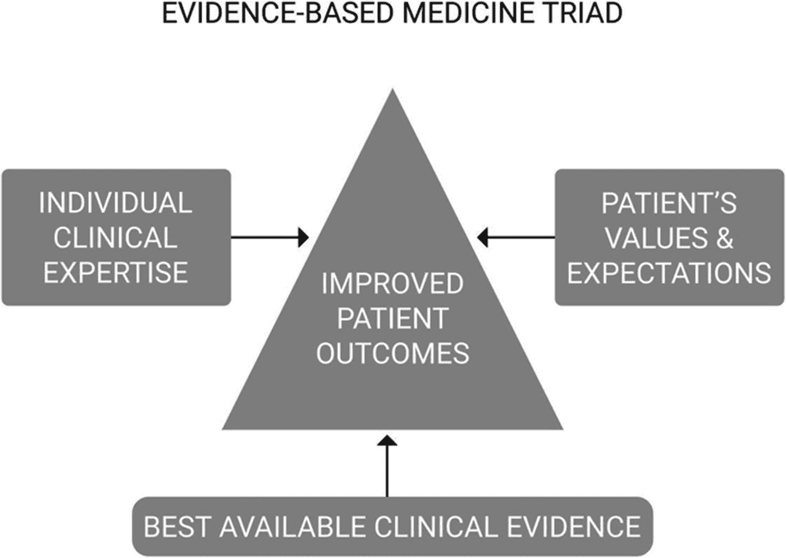

# 9. 医疗保健的未来是什么？

> *医学正处于一个关键节点，必须跟上现实世界中发现的步伐。*
> 
> ——夏洛特·萨默斯

医学领域的新进展以及曾经是科幻小说中未来主义主题的概念正逐渐成为现实。基因疗法、人体器官 3D 打印、液体活检、机器人辅助手术以及语音驱动的个人助理，如今都已成为现实，并且随着时间的推移变得越来越精密[165–168]。

技术的进步不仅影响着医学实践，也影响着公众对健康、生活方式以及何为健康的看法和态度。医疗保健必须明智地实施创新，以吸引尽可能多的患者。

数字健康技术以闪电般的速度发展。数据科学、人工智能、机器学习以及互联医疗技术的影响是巨大的，它要求我们以不带偏见的头脑和意愿，尽可能多地获取知识，参与到这个不断变化的环境中。

本章将探讨医疗保健领域的趋势转变，以及机器学习和 AI 在实现未来个性化医疗中的应用。读者还将探索沉浸式现实如何用于增强医疗保健，以及机器人、无人机和传感器如何用于开发智慧健康。

## 从数量转向价值

医疗行业正从以数量为导向，转向以患者为中心、基于价值的护理，以追求循证医学和个性化医疗。

医学领域正在发生转变，药物不再是第一且唯一的治疗手段；人们更加重视生活方式作为药物在预防和治疗中的作用。

### 什么是基于数量的护理？

医疗保健领域的传统支付体系，其基础是奖励提供者所接诊和治疗的患者数量。基于数量的护理侧重于规模经济。提供者会因在固定时间内为患者提供的所有服务而获得一笔固定金额的报酬。资金价值、患者体验和医疗质量随后成为次要的评估考量。提供者的激励来自患者数量以及为患者提供的整体护理成本。医疗资源和成本压力、疲惫不堪的医生以及受利益驱动的临床医生，在不知不觉中助长了“尽可能多看病人”的做法，这导致疾病管理从“药物优先，患者其次”的角度出发。医院和临床医生被激励去接诊尽可能多的患者，进行尽可能多的检查，并从药物优先的角度来处理疾病。

基于数量的护理模式通常以财务指标为模型，例如优化每位患者的利润或最小化每位患者的成本，而非健康结果。

基于数量的护理支付体系通常会在财务上惩罚那些致力于保持人群健康、减少错误或减少并发症的提供者，因为这些并非关键的绩效指标。例如，如果你被诊断出患有 2 型糖尿病，你的医疗团队通常会采取以下措施：

*   根据当前指南，提供如何管理血糖水平的信息。
*   推进治疗方案。
*   提供关于饮食选择的信息。

例如，在英国，如果一家医生诊所或医疗机构能够使患者实现 2 型糖尿病缓解，那么该诊所或医疗机构将无法获得因不再为患者开具药物而本应获得的资金。个人偏见也可能使问题复杂化。例如，在英国，参与评估应向 NHS 患者开具哪些药物的医生被发现每年从制药公司收取高达 10 万英镑的款项 [169–171]。

基于数量的护理关注的是为特定人群提供固定金额的资金。随着人口增长和资源紧张，向基于价值的护理的演变进程得以加快。医疗保健现在正转向以患者为基础的护理，这与价值同义，而非数量。

### 以患者为中心的护理

Tseng 等人将医疗保健中的价值定义为护理质量，通常通过医疗结果来衡量 [172]。另一个值得考虑的价值指标是患者体验或以患者为中心。以患者为中心是基于价值的护理的一个重要但并非绝对主导的质量衡量标准。

以患者为中心的护理采用一种多层面的方法，围绕患者、其目标以及更广泛的家庭进行决策和评估。以患者为中心的护理包含多个领域，其中就包括以患者为中心。

以患者为中心的护理是一种协作且多层面的方法，涉及提供以患者体验和患者结果为重点的健康和社会护理。以患者为中心的护理侧重于赋予患者知识、经验、技能和信心，以管理和优化他们的健康。护理是富有同情心的、个性化的、围绕患者协调的，并且尊重患者的世界观。这些目标对于医疗从业者来说似乎是常识。然而，它们并非总是作为标准实践来执行。医疗保健传统上采用还原论的方法，处理的是部分而非整体，并且是为患者做事，而非与患者合作。

像荷兰的 Buurtzorg 社区护理这样的组织就提供以患者为中心的护理。该组织每年为 8 万名患者提供护理，拥有 1 万名护士、21 名教练和 2 名管理人员 [173]。这种协作方法侧重于通过与护理人员建立关系来增强患者的能力。随着时间的推移，患者的健康状况得到改善，同时所需的外部护理总时间也减少了。患者和家属被赋予了照顾自己的技能和信心。数字疗法本质上能够提供以患者为中心的护理，根据用户的数据（如个人资料、行为、时间、地点或其他信息）定制体验，同时为医疗专业人员提供远程监控能力 [174]。

### 基于价值的护理

尽管是两种不同的理念，但以患者为中心的护理和基于价值的护理正变得越来越同义。纳入以患者为中心的结果、观点、经验和偏好的成功定义，正在积极影响护理的质量和提供方式。

基于价值的护理并不意味着廉价或经济的护理。实际上，护理是通过患者体验和结果的质量来评估的；并且该模式重塑了患者接受护理的方式。基于价值的护理正在重新定义健康经济学。

在基于价值的护理中，强调健康与预防。生活方式、行为和环境因素占疾病风险的 90% [175]。全球 2 型糖尿病患病率的不断上升已经证明了这一点。随着医疗资源压力日益增大，生活方式医学已悄然将重点重新聚焦于生活方式作为药物的作用。证据表明，活动、营养、睡眠和压力都会影响身体和情绪健康指标 [176]。

生活方式医学对生活方式和行为的关注，使医疗专业人员能够处理可逆的非传染性疾病，如 2 型糖尿病和肥胖症。不是用还原论的方法治疗患者，而是为患者提供整体、富有同情心的护理。生活方式医学的处方已经在医疗保健领域实施，例如通过处方数字应用程序来治疗疾病。例如，2 型糖尿病患者可能会被医生开具“低碳水计划”应用程序的处方，以支持患者自我管理病情，并在可能的情况下实现减肥和 2 型糖尿病缓解 [177]。生活方式干预通常安全、易于实施且可扩展。通过一种在引人入胜且有效的环境中实施的简单方法，可以缓解日益增长的慢性病水平。

#### 重新定义护理方式：质量优先，而非数量

价值导向型医疗不再被动应对事件，而是采取预防性的、以生活方式为先的健康管理方法。其核心在于患者健康、医疗质量与效率。这正是患者数据、数字健康与人工智能蕴含巨大潜力的领域。对效率的强调确保了该方法具有可扩展性和有效性，使医疗服务提供者能够降低医疗成本，并改善患者的临床健康结果。

通过戒烟、改变营养结构、调整生活方式、增加活动、改善睡眠以及识别遗传风险因素来预防疾病，可以减轻医疗资源的负担。健康管理正变得有激励性。保险公司和医疗服务提供者更密切地监测患者健康，已成为其最佳利益所在。

初创企业和数字技术公司正在开发数字健康工具，这些工具正在颠覆传统的医患关系，并使医疗服务提供者成为促进持续健康的第三方参与者。价值导向型医疗的目标是通过最佳实践来标准化医疗流程，并普及医疗服务的可及性与质量。对数据和历史证据的挖掘可以判断哪些方法有效，哪些无效。

#### 数字健康赋能以患者为中心的价值导向模式

保持人们健康可以降低医疗服务交付成本，并优化资源利用。例如，在管理 2 型糖尿病等慢性病时，价值导向型医疗采用协作和多学科的方法来管理疾病，以预防糖尿病相关并发症。

患者与一个了解其病情进展和健康状况的医疗团队合作。该医疗团队可能包括患者的糖尿病专科护士、营养师、行为健康教练以及其他专业人员，以支持患者的康复进程。

该团队会设定以患者为中心的目标，并帮助患者完成以下事项：

*   维持血糖控制。
*   引入一个由 2 型糖尿病患者组成的数字社区以提供支持。
*   提供健康指导和习惯维持支持。
*   促进活动计划的实施。
*   利用最新的循证依据提供营养指导。
*   处理 2 型糖尿病相关的心理问题。

激励机制发生了转变。以医院环境为例，医院的报酬不再基于接诊了多少患者，而是基于相反的标准。医院的报酬基于有多少患者处于健康状态以及有多少空余床位。关注点从入院那一刻转移到了预测未来风险的可能性，并通过预防性解决方案来预先应对。

除了面对面服务，还可以通过数字方式提供持续的患者支持，例如，通过应用程序、可穿戴技术或远程医疗提供健康指导、实施锻炼计划或帮助解决心理健康问题。人工智能和预测分析使医疗服务提供者能够优化医疗服务交付，专注于疾病的预防和治疗。

价值导向型医疗可以利用低成本的数字技术来提升和普及医疗服务。同时收集行为、人口统计、健康和参与度数据，为机器学习和新型人工智能的开发提供了机会，从而能够快速改进并从用户行为和结果中学习。

管理医疗运营并随后评估医疗质量是复杂的。为了评估价值导向型医疗模式，医疗机构必须收集和分析数据，通过护理质量、患者健康结果和成本效率来客观评估绩效。医疗服务提供者可以报告和建模预防性护理指标，例如再入院率、错误率、疾病进展、人群健康改善和参与策略。

医疗质量由多个指标定义。患者体验和满意度评分通常是首要评估指标。诸如每位患者花费的时间、患者参与度、药物节省和依从性等指标，是与生产力相关的质量示例。

人工智能在医疗领域的许多应用都发生在医院环境中。医院管理平台通过使机构能够做好准备来提供投资回报。能够预测患者流量高峰时间、预测再入院时间，并利用实时数据来应对现实世界医疗需求的系统，被视为对医疗服务提供者具有长期价值的系统。

涉及改善临床护理的应用显示出巨大潜力，但需要长期研究来评估其对疾病管理和人群健康的影响。

初级和二级医疗之间的数据链接可以追踪包括药物消耗、住院和急诊入院在内的数据点网络，这些数据可用于开发激励性的报销模式。

#### 评论：没有资金？没问题？公共医疗体系中的价值导向型医疗

*以下内容摘自为 NHS 创新加速器撰写的一篇博客，内容是关于创新资金模式以推广数字健康。*

*你拥有一个可以惠及数百万人的绝佳创新，它深受你向其展示过的 NHS 团队的喜爱，但当地的 NHS 区域却负担不起。没有资金。*

*创新在 NHS 内无法发挥作用的原因有很多，但当创新未被采纳的唯一原因是缺乏资金时，这不仅令人沮丧，而且损害了患者和人群的健康。资金常常会扼杀一个伟大的愿景，甚至连最初步的探索都无法进行。更重要的是，这对于那些在撰写商业案例之前就投入时间、精力和热情来策划项目的医疗团队来说，是一个巨大的挫折。对于参与其中的创新者和 NHS 团队来说，这简直令人士气低落——我们怎么可能推动积极的改变？*

*当我们与 NHS 地方机构接触时，利益相关者对通过一个可扩展且引人入胜的平台来改善 2 型糖尿病**管理**和缓解的想法感到欣喜。患者在健康方面的益处以及因减少处方药而节省的开支显而易见——但寻找预算仍然很繁琐。即使有预算，也往往太少，无法真正在人群层面影响健康。*

*作为创新者，我们创新的不仅仅是服务——还有服务交付的路径。全球医疗保健正在向以患者为中心的护理过渡，这与价值而非数量是同义词。*

*基于这一点以及我们在其他国家的经验，今年早些时候，我们与一个 NHS 临床委托小组（CCG）实施了首个“收益共享”模式。收益共享方法是一种按结果付费的模式，它不需要立即的预付预算，而是可以分享创新交付的成功。在我们的案例中，通过分享因患者血糖控制改善而减少用药所节省的开支。*

*这对各方都有利，因为它短期内需要的投资要小得多，而长期成果则可以共同庆祝和分享。这很有道理——如果每个人都为了“收益”，那么就会有完全的参与和更高水平的协作。这是一个团队——而不是两个——朝着共同的目标努力。*

*该模式重塑了患者接受护理的方式。更重要的是，由于生活方式、行为和环境因素占疾病风险的 90%，它使得一种可扩展的人群健康方法成为可能。*

*作为 NHS 的创新者，能够实现数字健康的好处真是太棒了。特别是，普及教育和自我管理的途径，让人们能够过上更健康、更幸福的生活。*

## 循证医学

如图 91 所示，循证医学通过将最佳研究与临床证据同真实世界的临床专业知识及患者价值观相结合，来解决临床问题。在医疗保健领域，这被视为随机对照试验和日益增长的真实世界证据。数据化与物联网正在为证据基础做出重要贡献。

循证医学的基础是基于最新、最可靠的科学证据进行决策。随着我们开发新的医疗模式，无偏见的证据对于理解和信任服务与创新至关重要。

循证医学先驱大卫·萨基特将这一概念定义为“在做出个体患者护理决策时，审慎、明确且明智地运用当前最佳证据”[178]。

随机对照试验（RCT）被视为评估治疗效果最可靠、最有力的证据形式。证据表明，许多因素会影响 RCT 的可靠性，包括方法学质量、报告质量和资金来源。“大型”公司资助了大部分临床研究，并面临着巨大的利益冲突。研究表明，存在偏向于行业资助研究的偏见，这削弱了对医学知识的信心。历史表明，一些组织选择了利润而非人民。可口可乐曾付钱给研究人员，让他们淡化糖与肥胖之间的联系[179]。

真实世界证据正出现在循证医学的关键时刻[27]。真实世界证据正在颠覆传统的循证等级体系和方法。通过手机、社交媒体、数字社区、健康应用、营养追踪、可穿戴设备和健康物联网，人类体验的数据化使患者能够成为自己的证据基础，并影响了医疗学术界和认知。例如，患者可以比较不同医院甚至不同医生的结果，从而最佳地选择其治疗提供者。

简单来说，当一个 RCT 启动并完成时，一个数字健康应用可能已经拥有数十万会员。需要其他渠道来验证数字医疗和创新在临床上的安全性和有效性[16]。

### 数字健康研究提出有效性问题

药理学领域进行的大多数 RCT 都具有内部有效性，确保特定药物的测试涉及精确的目标人群。例如，针对高血压药物的试验可能只关注患有高血压且无其他合并症的人群。在现实世界中，高血胆固醇和甘油三酯的合并症在高血压患者中可能很常见。这种方法意味着 RCT 报告的内容与患者报告的内容之间往往存在差距。这正是数字技术可以通过提供数据来连接这些点，从而帮助弥合药物干预与真实世界患者体验之间差距的地方。

数字社区可以提供关于药物副作用的真实世界证据。社区应用“糖尿病论坛”通过移动应用，以分析患者讨论和报告副作用的形式，向制药机构提供药物副作用数据。全球第二大常用糖尿病药物二甲双胍，其腹泻副作用据报道会影响十分之一的服药者。来自成员的真实世界证据表明，这一比例高出 400%，超过 48%的 2 型糖尿病患者报告了此副作用[181]。

历史上，真实世界证据被医学界视为轶事。然而，患者生活的数据化现在意味着数据直接来自设备、可穿戴设备和传感器，确保数据不会被误报。真实世界证据的增长速度之快，令医疗保健行业难以跟上。数字健康平台和数据聚合也对以往的医学范式提出了质疑。

### 循证医学如何跟上真实世界的步伐？

循证医学必须跟上真实世界证据的发展。正如大卫·萨基特所说：“你在医学院学到的一半知识将在毕业五年后过时；问题在于没人能告诉你哪一半。最重要的事情是学会如何自学。”患者现在将互联网、自身及其同伴作为证据基础；真实世界证据和医疗人工智能的普及意味着医疗专业人员不能再对证据基础的变化视而不见，也不能再固守旧范式。

这些数据为人工智能和机器学习提供了丰富的机遇。医疗保健可以采用数据驱动的方法，利用多种数据源来改善患者体验并降低成本。在未来几十年里，对这些数据的探索将显著推动医疗进步，并促进精准医学的发展。

## 个性化医疗

个性化医疗，也称为分层医疗或精准医疗，是一种将患者分为不同群体，并根据患者预期的治疗反应，做出明智的临床决策以提供治疗和干预措施的方法。作为循证医学的巅峰，个性化医疗的健康管理方法是为患者量身定制的。患者的健康在个体层面进行管理，以达到可能的最佳健康状态。

大约 10%的疾病风险基于遗传因素[182]。每个人都有一个独特版本的人类基因组。特定患者群体可能共享共同的基因组特征，从而具有共同的疾病风险。我们的基因变异决定了身体对特定药物的反应方式，或决定了疾病风险。例如，研究表明，南亚裔人群患 2 型糖尿病的比例高于白种人[183]。一种药物可能不适合所有人的需求。服用相同剂量同一种药物的两个人可能会有不同的反应。利用个性化医疗，可以为每个人选择正确的药物及其剂量组合。

这种医疗方法并非新鲜事物，自希波克拉底时代以来，医疗保健专业人员就一直在使用这种方法。

然而，通过使用患者基因组及其不断下降的成本——以及来自健康记录、可穿戴技术和健康物联网的医疗数据——所能实现的超个性化，再次激发了公众的兴趣。以前从未有可能预测疾病风险、人体对特定药物的反应，或者用墨水以外的材料打印治疗方案。这些技术的结合将推动个性化护理和医疗创新的时代。

预测工具可用于评估健康风险并制定个性化医疗计划，以减轻患者健康风险、预防疾病、管理疾病，并在疾病发生时进行精准治疗。随着医疗保健在治疗和服务提供方面越来越个性化，扩大可及性以确保社会各群体的参与变得至关重要。

诊断测试，例如血液检测，通常用于根据患者的生理分析来确定合适的治疗方案。最佳疗法的选择将越来越针对患者基因组进行个性化。医疗保健提供者将能够即时诊断现有疾病、预测未来疾病风险，并识别对治疗的预期反应以及细微特征。基因检测已开始在个性化医疗中产生影响；DNA 结果目前仅限于导入那些可以为患者个性化定制治疗方案、饮食计划或教育的服务中。目前，接收 DNA 检测结果需要数天时间。我们很快将进入一个即时、廉价基因检测的时代，这将使患者能够就治疗、服务、产品、药物和结果做出明智的选择。

### 医疗个性化引发伦理问题

基因检测的决定及其结果的影响引发了严重的伦理问题，需要仔细的准备和思考。对于提供者而言，这提供了一个充分参与个性化、基于价值的护理的机会，其中患者体验的质量至关重要。对于患者而言，它可以查明使人易患疾病的基因突变。了解此类信息的生理和心理影响可能是深远的，并在医学界和公众中引起了争议。

在特定问题上，所有人之间自然的分歧是要么支持，要么反对讨论的话题。进步并非没有道德后果，立法必须跟上首次出现问题的速度。人们对拥有大量关于自身的信息感到矛盾。

### 用数据实现医疗个性化

可穿戴设备和物联网掌握着实现个性化医疗（也称为智能医疗）的关键。可穿戴设备中传感器捕获的数据在医疗保健中发挥着越来越重要的作用，促进了以患者为中心的医疗系统的发展。

许多因素正在加速可穿戴医疗解决方案的接受度，特别是在临床试验和学术研究中用于监测患者健康和生活方式因素。研究可以使用安卓手表、苹果手表、佳明、Fitbit 或其他智能手表设备记录参与者的健康生命体征。参与者使用应用程序记录他们的生活习惯、营养、活动、用药依从性，并监测药物副作用等。保险公司开始使用可穿戴设备和患者数据来激励健康行为。

历史上，保险公司一直将产品瞄准精通数字技术的买家，提供最新设备以激励健康改善。激励型保险产品将在更广泛的人群中变得普遍，在对抗非传染性疾病方面尤其有效。

互联、数字医疗的提供为监测、管理和逆转疾病开辟了机会，扩大了风险组合，并创造了寿命更长、发病率更低的人群。不健康的成本太高，以至于支付方无法忽视。

#### 丰富、传感器驱动的数据

随着传感器变得更快、更小、功能更强大，患者的健康档案最终将包含详细的睡眠分析、连续血糖监测数据、心率、血压以及近似卡路里消耗等信息。智能手表将集成多种诊断工具，能够监测血压、心率变异性、血糖、酮体等指标。健康传感器将变得可植入、可生物降解，并保持持续连接，在患者护理等任务中发挥关键作用。行为经济学将为我们日常生活提供更深入的洞察。

表 9-1 简要描述了一些互联医疗设备的示例，说明了这些设备可在何处使用及其用途。互联医疗中涉及的一些可穿戴设备和嵌入式传感器包括：

表 9-1

可穿戴技术的应用

| 设备类型 | 佩戴位置 | 用途 |
| --- | --- | --- |
| **沉浸式技术** **军用服装** **头盔** **混合现实** | 头部 | 教育、行为改变、智能通信 |
| **智能隐形眼镜** **追踪器** | 眼睛 | 血糖水平监测 |
| **助听器** **耳机** **追踪器** | 耳朵 | 声音 |
| **气味检测** | 鼻子 | 嗅觉 |
| **智能纹身** **追踪器** **贴片** **植入物** **智能手表追踪器** | 手臂/手腕 | 血糖、血压、血氧饱和度、酮体水平、教育、康复 |
| **服装** **胸带** **植入物** **追踪器** **外骨骼** | 躯干 | 康复 |
| **服装** | 腿部 | 保护、康复 |
| **嵌入式鞋具** | 脚部 | 健康指标、姿势矫正、康复 |

图 9-1

循证医学

*   **压力监测带**

    压力追踪与心灵平静是可穿戴设备的两大关键市场。目前，可穿戴设备通过监测呼吸和心率，检测紧张迹象，以改善呼吸并帮助使用者达到更平静的心态。健身追踪器提供正念功能，还有能够向大脑传递特定波形的头带 [185]。

*   **紫外线传感器**

    西北大学开发了能够精确监测个人紫外线暴露量的紫外线传感器。这种可穿戴传感器薄如晶圆，小到可以放在人的指甲盖上。由于紫外线是已知的强致癌物，该技术有望减少过度暴露于紫外线的情况，并预防中暑和黑色素瘤等并发症 [186]。

*   **智能纹身**

    智能纹身将传感器置于皮肤内，麻省理工学院和哈佛大学的研究人员在此领域取得了重大进展 [187]。智能纹身墨水会与组织间液的生化成分发生反应，以指示身体状况。未来的发展将使纹身能够降解，按需持续存在，甚至仅在特定光线下显现。例如，高血糖可能使血糖智能纹身变红，而低血糖则可能使其变蓝。

*   **智能药物**

    药物智能化有众多发展方向。智能药物可以告知患者及其医疗团队已服用的药量、服药时间，并在可能漏服时及时提醒。如今，蓝牙连接的药瓶盖和药片包装可提醒患者服药，以提高用药依从性。蓝牙胰岛素笔和笔帽能够记录注射时间、剂量和胰岛素类型，通常会将数据从设备推送到云端，用户可通过数字应用程序界面查询数据。例如，智能哮喘吸入器可以在佩戴者意识到症状之前识别出即将发作的哮喘 [188]。

*   **智能胰岛素**

    作为智能药物的一种形式，智能胰岛素是下一代胰岛素，能够根据血糖水平的变化自动响应。血糖水平越低，释放的胰岛素越少；血糖水平越高，释放的胰岛素则越多。北卡罗来纳大学的研究人员报告称，他们研发的智能胰岛素贴片可贴在体外，利用微针系统自动检测高血糖水平，并通过活体β细胞适时释放胰岛素。由于β细胞被保存在体外的贴片内，因此完全不存在被 1 型糖尿病患者免疫系统排斥的风险 [189]。

患者在出现潜在疾病的第一个迹象或症状时，会立即求助于“谷歌医生”。网上搜索和症状自查工具最终都会告诉你，无论症状如何，你得了癌症——这已经成了一个经久不衰的笑话 [190]。

患者最了解自己身体的变化，如今他们就诊时准备得比以往任何时候都更充分。现在，就诊的患者信息更灵通、意识更强、健康观念也更强，他们的参与被用于个性化定制医疗保健计划。然而，这也在不同程度上导致了精神焦虑和疑病症。

患者绝不能忘记，合格的医疗专业人员能提供更全面的健康评估和解释，尤其是在他们掌握最新循证依据的情况下。这或许是医学界并不总是欢迎以患者为中心的方法的一个原因。2019 年的一项调查显示，87%的患者因使用该平台而与医疗专业人员的关系得到改善，75%的患者表示对自己的病情有了更好的了解。当这项调查在 2015 年进行时，同样比例的患者表示对病情有了更好的了解，但只有 20%的患者报告与医疗团队的关系得到改善 [191]。

互联医疗为解决新型健康问题提供了大量机会，尤其是在疾病管理和老年护理方面。

2015 年，联合国估计每 10 人中就有 1.2 人年龄超过 65 岁。预计到 2050 年，这一比例将跃升至 22% [192]。老年人口的医疗支出是一个日益令人担忧的问题，因为与其他年龄组相比，老年人口占医疗支出的份额更高。

2 型糖尿病和肥胖症等非传染性疾病已成为大流行病，世界卫生组织估计，到 2050 年将有 6 亿人患上 2 型糖尿病 [193]。大约四分之一的人患有两种或两种以上的慢性病 [194]。

随着政府、支付方和制造商面临降低医疗成本的日益增大的压力，老年和长期护理需要为即将到来的人口增长做好准备。医疗物联网（Medical IoT）通过提供远程监测、预测和诊断能力，展现出加速实现价值医疗的巨大潜力。

### 个性化医疗的应用

在丰富数据的驱动下，机器学习正在变革医疗保健，使其能够在越来越多的领域实现个性化。

#### 疾病与状况管理

心脏监测器可以检测心率变异性，并实时向医疗专业人员发出警报。同样的概念也让使用智能血糖监测仪的 1 型糖尿病患儿的父母得以解放。血糖测量值会直接发送到云端，父母可以近乎实时地查看孩子的血糖水平，并在出现潜在低血糖事件时收到警报。数字应用程序可用于逆转 2 型糖尿病、管理癫痫以及改善生活质量。

技术的新颖应用可以最大限度地降低健康问题的风险及其后续的医疗成本。老年护理可以通过数字应用程序实现。例如，跌倒等风险可以通过跌倒检测和紧急援助来减轻。

手机或手表中内置的加速度计可用于检测跌倒或癫痫发作，并在紧急情况发生时，向护理人员触发包含事件详情和位置的通知。未来的技术还可能包含安全设备。行动不便的人可以使用可穿戴式成人安全气囊。如果检测到佩戴者正在跌倒，成人安全气囊会展开以防止受伤[195]。技术有助于节省可避免的老年护理费用以及大量相关的医疗开支。

然而，技术在提供老年护理方面的真正价值，尤其是在联网助手和可穿戴设备方面，体现在从收集的数据中生成的预测性分析上。例如，偏离日常活动模式可能预示着值得担忧的问题、新出现的身体或心理健康问题，并能预测患病风险。随着传感器数据和证据的扩展，可穿戴设备在检测疾病迹象方面的应用也在增加。例如，通过 Apple Watch 收集的心率变异性数据可以预测房颤[196, 197]。

#### 虚拟助手

虚拟助手不仅具有娱乐性；它们可以陪伴独居者，并为老年人和高龄人群提供支持。虚拟助手可以通过回答问题、教授新技能、设置语音提醒来执行任务（例如提醒服药），甚至通过执行接听电话或拨打电话等任务来控制家居，从而增强人们的能力。随着家居日益互联，虚拟助手将在生活的方方面面为人们提供帮助，并与家居的各个部分进行交互。

虚拟助手可以代表患者呼叫紧急服务，并提供精确的详细信息和位置。联网摄像头可以追踪运动以检测跌倒，从而触发虚拟助手寻求帮助。虚拟助手不局限于语音领域，机器人形式的虚拟助手可以在老年护理的特定情况下提供帮助，执行诸如帮助人们起床、进入浴缸或坐上轮椅等任务。此类虚拟助手中的 AI 甚至可以学习行为模式，例如人们可能想要去洗手间的时间。

通过语音和触摸屏进行的交互实现了沟通，并将日益增强老年患者的自主权，减轻老年护理的负担。来自英国的 MiiCare 公司通过设备驱动的虚拟助手提供远程监控，以照看老年人群，测量患者体温，并监测活动、水分摄入和用药依从性。

随着虚拟助手能力的提升，它们判断主人情绪（无论是快乐还是悲伤，兴奋还是沮丧）的能力也将随之提高。虚拟助手将解读对话的句法、语义和语调，以检查是否存在精神或情绪健康问题的迹象。

虚拟助手在为残障人士提供有用帮助方面也存在类似的机会。应用程序可用于控制灯光、音乐、暖气、食品订购和生活方式。英国互联网组织 Nominet 开发了一个名为 Pips 的开源原型，以满足感官或认知障碍人士的需求[198]。该原型通过音频和视觉提示、轻推和提醒，帮助人们完成日常活动，并培养他们驾驭周围环境的技能和信心。该原型采用低功耗蓝牙控制器构建，可在设备之间发送和接收通知。这些设备可用于引导人们完成诸如洗脸、洗澡或服药等任务。

#### 远程监控

联网设备可以为护理人员和医疗专业人员提供支持，帮助人们避免住院并减少就医次数。应用程序和虚拟助手可以提供用药提醒；健身追踪器将监测用户的健康和活动，如果出现偏离常规的情况，会向护理提供者发出警报。

联网设备可以就诸如使用冰箱、洗澡或打开前门等事件向家人和护理提供者发出警报。数据中体现的日常活动模式将被学习，如果出现偏离常态的情况，相关账户将收到通知。紧急按钮可以通知相关服务部门，确保老年人或患有长期疾病的人在最需要的时候获得医疗干预。联网设备、应用程序和虚拟助手的结合使家居更智能，更有利于降低风险，确保医疗保健提供者/诊所掌握患者健康状况的最新概况，同时增强患者的能力。

Gro Health 是一款生活方式和行为支持应用程序，它与一个由十几名医生组成的团队共同设计了一个实时远程监控仪表板，为加拿大不列颠哥伦比亚省的患者提供实时护理。如果患者不遵守治疗计划或脱离平台，该平台会向临床医生发出警报[199]。

#### 用药依从性

忘记服药是很容易发生的事，但其后果可能是个问题。超过 50%的处方药未按医嘱服用[200]。漏服可能导致康复时间延长、病情恶化或产生更严重的后果。Benjamin 等人进行的一项研究表明，让患者正确服药仅在美国每年就可防止约 12.5 万人死亡[200]。

有许多应用程序和数字服务可以提醒患者何时服药，但医学的发展甚至超越了这一点。带有可摄入传感器的智能药丸旨在通过确认药物已被服用后通知相应的应用程序，帮助医生改善临床健康结果[201]。当传感器接触到胃液时，便会触发通知。这使得医生能够衡量治疗效果并优化患者治疗路径。

#### 便捷的诊断测试

患有慢性病的人和老年人群通常比健康人需要更多的诊断测试。便携式设备中的智能传感器允许用户在舒适的家中进行检测，而无需前往诊所或药房进行尿液和血液检测。检测结果随后可以无线传输给他们的医疗团队。

针对胆固醇、心脏功能、糖化血红蛋白、空腹血糖、维生素 D 水平和胰岛素的检测，提高了重复进行诊断测试的便利性，从而能够实现更快的治疗、降低并发症风险并减少可避免的医疗支出。

#### 智能植入物

连接到智能手机、医疗保健提供者和更广泛网络的植入式设备将用于实时监测和治疗疾病。这些数据带来的可能性是巨大的，因为可穿戴设备是外部植入物，有潜力从器官和组织中收集生物标志物的指标。

#### 远程医疗

远程医疗的历史可追溯至 20 世纪初，指利用电子技术实现远距离患者护理、患者与医疗专业人员教育及健康管理的临床应用。远程医疗（telehealth）与远程医学（telemedicine）为同义词。近年来，随着医疗手段从电话设备转向互联设备，"数字健康"一词已逐渐取代"远程医疗"。

通过 Skype 或视频会议设施进行问诊、电子健康记录远程监测、数字健康教育、扫描或影像传输等应用均属于远程医疗范畴[202]。

当今世界已真正实现移动化，数字工具主要通过电子手段处理初级保健问题。更严重的病症则会转介至相关医疗专业人员、机构或团队。数字健康使医疗专业人员能够提前预判健康问题，而非等待症状出现。

#### 数字疗法

数字健康领域中一个令人振奋的新兴分支是数字疗法。数字疗法是远程医疗的增强形式，它将数字与基因组技术同健康、生活方式及人为因素相结合，为患者提供个性化医疗，提升医疗服务的效率。

##### 该信任哪款健康应用？

苹果应用商店中现有超过 15 万款专注于健康与保健的应用，下载量已突破 5000 万次[203]。数字健康工具使患者能够主动管理自身健康，通过影响人类行为来改善健康状况。

唯一的问题在于应用数量过多——在目前可供下载的 32.7 万款健康应用中，65%已超过 18 个月未更新，仅 15%的受评应用达到最低标准。唯有临床证据的质量才能区分市场上各供应商与服务的优劣[204]。

随着医疗干预重点从急性病转向慢性病，行为疗法正超越药物干预成为一线疗法。数字健康与更广泛的远程医疗已应用于多种健康状况，推动医疗与治疗手段快速变革。

确诊癫痫的患者可获处方应用管理癫痫发作，哮喘患者可配备联网吸入器应用，计划接受减重手术的患者可获处方数字健康应用辅助术前减重[205]。

数字健康的绩效衡量将基于患者健康结局、护理质量及长期使用工具与服务的用户数量。

##### 增强传统医疗

英国糖尿病患者中，不足十分之一在确诊后 12 个月内参加过面对面结构化教育[206, 207]。研究表明，线下教育的获益通常在干预停止后 1-3 个月内消退，提示习得行为会随时间改变，需要进一步支持以维持生活方式改变。线下糖尿病教育课程的参与度十分有限。

新冠疫情导致许多地区的面对面教育几乎完全消失。

数字健康为健康认知、教育与自我管理提供了绝佳机遇。数字健康并非取代传统医疗，而是对其进行增强。即便在新冠疫情期间我们拥有触手可及的数字健康技术，也未能阻止非直接由新冠病毒导致的超额死亡激增[208]。

数字教育天然具有互动性：患者可随时通过任意设备获取服务。通过用户与服务提供者之间的数据交换，数字教育还能实现个性化定制，实时患者数据的呈现与分析进而促进以目标为导向的个性化实践与可持续行为改变。

##### 以患者为中心的设计

教育可实现以患者为中心、由患者主导，而非传统的师生模式。通过利用用户数据与第三方服务，治疗方案可达到精准化。

数字疗法与自我管理移动应用为赋能患者提供了重要契机，使其掌握管理并优化健康所需的知识、技能与资源[16]。

戒烟、增加运动、减重等生活方式改变均可通过行为干预实现，同时针对主要慢性病进行干预。慢性病及其管理本质上受行为影响[91]。

数字健康工具使治疗实现个性化、民主化与规模化。真实世界证据已充分证明数字工具的有效性。但仍需更多证据与随机临床试验来证明因果关系。一个尚不明确的问题是：数字疗法由谁付费？若医生开具数字疗法处方，应由谁支付？保险公司？医疗机构？雇主？还是患者？

无论如何，数字创新正在彻底改变疾病管理模式。患者对自主权的需求日益增长，他们希望了解自身健康状况、掌握最新循证依据，并积极参与健康管理。

##### 数字疗法：一项长期案例研究

参与研究时，案例“B”是一名 72 岁男性，于 2015 年被诊断患有肥胖症和 2 型糖尿病。B 居住在英国赫特福德郡。他在 67 岁时被诊断出 2 型糖尿病。研究结束时，B 的临床诊断已不再显示为 2 型糖尿病。B 是由其英国国家医疗服务体系（NHS）的医生推荐参加低碳水计划（Low Carb Program）的。

B 遵循应用程序中提供的信息，减少了饮食中的碳水化合物摄入量。在使用平台的前 16 周，B 每周参与干预 3-4 次，平均每周投入 20 分钟。B 使用了网页平台及相应的 iOS 移动应用程序，完成了 12 个核心教育模块中的 10 个。

B 在社区中发布了七次帖子。B 使用该应用程序记录他的饮食日记。通过应用程序测量，B 在加入研究第一周的基线碳水化合物平均摄入量为每天 253 克。

到第 16 周，碳水化合物平均摄入量降至每天 102 克。到第 15 个月，B 的碳水化合物平均摄入量为每天 109 克。B 饮食日记中最常出现的食物包括花椰菜泥、煎蛋卷、沙丁鱼、鲭鱼和水煮蛋。

到第 15 个月，B 平均每周使用平台 9 分钟。到第 15 个月，B 的糖化血红蛋白（HbA1c）已降至 2 型糖尿病诊断阈值以下。B 总共减重 36.29 公斤，糖化血红蛋白降低了 76 mmol/mol。平均血糖水平下降了 2.2 mmol/L。B 在 11 个月时被确认进入 2 型糖尿病缓解期。

作为案例研究报告的一部分，B 接受了采访。B 表示：“2018 年 6 月，医生告诉我，由于二甲双胍不起作用，他不得不开始让我注射胰岛素。这让我很害怕，我说我很乐意做任何事。我以前晚上会因呼吸困难而醒来，但想到要注射胰岛素是我主要的动力。12 月我回去看医生时，他非常惊讶。”

B 反思说，他现在的饮食中谷物和米饭明显减少了。“最重要的事情是意识到碳水化合物的总含糖量，特别是谷物和米饭，以及它们对血糖的影响有多大。戒掉它们似乎是一件小事。当你坐下来看看自己错过了什么，我并不觉得损失很大。我很惊讶它竟然有如此巨大的效果。”B 建议“记录体重，并在每周同一时间称重，这有助于你看到自己的进步，这本身就是一种动力。”B 确认“制定膳食计划并打印出每周的膳食计划”有助于坚持健康的饮食习惯。

#### 激励式健康管理

健康不佳代价高昂。对雇主和经济而言，身心健康问题每年给英国造成超过 770 亿英镑的损失[209]。

由于疾病或因健康不佳导致的工作表现不佳，员工平均每年损失 30 个工作日。根据世界经济论坛的数据，到 2030 年，癌症、2 型糖尿病和精神疾病等慢性病对全球经济的影响可能超过 47 万亿美元[210]。

个人的生活方式选择以及身心健康都会影响工作表现。对于保险公司和雇主等支付方来说，在改善缺勤率和出勤低效方面面临着巨大挑战。为此，支付方正在认识到整体健康的重要性——包括身体健康、心理健康以及工作内外的社交和人际互动。

随着医疗干预的重点从急性疾病转向慢性疾病，行为疗法通常正成为一线疗法，而非药物干预。

由可用数据个性化定制并针对用户量身打造的健康计划，为雇主和其他支付方提供了一种便捷的机制来支持健康与保健。过去，激励式健康管理意味着鼓励个人去健身房、多走路——比如走楼梯或步行上班。雇主通常会推广与员工福祉和降低医疗成本相关的健康行为。如今，健康计划和数字工具已超越了简单的指引和筛查。可远程访问的沉浸式、引人入胜的计划，使个人能够以改善临床结果和获得更好健康为目标来改变自己的行为[91]。

以治疗、行为辅导、生物医学数据反馈和传感器等形式进行的行为改变，使健康管理真正实现了以患者为中心。

## 人工智能还能在医学的哪些领域发挥作用？

人工智能是一系列技术的集合，而非单一技术，许多人工智能技术都与医学相关。个性化医疗为人工智能的应用和机器学习模型的开发提供了肥沃的土壤。人工智能旨在将医生，或者更具体地说，将医疗团队，放入我们的口袋。除此之外，人工智能在疾病预测、降低成本、提高效率、自动化手动任务、预约安排以及促使我们改变健康状况等方面都有应用。而且，人工智能在某些方面可以比人类做得更好[211]。

随着数据量和数据种类的增加，人工智能模型的能力将变得更加精确、更具探索性，也更具争议性。

人工智能将改变医生的定义。人工智能与医学的融合正在造就更好的医生并拯救生命。从缩短等待时间、确定优先级，到寻找证据、保持生产力或支持决策，人工智能将协助医生和医疗专业人员做出明智的决策。

以下描述了人工智能技术的一些应用。

### 挖掘电子健康记录（EHR）

对医疗信息系统进行挖掘在医学领域拥有巨大潜力。这些系统存储着关于患者及其健康状况、处方、医生笔记等大量信息。医疗数据可用于提高医疗质量、降低成本、减少错误，并改善和普及医疗质量。

由于复杂性、词汇和标准化程度的差异，目前从这些系统所包含的数据中进行知识发现颇具挑战性。数据挖掘为从文本和图像档案中提取相关信息提供了机会。挖掘像电子健康记录这样的大规模数据，能够发现数据中的模式，这些模式可用于构建预测模型。

正如第 3 章和第 4 章所讨论的，无监督学习以特征提取而闻名，而有监督学习则适用于预测建模。记录挖掘对患者和医疗服务提供者都有益处。挖掘可用于识别高风险患者或慢性病患者，以便为他们提供个性化的干预措施。记录挖掘使医疗服务提供者能够找到最佳实践和治疗方法，以减少理赔和住院率。通过比较症状、治疗方法以及积极和不良效果，医疗服务提供者可以分析出改善患者群体预后的路径，从而实现临床最佳实践和护理标准。

### 对话式人工智能

对话式人工智能指的是能够进行交谈的系统。与基于文本或代码输入的用户界面不同，人们通过语音与对话式人工智能系统互动。用户越来越多地使用聊天机器人与产品、品牌和服务进行沟通。像亚马逊的 Alexa 这样的语音驱动型人工智能拥有应用程序（或称技能），可以合成自然语言，提供食谱或健身建议、订购产品、查询食物卡路里或叫出租车。对话式人工智能正在普及：五分之一的美国人拥有智能音箱，并且有超过 10 万个 Facebook Messenger 聊天机器人 [212]。

随着人工智能聊天机器人的发展，它们的能力也在增强。智能个人助理将充当医疗保健助手。由于是语音控制，对于那些行动不便、只需使用语音即可执行任务或指令的人来说，具有直接的应用价值。

在医疗保健领域，对话式人工智能能够回答那些无需医生关注的简单问题。例如，新手父母可以向对话式人工智能提出各种问题，而无需担心尴尬或占用医疗专业人员的时间。诸如婴儿洗澡的水温、婴儿应该多久睡一次、或者是否达到了发育里程碑等问题，都可以由人工智能音箱即时回答。

许多人会求助于搜索引擎来寻找问题的答案。然而，大多数查询症状的患者并不知道如何辨别研究质量，除了可能遇到误导性信息（或假新闻）外，还可能遇到相互矛盾的证据，这会让患者感到困惑。

借助医疗人工智能聊天机器人的帮助，患者可以获得即时援助。延续前面的例子，如果新生儿的父母有医疗问题或对某种症状（比如胸腔咳嗽）感到担忧，他们为每个问题都去看医生会非常麻烦。然而，医疗确认的需求是存在的。这目前无法通过算法手段检测到；因此，对话式人工智能在医疗保健领域的发展，将使其被用作连接医疗团队及其周围世界的数字健康界面。

随着对话式人工智能的发展，认知系统将分析对话，以检测精神、身体或神经系统疾病的早期迹象。像 Alexa 这样的语音设备，有朝一日将能够通过对话语气识别阿斯伯格综合征、焦虑症、精神病、精神分裂症和抑郁症的症状。这将帮助医生更好地预测、监测和追踪疾病。有朝一日，医生或许能够通过患者在远程会诊中的声音来预测其患抑郁症的风险。

### 让医生更优秀

人工智能将使医疗专业人员能够跟上最新的循证依据。例如，PubMed 的档案中存有超过 3000 万篇论文 [213]。能够挖掘这些文章并提供最相关证据的人工智能，将有助于培养知识更前沿的医疗专业人员，并使他们能够凭借最佳知识和证据基础行医。人工智能可以在行政任务中协助医疗专业人员，扮演认知助手的角色。

人工智能有助于减少错误，包括人为错误。特别是记录挖掘，将使医生能够随着时间的推移不断改进。关于患者、他们的治疗、医疗专业人员和诊所的数字化数据可以被挖掘，以识别治疗某些疾病时的错误，并避免不必要的住院。荷兰组织 Zorgprisma Publiek 目前正是这样做的：使用 IBM Watson 挖掘数据以识别重复性错误 [214]。

次优流程会浪费时间和资源。为诊所、医生和患者设计的排班系统能使医疗保健尽可能高效。一个能够安排患者预约并简化沟通的人工智能系统，将减轻医生负担，使其能专注于更紧迫的事务。例如，如果患者出现紧急情况，人工智能可以根据风险进行评估并确定患者就诊的优先顺序。

### 诊断疾病

神经网络先驱杰弗里·辛顿教授曾有一句名言：由于图像感知算法的复杂性，并且可能很快超越人类，“很明显，我们应该停止培训放射科医生”。

人工智能目前可用于检查医学扫描图像、识别 2 型糖尿病症状、识别视网膜病变和心血管疾病风险，以及发现乳腺癌迹象。随着算法在更多数据上进行训练，人工智能的表现会更好。

用于检测疾病的算法显示出巨大前景，其中一些已应用于医疗实践。然而，这并不意味着所有人工智能诊断都已准备好实施。许多人工智能工具是在没有经过同行评审及其学术严谨性的情况下开发的。关键细节需要验证，例如算法的代码、训练和验证数据集；与之比较的数据；性能评估方式；以及神经网络如何得出其结论。

### 制定与合理化决策

医生每天都要做出具有挑战性的决策。确保这些决策尽可能基于充分信息至关重要。人工智能、数据挖掘和预测分析的应用，使临床医生能够合理化决策并制定基于证据的治疗方案。人工智能不必做出最终决定，但可以提出最合理的行动方向。

### 药物发现

开发一种新药是一项昂贵的业务，每三种新药中只有一种能够上市。每种新药上市平均花费制药公司 27 亿美元 [215]。

药物试验失败的后果可能是毁灭性的：从股价下跌到工厂关闭和人员裁减。因此，制药和生命科学行业越来越多地转向人工智能来促进药物研发。

制药业并非寻求用人工智能取代人类。相反，它希望通过使用创新的人工智能来了解失败率为何如此之高。正在开发的人工智能系统能够从现有药物的信息中识别新的疗法；这可以提高效率，带来药物开发的成功，并加速新药上市之路。在发生像埃博拉或猪流感这样的疫情时，加速上市之路可以挽救无数生命。

大约有 10⁶⁰ 种化合物具有类似药物的特性 [216]。未来的化学家将通过利用数据（历史数据、实验数据、推论和趋势）而获得赋能。人工智能能够更早地识别有前景的药物和生物标志物。

人工智能在临床试验中也有应用。临床试验患者分层能够识别出最有可能从相关药物中获益的患者群体。这使得临床试验操作者能够为试验找到合适的患者，而不是那些不太可能产生反应的患者。

### 3D 打印

随着 3D 打印技术变得更加经济实惠且易于获取，该领域的创新正开始颠覆传统范式。顾名思义，3D 打印涉及根据数字模型打印三维物体，通过增材制造工艺来构建物体。

3D 打印也被称为增材制造，它通过逐层叠加材料来组装模型。这使得建模更加精确，并减少了误差。尽管与其他技术相比，3D 打印解决方案仍处于起步阶段，但其应用潜力令人振奋。许多人工智能专家认为，未来人类将把机器人和生物打印材料植入体内，这是可行的。很快，人类或许就能打印出几乎所有东西，从假肢、药片到生物工程替代身体部位和器官。3D 打印的技术进步对患者具有改变生活的意义 [99]。

#### 个性化假肢

世界卫生组织指出，约有 3000 万人需要假肢、支架或行动辅助工具，但其中只有 20% 的人拥有这些设备 [217]。3D 打印使得为每个人定制假肢成为可能。通过获取患者的测量数据，可以定制假肢，以确保佩戴舒适、贴合个人。随着多材料 3D 打印有助于确保假肢与人体更好地融合，假肢也将变得更加舒适。

通过同样的个性化方法，石膏绷带也可以变得更舒适。3D 打印促进了快速且经济高效地创建个性化产品。3D 打印领域的创新正将集成传感器和机器学习算法相结合，以支持更自然、流畅的运动。

预测性运动算法将不断进化，以模仿更自然的运动，人类将能够用大脑和身体来控制它们。3D 打印技术使得假肢可以在不到 24 小时内完成建模和制造；重要的是，打印假肢的成本仅为传统假肢的一小部分。

肾脏、肝脏和心脏移植可能很快就会成为历史。3D 生物打印标志着一个时代的开始，在这个时代，移植等待名单将成为过去。3D 打印器官可以采用与 3D 打印相同的技术来构建，但使用干细胞作为打印材料。除了打印细胞，生物打印机通常还会输出一种凝胶，以在打印过程中保护细胞。

未来，一旦这些类器官被打印出来，它们将能够在患者体内生长。普林斯顿大学利用 3D 打印工具开发出了一种仿生耳朵，能够听到超出人类听力范围的频率。使用患者自身细胞制成的可打印、可定制的植入物，降低了身体排斥的潜在风险。

生物打印的一个应用案例是 3D 打印人类皮肤。例如，烧伤和酸液受害者，其毁容的皮肤可选择的治疗方案有限。一个西班牙研究团队开发了一种能够生产人类皮肤细胞的 3D 生物打印机。在 30 分钟内，一种含有人类血浆和其他材料的生物墨水能够打印出 100 平方厘米的人类皮肤 [218]。生物打印技术带来的机遇确实是改变生活的。

毫无疑问，生物打印存在一个美容市场。未来，人们有可能使用面部打印机将别人的面部模型应用到自己的脸上，甚至存储自己面部的数字模型，并定期重新打印自己的面部以永葆青春。

与纳米技术和基因工程一样，生物打印可能被证明是追求延长寿命的一种工具。

#### 药理学与设备

3D 打印正在颠覆传统的药理学和设备制造方法。例如，药物和其他治疗方法的功效可以在复制的人体细胞组织上进行测试。通过这种方式，3D 打印能够打印出为患者个性化定制的药物。

通过这种方法减少药物变异性，3D 打印药物有潜力提高药效、减少不良反应并改善依从性。同样的概念也适用于设备耗材。例如，血糖试纸可以 3D 打印，供糖尿病患者在家中使用。可能性是无限的。

#### 教育

英国利物浦的阿尔德希儿童医院使用 3D 打印来向利益相关者教学和介绍即将进行的心脏手术 [219]。

每位心脏病患者都是独一无二的；对于接受手术的患者，会打印出 3D 模型以实现多种用途。首先，它使外科医生能够使用与人体组织非常相似的纹理和颜色，向常常焦虑担忧的家长演示将要进行的手术。其次，工作人员和外科医生使用 3D 模型来熟悉手术中最重要的部分——孩子的心脏。最后，3D 模型用于培训学生。

3D 打印还使外科医生能够通过评估患者身体或器官的精确模型，在手术前做好准备。这降低了出错的可能性，提高了外科医生的精确度，并减少了患者需要在手术台上的时间。3D 建模在无需侵入性手术的情况下，对建模身体器官也很有用。

### 基因治疗

就像器官移植等待名单一样，遗传病可能很快就会成为历史。纳米技术的应用，即利用微小粒子操纵细胞和改变 DNA，使得在细胞水平上编辑基因表达成为可能。基因编辑已成功用于改造人类免疫细胞以抵抗 HIV 感染 [220]。由于每 25 名新生儿中就有 1 名患有遗传病，基因编辑有潜力治疗或消除疾病 [221]。它可用于纠正胚胎中的缺陷基因，并为孩子制定个性化的即时医疗保健计划。通过编辑患者细胞中的 DNA 来治疗囊性纤维化、镰状细胞性贫血和肌营养不良等遗传病是可行的。

基因编辑并非没有伦理影响；许多人对使用人类胚胎进行研究或编辑基因存在道德和宗教方面的担忧。

有人担心纳米技术和基因编辑将只为富人服务，这将加剧医疗保健和干预措施方面的差距。纳米技术将显著改善治疗和恢复时间，并有潜力从一开始就防止人类患上疾病。

## 选择你的现实

在不久的将来，进行 CT 扫描的外科医生将能够通过增强现实（AR）将扫描结果叠加到患者身体上；医学生将使用虚拟现实（VR）探索心脏内部；烧伤患者将被虚拟传送到白雪覆盖的山顶，作为一种疼痛缓解疗法。数字健康应用 Gro Health 以 360 度视频形式为用户提供引导式沉浸式正念练习，已被证明有助于人们去中心化 [222]。

沉浸于完全数字化的环境——虚拟现实，主要用于游戏。增强现实和混合现实的创新意味着我们现在可以将虚拟世界和物理世界交织在一起，并同时操控这两个环境。

虚拟现实、增强现实和混合现实正越来越多地被应用于广泛的医疗应用中。很明显，随着它进一步融入医疗保健领域，它有潜力改变许多医疗服务的提供方式。

### 虚拟现实

虚拟现实（VR）通常与游戏相关联。在虚拟现实中，用户的现实被一个沉浸式的、完全数字化的环境所取代。目前，这是通过头戴式设备和手持传感器实现的，这些设备使得用户能够在环境中进行交互。

### 增强现实

增强现实（AR）以物体、视频或数据的形式，将数字或三维环境叠加到用户的环境中。用户的真实世界体验仍然是核心，信息被添加到用户现有的现实中以增强其体验。这些信息是明显的数字信息，并不试图模仿真实世界的物体。

AR 不一定需要额外的硬件，可以通过手机等技术实现。AR 的普及性通过《精灵宝可梦 GO》应用现象得到了证实。这款游戏下载量超过 8 亿次，通过用户的 GPS 位置将三维角色叠加到用户的真实世界环境中，并引发了一波 AR 创新浪潮 [223]。

### 融合现实

融合现实旨在模拟可以与之交互的数字物体。这需要额外的技术，例如头戴式设备。独立的传感器追踪手势和移动。在混合现实中，用户可以同时操控真实世界和数字环境。

### 沉浸式现实在医疗保健中的应用案例

虚拟现实和增强现实主要用于增强传统的医疗保健路径，并提供治疗和教育。

#### 疼痛管理

研究表明，与对照分心条件相比，虚拟现实环境可用于减少人类感受到的疼痛量 [224]。大脑中的体感皮层和脑岛与疼痛相关。因此，通过让患者沉浸在虚拟现实中，VR 将被用于使患者能够忍受痛苦的手术。

截肢者经常报告其被截去的、缺失的肢体有疼痛感。VR 环境可用于让患者沉浸在一个环境中，以更好地应对他们的幻肢痛 [225]。

VR 也可以作为一种分心手段。无论是儿童还是成人，在接受注射时，医生都会给他们戴上 VR 头显，以分散他们对即将到来的针刺的注意力。Hermes Pardini 实验室和疫苗接种中心试点使用了 VR 头显，将患者沉浸在一个虚构的、游戏化的环境中 [226]。患者在虚拟世界中分心，以至于他们常常没有意识到自己已经接受了注射。

#### 物理治疗

VR 可以追踪人体运动，从而能够监测和分析患者的动作。VR 健身房已在旧金山和俄亥俄州开设 [227]。康复将变得游戏化，例如，通过踢虚拟球或接球来实现。

康复锻炼可以在 VR 环境中进行和追踪，如果患者做得不对，可以重新告知他们。

#### 认知康复

VR 和 AR 在恐惧和恐惧症中的应用是显而易见的。作为一种医疗手段，患者可以逐渐暴露，这被称为分级暴露疗法。来自传感器的数据将被评估，以确保患者安全并制定最佳实践。

对于难以完成日常任务的患者，可以改善其认知功能。通过监测患者在 VR 环境中的任务表现，医生可以判断记忆力的衰退情况，并确定需要关注或优先处理的领域。同样，对于脑部受伤或执行任务有困难的患者，可以创建代表现实生活场景的数字环境。

患者可以练习任务，并恢复或发展认知功能。可以监测和分析患者的参与度，以观察困难或注意力下降的领域。目前，关于 VR 在认知康复中的应用，进行的随机对照试验很少。然而，VR 的某些应用在治疗有神经系统诊断患者的认知缺陷方面是有效的 [228]。

#### 护理与药物递送

VR 和 AR 将发展成为标准医疗培训的一部分。这两种现实都可以通过丰富个人可获得的信息来改善结果。英国的 Alder Leys 儿童医院使用 VR 头显和 360 度视频来培训医学生如何处理压力情况。本书末尾提供了来自 Alder Ley 的案例研究。

关键决策点可以与同事和工作人员一起审查和分析。虚拟现实将更多地用于学习医学专业，例如进行手术操作和解剖学。

手术可以在专家实时监控和反馈的情况下进行练习。皇家伦敦医院进行了世界上首例 VR 手术，使观众能够观看 3D 360 度视频 [229]。

这种学习体验是无与伦比的，并且有潜力颠覆医学培训，特别是对于医疗资源有限的国家。

医生将使用增强现实和混合现实来丰富他们的环境。外科医生将通过混合现实实时获取关键信息，并通过眼镜将其呈现在视野中。

护士可以使用增强现实或混合现实来识别手臂上的静脉以进行抽血。波士顿塔夫茨医学中心的介入心脏病学中心使用 VR 在手术前向有焦虑情绪的潜在患者介绍该设施 [230]。

#### 虚拟问诊与虚拟教室

随着虚拟现实和融合现实设备成本的降低，虚拟问诊将变得普遍。虚拟问诊消除了前往诊所的不便，节省了时间和环境资源，并将医疗专业人员的时间集中在需要的地方。

虚拟问诊将变得像网络研讨会一样常见，使利益相关者无需出行即可参与。除了一对一问诊，虚拟现实和融合现实还提供了适合学习的沉浸式和引人入胜的体验。

虚拟现实将成为教育和培训的主要工具——无论是对于医疗专业人员还是患者。

## 在医疗保健中使用区块链

将传统的患者健康记录过渡到电子健康档案（EHR）被认为是医疗保健领域的巨大进步。患者记录的数字化减轻了集中式数据存储的一些传统风险。然而，这种模式仍然将医疗记录置于提供者手中。由比特币加密货币推广的区块链技术，有潜力彻底改变数据访问、隐私和信任。目前，区块链尚未在主流医疗保健领域部署。

### 什么是区块链？

区块链本质上是一组数据记录的集合，它是由几种现有技术组合而成的一款软件，这些技术赋予了区块链其典型特征：一个不可篡改、分布式的公共账本，任何人都可以验证其真实性。那些验证账本上数据的人会获得价值奖励，这有助于在缺乏信任的环境中建立信任；分布式点对点控制提供了高度的安全性；并且该账本可以被编程，以智能合约的形式触发自动交易，从而使这项技术得以广泛应用。

例如，PayPal、Visa 和万事达卡充当着金融交易的中央权威机构：即作为中介的可信机构。土地登记处则充当着房屋所有权详细信息的可信存储库。这些中心化数据库容易遭受黑客攻击或被人为篡改。

区块链技术旨在解决数据管理、隐私和安全问题，通过使用去中心化、不可篡改的数据库，改善互操作性，并促进医生、医院、医疗保健系统和保险提供商之间的数据流动。

患者要求更多地访问自己的医疗健康记录。来自电子健康档案（EHR）、物联网、可穿戴设备及其他设备的数据，可以在一个可信、安全、透明且具有互操作性的环境中，被用于该账本。

### 防篡改安全性

区块链是一个无法被编辑的数据库，由所有使用它的人共同存储和维护。每一笔新交易或每一条新数据都会被加密，然后通过网络上的其他节点，通过特定的证明协议（如共识机制、工作量证明、权益证明）进行批准，这些节点负责验证交易或核实存储的数据。

网络上的每个节点都拥有一份完全相同的区块链副本；因此，交易被永久记录，并与之前的记录相链接。这些链接被称为哈希值，可以追溯到区块链中的第一个区块。因此，任何在当前试图篡改某个区块的行为，都需要同时修改该交易以及所有相关区块，并且要在所有持有账本副本的节点上同步进行修改。最长的链被视为有效。

区块链采用了加密经济学和博弈论技术。任何试图创建一条竞争链的行为，都需要比当前被接受的“真相版本”创建得更快才能被认可。这需要投入巨大的计算能力、能源和资源。矿工们竞争以验证区块。这种良好行为在电力和算力方面代价高昂，因此矿工们受到激励去验证区块，并以此获得比特币（BTC；在比特币场景中）作为奖励。

通过创建一个通用的、分布式的、不可篡改的医疗信息数据库，医生和医疗保健提供者有可能从任何系统中访问医疗数据，同时获得更高的安全性和隐私性，减少管理负担，并更好地共享结果。

*   通过去中心化和加密数据，消除了单点故障。
*   区块链是民主化的。任何人都可以贡献或存储一个版本的真相。
*   通过确保对事件达成共识，保留了最可能的真相版本。
*   通过时间戳，提供了一个透明且可审计的事件账本。
*   博弈论、加密经济学和哈希算法激励良好行为，并确保事件不受审查。

### 应用案例

区块链技术在医疗保健领域有许多应用，目前大多数技术处于试点或概念验证阶段，应用于以下案例。

#### 验证供应链

区块链可以验证供应链。由于区块链是按时间顺序且可审计的方式创建的，它可以作为验证供应链中每个环节组件的一种手段。例如，材料或治疗方案的流转过程可以记录到区块链账本上，这可用于通过数据录入或物联网设备来识别欺诈活动、异常情况、错误或供应链中断。

从制造商到药房的胰岛素冷链配送过程，可以被确认为未被篡改且温度适宜。这在发展中国家目前正被用于打击假药。同时，它也被开发用于加强基因组数据保护，以应对大数据基因组学带来的隐私挑战。

#### 激励健康行为

区块链技术可用于激励健康行为：通过使用加密货币作为有价值的数字代币。让人们参与健康服务或养成更健康的生活方式，可以为全球经济节省巨额的医疗保健成本。

健康服务提供者或雇主通常以节省成本或增加利润的形式看到其中的好处，而这种好处很少传递给个人。通过利用区块链技术，可以创建代币并通过区块链分发给患者，以分享节省下来的价值，并将其视为一种可交易的货币。

个人可以通过诸如去健身房、达到步数目标、参加教育课程、进行正念练习、完成特定体育赛事、坚持服药或数字疗法等行为来赚取代币。该生态系统用有价值的资产或代币来奖励积极行为。代币的价值可以是固定的。

扩展这一概念，积极的健康行为可以发展到患者拥有健康代币储蓄账户的程度，该账户可用于在医院进行交易。

#### 患者记录访问

患者要求访问自己的健康记录。这带来了一个重大挑战：如何最好地与未知的第三方共享敏感医疗数据。对于第三方而言，在确保患者隐私的同时验证数据的完整性也是一个挑战。

在适当授权的区块链上呈现患者记录，可以在无需人工干预的情况下，为数据质量提供加密保证。上传健康数据的提供者或消费者将生成交易。用户提供签名和时间戳，以及用于访问数据的私钥。通过使用数字签名，存储在区块链上的所有记录都可以被识别，并用于创建全面的患者健康记录。

数字签名和加密加密技术的使用确保了数据的安全传输，并且只有拥有相关公钥的人才能访问。通过使用区块链技术，对电子健康档案（EHR）的每一次添加都可以被记录下来，形成一条不可篡改、可审计的交易轨迹，同时确保使用的是记录的最新版本。患者将能够验证所有访问或处理数据的尝试。

区块链的去中心化结构使得任何经批准的参与者都可以加入该生态系统，而无需担心数据集成或操作问题。

## 机器人

与其他人工智能领域一样，机器人技术的应用正在改变医疗保健。机器人技术目前尚未广泛普及或实施，并且在医疗环境中，机器人不太可能完全取代人类。医院和医疗保健系统在技术得到验证之前无法承担其成本；并且机器人助手尚未取代，有些人甚至说无法取代，人与人之间的接触。

除了在供应链中的应用，机器人技术在以下领域也具有潜力。

### 机器人辅助手术

机器人辅助手术能够提供增强的视野、更高的精度和灵活性。目前其应用范围有限，但随着硬件成本、培训等准入门槛的降低，机器人辅助手术将变得普及。未来，医疗专业人员可能不仅需要学习如何操作仪器，还要学习如何执行手术。机器人辅助手术模糊了责任界限，这可能成为其推广的一个障碍。

### 外骨骼

机器人外骨骼技术专注于让患者能够通过使用外部集成设备来执行任务。Ekso Bionics 是一家提供可穿戴外骨骼的组织，该外骨骼可帮助脊髓损伤患者站立并学习行走[231]。未来，外骨骼将成为一种标准的康复形式，并在更多活动和环境中辅助人类行动。

### 住院护理

通过使用机器人来简化任务，可以提升住院护理水平。机器人可用于自动化执行诸如收集邮件或运送血液等任务。配送机器人将自主运送药物或重要物资。

机器人已被用于对病房进行消毒，通过使用机器人代理，可以将人类面临的风险降至最低[232]。不久之后，可摄入药剂和智能药丸将能够监测患者对治疗的内部反应；机器人护士将在自动化任务（如抽血）中变得普遍。机器人将比人类护士更准确地识别正确静脉，从而测量你的生命体征并抽血。机器人将用于支持对老年人和慢性病患者的护理。

### 伴侣

随着自然语言处理技术的发展，虚拟助手正变得越来越像人类。如前所述，人类已经与机器人建立了情感联系。机器人可用于在心理健康、老年护理和长期护理的情况下提供陪伴或治疗孤独感。

随着机器人能力的提升，它们将能够执行越来越多的职责，例如为患者洗澡、转运患者等。机器人将能够通过物联网和可穿戴设备监测生命体征，并实时辅助患者。

### 无人机

无人机有潜力改变药物的运送方式。无人机可用于难以到达的地区、冲突地区和偏远人群，以运送药物、疫苗和诊断用品。无人机将用于从药房运送药物，就像它们正被用于购物配送一样。对于血液、体液和器官等时效性强的物品，无人机可以在园区内或更远的距离内，以较短的路程直接送达目的地。在武汉新冠疫情期间，无人机被用于转移人道主义援助物资[233]。

无人机还可用于定位和识别，尤其是在偏远地区。无人机的一个用例是在紧急情况下作为飞行药箱。中风、创伤或心力衰竭发生后的几分钟内，关键护理对于加速康复和预防死亡至关重要。由代尔夫特理工大学开发的一款救护无人机原型，集成了心脏除颤器、药物和双向无线电，可在第一响应者到达前被派往患者处，以加快响应速度[234]。

目前对无人机的使用限制正在削弱其潜力。飞行限制、立法以及无人机电池寿命和载荷等功能性问题，可能还需要一段时间才能解决。

## 智能场所

智能家居、医院、场所和物品有望改变我们的生活方式。无处不在的连接和不断扩展的传感器基础为人们、患者和医疗服务提供者带来了大量机遇。过去 30 年来，患者生活方式和医疗保健的改善使得百岁老人数量不断增加。仅在英国，活到 100 岁的人数就增加了 65%[235]。

这些突破是以医疗成本为代价的；而智能场所和智能物品则提供了可扩展的机会来改善健康和社会护理——在降低人均成本的同时，为患者提供个性化体验。互联场所将不再需要经历连接和集成应用程序、传感器或设备的过程，而是使用无需用户持续关注的自动化传感器，收集海量实时数据。

面部识别、语音识别、响应式通知和基于数据的建议将成为常态。聚合与分析平台将在一个快速变化的环境中简化和优化决策过程。这些设备可以实时通知患者和医疗专业人员：忘掉你的“老大哥”吧，这是“大医生”。

### 智能家居

为了改善患者和人群健康，家庭实现智能化的方式有很多种，通过举例可以最好地说明这一点。醒来时，可穿戴睡眠监测器会评估你的睡眠质量，同时你可以通过联网手表进行正念练习。你的睡眠监测器甚至会告诉你何时上床睡觉才能获得最佳恢复效果。在用一把能评估你是否脱水的牙刷刷牙后，你喝下早上的咖啡，咖啡会控制释放到血液中被吸收的胰岛素剂量。你的冰箱会告知你过期的食物，并确保你购买的食物中不含任何潜在的过敏原。

智能手机应用程序会标注食物的卡路里和营养价值；3D 打印机将能够打印出安全可服用的家用药品。虚拟助手甚至镜子会评估焦虑和抑郁的迹象，并以自然语言评估健康生物标志物。如果你开始咳嗽，你的虚拟助手会告诉你咳嗽比平时更频繁；并且根据智能手表检测到的体温变化，你的助手会代你给医生打电话并安排预约。

作为一个封闭环境，智能家居允许人工智能适应高度个性化的用户需求。任何“智能”事物最重要的元素在于规模化时的细微差别：理解上下文并优先处理本地活动。

未来并不像看起来那么遥远。意大利的博尔扎诺已经在与 IBM 及多家合作伙伴合作，帮助老年人安全地在家中养老[236]。安全与保障是首要任务，该项目使用安装在房屋内的传感器来监测温度、一氧化碳和水泄漏等环境因素。数据被推送至一个异地控制室，根据个人需求，会通知家庭成员、志愿者、应急响应人员和社会服务机构。

### 智慧医院

智慧医院是一种互联互通的医院，与智能家居颇为相似。其目标在于借助技术手段，提供卓越的临床诊疗、高效的供应链以及极致的患者体验。智慧医院将运用一个持续学习的生态系统，涵盖电子数据采集与健康档案、数字技术、机器人技术、3D 打印、非结构化数据以及强大的分析能力等多个领域。颇具讽刺意味的是，大规模使用技术和人工智能将使患者能够更积极地参与自身的治疗决策。非紧急咨询将在互联网上进行，通过人工智能的优先级排序，让具备相应技能和培训的合适医生来为患者诊疗。治疗将融合线下实体护理与数字护理——在这种模式下，患者的依从性和责任归属可以得到量化和维护。不断增长的数据和大规模分析将继续为患者个性化定制数字治疗方案。

患者入院时，自动化的精简流程可减少等待时间。入院后，患者将佩戴一个临床级别的可穿戴设备，用于在住院期间追踪生命体征。所有指标都通过无线方式发送到医疗团队可见的仪表板上。任何异常或值得关注的情况都会被检测到并设定优先级。

医院和手术中心将成为数据枢纽，医院与企业合作，从数据中挖掘价值——旨在提高效率、减少错误、优化治疗和器械决策。医疗保健将作为一种服务来提供，患者可通过保持明智健康的生活方式而获得加密货币奖励。所有相关数据都将进行匿名处理，并可供数字健康合作伙伴及内部部门访问，以便从每位患者的经历中持续学习。

## 发展整体人工智能

推理是还原论的。还原论的基本前提是，通过将复杂的生物或医学现象分解或简化为其众多组成部分，人们更有可能找到单一病因并设计出疗法。

例如，一只老鼠可以被分解为骨骼、循环系统、神经系统、消化系统等等。它符合一个模型——一种模式、理论、方程、公式或某种通用结构。人工智能系统也遵循同样的还原论方法，将问题简化为一个明确的学科。要使人工智能真正发展出人工理解能力，关键在于从整体论的角度来对待人类。

随着世界不断沉浸在数字技术中，医疗保健人工智能模型正变得更快、更准确，以患者为中心的护理和生活方式医学将重点重新放回整体健康上。生活方式因素、睡眠、运动、营养、环境和遗传对健康的影响是众所周知的。我们也知道，世界和人、思想和语言，都可能是不可预测的。

随着人工智能的发展，那些还原论方法无法解决的、具有不可还原复杂性的问题将需要得到解决。重点在于价值，在于患者，将患者视为完整的人，并关注患者更广泛的健康、人际关系和目标。

## 结论

自 1956 年被定义为一个领域以来，人工智能已经取得了长足的进步。机器已经发展到可以在拥有数百年历史的游戏中击败人类，并能告诉我们人类计算无法识别的信号。

随着人工智能的发展，不丢失人性化触感的要求也随之提高。合作性的学术研究、临床证据和政策制定必须塑造人工智能和医疗保健领域，以确保人类的最大利益免受那些开发智能软件者的侵害。

无论你是对人工智能对社会的影响持悲观态度，还是屏息以待地期待它，有一件事是确定的——随着数据量比以往任何时候都多，医疗保健领域最有希望的时代尚未到来。

