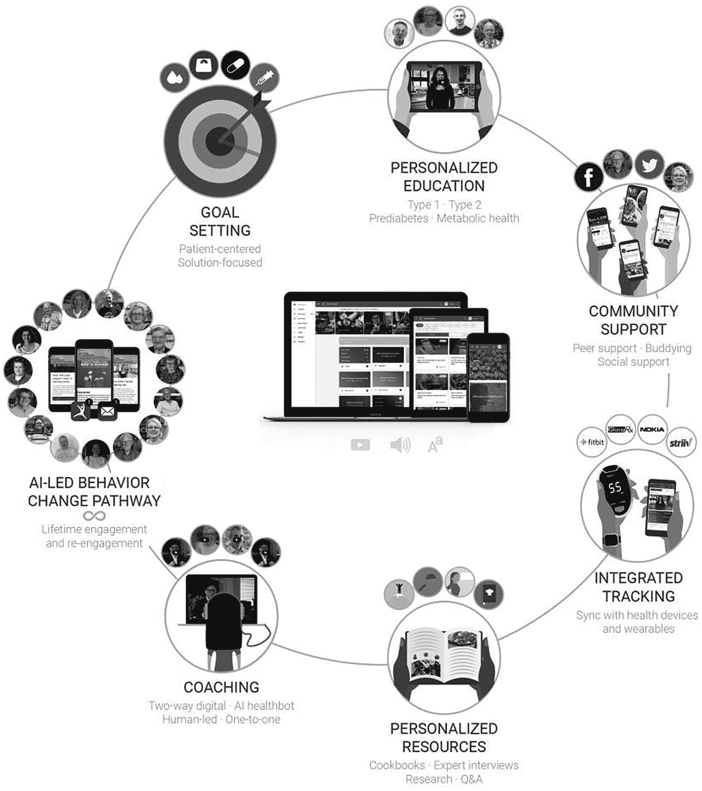
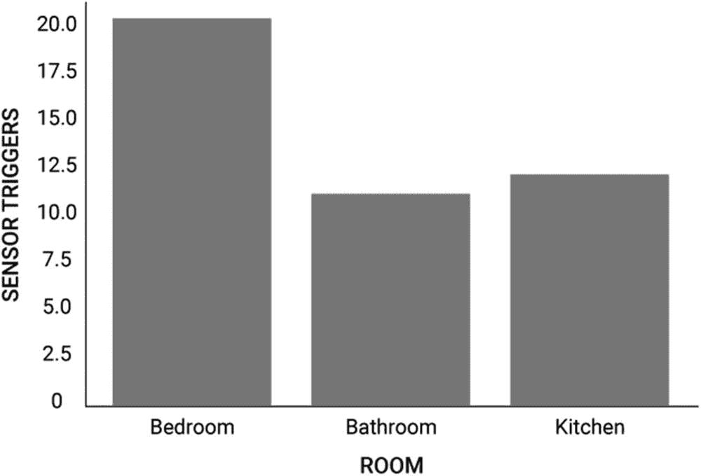
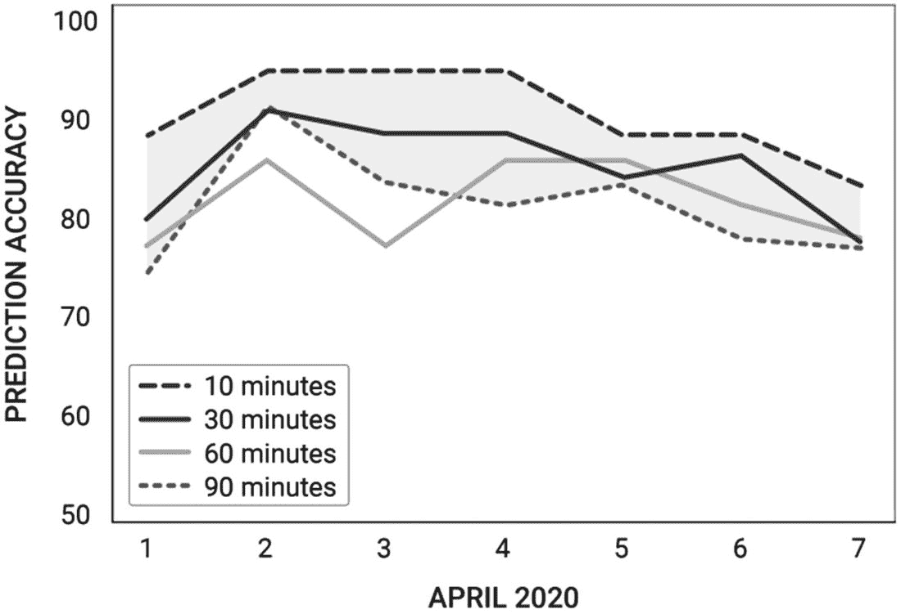
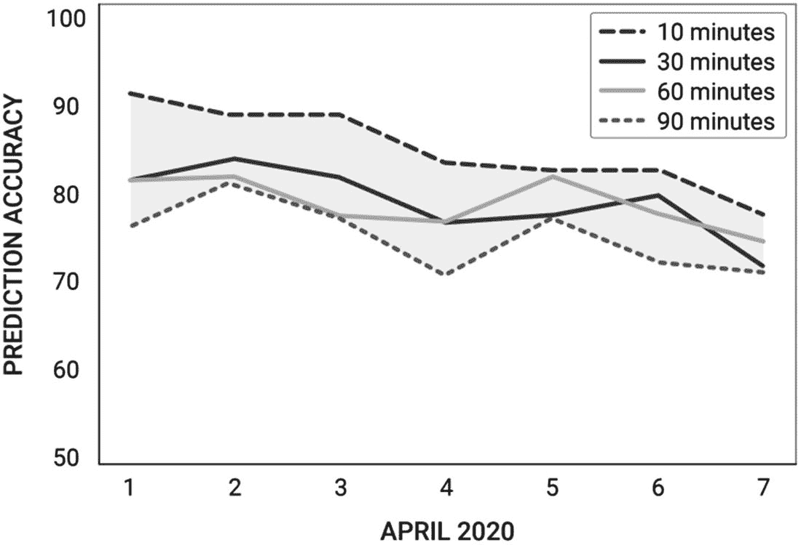

# 10. 案例研究

> *从自己的失败中学习，或者从别人的失败中学习。无论你选择哪种，都要学习。*
>
> ——基尔帕·伽亚特里·考尔

人工智能正在改善医疗保健体验，为那些能够利用并适应新型医疗和护理服务模式的人带来成功。本章包含现实世界的案例研究，展示了机器学习应用如何被用于解决数字健康领域的实际问题。

每个案例研究都提供了关于大数据、人工智能和机器学习在健康与社会护理领域中应用的独特且引人入胜的视角。对组织处理数据识别出的医疗保健问题的方法的真实描述，展示了数据和人工智能的即时价值。

这些案例研究背后的目的是展示人工智能、机器学习、数据和物联网在现实世界中新颖且创新的应用。

每个案例研究都分享了从各自智能系统的创建、训练和部署过程中获得的独特经验教训。

## 现实世界的灵感

我们在 Twitter 上征集案例研究，共收到 108 份提交。如果案例研究已在现实世界中使用（无论是试点项目还是其他形式），并有证据证明其从健康效益或成本节约角度具有价值，则被接受。

用于评估案例研究是否入选的标准包括：

*   重点关注精准医疗和大数据生成技术的交付。
*   机器学习或数据驱动模型必须已部署到现实世界中。
*   作者必须强调从项目提供的经验中获得的教训。
*   作者必须分享关于项目范围的充分信息，并就其组织、业务、临床或财务影响得出结论。

## 实际应用与经验总结

所选案例研究展现了在提升患者参与度、治疗效果及临床成功率方面的卓越愿景、专注与驱动力。这些案例研究在以下方面提供了富有启发性的范例：

*   利用大数据驱动决策，实现患者及群体层面的精准医疗
*   开发机器学习模型的优势与陷阱，及其在现实世界中的应用
*   数据收集、分析、管理与治理
*   开发人工智能代理，融合数字化与面对面医疗保健
*   在初级和二级医疗系统中使用可穿戴设备、传感器及物联网健康设备提供护理
*   人工智能的伦理与道德
*   数字技术、医疗保健及循证医学在追求提升生活质量方面的未来

关于案例研究、各自作者及其所属机构的更多详细信息，可在在线提供的补充阅读区域获取。

入选的案例研究均详细介绍了当今医疗保健领域中机器学习和人工智能的实际应用，并包含了我目前领导的机构 DDM 所提供的数字健康技术示例。

案例研究包括：

1.  用于糖尿病足问题影像学检查及转诊优先级排序以改善发病率和死亡率的人工智能
2.  数字化提供的低碳水化合物 2 型糖尿病自我管理项目的结果：一项单臂纵向研究的 1 年结果
3.  为癫痫提供可扩展且引人入胜的数字疗法
4.  通过新颖的增强现实和虚拟现实应用改善初级医生的学习成果
5.  可穿戴应用对健康结果有影响吗？一项关于活动影响的真实世界服务评估
6.  大数据、大影响、大伦理：从患者数据诊断疾病风险
7.  用于个性化护理的预测性人工智能模型评估及准确性评价
8.  语音激活助手能否支持成年人保持自主性？一项关于语音激活智能音箱应用对活动影响的真实世界服务评估

## 案例研究 1：用于糖尿病足问题影像学检查及转诊优先级排序以改善发病率和死亡率的人工智能

Harkrishan Panesar，Gro Health，英国

### 背景

全球有 4.63 亿人患有糖尿病，其中英国有 400 万[237]。目前英格兰有 7.7 万名糖尿病患者患有足部溃疡[238]。溃疡持续时间越长，愈合所需时间就越长。未经治疗的溃疡可能导致糖尿病足病（DFD）和截肢[239]。英格兰每天发生 25 例下肢（脚趾/脚/腿）截肢；其中 85%是可以预防的[240, 241]。

从 2015 年到 2018 年，英格兰发生了 27,465 例与糖尿病相关的下肢截肢，有 147,067 例与 DFD 相关的住院，平均住院时间为 8 天，总计 1,826,734 个住院床日，花费超过 6.86 亿英镑[242, 243]。

英国国家医疗服务体系（NHS）每花费 100 英镑，就有 1 英镑用于 DFD[244]。将溃疡患病率降低 33%每年可为 NHS 英格兰节省 2.5 亿英镑[9]。足部检查是识别、评估潜在问题并采取行动的机会。NICE NG19 指南指出，糖尿病患者应每年接受糖尿病足部检查，有活动性足部问题的患者应在一个工作日内转诊至多学科团队，并在另一个工作日内进行分诊[245]。

然而，由于以下原因，存在“患者对症状认识不足、医疗评估不准确以及获取专科服务困难”的问题[246]：

*   检查延迟：国家糖尿病足部护理审计发现，39%的患者等待 14 天以上才接受首次足部溃疡专科检查[247]。
*   缺乏检测：英格兰有 80 万名患者未接受年度足部检查。80%的执业护士对进行足部检查缺乏信心，导致护理和结果存在差异[248]。
*   评估质量差：33%的 NHS 英格兰专员不为医疗保健专业人员（HCP）提供足部护理培训。即使有培训，评估质量也很差[249]。

创新可以普及患者护理，并减轻溃疡/DFD 带来的经济和健康负担。

### 认知视觉

认知视觉或图像识别是一种旨在模仿人脑功能的机器学习技术。通过这项技术，机器学习模型被训练识别构成图像的视觉组件。通过在大量图像数据集上学习并识别模式，模型能够理解其输入并确定相关的标签和分类。图像识别并非易事。要成功执行图像识别，神经网络是首选技术。

然而，即便如此，实际中的计算资源成本仍然很高。例如，一个 20 像素乘 20 像素的图像输入到神经网络中，将接收超过 400 个输入。虽然这在典型的硬件设置中听起来可行，但更大尺寸的图像，比如 1000 像素乘 1000 像素，则需要强大的计算资源来处理更多的参数和输入。在传统的神经网络中，每个像素都会连接到一个单独的神经元。这在计算上非常昂贵。

图像中像素的邻近性与它们的相似性有很强的关系。卷积神经网络特别利用了这一特性。卷积神经网络不是将两个相邻的像素视为独立的，而是假设这些像素之间比距离较远的两个像素更可能存在关系。

通过绕过像素之间不太重要的连接，卷积解决了传统神经网络面临的计算和时间问题。

卷积神经网络通过按邻近性过滤关系，改善了图像识别所需的计算资源。

临床证据表明，诊断测试和风险分层可以预测溃疡和截肢的风险，早期转诊可降低截肢率和愈合时间[251]。

糖尿病足部护理的解决方案必须比标准的依赖医疗工作者的服务更广泛，并且能够以更低的成本为患者和医疗系统提供。

我和同事杨旺一起，应用了最先进的人工智能技术来自动检测糖尿病足问题的迹象，提醒患者，并支持医疗团队的沟通和评估。用于糖尿病足问题的图像识别技术将是革命性的，特别是考虑到这种机器学习经验可以改善溃疡愈合时间、成本以及截肢风险——因为这关系到溃疡被检测到的早晚。该模型在检测微小的瘀伤区域和足跟皲裂方面取得了高精度，这些问题很快可能发展成足部溃疡区域。

我们开发了一个基于云的系统，允许远程使用该应用程序，任何带有互联网浏览器的设备都可以按照标准化协议上传图像。输出将是一份检测到的任何问题的列表、最适合该问题的转诊路径，以及相关的教育信息（如果适用）。

该模型通过机器学习反馈循环不断优化，该循环定期使用随机标记数据子集（包括从基于 Web 的系统接收的数据）来优化和重新训练模型。

### 项目目标

我们项目的目标是进一步开发和验证这项机器学习技术，包括用于预测足部问题风险并为患者提供精准医疗的深度学习神经网络。用于多重预测的卷积神经网络可以通过使用和用户反馈循环变得更加精确。

由于用户群体主要是医疗专业人员和护理人员，学习过程可以扩大规模，并由医疗专业人员验证以进行适当的分诊。该项目还旨在为患者提供服务，而这只有在模型达到最大、理想情况下接近绝对的准确度时才有可能实现。减少错误是该项目的一个关键优先事项。

分级方案和标准化协议支持模型发展出更高的精确度和召回率。更早识别溃疡和其他足部问题的能力将加速诊断和治疗，并挽救许多人的生命。基于云的系统将有助于更轻松地共享应用程序及其结果。我们开发了一个全面的活动日志，以识别生态系统中发生的所有事件。该平台包括行为健康指导，以及通过蓝牙设备、可穿戴设备和自我输入数据对血糖、血压、情绪、饮食、体重和睡眠进行集成跟踪。

人工智能模型在预测分析中提供了无限的机会。通过分析和归纳数千张图像，医学图像正在转变为科学。很少有像数字化这样引人入胜且身临其境的方式，它使医疗保健能够收集海量数据；进行分析并提供有用的反馈来告知患者；以及预防、预测、诊断和治疗疾病。

从图像的本质来看，为聚合学习而进行的去标识化在技术上是简单的。然而，能够解释深度神经网络预测机制的要求在技术上是困难的。对应用程序更普遍的理解可以缓解大多数利益相关者的担忧，这可以通过演示来解释。

作为一项新颖的创新，一直需要解释模型是如何生成、验证和持续评估的。由于围绕产品分类的定义较为松散，事实证明，监管批准比之前的项目更加费力。

错误最小化一直是一个优先事项，监管批准的重点是确保患者安全。假阳性的风险被确定为更可能发生：早期溃疡检测意味着更快的愈合和更低的截肢风险。

在模型内部设定了关注阈值，任何疑问都会转交给人类处理。

该项目的成果正在通过临床论文进行记录，以强调该项目对患者、医疗保健提供者和全球医疗保健提供者的价值。也许最重要的是，这些成果将展示糖尿病患者如何通过预防和检测糖尿病足问题来实现显著的健康改善。

### 挑战

在整个项目期间，观察到了一些惯性点：

### 数据质量

任何模型的好坏都取决于用于创建它的数据。数据的完整性和正确性对于稳健的机器学习算法至关重要。收集到的数据集存在几个重大挑战，这促进了稳健数据治理流程的开发。首先，缺乏标注意味着数据未标记，并且在接收时通常不明确。

其次，支持图像扫描的手写笔记通常难以辨认。拼写错误或不完整的医生笔记使数据验证过程复杂化。数据的清理和审查推进了一个被确立为模型“唯一真实来源”的数据集。

### 数据治理

获得国家和国际监管批准的要求需要建立适当、透明的数据治理流程。治理涵盖的领域包括数据架构、归档、管理、元数据管理、隐私、安全和验证。为数据采集、核查和验证制定了标准、最佳实践和程序。

一个中央存储库保存所有相关数据和元数据，通过凭据限制访问以确保适当的用户管理。根据监管要求，记录了所有决策的治理轨迹，这为项目结束时的反思性学习提供了机会。严格的数据治理确保了项目中所用数据的完整性。

### 性能与“可解释性”

神经网络以其难以解释而闻名，尤其是当模型变得更加复杂时。该项目的一个关键要求是算法决策的透明度。

随着模型的发展，学习和反向传播的迭代调整了网络中的节点，使其变得无法解释。模型性能和准确性次于模型透明度。

### 伦理治理

与数据治理流程并行，制定了严格的数据伦理和信息伦理治理程序，以确保数据的合乎伦理和道德的使用。医疗专业人员使用该机器学习模型来预测和诊断足部溃疡的风险。

特别记录了关于假阳性和真阴性影响的过程，因为误诊被确定为最大的伦理问题。通过快速诊断和行动，溃疡和愈合时间的影响可以大大减少。

由于该应用程序用于支持医疗专业人员的行动，用户被告知了模型的局限性，并解释了模型准确性如何基于验证数据集。

### 闭环反馈

开发的模型预测了足部溃疡和其他糖尿病足问题的可能性。由于这将用于预防和诊断阶段，一个被要求的功能是验证和确认模型预测的能力。为此，使用该应用程序的医疗专业人员要么确认诊断，要么将患者转诊给专家进行诊断。

将患者结果反馈回系统的过程使系统能够近乎实时地学习。一旦患者被转诊到医院，从他们那里收集数据反馈是困难且繁琐的。

### 利益相关者理解

一个未曾预料的挑战是利益相关者缺乏理解，以及对技术驱动的医疗解决方案存在零星的抵触情绪。

关键利益相关者通常受到以往经验或负面新闻的影响，或者受到机器人时代将取代人类工作的担忧的威胁。这通过员工利益相关者培训日得以克服；第三方专家和内部利益相关者解释了人工智能和机器学习如何用于优化医疗专业人员执行的任务，减轻资源负担，并缓解对近期机器人竞赛的担忧。

项目范围是在一个多元化、多方面的利益相关者群体的意见下制定的，以确保所有相关方都参与到项目中。

### 采纳策略

作为一个通过研发资金启动的项目，试点项目与更广泛的组织方向几乎没有结合。通过研讨会和实践经验，提高了利益相关者对这项新颖创新的舒适度和采纳度。研讨会侧重于减轻利益相关者的担忧，并强调预测系统的简便性、有效性和资源节约性。

### 结论

对摄影硬件和格式差异具有敏感性且能灵活适应的云端智能，可与患者的临床、人口学、行为及基因组数据相结合，从而构建出用于检测糖尿病足问题的精准医疗框架。

该原型受到了医疗专业人士的欢迎，其中数人指出其某些元素提升了他们自身对该主题的认知。当与这一数字工具配合使用时，医疗专业人士在诊断足部问题方面感到更加自信。数字辅助手段能够确认并支持决策，同时促使医疗专业人士反思其决策过程。将该技术应用于医疗和研究机构收集的各类医学图像及数据，将能以可负担的方式实现大规模预后、风险分层以及最佳治疗决策。

根据我们的经验，拥有更多数据几乎总是比算法本身更重要。

克服文本数字化、标签识别与医学影像相结合所带来的挑战，被证明是该领域内一个颇具难度的方向。手写体和人为错误一直是需要最大程度减少以降低错误召回率的最大难题。开展大规模临床试验是该项目的下一阶段。一项评估项目可行性的试点项目正在等待资金批准。

## 案例研究 2：数字化提供的低碳水化合物 2 型糖尿病自我管理项目的成效：一项单臂纵向研究的 1 年结果

L. R. 萨斯洛博士，美国密歇根大学安娜堡分校

夏洛特·萨默斯，英国糖尿病数字媒体公司

J. E. 艾肯斯博士，美国密歇根大学安娜堡分校

D. J. 安温，皇家全科医师学院院士，全科诊所主任医师，英国绍斯波特诺伍德外科诊所

### 背景

2 型糖尿病具有严重的健康后果，包括失明、截肢、中风和痴呆；其年度全球成本超过 8000 亿美元。

尽管通常被认为是一种进行性、不可逆的疾病，但一些研究人员和临床医生现在认为，2 型糖尿病可以通过低碳水化合物饮食得到有效治疗，这可以改善 2 型糖尿病的管理，甚至可能导致病情缓解[252]。事实上，先前针对 2 型糖尿病的低碳水化合物饮食研究确实显示出改善的结果（例如血糖控制、体重减轻以及降糖药物使用减少），无论是极低碳水化合物饮食（总膳食热量中约 20%或更少来自碳水化合物）[253, 254, 255]还是较低碳水化合物饮食（总膳食热量中约 40%或更少来自碳水化合物）[256, 257]。尽管饮食干预历来是面对面进行的，但正如针对糖尿病前期成年人的饮食和生活方式干预研究所表明的那样，在线项目对某些参与者同样有效[258]。因此，低碳水化合物饮食对 2 型糖尿病患者的有益结果（血糖控制、体重减轻和降糖药物使用减少）已通过在线项目得到复制，这或许并不令人意外[259, 260]。

### 目标

我们的目标是评估数字化提供的低碳水化合物项目（`LCP`）的 1 年成效，这是一个以营养为重点、包含十次课程的教育干预项目，旨在帮助 2 型糖尿病成人患者控制血糖和减轻体重。该项目通过行为技巧（包括目标设定、同伴支持和行为自我监控）来强化碳水化合物限制。

### 方法

该研究采用准实验研究设计，包括一项开放标签、单臂、干预前后对比研究，并使用便利样本。

从已加入该项目并拥有完整基线数据集的 2 型糖尿病成人患者中，我们随机选择参与者进行为期 1 年的随访（`N` = 1,000；平均年龄 56.1 岁，标准差 15.7 岁；女性占 59% [593/1,000]；平均 `HbA1c` 7.8%，标准差 2.1%；平均体重 89.6 公斤，标准差 23.1 公斤；平均服用 1.2 种糖尿病药物）。

低碳水化合物项目是一个完全自动化、结构化的 10 周健康干预项目，面向 2 型糖尿病成人患者。参与者可以访问以营养为重点的模块，在 10 周内每周开放一个新模块。这些模块旨在帮助参与者逐步将每日总碳水化合物摄入量减少至低于 130 克，以实现他们自行选择的目标。该项目鼓励参与者根据每个模块末尾的“行动要点”或行为改变目标来做出行为改变。这些目标通过可下载的资源（包括信息表、食谱和建议的食物替代方案）得到支持。低碳水化合物项目在线平台还包括数字工具，用于提交关于多种不同变量的自我监测和设备驱动数据，包括血糖水平、血压、情绪、睡眠、食物摄入量和体重。根据用户对项目的使用情况，通过电子邮件通知每周提供自动反馈，并在下一周模块开放时通知参与者。课程通过视频、文字内容或不同长度的播客进行教学。

该项目强调参与者在第 1、2 和 10 周与其医疗保健提供者定期联系以调整药物的重要性。在 10 周的模块全部开放后，参与者仍可继续访问教育内容，并能够继续追踪他们的健康状况（血糖控制、体重）。

该项目中使用的内容和策略建立在先前的研究和理论之上。例如，有证据表明，目标设定可以作为一种有效的行为改变策略，用于提高肥胖管理项目中生活方式干预项目的依从性。因此，该项目鼓励参与者在项目开始时选择一个目标（例如减肥、减少药物依赖或为整个家庭做出更健康的选择）。参与者还被提示思考实现目标将如何有益于他们的健康。

在整个项目过程中，参与者会定期被提示思考他们距离实现目标还有多远。该项目通过整合追踪进一步强化行为改变，鼓励项目用户追踪他们的健康数据，包括情绪、食物摄入量、血糖水平、体重、睡眠和 `HbA1c`。

根据行为改变的控制理论，监控目标进展——即评估个人相对于标准的持续表现——并做出相应反应，对于实现目标至关重要。最近的研究结果表明，能够提高进展监控频率的项目干预措施很可能诱发行为改变。

### 结果

在 1,000 名研究参与者中，有 708 人（70.8%）报告了 12 个月时的结果，672 人（67.2%）完成了至少 40%的课程，528 人（52.8%）完成了项目的所有课程。

在起始 `HbA1c` 达到或超过 2 型糖尿病阈值 6.5%的 743 名参与者中，有 195 人（26.2%）在未服用降糖药物或仅服用二甲双胍的情况下，将其 `HbA1c` 降至阈值以下。

在基线时至少服用一种降糖药物的参与者中，有 40.4%（289/714）减少了一种或多种此类药物。近一半（46.4%，464/1,000）的参与者体重减轻了至少 5%。总体而言，血糖控制和体重减轻情况有所改善，尤其是完成了项目所有十个模块的参与者。

例如，基线 `HbA1c` 升高（≥ 7.5%）且参与了所有十个每周模块的参与者，其 `HbA1c` 从 9.2%降至 7.1%（`*P*` < .001），并且平均体重减轻了 6.9%（`*P*` < .001）。

### 观察

-   本研究患者使用的参与平台仅限网页端，而非移动应用。可以预见，移动应用将能提升参与度。
-   本项目的纳入标准为年满 18 周岁且具备英语沟通能力。

HbA1c 水平低于 6.5%的患者比例从 26%（257/1,000）上升至 50%（503/1,000）。若通过药物治疗达到此种控制水平，通常伴随体重增加和低血糖事件风险[261]。正如著名的“控制糖尿病心血管风险行动”（ACCORD）研究报告所述，强化降糖药物治疗“增加了死亡率，且并未显著减少主要心血管事件”[262]。

本研究的局限性在于完整干预措施的完成率，仅有 528 人（52.8%）完成了所有模块。然而，有较高比例（70.8%）的患者报告了 12 个月的结果。这可能是由于项目于 11 月启动，圣诞节和季节性活动影响了完成率。另一方面，鉴于该项目完全自动化且覆盖范围广泛，仍有大量个体得以完成项目。

### 结论

特别是对于完全投入的参与者而言，一项向 2 型糖尿病成人患者教授低碳水化合物饮食的在线项目，在血糖控制、体重减轻和减少降糖药物方面是有效的。

## 案例研究 3：为癫痫提供可扩展且高参与度的数字疗法

夏洛特·萨默斯，英国糖尿病数字媒体公司

### 背景

癫痫是一种大脑神经系统疾病。不同类型的癫痫由多种不同的潜在病因引起[263]。病因可能复杂且有时难以确定。一个人可能因以下一种或多种原因开始出现癫痫发作：遗传倾向、大脑结构改变或遗传性疾病[263]。

癫痫有时被称为一种长期疾病，因为患者通常需要与之共存多年甚至终生[264]。虽然癫痫通常无法“治愈”，但对大多数人来说，癫痫发作是可以“控制”（停止）的，从而使癫痫对其生活影响极小或无影响。治疗通常侧重于长期管理癫痫发作。

大多数癫痫患者服用抗癫痫药物（AEDs）来阻止癫痫发作[264]。然而，此类药物可能存在副作用，对于 AEDs 无法控制癫痫发作的患者，还有其他治疗选择，包括生酮饮食（KD）[265]。

本案例研究记录了该组织如何在团队内部阐明机器学习项目构想，以及如何运用循证方法来支持决策，以解决现实世界中的问题。

### 实施循证依据

饮食性酮症及生酮饮食（KD）对人体生理的积极影响和治疗机制已在文献中得到充分记载。KD 是一种高脂肪、低碳水化合物（通常低于 50 克/天）、适量蛋白质的饮食[266]，其代谢效应可追溯至 20 世纪 60 年代；然而，KD 的治疗效果可追溯到 20 世纪 20 年代初，当时它被成功用于治疗癫痫[267]。

自那时起，多项研究对 KD 的潜在临床应用进行了探索，积累了关于 KD 对各种生理紊乱治疗作用的科学证据。多项研究表明，KD 确实能减少或预防许多药物无法控制癫痫发作的儿童的癫痫发作。

超过一半采用该饮食的儿童，其癫痫发作次数至少减少了 50%。一些儿童（通常为 10-15%）甚至不再发作[268]。英国癫痫协会支持将 KD 作为 12 个月以上患者的治疗选择。研究强调，KD 对癫痫患者的治疗效果主要体现在减少用药和减少癫痫发作。在最近一项关于 KD 效果的 Cochrane 系统评价中，Levy 和 Cooper 未发现随机对照试验（RCTs）[269]。

这表明癫痫是可以管理的；在某些情况下，患者通过持续应用生酮饮食方式，可以过上无癫痫发作的生活[270]。通过减少饮食中的糖分并同时改善血糖控制，癫痫患者可以获得显著的健康益处，例如降低癫痫发作风险和减少用药数量[271]。

### 传感器驱动的数字项目

癫痫生酮项目（KPE）是一个针对癫痫患者的结构化教育行为改变项目。KPE 通过提供适当的个性化教育、健康追踪工具、支持、健康指导和资源，帮助用户可持续地采用低碳水化合物生活方式，以维持安全且可持续的生活。因此，癫痫患者有望改善血糖控制，从而减少癫痫发作的发生率，减少药物依赖，并增强管理自身状况的信心。

通过应用程序内的血糖监测、用药监测和癫痫发作追踪模块，实时收集健康数据。可穿戴设备用于收集数据以感知癫痫发作和跌倒。非结构化数据在理解患者情绪和心理方面特别有用。

研究活动持续 12 个月，报告 3 个月、6 个月、9 个月和 1 年时的流行病学健康结果和参与度数据，随后进行 18 个月和 2 年的随访，以证明项目在中短期内的有效性和依从性。

这是全球规模最大、持续时间最长的关于癫痫患者使用数字平台的研究。

### 研究

作为该项目的一部分，我们旨在探索最高效、最有效的方法，以加速向英国国家医疗服务体系（NHS）人群和国际付费方大规模推广我们的技术。该项目由一个屡获殊荣、经验丰富的团队领导，该团队以创新数字健康而闻名，致力于彻底改变全球人民的健康与福祉。

技术挑战在于创建一个可扩展、高参与度且有效的解决方案，以便在全球实施。通过依托 DDM 公司低碳水化合物项目的基础设施，并凭借经过临床验证的结果和一年后 71%的留存率，这一挑战得以缓解。截至撰写本文时，在全球注册参与低碳水化合物项目（针对 2 型糖尿病）的 30 万名患者中，有 3,112 名癫痫患者（占英国人口的 0.5%）——这表明针对这一人群开展以营养为重点的在线干预措施的时机已经成熟。

为医疗付费方带来的潜在成本节约影响是巨大的。那些获得赋权、健康状况和福祉得到改善的患者，也会成为社区中更积极的成员，并减少对社会护理的需求。

### 项目影响

通过赋能患者管理自身癫痫，癫痫患者及其家属将感受到最深远的影响。证据表明，通过生酮饮食（KD），婴儿和成年癫痫患者均能维持该饮食模式，并观察到癫痫发作次数和用药量的改善。同时，证据也显示其对心血管疾病风险有积极影响[272]。由此带来的健康改善和潜在成本节约相当可观。

除了健康改善，该项目对英国经济和国民健康服务体系（NHS）也具有巨大价值，其通过减少并发症、改善心理和情绪健康、降低住院率以及减少用药，直接影响了英国财政部的预算。

患者所经历的积极社会影响，会对更广泛的社区、企业和英国经济产生连锁反应。

由于患者和人群健康状况的改善，各类组织将受益于病假天数减少、缺勤率降低、心理健康改善、感知生活质量提升，以及管理癫痫的感知负担减轻。临床医疗界也感受到了积极影响——这通过减轻医生和医疗专业人员的负担，并增强循证基础来实现。

### 初步分析

本项目研究分支的目标是评估数字化交付的生酮饮食计划的 1 年效果：这是一项以营养为重点、包含 16 次课程的教育干预措施，旨在通过提供生酮饮食来控制癫痫。

该计划通过使用行为技巧（包括设定目标、同伴支持和行为自我监控）来帮助患者达到酮症状态。血糖升高与情绪之间有趣的相关性，使得能够开发预测算法来识别即将发作的癫痫症状，并通过通知提醒患者采取行动。

特别是对于完全投入的参与者而言，一项向成年癫痫患者教授低碳水化合物饮食的在线计划，可有效控制血糖、减轻体重、减少用药和患者癫痫发作次数。

需要进行随机对照试验，以了解此类数字疗法的临床效果。

## 案例研究 4：通过创新使用增强现实和虚拟现实改善初级医生的学习成果

保罗·杜瓦尔，英国利物浦大学

维迪·泰勒-琼斯，英国利物浦大学

### 背景

初级医生满怀服务人类的热情来到大学，但他们往往不知道如何处理高压、危急的场景。恰当地处理医疗问题——无论是否紧急——都需要多年的经验和学习。

随着时间的推移，在医生诊室、医院和诊所的历练，培养了初级医生实现其职业所需的自信、准备和经验。高压场景，例如患者心脏骤停，需要决策和行动达到精准无误。

在初次进入大学后的一段时间内，初级医生尚未准备好做出此类决策。这正是增强现实和虚拟现实提供机会的地方，可以让学生参与学习，为他们未来的医生生涯做好准备。当你成为一名医生时，每个决定都有后果——这对一些人来说可能是一种负担。

更重要的是，每年有 1500 名学生，集体去医院参观既昂贵，后勤管理也困难。

该项目因其开创性而受到认可，获得了医学教育协会（ASME）教育创新奖。

### 目标

该项目的目标有多个：

*   在不使用模拟中心的情况下，增加初级医生接触模拟和培训环境的机会。

*   让缺乏经验的医生在非关键环境中获得他们所需的经验。

*   展示有效和无效的临床实践。

*   鼓励学生反思自己的实践和思维过程。

*   让学生沉浸在临床学习环境中，并确定使用虚拟现实是否能使他们熟悉医疗环境和患者的不可预测性，并提供应对高压场景的信心。

### 项目描述

大家一致认为该项目应尽可能扩大覆盖范围。这排除了像 HoloLens 或 Oculus 这样的虚拟现实硬件，并将交付重点放在移动设备上。三星 Gear 和谷歌 Pixel 能够通过使用头戴式设备来扩展视野进入虚拟现实，从而促进内容的交付。考虑到几乎每个学生都拥有手机，而 HoloLens 和 Oculus 的使用仍然相对小众，这是合乎逻辑的。

使用 360 度摄像技术拍摄了多种临床场景的模拟，由医生和患者担任演员。这些模拟是 5 到 10 分钟的短视频，其中包含需要学生做出主动选择的决策时刻——包括一名心脏骤停的患者和一名精神分裂症患者变得越来越焦躁不安。

这些视频被集成到一个虚拟现实应用程序中，该应用程序使学生能够在虚拟现实中探索临床环境，融入环境，并鼓励他们在过程中做出各种决策。该应用程序鼓励用户“佩戴”头戴式设备以获得完整的沉浸式体验。

随后，使用该增强现实应用程序教育初级医生的效果与学生一起进行了评估。

### 什么是 360°视频？

## 360°视频与VR教育

360°视频是一项较新的技术，它使用全向摄像机来捕捉球形视频空间，而不是传统摄影的横向维度。这些视频被拼接在一起，创造出沉浸式的观看体验，将观看者置于场景中的环境内，而不是作为旁观者或“墙上的苍蝇”。观看者能够探索场景，旋转完整的 360°。捕捉 360°视频需要专业摄像机。

360°视频的回放最常在移动设备上进行，智能手机屏幕充当了通往 360°环境的窗口。观看者可以物理移动手机来查看 360°视频的其他区域——同时控制方向和视角。

可以获得允许将观看者的设备作为头戴式设备佩戴的物理设备，以提供完全沉浸式的体验。台式电脑也可以像移动设备一样播放 360°视频。在台式电脑上与 360°视频交互通常需要使用鼠标在环境中移动。基于硬件的头戴式设备也可用于观看 360°视频；然而，考虑到项目的目标，这被认为成本过高。

### 结论

VR 驱动的教育受到了团队成员、学生和教职员工的热烈欢迎。在经历了使用 360°视频和/或虚拟现实的初始“惊叹”效应后，佩戴头显设备的参与者能够融入周围环境，并参与到 VR 提供的培训中。

*   虚拟现实模拟为初级医生提供了一个优质且安全的临床环境，供他们探索实践。
*   特别是，该技术使学生能够专注于错误——从而在全体学生中统一医学处理方法。
*   该技术使学生能够随时随地学习：在家中、学校或图书馆。
*   所有拥有合适硬件的医学生都可以使用虚拟现实模拟。
*   学生在课堂上能够更积极地参与决策。
*   虚拟现实体验促进了讨论和学习。
*   与组织学生前往医院病房相比，这种方式成本更低，后勤管理也更简便。
*   这项创新技术的使用让初级医生为应对职业需求做好了准备。
*   随着这些工具变得越来越普及，需要研究和探索合适的教学法来支持虚拟现实学习。

沉浸式教育是一种值得进一步探索的交付途径，以改善学生的学习体验、降低成本并进一步推动医疗保健创新。

## 案例研究 5：可穿戴应用对健康结果有影响吗？一项关于其对活动量影响的真实世界服务评估

夏洛特·萨默斯，英国糖尿病数字媒体
阿琼·帕内萨，英国糖尿病数字媒体

### 背景

与许多发达国家一样，英国与饮食和生活方式选择相关的慢性病发病率正在上升，例如肥胖、2 型糖尿病和心血管疾病[273]。肥胖已被证明是 COVID-19 的一个风险因素[274]。支持采用健康生活方式来预防和管理这些及其他长期健康状况的证据非常充分[275]。在英国，新确诊的 2 型糖尿病患者中，参加结构化教育的比例不足十分之一[276]。造成这种情况的原因有很多，包括这些课程安排在工作日，且时间往往不方便[277]。除此之外，参加线下教育项目 6 个月后，习得的行为会逐渐消退[278]。通过减少碳水化合物摄入可以改善 2 型糖尿病的管理，这种方法已被证明是实现正常血糖控制和可持续减肥的最有效途径。减肥是改善肥胖和代谢健康状况（如糖尿病前期）自我管理的关键因素[279–281]。

面向患者的数字健康应用（应用程序）提供了改变个人管理自身健康方式的机会，其途径包括更有效地传递健康信息、更好地监测健康指标以及鼓励生活方式的改变。可穿戴设备（及可穿戴应用）已被证明可以增加老年人的活动量，并有助于减肥[282–284]。

过去几年，人们对健康应用潜力的热情迅速高涨，许多 `NHS` 服务机构现在都在委托开发数字健康应用。虽然健康应用有望增强对从心理健康到高血压、心血管疾病和 2 型糖尿病等多种健康状况的护理，但与普及率相比，令人惊讶的是，人们对它们的功能或对健康结果的影响知之甚少。

从现有的数据来看，有迹象表明，一些主要预测使用率的因素，与预测完成率或健康结果的因素并不完全相同，并且很少有健康应用能证明其具有长期依从性[285]或报告长期健康结果。这在一定程度上可能是由于缺乏跨健康应用的数据收集标准[286]。

应评估已被证明能影响行为和健康结果的数字健康应用的功能，以改善健康服务的设计和交付。需要进行研究以扩展先前的健康应用研究，并了解特定应用功能对参与度和健康结果的有效性。先前关于低碳水计划（一个结构化教育和行为改变应用）的出版物证明了其在支持肥胖管理方面的临床有效性，包括具有统计学意义的体重减轻[287]。

患者的行为直接影响其治疗成功与否，医生依赖患者服用处方药物，同时做出并坚持饮食和生活方式的改变。医疗保健领域许多最重大的挑战，特别是长期或慢性疾病（如肥胖和 2 型糖尿病）中的挑战，只有在我们能够影响行为并支持可持续的行为改变（以及其他方面，如食品环境）时才能得到解决。

我们对低碳水计划的功能进行了详细审查，并分析了每个应用功能存在的理论基础。本研究旨在评估其中一些应用功能，并了解对这些功能的参与度如何影响健康结果，特别是体重减轻。

肥胖与显著更差的心血管风险因素相关，这表明采取更积极的干预措施来控制体重增加，将有助于应对肥胖给 `NHS` 带来的日益沉重的负担。无论使用何种减肥干预措施——药物或行为——体重通常都会反弹[288–290]。

通常，减掉的体重在第一年内会恢复一半。体重反弹通常会持续到治疗后的 3 至 5 年；平均而言，80%的人会恢复到干预前的体重或超过该体重[291]。

同样，尝试戒烟和试图减少饮酒的人的复发率也很高[292–294]。

因此，有效的干预措施需要考虑不仅与初始体重减轻相关，而且至关重要的是与维持体重减轻相关的已知因素，例如建立减肥的内在动力、建立社会支持机制、识别应对策略，或为自我效能和自主性提供支持，这些都能增强体重维持效果，这对于任何减肥干预措施的长期成功都至关重要[295]。

### 方法

#### 研究设计

本研究采用准实验研究设计，包括开放标签、单臂、干预前后对照。参与者未因参与而获得报酬；成员由其 `NHS` 医疗保健专业人员团队转介以访问该计划，并同意对去标识化数据进行分析。各研发委员会确认，由于该研究是一项服务评估，因此无需伦理批准。

该计划可通过运行 `iOS` 和 `Android` 的智能手机设备上的应用访问，并配有适用于 `Apple Watch` 3 及以上版本以及运行 `Android` 8.0 或更高版本且搭载 `Wear OS` 2.7 或更高版本的 `Wear OS` 手表（在 `Android` 智能手表上运行）的配套应用。

#### 参与者

参与者通过其 `NHS` 医疗保健专业人员招募并转介至该平台。从 2019 年 1 月 1 日至 2019 年 4 月 30 日期间转介至低碳水计划的 2 型糖尿病患者中，共找到 200 名用户。对这些人注册后 6 个月的健康和参与度数据进行了分析。所有参与者均来自英国英格兰地区。

#### 低碳水化合物计划

低碳水化合物计划是一款针对 2 型糖尿病、糖尿病前期和肥胖症患者的行为改变应用程序。该应用为 2 型糖尿病、糖尿病前期、肥胖症、代谢综合征、多囊卵巢综合征（`PCOS`）和非酒精性脂肪性肝病（`NAFLD`）患者提供经英国国家医疗服务体系（`NHS`）认证的结构化教育。该计划教导患者在为期 12 周的核心实施阶段，将每日饮食中的糖分摄入量减少至 130 克碳水化合物。

该平台允许用户追踪其健康状况（体重、糖化血红蛋白、血糖、饮食、情绪、用药、酮体、胆固醇、血压），通过饮食日记追踪营养摄入，并将应用与可穿戴设备（`Apple Health`、`Google Fit`、`Fitbit`、`Nokia`、`Garmin`）连接，并提示用户定期进行健康检查。该应用已在 `NHS` 内部使用，并被证明有助于肥胖症、糖尿病前期和 2 型糖尿病患者减轻体重[287]。

该平台为南亚裔（旁遮普语）用户提供母语教育和文化相关的支持，并可在响应式网页、`iOS`、`Android`、`Apple Watch`、`Android Watch`、`Alexa` 和 `VR`（`Oculus`）上使用。

该平台建立在经过同行评审的行为改变架构之上，旨在支持应用内的长期行为改变。其组成部分包括目标设定、定制化教育、社区支持、集成追踪、定制化资源、辅导以及基于行为和健康状况的 `AI` 驱动参与。图 10-1 展示了该行为改变架构。

图 10-1

低碳水化合物计划中使用的行为改变架构

##### 可穿戴应用：适用于 `Apple Watch` 和 `Wear OS` 手表的低碳水化合物计划

低碳水化合物计划的可穿戴应用可在 `Apple Watch` 和 `Android` 手表（也称为 `Wear OS`）上使用。配套的低碳水化合物计划手表应用为佩戴者提供四项功能。

*   **健康追踪：** 配套应用用户可以追踪他们的体重、血糖、情绪、活动、步数、血压和心率。
*   **放松：** 参与者可以选择一段固定的时间来专注于呼吸。智能手表会显示旨在舒缓情绪的动画，并指示何时吸气和呼气。
*   **生活方式：** 参与者可以阅读教育内容，并从每日更新的文章库中将文章发送到他们的手机。
*   **激励：** 配套应用中的一个屏幕，显示随机选取的励志名言，旨在引发反思和目标重新评估。

#### 测量指标

在基线期，即注册智能手机应用时，参与者被要求报告其糖尿病类型、确诊年份、体重、当前用药情况、年龄、性别、饮食偏好、社会经济状况（基于每周食品预算）以及是否患有共病慢性疾病。

在第 3 个月和第 6 个月时，参与者被要求报告他们当前的体重和用药情况以进行重新评估。在可能的情况下，提取了参与者的体重、活动量（步数）和参与度数据。

该研究探讨了在 6 个月时有多少参与者仍保持参与。它还探讨了所有用户各自的活动量、体重减轻情况以及平台参与度。

### 统计分析

使用 SPSS 21.0 版（SPSS Inc.，芝加哥，伊利诺伊州，美国）进行分析。我们进行了多元回归分析，以确定低碳水化合物计划应用功能参与度对体重减轻的预测能力。主要结局指标是参与度、体重和步数。

结局指标还根据参与者完成低碳水化合物计划的情况进行了分层分析（即，完成者：参与了 12 个低碳水化合物计划每周模块中至少 9 个，n=117；部分完成者：参与了 4-8 个模块，n=49；未完成者：参与了≤3 个模块，n=34）。

结果考虑了所有样本，无论是否提供随访信息或完成课程。队列中任何激活了账户的患者均被纳入分析。

对于在 6 个月时未报告结局指标的参与者，我们采用了高度保守的方法，即假设他们完全没有改善（末次观测值结转法），将其基线值作为其结局值进行插补。例如，未按要求报告 6 个月结局指标的参与者被视为结局变量无变化，因此不计入有任何体重变化。

## 结果

### 基线期参与者特征

在基线期，平均体重为 95.51 公斤（标准差 22.36），平均年龄为 56.86 岁（标准差 10.75）。女性略多于一半（59%，118/200），88%（176/200）为白人，所有参与者均来自英国英格兰。

### 平台使用与参与度

超过一半的转诊参与者（53%，106/200）在网页上注册。超过一半的参与者（121 人，54%）通过 `iOS` 设备访问该计划，79 人（39.5%）通过 `Android` 设备访问。少数参与者（1%，2/200）下载了 `Alexa` 应用。

在通过可穿戴设备（Apple 或 Android 手表）追踪活动的 200 名参与者中，84%（168/200）保持参与并在 6 个月时有结局指标（定义为在过去 7 天内主动输入过数据）。对于在 6 个月时失访的 32 人，采用末次观测值结转法。

### 可穿戴设备参与度

对于完成计划的成员，使用配套应用并完成计划的参与者报告体重减轻了 7.38%（7.34 公斤，`t[116]=10.9247`，`p<0.001`）。

| **状态** | **基线体重（公斤），均值（标准差）** | **6 个月体重（公斤），均值（标准差）** | **体重变化（公斤），均值（标准差）** | **体重变化（%），均值（标准差）** | **P 值** |
| :--- | :--- | :--- | :--- | :--- | :--- |
| **所有参与者（n=200）** | 95.51 (22.36) | 90.43 (20.63) | -5.07 (6.99) | -4.99 (6.31) | <0.001 |
| **完成者（n=117）** | 96.96 (23.21) | 89.61 (21.8) | -7.34 (7.27) | -7.38 (6.72) | <0.001 |
| **部分完成者（n=49）** | 96.72 (22.33) | 93.51 (19.13) | -3.21 (6.35) | -2.78 (4.39) | .0009 |
| **未完成者（n=34）** | 88.79 (18.44) | 88.81 (18.52) | 0.02 (0.44) | 0.02 (0.52) | .8478 |

对于使用配套可穿戴应用并完成计划的 117 名参与者，到 6 个月结束时，平均每日步数增加了 54.2%（`t116=11.57`，`P<.0001`）。用户在注册应用 6 个月后的平均步数显著更高。

| **状态** | **基线步数（步/天），均值（标准差）** | **6 个月步数（步/天），均值（标准差）** | **步数变化（步/天），均值（标准差）** | **步数变化（%），均值（标准差）** | **P 值** |
| :--- | :--- | :--- | :--- | :--- | :--- |
| **所有参与者（n=200）** | 2988.76 (598.95) | 4318.32 (1624.74) | 1329.56 (1515.61) | 46.5 (52.82) | <0.001 |
| **完成者（n=117）** | 2947.86 (571.92) | 4494.02 (1577.88) | 1546.15 (1445.47) | 54.2 (47.89) | <0.001 |
| **部分完成者（n=49）** | 3057.35 (684.04) | 4649.04 (1837.2) | 1591.69 (1778.9) | 55.85 (66.63) | <0.001 |
| **未完成者（n=34）** | 3030.65 (564.1) | 3237.1 (883.87) | +206.44 (580.23) | 6.37 (17.5) | .0459 |

## 讨论

本研究并非随机对照试验，因此无法将 6 个月的结果与对照组或标准治疗组进行比较。然而，在转诊至该平台的 200 名肥胖患者中，84%使用可穿戴设备的患者在 6 个月随访时仍保持参与，这支持了先前关于低碳水计划有效性的报告结果。

尽管研究设计不支持对因果关系进行推断，但可穿戴设备的使用与体重减轻之间存在统计学上显著的相关性。

研究发现，完成（>9 个模块）或部分完成（>4 个模块）该计划的成员报告的体重减轻幅度大于未完成计划的成员。

完成计划的成员在 6 个月时体重显著下降了 7.38%。基于先前关于 2 型糖尿病患者使用该平台改善血糖控制和维持体重减轻的证据，本研究的结果进一步表明，对于完全投入的参与者而言，通过智能手机和配套应用程序提供的自动化在线计划，教导肥胖成年人采用低碳水饮食并提供按需定制的锻炼方案，可以促进体重减轻。

### 主要发现

我们最初的假设——患者对可穿戴配套应用程序的参与度可预测其生活方式行为改变——似乎成立。特别是，完成计划并使用可穿戴配套应用程序的参与者实现了显著的体重减轻。

使用平台配套可穿戴应用程序并完成计划的参与者，其体重减轻幅度超过了所有其他分析层级的参与者。使用配套应用程序并完成计划的成员在 6 个月随访时体重减轻超过 7%。这些成员的步行量也增加了——6 个月时的步行量比基线时增加了 50%以上。值得注意的是，基线数据是由患者的医疗保健专业人员在转诊时提供的。

然而，后续的健康结果（体重、步数）是通过自我报告和可穿戴追踪器输入的，而非通过临床健康记录进行测量。不过，先前的研究发现，这些自我报告的健康结果可能与实际值相当接近[296, 297]。

本研究的一个局限性在于，分析只能将主动的配套应用程序功能参与与健康结果相关联。任何特定患者可能进行的一些被动参与，虽可被视为应用程序内的参与，但不会被明确追踪。

一个例子是同伴支持社区；对于阅读帖子但不通过提问或回答来积极参与的“潜水者”，这一患者群体可能占数字社区人口的 75%。这可能对采纳生活方式行为改变及后续健康改善的可能性产生显著影响，但这些影响更难监测。

## 结论

本研究旨在评估配套可穿戴应用程序是否有助于减轻体重。使用配套可穿戴应用程序追踪健康的参与者在 6 个月时表现出显著的体重减轻，同时活动水平也有所提高。

这些发现支持了先前的研究，表明可穿戴应用程序可以改善健康结果。应进行进一步分析以探索不同人群之间的差异，特别是不同年龄、性别、种族和社会经济地位是否会影响健康应用程序的参与度及后续健康结果。

## 案例研究 6：大数据，大影响，大伦理：从患者数据诊断疾病风险

多米尼克·奥特罗，Diabetes.co.uk，英国

### 背景

近几十年来，患者数据的多样性和产生速度呈指数级增长。但这些数据并未提升决策的稳健性。这引出了一个问题：为什么决策没有变得更加数据驱动，以及可以采取什么措施来验证并加速其采用。

`Diabetes.co.uk` 是世界上最大的糖尿病社区，位于华威大学，该平台每年接待超过 4500 万访客。作为全球性的糖尿病社区，该组织提供一系列专注于患者数据生态系统的服务，旨在赋能患者管理和控制自身健康。

通过长期收集患者数据（即真实世界证据），构建了这样一个生态系统，能够针对患者健康的特定方面提供见解、教育和反馈。

### 平台服务

该平台收集了大量数据。从访问平台的那一刻起，就会收集行为和参与度指标，随后患者会注册平台，并选择提供涵盖其糖尿病及整体健康状况的 120 多个变量。

进入平台后，会收集多种类型的数据——非结构化数据（如对话、互动、参与和行为）以及结构化数据（如自我报告、设备驱动、可穿戴设备、物联网和临床健康记录数据）。该平台为患者和付费方提供多项服务。

### 药物依从性、疗效与负担

药物依从性、不良反应和浪费是药理学试图克服的问题。糖尿病患者在进入平台时通常至少服用一种药物。

在平台内，患者会定期评估他们的药物，分享他们在现实世界中使用药物的个人看法，并报告更结构化的数据，如副作用、依从性、疗效以及使用药物的负担。这些数据会按地理位置、疾病、药物和其他标记进行映射，并以去标识化的汇总方式反馈给药理学和学术合作伙伴，用于研究目的。

合作伙伴利用这些数据来识别新药，并了解药物相互作用、使用情况、依从性以及真实世界中的不良反应发生率。同样的数据也用于改善患者安全。例如，如果特定药物或设备出现问题或需要召回，平台会向使用这些药物或设备的成员发出警报。

## 大数据：汇聚人群力量，赋能健康决策

`Diabetes.co.uk` 社区论坛是全球规模最大的糖尿病患者支持社区，为洞察全球糖尿病群体提供了无与伦比的视角。该平台欢迎所有类型的糖尿病患者、护理人员以及医疗专业人士。其理念很简单：让真实的糖尿病患者分享自身经历，并与处境相似的人交流。患者参与度很高；会员们累计拥有超过 200 万年的经验，每次访问平台的平均时长超过 17 分钟。

参与在线健康社区对福祉的影响，主要从成员从社区获得的信息和情感支持，以及此类支持对其健康状况产生的积极影响这两个方面进行研究 [298, 299]。

社区成员通过分享有助于管理自身健康状况的实用信息来提供和获取信息支持。情感支持则涉及社区成员通过分享自己与疾病共存的挫折与痛苦经历，来寻求相互理解和安慰 [300]。

同样，并非所有人都对健康社区持积极态度。医疗专业人士之间一直存在争论，焦点在于在线分享信息的质量，以及健康自我管理可能带来的意外后果，尤其是在健康素养较低的人群中 [301, 302]。

作为一个新颖的数字社区，来自在线论坛的数据和相应见解，以及学术研究成果，会持续在 `Diabetes.co.uk` 患者支持网络、组织医学顾问委员会、合作伙伴及其他相关网络内部分享。

由伦敦大学皇家霍洛威学院的 Bernardi 和 Wu 进行的第一阶段研究，探讨了在线健康社区在患者自我管理中的作用，评估了以下方面：

*   患者如何评估来自在线健康社区的知识以管理糖尿病

*   患者的医疗专业人士如何看待这些知识，并可能如何利用这些知识来创新其临床实践

Bernardi 和 Wu 开发了一个模型，用于研究 a) 影响在线社区参与度的因素，以及 b) 在线社区参与度对成员在健康自我管理方面的认知、行为和情感体验的影响。该模型通过对 `Diabetes.co.uk` 论坛用户进行在线调查进行了实证检验 [303]。

该研究旨在提供一个整体视角，审视管理得当的在线健康社区对患者福祉的影响。

研究得出以下结论：

1.  `Diabetes.co.uk` 论坛是创新的催化剂。

2.  `Diabetes.co.uk` 论坛赋能患者，具体表现为：

    *   与医疗专业人士建立良好关系

    *   在管理自身状况方面具有高度信心或自我效能感

    *   感觉情感负担减轻

这一点得到了来自 13,000 名患者的数据支持，这些数据凸显了通过使用平台为患者带来的益处：

*   53% 的患者血糖控制得到改善

*   58% 的患者生活质量得到提高

*   59% 的患者管理糖尿病的信心增强

*   65% 的患者饮食选择得到优化

*   76% 的患者对糖尿病的理解加深

## 利用人工智能对患者互动进行优先级排序

为满足监管要求，任何健康平台在发现患者健康或安全问题后必须立即报告。对于像 `Diabetes.co.uk` 这样成熟的健康平台，如果完全由人工主导，会因以下几个原因而变得繁琐：

*   监控医疗讨论组和互动需要大量人力来发现监管方面的问题。

*   如果所有检查都由人工完成，将会浪费大量时间。

为了履行我们的义务，决定使用人工智能机器人来加速这一过程，从而使人类能够将时间花在真正重要的问题上。这是通过开发一个基于神经网络的分类器来实现的，该分类器根据内容、用户资料以及其他关键指标的频率来判断情感倾向和关注点。

该分类系统经历了数百轮验证，从数百万条帖子构成的庞大数据库中提取了一个子集。该分类器能够识别出 99.8%的潜在问题，仅有 0.2%的案例需要人工干预。人工智能优先级排序带来了诸多好处：

*   节省了大量人力时间。

*   人力被用于处理最受关注的问题。

*   讨论的标记几乎是实时完成的，而人工标记则需要 15-20 分钟。

这些信息还帮助客户支持团队高效处理用户查询，因为他们能准确了解对话内容、此类查询的典型回复，以及如何与用户沟通以确保各方都能获得有利结果。此外，通过评估并存储用户的情感倾向，未来可以利用这些用户数据构建其他系统。

## 真实世界证据

通过对患者数据的分析，我们可以发现官方健康统计数据与真实世界统计数据之间存在差异。例如，在英国，预计有 14%的糖尿病患者存在心理或情绪健康问题，而该平台显示有 44%的用户患有此类健康问题 [304]。这凸显出，为了确保患者护理的关键方面不被忽视，迫切需要进一步探索和了解患者群体。随着时间的推移，合作伙伴对真实世界证据的兴趣日益浓厚，部分原因是对研究资金和利益冲突的担忧。

## 预测性分析中的伦理问题

预测性分析使智能分类器能够预测疾病风险。通过收集多样化的患者数据集——包括对话、健康指标、人口统计信息和行为数据——可以开发出用于进一步优化预测的复杂模型。该项目的一个意外后果是在部署一个预测患者罹患胰腺癌风险的 AI 模型时被发现的。

胰腺癌通常每 1 万人中仅有 1 例发病，且常被误诊。患者往往在确诊时已为时过晚。该胰腺癌 AI 模型利用包含健康指标、参与度和行为数据的临床数据集开发，首先预测患者代谢健康状况不佳的可能性。若患者达到代谢健康不佳的阈值，模型便会评估其罹患胰腺癌的风险。

如何向用户传达这一信息，对该组织而言是前所未有的难题。所有相关利益方，包括医学顾问委员会全体成员，均被要求就此议题提供意见。此前，预测性分析曾用于告知患者可能患有高血压或基于生活方式增加的疾病风险。

然而，告知患者其胰腺癌风险被认为是不道德的，尤其是因为我们不希望引发额外的心理健康问题或焦虑。

应如何告知用户可能改变人生的健康隐患？沟通的关键行动是促使患者尽快就医。此案例中成功的决定因素被确定为“用户摩擦”。用户与沟通方之间的摩擦越小，互动就越成功。

来自行为经济学的利益相关者在测试和确认一种有效的沟通方式方面发挥了关键作用——即告知用户其数据偏离了正常预期范围，同时避免引发恐慌。为此，预测结果被置于患者个人及人群的人口统计与医疗数据背景下进行解读。患者不会被告知自己是唯一出现异常数据的人，而是得到安抚：其他人也曾出现类似模式，并成功改善了健康状况。

## 物联网的整合

可穿戴设备中的传感器，如加速度计、高度计、心率及皮肤温度监测器，能提供海量有用信息。例如，运动、汗液分子和对话都是有用且相关的数据点。这些指标可用于快速评估代谢健康、心血管健康和心理健康。要实现大规模应用，患者与数据提供方之间的摩擦必须降至最低。

用户与其选择共享数据的对象之间的摩擦越小，产品就越成功。可穿戴设备在激励型健康计划中的应用日益广泛。验证患者行为与基本生理状况，有助于实现保费的个性化定制和基于结果的赔付。

患者可以选择将他们的设备和应用程序连接到 `Diabetes.co.uk` 的架构。有趣的是，年轻用户通常更习惯使用可穿戴设备并觉得操作简单，而老年用户则往往相反。这对保险和激励型健康计划具有重要意义，因为大多数理赔来自年长的保单持有人。

## 结论

精准医疗的实现并非没有技术和伦理挑战。物联网、对话数据及可穿戴数据只是可收集并用于实时赋能患者、促进健康改善的多种数据类型中的几个例子。

数据与 AI 的应用带来了伦理问题，尤其是在预测未来疾病风险方面。随着 AI 能力的成熟，迫切需要建立关于此类议题的流程和治理机制。

## 案例研究 7：个性化护理预测性 AI 模型的评估与准确性评价

Kelvin Summoogum，MiiCare 创始首席执行官

### 背景

为了向用户提供个性化的医疗健康福利和服务，我们的 AI 试图学习并解读用户的日常生活活动。这包括与他们在室内的移动轨迹相关的行为模式，以及如厕习惯、起床和入睡时间等常规作息。

这构成了所有预测分析的关键基础，这些分析旨在为独居老人建立情境感知和洞察，并检测需要触发警报的异常活动。

在之前的试验中，我们基于“状态”和“转换”识别异常行为的准确率已超过 90%。当时我们简要讨论了应用贝叶斯学习框架来自动化用户行为预测并实现主动监控能力的潜力。本文中，我们定义了该应用的问题陈述，并概述了为评估拟加入算法库的新预测算法的有效性所采取的贝叶斯方法。

我们基于一组选定用户的数据对该算法进行的初步评估显示，平均预测准确率为 82.2%。该准确率对应于系统需要在 10 分钟窗口内预测用户位置。然而，如果将窗口延长至 30 分钟以上，准确率最高可达 93.75%。

随着研究的推进，收集到更多关于受试者的数据，并在更广泛的数据集上训练模型，我们预计 10 分钟窗口的准确率也将提高。此外，我们也在投入精力开发另一种预测方案，该方案使用状态模型进行关键时间预测，无需在线连接。

### 问题陈述

`miiCUBE` 网络以传感器触发信号的形式收集移动数据。在每个用户的家中，该网络由安装在每个房间和通道中的专用运动检测传感器组成。

每当用户经过传感器时，网络会记录该活动，包括事件的时间戳和传感器被触发的位置。

在我们之前的论文中，我们概述了如何开发算法和公式，根据一段时间（数天）内收集的传感器数据来可视化用户的日常作息。然而，该方法是静态的，无法考虑用户改变行为或突然做某事的情况。因此，我们需要一种能够实现以下功能的方法：

1.  预测用户在一天中的任何时间点应该在哪里

### 基于期望的建模方法

本节概述了我们如何定义预测窗口的概念，并为每个此类窗口训练一个贝叶斯模型，以获得用户预期所在位置的概率分布。这种方法还使我们能够发现相对于模型而言“意外”的事件，并利用每天收集的新数据持续更新我们的模型。

#### 预测窗口

早期的研究让我们推断出，单一的预测模型无法以足够高的准确度判断用户在一天中特定时间位于家中的哪个位置。这是因为：

*   一天中会有一些冲动性或情境性的小事件，这些事件并不能反映真实的行为模式。

*   老年人倾向于在清晨、午后和深夜遵循固定的日常流程。这些是基于任务的例行活动，比如喂猫、吃药、看电视、外出等。但在这些时段之间，他们的行为更难以预测，这主要是由于疾病、身体虚弱或疲劳所致。

为了解决这个问题，我们将一天划分为若干个长度为 `n` 分钟的时间块或窗口。这个窗口的时长决定了我们对异常行为或事件的敏感度。

如果窗口太大（例如 40 分钟），我们将无法及时发送早期通知。相反，如果窗口太小（例如 5 分钟），则会降低预测算法的准确性，导致误报率过高。

因此，设置窗口需要在服务提供商或老年人在紧急情况下可接受的范围内，具备一定的务实性。

#### 多项-狄利克雷模型

假设一个预测窗口为早上 9:00 到 9:15 之间的 15 分钟。如果我们的用户通常在早上 9 点左右起床，那么我们可以预期在卧室和卫生间会有传感器触发。也许，用户上完卫生间后，会去厨房泡杯茶或咖啡。因此，厨房也可能有传感器触发。如果我们只监测这三个位置，我们可以将观察到的传感器触发次数分布可视化，如图 10-2 所示。

图 10-2 传感器触发次数的示例可视化

这种传感器触发次数的分布是多项分布的一个例子。由于分布值是传感器触发次数，在归一化后，它们直接转化为概率值。

对于一天中的预测窗口 `𝑡`，我们定义了一个多项分布 `(𝑙𝑜𝑐𝑎𝑡𝑖𝑜𝑛 = 𝑟)`，它告诉我们观察到位置 `𝑟` 有传感器触发的概率。从图 10-2 中，我们可以得出：

*   `(𝑙𝑜𝑐𝑎𝑡𝑖𝑜𝑛 = 卧室) = 20/(20+10+12) = 10/21 ≈ 47.6%`，时间在早上 9:00 到 9:15 之间。

狄利克雷分布是对多项分布的一个有力补充：它能够嵌入我们关于用户在一天中任何时间可能位于何处的先验个人知识。在贝叶斯框架中，我们总是从对所讨论事件发生概率的先验知识开始。

例如，从图 10-2 的例子中，我们知道用户在早上 9:00 到 9:15 之间会在卧室，因为他们在这个时间起床。我们通过为参数 `𝛼` 定义一个初始信息值来形式化这一知识，其中 `𝛼[卧室] > 1`，而 `𝛼[其他房间] = 1`。

参数 `𝛼` 的值由狄利克雷分布 `(𝛼)` 定义为：

`𝐷𝑖𝑟(𝛼) = {𝛼𝑟 } 对于 𝑟 ∈ {所有传感器位置}`

它代表了集中度，类似于权重。`𝛼[𝑟] > 1` 表示将更高的集中度分配给用户位于位置 `𝑟` 的概率，而 `𝛼𝑟 = 1` 表示无信息、无偏的集中度，即对该特定事件是否发生没有任何特殊知识的状态。

使用狄利克雷分布使我们能够指定用户的某些已知特征，从而为模型增加行为个性化。

对于预测窗口 `𝑡`，我们的多项-狄利克雷分布 `(𝛼𝑡)(𝑙𝑜𝑐𝑎𝑡𝑖𝑜𝑛 = 𝑟)` 告诉我们，在给定初始先验知识的情况下，用户通过触发该位置传感器而位于位置 `𝑟` 的期望概率。这个定义构成了我们基于期望的预测模型 `𝑀𝐸` 的基础：

`𝑀𝐸 = 𝐷𝐷𝑖𝑟(𝛼𝑡)(𝑙𝑜𝑐𝑎𝑡𝑖𝑜𝑛 = 𝑟)`

其中：

1.  `𝑟 ∈ {安装了传感器的房间}`

2.  `𝑡 ∈ {一天 24 小时内 n 分钟时间块的序列}`

3.  `𝑛 = 一个时间块的时长（分钟）`

4.  `𝛼𝑡` = 预测窗口 `𝑡` 的狄利克雷分布的集中度参数

#### 基于观测数据对多项-狄利克雷模型进行条件化

为了计算 `(𝛼𝑡)(𝑙𝑜𝑐𝑎𝑡𝑖𝑜𝑛 = 𝑟)`，我们需要计算“训练”期间内每一天在预测窗口 `𝑡` 的“观测”多项分布。例如，如果我们将训练期设置为当月 1 日到 7 日，预测窗口为早上 9:00 到 9:15，那么我们必须首先计算该周内每一天、每个位置在该窗口内的传感器触发次数。

计算的结果是一个矩阵，其中每一行是训练期内某一天的传感器触发多项分布，而每一列代表不同的位置。

然后，我们定义一个包含两个分布的贝叶斯模型：`(𝛼)` [用一组先验信息值初始化] 和 `(𝛼𝑡)(𝑙𝑜𝑐𝑎𝑡𝑖𝑜𝑛 = 𝑟)`。该模型将根据观测数据（即分布矩阵）进行自我条件化。一旦条件化完成（即“训练”完成），它就可以用于生成与输入矩阵维度相同的矩阵，但这些矩阵现在遵循从输入数据中学习到的传感器触发的真实多项分布。

为了计算 `(𝛼𝑡)(𝑙𝑜𝑐𝑎𝑡𝑖𝑜𝑛 = 𝑟)` 的期望值，我们对生成的矩阵按列求平均，从而得到真实多项分布的一个近似值。

#### 预测准确度评估

为了评估条件化后的模型 `(𝛼𝑡)(𝑙𝑜𝑐𝑎𝑡𝑖𝑜𝑛 = 𝑟)` 的性能：

1.  我们计算测试日期上窗口 `𝑡` 的“观测”多项分布，并找出观测传感器触发次数最高的前两个位置 `𝐿𝑂1, 𝐿𝑂2`。

2.  我们找出分布 `𝐷𝐷𝑖𝑟(𝛼𝑡)` 中期望概率最高的前两个位置 `𝐿𝐸1, 𝐿𝐸2`。

3.  我们对观测位置和期望位置中概率最高的进行比对，规则如下：

    1.  如果 `𝐿𝑂1 = 𝐿𝐸1` 或 `𝐿𝑂2 = 𝐿𝐸2`，则视为一次好的预测（“命中”）。

    2.  如果 `𝐿𝑂1 ≠ 𝐿𝐸1`，则视为一次差的预测（“未命中”）。

### 模型评估

在本节中，我们评估预测模型的性能。我们使用了六种不同时长的预测窗口，以便比较由此产生的预测准确率变化。

请注意，出于隐私原因，未披露关于客户的唯一可识别详细信息。

使用的参数值如下：

1.  训练期：2020 年 3 月（31 天）

2.  测试期：2020 年 4 月第一周

3.  所有预测窗口 `𝑡` 和位置 `𝑟` 的 `𝛼𝑡 = 1`（无信息无偏先验）

4.  预测窗口长度 `𝑛 = 10`、`30`、`60` 和 `90` 分钟

对于每个评估表：1）每一行代表 2020 年 4 月第一周中的一天；2）每一列标题代表为该试验选择的预测窗口时长；3）每个单元格的值是“命中率”，其计算方式为模型在某一天做出良好预测的次数。

用户 A 是一位居住在英国、年龄 90 岁以上的老年绅士。他在家中十个位置部署了活动传感器。表 10-1 总结了测试期内每天在不同预测窗口时长下的命中率。我们发现，当使用一个月的数据进行训练并在一周的数据上进行测试时，该模型的预测准确率达到 80%。

表 10-1 评估用户 A 的预测性能

|     | 10 分钟 | 30 分钟 | 60 分钟 | 90 分钟 |
|-----|-------|-------|-------|-------|
| **1** | 75.9  | 81    | 81    | 90.4  |
| **2** | 80.6  | 83.5  | 81.4  | 88.1  |
| **3** | 77    | 81.4  | 77.3  | 88    |
| **4** | 70.5  | 76.5  | 76.5  | 82.8  |
| **5** | 76.9  | 77.5  | 81.4  | 82.2  |
| **6** | 72    | 79.4  | 77.5  | 82.1  |
| **7** | 71    | 71.7  | 74.4  | 77.4  |
| **平均** | 74.8  | 78.7  | 78.5  | 84.4  |

我们还预期，随着我们预测更远的未来，准确率会出现下降趋势，如图 10-3 所示。阴影区域突出了使用 10 分钟和 90 分钟窗口时准确率的差异范围。

图 10-3 用户 A 随时间变化的预测准确率。阴影区域突出了使用 10 分钟和 90 分钟窗口时准确率的差异范围。

用户 B 是一位居住在英国、年龄 85 岁以上的老年女士。她的家中安装了六个活动传感器。表 10-2 总结了测试期内每天在不同预测窗口时长下的命中率。对于该用户，我们发现模型的预测准确率为 84.4%。

表 10-2 评估用户 B 的预测性能

|     | 10 分钟 | 30 分钟 | 60 分钟 | 90 分钟 |
|-----|-------|-------|-------|-------|
| **1** | 74.2  | 89.17 | 89.2  | 87.5  |
| **2** | 90.3  | 89.8  | 87.5  | 93.75 |
| **3** | 82.8  | 87.5  | 79.2  | 93.75 |
| **4** | 80.7  | 87.5  | 87.5  | 93.75 |
| **5** | 82.7  | 83.3  | 87.5  | 87.5  |

## **案例研究 8：语音激活助手能否支持成年人保持自主性——一项关于语音激活智能音箱应用对体重和活动影响的真实世界服务评估**

夏洛特·萨默斯，英国糖尿病数字媒体公司

### **背景**

定期进行适度的体育锻炼能带来许多生理益处。它能降低疾病风险，也是重病后适当康复的基础[305]。最重要的是，规律活动可以改善生活质量[306]。研究表明，体育锻炼能提高痴呆症及相关认知障碍患者的体能、身体功能、认知功能和积极行为[307]。一项研究发现，游戏系统具有激励作用，并能对老年人群的力量、平衡能力和整体健康产生积极影响[308]。

面向患者的数字健康应用（App）通过更有效地传递健康信息，为改变个人（尤其是老年人）承担和照顾自身健康的方式提供了机会。新的平台和设备能够更好地监测健康指标，并可作为支持和鼓励生活方式行为改变的工具。已有证据表明，应用程序和可穿戴设备能够增强老年患者的活动能力，并有助于减轻体重[309]。

#### **健康应用**

过去几年，人们对健康应用潜力的热情迅速高涨，许多全球卫生服务机构都在委托开发数字健康应用。尽管健康应用有望增强对从心理健康到高血压、心血管疾病和肥胖等医学状况等多种健康状况的护理，但令人惊讶的是，人们对其功能或对健康结果的影响知之甚少。在英国，只有 15% 的健康应用受到监管机构的正式审查[310]。

养成积极健康的生活方式行为仍然是公共卫生领域的一项挑战，需要创新的解决方案[311]。语音激活助手是一种对话代理，包括亚马逊 `Alexa`、苹果 `Siri`、微软 `Cortana` 和谷歌助手。这些代理是人机交互计算的一种形式，通过基于声音的输入/输出提供人与计算机之间的交互。这为以新颖的方式吸引受众提供了机会——通过与处理用户语音（唤醒）并返回语句、图像、音频或视频作为输出的代理进行对话。

#### **对话代理**

对话代理是一种旨在与人类对话的计算机系统[312]。语音激活助手连接到互联网，监听命令，解释命令并采取行动。

##### **智能音箱**

智能音箱是一种音箱和语音命令设备，集成了虚拟的语音激活助手，借助唤醒词提供交互式操作和免提激活功能[313]。智能音箱可以运行第三方应用程序。对于亚马逊 `Alexa` 来说，这被称为技能（`Skill`）。

##### **语音激活助手**

智能音箱或语音助手（如 `Alexa`、`Siri`、`Cortana` 和谷歌助手）的使用量激增，据估计英国至少有五分之一的家庭在使用它们[314]。亚马逊 `Alexa` 是最受欢迎的智能音箱设备[315]。研究表明，`Alexa` 主要用于查看天气预报、播放音乐和控制其他设备[316]。使用亚马逊 `Alexa` 等设备提供了一种吸引新受众的新机制，并显示出帮助老年人的潜力[317, 318]。`Alexa` 在周末的使用频率高于工作日，但总体使用量往往会随着时间的推移而下降[318]。

用于语音激活助手的健康和健身应用被认为是智能护理的新兴领域，这一点从今年才进行的第一篇文献综述中可以看出[321]。有迹象表明，语音激活助手能够覆盖多样化、服务不足且难以触及的人群。

用户对语音助手的满意度和接受度前景看好，但与智能手机应用相比，语音设备功能非常有限且缺乏证据支持[321]。一项证据综述显示，语音激活助手已被用于提醒人们服药、作为孕期伴侣、帮助寻找问题答案以及提供指导[321]。值得注意的是，有证据表明这些应用的准确性有待提高[320, 321]。

语音助手的可访问性、普遍性和便利性，使得语音激活设备（例如智能手机、智能音箱）成为数字健康生态系统的重要组成部分。这种生态系统尤其为患有慢性病的患者所设想[322]。语音助手的预期益处也被认为体现在老年护理和帮助老年人更自主地生活（“智慧养老”）方面[323]。

一项研究发现，使用人工智能语音助手可能是提供可扩展的个性化行为健康指导，以改善癌症幸存者心血管健康的实用方法[324]。

#### **网络安全**

然而，语音助手面临的一个关键阻力领域，特别是如果它们要集成到电子健康记录（`EHR`）中，就是隐私、网络安全和被利用的真实及感知威胁 [320, 325]。其他人则对其在信息消费、用户画像以及人与技术关系方面可能产生的长期颠覆性影响提出了质疑 [325, 326]。

### **改进方案**

在我们对两位用户的试验中，我们将所有预测窗口的 `α` 值设为 1。这代表了模型在未看到任何数据之前的无信息无偏状态。相反，我们可以手动定义一个反映我们对用户在一天中不同时间点存在情况认知的有信息有偏 `α` 值。这可能是一项繁琐的手动任务，但一旦定义好，就可以减少模型为完全适应自身以得出真实且精确的期望概率所需的数据量。

增加预测窗口的时长可以提高预测准确率；然而，我们的目标是改进模型，使其对 30 分钟窗口的预测准确率超过 90%。考虑到老年人不一定严格遵守日常作息，实现如此高的准确率极具挑战性。不过，随着数据点的增多，预测模型将能够学习到某些触发老年人偏离其日常作息的特定外部因素，例如疾病、药物影响等。

将模型置于养老院或家庭环境的预期使用场景中，模型将预测一个人“应该”在的位置，然后算法会将其与该特定窗口内人的实际位置进行比较。在大多数情况下，一两个 30 分钟周期的位置不匹配并不会造成严重后果。

然而，例如，如果我们预测用户将在接下来的 30 分钟（第一个周期）内待在厨房，然后在接下来的 30 分钟（第二个周期）内待在客厅，但系统检测到他们在浴室停留超过 30 分钟，那么就会触发警报。同时，系统会监测他们的身体生命体征，如果观察到任何异常情况，也会通知其家人或护理人员。

任何短于 30 分钟的窗口很可能会导致过多的误报，因为老年人的行为模式往往变化很大。话虽如此，任何身体生命体征的异常（例如心率过低）都会立即得到通知。

随着我们 `miiCUBE` 设备群的扩大，两个重点关注领域是用户持续时间和数据流。

#### **用户持续时间**

确定用户必须在同一位置停留多长时间才能触发警报。这目前是一个可由用户/家人/护理人员配置的功能；然而，有了足够的数据点，机器学习模型将能够自动设置这些参数。

#### **数据带宽**

`miiCUBE` 单元作为一个物联网中心，用于将传感器网络连接到服务器，并且还配备了一个小型板载计算机，用于执行其他功能，例如与老年人进行对话。我们的预测模型如果实施，将部署在服务器上，接收来自 `miiCUBE` 的数据用于训练和预测。此工作流程取决于用户所在地区的互联网连接质量。如果此连接长时间中断，网络将失去主动监控紧急情况的能力。

##### **下一代模型**

我们将探索的下一代预测模型是基于概率图模型的状态和转移模型。这在之前的白皮书中以及本文定义的 `贝叶斯` 方法中都有提及。

概率图模型用于基于顺序敏感的数据来表示、建模和推断可能的行动过程。我们使用传感器位置作为“状态”，并将这些位置之间的连接定义为用户在其间移动的路径来定义此类模型。

因此，当用户处于某个位置（“状态”）或处于移动途中（在“状态”之间）时，我们可以隔离并检测到诸如跌倒之类的紧急情况。我们还可以找出用户在一天中的特定时间处于某个状态或处于两个状态之间转移的概率。此类模型可以在 `miiCUBE` 本地运行，并且在网络连接不可用时将非常有益，从而维持服务的连续性。

### **结论**

本文采用 `贝叶斯` 框架作为 `miiCUBE` 传感器网络的关键预测操作框架。我们定义了一种基于期望的预测方法，其中：

-   对于一天中的每个 `n` 分钟窗口，存在一个`多项-狄利克雷贝叶斯模型`。
-   这些 `贝叶斯` 模型以特定于该天窗口的每个位置的传感器触发数据为条件。
-   这些模型会指出用户在一天中特定窗口期最可能出现的两个位置。

该方法有三个操作参数：训练周期、预测窗口的持续时间，以及为一天中每个窗口选择的 `α` 先验值。

模型的预测准确性主要取决于后两个参数，其中：

-   在一个窗口的模型中，预测的相关性与预测的不确定性之间存在权衡。增加窗口持续时间会降低预测的不确定性，但同时也会降低该预测在实时监控中的有用性。
-   为 `α` 定义强信息先验值，可以减少模型为得出用户未来位置的精确期望概率所需的条件数据量。

在一项涉及我们两位 `miiCUBE` 用户的试验中，该方法实现了 82.6% 的平均预测准确率。

| **6** | 77.4  | 85.4  | 83.3  | 87.5  |
|-------|-------|-------|-------|-------|
| **7** | 76.4  | 77.1  | 80    | 82.5  |
| **平均** | 80.6  | 84.3  | 83.4  | 89.4  |

与用户 A 类似，用户 B 也观察到了下降趋势，如图 10-4 所示。阴影区域突出了使用 10 分钟和 90 分钟窗口时准确率的差异范围。

**图 10-4**

用户 B 随时间变化的预测准确率。阴影区域突出了使用 10 分钟和 90 分钟窗口时准确率的差异范围。

为了公平比较，两种情况下，训练期和测试期、预测窗口的持续时间以及一天中所有窗口的 `α` 值均保持不变。该试验已推广至我们所有用户。

有观点认为，智能音箱可以帮助老年人在家中保持更高的自主性 [327, 328]。作为“智能”未来的一部分，智能医疗可以通过多种方式衡量这一点——通过可穿戴设备、联网设备和智能音箱。有大量信号可用于衡量活动量——包括活跃分钟数、活动量、卡路里消耗和步数。

应评估数字健康应用中那些被证明能影响行为和健康结果的方面，以改善健康服务的设计和交付。已有证据表明，人们对新技术的接受度较低，但通过适当的培训，新技术可以在医疗保健中发挥重要作用 [329, 330]。

需要进行研究来扩展先前的健康应用研究，并了解特定应用功能对用户参与度和健康结果的有效性。

先前关于低碳计划（`Low Carb Program`）的出版物，这是一个结构化的教育和行为改变应用，证明了其在支持肥胖和 2 型糖尿病自我管理方面的临床有效性，包括具有统计学意义的体重减轻、糖化血红蛋白（`HbA1c`）改善，以及因药物依赖减少而导致的 2 型糖尿病缓解 [91]。

已有对低碳计划功能的详细回顾，并分析了每个应用功能存在的理论基础 [16]。2019 年，配套的低碳计划亚马逊 `Alexa` 技能（`Amazon Alexa Skill`）在 `Alexa Echo` 和 `Echo Show` 上推出。该技能使用户能够与 `Alexa` 对话，观看项目的所有课程、更新体重、更新糖化血红蛋白值、查询食物的营养价值，以及请求按需的锻炼课程、引导式拉伸课程和瑜伽课程 [331]。

所包含的特征有：使用历史（点击/触摸次数、日期和时间、设备、屏幕尺寸）、年龄、性别、目标、健康状况、用药情况、饮食偏好、过敏史和位置。为降低复杂性，对特征进行了转换，例如对年龄进行分类。

# 真实世界数字健康评估

作为在网页、移动端、智能手表和语音助手等多个平台上提供低碳计划这一数字健康干预措施的提供方，我们有机会评估语音助手的用户参与度、健康结果及其在真实世界中的影响。

本研究的目的是考察使用低碳计划语音激活智能音箱技能（应用）作为健康管理工具，以支持可持续健康促进行为的参与者的个人特征和健康结果。

## 目标

本研究的目的是考察将对话代理作为健康管理工具纳入其生活方式一部分的参与者的个人特征和活动结果。

## 方法

2020 年 2 月，共有 27 名患有肥胖症、糖尿病前期和 2 型糖尿病的患者由其英国国家医疗服务体系（`NHS`）的医疗专业人员转介至低碳计划。其中 13 名患者还下载了该平台的亚马逊 `Alexa` 技能。

所有参与者均来自英国英格兰地区。会排除医疗专业人员转介的健康状况包括：肉碱缺乏症（原发性）、肉碱棕榈酰转移酶（`CPT`）I 或 II 缺乏症、肉碱转位酶缺乏症、β-氧化缺陷、中链酰基脱氢酶缺乏症（`MCAD`）、长链酰基脱氢酶缺乏症（`LCAD`）、短链酰基脱氢酶缺乏症（`SCAD`）、长链 3-羟基酰基辅酶 A 缺乏症、中链 3-羟基酰基辅酶 A 缺乏症、丙酮酸羧化酶缺乏症、急性卟啉症、精神健康障碍病史或怀孕。

所有用户均被纳入分析。在 4 个月的时间里，对来自移动端和配套应用使用的患者健康数据和参与数据进行跟踪、收集和分析，以确定使用 `Alexa` 技能是否有助于改变健康促进行为。

分析的数据包括人口统计数据（年龄、性别、民族、地点、就业状况）、体重以及在按需课程上花费的分钟数。还对功能的定性反馈进行了评估。

### 低碳计划

低碳计划是一个基于证据的结构化教育和行为改变自我管理平台。该平台已显示出临床益处，包括体重减轻、药物减少以及支持 2 型糖尿病缓解。该平台建立在基于行为改变心理学的循证架构之上 [16]。

低碳计划为患有肥胖症、糖尿病前期、2 型糖尿病、代谢综合征、多囊卵巢综合征（`PCOS`）和非酒精性脂肪性肝病（`NAFLD`）的患者提供经 `NHS` 批准的结构化教育，内容涉及总体健康，并帮助患者在核心的 12 周实施期内将每日饮食中的糖摄入量减少至 130 克碳水化合物。

参与低碳计划的用户在干预过程中，其活跃分钟数呈上升趋势。为支持这一点，应用中提供了按需活动。按需活动包括由合格私人教练带领的引导式锻炼、瑜伽和拉伸课程。

按需活动在所有应用平台上均可使用，包括亚马逊 `Alexa`，在这些平台上，活动以视频或音频格式仅以英语呈现给参与者。

#### 语音助手应用：面向 `Alexa` 的低碳计划

低碳计划的亚马逊 `Alexa` 技能可从亚马逊托管的 `Alexa` 技能商店下载，或通过对亚马逊 `Alexa Echo` 或亚马逊 `Echo Show` 智能音箱说“`Alexa`，启用低碳计划”来调用该技能 [331]。

亚马逊 `Echo` 仅提供音频输出，而 `Echo Show` 也提供视频输出。参与者需要将其亚马逊账户与低碳计划账户关联，以便利用该技能为参与者提供的个人资料调用功能。

##### 与 `Alexa` 技能互动

启用后，通过说“`Alexa`，询问低碳计划……”后跟一系列命令之一来调用低碳计划亚马逊 `Alexa` 技能，以开始一项活动：

*   给我一个锻炼。

*   我想热身。

*   我想放松。

*   我想动起来。

*   给我一个瑜伽。

*   给我一个训练。

*   给我一个拉伸。

参与者会在亚马逊 `Alexa` 技能列表页面以及应用内获知可用的命令。这些命令允许用户与 `Alexa` 对话，观看项目的所有课程、更新体重、更新糖化血红蛋白值、查询食物的营养价值，以及请求按需的锻炼课程、引导式拉伸课程和瑜伽课程。

深度神经网络推荐系统用于根据当前用户的个人资料和行为对其他资源、活动和教育内容进行预测。该神经网络基于 77,713 人的行为进行训练。提取了包含 105,394 条记录的初始数据集。经探索确定，仅使用完全完成的属性集，其余 26,681 个半标记数据集将用于在真实世界中验证模型。

亚马逊 `Alexa` 技能输出的锻炼分别以引导式音频或引导式视频的形式提供给亚马逊 `Alexa Echo` 和亚马逊 `Alexa Echo Show`。共有 21 项活动可用——7 项瑜伽训练、7 项 `HIIT`（高强度间歇训练）锻炼训练和 7 项拉伸训练。这些训练针对初学者的体能水平进行了定制。

使用亚马逊 `Alexa` 技能 12 周后，用户会收到一份调查问卷，以征求他们对亚马逊 `Alexa` 技能的意见和反馈。用户有 4 周时间完成反馈调查。

### 措施

在基线阶段，即注册应用程序时，参与者需报告其糖尿病类型、确诊年份、体重、当前用药情况、年龄、性别、饮食偏好、社会经济状况（基于每周食品预算）以及是否患有共病慢性疾病。完成注册后，参与者会收到电子邮件通知，告知其可使用亚马逊 `Alexa` 技能，并提示下载。

在第 4 个月时，提取了参与者的体重、活跃分钟数和参与度数据（如有）。活跃分钟数定义为“按需锻炼、拉伸或瑜伽课程被打开且未在后台运行的分钟数”。

研究期间计算了总活跃分钟数。使用亚马逊 `Alexa` 技能的参与者收到了一份调查问卷，以征求其对功能、可用性、易用性和舒适度的反馈。

该研究探讨了有多少参与者下载并使用亚马逊 `Alexa` 技能来参与按需课程。同时，还研究了所有用户各自的活跃分钟数、体重减轻情况以及平台持续参与度。

### 统计分析

使用 `SPSS` 21.0 版（`SPSS` 公司，美国伊利诺伊州芝加哥）进行分析。我们进行了多元回归分析，以确定低碳水计划应用程序功能参与度对活跃分钟数的预测能力。

主要结果是亚马逊 `Alexa` 技能的参与度和下载量以及活跃分钟数。次要结果是健康结果，包括体重减轻。还根据参与者是否下载了低碳水计划亚马逊 `Alexa` 技能，在分层内对结果进行了分析，比较了技能用户（`ASU`，已下载亚马逊 `Alexa` 技能，n=13）和非技能用户（`NSU`，未下载亚马逊 `Alexa` 技能，n=14）。

结果考虑了所有样本，无论其后续信息或课程完成情况如何。

对于未在第 4 个月报告结果的参与者，我们采用了高度保守的方法，即假设他们没有任何改善（末次观测值结转法），将其基线值作为其结果值进行插补。

例如，未遵守报告第 4 个月结果的参与者被视为结果变量无变化，因此不计入任何体重变化。

## 结果

对于将账户与 `Alexa` 技能同步（需要亚马逊账户）的 13 名参与者，92%（12/13）在第 4 个月时仍保持参与，并产生了结果，定义为在过去 7 天内主动输入了一项数据。

### 基线参与者特征

在基线阶段，所有参与者的平均体重为 95.1 公斤（标准差 22.9 公斤），平均年龄为 61.7 岁（标准差 5.7 岁）。使用亚马逊 `Alexa` 技能的参与者在基线时的平均体重为 91.7 公斤（标准差 21.7 公斤）。

五分之二的参与者为女性（40.7%，11/27），超过一半为白人（55.5%，15/27），所有参与者均来自英国英格兰。

### 平台使用与参与度

近一半（48.1%）的参与者下载了亚马逊 `Alexa` 技能（13/27）。

在总共 27 名参与者中，24 名（88.9%）在第 4 个月时仍保持活跃。85.7%（12/14）的非亚马逊 `Alexa` 用户在第 4 个月时仍保持参与，而亚马逊 `Alexa` 用户的这一比例为 92.9%（12/13）（定义为在过去 7 天内主动输入了一条数据）。

### 亚马逊 `Alexa` 技能使用情况

使用亚马逊 `Alexa` 技能的参与者记录了 85.82 分钟的活跃分钟数，比未使用该技能的参与者记录的 50.86 分钟活跃分钟数增加了 68.9%。

# 总览

| **状态** | **总活跃分钟数（分钟/天），平均值（标准差）** |
| --- | --- |
| **所有参与者（n=27）** | 67.74 (28.36) |
| **技能用户（n=13）** | 85.92 (12.84) |
| **非技能用户（n=14）** | 50.86 (28.61) |

## 体重

使用亚马逊 Alexa 技能的参与者在整个研究期间平均减重 1.77 公斤。

| **状态** | **基线体重（公斤），平均值（标准差）** | **第 4 个月体重（公斤），平均值（标准差）** | **体重变化（公斤），平均值（标准差）** | **体重变化（%），平均值（标准差）** | **P 值** |
| --- | --- | --- | --- | --- | --- |
| **所有参与者（n=27）** | 95.05 (22.94) | 93.66 (22.86) | -1.39 (3.22) | 1.49 (3.43) | 0.557 |
| **技能用户（n=13）** | 91.69 (21.79) | 89.92 (21.68) | -1.77 (2.80) | 2.03 (3.25) | 0.041 |
| **非技能用户（n=14）** | 98.17 (24.45) | 97.14 (24.17) | -1.03 (3.63) | 0.99 (3.63) | 0.308 |

## 定性反馈

作为用户体验的一部分，向使用亚马逊 Alexa 技能的参与者发送了一份反馈调查。在 13 名 Alexa 技能用户/参与者中，有 7 人（53.8%）完成了调查。

# 讨论

这不是一项随机对照实验性试验，因此我们无法将第 4 个月的结果与对照组或标准护理组进行比较。然而，在使用低碳水计划 Alexa 技能的 13 名参与者中，92.8%在第 4 个月的随访中仍保持参与，这支持了先前报告的低碳水计划参与度结果[91]。

### 参与度

令人惊讶的是，近一半的参与者下载了 Alexa 技能，这表明智能音箱的普及度正在上升。医疗保健专业人员并未向所有参与者推荐使用亚马逊 Alexa，因此本研究中的一个未考虑到的偏差是参与者是否拥有亚马逊 Alexa Echo 或 Echo Show。本研究本质上偏向于那些已经拥有智能音箱的人。如果智能音箱仍被视为一项新兴技术，那么可以合理推断，该干预措施所接触的人群将被视为“早期采用者”。

尽管研究设计不支持对因果关系进行推断，但使用 Alexa 技能的参与者与未使用该技能的参与者记录的总活跃分钟数之间存在统计学上的显著差异。

### 总活跃分钟数

在本研究中，Alexa 技能用户记录的总活跃分钟数（`85.92` 分钟，标准差 `12.84` 分钟）在统计学上显著高于非技能用户（`50.86` 分钟，标准差 `28.61` 分钟），`t[(25)]=-4.05，p=<0.01`。

与未使用 Alexa 技能的参与者相比，使用配套 Alexa 技能的参与者在整个研究期间平均记录了超过 30 分钟的活动（按总活跃分钟数定义）。对此有几种可能的解释，包括智能音箱更优化的用户界面以及通过对话检索信息的便捷性。

Alexa 的命令与重复特性似乎很适合参与活动。Alexa 技能的使用可能受到了 COVID-19 的影响，当时广大公众在居家保持安全和健康的同时，开始接触并使用数字公共卫生服务，如远程监测。

总活跃分钟数定义为用户在用户界面打开且未在后台运行的情况下，参与按需锻炼、拉伸或瑜伽课程所花费的总分钟数。

结果的准确性可以通过使用可穿戴设备数据来提高总活跃分钟数的精确度。按需课程的播放被用作衡量用户活跃分钟数的代理指标，并根据视频持续播放来假设用户处于参与状态。令人惊讶的是，没有与 Alexa 配对的用户同时使用智能手表与该应用程序。

根据医疗软件的最佳实践，平台的安全自动注销机制减轻了让按需课程持续播放的可能性。

进一步的研究可以探索使用可穿戴设备和 Alexa 来提高积极健康行为（如活动时间）的精确度。

### 体重减轻

在这项研究中，Alexa 技能用户的体重减轻幅度（`-1.77` 千克，标准差 `2.80` 千克）大于非技能用户（`-1.03` 千克，标准差 `3.63` 千克），`t[(25)]=0.59，p=0.56`。Alexa 技能用户比非技能用户减重更多。对此有几种可能的解释。

鉴于 Alexa 技能用户记录的总活跃分钟数也更多，可以推测 Alexa 智能音箱的所有者可能本身就偏向于那些对健身感兴趣的人。事实上，在新冠疫情期间使用该应用程序也可能促进了其参与度。

使用低碳计划 Alexa 技能的参与者平均年龄比非 Alexa 用户年长近 5 岁，这支持了其他研究，即语音助手和智能音箱可以帮助老年人更加活跃和自主，并改善社交联系 [318, 321, 332, 333]。

### 反馈

在完成评估 Alexa 技能反馈调查的 13 名技能使用参与者中

*   恰好四分之三的参与者（75%）认为设置简单，75% 认为使用愉快。
*   四分之三的参与者（75%）对新科技感兴趣。
*   大多数参与者（76.9%）使用该技能进行按需课程或冥想与正念练习。
*   超过三分之一的参与者（38.4%）认为在新科技平台上使用是一种舒适的体验。
*   大多数参与者（84.6%）会向朋友推荐该技能。
*   超过一半的参与者（53.8%）感到对低碳计划 Alexa 技能负有责任，四分之三（75%）的人因使用它而感觉更活跃。
*   几乎所有参与者（92.3%）都表示希望接受关于如何使用该技能的培训。

这些结果支持了以下证据：老年人群对新科技感兴趣，但在没有适当培训的情况下会感到使用不适。有明确信号表明，参与者期望新科技能提供上手支持。

这项研究为智能护理领域的证据基础做出了贡献。目前评估智能音箱数字健康应用程序使用情况的研究非常少。

该研究基于应用程序平台引发了其他研究问题，包括使用智能手表和增强现实或虚拟现实的其他配套应用程序是否会影响健康状况或与平台的互动。

# 结论

本研究旨在评估使用低碳计划 Alexa 技能是否有助于改善积极的健康行为。使用 Alexa 技能的参与者在总活跃分钟数上有所改善。

研究结果支持了先前的研究，即语音助手应用程序可以改善健康结果。使用 Alexa 技能的参与者更有动力尝试创新技术，年龄较大，并渴望通过培训来克服舒适度低的问题。应进行进一步分析以探索不同人群之间的差异，特别是不同年龄、性别、种族和社会经济地位是否会影响参与度及随后的健康结果。

# 索引

## A
溯因推理
自适应增强
人工智能伦理
聚合数据
行为与成瘾
代码
数据同意
数据控制者/处理者
数据驱动
数据伦理
数据科学
经济/就业
首次问题
框架考量
自由选择
全球标准/模式
健康智能
人性
可识别数据
个性化数据
知情同意
智能
责任
过度炒作/危言耸听
政策、法律、法规
公共利益相关者
分析 1.0
分析 2.0
分析 3.0
抗癫痫药物
Apriori 算法
人工智能
组件
计算机科学
检验
发展
有限
理论
反应式机器
自我意识
强
心智理论
弱
医疗保健
偏见
数据治理
诊断
数字疗法
药物发现
随访护理
碎片化数据
预测
安全
理解差距
软件
人工神经网络
巴黎公立医院集团
关联
关联规则学习方法
Apriori
置信度
提升度
支持度
心房颤动
增强现实与虚拟现实
目标
定义
项目描述
360°视频
增强现实

## B
向后特征消除
Bagging `与` Boosting
大数据
人工智能优先级排序
挑战
数据增长
数据来源
专业知识
基础设施
质量
安全
赋能健康决策
碎片化
物联网、集成
用药依从性、疗效、负担
平台服务
政策/治理
预测分析
项目
真实世界证据
耐药性
策略
三个 V
时效性
工具
区块链
Boosting
业务流程管理

## C
肉碱棕榈酰转移酶
铸造
美国疾病控制与预防中心
基于云的智能
基于云的系统
聚类
认知视觉或图像识别
可理解性
一致数据
卷积神经网络
矫正替代制裁罪犯管理分析算法
网络安全

## D
数据
定义
演进/分析
医疗保健
信息源
十个 V
类型
体积
数据库
挑战
数据类型
定义
电子表格，区别
数据库管理系统
数据内容
数据伦理
数据化
数据治理
数据治理政策
数据 `与` 信息
数据泄露
数据管理
准确性
选择模型
选择变量
清理数据
集成
假阴性
线性
过拟合
参数
性能基线
生产力
冗余
训练时间
可理解性
数据挖掘
数据准备
阶段
数据清洗
数据探索
数据收集
扩展
数据转换
数据质量
数据科学
数据管理
数据量
基于决策树的预测模型
不同语句
决策树
算法
优势
C4.5
CART
ID3
演绎推理
深度学习
依存句法分析
描述性分析
确定性环境
糖尿病
糖尿病足病
挑战
认知视觉
症状识别差
项目目标
诊断分析
数字疗法
数字治疗
降维算法
向后特征消除
特征提取
前向特征构建
高相关性
低方差
缺失/空值
自然语言处理
主成分分析
随机森林决策树
分布式拒绝服务
删除表
动态环境

## E
集成技术
企业资源规划
环境
可访问性
确定性
情节
数据流
类型
癫痫，数字疗法
定义
证据基础
初步分析
研究
传感器驱动的数字项目
情节性环境
评估指标
分类
准确率
AUC
混淆矩阵
对数损失
每类准确率
精确率/召回率/特异度/F 值
回归
误差百分位数
RMSE
循证医学

## F
特征工程
特征选择
前馈神经网络
前向特征构建
碎片化
来自关键词

## G
通用数据保护条例
基因疗法
遗传算法
葡萄糖浓度
梯度提升
网格搜索
`group by` 命令

## H
医疗保健人工智能，开发
区块链
对话式人工智能
数据
电子健康记录
循证医学
物联网
预测等待时间
预测分析
公共卫生
减少再入院
基于价值的护理/参与
药物发现
制定与合理化决策
让医生更优秀
挖掘电子病历
机器人
智能场所
从数量到价值
以患者为中心的护理
基于价值的护理
基于数量的护理
保留法
超参数调优

## I, J
归纳推理
信息专员办公室
信息治理
信息管理系统
`INNER JOIN` 命令

## K
生酮饮食
癫痫生酮计划
k 均值聚类
k 近邻

## L
学习算法
`LEFT JOIN` 命令
词汇规范化
线性回归
对数损失
逻辑函数
逻辑回归
低偏差算法
低碳水计划
数字健康干预
低碳水计划
低方差算法

## M
机器学习
智能体
自主性
基础
定义
目标
接口
知识
方法
性能
实际示例
效用
机器学习算法
组件
经验
库
性能
任务
机器学习伦理
偏差
纠正
数据偏差
定义
人类偏见
智能偏见
机器偏见
预测
预防算法
防范错误
意外后果
有效性
机器学习项目
数据准备
部署
评估
算法调优
偏差
数据表示
集成
特征选择
获取更多数据
实现问题
优化
性能度量
问题分布
数据质量
重采样数据
监督/无监督学习
验证数据
方差
框架
背景信息
收集示例
错误
数据学习曲线
科学实验
训练
可理解性
预测准确性
编程语言
从头开始
测试数据
效用
磁共振成像
映射函数
主数据管理
中位数绝对百分比误差
miiCUBE
网络
模型开发与工作流
方法
评估
阶段
实时监控
偏斜数据集/异常/稀有数据
模型超参数
模型参数
模块化神经网络
蒙特卡洛交叉验证

## N, O
朴素贝叶斯模型
自然语言处理
贝叶斯分类器
余弦相似度
词汇规范化
N 元模型
噪声去除
对象标准化
Porter 词干算法
语义
TF-IDF
神经网络
n 折交叉验证
噪声去除
非参数算法

## P, Q
参数算法
参数 `与` 非参数算法
帕累托原则
词性
识别特征
规范化
减少歧义
停用词移除
以患者为中心的护理
面向患者的数字健康应用
感知器
个性化医疗
应用
数字疗法
疾病/状况管理
植入式设备
激励性健康
用药依从性
远程监测
远程医疗
虚拟助手
数据
诊断测试
伦理问题
预测工具
多囊卵巢综合征
Porter 词干算法
后验概率
预测准确性
预测性人工智能模型
基于期望的建模
改进
解决方案
问题陈述
预测分析
从数字到药理学
患者监测
个性化护理
主成分分析
隐私
匿名性
数据共享
不同价值观

## R
径向基神经网络
随机森林决策树
随机对照试验
现实
增强现实
沉浸式，用例
混合现实
虚拟现实
真实世界应用/学习
真实世界证据
推理
溯因
演绎
归纳
循环神经网络
强化学习
风险预测
机器人外骨骼技术
均方根误差

## S
安全
`select` 命令
语义分析
半结构化数据
半监督学习
Sigmoid 函数
统计假设或多变量检验
变化量
相关性
数据方差/漂移
定义
分布
度量
评估
多变量检验
观测值
过程
p 值
检验，统计功效，效应量
分层或精准医学
结构化查询语言
命令
`AND/OR/NOT`
类型转换
`delete/truncate`
`drop table`
`group by`
`NULL` 值
`update`
创建表
插入数据
主键/外键
`select/from/where`
日期函数
定义
连接
监督与非监督模型
监督学习
分类
特征
预测
回归
支持向量机
句法分析
依存句法分析
词性标注

## T
3D 打印
技术成瘾
词频-逆文档频率
传统软件工程
`truncate` 命令
2 型糖尿病
定义
方法
观察
结果

## U
Uber 的 Greyball 算法
`update` 语句
非结构化数据
无监督学习
关联
聚类
用户体验
效用

## V
验证
有效性
价值
基于价值的护理
定义
数字健康
赋能
公共卫生系统
重新定义方法
可变性
多样性
物联网
来源
速度
真实性
虚拟现实
可视化
语音激活助手
网络安全讨论
健康应用
方法
真实世界数字健康
结果
基于数量的护理

## W, X, Y, Z
可穿戴应用
数字健康
发现
低碳水计划
措施
方法
结果
统计分析
可穿戴生物医学传感器
`where` 命令
世界卫生组织