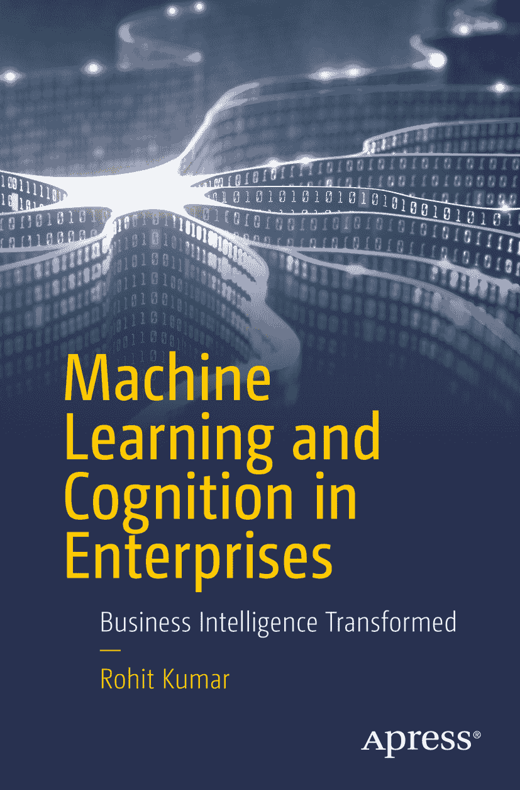

罗希特·库马尔 著《企业中的机器学习与认知：商业智能的变革》

本书作者引用的任何源代码或其他补充材料，读者均可通过本书在 GitHub 上的产品页面获取，网址为 [`www.apress.com/978-1-4842-3068-8`](http://www.apress.com/978-1-4842-3068-8)。如需更详细信息，请访问 [`http://www.apress.com/source-code`](http://www.apress.com/source-code)。ISBN 978-1-4842-3068-8 e-ISBN 978-1-4842-3069-5 [`doi.org/10.1007/978-1-4842-3069-5`](https://doi.org/10.1007/978-1-4842-3069-5) 美国国会图书馆控制号：2017959563 © 罗希特·库马尔 2017 本作品受版权保护。出版商保留所有权利，无论涉及材料的全部或部分，特别是翻译权、重印权、插图再利用权、朗诵权、广播权、缩微胶片复制权或任何其他物理形式的复制权，以及信息存储与检索、电子改编、计算机软件或目前已知或未来开发的类似或不同方法的传输权。本书中可能出现商标名称、标识和图像。我们并非在每次出现商标名称、标识或图像时都使用商标符号，而是仅以编辑方式使用这些名称、标识和图像，以维护商标所有者的利益，且无意侵犯商标权。本出版物中使用商品名称、商标、服务标记及类似术语（即使未明确标识）不应被视为对其是否受专有权利保护的立场表达。尽管本书中的建议和信息在出版时被认为是真实准确的，但作者、编辑和出版商均不对可能存在的任何错误或遗漏承担法律责任。出版商对本书所含内容不作任何明示或暗示的保证。本书采用无酸纸印刷。通过 Springer Science+Business Media New York 向全球图书贸易发行，地址：233 Spring Street, 6th Floor, New York, NY 10013。电话：1-800-SPRINGER，传真：(201) 348-4505，电子邮件：orders-ny@springer-sbm.com，或访问 www.springeronline.com。Apress Media, LLC 是一家加利福尼亚有限责任公司，其唯一成员（所有者）是 Springer Science + Business Media Finance Inc (SSBM Finance Inc)。SSBM Finance Inc 是一家特拉华州公司。谨以此书献给我的父母（Namita & Ramesh K. Sinha）以及 Vagi、Sim、Gayatri 和 Adi，感谢他们的支持。

## 引言

在我为不同客户提供技术和咨询服务的经历中，我发现总会有令人着迷的新技术出现，并在可用性和功能方面承诺许多新特性。好的一面是，这些技术在功能和业务用例方面越来越强大和生动，但它们也可能令人困惑。

其原因耐人寻味。技术遵循业务需求并随之发展。但并非所有企业都会根据其确切需求及其他各种原因积极采用最新技术。即便如此，总会有相当一部分企业实际上试图在技术采用方面逐步跟进其所需。困惑便由此开始。当一个组织觉醒并寻求变革时，技术可能已经比他们当前使用的领先了好几代。这时，优秀的咨询能力便派上了用场。同时，CXO 及其他决策者的认知也绝对重要。但这里也可能存在差距：技术以突飞猛进的方式发展，试图从过去的角度来理解它根本无济于事。

本书正是围绕这一问题展开。它首先旨在提供理解机器学习、认知计算及其他相关主题所需的所有基础知识。同时，它还提出了一个名为 `PEIB` 的新框架（我在本书中定义的全新框架），旨在帮助决策者理解如何着手采用和调整这些技术以满足其特定的组织需求和结构，以及如何在此过程中取得成功。这体现在本书的核心章节：第 10 章《转型路线图》。

建议读者循序渐进地阅读各章节，并按正确顺序建立必要的理解基础。

我尽量用商业人士能理解的语言和大量示例来描述技术领域的内容和细节。

在需要的地方，我提供了真实和假设的业务用例或案例研究，以确保概念能被充分吸收。

首先，让我在此描述各章节涵盖的细节，然后我将给出本书的总体思路。

## 各章详解

本书从商业智能（BI）的发展历程入手，探讨了其历史视角和范式转变。我们讨论了商业智能起步时的面貌，以及它多年来的演进过程。通过一个同时包含新旧视角的商业智能场景，来理解其中的差异。

在第 2 章中，我们简要探讨了转向认知计算和机器学习的必要性。为了便于理解，我们简要讨论了人工智能与机器学习的区别。尽管这些主题将在后续章节中单独处理，但在此处提及，只是为了在本章范围内设定正确的讨论背景。本章最后简要讨论了为什么认知计算是必要的。本章是后续各个主题讨论的跳板，同时快速介绍了为何需要这些技术。

第 3 章围绕人工智能的基础知识展开。掌握人工智能的基础知识，是理解机器学习、认知计算等后续概念的前提。本书并非技术性书籍，因此不包含深入的技术描述和细节。我只选取了那些有助于我们掌握必要知识、以便采纳和适应这些技术的基础内容。监督学习、无监督学习和强化学习也通过示例和图表进行了解释。本章再次讨论了人工智能的必要性，但更为深入。同时，也探讨了实现人工智能的多种方法。

第 4 章讲述了机器学习的基础知识。其中包括一些关于训练模型和任务的详细示例。非常有趣的深度学习技术概念也通过一个易于理解的示例进行了讨论。本章还列举了一些很好的例子，并在结尾处介绍了 Netflix 一个非常有趣的商业应用案例。

在整本书中，你会注意到许多精心绘制的图表和图片，以帮助更好地可视化理解。

接下来，我们在第 5 章中转向自然语言处理（NLP）这个有趣的话题。`NLP` 是一个非常广泛的研究领域。就本书的范围而言，我们只保留了最低限度的必要内容。该主题通过示例和清晰的步骤进行了简要描述，以解释其工作原理。

预测分析是本书在第 6 章中详细讨论的另一个主题。讨论从预测分析的概述开始，并谈及为了进行正确的预测分析而必须注意的数据属性。然后，结合清晰的图表，较为详细地讨论了预测分析的过程。此外，还讨论了不同类型的分析。本章还提到了一些重要的产品。最后，通过一些有趣的用例示例来帮助更好地理解。

第 7 章和第 8 章致力于构建认知计算方面的知识。认知计算是一个深受人类或动物认知研究和特性影响的领域。因此，第 7 章从认知的讨论开始。随后是认知计算的概念。本章提到了认知架构，并更详细地探讨了“为什么是认知？”这个问题。还介绍了一些有趣的用例。这两章还包含了认知设计系统的设计原则。这是一个非常重要的讨论。通过一个简单的日常示例解释了细节。本章还讨论了使用认知解决方案可能实现的决策复杂性。提供了各种示例来理解底层概念。本章还详细介绍了认知与人工智能和机器学习的关系。

第 9 章讲述了并行演进的 `IT-BI` 系统（`PEIB`），这是我首次使用的术语。我将这个术语赋予了新一代的 `IT` 格局和商业智能，它们为了响应需求而共同演进。我们理解了当今 `IT` 与业务关系运作的复杂性。本章审视了其中的差距和局限性。然后，我们讨论了这种关系中正在变化的范式及其必要性。我在本章中定义了这个新术语 `PEIB`，并说明了它的定位。添加了一些非常有趣的图表来辅助理解。然后，进一步描述了此类系统的特性，并探讨了它为何能成为商业领域的游戏规则改变者。第 8 章以一个案例研究结束，以综合理解第 7 章和第 8 章的所有内容。

第 10 章是核心章节。我在本章中定义了一个新的框架——`PEIB` 框架。因此，这实际上是帮助回答可能被提出的问题的一章：“是的，技术很好，但我应该如何着手这些改变，又该从哪里开始？”本章对该框架进行了详细的描述和定义。由于这是核心章节，它也是最长的。关于本章，我无法描述更多，因为其中详细介绍了此前不存在的内容。因此，更好地理解它的唯一方法就是读到那里并学习。

第 11 章讨论了可能阻碍第 10 章所述转型的道路障碍、困难、风险和缓解措施。

第 12 章讲述了并行演进的认知业务。这也是我创造的一个术语，现在，借助前几章积累的所有知识，用它来定义和描述一个真正的认知系统。

最后一章，第 13 章，讨论了实施此类解决方案或计划进行此类转型的组织的前进道路，包括为 `IT` 服务提供商和 `IT` 顾问提供的详细讨论。

## 全书概述

本书聚焦于帮助组织采纳和适应机器学习与认知计算，以转型为数据驱动型认知组织这一核心问题。

因此，本书涵盖四个领域。第一部分详细阐述了作为先决条件所需的技术概念基础。这里讨论了人工智能、机器学习、自然语言处理、预测分析和认知计算的基础知识。由于本书并非技术专著，这些内容均以通俗语言和大量示例进行解释。认知计算的概念则通过与人类认知的对比进行说明。

## 致谢

感谢瓦吉莎和斯姆里蒂在完善项目流程定义方面提供的帮助，以及所有深夜的咖啡。没有她们的支持，我很难兼顾工作与写作。她们帮我摆脱一切杂务，专注于此。

感谢高拉夫·库马尔（IBM）允许使用他的照片，并为书中一张照片担任模特。

感谢普里蒂·辛格（IBM）作为读者提供反馈，帮助优化内容，使其更易于理解。

***

（注：由于您提供的“需要排版的文本”在“致谢”之前部分为完整的序言内容，且该部分未包含需要添加反引号的技术性术语，故按要求仅优化其段落格式。以下为完整排版结果。）

在建立基础知识并清晰理解其必要性之后，接下来的核心部分围绕如何采纳和适应的难题展开。本书通过一个全新定义的框架（命名为 `PEIB` 框架）详细阐述了实施过程中的复杂细节。

第三部分探讨了需要考量的潜在障碍、风险及缓解措施，以确保前文所述内容能够成功实施。

第四部分也是最后一部分，描述了认知驱动型业务的概念，让读者一窥成果；并以对前行之路的深刻思考作为全书结尾。

希望本书能帮助读者深入理解此类技术的采纳与适应之道，以及业务转型的方式，同时掌握所有必要的基础技术知识。

希望各组织能够摆脱过去的种种困境与低效，凭借当下采取的正确方法与手段征服未来。愿所有相关者皆能幸福！

最后，我引用比尔·基恩的一句话作为本序言的结尾：

昨天是过去，明天是未来，但今天是一份礼物。这就是它被称为“当下”的原因。

罗希特·库马尔

2017 年 8 月 1 日

浦那

***

## 致谢

感谢瓦吉莎和斯姆里蒂在完善项目流程定义方面提供的帮助，以及所有深夜的咖啡。没有她们的支持，我很难兼顾工作与写作。她们帮我摆脱一切杂务，专注于此。

感谢高拉夫·库马尔（IBM）允许使用他的照片，并为书中一张照片担任模特。

感谢普里蒂·辛格（IBM）作为读者提供反馈，帮助优化内容，使其更易于理解。

# 第 1 章：商业智能之旅

## 商业智能
## 起源与动因
## 向前发展
### 至 20 世纪 80 年代
### 进入 21 世纪
## 早期用例
## 后期用例
## 范式转变
### 客户关系管理
### 市场调研分析
### 忠诚度管理
### 产品发布
## 案例研究
### 范式转变前的商业智能
### 范式转变后的商业智能

# 第 2 章：为何选择认知与机器学习？
## 人工智能与机器学习
## 为何选择人工智能与机器学习？
## 为何选择认知？

# 第 3 章：人工智能基础
## 概述
## 人工智能的目标
## 人工智能的组成部分
## 为何选择人工智能？
## 方法
### 符号方法
### 混合符号方法
### 面向智能体与分布式方法
### 集成方法
## 工具
### 逻辑编程
### 自动推理
### 搜索算法
### 人工神经网络
## 总结

# 第 4 章：机器学习基础
## 机器学习
## 机器学习任务
### 分类
### 聚类
### 回归
## 相关关键概念
### 深度学习
### 遗传算法
### 决策树与关联规则
### 贝叶斯网络
### 语音识别
### 生物监测
## 机器学习与统计学
## 商业用例示例

# 第 5 章：自然语言处理
## 自然语言
## 自然语言处理概述
## 自然语言处理与机器学习
## 自然语言处理的工作原理
### 首先是单词和字母
### 然后是句子
### 语用学
## 商业案例
### 聊天机器人
### 垃圾邮件过滤器
### 情感分析
### 搜索引擎
### 问答系统
## 总结

# 第 6 章：预测分析
## 概述
## 数据相关性
### 新鲜与真实
### 避免噪声
### 避免个人或敏感数据
### 数据保留期限
### 过去、现在和未来的价值
### 一致且非负担
### 过时或目的不符
## 预测分析流程
### 来源与存储
### 数据建模
### 分析
### 报告
## 分析类型
### 描述性分析
### 诊断性分析
### 规范性分析
## 工具
### `SAP HANA` 预测分析
### `Apache Mahout`
### `IBM SPSS`
### `SAS` 统计
### `Oracle` 高级分析
### `Actuate`
### `Mathematica`
## 部分应用
### 制造业
### 营销与需求管理
### 预测性维护
### 弹性定价
### 天气预报
### 流行病管理
### 研发

# 第 7 章：认知计算
## 认知
## 认知计算
## 认知时代
## 认知架构
### `Soar`
### `ACT-R`
### `CMAC`
### `CLARION`
## 认知芯片
## 为何选择认知？
### 始终被渴望
### 大数据与洞察
### 咨询建议
### 物联网杠杆
### 业务连续性
### 利用资源
### 效率
### 客户满意度
### 个性化关怀
### 更多即席分析
### 生成所需内容
## 内部审视
### 认知+物联网
## 用例
### 网络安全
### 石油与天然气
### 医疗保健
### 临床试验
## 总结

# 第 8 章：认知系统设计原则
## 设计原则
### 识别问题领域或需求
### 高层范围界定
### 参考资料
### 可行性研究与范围调整
### 识别更细化的需求或关联
### 蓝图设计
### 详细执行计划
### 识别验证检查点
### 开发试点或测试
### 验证
### 修复缺陷或偏差
### 优化
### 反馈评估
## 认知设计原则
### 识别问题领域或需求
### 高层范围界定
### 参考资料
### 可行性研究与范围调整
### 识别更细化的需求或关联
### 蓝图设计
### 详细执行计划
### 识别验证检查点
### 开发试点或测试
### 修复缺陷或偏差
### 优化
### 反馈评估
## 认知工作分析
### 工作空间设计
### 认知知识生成与来源
### 语言能力（自然语言处理）
### 对话或沟通能力
### 与所有数据源的连接性
### 处理所有类型数据的能力
### 知识生成能力
### 推荐能力
### 知识生成——详细说明
## 接口
### 基于 `Web`
### 物联网接口
### 用户输入
### 业务数据
### 标准数据馈送
### 金融与商业网络
### 自身
### 故障机器
## 与人工智能和机器学习的关系
## 总结

# 第 9 章：并行演进的 IT-BI 系统
## 我们何去何从？
### 当今的 IT 与业务关系
### 业务与 IT 范围
### 业务与 IT 关系：边界
### IT 与业务关系：走向何方？
#### 全球经济
#### 丰富的数据
#### 分析
#### 上市速度
#### 客户关系
### 内部审视
### 协作是关键
## 什么是并行演进的 IT-BI 系统？
## 它位于何处？
## 制定计划
## PEIB 框架的属性
### 认知能力
### 无差异化
### 填补空白
### 单一事实版本
### 躯体控制
### 感觉反射
### 统一决策模型
### 响应性
### 核心协作
### 最优努力
### 简洁性
### 数据驱动
### 超越表面
## 复杂吗？
## 为何这是游戏规则改变者？
## 案例研究
## 总结

# 第 10 章：转型路线图
## 一些事实
### IT 支出优先级
### 最新趋势
### 企业或业务规模
## PEIB 框架
### 初始化
### 形式化
#### 场景到达矩阵
#### 场景检查清单
#### 场景优先级列表
#### 知识与 `KPI` 检查清单
### 开发
#### 蓝图与设计
#### 开发与训练
#### 验证与用户反馈
### 部署
#### 集成
#### 关于成本
### 数字化转型
#### 整体转型
#### 制造业中的认知
## 总结

# 第 11 章：转型障碍
## 方法或范围相关
### 用例相关性
### 各类演示
### 传统方法
## 规划相关
### 战略
### 自上而下
### 错误启动
### 供应商介入
### 里程碑跟踪
### 正确参与
### 知识资源
### 资源对齐
## 实施相关
### 范围与蓝图对齐
### 锚点
### 系统训练
## 采用相关
### 忽视
### 成本因素
### 行业核心缺失
### 文化冲击
### 成熟度与丰富化计划
### 有限发布
## 风险
### 人员相关风险
### 流程相关风险
### 技术相关风险
### 管理相关风险
## 总结

# 第 12 章：自我演进的认知业务
## 传统系统与认知自我演进系统
### 孤岛
### 混合决策领域
### 领导力有效性
### 扩展与集成问题
### 浪费与过度
### 人力资源管理
## 那么什么是自我演进的业务？
## 关于认知的现实检验
### 认知适合所有人吗？
### 认知万无一失吗？
### 所有供应商/产品都好吗？
### 自我认知能力？
### 认知会抢走工作吗？
## 总结

# 第 13 章：未来之路
## 未来之路：实施组织
### 战略价值
### 转变人员与文化
### 自上而下
### 耗时
### 定制与使用
### 正确的合作伙伴与解决方案
### 三个关键
### 去中心化
### 动力
### 安全
## 未来之路：IT 服务与产品公司
### 战略构建
### 产品质量
### 孵化与灌输
### 市场拓展
### 卓越中心
#### 项目管理卓越中心
### 协作
### 技能发展与成熟度
## 未来之路：IT 顾问
### 现有劳动力
### 新劳动力
## 感谢与告别！
# 索引
# 内容速览
* 关于作者
* 关于技术审校者
* 致谢
* 引言
* 第 1 章：商业智能之旅
* 第 2 章：为何选择认知与机器学习？
* 第 3 章：人工智能基础
* 第 4 章：机器学习基础
* 第 5 章：自然语言处理
* 第 6 章：预测分析
* 第 7 章：认知计算
* 第 8 章：认知系统设计原则
* 第 9 章：并行演进的 IT-BI 系统
* 第 10 章：转型路线图
* 第 11 章：转型障碍
* 第 12 章：自我演进的认知业务
* 第 13 章：未来之路
* 索引
# 关于作者与关于技术审校者
## 关于作者
## 关于技术审校者