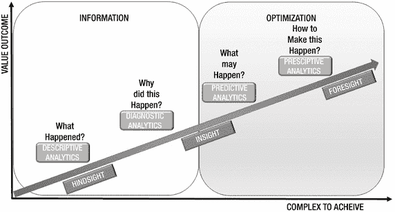
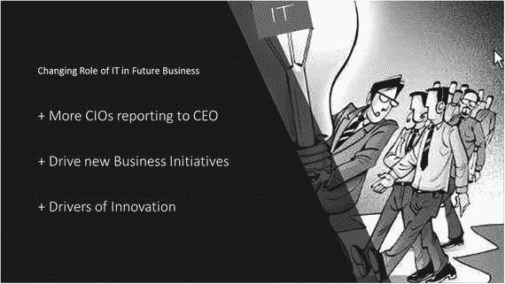
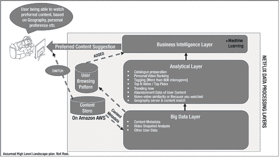

# 1. 商业智能之旅

本章旨在通过定义初步建立对商业智能（BI）的理解。同时，本章也致力于让读者基本了解商业智能的起源及其最初的应用场景。我还会探讨商业智能向行业业务可用性用例的范式转变。

注意

本章着重于帮助读者建立对核心主题领域的初步理解。因此，即使你熟悉商业智能术语，仍建议通读本章，以便与本章开启的思维过程建立联系；这将有助于理解后续章节中更高级的主题。

## 商业智能

对于几乎所有企业（无论规模大小）的 IT 和业务部门来说，商业智能并非一个陌生的词汇。市场上已经有许多提供商业智能产品的厂商。以下是市场上一些流行的厂商（按价格从高到低排序）：

*   SAP
*   IBM Cognos
*   SAS
*   Pentaho
*   Alteryx
*   MS SQL – BI 版
*   Tagetik
*   GoodData
*   Board
*   BI360 套件
*   iDashboard
*   Mits 分销分析
*   Dundas BI

企业至少拥有一些商业智能解决方案至关重要，这样它才能明智地行动和管理运营。这需要将数据作为信息呈现在决策者眼前。它可以简单到基于 Microsoft Excel 的数据透视表和图表。

以下是我的定义：“商业智能是一套技术和方法，用于从各种入站数据源获取各种格式的数据，并从中生成有意义的报告、可视化图表或警报，进而支持业务的各个方面，并最终支持整个业务。”

因此，这个定义本身就凸显了这些技术的重要性和广泛适用性，即从你一直在使用的所有数据源中提炼出关于“你在做什么以及做得如何”的内容。借助当今的技术，甚至可以将结构化数据和非结构化数据同等用于基于商业智能的数据解读。

直到最近，数据仓库还是商业智能的主要甚至唯一来源。然而，随着技术的变革和基于高速内存的数据库（例如 HANA）的出现，完全可以在没有数据仓库的情况下开展工作。事务系统可以直接用于报告。传统的 OLTP（在线事务处理）和 OLAP（在线分析处理）系统之间的界限正在消失。OLTP 系统过去主要负责支持日常业务事务，而 OLAP 系统则对从 OLTP 提取到其中的数据子集进行建模和报告分析。这就是数据仓库能力和商业智能。

如今，技术使得引入先进功能以提供最佳的分析型商业智能成为可能；另一方面，它也帮助商业智能变得更加敏捷、更易于实现、更具可扩展性；它还使得部署更快速、以更少的总投资获得更高的投资回报率（ROI）成为可能。换句话说，OLTP 和 OLAP 之间日益模糊的界限使得避免使用两个独立的系统成为可能，并进一步降低了成本。

可以说，数据仓库中数据集市的解耦为业务仓库带来了更高的敏捷性。因此，不再需要将冗长、复杂的数据集市序列耦合到一个数据仓库流程中。相反，它变成了一种单层虚拟架构，并且更倾向于功能视角，这与早期架构的技术报告视角形成对比。设计中这种功能视角的增强使其能够灵活适应未来需求可能带来的变化。这使得它更加敏捷，并且易于在未来进行扩展。敏捷性和扩展灵活性是选择合适商业智能产品时非常看重的标准。简单来说，这意味着在部署因业务需求变化而产生的新增功能时，需要进行的重新开发工作更少。

分析是商业智能的一个子集，主要涉及在后台运行统计算法（通用的业务流程算法或为组织定制的算法），然后通过报告和仪表盘显示更复杂的结果。各种类型的分析几乎是所有商业智能产品标准套件的一部分。

最基本的商业智能报告仅限于基于关键绩效指标（KPI）的简单报告，这些指标经过聚合以显示业务流程和领域的绩效摘要，从而辅助业务决策改进；这也被称为决策支持系统（DSS）。有时，它用于向高层管理人员报告组织摘要；因此，它也可能被称为管理信息系统（MIS）。在上述场景中，从技术上讲，报告可能只是不同级别的聚合，并采用多维数据组织方式，以实现更灵活的信息展示。

注意

随着数据库技术的进步和架构的简化，通过商业智能实现更实时的信息成为可能。

商业智能的各种可用性用例如下：

*   衡量绩效矩阵和关键绩效指标
*   提供数据集成与交换的协作平台
*   部门数据可视化
*   知识管理
*   法规合规管理
*   规划运营支持
*   预测

当前统计数据显示，全球商业智能市场总收入为 133 亿美元。此外，据预测，到 2020 年，企业中近 75% 的人员将使用一种或另一种商业智能工具。¹

基于云的软件即服务（SaaS）和基础设施即服务（IaaS）范围的扩大，正在帮助商业智能产品找到通往各种规模客户的途径，因为他们可以根据自己的需求按使用量付费。

由于维护成本更低且安全性承诺更高，甚至一些较大的厂商也放下了顾虑，转向了云解决方案。值得一提的客户包括可口可乐、HTC、百思买和普华永道（PwC）。

本书将带你踏上商业智能世界的旅程，包括其与认知科学及其理论的关联。然后，它将通过一个框架帮助你获得你所期望的专业知识。

让我们首先回顾一下过去，更详细地观察商业智能是如何开始的。

## 起源与动因

商业智能所驱动的智慧，依赖于多种类型、多源及单源数据的支撑。正如我们通过融合当下与过往的多源数据及经验来展现智慧，商业智能亦是如此。仅凭单一信息源是无法实现这一点的。在此之前，从经验中学习（即“思考”）这一概念一直是缺失的环节，但现在，借助认知计算与分析技术，这已成为可能。从第 2 章开始，我们将讨论认知计算与分析的相关概念。

最早提及“商业智能”这一术语的是理查德·米勒·德文斯，他在 1865 年出版的著作《商业与贸易轶事百科全书》²中首次使用。

书中写道：“在那些为当时金融家赢得声誉的已故银行家中，亨利·弗内斯占据重要地位。他在荷兰、佛兰德斯、法国和德国全境，维持着一套完整而精密的商业情报体系。”

这个早在 19 世纪 60 年代，银行家利用相关信息赢得商业案例的例子，充分说明了商业智能的关键重要性。不幸的是，他利用这种知识收集与解读技巧，通过欺诈手段赢得商业机会，因此商业智能的首次应用走向了负面方向。然而，无论好坏，当时的商业智能仅限于作为做出相对简单决策的工具；其多种应用场景是随着时间推移才逐渐发展起来的。

在这一领域，其他重要人物还包括 1958 年的汉斯·彼得·卢恩（IBM）和 1989 年的霍华德·德雷斯纳（高德纳）。

德文斯首次提出了“商业智能”这个标签，德雷斯纳则为其赋予了现代定义；但由于卢恩在该主题上实际完成了开创性的全面工作，他被认为是商业智能之父。

1958 年 10 月，卢恩在《IBM 期刊》上发表了一篇相关文章。³ 他提到：“一个自动系统正在开发中，用于向任何工业、科学或政府组织的各个部门传播信息。该智能系统将利用数据处理机器，对文档进行自动摘要和自动编码，并为组织中的每个‘行动点’创建兴趣档案。无论是外部传入还是内部生成的文档，都会被自动摘要，通过词模式进行特征化，并自动发送到相应的行动点。”

他在文章结尾指出：“自动摘要和自动编码系统仍处于早期开发阶段，还需要进行大量研究才能完善它们。或许最终得到最广泛应用的技术将与目前设想的大相径庭，但某种形式的自动化最终将为商业智能问题提供有效的解决方案。”

卢恩所描述的商业智能解决方案，旨在解决如何理解所呈现事实之间的相互关系，从而引导行动朝着预期目标前进的问题。

### 展望未来

随着 20 世纪的到来，能够存储更大量数据并对其进行电子化处理的技术变得可行。从某种意义上说，这种技术的成熟也自我促进，推动了更强大的数据管理能力。二战后，世界经历了战后的经济繁荣。这一时期，被一些人称为资本主义的黄金时代，被视为第二次工业革命的快速推进。所有这些因素都推动了像卢恩这样的商业智能研究，以帮助企业适应环境、繁荣发展并更好地管理其资源。

他论文中描述的许多内容至今仍被视为重要议题：区别于常规标准查询的临时或个性化查询、安全性与数据所有权（谁应该知道什么）、数据审计、性能优化，以及基于个人使用模式的学习系统。

值得注意的是，他还提到，实现所有这些目标需要先进的机器和技术。

因此，认为基于人工智能或认知智能提供商业智能的自我学习机器是一个全新概念，是错误的。商业智能之父卢恩甚至构想出了社交功能。只是随着全球竞争日益激烈，商业需求的涌现才使得通过技术进步实现这些构想成为必要。

卢恩提交了一篇题为《文献摘要的自动生成》的研究论文，以展示该领域的技术研究。⁴

其核心思想是，他将商业智能系统描述为能够理解、创建摘要并从大量数据中生成报告的系统，以建立相互关系，从而提供有助于决策的洞察。

卢恩在非常早期就提出了一个至今仍然有效的广阔愿景；此外，他还提供了将其与各种应用场景联系起来以帮助做出明智决策的初步构想。

### 20 世纪 80 年代

尽管已有诸多理论描述、商业需求以及技术能力的进步，但直到 20 世纪 80 年代，企业才开始使用计算机。在此之前，数据需要从穿孔纸带记录转换为缩微胶片和磁带才能进行处理。这在技术上是可行的，但对于企业而言，大规模、高频次地使用这种方式却非常麻烦。

随后，一系列作为数据库管理系统（DBMS）的产品相继问世，用于存储海量数据。继 60 年代 IBM 的层次型 DBMS 和霍尼韦尔的网状 DBMS 之后，传奇般的“关系型 DBMS”终于在 70 年代末诞生于 IBM。这为实现高度组织化、海量的 DBMS 提供了可能，从而可以用计算机取代纸张或穿孔卡片来存储一切数据。于是，技术将事务处理系统直接整合为数据源。这些数据规模庞大、组织有序，并以完整的电子格式存在；不再需要转换格式或进行预处理。因此，企业生成的数据可以直接用于商业智能。这是一个良好的转变，因为它提供了一个平台，使得商业智能及其可用性能够被更精确地聚焦，而不仅仅是停留在思考可能性上。

企业开始出现名为“信息中心”的新部门，它介于 IT 与业务之间。IT 部门专注于维护所有 IT 系统——硬件、软件和网络——而信息中心则以数据为中心。他们了解何种数据以何种格式存储在何处。他们负责帮助业务部门获取正确的数据，并识别和使用合适的工具。最初可用的一些工具包括 Crystal Reports、MicroStrategy 和 Business Objects。这一切大约始于 80 年代。

80 年代，数据仓库作为帮助进行商业智能报告的专用系统的概念开始出现。这一概念最早由 IBM 的巴里和保罗提出。它强调了 OLTP 与 OLAP 系统的区别。该概念指出，为了让数据仓库高效地驱动业务智能化，OLTP 系统与决策支持商业智能系统应结合使用。这种仓库系统的概念催生了 ETL（抽取、转换、加载）的概念。它提供了从 OLTP 系统中提取相关数据到这些仓库的概念、最佳实践和数据流方法。

来自不同 OLTP 系统的异构数据开始以通用格式，通过各种 ETL 方法和工具流入这些数据仓库。

这些数据仓库会将数据抽取到各自的业务领域，然后根据报告需求，将其压缩成更小的数据集市以提高性能。这些系统也被称为 OLAP 系统，它们擅长对存储的数据提供复杂分析查询的响应。

商业智能的发展与企业资源规划（ERP）是并行的。因此，企业可以在多个部门之间建立协同效应，无需操心数据录入，就能利用数据获得关键问题的答案。

1989 年，Gartner Group 的霍华德·德雷斯纳提出了“商业智能”这一术语，作为所有相关概念的总称，例如 DSS、主管信息系统（EIS）、基于数据仓库的数据存储、抽取与分析、OLAP 以及 ETL。至此，商业智能 1.0 诞生了。

商业智能 1.0，简称 BI 1.0，是一个功能完备的基于 ETL 的系统。它在性能和可用性方面表现良好，但主要缺点如下：

*   查看数据耗时过长，数据在 OLTP 系统中生成后存在延迟
*   获取解决方案非常复杂且繁琐
*   过度依赖专家来使用工具
*   所需工具的培训过于复杂

因此，一方面，第一代功能完备的商业智能成功诞生了。另一方面，在最初的蜜月期过后，人们逐渐意识到，由于使用复杂，获得良好结果需要耗费过多时间。这有点像一把剃须刀，每次剃须前，必须由指定的专家更换刀片，或者至少在他们指导下进行（而这种培训需要很长时间）。

另一个问题是应用程序、解决方案和硬件的高维护成本。这也限制了其在各行业中的应用。

因此，BI 1.0 有两个方面：数据和报告。一端处理数据直至数据集市的录入，另一端则从中提取报告。

### 进入 21 世纪

21 世纪头十年后期的技术进步开始克服这些主要的困难和缺陷。更实时的数据访问可能性和自助服务选项带来了商业智能 2.0（简称 BI 2.0）的时代。

BI 1.0 与 2.0 之间最重要的区别在于，1.0 侧重于使用工具进行 ETL 和报告，而 2.0 则侧重于更好的访问、更便捷的访问以及扩展数据库。它可以通过更多地利用互联网来包含更广泛的数据库。

BI 2.5，作为该系列在 2005 年左右的下一代产品，在已经庞大的数据范围基础上，进一步增加了海量数据的计算能力；这是通过利用互联网实现的。它能够在短时间内处理泽字节级的数据，以处理以前无法想象的维度信息。数据民主化也成为了另一个重要变革。云能力是这个时代的又一附加优势。

如今，随着认知能力的加入，商业智能正进入 BI 3.0 的新时代。本书后续章节的范围是描述这个新的 BI 3.0，并涵盖如何在您的组织中实施和适应它。

因此，作为对“为何及如何”的总结，我们可以说，这一切始于不断扩张的市场需求及其日益增长的运营复杂性。尽管商业智能之父卢恩最初的构想涵盖了完整商业智能系统的所有方面，但至今尚未完全按照他的定义成功实施。BI 3.0 或许将完成这一期待已久的实现。一方面，它的起源和发展是基于需求的，另一方面，技术一直是一个限制因素。在他那篇《商业智能系统》的文章中，卢恩描述了这些系统将如何涵盖社会层面；这一点在我们发展到 BI 2.5 时已基本实现。但他还描述了一个“适应用户需求的适应性系统”，而这似乎正通过 BI 3.0 的认知能力得以实现。

## 初始用例

商业智能的初始用例大致可分为两个时间段：20 世纪 60 年代，以及 80 年代至 90 年代末。

在 60 年代，甚至在第一代 ERP（即 MRP，物料需求计划）诞生之前，商业智能更侧重于记录保存的组织与自动化。那时并没有我们现在所理解的真正意义上的商业智能。最初以文件和档案柜形式存在的数据库开销巨大且充满冗余数据。这些数据分散在纸质文件和文件夹中，难以核对或审计。最初的想法只是通过自动化方式整理这些记录，以解决上述所有缺陷。当时的技术并不完全支持；仍需采用混合操作，即使用纸质或打孔记录，再手动将其转移到微缩胶片和磁带上。但所有这些辛苦付出，最终能换来一份整洁的电子记录，仍然是值得的。与此同时，在 IBM 的实验室里，埃德加·科德正在发明一种全新的数据库管理方式：即我们至今仍在使用的**关系型数据库管理系统**。

到了 70 年代，科德（IBM）的数据库版本已经就位，足以将数据存储在新的表格形式中；然而，数据却相当分散。这些数据缺乏生成良好商业智能可视化所必需的关系功能。在这种情况下，技术成为了限制因素；如果当时技术上可行，企业无疑会欣然接受。但以当时可用的技术，他们所能实现的仅仅是可按需检索的电子记录；当然，仅此一项就已远胜于笨重且难以管理的纸质档案柜和文件夹。因此，这个时代并没有提供或甚至可能实现数据混搭与可视化的实际用例；取而代之的是将数据录入文件，再录入到分散的表格中作为电子记录。其他用例则体现在生产管理与控制中的 MRP 形式。

80 年代初，随着关系型数据库和数据仓库概念的出现，技术迎来了新的飞跃。这个时代带来了寻求和获取更多实际商业智能解决方案与产品的技术。第一批高效且尖端的工具诞生于这一时期，借助这些工具，可以在整合数据上利用中央数据仓库运行 DSS、EIS 和 MIS 等用例。实践 ETL 需要将数据引入所谓的 OLAP 系统，以运行复杂的业务查询。企业开始出现被称为信息中心的新型 IT-业务混合部门。这些人员知道数据在哪里，并会使用工具为业务用户和分析师提取所需信息。这是 IT 主导的大规模开发真正兴起的时代。企业会满意地规划他们希望从各个部门或组合中看到的查询摘要。IT 部门负责找出这些需求、进行开发并交付。他们可以看到来自多个部门的数据组合；例如，生产人员可以看到销售管道数据，财务部门可以轻松监控市场部门产生的日常开支。由于个人电脑已经普及，甚至第一代 ERP 也已存在，因此不再需要手动数据录入。自动化的 ETL 活动会处理这一切。当时已有丰富的可视化工具，例如 Business Objects，可以在数据之上实现精细的可视化。用例得以运行，因为即使在大企业中，每个部门都能通过中央仓库将数据协调并存储在一个地方，然后通过 IT 部门开发的报告自动展示。

因此，总结初始用例，从 60 年代到 80 年代，商业智能从最初的数据录入自动化，一路发展到先进的数据库支持的数据仓库集市，以及在其之上支持丰富组合数据与出色可视化的能力。

在 60 年代，初始用例的早期采用者是军事、金融和银行业。甚至零售市场也是主要采用者。电信行业的 AT&T 和 Bell Atlantic，以及零售行业的沃尔玛是先行者，并被称为商业智能的初始用例持有者。

AT&T 投资数百万美元，建立了一个庞大的遗留系统数据仓库，用于处理来自服务和客户的数据。虽然最初只有屈指可数的用户在使用，但它后来帮助建立了一个拥有所有数据和商业智能工具的系统，能够对潜在客户进行细分。这花费了大量的时间、精力和金钱，但仅凭这一点就带来了数百万账户的增长，回报丰厚。随着时间的推移，AT&T 升级了其数据仓库和商业智能解决方案，从而增强了对市场和客户的掌控力。最初的商业智能，通过建立基于遗留系统的数据仓库，将其客户获取成本降低到了前所未有的水平。为此进行的投资带来了更高的资金价值。然而，在历史上的那个时期，数据仓库和商业智能是如此新颖，以至于没有人费心去考虑为这些投资建立投资回报率（ROI）的概念。开发过程繁琐、复杂且耗时。但由于其带来的利润显著增长，ROI 的收益显而易见，并被商业智能和数据仓库销售公司所炫耀。

90 年代初，美国海军作战中心等政府机构开始使用这些解决方案。一个数据仓库和商业智能项目启动，旨在整合来自 30 个不同异构系统的数据，汇集了 12GB 的数据（在 1991 年这是一个大项目），相当于约 120 亿个字符的信息。该项目服务于弗吉尼亚州、马里兰州和佛罗里达州的 700 名用户，简化了海军信息管理系统。获取任何计划中或已执行项目的准确及时细节的工作，现在可以按需和谐地流向所需用户，而无需在数据不统一的 30 个系统中逐一查找。这成为政府机构早期采用这些技术的案例之一。后来的政府采用者包括医疗和金融组织。

商业智能一个突出且成功的早期用例来自保险机构。安泰人寿保险公司和旅行者保险公司是 90 年代的领导者。他们从个人驾车者保险和索赔数据中获得了海量数据。这为他们提供了可视化区分保额不足与未投保驾车者成本的机会，但如果没有这些技术，几乎不可能利用这一机会。这帮助他们与政府协商保险费率，在新竞争者进入市场时制定有竞争力的价格，并分析多个产品领域的销售情况。有些人甚至声称因此获得了超过 1000%的投资回报率。

最著名且最成功的案例之一仍然是沃尔玛。他们被誉为供应链管理大师。作为全球最大的零售商，拥有约 1 亿客户群，并由超过 25,000 家供应商支持，供应链管理是一项巨大的挑战。了解哪些商品该送往哪个门店、数量多少以及何时送达，是成功供应链管理的关键。在幕后，基于中央仓库的商业智能系统正悄然运转。凭借这一神奇能力，沃尔玛能够深入了解庞大的客户群及其购物模式。1992 年，他们拥有一个 1TB 的数据仓库，这在当时是最大的数据库之一。任何交易数据都能在大约七分钟内提供给管理者。这在当时堪称对数据的近乎实时洞察。总而言之，这在当时是一个非常成功的解决方案，例如，某地区一家门店的电脑销量突然出现巨大峰值，几乎同时，该地区所有门店都复制了相同的促销活动，并且所有门店的销量峰值也随之出现。

## 后续用例

商业智能的后续用例大致可分为两个时间段：21 世纪初和 2015 年之前的 21 世纪后期。

到 21 世纪初，企业已在数据仓库之上运行着大量商业智能产品。此时，它们确实能够看到这些解决方案带来的投资回报率（ROI）收益。这固然不错，但与此同时，情况也发生了变化。企业使用这些方案已超过十年，慢慢地几乎所有人都开始使用相同的方案。这使得投资回报率和其他任何收益曲线都趋于平缓。根据垂直行业类型和关注的子领域不同，企业大多使用标准场景。行业标准内容尚未完全确立，并且由于从第一代数据仓库的数据录入自动化时代发展而来，企业在各自领域实施着相同的 IT 解决方案。这些解决方案本质上更具战略性，最终却只实现了战术性目标：一个庞大的 IT 与业务机器，经过漫长而复杂的流程，最终产出一大堆报告。正如你可能想象的那样，解决方案的敏捷性或可扩展性机会很少。为了与竞争对手区分开来，这些企业需要更直接的战术性解决方案，一个能更快速响应个体业务变革计划、并能更快被采用的方案。人们还希望有更友好的工具，服务于几乎没有 IT 背景的用户。这以前是 IT 专家的领域，但现在人们渴望出现更强大的“超级用户”概念。

不幸的是，此时完全用户友好的解决方案尚未面市。虽然已有更轻量级、投产时间更短的产品，但 IT 团队仍然需要开发它们的每一个部分。

随着更多产品的出现，甚至可以实现即席查询，并在超快的新一代数据库（如基于内存的 SAP HANA 数据库）上进行极速计算。

如今，高度敏捷的开发融入了最新的可视化技术，包括基于移动设备的报告解决方案。超强数据库拥有闪电般的报告能力，有时甚至无需实际 ETL 过程。除此之外，社交集成以及非结构化数据与结构化数据的同等使用，填补了大量空白。云是进一步降低成本和提高可用性的另一个推动因素。它带来了 SaaS（软件即服务）、IaaS（基础设施即服务）和 PaaS（平台即服务）等类型的解决方案。因此，商业智能与最新、最现代化的数据仓库能力相结合，被视为最成熟的解决方案。一个与多个 OLTP 源虚拟连接的报告，能在几秒钟内完成百万次计算，并在用户屏幕上实时显示数据表或可视化图表。还出现了几种高端分析能力（例如，预测性分析、描述性分析、诊断性分析）。规范性分析尚未完全实现。但这并非终点。我们将在下一节“范式转变”中讨论这一点。

继续讨论分析类型，图 1-1 从复杂性与价值的角度对它们进行了描绘。

图 1-1.

分析类型

以下是对所有四种分析类型的简要描述：

1.  **描述性分析**：这是关于“发生了什么”。结果集提供了所讨论时间线内“发生了什么”的详细信息（例如，一家公司考虑某个成本案例，以分析冗余在哪里以及如何消除它）。大约 35%的组织经常这样做。这源于历史数据，因此被视为事后分析。它实现起来最不复杂，因为这主要是数据的向上或向下钻取。其价值被认为是最低的，因为它仅有助于找出“发生了什么”，而别无其他。
2.  **诊断性分析**：这是关于“为什么会发生”；它主要用于解决特定问题。这借助数据下钻、数据挖掘和相关性分析等技术。大约 10%的组织使用这些技术，其中只有一半经常使用。诊断性分析也主要使用历史数据，但在数据挖掘和关联模式分析方面比前者更进一步。它不仅仅是按原样查看历史数据，而是将其转化为数据点，以理解“为什么一定会发生”。简而言之，这是对历史数据的洞察。
3.  **预测性分析**：这种分析显示“可能会发生什么”。它将情境数据与行为数据相结合，并确定可能的未来结果（例如，现代 CRM 和营销解决方案用于理解客户模式，以决定哪个活动应针对哪个客户群体）。目前，很少有组织经常使用它，因为它要复杂得多；另一方面，它提供了巨大的价值。它需要一些复杂的数学模型，利用与业务运营数据混合的一系列数据进行预测。
4.  **规范性分析**：这更进一步，提出“更好的行动路径，以避免不太好的或糟糕的路径”。目前，它尚未以成熟的形式轻易获得，但已接近达到这一水平。它包括使用机器学习和认知技术。它是四种分析中最复杂的，并且超越了其他分析，通过思考问题来增加更多技术，从而能够规定解决方案。我们将在第 7 章和第 8 章中介绍思考机器。

## 范式转变

从 2014 年下半年开始，商业智能经历了一场范式转变；其用例更多地转向了预测性和规范性分析。同时，IT 的用例也在不断扩展其范围，其角色也在发生变化。从被视为支持业务的角色，IT 开始进入作为创新主要驱动力的领域（图 1-2）。如今，IT 影响着商业战略，甚至在推动这些战略方面发挥着作用。

传统上，IT 一直扮演着促进实现业务目标的角色。从 80 年代信息中心时代开始，他们就是那些提供手段来获取所需数据可见性的人：想象一下，业务后端运行着一些昂贵的项目，仅仅是因为数据被投资在众多不同的系统中，以至于他们需要整合这些数据，然后“按照业务意愿”提取出规定的细节。凭借技术能力和敏捷与精益所支持的最现代交付方法，他们可以更快地做到这一点。借助数据库领域的最新技术进步，他们可以用非常精简的数据模型来实现，但核心问题依然如故——IT 过去是，现在也仍然是业务的后端。他们从未被认为能够为业务增长或扩张做出贡献，或者亲自接触客户。

图 1-2.

IT 角色的转变

但是，随着万物互联（物联网），情况发生了变化。在一个全球互联的社会中，互联网的越来越多使用开始在网上带来客户偏好模式。社交媒体帖子开始成为指路明灯，并且有能力在短时间内摧毁产品和公司。针对某个产品或服务的负面言论会像森林大火一样迅速蔓延。任何没有准备好近乎实时地管理这种情况的组织都可能面临形象问题，其声誉受损程度可能大到难以挽回（例如，在 90 年代互联网和社交媒体影响力还没那么大的时候，有多少人会知道，任何销售电池会着火的手机的公司都会面临全球性问题，而不仅仅是局部问题？）。即使当时的影响是全球性的，传播到人们那里也需要时间。

现在，这样的事件发生在某个地方，甚至可能只有一两个人坐在两个不同的大洲。他们将其发布在社交媒体上，几小时内这就会成为热点新闻。全球销量在几小时内降至零，或者已经购买了该产品的人会涌向客户服务中心。如果这是一个真正的问题，最终也会帮助公司，尽管当时看起来可能很痛苦，但为了客户安全召回产品是必要的。但是，如果相反，是有人在搞破坏呢？公司现在应该有能力让商业智能也来管理这种情况。

现在有些公司完全利用 IT 资源来驱动其业务目标设定（例如，具有类人思维和推理能力的计算机，这将在后续章节中详细讨论）。有些公司正在以与其 IT 资产完全整合的方式推动客户触达和规划扩张，因此 IT 角色现在对其成功至关重要。IT 资源是其成功故事的主要组成部分，与业务计划携手并进，甚至作为主要执行者。值得一提的是 Netflix。在未观看试播集的情况下就决定投资并制作整部《纸牌屋》电视剧（一部价值 1 亿美元的作品），这完全是一个由 IT 支持的决策。Netflix 不依赖媒体公司进行广告宣传，而是通过内部 IT 数据资产来扩大其影响力。因此，Netflix 的投资回报率基于会员订阅，而不是基于媒体公司的广告支出。这是一个公司向未来优化的 IT 驱动型组织迈进的例子，这种组织将非常擅长使用广泛的规范性分析。这是 IT 角色范式转变的一个绝佳例子。

通常情况下，一部电视剧要获得任何制作公司的批准，需要提交完整的故事情节剧本和主题描述，然后在下一阶段提交一系列试播集。但在这个案例中，仅仅输入了剧名和主演的名字，甚至没有经过任何试播集，Netflix 就能判断出该剧的成功与否并对其进行投资，这一切都基于智能预测分析。它利用其约 8100 万的庞大客户群和每天约 1.25 亿小时的观看量来分析这些细节。所有观众的观看模式和行为特征，以及人们观看由凯文·史派西主演的剧集的可能性，都为他们提供了关于该剧成功的可靠预测。分析不仅限于识别和确认对该内容的预测，还根据观众表现出的行为和内容偏好选择，将观众基础分为十个不同的类别，这有助于他们推广《纸牌屋》。基于这些分析，制作了十个不同的预告片，分别呈现给相关的观众群体（例如，更喜欢看动作片的观众应该看到包含更多动作元素的预告片；观看凯文指数较高的观众应该看到凯文出镜最多的预告片；而主要观看女性题材电影的观众则被展示符合他们口味的预告片）。因此，Netflix 没有去任何媒体公司进行推广数据获取或执行推广计划，而是基于用户数据做出决策，并完全根据用户偏好进行反向推广。这是 IT 范式转变的一个很好的例子。在这个例子中，IT 不仅仅是后端数据处理、ETL 和向业务呈现数据，而是 Netflix 业务的强大推动者。他们拥有一个数据驱动，因而也是 IT 驱动的商业模式。业务扩张和产品扩张的细节在充分考虑业务范围并利用用户数据的情况下处理得很好，甚至推广也是以这种方式进行的。在此之前，Netflix 并没有利用 IT 与业务连接的这一方面。在 2002 年之前，Netflix 只有基于用户地理位置的推荐在运行。

通过理解用户的观看模式以及其庞大的大数据收集所揭示的其他事实，Netflix 试图在 60 到 90 秒内将新的 Netflix 网站访客转化为订阅用户。这个特定的时间框架至关重要，因为如果一个人在这段时间内没有静下心来观看他或她觉得有趣或相关的内容，他们可能会放弃该网站，或者如果已经是观众，甚至可能计划取消订阅。即使是上传到其亚马逊 AWS 云服务器上的视频，也已被观看并标记为超过 80,000 种微类型，以便能够映射到全球范围内每个用户的个人偏好。

Netflix 还管理着所谓的“持续观看”方面。如果用户每次会话观看的内容不足约二十分钟，研究发现他放弃订阅的可能性很高。

图 1-3 展示了 Netflix 如何将内容呈现给其观众的高级示意图，从将媒体上传到亚马逊 AWS 服务器，到在客户登录仪表板上提出建议。

图 1-3.

内容管理与呈现——Netflix（高级视图）

因此，Netflix 的用例是一个公司如何利用 IT 作为其有机增长和可持续发展的业务推动者的例子。这是一个新时代的开端，在这个时代中，IT 与业务关系的等式正从消费者与供应商的关系转变为成功伙伴的关系。互联网及其各种方面（如社交媒体）正在改变产品或服务生命周期的管理方式。越来越多以客户服务为中心的方法已经改变了企业必须运营的方式。

社交媒体对业务有多维度的影响。其中一些将在以下部分详细说明。

### 客户关系管理

口碑赞誉是好事。可能需要千言万语的赞美才能在一两个客户中赢得良好声誉。但只需一句坏话就能摧毁这一切。这一点从未像现在这样具有影响力，原因就在于社交媒体。社交媒体上的一句坏话可能在短短几小时内传播给数百万甚至数十亿人。因此，这需要实时追踪。如果我们只谈 Facebook，其月活跃用户（MAU）约有 17 亿。预计每年 MAU 增长约 15%。每天产生约 45 亿次点赞（2013 年），每天约有 1000 万个网站受到 Facebook 点赞或分享的影响（2014 年），42% 的营销人员报告称 Facebook 对其业务至关重要（来源：2012 年入站营销状况）。其他社交媒体平台也有庞大的数字，所有这些的总和是巨大的。除此之外，还有反馈网站。因此，组织已经付出了巨大的努力来捕捉这些信息，而且是实时捕捉。

除此之外，现在的技术允许接触个人客户，并为他们提供定制化的福利和服务。例如，某个子区域的一家杂货连锁店客户可能期望该社区有一个合理的季节性促销优惠，这在不久前还是最大的可能性。但借助现有技术，为那个特定客户提供定制化或个性化的促销是完全可能的。这似乎与社交媒体的影响没有直接关系，但针对个人层面的个性化促销有助于进行损害控制，并且可以在同一渠道上进行。

### 市场调研分析

Netflix 再次成为这方面的一个非常有力的例子。社交媒体和所有数字媒体手段都应是组织的“耳朵”。这带来了大量关于文化、偏好、反应、生活方式、年龄和性别构成，以及关于自身和竞争对手在目标客户群中的反馈等宝贵信息。这就像是对每个客户进行十亿次单独接触，并记录他们的属性和偏好，这显然有助于建立最佳、精准定位的营销活动。

### 忠诚度管理

客户忠诚度管理意味着堵住船上的漏洞。每个企业都渴望拥有一个更基于忠诚度的客户群。被标记为“忠诚”的目标消费者群体承担着双重职责：他们带来稳定的业务来源，并且他们也会向周围的人传播良好的口碑。作为一个受控群体，这些客户也会被邀请参加新品发布，以获得他们对产品是否足够好以进一步推向新受众的初步反馈。满意的客户及其故事被潜在客户视为可信赖的范例。组织应确保在所有期望的受众类别中拥有健康数量的忠诚注册客户。这反过来又将帮助他们通过相关的例子接触到更多的潜在客户；例如，低收入群体的潜在客户希望看到并分析与自己收入水平相关的故事，以评估其对他或她的益处。如果展示的例子来自同一州亿万富翁的故事，他或她可能会认为该产品或服务过于昂贵。有些人主张让成功故事不受社会或财务等级的影响。现实是，这在某些情况下可能效果不错，但来自相似等级的故事总是更有影响力。也许这种定位在早期的纸质和广告牌宣传活动中更难实现，但借助个性化技术，这完全可能。研究表明，大多数在社交媒体上倾向于坚持某个品牌的人，甚至会转化为与该品牌开展业务。

### 产品发布

关于潜在客户群的详细信息，能够精准指导在特定地区应发布何种产品。这提高了所发布产品的成功率。

除这些因素外，售后服务也蕴藏着巨大的商业机遇。企业早已认识到以服务为中心的商业理念。那些曾自诩为制造型企业的汽车公司，如今更倾向于首先将自己定位为服务提供商。研究机构 Aberdeen Group 指出，在美国，消费者每年在已有资产上的花费接近 1 万亿美元。

如今，售后服务已成为一项利润丰厚的庞大业务。企业深知，由于全球和国内竞争激烈，必须在价格上取得平衡，提供兼具经济实惠与更多炫酷功能的产品和服务。但服务领域一旦被开发，就能从同一客户群中带来持续的收入流，且利润率要高得多。1999 年的一项 AMR 研究提到，企业 45% 的毛利润来自售后市场，而该市场仅占其总收入的 24%。调查表明，客户寻求的是那些更能满足其个性化使用需求、且易于快速维修的公司和产品。他们并不总是关心产品的质量认证，但如果产品出问题能迅速修好，他们当然会印象深刻。在印度，像 Maruti 这样的公司拥有优势，它们专注于生产符合国情的产品，控制价格，并提供极其高效的服务。相反，一些知名的欧美品牌尽管名声在外，客户也可能倾向于选择它们，但却因市场上关于其原厂配件短缺、服务中心差强人意的负面口碑而未能占领印度市场。就连经销商网络也渐渐认识到了技术和服务导向方法的价值。像印度浦那的 Kothari 汽车销售公司，就因采用技术并提供极其优质的服务而获得了成功。因此，在商业的各个层面，以服务为中心的方法都是大势所趋。

《哈佛商业评论》的一项研究指出，尽管服务利润丰厚，但通常情况下，服务供应链需要管理的库存单位（SKU）比销售供应链更多。此外，与销售相比，要提供更好、更专业的服务，需要协调的环节也更多。

曾几何时，市场研究侧重于维护品牌形象并助力新产品的逐步推出。如今，趋势已转变为通过售后与客户建立长期联系来创造品牌价值，并维系这种关系。有些公司在产品尚未问世之前就着手深入了解客户，并取得了成功。法国汽车制造商雷诺在推出 Duster 车型时就采用了类似思路。他们的市场研究锁定了目标客户群中的 30 个家庭，并从头开始开发 Duster，最终大获成功。

因此，回顾本章前述内容，我们了解到，从早期的自动化数据录入到如今所期望的一切，商业智能在商业和技术领域都已变得成熟和先进。

随着市场动态的变化以及商业管理中涌现出众多由互联网驱动的新属性和参数，商业智能在组织内的定位方式及其应用方式都发生了根本性转变。

总体而言，这种范式转变体现在商业模式日益复杂，以及技术如何更深入地嵌入业务流程管理，从而获取或创造业务，而不仅仅是生成关于过去已发生事件的“红、黄、绿”仪表盘。如今，IT 在组织的现在和未来扮演着更重要的角色，而不仅仅是描绘过去的图景。

像 Netflix 这样的公司走在前列。银行和零售企业也是这一趋势的主要受益者。从商业智能的角度来看，这种范式转变是沿着一条“成熟度路线图”前进，走向优化，并以预测和规范模式提供解决方案。自 2015 年以来，预测模式一直领先，但现在规范模式也应有机会引领潮流。这正是认知计算和机器学习发挥作用的地方。

在后续章节中，我们将进一步探讨这些内容。本书旨在深入探讨这一主题及其如何彻底改变商业运作方式。本书不会使用核心的技术语言。相反，其目标是让企业深刻理解认知驱动的商业智能，然后指导他们通过明确的步骤来采用这些技术。

领先的管理咨询公司已经预测，如果企业在这些由 IT 驱动的增长领域落后，那么无论其当前的增长、规模或发展势头如何，这些公司很可能会消失。

## 案例研究

现在，让我们尝试通过一个假设的案例研究来形象化地理解我们到目前为止所讨论的内容。本书旨在让读者深入理解这些概念，而通过好的例子能更好地阐释。在本书的许多地方，我会不断举出真实或假设的案例研究作为例子。有时，出于数据隐私的考虑，我会将案例研究限制在假设范围内，但这些案例都基于我迄今为止处理过的某个真实项目。

在这里，我将讨论一个零售连锁店的案例研究，对比其在 2015 年初范式转变前后的商业智能状况。该案例研究将首先在“范式转变前的 BI”部分进行讨论，然后在“范式转变后的 BI”部分进行讨论。我不会在此讨论更古老或更原始的案例，即那些仅将商业智能用于数据录入自动化的例子。我在此想通过对比这些案例研究来说明，作为商业智能解决方案，它在过去和现在看起来会是什么样子。

现在，我们将尝试设想一个针对零售连锁业务的案例研究。该连锁店在多个城市经营门店。该连锁店面临的挑战如下：

*   **利润率问题**：IDC 及其他零售调查报告反复指出，这是零售连锁店寻求 IT 协作环境的主要领域。
*   **客户偏好**：受多种参数（如时间推移、价格波动（尤其是生鲜品）、供应链管理、运营优化、竞争等）影响的、不断变化的动态客户偏好，是导致这一问题的因素之一。
*   **法规**：遵守政府法规十分复杂，且必须 100%合规。这造成了复杂性和延误。
*   **质量管理**：质量管理不仅关乎品牌选择和对过去劣质产品的认知，它还能帮助客户处理保修问题，并与相关供应商进行智能、及时的协调。
*   **电商和/或全渠道挑战**：无论是实体店、线上渠道，还是两者兼有，每个渠道的销售都有其独特的挑战。
*   **顺应趋势**：有效理解变化模式并在特定场景下遵循过往模式是一项挑战。
*   **货架及门店缺货**：这是两级供应链管理中非常复杂的部分。确定哪些商品正在快速下架以及其在库存中的状态是一项复杂的任务（例如，是需要从门店仓库调货，还是从配送中心订购，或者是否需要提前向某个供应商触发警报）。研究表明，此类缺货情况会导致零售商年销售额损失 4%至 8%。
*   **过时产品管理**：零售连锁店从库存到货架的金科玉律是“先进先出”。如果做不到这一点，较旧的库存可能等待更长时间，甚至过期，或者最多在促销活动中以较低利润出售（因为以较低利润尽可能多地销售生鲜品，总比让其变质损失要好）。此外，特定时段的商品应进行阶段性价格调整，以确保在该时段内实现最大销量。
*   **数据完整性问题**：一家零售连锁店要处理数千种产品的供应链。数据中的任何不匹配、重复或缺陷，都可能导致巨大的客户不满和运营混乱。全球范围内，由此造成的销售损失估计超过 800 万美元。甚至有零售商报告称，由于数据完整性问题，库存记录错误率高达 60%甚至更多。考虑到商品数量，处理不当可能会产生数百万个问题。主数据管理是另一个挑战，考虑到品类和子类别的多样性，如果这里出现数据问题，对零售商来说可能是一个非常昂贵且令人不安的局面。

这些问题以及其他许多问题，可能会同时、逐一或以任何其他组合方式出现在零售商面前。

现在，我们将以我们假设的零售商（我们称之为 ABC）为例，进一步讨论这些问题。

### 范式转变前的商业智能

我们来谈谈 ABC 在 2014-2015 年之前的选择。考虑一下他们可能从商业智能解决方案中获益的各种方式。

让我们首先列出前面讨论过的问题清单：

*   利润率问题
*   法规
*   质量管理
*   全渠道挑战
*   顺应趋势
*   缺货管理
*   过时产品管理
*   数据完整性问题

直到 2014 年及 2015 年初，也就是新范式开始盛行之前，技术已经能够非常出色地解决这些问题。

市场上有各种产品提供零售相关解决方案，以满足后台、销售点、退货、库存、总部和供应链管理的需求。到那时，已经有了现成的行业产品，以易于配置的产品和预设计报告的形式出现，可以解包运行并进行不同程度的定制。甚至还有支持移动端的报告可用。

问题清单中的几乎所有领域都得到了不同程度的覆盖。让我们逐一审视每个问题。

*   **利润率问题**：这是客户管理、运营管理和供应链管理的综合效应。当时的 IT 解决方案能够在很大程度上堵住这方面的损失漏洞。基于大数据运行的预测分析，可以根据过去的趋势，对预测的可能性提供更深入的洞察。数据切片和切块可以提供大量的数据可视化视图，从而有助于缓解这些问题。
*   **法规**：法规很容易被监控和管理，并且可以通过各种产品（例如 SAP 和 Greenlight 产品）获得相关警报。自动化通过更好的监控以及对各种阈值或违规行为的警报，使企业免于违规。这有助于更好地监控内部和外部的法规控制。
*   **质量管理**：与法规管理类似。这也建立了内部和外部控制，并且这些控制是动态的、可随时间变化的。因此，还应该有一个基于以往标准所采取措施的适当记录，以便区分和衡量当前情况下的收益。多家供应商将其作为服务和产品提供。可以提供良好的监控和报告来记录相关信息。
*   **全渠道挑战**：已有诸如 SAP 的 Hybris、Teradata 数字营销中心、各种 Oracle B2B 和 B2C 全渠道产品等众多产品可用。这将帮助零售商利用全渠道专业服务和产品，为客户提供相关体验，让他们更满意。对于实体店来说，这不太有用，尽管有产品可以在一定程度上管理和改善店内环境。
*   **顺应趋势**：趋势分析和规划选项已经足够成熟，能够提供更好的规划和预测结果，从而基于深度趋势分析进行更智能的规划。大数据和分析技术使得从多样化和海量的数据源（无论是结构化、非结构化还是两者的结合）中提取信息变得更加容易。这反过来又促进了从数据中获得更丰富的结果。
*   **缺货**：已经有足够的产品来满足这一需求。基于 Web 和移动端的仪表板已经可用，并且利用高性能数据库，还可以实时监控情况。预测分析算法与销售点数据协调，可以预测补货需求。
*   **过时产品管理**：这也可以通过各种产品以创建定制化配置的形式进行管理。提供了每日、每周、每季度、临时以及任何时间的报告仪表板来监控和管理。工作流已到位，以满足多级审批要求。像 SAP FIORI 这样的技术可以为工作流中的用户提供分解后的交易，用户将看到非常简单的屏幕，具体取决于他们需要做什么以及应该看到什么。这种 UI 技术也非常轻量，基于 HTML5 技术，易于在移动设备上使用。此外，底层应用程序会处理运营系统的后端更新。
*   **数据完整性**：到那时，已有最佳的主数据管理和 ERP 应用程序来处理这个问题。整合的系统和高性能数据仓库将提供协调一致的数据，并实时更新单一事实版本。有时，这可能意味着从多个系统进行繁重且耗时的 ETL（数据抽取、转换、加载），但最终每个人都满意。

因此，考虑到我们前面讨论的内容，可以说到那时，我们在技术方面已经具备了所有必要的能力，可以提供所有期望的解决方案。

在行业专业知识方面，已有解决方案提供现成的内容。IT 部门将这些先进的应用与庞大的系统环境连接起来，为企业关心的所有问题提供答案。基于内存的数据库有助于运行一个高度优化且性能卓越的系统，使得每一份报告都能实时生成。

针对基于用户交互的电子商务需求，已有网站能够根据用户的导航动态定制内容，并呈现相关信息。

预测分析能够从已获取的“甜蜜点”（即最佳客户群体）中，预测出高概率的潜在客户。这进而会推动高度精准的“外科手术式”营销活动。如果我在某零售连锁店购买过西红柿但从未买过土豆，那么根据我的偏好，我将会收到关于西红柿的优惠，而很少收到关于土豆的。这提高了营销成本的投资回报率。市场营销和销售部门通过窥探潜在客户在社交媒体上的帖子和点赞来保持对环境的认知，并推出社交化营销活动，一旦有负面信息传播，便立即制定防御计划。

对文本分析的深入理解，可以从消费者的反馈文本甚至发布的视频中得出情感评分。

沿着分析能力的阶梯不断前进，直至达到预测分析，在图 1-1 的“优化”象限中，这似乎是最终可能达成的成就。

但仔细审视预测分析，会发现以下几点：

*   它仍然是一种高度自动化且复杂度极高的运作方式。
*   报告仍然需要由业务部门提出，并由 IT 部门开发，作为固定的产物先添加到生态系统中，之后才能被使用。
*   预测并不总是意味着优化；它只是一个在数据上运行的大型复杂算法，其本身是一种静态逻辑。
*   系统逻辑中蕴含的所有知识，恰好等同于业务部门分享的智慧，这些智慧由 IT 部门转化为技术术语并实现。随着时间的推移，这些知识会因双方的共同贡献而被进一步使用和增强。
*   管理者和领导者所需的临时数据展示形式非常庞大，这限制了它们只能是二维的展示形式，而这些展示是通过在 IT 系统环境（类似于一个“游乐场”区域）中，利用提供给他们的有限知识和范围来操作数据生成的。
*   由于系统中投入的知识需要由使用它的人来更新，任何优化或现代化的变更都必须通过正式渠道提交给 IT 部门，而且这个过程并非免费。
*   提出需求的用户很少需要整个报告库。大多数时候，这些用户可能只需要其中的一部分，而运行整个报告会消耗大量系统资源，这并非最优方案。
*   趋势分析是可行的，但使用同一套商业智能工具，无法对趋势分析本身进行修改或变更。
*   归根结底，尽管业务部门和 IT 部门是同一家公司的员工，但在这种情况下，他们被以不同的方式使用。业务部门提出与业务相关的想法，并需要报告来增加收入或堵住漏洞；而 IT 部门严格来说是一个成本中心，尽管它是必不可少的一环，仅仅因为 IT 部门本身不产生收入。
*   IT 部门很少贡献脑力来拓展业务或创造更多利润，数据科学家在某种程度上是例外。相反，他们只是将业务工具转化为技术术语，并且可能出现尴尬的情况：IT 部门似乎对成百上千份报告中某一份报告的严重性毫无察觉；当有人说某份报告非常重要需要立即修复时，他们可能会感到惊讶。因此，情况是极度依赖 IT 资源，但 IT 部门却并未完全融入业务案例管理之中。
*   报告基于数据输入提供预测，但需要人工努力才能更改，包括在需要调整时通过正式的活动渠道进行微调。当需要变更时，大多数情况下，报告本身并不会明显地显示出这一点。
*   一线管理者被赋予了如此先进的工具，以便随时随地做出快速决策，但这些工具仍然无法真正帮助他们做出这些决策。在任何外部、内部和个人情况下，他们仍然必须 100%地运用自己的智慧和思考。事后可能会有流程层面的检查来验证他们行动的合理性，但在利用系统生成的数据时，却没有对优化他们的思考提供任何输入。
*   我们拥有优化的解决方案，能够读取客户的地理位置和情绪文本，甚至能够理解他们的情感并预测关于他们的不少事情。然而，这些解决方案还不太能够为任何特定的消费者提供基于个体的、具体且理性的指导。
*   在知识管理和共享方面，对 IT 的依赖非常巨大。尽管有良好的文档和存储选项，但系统与文档之间是脱节的，随着时间的推移，可能难以找到正确的文档来源。曾有公司不得不投入大量资源来解决这个问题。然后他们必须评估，是理解和清理这个烂摊子更便宜，还是干脆推倒重来更划算。这一切都可以归咎于糟糕的文档和/或大量的知识管理文档（无论是简单还是复杂）。虽然有公司在致力于提供良好的知识管理解决方案，但知识管理和实际系统仍然并行存在，从未真正融合。

这些以及更多类似的想法，如果应用于通过 ERP 和商业智能系统所能实现和交付的内容，最终看来都显得原始。这正是我们可以讨论范式转变，或者更准确地说，是第二次转变的地方。第一次转变，正如我们所熟知的，是从数据录入自动化和孤立数据存储转向商业智能。第二次转变，则是从由想法产生的系统，转向能够提供想法甚至能够学习的系统。像往常一样，这是由企业需要与全球竞争对手实现差异化，并在日益缩小的利润空间中最有效地运营所驱动的。这引领我们进入一个协作竞争的世界，在这个世界里，多个供应商可以根据其利基能力，成为为客户提供无缝体验的一部分。对用户而言，这是一个能够与之互动、理解他们，并随着他们的经验一同学习的系统。预先设定的算法将不再是固定不变的；这些学习型认知商业智能解决方案将通过向用户提供经过学习的建议来建立信心。它们将在待使用的系统与待共享的相关知识之间实现无缝集成。这些商业智能系统将学会在重复失败的情况下自动纠正。它们将使 IT 部门能够平等地参与企业福祉的协作，因为他们的角色将从简单的执行者转变为需要深入了解业务、与业务用户并肩设计解决方案的人。认知系统将消除系统的僵化性，这种僵化性曾要求通过正式项目提出固定需求，才能生成报告或仪表板等最终产品。

让我们用同一个零售示例来审视这第二次范式转变的想法。本书将更详细地讨论这种转变，并努力涵盖所有方面。不过，本章的重点是首先提出围绕这一转变的最基本想法；随着章节的推进，更深层次的知识将逐步展现。IBM Watson，一个运行在 IBM WebSphere 服务器上的领先认知解决方案，将在本书中贯穿讨论。

### 范式转变下的商业智能

现在，让我们来谈谈 ABC 公司从 2015 年年中左右开始逐渐可用的选项。我们再次讨论的是，在这个时代，面对与之前相同的一系列问题，他们可能从商业智能解决方案中获益的几种方式：

*   利润率问题
*   法规遵从
*   质量管理
*   全渠道挑战
*   顺应趋势
*   缺货管理
*   过时产品管理
*   数据完整性问题

让我们再次首先谈谈 IT 格局。此时的 IT 格局已经拥有最佳实践的本地部署或基于云的数据库，能够无瓶颈地支持任何数据量。现在，在这个精简高效（非常简化的数据模型设计）开发的数据平台之上，增加了一个基于认知的层。来自所有可能来源的数据被协调一致并置于关系模型中。大部分数据甚至没有物理加载到数据库中，但这些数据平台支持的开源协议现在支持对这些源进行虚拟访问。非即时需要的数据或高数据量处理源被迁移到运行着 Hadoop 的低价商用硬件上。

存在一些像往常一样作为静态报告提供的运营报告。到这个时候，我们开始将所有来自 IT 项目的报告称为固定产物，也就是静态运营报告。这些是用于标准格式报告所需的，涉及会计、审计和法律目的的一般性报告。

然而，其他报告将利用顶层的认知解决方案来生成。因此，当一位寻求并购的领导者突然需要理解来自系统的数据并提出非常规问题时，他不再依赖 IT 部门为他生成必要的报告。在认知解决方案出现之前，这种情况有时会失控到实际价值付诸东流的地步。现在，他也不再需要依赖其助理经理在该系统沙盒或工作区中的技术技能来尝试一些新的临时模型，而在此之前，他对系统的访问甚至可能受到 IT 部门的限制。

也许他需要在最后一刻理解某些事情，以便为他向董事会建议的并购找出最佳理由，而且他几乎肯定也需要一些有说服力的数据。

有了这样一个认知系统，他所需要做的就是以简单的英语（或任何他习惯的语言）提问；转瞬之间，他不仅会在屏幕上看到他所请求的数据，还能选择各种图形格式。所有相关的趋势都将整齐地排列在同一屏幕上，使他能够更好地理解主题（例如，他们在某个地区可能面临的财务数据方面的弱点）。系统会抛出一个或多个图表来显示产品或服务领域的弱点，同时还会抛出许多其他图表来展示多个分析维度上的真实趋势。它会自动理解上下文，并显示来自该地区的分类投诉趋势，或许还有与周边其他门店的对比分析。如果系统按此方式连接和规划，它甚至可能引入门店的实时数据以及与主题相关的任何新出版物。如果领导者还想考虑门店的人员配置趋势以获得更多背景信息，他还可以看到人员流失趋势和最常见的离职原因气泡图。

因此，用户与系统之间实现了无缝集成。

零售业的变革也正朝着更加个性化的方向发展。消费者对此抱有期待，并以此为标准来审视零售商。一个很好的例子是 The North Face 网站（[`https://thenorthface.com/xps`](https://www.thenorthface.com/xps)）。该网站近乎实时地利用 IBM Watson 的能力来帮助客户。简单来说，用户可以回答 Watson 提出的一系列相关问题，然后从数千种产品中，将最相关的那一款显示在屏幕上。客户互动的三个主要领域（即：互动、发现和决策）现在成为了关注焦点。

正如之前讨论数据量和数据模式变化时所述，预测模型需要非常频繁地调整，并且无法自动改变其运行轨迹，而认知计算和机器学习则具备自我调整和自我修正的能力。

在向认知计算范式转变之前，系统能够基于预测能力对结果进行良好的解读，但它们还不够智能，无法进行学习。它们可以混合搭配各种数据，比如天气和其他因素，然后通过更广泛的数据源计算，提供它们被设定要提供的精确细节。这具备一定程度的灵活性，例如能够基于算法改变方向，但这种灵活性仅限于这些模型程序范围内的机会。

相比之下，认知计算具备这样的要素：能够决定使用什么数据，以及据此得出什么结论。它还能发现新的模式，并从中进行新的学习。这进一步拓展了其整体计算范围。

我们之前为零售商讨论的那些常见问题，在范式转变后，其管理方式实际上与之前相同，但有了认知计算的加入，所有这些问题都变成了学习和预测系统。认知系统报告仪表盘的易用性使其更加以用户为中心，并且范围不受限制。

这段神奇的旅程大约在 2014-2015 年左右开始商业化，并持续至今，影响着几乎每一个行业。

本书将深入探讨这一现象。

脚注 1

[`https://cisonline.bu.edu/news-resources/why-business-intelligence-is-key-for-competitive-advantage/`](https://cisonline.bu.edu/news-resources/why-business-intelligence-is-key-for-competitive-advantage/)

2

[`https://archive.org/stream/cyclopaediacomm00devegoog#page/n262/mode/2up/search/business+intelligence`](https://archive.org/stream/cyclopaediacomm00devegoog#page/n262/mode/2up/search/business+intelligence)

3

[`http://altaplana.com/ibmrd0204H.pdf`](http://altaplana.com/ibmrd0204H.pdf)

4

[`http://courses.ischool.berkeley.edu/i256/f06/papers/luhn58.pdf`](http://courses.ischool.berkeley.edu/i256/f06/papers/luhn58.pdf)

