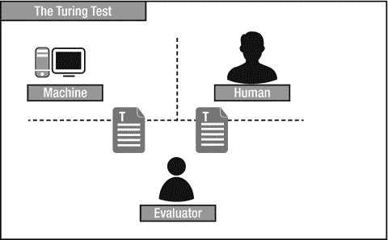
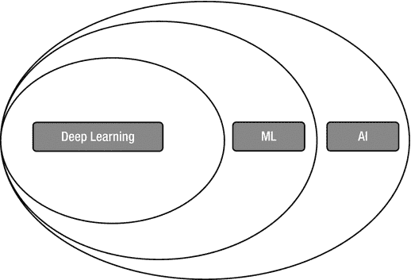
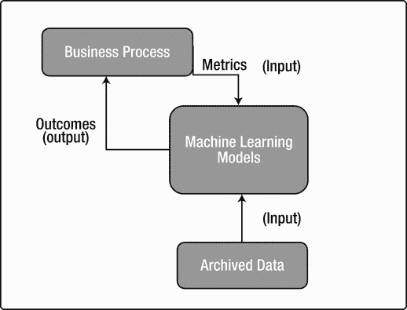

# 2. 为什么是认知计算和机器学习？

本章将继续深入探讨，为什么认知计算是商业智能演进的必然选择。在第一章中，我们讨论了商业智能演进的各个层次，并看到到 21 世纪初，能够进行预测性和规范性分析的、更像人类思维的机器已经出现。这些就是认知计算和机器学习应用或机器。尽管我们打算在后续章节中讨论这些术语，但让我们先深入探讨一下，看看为什么需要这种演进。

注意

人工智能（AI）和机器学习（ML）是相互关联的。机器学习源于人工智能学科。认知计算这个术语最初由 IBM 推广开来，其水平领先于人工智能和机器学习。

## 人工智能（AI）和机器学习（ML）

艾伦·图灵是第一个提出“机器能思考吗？”这个问题的人 [Turing, A.M. (1950). “Computing Machinery and Intelligence.” Mind, 59, 433-460]。他创建了一个名为“图灵测试”的测试。简单来说，这是一个测试场景，其中有两个参与者，一个是人，一个是机器。评估者应使用计算机屏幕和键盘界面与两者进行交互，以确保机器不会因其无法说话而在测试中受限。如果评估者无法区分机器和人，则测试成功（图 2-1）。因此，“机器能思考吗？”这个问题早在人工智能作为一门学科开始之前就由艾伦·图灵提出了，但这是人工智能和机器学习核心的根本问题。

图 2-1.

图灵测试

随着时间的推移，人工智能和机器学习（人工智能的一个子集）发展成为不同的研究领域。基于这些应用开发出的应用程序，其目标是让机器在更少的人工干预下，以更自动化的方式完成任务。人们一直认为这些技术的目的是：减轻人类负担，实现自动化，从而获得更快的周转速度和更少的缺陷。

## 为何选择人工智能与机器学习？

人工智能与机器学习存在根本性差异：人工智能更侧重于制造智能机器，而机器学习则在此基础上更进一步，增加了学习能力。因此，机器学习探讨的是能够学习的智能机器。

任何系统中的人工智能都运用了大量已内置于系统中的规则；系统评估这些规则以产生看似智能的响应。因此可以说，尽管这类系统可能表现出智能的表象，但以此方式构建的人工智能系统实际上并不具备真正的智能。

机器学习系统是具备学习能力的人工智能系统。此外，深度学习（DL）是机器学习概念的一种特定类型，是一种更高阶的形式，能够从更多维度的信息中学习，并组合结果以生成整体高度抽象的结果集（图 2-2）。例如，此类系统可能会查看图像中显示汽车车窗某一部分的区域，并理解这是一辆汽车。该术语将在第 4 章中详细讨论。

图 2-2.

人工智能、机器学习与深度学习

简而言之，人工智能的所有条件均由硬编码规则处理，只要输入相同的事件，这些规则就会始终生成完全相同的体验。

其次，机器学习被定义为一种程序 A，它针对某类任务 T 提供经验 E，并具有某种性能 P。借助 E，其在任务 T 上的性能 P 会得到提升。

人工智能和机器学习专注于通过预编程场景（人工智能）或利用模式的学习能力（机器学习）来完成具有有限功能的特定任务或活动。但它们无法像人类或其他思维实体那样思考（例如，一个人工智能医学影像工具可能识别输入数据并将其作为各种图像分类到不同的癌症类别中）。

相比之下，基于机器学习的医学影像系统也会随着时间的推移，通过学习识别更多新型图像并将其分类到预设类别，从而扩大其范围。

然而，这些机器都无法将其医学专业知识的学习迁移到其他领域（例如室内装饰）。该机器被设计为仅在癌症检测和治疗领域工作；它无法在其他学科领域提供帮助。

一些更常见的例子包括用于机器学习的谷歌搜索引擎；搜索引擎不仅为用户提供基于人工智能的结果，还会不断学习人们的搜索模式并做出相应响应。机器学习与统计学有着密切的联系。

60 多年来，这些机器学习解决方案带来了自动化以及更好的学习成果。人工智能和机器学习的基础知识将分别在第 3 章和第 4 章中详细描述。

## 为何选择认知计算？

通过人工智能和机器学习，我们可以实现许多目标，包括智能自动化以及更优、更智能的机器响应/结果。利用这些机器学习技术，存在良好的数据挖掘解决方案可用于商业智能。

那么，为什么还需要认知计算呢？如果你关注之前描述的所有内容，机器学习和人工智能都专注于同一个问题，通过使用预编程学习或利用新经验扩展学习来寻求解决方案，以增强问题解决能力。但它们在意义上局限于相同的问题领域。

认知计算更进一步，它模拟了类似人类认知的行为。它几乎模仿了人类思维的工作方式。它不仅能够利用已习得的知识进行智能响应（人工智能），或在该领域扩展知识以更好地解决问题（机器学习），还能识别新的问题领域，并围绕它们提出/构建新的解决方案。当然，它受限于其所连接的知识源。但实际上，人类的认知能力也同样受到限制。因此，如果能够访问新的知识领域，认知计算也会利用来自这个新来源或领域的知识。并且，由于它与自然语言处理（NLP）高度集成，因此更容易与之通信，系统也能够填补结构化与非结构化数据结合之间的空白。

对于医学影像而言，除了能够以更好的方式读取各种图像（机器学习）之外，它还意味着可以将数据与医学研究期刊结合起来以理解问题。例如，一个拥有数千张图像的 CT 或 MRI 扫描读取系统，可以通过先进的机器学习系统做出更精确的识别，但认知计算通过将这些图像和该患者的异常情况与其病史、相似患者以及该领域所有可能的医学研究相结合，将其带入一个全新的维度。此外，在一个基于权重的系统中，它可以处理诸如“对特定患者而言，最佳药物和剂量是什么？”之类的问题，它不会基于单词匹配从某个库中给出 5000 或一百万个匹配响应，也不会仅基于扫描图像和系统中预定义的某些参数给出详细报告，然后提供可能的药物和剂量列表。相反，基于评估高度个性化的患者病历、理解图像、并读取截至该时刻的所有类似治疗资料库和所有相关医学期刊文章，它将提供唯一一个权重最高的响应，并附带一些更密切相关的选项及其权重和理由。这就是认知计算的力量：它作为一种工具，支持专家们共同协作，如同一个巨大的认知思维伙伴。

深度学习与机器学习被构想出来的那一刻，认知作为一个概念就已经存在了。但如果没有我们现在所拥有的——海量的数字化数据来训练同样庞大的计算能力——实际上是不可能实现这一点的。庞大的数字语料库和高度互联的世界，使得对海量结构化与非结构化数据进行大规模计算成为可能，从而促成了这一目标的实现。除此之外，互联设备和传感器数据带来了来自机器的数字化结构化感知数据；这种形式的大数据为这个新维度增添了一个基本组成部分。

就我们第 1 章中的零售示例而言，这不仅意味着对来自商店或各个部门的数据进行系统训练，还意味着混合来自天气、物联网传感器和新闻频道等各种来源的数据，为商店和仓库管理增加新的维度。

因此，认知是从人工智能和机器学习自然演进而来的。自人们首次思考“机器能思考吗？”这个问题之日起，这一概念就已萌芽。现在，我们有可能拥有一个机器学习系统，它能够同时运行数百万个参数，拥有通过互联网/内联网访问的数字化语料库、物联网传感器数据以及巨大的计算能力，从而引入认知系统作为辅助。目前，物联网数据应用仍将是认知计算更高级的应用。

图 2-3 是机器学习系统及其与业务流程关系的通用表示。

图 2-3.

业务流程与其他数据（包括物联网数据流）及机器学习模型之间的通用关系

