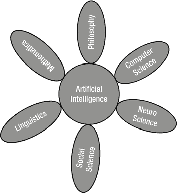
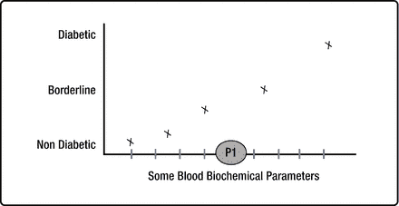
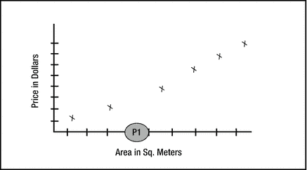
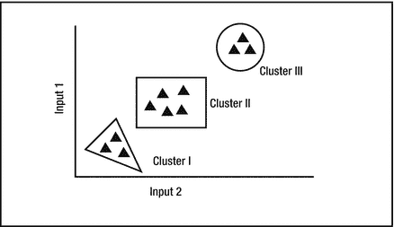
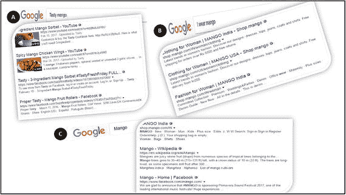
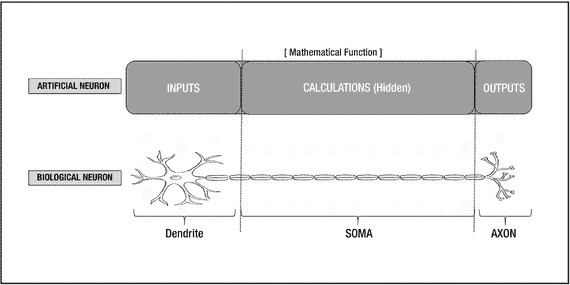

# 3. 人工智能——基础

本书旨在围绕认知计算及其在影响商业与 IT 领域中的作用，构建基础知识体系。但若不具备人工智能（AI）、机器学习（ML）和深度学习的基础知识，就无法建立认知计算的知识体系。

**注意**

掌握人工智能和机器学习的基本概念，将有助于更好地理解后续章节中的认知计算概念。

## 概述

人工智能领域诞生于艾伦·图灵提出机器图灵测试研究之后的数年。该领域于 1956 年在达特茅斯学院的一次会议上正式确立；约翰·麦卡锡创造了“人工智能”这一术语。它被定义为计算机科学的一个分支，旨在开发能够以某种方式与人类认知能力相媲美的计算机程序或应用（例如语音识别、视觉模式或图像识别、语言翻译、自然语言处理（NLP），或在决策中进行推理）。

人工智能作为一个概念诞生时，远远超前于当时的计算能力。这也是它直到最近几年（大约从 2012 年起，当相关计算能力具备时）才达到应用高峰的原因之一。

然而，早期的人工智能系统并不具备我们现在使用的认知方法的功能。这些系统大多是基于知识图谱和启发式方法来制定智能决策的。因此，它们依赖于朝着最确定获胜或成功的方向做出的智能决策，与认知方法（人类思考的方式）并无直接关联。

**注意**

启发式方法也被称为“经验法则”。人类在解决任何问题时，要么遵循程序化步骤，要么遵循某种启发式方法。启发式解决方案可能无法提供最优解，但在需要时能提供快速解决方案。例如，你曾在一个比你所在城市更热的新城市里，顶着烈日走在人行道上去附近的商店，感到非常炎热。下次出门时，你开始沿着墙壁和建筑物行走以寻找阴凉。你刚刚遵循了一条经验法则：离墙壁越近，阳光直射越少，因此感觉更凉爽。同样，启发式方法基于一组预定义规则运行，相比严格遵循算法，能更快地找到解决方案。因此，启发式模型或方法遵循一些明智的预定义规则集，并快速得出结论。一个例子是 IBM 的“深蓝”，它被用于下国际象棋。甚至大多数自动驾驶汽车也使用这种人工智能。这也被称为“弱人工智能”。

能够利用高端机器学习及其他与人类认知能力相当的功能的人工智能系统被称为“强人工智能”系统（例如 SAP Leonardo）。

但弱人工智能系统并非完全意义上的人工智能。它们被编程为仅执行一种任务，并根据之前的输入提供各种连续选项。因此，它会遍历每个输入，找到最合适的输出来完成任何操作，并沿着路径走向预设的输出之一，这是其硬编码设定的方式。这与人类认知的工作方式不同。

## 人工智能的目标

广义上讲，人工智能有两个目标：

*   **工程产品/应用**：需要创建人工智能产品来解决一个或多个领域的现实问题。这些产品是人工智能的物理部分，是用户直接使用的产品（例如谷歌搜索引擎或智能移动助手）。

*   **科学地表示数据**：这是人类不可见的一个方面，致力于寻找使用各种模型和算法处理和数据分析的方法。这导致数据以智能方式呈现，用于商业智能目的，并从中创建模式和图表（例如商业洞察仪表板）。

人工智能借鉴了多个学科的知识，如心理学、计算机科学、语言学、哲学、神经科学、数学和社会科学（图 3-1）。

图 3-1.

人工智能的组成部分

## 人工智能的组成部分

人工智能包含以下组成部分：

*   学习

*   感知

*   行动

*   推理与问题解决

*   语言理解

*   规划

以下各节将对每个组成部分进行详细说明。

### 学习

所有人工智能系统都应具备核心的学习能力。在弱人工智能系统中，这些学习能力通过编程中的`if-else`条件内嵌，并应用规则、权重和启发式方法。

在机器学习的情况下，学习能力更为突出。

学习有多种类型：

*   监督学习

*   无监督学习

*   强化学习

#### 监督学习

这包括“回归”和“分类”两种。监督学习拥有所有已存在的连续数据集，以便利用这些算法得出结论。例如，可以使用人工智能算法来判断某人是否患有糖尿病（分类），或者某个区域的商店价格可能是多少（回归）。

图 3-2 展示了一个分类的示例。

图 3-2.

分类示例

基于某个生化参数（例如血糖水平）在 x 轴上的连续值绘制，以及 y 轴上的类别，绘制出一个图表。任何生化参数的值都与一个或多个类别相关：非糖尿病患者、临界患者或糖尿病患者。如果对于患者 1（P1），其数值落在 x 轴的某个点上，那么该患者患糖尿病的概率是多少？这就是分类的任务。

这个示例有两个显著特征：

*   已知的生化数值标度是现成的，并且分类与之对应。

*   在每个指定的分类中，都期望得到一个解决方案或结果。因此，这是离散值。

因此，对于监督学习，数据集已经包含了所有可用的结果作为训练集；而对于分类，人工智能必须根据其算法的逻辑，将每个数据项归入到相应的类别中。

图 3-3 展示了一个回归的示例。

图 3-3.

回归示例

在这个示例中，价格（美元）绘制在 y 轴上，房产面积（平方米）绘制在 x 轴上。基于这些数据，当房产 1 位于 x 轴上的某个点时，其最可能的价格是多少？这是一个回归监督学习的例子。

这个示例有两个显著特征：

*   两个轴都有相互绘制的连续相对值，并且一组现有的值（面积 vs. 价格）已经以 X 的形式绘制在图表中。

*   对于新点 P1，期望得到一个解决方案；该点可以延伸到由 X 点形成的直线上，它与直线相交的位置就是其数值。

让我们通过一个业务场景来讨论这两种监督学习。

可以使用回归算法，基于归档的和运营中的非归档数据来执行规划和趋势分析。例如，基于多个此类算法并行处理销售数据，一家零售连锁店可以决定当天产品最具竞争力的定价，或者一年中某些天货架上的产品数量。

一个分类监督算法可以确定哪些商品最适合打折。

可以并行运行多个参数，然后使用加权算法将结果结合起来，以得到最终答案。如今，借助高端计算能力，数百万个参数可以并行运行。

#### 无监督学习

与监督学习不同，无监督学习没有预先设定好的测量和/或分类数据。常用的算法是聚类，以生成结果。因此，输入是现成的，但需要根据某些参数对数据集进行分组（图 3-4）。

图 3-4.

聚类

在图 3-4 中，实心三角形代表各种独特的数据集。这里没有像回归或分类监督学习中那样现成的预分类或量化关系，因此无法确定数据应如何分类或从中推导出结果。但是，在决定数据如何相对于某些预先确定的输入参数进行排列时，算法仍然可以根据这些选定参数与数据的关系，识别出数据集的簇或组。例如，在图 3-4 中，三角形根据输入 1 和输入 2（选定的两个参数），围绕一个中心趋势被分成了三个簇。

业务案例示例：假设前面的三角形代表从不同客户那里收到的金额，我们希望根据消费金额和市场细分自动将这些客户分组。这将提供每个市场细分下的客户购买详情。

#### 强化学习

这比监督学习更进一步。它基于输出应如何随输入变化而变化的概念。换句话说，任何与环境交互的智能体都会根据不断变化的输入来调整其输出。智能体并非该环境的组成部分，而只是与之交互。智能体必须对环境中的每个状态采取行动；这些行动会收到正面或负面的反馈（惩罚或奖励），因此它会逐渐尝试选择一条路径，通过避开负面反馈路径来最大化收益。

强化学习在某种程度上模仿了生物行为学习。并非所有行为都有学习手册（例如，一个试图学习走路的孩子会尝试、摔倒、跌跌撞撞，直到通过认知反馈学会正确走路）。强化学习的工作原理与此完全相同。

强化学习在金融、保险、医学研究等领域有许多商业应用案例。

业务案例示例：可以使用这些算法分析投资策略，以确保为具有特定当前状态（年龄、薪酬、工作类型等）和预期未来状态的特定个人提供最大收益分析。

### 感知

这涉及视觉、触觉、声纳、语音识别、面部识别、物体识别等感官方面。

最初，计算机只能通过键盘输入。但现在，通过各种可用的传感器，提供了大量选择，使机器具备了几乎与人类相当的全面感官感知能力。

来自传感器的数据也可以用于商业智能报告；例如，欧洲一家主要银行已为其物业维护实施了报告，其中包括来自谷歌的基于天气传感器的数据。因此，它不仅提供租约续签等信息的详情，还提供该银行所在地可能发生的自然灾害预测。这也有助于银行提醒与该地点相关的客户注意安全或规划他们的活动，以便安全地远离该地点。

感知或感官细节为商业智能做出了重大贡献，而这源于人工智能的核心研究分支。正如后续章节所讨论的，这对机器学习和认知计算也至关重要。

制造业和航空公司正在利用这些先进的传感器数据进行维护。这些行业中任何重要机器部件（制造单元中的机器或飞机部件）的磨损情况都可以实时监控，有助于进行有针对性的快速维护，从而节省时间、金钱，甚至挽救生命。

### 行动

行动或提供所需输出同样是任何人工智能系统中非常重要的组成部分。结果应以数字或机械方式输出。在机器人应用中，运动和路径规划是其中的一部分。

### 推理与问题解决

这是任何人工智能系统的核心组成部分，也是其被期望具备的能力。其他类型的计算机程序则不被要求具备推理和问题解决能力。如同人类思维一样，每个问题领域都会被分解为子问题，并采取逐步行动。这里运用了概率论的概念。人类也有其他解决任何问题的方式。他们可以通过上下文、过往学习和直觉来解决问题。但人工智能系统无法做到这一点，除非它们是认知型人工智能系统。即便如此，其能力也也相当有限。神经网络、感知能力、统计方法以及学习系统共同尝试在某种程度上模仿人类。

## 语言解读

人工智能系统的设计初衷是帮助人们更高效、更快速地完成指定任务。因此，它们应该能够听取或阅读人们存储的信息，并用相同的语言媒介进行回应。

自然语言处理能力对于任何人工智能系统来说都是最重要的能力之一。自然语言处理的界面可以是基于文本的，也可以是基于语音/声音的。

机器理解语言的一种常见方式是通过语义索引。但这同样取决于机器接受训练的程度、可用的训练数据量，以及能够存储和快速处理的输入数据量。因此，需要某些参数：高计算能力、充足（且廉价）的存储空间、更快的互联网（在需要在线参考库来理解声音的情况下），以及更智能的算法。这些能力直到近十年才变得普遍可用，这也是它们大多从 2012 年才开始被广泛使用的原因。

自然语言处理将在后续章节中详细阐述。

## 规划

自动规划与调度执行是另外的属性。人工智能系统应能作为与环境相关的智能体进行规划、调度和执行，以最大化体验和资源利用率。从某种程度上说，这也概括了人工智能系统的全部目的。智能体应能持续监控世界，并据此不断调整输出。

几年前，这些功能主要应用于机械设备（例如无人驾驶车辆）。但现在，即使是商业智能报告也能构建此类能力。通过使用认知应用程序（例如 IBM Watson），人工智能系统可以根据来自物联网设备传感器的实时数据流，自行决定向特定人群发送警报。基于其能力，它甚至能规划维修或补救措施，并及时向用户提供详细信息。仅通过使用报告和电子邮件，它不仅能规划补救措施，还能向正确的人员发出警报并传达正确的步骤。基于库存关键数据的变化以及销售/供应优先级数据，可以引入最新的商业智能工具，从而改变所有正在执行的订单的生产计划，并通过仪表盘向相关利益方生成实时报告。

## 为什么需要人工智能？

人工智能最初为何被设计出来？我们为何集体需要它或想到它？其目的是为了在更短的时间内、以更少的错误完成更多工作，并实现自动化：将任务交由机器而非人类完成。

人工智能使机器更接近人类操作，但具备以下优越特性：

*   更快速

*   行动和决策更准确

*   执行相同任务时更不易出错

*   始终可用，无需休息

这些正是人们梦寐以求的一些能力，以便机器能像人类一样完成任务，但具备卓越或超人的能力。这种自动化对于工业革命也至关重要。

这些是构思和创造人工智能驱动型机器的最基本构建模块。

因此，为了在制造业、服务业、娱乐业等众多行业中获得更高的产出，我们需要人工智能。

除工业机器人外，一些著名的人工智能应用包括苹果 Siri、IBM 聊天机器人、特斯拉汽车（以及其他自动驾驶汽车）、Netflix（详见第 1 章）、亚马逊和 Pandora。

但主要应用领域仍是制造业，不仅需要前述能力，而且有时由于工作对人类来说风险过高，需要基于人工智能的系统。这些机器每次都能以相同的精度水平工作。

尽管一直有人担心基于人工智能的机器会完全取代人类工人，并且这种超级智能机器可能会从人类手中接管所有工作，但情况并非如此。它可能会在很大程度上减少普通劳动力，但专业劳动力始终是必需的。操作员和维修此类机器的机械师也将成为具备新技能要求的新工人群体。

根据 IDC（国际数据公司）的数据，全球人工智能市场将从 2017-18 年的 16 亿美元增长到 165 亿美元，复合年增长率（CAGR）为 65.2%。

但是，在我们拥有那些超级认知学习机器（可能甚至利用了新发明的量子计算）之前，我们现有的人工智能机器大多只具备狭义智能，并且被编程为仅执行类似任务；它们甚至远未达到人类智能的水平。

即使是像 IBM Watson 这样先进的聊天机器人，在这方面也受到限制。例如，Watson 在提出问题解决方案方面极其先进，甚至在癌症治疗等复杂领域也有应用，但它受限于其所接受的训练以及该领域知识库的更新。尽管如此，我们仍可以说，我们尚未达到能够制造出一个真正通晓地球上一切事物的 Watson 那样的计算能力。

然而，这绝不是为了对 IBM Watson 或 SAP Leonardo 这类技术奇迹的能力产生丝毫怀疑。

以更少的错误、不知疲倦地全天候完成更多工作的追求，导致了人工智能的发明。如今，制造越来越像人类的机器的追求，正引领我们走向认知机器，我们将在后续章节中对此进行讨论。

## 方法

正如我所提到的，人工智能作为一门学科，是心理学、计算机科学、逻辑学、语言学、哲学、神经科学、数学、认知科学和社会科学等多门学科的融合。

以下是与人工智能研究相关的一些主要领域或学科。如果我们仅讨论这些领域并尝试将其分为两类，可以得出以下分类：

*   A 组（非生物类）

    *   计算机科学

    *   逻辑学

    *   数学

    *   社会科学（在一定程度上，例如分类）

*   B 组（生物类）

    *   语言学

    *   哲学

    *   神经科学

    *   认知科学

    *   社会科学（在更大程度上）

由此，A 组产生了弱人工智能，而加入 B 组（无论在数量上还是质量上）则使我们走向更强的人工智能系统。

基于上述论点，目前流行以下几种方法：

*   **符号主义**：这是一种基于对符号及其结构中表示的知识进行操作的人工智能方法。所有相关含义都显式地存在于这种基于句法的结构中。它使用层次化的有序逻辑和规则来推导含义和结果，并基于对人类可读符号的书面逻辑的 `IF-THEN` 方法。其局限性在于它只能在硬编码到其中的逻辑和符号范围内工作。

*   **亚符号主义**：这种方法更多地受到人类思维能力的启发。符号主义中的知识潜力在达到层次结构中正确层级时得以实现，但亚符号主义并非如此。这种方法受神经科学启发，并使用了神经网络。这些系统在内部也由规则驱动，但单个节点结果达到的层级并非语义层级。然而，它通过大量此类并行处理来推导语义，使其更具动态性，看起来不那么硬编码。

*   **逻辑驱动**：这一学派由约翰·麦卡锡推动。他认为人工智能不应朝着人类认知的方向发展，而应依赖逻辑。彻底运用抽象推理和问题解决技术是这种方法的核心。

*   **反逻辑主义**：这一学派认为，在视觉和自然语言处理领域，不可能存在一种仅能依靠预编程逻辑（无论其多么庞大）工作的人工智能。该方法的倡导者称其为“杂乱”或“不整洁”，因为它不遵循严谨的逻辑驱动型人工智能路线。

*   **机器学习与统计学**：这种方法与基于逻辑的“整洁”方法相关，但看起来却像反逻辑主义一样“杂乱”。其后台拥有大量数学模型和工具，使机器感觉像是在学习新事物，但逻辑正在被修改，并根据额外经验产生的新状态进行优化。还使用了许多统计方法，从接收到的更大输入集中得出或推导出一组结果。

*   **基于知识**：这种方法大约在 20 世纪 70 年代发展起来，当时可以将海量内存添加到基于人工智能的专家系统中。这些系统唯一能做的就是利用加载的大量数据并据此做出响应。这得益于巨大的存储容量。

*   **认知主义**：这是一种受人类认知方法启发的人工智能。其核心是利用人类的心理和思维能力来解决问题。我们将在后续章节中详细探讨这一点。

这些方法可以再次归纳为四类：

*   符号方法

*   混合符号方法

*   面向智能体与分布式方法

*   集成方法

本书的范围并非深入探讨技术知识，而是建立对当前认知计算和其他更智能的计算方面如何改变商业智能构建和使用方式的理解。

尽管如此，为了对这个主题有所交代并形成知识闭环，我将对上述四种方法进行高层次的解释，然后描述一些工具，最后从商业用户的角度对该主题进行说明。

### 符号方法

这种方法也被约翰·豪格兰德称为 GOFAI 或“老式人工智能”。这是人工智能的主要方法，其思想基础是通过创建能够读取和操作符号的系统来构建人工智能。符号通过基于 `if-else` 的逻辑进行读取和处理，以提供输出。输入也通过指定的人类可读符号呈现给这些系统。这种方法在 20 世纪 80 年代末之前一直占主导地位。简而言之，此类系统是使用（传统）编程语言创建的人工智能，并内置了 `if-else` 语句，用于将此类符号读取和处理成所需的输出。

一个常见的类比是，一个不懂某种语言的人。当他希望用那种语言给朋友寄信时，他先用英语写好，然后查阅该语言的词典和语法书进行翻译。因此，这个人正在结合词典和该语言的语法规则处理英语单词。他仅仅是根据某些规则（此处为语法规则）将符号处理成另一组符号，并生成输出。

因此，这不是真正的人工智能，也无法解决绝大多数问题。这是此类系统的局限性之一。这些系统本质上是极其僵化的，并且只专注于一个非常精细定义的问题领域。

### 混合符号方法

这是符号方法与生物计算或感官能力相结合的一种方法。

混合符号方法为人工智能系统提供了一种新能力，使其能够将周围环境作为决策因素加以感知。毕竟，大多数基本的人类智能都依赖于感官输入。人工智能机器中的这一组件将使它们更像人类，而不仅仅是逻辑或数学计算引擎。

这是一种将人工智能从“黑箱”时代带入更广泛方法的方法。利用这些概念创建了具有强化学习能力的机器人和机器（例如，跳棋游戏应用程序）。移动决策基于实际的实时动作。系统开始被构建为能够学习和进化。

### 面向智能体与分布式方法

通过面向智能体与分布式方法，人工智能向前迈进了一步，引入了面向智能体编程范式。这些智能体分布在一个去中心化的分布式系统中，并在其中进行编程。与人类智能体相比，这些智能体非常粗糙或原始，但它们的编程足以满足人工智能的目的，即机器必须在充满多种不确定性的环境中做出决策。一个很好的例子是基于智能体的制造控制系统，其中多个参数（如不同阶段的任务运行时间和整体调度）都是动态的。另一个很好的例子是由此类人工智能控制的供应链管理，其中许多变量会影响它：天气、路况、突然的路线变更、交付计划变更等。当时的硬件成本和能力对此有利，因为那时已经可以以较低成本进行大规模并行计算。

### 综合方法

这是一种更偏向学习导向的方法，其核心是学习型智能体的概念。通过各种感官手段将状态信息输入机器。系统中内置了面向行动的系统，它会基于所有符号化和感知到的感官状态信息，决定下一步输出所需的行动。此外，还有一个内置的学习机制，它会随着时间推移，针对不同级别和类型的感官输入所对应的各种事件变化，持续学习问题与解决方案的配对。系统利用这个语料库来绕过主要机制，直接运用这些学习成果来采取行动。然而，任何对此类基于学习的响应所产生的负面反馈，也会被记录下来，用于更新或微调学习过程。

这类人工智能机器的基本架构最初是为了处理最基本的操作而创建或设计的，随后被扩展以支持更广泛的功能。`Soar` 项目是该领域的重要成果之一。

`Soar`这个名字最初是状态（`State`）、算子（`Operator`）和结果（`Result`）的缩写，这是人工智能计算中的基本循环。该项目实现了通用子目标的概念。它通常从一个目标的输入开始。这个输入需要在更广泛的可能性集合中进行搜索。一旦某个可能性被锁定，环境的状态就会被纳入考量。为了规避单一输出程序步骤可能造成的瓶颈，这个状态会被进一步分解为多个子目标。多个进程的并行触发会导致多个子状态和子目标的产生。递归地，结果过程被应用于这些并行的目标，并选出最合适的解决方案。最佳解决方案会获得奖励并被存储，从而让系统从该场景中学习。因此，`Soar` 能够做出几乎像任何明智之人一样最有利的决策——当然，这仅限于特定的专业领域。

自然语言理解是一个很好的商业应用案例。网络上的某些内容需要被归类到特定类别，并发布到像 Google 新闻这样的动态新闻页面上。新闻频道实时抓取网络信息，分析各种内容，然后通过一个子目标分解过程，尝试将它们分到不同的类别中。最终，新闻通过最佳场景分析被自动分类，并整理到特定的新闻类别中。

这种方法更接近人类或生物学的特性，例如在神经科学和认知科学中所观察到的现象。

## 工具

随着人工智能多年的研究，涌现出一些用于不同用途的著名工具。这些工具具有通用性，可以成为许多人工智能应用的一部分。

### 逻辑编程

在编程语言中使用数学逻辑来创建人工智能被称为逻辑编程。最初，使用 `LISP` 软件和以 `Lambda` 演算形式存在的数学逻辑来进行此类编程。`Prolog` 催生了各种逻辑编程语言。

逻辑编程是一种受控的演绎推理。它使用反向推理来确定一个与或树，并以此锁定解空间。每个条件都会被尝试和测试以判断是否成功，一旦找到最合适的解，过程就会停止。例如，如果需要列出既活着又快乐的人，已有数据是：A 先生在跳舞，B 先生在睡觉，C 先生在喊叫，D 先生在哭泣，E 先生在唱歌；另一组信息是：快乐（跳舞，唱歌）和活着（跳舞，喊叫，哭泣，唱歌）。那么，逻辑编程在检查这些表达式集合后，会返回 A 和 E 是既活着又快乐的人。它所做的不过是回溯所有可能的推理路径，以锁定解空间。

理想情况下，它是从一个顶层根节点向下设计到多个节点和叶节点的。因此，从 A、B、C、D、E 回溯到上层（如睡觉、跳舞等），再到更高层（活着或快乐）的结果推导，在这种编程中很难实现。但是，可以从任何节点出发来解决问题。因此，自上而下地，我们可以从“谁在睡觉”或“谁在吃饭”开始，并轻松获得结果，因为仍然遵循自上而下的路径。逻辑与控制语句集成在一起，以确保不会发生不期望的偏差，这在处理更复杂的逻辑时尤其如此。假设我们在数据集中添加了关系和性别相关的规则。那么，如果我们查询“快乐的男性”，它会跳过那些一开始就遇到女性标记的分支，并仅在男性一侧自上而下地遍历树，跳过所有女性分支和个体姓名。每个分支都有叶节点或子节点，它们通过 `OR` 子句分组并作为个体选择被访问。`Prolog` 在本质上有点原始，没有并行处理能力，只能使用后进先出（`LIFO`）方法进行顺序回溯。

### 自动推理

更接近心理学和哲学，这是一种帮助程序使用数学模型或逻辑来理解推理各个方面的技术。

自动推理的创建是为了帮助计算机程序像人类一样推理。第一个这样的成就是“逻辑理论家”，这是一个写于 20 世纪 50 年代的计算机程序，旨在模仿人类解决问题的能力。它被用来证明怀特海和罗素所著《数学原理》中的数学定理。它通过其推理能力证明了书中的许多定理。这是思维机器的第一个实例，也是强人工智能的起点。

### 搜索算法

本节探讨如何从海量数据中实现优质、智能的搜索能力。其中还包含了逻辑推理和自动推理，以实现最优化的搜索可能性。简单的符号比较搜索在实际应用中往往作用有限。数学优化概念被用于获得一个或一组良好的结果。

搜索上下文利用得越充分，搜索的优化程度就越高。

谷歌搜索就是一个很好的例子。示例如图 3-5 所示。

图 3-5.

谷歌搜索示例

图 3-5 展示了三个示例。这三个都是来自谷歌的搜索结果。使用的三个不同搜索短语分别是“tasty mango”、“I wear mango”和“Mango”，分别对应结果 A、B 和 C。

根据搜索短语的上下文以及谷歌服务器上运行的优化模型，这三个搜索都提供了三组截然不同的结果。

第一个短语“tasty mango”提供了强烈的上下文，暗示这是一种水果或可食用的美味芒果。单词“tasty”明确给出了关于可食用物品的上下文，而非服装品牌 Mango。因此，从第一个位置开始的所有搜索结果都是相关的。

第二个短语“I wear mango”提供了强烈的上下文，指向某种可穿戴的物品，因此，与第一个搜索短语不同，没有任何结果集提供与可食用芒果相关的结果。

第三个短语实际上并非短语，而只是一个单词“Mango”；这并没有提供关于被搜索对象的任何上下文，因此结果集是第一个和第二个搜索短语结果的混合。

尽管基于上下文的搜索备受重视，但由于需要适当的参数才能获得优化良好的搜索结果，它也存在局限性。

这方面的一个优秀例子是 `IBM Watson`，它利用这种基于上下文和认知能力的搜索能力赢得了《危险边缘》游戏。除了数学逻辑和优化之外，`Watson` 还运行权重算法，以更接近上下文，并在该领域给出有限的结果。`Watson` 赋能 `North Face` 网站（[www.​thenorthface.​com/​xps](http://www.thenorthface.com/xps)）就是一个很好的商业应用。

`North Face` 在线提供了数千种服装设计。基于一些有针对性的问题，`Watson` 会为该客户推出一套定制的产品目录。这不仅帮助了客户，也帮助了 `North Face`，使他们能够为客户提供最个性化的用户体验。

### 人工神经网络

人工神经网络由人工神经元或大型神经连接的简单单元组成。人工神经元不过是系统中的数学函数。神经网络类似于人脑，而单个单元或人工神经元则类似于单个生物神经元。生物神经元有头部（树突）和远端（轴突）。作为数学函数的人工神经元，其接收的一个或多个输入代表树突，输出代表轴突。这些人工神经元或数学函数是整个人工神经网络的单个单元。图 3-6 展示了这种相似性。此类系统是可训练的，许多复杂问题都可以通过这种网络解决。以下是神经网络涵盖的一些广泛领域：时间序列预测、机器人技术、语言处理、模式识别、人脸识别等。

图 3-6.

神经网络（示意图）和神经元

## 总结

人工智能的创建是为了实现许多业务功能的自动化。最初，这主要应用于工厂流水线自动化。随着时间的推移，它从简单的符号迭代作业机器演变为更接近人类的解决方案。基于心理学、社会学和神经科学，加入了人为因素。人工智能进一步发展，出现了更基于人脑模式设计的机器，称为神经网络。这些网络具有称为人工神经元的单元，类似于生物神经元。

在我们继续深入之前，让我们稍作停顿，看看后续章节将涉及什么。到目前为止，我们已经构建了所需的主要背景技术知识。

至此，我们已经走过了从 BI 到 AI 的知识构建之旅。接下来，我们将讨论两个较小但重要的主题：机器学习，然后是 NLP。这将让我们了解这些 ML 和 AI 机器以及更先进的系统如何利用 NLP 能力。

然后，我们将讨论预测分析及其商业价值。关于预测分析的章节将进一步与本书的核心主题——认知计算——联系起来。

我们将深入探讨用于此类认知系统的原理，然后讨论并行发展的 IT 商业智能系统。

之后，我们将讨论组织如何迈向这种转型，指出各种路线图以及潜在的障碍。我们将进一步讨论这些自我进化的认知解决方案以及未来的道路。

本书通过所有这些讨论，旨在进一步提出基于认知计算、区块链等改变 IT 格局的观点，这不仅会改变企业对 IT 格局的需求，还会影响 IT 服务公司及其从营销销售到交付的运营方式，以及咨询顾问需要做出哪些改变。

本书将尝试为三类读者（使用这些解决方案的企业、提供这些解决方案的 IT 服务公司，以及为两者服务的咨询顾问）进一步解答所有这些问题。