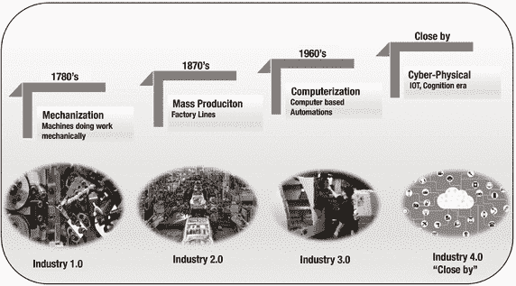
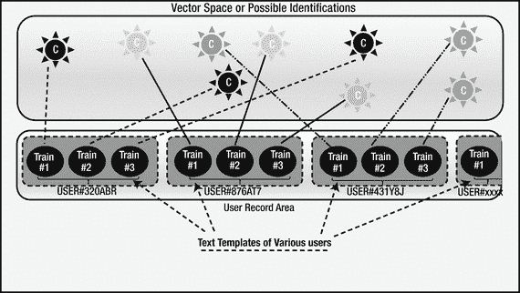
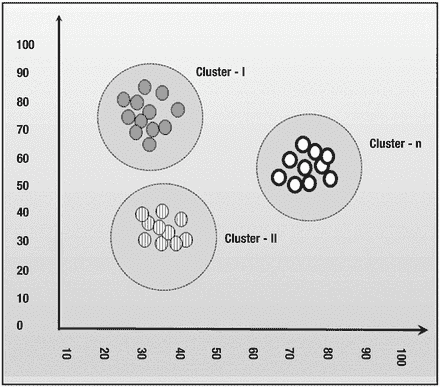
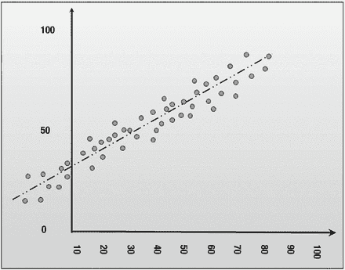
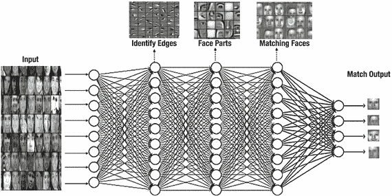

# 4. 机器学习基础

延续第 3 章关于 AI 的讨论，我们将在本章进一步讨论一种特殊类型的人工智能，称为机器学习。

**注意**

本书的主要读者是商业用户和高层管理人员（包括企业客户和 IT 服务提供商）。尽管如此，了解人工智能和机器学习概念的基础知识将有助于更好地理解后续章节中的认知计算概念。

## 机器学习

机器学习是人工智能的一种特殊类型。它是指机器无需显式编程，就能学习并处理新问题维度的能力。程序会随着接触新的数据和场景而发生变化。

机器学习在所谓的第四次工业革命中扮演着非常重要的角色。

这场革命以物联网和认知计算为核心。机器学习在此扮演着重要角色，因为它成为了这个生态系统中的一个关键子组件。

谷歌和许多其他公司现在甚至能够将机器学习作为云服务提供。这与向`工业4.0`级别迈进的准备工作是一致的：参见图 4-1 中各个工业世代。

图 4-1. 工业世代

机器学习与数据挖掘或模式分析有一些相似之处。这些活动有助于搜索数据点以生成结果作为输出。因此，这些功能的主要作用是分析和理解数据，然后利用数据来理解用户的成果或输出。类似地，机器学习在处理过程中也会不断理解它所接触的数据，但这种发现的结果并非面向用户的输出，而是一个持续调整和更新人工智能程序的过程。

因此，要比较机器学习和数据挖掘的基本活动模式，原则上它们都会筛选海量数据，以将某些坐标固定在期望的结果点上。但数据挖掘的目的是以“固定”的结果目标向外展示此类挖掘活动的本质，并帮助用户以图表或表格的形式查看发现的模式；而机器学习的目的是在内部进行提炼，从中推导出多重含义，并在内部消化这些含义以改进其算法，从而帮助优化或升级其他地方的输出。

因此，数据挖掘所消耗的数据点就是作为结果输出的数据点；而在机器学习中，所消耗的数据点可能与需要直接输出的数据并不相同。

例如，某个特定地理区域的降雨和土壤湿度数据，可能通过数据挖掘来进行某种趋势分析，因此相同的数据被消耗并输出，只是结果格式不同。而在机器学习中，这种数据模式和预测可能被用于根据天气运行机器，以最优化方式运行灌溉系统。因此，降雨和土壤湿度的数据仍然被消耗，但目的是优化田间灌溉机器的性能，并影响另一组数据以实现优化，例如，以最优化方式运行此类机器的投资回报率。

机器学习的根源在于模式分析和人工智能的各种计算学习理论等学科。

汤姆·米切尔对其定义如下：“如果一个系统在经历经验 E 后，能够可靠地提高其在任务 T 上的性能指标 P，那么我们就说该机器针对特定任务 T、性能指标 P 和经验类型 E 进行了学习”（2006 年 7 月，CMU-ML-06-108）[`www.cs.cmu.edu/~tom/pubs/MachineLearning.pdf`](http://www.cs.cmu.edu/%7etom/pubs/MachineLearning.pdf)。

机器学习是计算机科学的一个领域，它关注计算机如何根据任务和结果来改进其程序，并以某种方式自我编程以实现更好的输出。

基于机器学习的人工智能进入市场较晚，直到 20 世纪 80 年代末，市场上几乎还没有商业应用。

目前，使用机器学习的一些突出应用包括语音识别、人脸识别、机器人应用、机器人聊天机器人、自动驾驶汽车等。

对软件候选者进行机器学习训练是一个领域，其中预先编程可能很困难甚至不可能。你无法编程让机器学会所有可能类型的人脸表情或语音模式。即使可能，也会非常繁琐且耗时，并且会预装海量的程序逻辑数据，可能达到 TB 级别。更好的方法是预先训练它，使其基于某些向量进行自我训练，然后让它像婴儿一样保持天真，并允许它为使用它的用户学习。这基本上是这些系统的工作方式。例如：

*   用于医疗应用的 IBM Watson 可以识别患者 CT 扫描结果的细节，并通过与所有具有类似 CT 扫描结果和其他参数的患者进行比较来提供建议。这些数据可以作为多个 CT 扫描报告的示例输入，并可以添加各种标签标记，但仅通过编程为 Watson 创建此类数据是绝对不可能的。

*   可以训练人脸识别或指纹识别系统，使其仅允许基于此类识别的授权图像通过系统。

因此，有一类数据只能通过数据标记和输入系统来提供，而不能通过编程实现，这主要发生在涉及图像、声音或其他传感器数据的感官感知情境中。数据标记意味着用各种向量点来标识单个数据，将其标记为独特且离散的事物，然后将其记录为系统的学习内容。

个人声音的特殊特征（在语音识别系统的情况下）是通过与用户一起训练提取出来的。然后，这些特征会与同一用户反复进行再训练，所有信息都存储为具有指定质心向量位置的可能聚类。这就是说话者的训练数据。提取过程使用数字信号处理相关工具完成。然后，系统中所有此类用户训练数据都会用一个唯一的用户 ID 进行标识。系统可能会根据某些阈值（如响度、清晰度、背景噪音和失真）接受或拒绝测试样本。最后，包含所有训练数据的系统就为该用户准备好了参考模型或模板，并通过用户 ID 进行标识（图 4-2）。训练得越多，精度就越高。这就是为什么你手机上的`Google助手`或`Microsoft Word`会要求你至少用你的声音训练系统两到三次。因此，当用户通过语音唤醒进行匹配时，本质上就是在后端进行模式或特征匹配，与系统中记录的、由唯一用户 ID 标识的该用户模板进行比对。

图 4-2. 语音训练模型

但存在一个局限性：学习是根据提供给该系统的内容进行的。它无法自行选择新主题来创建与新主题领域相关的程序。例如，一个擅长唱歌的人可能会随着时间的推移观察某种街舞形式并学会它。这可能是刻意的学习，或者他可能更被动地观察，但仍然能在一定程度上学会。

但是，一个精通癌症的机器学习机器不能仅仅通过获取音乐知识就成为音乐专家；同样，语音识别系统学习的是语音波前，而不是用于人脸识别的图像像素。由于这个局限性依然存在，无限学习的机器尚未被创造出来。我们现在拥有的是课程驱动的机器，它们在自己的学科领域内学习。

相反，自我发起和监督的学习将涉及类似这样的场景：例如，一个负责为录音室工作人员送茶和咖啡的机器人，也通过观察和聆听周围人的歌声来学习一些音乐课程。

这些概念在人类学习和机器学习中都很常见。实际上，后者试图从前者中汲取一切。

一些研究表明，人类大脑只有一个学习算法；如果将来自眼睛和耳朵的神经连接在大脑中的主要连接位置切断并互换，那么互换后的位置会学习新的感知。因此，当大脑的听觉部分与视神经连接时，它开始处理视觉信息；而原本负责视觉的大脑区域在与听觉神经连接后，则开始处理声音。这是神经网络的基础，而神经网络是机器学习的重要组成部分。

## 机器学习任务

机器学习是人工智能的一种。因此，学习任务的类型同样适用于人工智能，正如第 3 章（监督学习、无监督学习和强化学习）中详细描述的那样。

根据输出结果，还可以列出一些额外的任务。具体如下：

### 分类

这是一种基于观察结果预测类别的操作。这仅通过监督学习实现。因此，分类类别是预先设定且明确定义的。被分类的数据可以是任何类型，无论是普通文本格式还是图像。请参见本章前面关于为用户创建语音模板的示例，以及图 4-2。

模型训练的目的是进一步将任何数据分类到正确的类别中。分类程序会将每个单词的上下文计算为概率，并根据这个概率权重，将整个关联内容归入或标记到某个预定义的分类类别下。这类应用中最常见的是垃圾邮件检测应用。此外，用户还可以进一步训练这些应用，以识别更多类型的垃圾邮件。用户手动将某些邮件标记为垃圾邮件，系统会进一步自我训练，也将此标准纳入考量。`Google搜索`和`Google新闻`也属于此类。

### 聚类

聚类是一种无监督任务。输入数据被分成若干组，但不存在预定义的分类。这些组被称为簇。聚类可以采用多种可用的自顶向下或自底向上的方法。输入数据会被标记上一些值。然后，基于所有靠近或最接近这些均值（`K-means聚类`）的对象来定义簇。每个定义的簇可以进一步关联成一棵树，或者所有对象可能首先被视为一个大的整体，然后逐渐被分割成簇，并与其他簇以树状结构关联（`层次聚类`）（图 4-3）。像亚马逊这样的在线电子商务购物应用就是基于聚类原理工作的。

图 4-3. 聚类示例

在线商店在其网站上拥有数百万种关联库存中的待售产品。这里可能存在两个主要问题。

*   在某个特定时间点，这些网站上待售的产品可能数量庞大，以至于快速将它们分组到正确的产品类别中变得困难。

*   如果用户对某个特定子类别的产品感兴趣，那么确定分组的方法应该足够灵活或智能，以帮助该客户完成购买。

这正是聚类发挥作用的地方。在卖家上传详细信息时，系统会询问一些问题以便快速打标签。例如，供应商可能上传一件衬衫，其详细信息包括：男装、正装、尺码 M、L 和 XL、材质棉、颜色红、白、紫、黄。基于这些属性（标签）和聚类算法，系统会自动将其注册到男装类别下。

现在，如果客户有兴趣购买蓝色正装衬衫，系统应该能够再次根据特定的搜索词、之前的购买模式或克隆客户属性（任何具有相似模式的其他客户，例如地理位置、搜索词语言、年龄等）对产品进行聚类。

可能并不存在一个“蓝色男装”这样的类别。但基于后端的标签、智能推荐和预测聚类算法，电子商务网站会开始在屏幕上显示相关产品，这应该能提高用户满意度和销售额。

### 回归

这是一种监督学习任务。它比较多个输出均值之间的关系，并线性预测其他相关输出的对应值。使用训练数据通过统计分析进行预测（回归）。一个著名的例子是根据相关的训练数据预测房价。它不像聚类那样将对象分组为围绕均值的簇，也不像分类那样将对象归入不同的标签；相反，它为每个候选对象预测值（图 4-4）。

图 4-4.

回归示例

## 相关核心概念

机器学习有许多与之相关的核心概念。这些可以被视为机器学习的方法，并用于实现机器学习解决方案。其中一些将在以下章节中描述。

### 深度学习

这也被称为深度机器学习（DML）。具有多个隐藏层的人工神经网络（在第 3 章中讨论）与算法一起研究时，被称为深度学习或 DL。

机器学习与深度学习的一个快速区分点可以是图像识别的例子。它可能两者兼具，具体取决于需求。想象一下，有一个工厂机器人，其目的是学习并阻止有缺陷的零件进入包装单元。它的系统中输入了某种图像变化和原始预期图像。这个机器人可以使用工厂生产线上每件成品的完整面部照片，并快速进行比较，以判断其是否有缺陷。这些机器可以以极高的速度和精度做到这一点。这就是经典的机器学习。

现在让我们看另一个例子：在人群中，移动的卡车、公交车、汽车、自行车、猫、狗和人都在其中。要求是只找出人的面部，并将其与罪犯数据库中的面部照片进行比较，以查看是否有人在逃，然后立即逮捕此人。除了前一个例子中的挑战之外，这还有其他挑战。

在这种情况下，没有可以通过校准的焦距调整和安排来捕获的特定图像；除了面部之外，监控摄像头可能捕获到很多东西。它可能是任何角度的面部；可能是一个怀里抱着一只大猫的男人，或者是一个推着装满西瓜的手推车的人。在比较面部和面部照片之前，后端的机器应该能够从连续的曝光中区分出面部的集合，然后进行处理比较的工作。这就是机器学习失败的地方。它需要更广泛范围的数据输入和更高阶的处理。这就是深度学习发挥作用的地方。

DL 是更深入的学习，因为数据学习是通过基于多层人工神经元的神经网络传递的，因此可以从数据中推导出更深层的含义，以及多出许多倍的变量和组件。因此，它提供了更深层次的理解，进而实现了学习。通过这种多层复杂神经网络的渗透，可以将浅层或不太深入的输入转化为深入而丰富的学习。

这可以用于监督学习或无监督学习，但最佳用途是无监督学习，因为这种基于深度神经网络的渗透提供了更丰富的推理，从而为机器提供了更丰富的学习。因此，可用性因素更符合无监督学习。此外，主要的问题领域总是存在于无监督领域。

简单来说，关于任何主题的可能细节的多个维度都被输入到系统中，然后即使只有部分维度的信息可用，系统也能获得所需的感知。这是世界各地使用的人脸识别系统背后的技术（最近新闻中提到的一个是澳大利亚联邦警察在黄金海岸为筹备 2017 年黄金海岸英联邦运动会所使用的系统）。一排排闭路电视摄像头将使用此类算法捕捉人群中的人脸图像；然后，他们的面部特征将被映射、测量，并与恐怖分子图像数据库进行比较。

因此，深度学习机器比机器学习机器更进了一步。当信息的维度变得过高时，机器学习应用就开始失效。换句话说，问题越复杂，其维度就越高。深度学习使用神经网络来帮助将问题的维度分解成不同的抽象层，然后逐一解决它们，并在最高抽象层组合结果，它被用于所有这些应用。

从部分面部图像中识别人脸，并能够在人群中检测出已知的恐怖分子，是一个过于复杂和多维的问题，无法通过机器学习解决。它有很多维度：边缘信息，用于理解图像中捕获的部分是鼻子、部分嘴唇、部分眼睛或面部特征的其他组合。还有肤色、皮肤纹理、眼睛颜色、眼睛或鼻子与脸部的比例等维度，以及大笑时肌肉拉伸运动相关的所有信息，甚至包括要与之比较的人的全脸细节。神经网络在这里提供了帮助。

神经网络遵循马尔可夫隐藏模型概念，具有输入接口、输出接口以及介于两者之间的多个隐藏层。每一层处理一个不同的维度；然后，使用数学模型将它们全部组合起来，在尽可能高的抽象级别上得出输出结果，从而识别出人脸。

请参见图 4-5 查看相同的示例。

图 4-5.

深度学习示例

该图显示了一个中间有多个隐藏层的神经网络。输入层和输出层位于两端。来自摄像头的图像输入从输入端进入，然后神经网络的每一层都在处理各种属性，并随着输出或接近分辨率的程度越来越高，进入更高层次的抽象层。第一层查看图像的各种边缘和轮廓，然后尝试在下一层（一个更高层次的抽象层）将其解析为对面部各部分的认知。下一层然后将这些识别出的属性与数据库图像进行匹配，并能够从原始图像中区分出面部和背景，轻松地与数据库图像进行比较，例如，从数据库中识别出四个人与人群中的人匹配。

这就是深度学习的工作原理，如一个非常著名且简单的例子所示。

深度网络将多个执行简单任务的简单网络组合在一起，随着结果复杂程度的提高，最终形成结果。考虑到需要处理的信息维度，在实际应用中，这可能在层数上非常庞大。

### 遗传算法

这些算法模仿了生物遗传学中的自然选择理论。生物学理论讨论的是可持续物种的基因的各种交叉和突变，而这些算法则使用启发式概念来寻找更好的解决方案。遗传算法具有用于计算的遗传因子和成功参数，用于判断每个假设和模拟的可能变体的成功程度。机器学习算法使用这些来优化其效率，而遗传算法则通过机器学习进行优化。

### 决策树与关联规则

机器学习使用类似数据挖掘的计算来获得最具结构化的学习，以改进其程序。因此，决策树与数据挖掘中的决策树完全相同。这些树有助于更好地预测解决方案，并为学习（即使在无监督学习中）构建数据结构。

相比之下，关联规则帮助机器学习机器通过推断数据中的关联来创建组合学习，并进一步从场景中得出组合学习，以便在程序中添加更复杂和有效的更改。

### 贝叶斯网络

工程领域始终面临两大核心难题，且同时处理好两者极具挑战性：**复杂性**与**概率（或不确定性）**。这一问题可通过图形化建模以及贝叶斯网络（或称信念网络）中的随机变量来建模。这种图形模型由多个较小的图形组件组合而成，每个小组件都代表整个问题的一个子集。对人类而言，图形模型一直被认为是最直观的表达方式。这也使其成为人工智能和机器学习领域一个更具趣味性的课题。贝叶斯网络既可以是简单的，也可以是动态的。

### 语音识别

这类应用有其独特性：它们被交付后，再由用户进行训练。语音识别无法通过预先编程来识别所有语音模式；相反，它必须针对特定用户的使用习惯进行训练。即使不考虑地区口音差异，所有人在发同一个词时发出的声音也略有不同。全球有超过 6900 种现存语言，仅在一个国家或地区就有数千种方言，因此，要让软件预先掌握所有这些语言和方言是不可能的。此外，每个人的生理构造也会影响其使用某种方言说话的方式，这无疑使问题变得更加复杂。

即便只是设想一下，也会觉得这几乎不可能实现：想想看，这需要投入多少训练数据。例如，想象一部智能手机为了给这样一个语音识别系统提供训练内容，需要预装 50GB 甚至 1TB 的数据。

所有这些因素加在一起，使得语音识别任务成为机器学习的绝佳应用场景。在这种场景下，一个基于预设训练和规则的系统被交付，然后它会针对特定用户进行训练，以解读其语音。

### 生物监测

目前，全球许多国家都使用机器学习对住院数据进行生物监测，以了解多种传染病的入院模式。系统基于已识别的模式来检测任何异常情况。这有助于建立生物监测体系，从而帮助阻止此类疾病的传播。

## 机器学习 vs. 统计学

机器学习与统计学之间的异同长期以来一直是争论的话题。有些人将它们统称为计算机科学的统计学，而另一些人则倾向于根据起源将它们视为两个不同的领域：统计学源于数学，而机器学习源于计算机科学（人工智能）。

机器学习和统计学都作用于数据，以推导模式并提炼出某种意义。

一个主要区别在于：统计学是在预设的精确数据点上寻找数据，以辨别某种趋势；而机器学习则必须跳入一个全新的数据场景，并从中推断出意义。但如果我们认为机器学习只是针对某一特定主题的应用，那么这就等同于统计学中预设数据点的做法。

为了解释这一点：假设机器的主要设计目的是响应问题 A。随着时间的推移，机器会对环境产生一些新的认知，并开始从中提炼出意义。更具体地说，假设机器需要从厨房拿一杯水、一块蛋糕或一个苹果，放到某个房间内用户的桌子上，用户会说“把水[或蛋糕、苹果等]拿到我的桌子上”。现在，用户移动到了桌子的另一边，并喊道“把水拿到桌子的另一边”。这就需要调整路径。随后，当用户使用“桌子另一边”这个短语要求拿蛋糕或苹果时，机器就会知道它必须走到另一边，并据此计算其行进路径。机器学会了。但考虑一下当用户发出一个自然、正常的指令时的场景。同一个用户或不同用户可能用多种语调、风格和其他变体说出这个指令，但所有指令都表达同一个意思：把水拿到我的桌子上。这在后台的工作原理与统计分析完全相同，即对同一场景下指令的权重取平均值。学习曲线通过将中心均值转移到另一个位置，引入了非统计行为，而在桌子另一边，同样存在多个具有相同含义的变体。因此，对于相同的情况和理解常规输入，它按照统计模式工作；而对于新的学习，则需要生成新的模式，并且它必须偏离这种基本行为，以便能够生成可供进一步存储的新训练数据。

这两者之间也存在相互关系。统计学为机器学习编写算法提供了方法，而统计学也从机器学习的应用中获益。

关于统计学与机器学习之间关系的一个非常精彩的阐述，可以在 SAS 的一篇出版物中找到（[`blogs.sas.com/content/subconsciousmusings/2014/08/22/looking-backwards-looking-forwards-sas-data-mining-and-machine-learning/`](http://blogs.sas.com/content/subconsciousmusings/2014/08/22/looking-backwards-looking-forwards-sas-data-mining-and-machine-learning/)）。

统计学只关注所考虑数据集中的数据点或结果，而机器学习的目的则是从中进一步生成意义，并利用这些意义来升级其程序，进而升级整个系统。

因此，无论认为两者相同、一个是另一个的子集，还是它们互为补充，都很难得出一个确切的结论。

在我看来，统计学作为一门已有数百年历史的成熟学科，更侧重于对各类数据集进行纯粹的数学建模或数据推导。它是一种处理数据的工具。它被认为是数学的一个分支，致力于[数据](https://en.wikipedia.org/wiki/Data#Data)的收集、分析、解释、呈现和组织。

另一方面，机器学习是计算机科学中一个较新的领域，或者更确切地说是人工智能的一个子分支，它利用统计学的大部分技术来解决其核心目的：通过各种方式从提供给它的数据中推断出意义。因此，机器学习应用的最终阶段是通过统计学来组织数据，然后以学习的形式得出一些结论。这些结论随后被用于修改程序，或基于规则创建新的程序。

然而，统计方法也可以利用各种机器学习应用进行大量分析，以生成关系或检验此类关系。

换句话说，它们是互补的。但机器学习建立在（部分）统计学基础之上，反之则不成立。

此外，机器学习不仅仅是统计学。它还需要结合许多其他学科才能提出这样的解决方案。

## 商业用例示例

Netflix 就是一个很好的例子。Netflix 奖是该领域最著名的竞赛之一；其目的是理解如何利用用户数据来训练系统，使其能够提前预测用户的选择，并向他们推荐最可能的选项。

除了竞赛本身带来的宣传效应之外，利用样本数据在市场上发起一场竞赛或挑战，本身就是一个非常明智的商业构想。通过向获胜团队支付 100 万美元，他们只为获胜的创意付费，并且通过让多个团队研究所有选项并选出最相关、最合适的方案，为自己节省了大量时间。因此，与仅为实现相同目的而选择内部团队相比，这变成了一项成本非常低的事务。同时，这也克服了知识传播范围的限制。任何有资格且能想出点子的人都可以参与竞争，消除了只能与通过招聘限制选出的人员合作的局限性。

然而，存在一个问题：有人对他们提起诉讼，指控其在未事先获得同意的情况下，将私密/保密的客户数据披露给了第三方。

但回到我们的商业用例主题，让我们看看 Netflix 是如何运行一个极其先进的推荐系统的。该系统的基础如下：

*   每个人都是独一无二的，家庭中使用同一订阅账户的每个个体也是独一无二的。

*   当解决方案或服务为用户提供有利的选择时，用户会通过“喜欢”来做出积极回应。

Netflix 希望为其观众提供这种机器学习解决方案。从最初一家基于门店的 DVD 电影供应商，他们已转型为一家完全基于网络的企业。

从客户互动的角度来看，最大的转变是失去了门店级别的个性化接触。尽管此时内容库已经非常庞大，但基于门店的服务在帮助个人客户选择合适内容方面可能仍有优势，因为仍然有可能与客户互动，甚至亲自了解客户，从而为他们推荐相关的内容。

但从这个角度来看，在线商店环境有时就像一个黑箱。只有当客户提供反馈，或者客户通过在海量内容和多种类型中搜索和浏览，偶然发现正确内容时，你才能知道谁喜欢什么。

这正是 Netflix 解决的问题：以甚至可能超越实体店中人性化服务的方式，更好地提供内容。

该系统从一开始就被设计为，能够根据用户之前的互动以及基于规则的推荐算法，向人们推荐合适的内容。

因此，一个智能系统需要根据家庭中实际使用该订阅账户的个人来进行推荐；这就是为什么 Netflix 建议在订阅账户中添加家庭中的个人子用户。

不仅视频如此，连电影的预告片也是以这种方式处理的。例如，一个人可能对看战争片感兴趣，而同个家庭中的另一个人则更喜欢看喜剧；在这种情况下，向每个人展示的预告片版本可能会有所不同，会强调对他或她来说更有趣的因素。

因此，这涵盖了从电视剧集到电影再到预告片的所有内容，这些内容都会根据个人用户的选择进行推荐和呈现。

这一切都在机器学习的范畴之内。该系统的算法最初是在 Netflix 奖中设计的。曾几何时，该算法是为一个较小的数据集设计的；大约有 1 亿个用户评分。随后，它被重新创建以容纳数十亿条记录。一旦系统准备好这个算法并用这些数据进行了训练，一个基线智能系统就准备就绪了。该系统基于理解这些客户，并从这种学习中得出推论，以便为其他客户（甚至新客户）提供推荐。

随着时间的推移，该系统从两个角度进行学习。一个角度是不同客户的整体偏好，这有助于在系统尚未开始针对新客户的偏好进行自我训练时，也能为他们提供推荐。另一个角度则更像是一个持续且完整的学习过程，用于识别现有客户的偏好，以便能够向他们推荐相关内容。

这就是机器学习的工作原理：通过数据训练，能够产生越来越符合该事件偏好的输出，在这个案例中，就是针对在家使用该订阅的个人客户或成员。

注意

正如我们在第 1 章中看到的，Netflix 更进一步，开始根据这种选择模式制作电影。基于客户基础矩阵及其选择，Netflix 能够提前理解或预测什么样的故事和哪种艺人组合可能会产生一档超级热门的节目。其结果就是像《纸牌屋》这样的剧集。

内容的类型也被细分为子类型。这样做是为了能够利用额外的参数进行推荐。例如，像喜剧这样的单一类型被细分为以下子类型：

*   黑色喜剧（例如，《希特勒回来了》）

*   伪纪录片（例如，《废柴舅舅》）

*   政治喜剧（例如，《战争机器》）

*   体育喜剧（例如，《粉笔大战》）

*   讽刺剧（例如，《热带惊雷》）

仅喜剧本身就有大约 12 个这样的类别。因此，Netflix 将每种类型都细分为子类型，以适配识别出的每一种观众子类型，并向其推荐相关内容。

推荐系统能够根据偏好和流行度进行推荐。不过，流行度在某种意义上与偏好恰恰相反，因为它指的是某样东西被观看仅仅是因为用户喜欢它，而不是因为别人在看。但在通过机器学习算法从群体或类别角度为个体训练系统时，这个重要因素也会被考虑在内。

它还会考虑用户的社交数据，以了解用户自己社交网络中流行什么。

因此，Netflix 是一个运行良好且成功的例子，像他们这样的模式是我个人的选择，因为它不仅让组织能够成功实施并从中获益，还能为娱乐业带来一个新时代：从实体 CD/DVD 租赁业务向在线内容流媒体的转变。