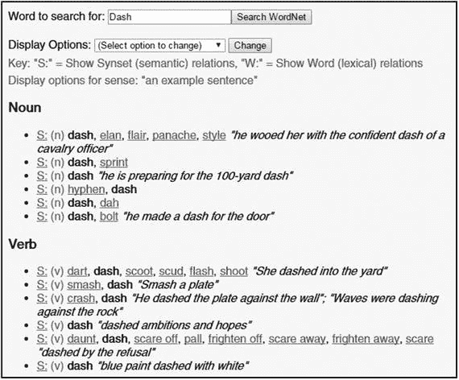
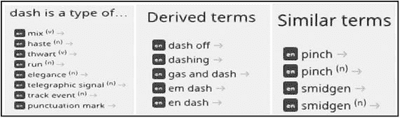

# 5. 自然语言处理

继第 4 章关于机器学习基础的讨论之后，我们将在此讨论下一个主题：自然语言处理，或者说机器和计算机处理与理解自然（人类）语言的方式。

> **注意**
>
> 本章概述了自然语言处理及其与人工智能和机器学习的关联。涵盖这个相对较小的主题的目的是，为了很好地理解人类与机器交互中的交互媒介和方法。

## 自然语言

那种随时间演变并被人们使用的语言被称为自然语言。这些语言并非在任何预先策划的计划或项目下发展起来的，而是随着持续的使用而演变；多年来，通过重复使用，许多变化被固化下来。这种语言对于使用它的特定人群来说是本土的，并且是他们最自然的交流方式（例如，印地语、英语等）。基于地理位置，一种自然语言也可能存在方言。自然语言最初以口语形式出现，但大多数自然语言也发展出了书写或文字系统。

> **注意**
>
> 印度尼尔吉里部落使用的托达自然语言没有与之相关的文字系统。

## 自然语言处理——概述

本节介绍计算语言学和人工智能领域中涉及计算机语言处理的一个分支。该研究领域探讨机器/计算机如何处理自然语言指令（无论是书面还是口头形式），然后根据请求执行相应操作。输出结果应通过自然语言的书面或语音响应呈现。

自 20 世纪 50 年代艾伦·图灵发表《计算机器与智能》以来，自然语言处理开始发展为一门学科。其核心目标是让机器以更高的准确性和速度自动完成以往由人类执行的操作，同时还能用自然语言与用户交互。从人工智能或类人机器播下第一颗种子时起，通信视角或自然语言处理视角就已经被纳入预期。

在图灵测试中，如果用户难以区分与自己交流的是人类还是机器，则该机器被视为成功。当人类与机器遵循的通信模式同步，且双方使用同一种语言时，这种效果尤为显著。因此，如果你在另一端与聊天机器人对话，若该机器人具备足够的智能来回答你的问题，并拥有良好且无缝的自然语言处理能力，那么它的表现会更具说服力。简而言之，无缝通信是必要条件。即使智能程度较低（真实人类支持也可能如此），但良好的机器与人类交互必须依赖通信能力。

机器应能从输入的自然语言句子中理解含义和上下文，并能够以自然语言无缝地响应或输出通信。

因此，这涉及机器能够使用自然语言进行倾听、感知和响应，或者将这种能力集成到机器中来实现相同目标。

早期的研究工作非常基础，仅运行简单且固定的规则集。但随着 20 世纪 80 年代机器学习的兴起，自然语言处理领域也迎来了一场革命。因此，如果我们对比这两种场景，就像一个人坐在帘子后面，根据自己记忆的语言知识，将翻译好的纸条递回给请求者。这相当于具有固定规则的机器学习机器。通过规则（if-else）固定的知识本身就是一个限制因素。但另一方面，如果一个人能访问图书馆，即使他原本不具备相关知识，也能通过查阅书籍翻译任何内容；这就是更高级机器学习的例子。学习能力不局限于输入其中的规则集，而是通过新输入，它能在算法中创建新的关联，并生成新的程序部分来自我升级——正如本例中的人通过阅读所需书籍来升级知识，从而翻译超出其实际知识领域的语言。

决策树算法开始模仿最初的固定规则翻译算法。决策树算法不过是固定规则的图形化表示，以及将其转化为数学模型以数学方式重现逻辑步骤。在大多数情况下，这些仍然是算法的一部分，但只是中间工具，而非唯一工具。

随后出现了一些新的计算理论，包括概率理论，例如马尔可夫模型。

简而言之，马尔可夫模型指出：在无法对未来状态做出精确推断的概率动态环境中，未来状态取决于当前状态，而非任何更早的阶段或事件。但所有状态都是隐藏的。

因此，这里涵盖的重要方面如下：

*   我们考虑一个本质上是随机的环境，这符合现实世界的情况。每个动作都是多种可能动作集合中的一部分。

*   如前述要点所述，由于这是一个动态概率环境，无法绝对确定地提前推断下一个动作，因此对于下一个可能的状态或动作而言，它在某种程度上是一个黑箱。

*   当前状态与所应用的动作是关联的。所应用的动作与当前状态相关，并旨在达到下一阶段，因此当前状态决定下一阶段，且通常不基于任何先前状态。

*   所有状态在达到之前都是隐藏的。

语言处理总是需要以某种形式使用马尔可夫模型。

在语音识别的情况下，各种语音波形会产生多个语音向量，然后使用马尔可夫隐藏模型的概率模型来确定可能说出的话语。一个单词可以被分解为更小的声音向量，通过最高概率的可能性推断该向量的含义，从而可能选择从起始状态到结束状态的正确路径；概率模型发现或揭示整体声音路径，以决定将该声音归入特定单词发音区域。关于为多个用户生成语音识别语音模板的详细信息，请参阅第 4 章中的详细内容及图 4-2。

当我们命令谷歌助手拨号并呼叫某个名字时，所有这些活动都在后台发生，包括区分两个名字并选择正确的那个；然而，这只能达到系统针对特定用户语音所训练出的准确度。这是通过机器学习能力实现的，即针对特定用户的语音波形训练系统。

后来，IBM 创建了更复杂的统计模型。IBM 的乔治城实验在这方面很有名。

> **注意**
>
> 乔治城实验是 IBM 与乔治城大学合作进行的一项著名实验。在该实验中，IBM 当时著名的基于真空管的 701 计算机首次实现了将俄语高速翻译成英语。

## 自然语言处理与机器学习

随着时间推移，自然语言处理开始采用多种统计格式和机器学习算法，以推动计算机科学这一领域的发展。

词性标注是其中的核心概念之一。

以英语为例，共有九种词性：

*   名词

*   代词

*   动词

*   冠词

*   形容词

*   副词

*   感叹词

*   连词

*   介词

但对于计算语言学而言，为了从英语句子中提取语境，甚至可能标注多达 100 种词性。

这种标注有助于机器理解诸如 `This is mine` 和 `The boy works in a mine` 这类句子的区别。单词 `mine` 在第一句中是物主代词，在第二句中则是名词。这种理解不仅依靠词性标注实现，还需要其他技术辅助。本章后续将对此进行介绍。

词性标注随着时间发展，逐渐演变成一个庞大的知识语料库，用于机器语言学。词性标注与马尔可夫隐模型也常结合使用。

因此，庞大的词性语料库与马尔可夫模型相结合，能够帮助机器确定理解句子真实语境所需遵循的路径。

这些包含真实世界示例的语料库，连同马尔可夫隐模型等统计工具，被应用于机器学习技术中，以训练机器更好地理解和学习语言。

这些机器学习算法会参考词性关联的语料库，并结合统计与概率方法进行权重分析，从而实现更优的自然语言处理。

结合聚类算法（聚类将在第 3 章讨论），机器学习算法能够从词性语料库中确定最相关的数据集，进而知道如何朝特定方向继续推进。

系统获取的数据越多，其训练效果就越好。类似这样的大型语料库已创建了许多，一个例子是布朗大学编纂的布朗语料库。

一个能够从 A 点移动到 B 点、拿起杯子并返回的机器人，借助人工智能，变成了一个机器学习智能机器人，甚至能克服 A 点与 B 点之间的障碍来完成取杯并返回的任务。但有了自然语言处理能力，这个机器人可以接收“去接杯水”这样的口头指令，而无需按下按钮或进行类似的手动输入。这就是 AI + ML + NLP 潜在组合的力量。

正如机器学习与自然语言处理的结合将机器带入了一个新时代，机器学习也在助力自然语言处理不断进化。

随着深度学习的出现，自然语言处理完成更复杂的语言处理任务变得更加容易。

统计方法有其自身的局限性，但结合了机器学习（以及后来的深度学习）支持的马尔可夫隐模型后，它在很大程度上降低了失败率。

## 自然语言处理的工作原理

尽管本书的目的并非深入探讨技术的细节，但我们仍需从宏观层面理解一些基本核心概念，以便触及本书的核心主题——认知计算（我们现在已接近这一主题）。

自然语言处理机器必须处理语言的多个方面，才能得出最终输出或理解，无论是书面（文本输入）还是语音（声音输入）形式。

其中一些方面如下：

*   语音学（单词和字母的发音）

*   基于词法的切分

*   句法规则

*   语义学

*   语用学

我们不会深入探讨这些方面如何实现的技术细节；相反，在接下来的章节中，我们将从整体上概述语言处理是如何发生的。

### 首先是单词和字母

理解字母的发音及其组合成单词的方式是第一步。除非这些内容被解析为实际含义并送入自然语言处理系统，否则后续一切无从谈起。语音学是研究声音的结构、识别和分类的学科。在自然语言处理系统中，语音元素不仅通过声音来理解，也通过语境来理解。声音可能相似，但语境有助于精确锁定应选择哪一个。

单个音素更容易检测。单个音素的声波易于映射，且该特定音素所有可能的合成声波都已得到充分识别。

但理解句子中的单词要困难得多。

句子中的单词首先需要被清晰识别，然后归类为指定的词性之一，以便进一步处理。在语音情况下，必须通过各种切分模型从句子的整体波形中识别出单词。语音切分有助于将这些波形切割成相当于单个单词单位的片段。这很困难，因为在口语中，一个或多个句子对应的是一个单一的波形。

分解声波是一种高阶概率运算，称为切分。它利用识别出的单词的形态发音以及语境，将句子的完整波形分解为不同的单词。我将在本节末尾稍后讨论形态学。

单词的语境是一个非常重要的方面。假设有两个句子：“Mr. E. Hunter is dead now”和“Mystery Hunter is dead now”。它们产生的波形几乎相同，极难区分。

再举一个例子。“I bought this rabbit fur coat from the sweatshop”；单词“sweatshop”与单词“pet shop”也押韵。但基于语境的理解确保了我们这里谈论的是由兔毛制成的“fur coat”，因此应该是`sweatshop`而非`pet shop`。

语音识别的另一个方面是理解单词的形态。学习一门语言时，人们会学习该语言的词汇。但由单词构成的词汇也具有形态特征。单词不仅通过其字面意义被认知，还通过来自类似用法的关系知识被理解。让我用一个简单的例子来解释。单词“blue”（发音为/blu:/）表示彩虹中介于绿色和紫色之间的颜色。但“blueish”表示带有蓝色调的东西。现在考虑任何你添加后缀“–ish”的颜色：它都将表示那种颜色的色调。即使明天发现了一种新颜色`zup`，`zuppish`也将表示`zup`的色调。这就是对语言形态的理解（即单词如何构成以及它们之间如何建立关系）。这在自然语言处理中也被用于理解单词。

### 句子理解紧随其后

在对单词进行正确的类别标注之后，现在必须从整个句子中找出正确的推断。像“Time flies by quickly”（时光飞逝）和“The eagle flies by rapidly”（雄鹰疾飞）这样的句子，应该能够通过推断加以区分，并且要理解“时间”并非一种鸟类。同义词和多义词等术语在此处至关重要。需要仔细理解单词在整个句子语境中的正确含义，并判断是否使用了同义词。词义消歧（`WSD`）技术/概念被用来解决这个问题。通过执行词网（`wordnet`）来理解句子的正确推断。因此，必须考虑正确的含义。

像[`www.conceptnet.io`](http://www.conceptnet.io)和[`http://wordnetweb.princeton.edu/perl/webwn`](http://wordnetweb.princeton.edu/perl/webwn)这样的网站很有趣，它们展示了自然语言处理功能如何分解一个多义词的各种含义，并通过权重来追踪其正确含义。

一个例子是单词“`Dash`”。`wordnetweb`网站提供了关于这个多义词的详细信息，如图 5-1 所示。

图 5-1. “`Dash`”在`wordnet`中的显示

类似地，在`conceptnet`上搜索会揭示一个词在不同语境下可能意味着什么。这里的“`Dash`”会有许多分类标题，其中一些如图 5-2 所示。

图 5-2. “`Dash`”在`Conceptnet`上的语境

“`dash is a type of…`”（破折号是一种……）类别下列出的每个示例都指向一个不同的信息子类别，进而导致句子在其使用语境中产生不同的可能含义。

这就是自然语言处理发生的方式，以及如何通过使用各种算法和马尔可夫隐模型，利用单词来确定句子的整体含义和语境。深度学习机器使这个过程更简单、更省时。

### 语用学

语用学紧随其后，作为一种对从句子中推导出的整体含义或语境进行重新验证的方式。例如，A 对 B 说：“你是个好人；你能做到。”现在，在使用前面提到的所有技术进行完整推断后，处理机器应该能正确判断 B 是在被赞赏，还是 A 只是在讽刺。或者以“John saw Kelvin with spectacles.”这个句子为例。这是指“约翰用眼镜看到了凯尔文”还是“约翰看到凯尔文戴着眼镜”？这个领域很重要，尤其是在文本分析和情感分析等应用中。

## 商业案例

现在让我们谈谈一些使用它的商业案例。我相信，在这个智能手机、互联网连接和设备普及的世界里，自然语言处理已不再是一个陌生的词汇。但为了遵循本书的一般趋势，我想提及一些突出的用途或应用。

### 聊天机器人

这是当今最重要的应用之一，并且它严重依赖自然语言处理。`IBM Watson`聊天机器人值得一提。这些机器人将（主要是技术性的）支持服务提升到了一个新的水平。凭借`Watson`的智能回答能力和顶层的聊天机器人界面，组织可以通过实施它来节省大量成本。

这些聊天机器人可以像任何人工聊天支持或技术支持那样回应个人，并且通过适当的训练语料库，它们可以像人工支持一样解决许多问题。而且，这是快速且不知疲倦地完成的。

还有一些其他著名的聊天机器人，如`Mitsuku`、`Baidu-Melody`和`Duolingo`，都可以在线使用。

### 垃圾邮件过滤器

邮件垃圾邮件过滤器也是自然语言处理的应用。对单词的误报（`false-positive`）和漏报（`false-negative`）检测，可以避免一封好邮件仅仅因为其中提到的几个词就被算作垃圾邮件；在其他情况下，一封垃圾邮件可能写得非常巧妙，以至于它可以通过不使用其中存在的任何单词模式来绕过过滤器。因此，邮件垃圾邮件过滤器的这种智能性来自于它们的自然语言处理能力。

### 情感分析

在如此紧密的在线连接和社交媒体平台巨大影响力的世界里，公司挖掘围绕自身及其产品或服务流动的情感变得非常重要。任何负面反应被捕捉得越快，损害控制就能越快进行。这是当今营销和客户关系管理的核心。有很多工具为公司做这件事，值得提及的是`SAP Business Objects Data Services`的文本和情感分析能力以及`SAP Hybris`营销解决方案。这些是衡量个体客户情感并发现社交媒体上带有此类情感信息的先驱。

这不仅是为了损害控制，也是为了衡量营销投资的有效性。这也有助于进行精准定位的营销活动，再次提高投资回报率（`ROI`）。

自然语言处理在此也有助于区分误报（`false-positive`）和漏报（`false-negative`）的陈述。

### 搜索引擎

像谷歌和许多其他搜索引擎是这些非常流行的应用中的佼佼者。在第 3 章中，我们看到了一个例子，展示了谷歌搜索引擎如何理解三个不同陈述的语境并提供相关的搜索结果。

### 问答系统

`IBM Watson`在 2011 年通过与前冠军`Ken Jennings`和`Brad Rutter`竞争，赢得了《危险边缘》（Jeopardy）游戏。

这仅仅是问答系统的一个例子。如今，有很多这样的设备或应用程序，它们可以为问题提供单一的加权答案，而不是像任何搜索引擎那样提供一大堆答案。当然，这并非完全由自然语言处理领域独有，但它在理解问题句子并提出唯一最加权答案方面扮演着重要角色。

## 总结

现在我们到达了关于自然语言处理这一章的结尾，剩下的唯一技术主题是预测分析。这将使我们直接接近本书的主要主题——认知计算。

到目前为止获得的知识以及关于预测分析的额外知识，将使我们能够很好地理解认知计算的概念。

一旦完成，我们就可以开始深入探讨认知计算的各个方面，并展示它如何成为行业中的主要变革者。