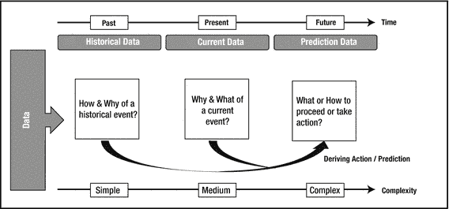
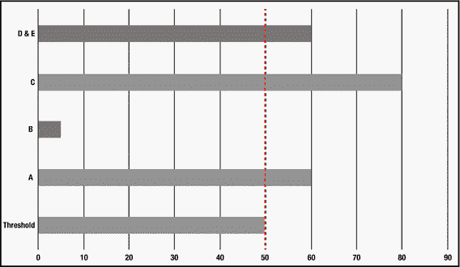
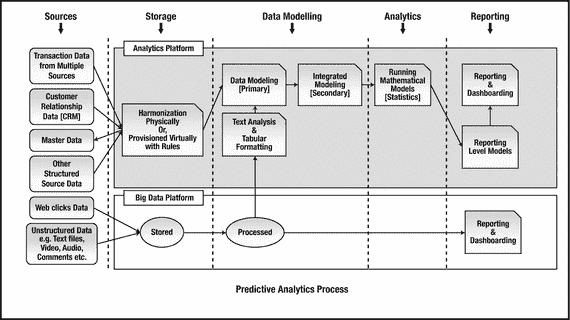
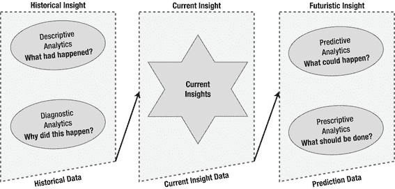
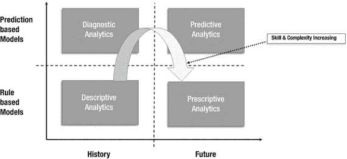
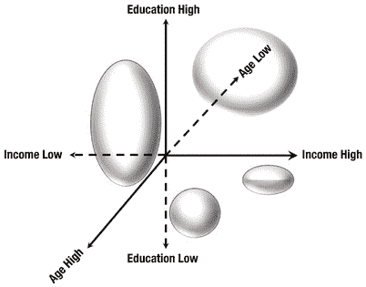
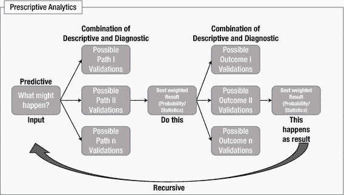

# 6. 预测分析

本章的主题延续了人工智能、机器学习和自然语言处理。现在我们将讨论预测分析，它利用所有这些技术从当前和历史数据集中预测有价值的信息。

注意

我们已经在最后三章中讨论了人工智能、机器学习和自然语言处理。这是讨论预测分析所需的先决知识。本章将讨论技术方面，然后是商业用例。

## 概述

预测分析是一种高级预测系统，它利用当前和历史数据，为某个业务案例或重点领域提供高度概率性、智能且精准的预测。

它是一个研究分支，运用了人工智能、机器学习、统计及其他数学模型、数据挖掘、数据建模、文本分析和情感分析等技术。

预测模型不过是应用于特定数据集，以得出特定结果集作为结论的数学模型。市场上已有大量应用，它们拥有非常丰富的应用集和内置库，其中包含了针对几乎所有典型业务场景（例如，客户关系管理、营销预测、销售预测、风险预测、欺诈预测等）的预封装模型。

当前和历史数据集无疑是必需的。从某种程度上说，这种分析会审视海量数据以寻找模式。针对特定业务预测目标的模式，就是预先编程或定制编程到此类应用中的特定数学模型。这使得从各种来源向这些模型输入特定的最小数据集变得至关重要。

数据可能来自特定的时间范围（例如，来自特定的过往业务领域、存储的历史数据等）。然而，始终存在一个挑战：应该保留多少数据、应该保留哪些数据，以及保留期过后数据如何处理。这些不能仅由企业自身的规章制度来控制。它还必须始终符合相关政府和非政府监管机构的规则框架。这使得问题更加复杂。我们将在本章范围内讨论这些方面。

根据数据类型的不同，数据从各种来源收集。它也可能是一个大数据分布式文件系统，这对预测分析的发展有着巨大影响。

当然，当我们谈论预测分析时，我们指的是从尽可能多的不同数据源获取数据，并将其混合成正确的“鸡尾酒”，以获得最佳预测。这意味着巨大的、有时甚至超乎想象的数据量，甚至达到 PB 级别。因此，像 `Hadoop` 这样基于廉价和通用服务器支持的开源应用的出现，在预测分析的出现中发挥了至关重要的作用。这使得获取此类分析最关键的部分——大数据——成为可能。这种简单且廉价的数据存储平台的实现，因此对这项技术提供了重大帮助。

分析预测可以在特定的应用软件包上完成，但考虑到相关数据库的许可成本，应始终考虑使用更廉价的数据源。这样做还有其他一些原因：

*   传统数据存储系统主要用于以表格格式存储结构化数据，而与此类分析相关的数据源可能以非结构化格式（例如，文本文件、视频、音频等）提供数据。

*   在非结构化数据的情况下，从所提供数据中实际收集到的数据可能只占很小一部分。因此，可用于分析的数据可能仅占从这些非结构化来源收集到的 TB 级数据的个位数百分比。例如，一个 700 MB 的视频文件可能只提供几 KB 的具有分析价值的信息。在这种情况下，拥有更廉价、更具成本效益的存储选项至关重要。

*   存储的便捷性也被视为一个重要方面。传统数据库在加载或写入数据之前非常注重检查数据的完整性和格式。但非结构化数据在这方面总是很混乱。存储此类大数据的系统应该足够快，以确保快速写入。无论如何，数据量都是巨大的：例如，一个捕获 `Facebook` 或 `Twitter` 推送的系统，每天需要以非结构化格式（例如，对推送的评论）存储数十亿条此类事务。

*   它必须易于扩展。考虑到数据存储的简单性和简单的应用程序接口，这更容易实现。

这些廉价、易于写入、易于扩展且大多拥有自由许可的数据存储选项，在许多方面对预测分析做出了巨大贡献。这些文件系统（大多如此称呼，例如 `Hadoop Cloudera`）也可以直接用作从中存储的数据中提取某些信息的报告环境。

所使用的统计方法主要是`时间序列分析`、`回归分析`和`预测建模`。

因此，简而言之，预测分析包含以下内容：

*   为特定目的识别和存储数据

*   对指定的数据点运行数学模型

*   推导数据点结果

预测建模应用的报告范围包括：

*   当利用历史数据时，提供问题领域的历史视角（例如，某事如何以及为何发生）。

*   当利用当前数据时，提供当前状态（例如，当前正在发生什么以及为什么）。

*   当使用数学统计模型时，提供未来预测（例如，应采取什么行动或应如何做某事）。

图 6-1 进一步总结了这些方面。

图 6-1.

预测建模的报告范围

## 数据相关性

预测分析的一个非常重要的方面是数据。我们在上一节讨论了一些方面，但还有其他重要的方面。其中之一是哪些数据是值得存储的。

许多咨询公司的研究都强调，存储或收集的数据中甚至高达 99.99%或更多是不相关的（根据 IDC 的数据）。这还不包括一个事实，即只有一小部分相关的已存储数据最终会成为相关的分析数据。

因此，如果 100GB 的相关或优质数据能产生 50MB 的分析相关数据，那么选择不相关的数据将再次扩大这个比率差距。

在考虑为分析目的选择数据时，应考虑各个方面。Gartner（在第 1 章中引用）提到，“只有 31%的业务和 IT 领导者拥有有助于实现战略 KPI 的指标（[`https://www.gartner.com/newsroom/id/2650815`](https://www.gartner.com/newsroom/id/2650815)）。”

如此获取的数据应基于一些快速测试分数进行存储。只有当它在很大程度上满足这些测试条件分数时，才应被视为用于该目的的优质数据。

测试条件如下：

### 新鲜与真实

有些数据源可能并不可靠或质量不达标。仅仅因为某种数据类型而随意采集数据，可能是一个重大错误。请记住，即便是最廉价的商用服务器存储大数据，也依然需要付出成本，这笔开销最终会体现在你的账目中并产生影响。因此，CIO 及其团队必须对所使用的数据源格外谨慎。

举例来说，假设我们需要客户语音数据。人们通常会考虑从 `Facebook`、`Twitter` 或其他相关且流行的社交媒体讨论区或客户论坛获取数据。假设有 200 个此类网站运行着这类客户数据，且这些网站的点击率各不相同。

现在，绝不能仅仅因为某些网站上有少数客户发布了内容或可能使用它们，就将所有数据源都纳入考虑范围。这会给设计和成本带来不必要的负担。那些点击率最高、最受欢迎的网站，足以用于趋势分析；原因在于，它们能提供来自大多数客户或目标受众的、更新更快的详细信息。从这个意义上说，由于这些网站持续且较新的点击量，数据的时效性也得到了保证。

试图整合来自每个数据源的数据，并设计一个系统来抓取每条记录，可能会对系统性能造成过度负担，也会让你的预算吃不消。

请参见表 6-1，了解一些知名社交媒体网站的用户统计数据（数据来源：[`www.brandwatch.com`](http://www.brandwatch.com)）。

表 6-1.

知名社交媒体网站的用户份额

| 网站 | 占互联网总用户百分比（约） |
| --- | --- |
| Facebook | 23.53 |
| 微信 | 15.24 |
| YouTube | 13.60 |
| WhatsApp | 12.24 |
| 微博 | 8.98 |
| LinkedIn | 6.12 |
| Instagram | 5.44 |
| Twitter | 4.35 |
| Google | 4.09 |
| Flickr | 1.52 |
| Pinterest | 1.36 |
| Snapchat | 1.36 |
| Myspace | 0.69 |
| Airbnb | 0.68 |
| Reddit | 0.49 |
| 4Chan | 0.15 |
| Periscope | 0.14 |

因此，如果我们信任这组数据（看起来研究得相当透彻），那么前四个网站或应用提供了超过 60% 的社交数据。前六到九个网站的组合也拥有可观的数据量。而这仅仅是这 17 个网站/应用的情况；还有成千上万个网站/应用可以列出。

但是，从单个企业的角度来看，实际的数据质量还应通过良好的市场和网络调研来评估。因此，即使只考虑表 6-1 中的 17 个平台，与该企业相关的优质数据的排列组合，也可能与表 6-1 中显示的客户基础优势大相径庭。原因很简单：该表仅显示了这些平台上的活跃客户总数，而对于特定企业而言，其客户数量可能完全不同。因此，尽管有关于这些平台数据质量和活跃用户数量的标准市场调研，但对于特定组织来说，仍必须重新核查；不应瞄准所有平台，而应只关注主要部分。通常，组织会选择两到六个这样的平台。

### 避免噪音

一个人的音乐可能是另一个人的噪音。因此，即使你知道了在最终选定的平台列表中有多少“你的用户”，也不应使用从上一要点中确定的相关数据源中的所有数据。同样，可能需要进行质量复核。

多个平台上的用户数量可能如下：

*   平台 A：8%
*   平台 B：20%
*   平台 C：34%
*   平台 D 和 E 合计：30%

这是根据众多平台上的用户数量得出的最终平台列表。然而，进一步的深入调查揭示了关于数据质量的以下事实：

*   A 的数据质量达到 60% 或更高
*   B 的数据质量为 5%
*   C 的数据质量达到 80% 或更高
*   D 和 E 的数据质量达到 60% 或更高

如果将噪音或质量阈值设定为 50% 或以上以确保良好的数据质量，那么可能会看到如图 6-2 所示的趋势。

图 6-2. 样本中的噪音水平

基于此，尽管平台 B 拥有约 20% 的客户点击量，但其数据质量极低。在这种情况下，明智的做法是将该平台从列表中剔除。

然而，这只是一个示例场景，现实中的决策可能会更复杂一些。但只要企业和 CIO 清楚他们需要瞄准什么，这种两步深入分析法应该能够削减浪费或冗余，并将可用性因素提升到一个可观的水平。

### 避免个人或敏感数据

对于此类违规行为，有极其严格的法律规范。因此，只应采集你被授权采集的数据。法律和监管意识是必须的。如果你被授权使用个人数据，则应保持其最新状态。数据应得到妥善保护或加密，以防止滥用或泄露给他人。一旦数据不再需要使用，应立即删除或移除。应充分告知用户其数据被使用的情况及目的。在使用数据前应获得同意。应阻止数据泄露事件的发生，但如果确实发生，应通知所有监管机构和用户。

确保只采集必要、授权且相关数据的做法，不仅在技术层面（系统性能角度）有益，在成本和项目时间线方面也同样有益。这有助于提升整体投资回报率，增强对系统的信心，进而提高对预测分析结果的信任度。目标应该是用最小体积的干草堆来找到一根针，而不是把全世界的干草都堆在一个地方，让本已复杂的任务变得更加复杂和昂贵。

## 数据保留期限

数据相关性的另一个方面是时间因素，换句话说，就是系统中应获取或保留多旧的数据。出于上一节提到的所有原因，这也是一个值得牢记的重要方面。

显而易见，任何信息只有在正确的时间使用或应用时才是有用的；否则，它就没有可用性或重要性。这是一个与时间相关的函数。

以下是一些需要牢记的测试条件：

### 过去、现在与未来的价值

就任何数据的时间戳而言，都应仔细考量其在当前问题解决范围内是否具有生成预测的价值，以及它能否作为数学/统计模型中的参数使用。如果不符合这些条件，它就不是好的历史数据。

例如，要预测某零售连锁店单一门店的季节性销售模式，收集客户销售明细、客户主数据和客户会员信息，以便按性别、年龄、职业类型等对客户进行分类，这样做是合适的。而如果我们将该时段所有收银员的排班表和轮班详情数据合并起来，这本身几乎毫无用处。这两个细节可能同时出现在交易表的销售信息中，但只选取正确的数据子集才是正确、合理且最高效的做法。从历史数据中剔除收银员数据，使其不参与预测分析，这甚至与预测过程的目的相去甚远。

当前数据也是如此。只应选取那些与问题范围及/或数学预测模型相关的当前数据。

一旦完成这些步骤，并从历史数据和当前数据中使用了正确的数据集（或更确切地说是子集），我们便自动拥有了一个具有未来价值的数据集。这里的“未来”指的是仅使用这些数据记录，通过预测模型所产生的输出。

### 一致且非负担

数据应与需求保持一致，且不应成为负担。即使是时间维度上的私人数据也应予以考虑。敏感数据应尽快移除。

### 过时或偏离目的

大数据系统使我们有能力存储甚至长达数百年的历史数据。借助诸如 `Hadoop` 上的 `Apache Spark` 或 `HANA Vora` 等工具，可以轻松地筛选这些数据以理解其含义。

但这有意义吗？随着文明经历各种社会和生活方式的变迁，商业也在随之改变。这不仅受到个人层面社会变化的影响，也受到社会规范随时间整体变化的影响。政治局势同样会产生影响。

因此，公司应足够明智，通过了解数据在时间上回溯多远仍足以与当前模型配合使用，以及这些数据是否是在相对相似的社会情境下创建的，来界定哪些数据从时间角度来看是高质量的。

某些曾经非常流行的事物，随着时间的推移可能会成为耻辱或批评的对象（例如，吸烟）。

企业应非常确定，并建立一个基准测试流程，以确定在进行分析时，数据可以回溯到多久以前。

## 预测分析——流程

从它诞生至今，这主要是一项依赖个人技能的工作。数据科学家和业务分析师共同协作来主导整个过程。

成为一名优秀的数据科学家，始终需要具备扎实的统计学、编程知识以及商业头脑。

然而，近来，机器学习和认知技术因其超人的能力（例如，以极低的错误率工作，并在短短几秒钟内针对新的需求维度给出新结果）已开始取代数据科学家。

但最关键的是，工具和方法不应主导预测分析的结果。首要的应该是目的。大数据和工具并不能提供良好的预测分析解决方案；恰恰相反。方法应该是首先定义预期目标，然后对其进行细化，并通过此过程审视价值产出。接着，应确定并微调数据源。然后，应尝试并调整模型。最后——砰！——得出黄金结果。

已有一些例子表明，数据科学家陷入了自身工具和行业魅力的陷阱，进行了一些不合理的分析，虽然表面上图表、图形和表格看起来非常精彩，但最终毫无意义。

继续并总结之前的论点：预测分析的技术层面并非重点。更重要的是组织层面，即：进行预测分析的明确目的或需求，以及为实现该组织目标所需事项的清晰定义清单。

尽管有各种具备超人效率的机器（例如，`IBM Watson`），但人类参与的需求依然存在。这就是为什么在招聘数据科学家时，诸如品味、类似业务经验以及非常科学的问题解决方法等额外技能，是需要考察的重要属性。数据科学家不能，也不应被期望仅凭纸面上的需求单打独斗。数据科学应是一项有机的活动，并且需要管理层的利益相关者密切合作与监督。它更像是一项组织的战略举措。

在商业案例确定之后，建立预测分析的流程主要是技术性的。但试点和扩展方法，主要由首席级高管（C-Level）监控，是确保项目不偏离轨道的必要条件；否则，偏离目标就太容易了。

数据科学家的努力是复杂的，因为所需的关联性可能涉及多个领域的组合，因此无法仅由他一人完成。这些关联性不应仅仅是对任何机器学习或统计模型的精通。它们需要随着时间的推移，在经理和分析师的帮助下进行微调，同时也要衡量是否偏离了最初的目标。

这个过程并不复杂。图 6-3 展示了一个高层次的通用描述。

图 6-3. 预测分析流程

这是一个典型的预测分析流程，图中展示了指定分析平台（例如，`SAP HANA`、`BODS` 等）和大数据平台（例如，`Hadoop`）的高层次使用范围。

请记住，好的数据并不总能带来好的预测分析，它还需要结合如前所述的良好的规划和有机的环境。

需要根植一种数据驱动的管理或业务文化。因此，预测分析应从顶层开始推动。这个价值链中的所有人员都应尽可能紧密地与组织的核心协同工作。他们应充分了解业务领域、问题领域以及用于改进的战略性长期和短期计划。数学、机器学习以及工具本身并不能驱动业务或成功的预测，但如果它们被赋予了经过正式规划和监控的正确目的，它们就能共同主导整个过程。

现在，为了总结图 6-3 的内容，我将从高层次进行一些简要的进一步讨论，并提供基本输入（再次说明，本书的目的/范围并非技术性的）。

我们将从以下五个方面来描述该流程：

*   数据源

*   存储

*   数据建模

*   分析

*   报告

为方便和相关性起见，我将把数据源和存储放在一起讨论。

### 数据源与存储

数据源由结构化数据源和非结构化数据源组成。结构化数据源指的是规范的表格格式数据；除此之外的所有数据都属于非结构化格式。甚至音频、视频及其他类型的文件也属于非结构化数据。

通常，业务交易数据和主数据系统是结构化数据源的来源。也可能存在其他来源，例如平面文件系统，其中 `XML`、`Excel` 和文本文件可通过特定的适配器和接口被读取到表中。

非结构化数据可以是任何内容，从传感器输入到网页点击信息以及社交媒体数据采集。

结构化数据通常存储在关系数据库表中，而非结构化数据则存储在像 `Hadoop` 这样的分布式文件系统中。这些数据也需要经过处理，转化为有意义的衍生数据，这由特定的应用程序（例如 `Hive`）负责处理。

与业务交易数据相比，非结构化数据的量通常非常大。但某些业务交易数据也可能具有极高的数据量，并且最终可能存储在大型数据平台中（为了将所有数据集中存储），但对于一般性和分析性需求而言，其效用可能很低（例如，电信网络数据）。

来自相同业务领域但源自多个数据源的数据应进行整合，以确保它们在类型、大小和业务术语格式上保持一致。

对大数据内容进行的文本分析也会在分析平台上进行处理和存储。

### 数据建模

数据建模有多种目的。必须进行一些建模来创建数据集市，以存储用于预测模型的特定数据子集。这些被称为主数据模型。主数据模型包含为有限问题解决目的而整合和清理过的数据子集。现在，也可以远程连接来自多个数据源的数据。这意味着，无需创建物理的数据集市或容器来提取和存储数据，而是创建并存储一个元数据结构和类似 `SQL` 的查询，该查询在运行时按需从已连接的数据源获取数据。一旦报表需求完成，这些数据便不复存在。为此，需要进行虚拟建模。

对于进入分析应用平台参数范围内的所有类型的数据，都必须进行主数据建模（物理或虚拟）。这是为了确保所有这些数据子集（无论是物理还是虚拟形式）的存在，以便在预测性数学模型以及最终的报表中进一步使用。

可能还需要进行进一步的建模，以整合来自相同或多个数据源的特定数据子集，从而更好地准备数据以呈现给预测模型。

这被称为中间建模或集成建模。

### 分析

### 报表

这是最终的可见成果。中间可能存在某种建模层，用于存储结果并进一步在报表应用程序中使用它们。某些数据的报表也可以直接从大数据平台中生成。

## 分析类型

预测性分析涉及基于对特定数据集使用统计方法获得的评分来进行预测。基本上，根据其“教科书”定义，预测性分析意味着将预测建模付诸实践，而预测建模在很大程度上是机器学习的一个学科。因此，预测性分析源于预测建模技术。

当这种建模在交易系统或一个包含交易数据及其他数据（如前面章节所述）的独立系统中创建时，该系统会生成预先指定的预测；那么，这种商业业务应用就被称为预测性分析。

如今，除了运营报表之外，大多数报表都是为了生成某种直接或间接的预测而制作的。直接预测是指直接表明某些事情可能出错（例如，用颜色代码预测哪些客户可能即将转向另一家电信服务提供商，或者一台机器如果不进行维护可能在几分钟内发生故障的概率）。间接预测可能是从各种数据中得出的清晰推论，以显示数据的当前模式，以及基于这些模式作为可能结果或趋势的预测模式（例如，财务预测报告）。

然后，这些系列的预测可以汇总成一个单一的仪表板，以从一个或多个维度提供关于组织整体健康状况的趋势。其主要应用领域包括金融、销售、市场营销、交叉销售、客户关系管理、流程优化和产品研究。

自然语言处理是预测性分析中的一个重要工具。应用程序使用这个工具库中的工具来理解或推断来自社交媒体交互的大数据（无论是文本评论、音频还是视频）中数据的含义。这些能力近乎实时，并旨在记录系统中的一次命中，以基于此更新预测。

最大的挑战是对这些分析用例的理解。应按照本章前面提到的方式来处理。这种类型的分析适用于与优化运营和战略能力相关的问题。

与直接预测性分析不同，间接预测性分析不提供任何绝对的结果或预测。它仅提供关于可能发生情况的模式。但还有三个更重要的问题。

*   发生了什么？（是什么导致了我们今天所处的状况？）
*   为什么会发生？（这究竟为什么会发生，或者到底哪里出了问题？）
*   应该做什么？（一旦我们达到某种潜在状况，我们应该做什么？）

这些问题无法由预测性分析回答，因为它主要侧重于回答“可能会发生什么？”

上述三个问题分别由其他三种类型的分析来回答。

*   **描述性分析**（发生了什么？）
*   **诊断性分析**（为什么会发生？）
*   **规范性分析**（应该做什么？）

它们如图 6-4 所示。图中从数据时间线视角以及用例或适用性角度进行了展示。

图 6-4. 与数据消费时间线相关的分析类型

成熟度水平按以下顺序递进：描述性分析、诊断性分析、预测性分析和规范性分析。这显示了它给组织带来的价值程度，并且顺序相同。随着成熟度和价值按此顺序增加，实施它们所需的技能和努力也成比例增加。

图 6-5 再次从所达到的成熟度和达到该成熟度所需的技能水平的角度描绘了所有类型的分析。

图 6-5. 具有所需技能和成熟度水平的分析类型

让我们逐一讨论它们。

### 描述性分析

这是最常见的商业智能报告方式，被认为是通过历史数据报告进行的最基础或初步的分析。

通过使用不同聚合级别和不同维度的历史数据，在这些报告中观察关键绩效指标（KPI），以了解“发生了什么”。这些数据经过建模，并被调整到正确的聚合级别，以便进行报告和监控。这是目前最常见的数据仓库型报告，它展示了问题的影响程度。基本上，它说明了问题有多大或多小。然而，它并不涉及“为什么”的部分。这部分由诊断性分析来解答。

这是被回答的最基本问题，也是所有其他类型分析的入口。如果任何问题的原因未知，那么进一步的调查或解决方案就无从谈起。因此，这里的数据通常包含一些维度，例如业务领域参与者（如客户编号、文档编号、公司代码等）、日期（如销售日期、购买日期）以及一些关键绩效指标（如销售额、订单数量等）。

表格或图形化的展示形式很常见。随着时间的推移，这可以帮助用户理解模式变化，而这些模式变化随后可以被理解为被凸显的问题区域。结合了多种此类报告的数据仪表板也会被创建。

> 注意
> 描述性分析为后续的行动计划奠定了基础。

例如，假设一家供应电信设备的公司想要检查并规划，以更好地了解他们供应给客户的所有部件。现在，这家公司至少有 50 种天线变体以及其他小到螺丝级别的部件，这些都被视为物料清单中的一个单元。有些组件被多个变体共用。销售详情以及去年的销售记录将帮助公司了解所有组件的消耗或使用模式；然后，它可以决定进一步行动，看看计划制造什么、库存什么、销售什么，以及哪些是完全不需要或需求量很小、应该淘汰的。这份关于历史销售和物料数据的报告就是一种描述性分析报告，它能提供清晰的信息，并描述与销售相关的情况。

或者，让我们看另一个例子：在面向所有客户发起营销活动之前，公司想要分析现有的客户群。推出的产品很少面向所有阶层和年龄段的客户。根据可用性、价格等因素，它们大多对某一阶层和特定年龄段的客户更具吸引力。

他们进行了一项描述性分析，根据三个参数——教育程度、收入和年龄——来确定当前用户的数据，以了解目前谁购买他们的产品最多（图 6-6）。他们看到了四个主要细分群体：最大的群体是中等消费水平的年轻订阅者；第二大群体是消费水平低但教育程度高的中年订阅者。这让他们能够了解如何更好地设计活动，以针对同一细分群体，甚至是一个由高学历、年轻且高消费群体组成的新细分市场。

图 6-6. 电信活动用户分析

这样一份基于此类参数描述客户群的报告就是一份描述性分析报告。

这只需要最基本的建模和报告技能，技术开发人员在业务用户或管理者的极少指导或监督下即可完成。除此之外，这些报告的复杂性最低，因为它们大多基于规则，不依赖于任何概率数学模型。

### 诊断性分析

既然问题领域已由描述性分析界定，那么是时候运行一些诊断性分析来找出问题的根本原因了。

> 注意
> 诊断性分析从描述性分析结束的地方开始，并为预测性分析提供输入。

这里需要注意的是，在实际应用中，这些分析并非作为独立的、顺序的活动或流程，在单个或多个应用程序上一个接一个地独立运行。在此讨论中之所以这样呈现，仅仅是因为有必要分别解释每种分析类型及其特性。这仅仅意味着，通过向所使用的模型中增加一些复杂性，可以将组织中的应用提升到那个成熟度水平。每个升级到更高水平的模型都源自其先前版本，因此，以批处理的形式，一旦所有相关报告就绪，组织就具备了该级别的报告能力。所以，当我说它从描述性开始，一直到预测性，这仅仅意味着在这个成熟度水平上开发的报告将使用大部分相同的后端技术模型，并且这些报告将基于相同的模型、一些新增的模型，或者由它们衍生出的更复杂的模型。这并不意味着存在一个报告从前一个报告获取数据，然后再传递给下一个报告。

回到诊断性分析，这是对切片、切块以及向下钻取/交叉钻取功能的使用。这些功能及其他辅助功能有助于找到问题的根本原因。即使在 Microsoft Excel 中，也常常在此类报告转储上使用宏来运行一些用户级别的规则以进行诊断。

由于诊断性分析位于基于概率的规则象限内，它也会使用一些此类数学和统计模型。但概率部分并非强制要求。这个限制本身会利用机器学习的概念和技术来训练数据计算，以关联过去的趋势和当前状态，从而将问题聚焦到某个特定的关注区域，仅此而已。举个例子，假设一台机器出现某种故障或生产力下降，在类似条件或可见症状下，带有概率的诊断性分析会指出可能出了什么问题，并需要利用类似的过往经验或趋势进行检查，这些经验或趋势曾导致过中断。因此，融入概率的诊断算法可能不一定能精确定位根本原因，但它可能会根据导致同类问题的先前事件和状态，将注意力集中到与此类问题相关的领域。事实上，基于向下钻取的非概率诊断性分析在精确定位当前问题方面可能同样强大甚至更强。但这可能比另一种（即基于概率的）方法更耗时，因为更广泛地分析更大区域需要时间。额外的时间是一个负面因素，但通过手动向下钻取更有可能精确指出根本原因。最佳方案是两者结合：聚焦放大到几个特定区域，这些区域被突出显示，然后进行验证。

### 规范性分析

规范分析可被视为预测分析的延伸。预测分析基于描述性分析所强调的高层问题，以及诊断性分析所确定的根本原因，利用概率方法提供预测，以回答“可能发生什么”的问题。而规范分析则更进一步，旨在回答“如何为此做好准备”以及“如何处理这种情况”。

这是分析的最高层级，也是最成熟的层级。它包含了诸如物联网、认知计算和深度学习等额外的概念和技术。

# 预测分析与规范分析

预测分析与规范分析之间的关系十分紧密，因为规范必须从审视“可能发生什么”开始。它也与描述性分析和诊断性分析密切相关，通过递归方式得出关于最佳解决方案和时机预测的结论，因为它不仅回答了“如何解决问题”，还回答了“何时能解决”以及“以这种方式解决后会发生什么”。

图 6-7 描绘了在规范分析范畴内，预测分析、描述性分析和诊断性分析之间可能存在的关系。

图 6-7. 规范分析生态系统

然而，这些分析确实存在一个特定的缺点：即解决方案的非唯一性。它可能会返回并指出 n 种选项，每种选项都对应不同的路径。这正是较新的应用程序利用认知计算（将在后续章节中介绍）所处理的问题。

通过讨论这些类型，特别是规范分析，我们已经涵盖了理解本书核心主题领域（即认知计算）所需的基础知识。在接下来的两章中，我们将详细讨论认知计算的概念，然后我们将从规范分析继续我们的讨论，并探讨认知计算概念如何为规范分析做出贡献，以进一步塑造商业智能。

## 工具

市场上有许多此类工具。我在此列举一些知名的工具。目的并非通过提及它们来证明它们是最好的，或者不应考虑其他工具。相反，目的是在此提供一个简短的集合，并对其中一些工具提供一些细节，以展示可用的多样性。

### `SAP HANA` 预测分析

该工具内置了预测分析库。此外，它还拥有用于一些知名社交媒体数据采集的库和标准模板数据流，以便与预测结合使用。文本分析/情感分析库也包含在内。其 ETL 功能是内置的，能够连接到所有可能的数据库类型或数据源，包括大数据湖。此外，它还具备内存支持能力，可实现超高速计算。

该工具可在本地、云端以及混合环境中部署，并可在多种 Linux 和 Unix 操作系统上运行。

### `Apache Mahout`

该工具来自 `Apache` 软件基金会，是一款开源应用程序。它具备高效的机器学习能力。它主要部署在 `Hadoop` 集群上，但也可以不使用 `Hadoop`，而通过其他应用程序（如 `Apache Spark`）来运行。它在市场上相对较新，是 `Apache` 基金会推出的一款全新类型的产品。

### `IBM SPSS`

这是 `IBM` 的一款统计分析工具。它也具备文本分析和数据挖掘功能。它可在 Mac、Windows 和 Linux 等多种操作系统上运行，并使用 `Java` 编写。它主要用于市场研究和社会分析。这是一款易于使用的应用程序，也适用于个人研究人员。通常，该工具提供免费许可证。

### `SAS`

这也是预测及其他分析领域的先驱之一。该应用程序使用 `C` 语言编写，可在包括 `IBM` 大型机在内的大多数操作系统上运行。

### `Statistica`

这是戴尔的一款产品。它在 Windows 操作系统上运行。该产品有六个产品线，涵盖从数据挖掘到预测分析的各种活动。它包含数据可视化功能。它能够与开源的 `R` 编程环境集成。

### `Oracle` Advanced Analytics

考虑到 `Oracle` 和 `SAP` 之间的竞争，我决定将它们分开一些。这个顺序并非我的优先考虑，自然两者中的任何一个都可能排在前面，所以我希望没有冒犯到任何人。

这也是同类软件中的佼佼者之一，它结合了 `Oracle` 数据挖掘和 `Oracle R Enterprise`。这使其能够在 `Oracle` 数据库内部进行数据挖掘；结合机器学习算法，效果非常显著。

借助 `Oracle R Enterprise`，它允许在 `Oracle` 数据库内部使用 `R` 语言的功能。

### `Actuate`

这是 `BIRT`（开源 `Eclipse BIRT` 公司）的一款产品。它在此方向上涵盖三个产品线或领域：业务分析、嵌入式分析与可视化，以及客户沟通管理。

### `Mathematica`

这是一个拥有三十年历史的解决方案，使用 `Wolfram` 语言编写。金融、统计和业务分析是其三大主要应用领域。它甚至拥有与物联网交互的应用程序。

还有一些免费的应用程序可用，例如 `Orange Data Mining`、`RapidMiner`、`KNIME`、`R Software Environment`、`Dataiku`、`Apache Spark`、`Anaconda`、`HP Haven`、`Scikit-learn`、`H2O` 和 `Apache Mahout`。

## 一些应用

现在有必要提及预测分析的一些业务领域应用。

预测分析可以用于单一或多条业务线的方式可能有数百万种。它仅受限于个人的想象力和对业务的理解，当然，还需要有工程师来实现自己的想法。下面我将介绍一些重要的应用。

### 制造业

机器/作业的预测性排程与预防性机器维护是两个核心领域。

如何根据即将到来的订单和未来需求增长的预测来优化机器利用率？我们现在是否需要购买新机器，或者是否应该以某种方式使用现有机器，从而将新机器的购买决策推迟到未来某个时间点？我们是选择容量较小的版本就能满足需求，还是需要更大容量的机器？这些问题不仅关乎生产计划，更涉及公司的整体财务管理和财务反映。

该问题的另一个方面是预防性维修。公司必须在机器或重要设备即将发生故障前收到警报。这通过传感器数据流和及时的可能错误通知来实现，有助于进行有效的维修/维护，从而减少停机时间。目标是实现最低的机器停机时间和最高的整体设备效率，进而提高资产回报率和利润。

一个很好的例子是在微芯片或半导体行业中的应用。该行业拥有一个复杂且困难的订单、制造和供应周期。所使用的硅晶圆在高科技机器生产线上进行切割和制造。每台机器上的传感器数量以及每台机器产生的数据细节都非常庞大。订单、销售和供应也各自独立运作。那么，如果一家公司能将所有这些整合起来会怎样？结果将是惊人的。这里不同的数据头可能包括：机器状态传感器数据、产品制造工艺步骤数据、原材料库存数据、近期生产计划数据以及当前订单和销售数据。机器将被设计用于在以下领域进行预测：

*   `机器实时预测性维护`，因此无需频繁的维护停机。

*   `产品制造步骤传感器数据`和`成品加工数据`与`机器状态数据`相结合，将有助于应对良率失效或退化。随着先进、更小的工具和复杂的工艺，良率失效很常见。不断增大的芯片尺寸也导致更高的缺陷密度。有时，需要调整工艺参数来克服超过 80%的缺陷。目前已有许多独立的控制图可供生产线工程师和控制器使用。但如果所有数据都通过一个预测性分析应用连接起来，甚至通过一个规范性应用进行优化，其结果将令人难以置信。

*   `研发和销售`是该行业很少能取得良好平衡的两个端。在这种情况下，押注于市场上的正确方向或未来可能出现的趋势，总能帮助将产品和生产力优化研发引向正确且富有成效的方向。因此，研发支出在很大程度上得到了控制。通过基于预测的营销、客户关系管理和趋势分析，这可以得到进一步的优化。

### 营销与需求管理

如今，企业谈论的是个体客户及其选择：不仅是客户旅程分析，更是客户旅程的引导。

预测模型可用于根据购买、搜索、社交互动和销售历史，进一步预测在先前划分出的优选客户群中，哪些子客户群最有可能对当前产品销售或相关营销活动做出积极回应。客户旅程和多渠道接触历史将预测出广告投资回报率更高的理想营销组合。它可以更精确地预测，并帮助将每一分钱都投入到明确的客户获取投资中，而不是盲目下注。这就是预测分析营销的力量。

当今的工具甚至能够很好地整合和融合实时社交媒体和论坛数据，以进一步优化投资回报率策略。

另一个方面是需求管理：在正确的时间储备正确的库存，以便：

*   客户能够随时获得所需商品，无需长时间等待；

*   库存不会因积压而超负荷，这可能会产生巨大成本（即使避免了纯粹的浪费，仍存在商品损耗的风险，成本由卖方承担）。

随着电子商务的蓬勃发展，在正确的库存水平、正确的地点储备正确的商品变得至关重要。如今，这正通过使用预测分析模型来实现，这些模型在这方面创造了大量成本节约。

## 预测性分析的应用

所有这些都提供了大量关于客户选择的信息和预测，以至于可以根据客户的选择将产品推向市场，而客户几乎会被迫购买这些产品，仿佛最初就是他们自己想要得到这些产品一样。这就是对客户旅程的引导。很多时候，购买产品 A 的客户可能会持续购买 A 及其所有后续版本，或类似的产品 B。但如果了解了个体客户的购买习惯和虚拟互动，就可以向客户推荐产品 C，而基于客户数据的预测表明，客户购买产品 C 的可能性很高。于是客户购买了 C 而不是 A 或 B；他的旅程已经被引导了。以 Netflix 为例。假设我想要一个免费版本——一个月的试用期——因为我看到我想看的某些电影已经在那里了，当然视频质量总是很好，流媒体播放也很出色，即使是一个免费的临时账户。现在神奇的事情发生了：我会不断看到 Netflix 推荐的各种内容，不仅仅是电影。现在 Netflix 向我提供那些我可能会喜欢、甚至根据其智能推荐系统在一个月内能为我生成的统计数据而无法拒绝的东西。于是，免费月结束了，而我的观看列表中还有 10 个内容。不仅是我免费使用一个月的决定被“劫持”了，而且我现在观看的是 Netflix 推荐给我的内容。这对双方都有好处。我找到了一个以合适价格和良好质量观看娱乐内容的好网站。但这个网站也在我面前展示自己，而不是由我主动去说：“嘿，告诉我你有什么给我看。”对他们来说，这当然意味着他们的金库里又多了一个客户。最终，对于 Netflix 来说，从 Netflix Prize 奖金的花费以及整个项目的采纳/适应来看，这是一个很好的投资回报率。

此外，`The North Face` 的 `Watson` 页面就是一个很好的例子（如第 1 章所述）。

### 预测性维护

这本质上包含两个方面：

*   在设备可能发生故障之前意识到需要维修；

*   借助规范性分析，减少计划性维护的次数，这就像是一个黑箱操作。你需要停下一切工作，进行例行检查，以确保所有设备正常运行。

在工具或机器维护领域运用预测性分析对航空公司来说并非新鲜事；它们已经使用了一段时间。能够预知的故障点越多，修复速度就越快，飞机在空中的时间就越长，从而带来更多利润或收入。因此，航空公司有必要转向预测性维护模式。一架飞机上已有数千个传感器。这使得飞机的预测性维护变得更加容易。许多公司以及航空公司自身都在利用这一技术优化 `MRO`（维护、修理和大修）。此外，航空公司还可以整合这些数据来分析零部件供应商和维修承包商的绩效。

另一个至关重要且高度集成的领域是汽车制造业。该行业环节被称为“生产线”。因故障导致生产线停工会造成巨大损失，并使整个生产过程陷入停滞。而且，这种情况发生的频率越高，成本就越高。因此，与航空公司类似，汽车制造商也在推行预测性维护，以获得前述要点中提到的种种好处。其成果已经非常令人鼓舞。

### 弹性定价

弹性定价在电子商务中至关重要。有些网站会告知用户，同一件商品现在在另一个完全不同的网站上可能更便宜。而企业自身也在持续关注客户旅程，追踪虚拟路径以提供最优价格。如果一位客户访问了 A 网站（价格 2 美元）和 B 网站（价格 2.10 美元），而我拥有 1.5 美元到 3 美元之间的定价空间，我无需硬性设定 1.5 美元来降低利润，也无需坚持 3 美元而给人留下定价过高的印象。我会运用分析，首先生成一组推荐方案，除了原始方案外，还能为我带来更多利润空间。我可以以更低的价格将商品卖给客户，比如将这件商品定价为 1.90 美元或 1.80 美元。与第一个网站（A 网站）相比，这相当于 5%到 10%的折扣；与另一个网站（B 网站）相比，则是 10%到 14%的折扣。将军！客户满意，我也满意。但请注意，这只有通过追踪虚拟足迹并给出有竞争力的价格才能实现。如果客户碰巧先访问了我的网站呢？那该怎么办？这正是预测性分析发挥作用的地方。那么，我有哪些选择呢？可能是以下几种：

*   我尝试捕捉他的浏览风格、地理位置以及所有可能的细节，并进行预测，将最相关（基于用途、需求及价格）的选择呈现在他面前。

*   如果是已知客户，那么我预测的把握更大，包括购买模式和浏览历史，或者我可能能够获取该客户的社交互动信息。

因此，在任何情况下，预测性分析都占据主导地位。

航空公司和电力公司从这种弹性定价中获益良多。

### 天气预报

这不仅仅指新闻节目结束时播报的天气预报，尽管那是其非常重要的一个方面。天气预报在太多事情上都能提供帮助，以至于不能完全被忽视。但现在，有些公司正在为企业提供天气预报服务。这意味着什么呢？

你会注意到，“面向企业的天气预报”包含两部分。一部分是“天气预报”，另一部分是“面向企业”。第一部分与电视新闻时段末尾的播报内容相同，你会了解到今天各地的天气状况，以及明天或未来几天的预测，甚至一些提前一年的亮点预测（例如，预计季风提前到来等）。

另一部分，“面向企业”，则不是新闻时段后的报告。这是针对你特定业务的。因此，结合对你业务的理解、可能的地理范围、供应链实时数据，并与天气预报相结合，该解决方案可以预测最佳的供应方式，或者利用规范性分析为已经陷入困境的货物提供解决方案。无论哪种方式，都能节省资金。

总的来说，天气预报很重要，但与具体业务相结合，不仅能节省大量资金，还能维护声誉。

### 流行病管理

在当前时期，世界各地的许多政府正与医疗机构合作，利用这一技术预测各种疾病爆发和流行病。这基于历史数据、天气、疾病趋势以及该人群当前的疫苗接种状况。此外，人口迁移也被考虑在内。这有助于进行良好的控制，在某些情况下，甚至可以通过这些工具展示预测结果来教育公众。

### 研发

应用科学中的统计模型一直得到应用。预测模型有助于检索已知研究数据库，并虚拟预测一些结果。这节省了时间和金钱。同时，也避免了在同一方向上的重复努力。

为了产品开发而进行此项工作的企业，通过预测各种产品特性应朝哪个方向发展（同时考虑对其的预测需求），节省了大量资金。

至此，本章结束。本章概述了预测性分析、分析类型、工具及其主要应用。

接下来，我们将进入本书的核心主题：认知计算。