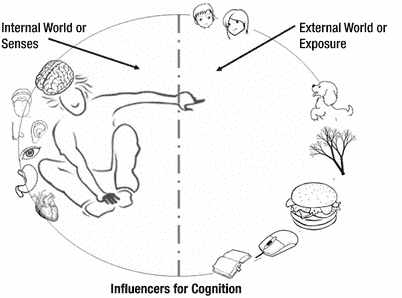
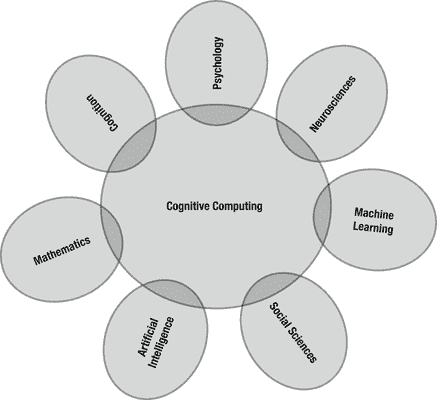
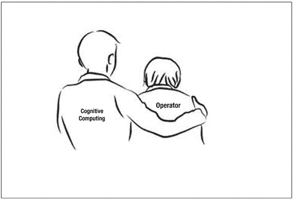
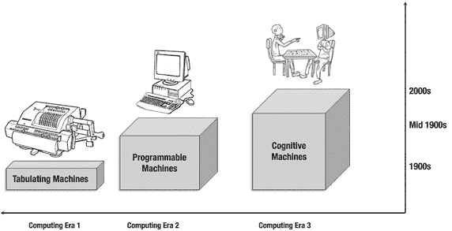
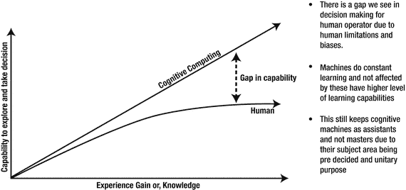
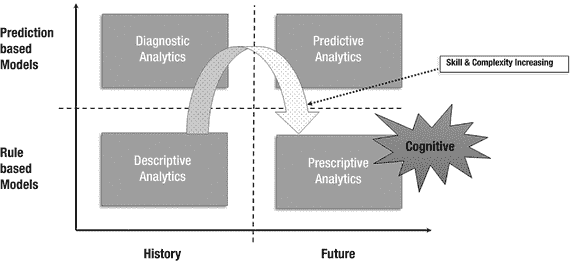
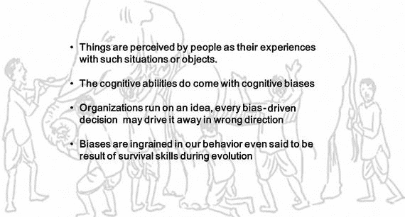
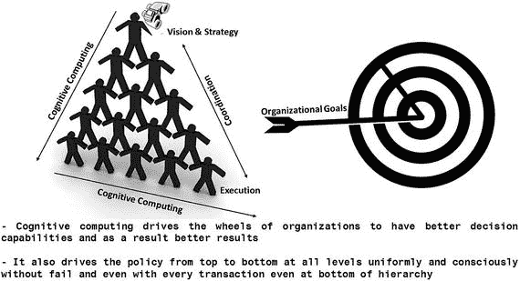

# 7. 认知计算

本章讨论认知和认知计算的概念。这些机器通过计算能力模拟人类的思维过程。

注意

具备了理解人工智能、机器学习、自然语言处理和预测性分析工作原理所需的基础知识后，我们已准备好在本章及后续章节中深入探索认知计算的细节。

## 认知

搜索“认知”一词的含义，屏幕上会显示如下内容：

*   “通过思考、经验和感官获取知识和理解的心理活动或过程。”

然而，这主要属于心理学和神经科学的范畴。甚至还有像神经心理学这样结合了这两门学科的新兴研究领域。这个新的研究领域既关注神经科学（即研究大脑各部位的结构和活动），也关注心理学（探讨大脑在处理信息和通过经验学习新事物时的功能）。

认知是一个广阔的讨论领域：我们在此只涵盖与继续深入探讨认知计算主题相关的部分。

正如前几章所讨论的，人工智能、机器学习、自然语言处理和预测分析，其根源都在于对人类认知的研究。它们遵循着这一脉络。我们的努力始终是让机器在学习方面尽可能接近人类智能，并像人类一样自主：自我学习和进化。在最近一段时间，我们或许已经接近了某种认知计算的水平，但与人类内在的认知能力相比，我们仍有很长的路要走。

人类认知研究与认知计算之间的主要区别在于，前者是基于已经存在的事物，并试图更深入地了解它，或许是为了帮助大脑恢复，或者在其功能不佳时进行更好的训练；换句话说，有点像逆向工程。而后者，即认知计算，则从前者获取输入，并试图在机器中重现相同的认知现象。

因此，人类认知研究探讨的是如何测量、发展或理解认知以改进它，而认知计算则试图简化从这些研究中获得的知识，并将其转化为可在机器中实现的算法。

动物（包括我们人类）的认知是一个非常复杂的课题。但简单来说，可以理解为以下内容。

出生后，婴儿开始学习。大脑具有预先编程的功能，能够通过感官输入来感知和回应感觉。这些是原始信息进入心智的五道大门。此外，来自身体内部的感受（例如，疼痛、饱腹等内部感觉）通过中枢神经系统流向大脑。这使得这个原始的新生系统为学习做好了准备并装备齐全。学习被存储为来自物理感官输入的经验，包括来自中枢神经系统以及外部世界的经验（图 7-1）。经验有好有坏，之后会逐渐演化出一些介于两者之间、区分更精细的感受，但并非一蹴而就。要达到那种程度的感受层次，需要随着时间的推移进行大量的学习。

图 7-1.

人类认知影响因素

于是，大脑开始将这些经验记录为好的感受或坏的感受，并根据大脑中存在的原始程序，以微笑或哭泣作为反应结果：这确实是一种非常二元的反应。微笑和哭泣作为输出之间的反应（即中间反应）是通过出生后大脑的长期学习发展而来的。所以，如果婴儿看到妈妈靠近，他会将其与舒适关怀、爱意和饱腹等美好感受联系起来；然后婴儿会微笑，或者至少不哭，这取决于他当时是正忙于感知某物，还是空闲可以做出反应。这是行为发展中一个非常重要且有趣的方面。这个方面就是：“我该不该反应？”；此时，优先级排序的部分已经开始形成。

整个世界都是一个学习平台；一切都是新的。在基本的视觉、听觉、嗅觉和来自内部的神经感知之后，语言识别开始发展。这也非常有趣。任何执行此任务的机器都需要语法和算法来感知语言，而人脑则是一台机器，仅基于基本的感官解释、获得的结果以及所经历的情感，就能在出生后、尚不具备阅读或学术学习能力时学会语言。这也是为什么人们在语言环境中、被母语者包围时学习任何外语，会比坐着通过书本上的例子和语法学习效果更好的原因之一。这完全是因为我们天生就被设定为以这种方式学习更有效。

试想一下，地球上的每个人都有自己独特的经验，并通过这些经验及其产生的视角来看待世界。

这就是我们被设定的方式。据说大脑有意识区域和潜意识区域。潜意识部分是主要部分，它就像一个隐马尔可夫模型。这部分以生物化学的方式记录记忆和经验。因此，人们每天都在不断地被“编程”，这些信息随着时间的推移被存储为记忆中针对单一主题的复杂关联集合。与任何新主题相关的初始经验是线性的细节；随着时间的推移，经历得越多，它就会不断地将来自不同经验的信息关联起来，这些信息可能存储在大脑的不同部位。

让我们通过一个简单的假设实验来理解这一点。假设有一个天生失明的孩子，在很小的时候就接触到周围有人吸烟，但除了知道香烟是用来取乐的这个简单事实外，他没有其他信息。他的大脑会存储记录这些经验的特定信息。所以，下次他在某处闻到这种熟悉的气味时，关联信息会告诉他，这是被点燃、燃烧的东西，能带来愉悦。这就是他在那个生命阶段对吸烟的经验。

随着时间的推移，这个孩子恢复了视力。现在，第一次的视觉接触创造了经验，并存储在大脑的某个地方。但关联会自动与先前的经验建立起来。无论是先前的经验还是新的经验，都给了他关于所存储的整体学习的所有感受。

现在，这个孩子成年后自己也吸烟了。又多了一个维度，可能存储在其他地方，但关联仍然被建立起来。随着时间的推移，越来越多的经验发生并被添加进来，同时也建立了相应的关联。有时，大脑甚至在未主动意识到的情况下就记录了事物，并在其内部创建了相应的关联。

因此，所有学习及其所有方面的关联都在大脑中建立起来；随着时间的推移，任何相关的信息也会被关联在一起。例如，他可能成为一名理科学生，并了解到吸烟可能带来的所有医学弊端和疾病。甚至提到这样一种疾病，比如喉癌，或者接触到这样的病人，都可能触发所有与吸烟相关的信息在他脑海中闪现。

这种联想记忆使学习变得完整且极其强大。这个孩子在人生的不同阶段，对同一个主题拥有不同程度的知识。这些关联要么是增加了新的信息维度并改变了他对此的反应，要么是与新经验和外来知识的关联取代了某些旧关联。因此，在人生的某个阶段，愉快的关联被删除，取而代之的是对这个主题的负面感受。

这种联想式学习是一个非常重要的概念，对于认知计算至关重要。

本章后续内容将提及这个孩子的相同经历，因为这关系到认知计算。

研究表明，即使在我们睡觉时，大脑也会记录经历并做出反应或学习。以色列魏茨曼科学研究所神经生物学系进行了一项非常有趣的帮助人们戒烟的实验[ [J Neurosci](https://www.ncbi.nlm.nih.gov/pubmed/25392505#The%20Journal%20of%20neuroscience%20:%20the%20official%20journal%20of%20the%20Society%20for%20Neuroscience.) 2014 Nov 12;34(46):15382-15393\. doi: [10.​1523/​JNEUROSCI.​2291-14.​2014](https://doi.org/10.1523/JNEUROSCI.2291-14.2014).]。研究人员让参与者多次、连续多晚交替接触他们最喜欢的香烟口味的气味和最讨厌的气味。这使得大脑将吸烟与不愉快的经历建立新的关联，从而帮助许多人成功戒烟。

另一个方面是从现有知识中推导细节并预测新结果。例如，当我们从婴儿期成长起来时，会看到许多单一形态的事物（例如书或树）。书可以有多种尺寸和颜色，树也是如此：地球上的每个物种都有不同的外观。但无论类型如何，我们是如何看到并识别出它们全部的呢？大脑在潜意识的后端存储了一些独特的信息快照，一旦我们看到某些具有匹配信息点的相似事物，就会将其识别为那个事物。所以，任何高大、底部有粗壮树干、长满绿叶的东西就是树，任何有多页的物体就是书。

随着我们从婴儿期成长，大脑会经历不同阶段的成熟，而在以后的生活中，类似的经历会带来对真相的不同认知。

有时这也会产生错觉，就像从远处很难判断蒸汽是热是冷，直到出现水滴或雪花等提示，才能确认它是冷的而非热的。

大脑会覆盖某些信息或将其完全丢弃。据说，凌晨大约 2 点到 4 点是大脑进行这项工作的时段。因此，今天可能具有多重关联的信息，明天可能会被全新的根源和关联完全取代。那么，假设明天我们发现某种化学成分，将其撒在香烟上吸食后能带来更好的健康和长寿，并且人们被强制要求吸烟。砰！大脑会覆盖之前的负面体验，同样的气味可能突然变得神圣起来。大脑会丢弃那些关联经验较少或几乎没有关联的信息。因此，只读过一次或仅为阅读而阅读的内容，会在几分钟、几天、几个月或几年后被遗忘。这是大脑进行清理、为优质的新旧信息腾出宝贵的计算空间，并通过关联来理解信息的方式。在建立这种关联之前，摄入的信息可能意义不大。

大脑另一个有趣的特征是捕捉不寻常或独特事物的能力。这些信息会连同某种独特的经历或感受，被存储在记忆中的更高层级位置。“耳光记忆”是实现这一点的方法之一。爱因斯坦曾谈到过这一点。如果在讨论过程中非常用力地扇某人一耳光，那么那一刻的讨论和场景会长时间铭刻在心。这是因为当时大脑的多个不同区域（例如，负责学习、好奇、疼痛、羞耻、恐惧等的区域）共同建立了关联。

这使得大脑为此形成一个庞大而复杂的跨脑区关联，因此我们称之为“烙印”在大脑中。这就是所谓的联想学习。人类（或动物）的大脑如果缺乏关联，就容易丢失细节或完整信息。因此，大脑中没有任何关联的零散信息往往会很快消失，变得难以记忆。

如今很多教育工作者都在谈论这一点。对于左脑或右脑活动占主导的人，尤其是孩子，必须根据他们出生时大脑的生理构造方式来教导或训练，而不能采用与大脑构造模式相反的人相同的方式。这对许多孩子来说效果显著，同样也适用于个性提升工作坊或课程。参考书目：Diane Connell 所著的《基于大脑策略触及每位学习者》[ISBN: 978-1-58390-205-9]。

以上所有内容都是讨论认知计算机（即会思考的机器）所需的背景知识。

## 认知计算

认知计算无非是尝试利用各种计算机科学技术和数学模型，在可编程机器中模仿人类最大限度的认知特性。

这种模仿人类认知能力的尝试，因此涵盖了科学、技术以及其他众多学科领域，如图 7-2 所示。

图 7-2.

认知计算的主要学科

因此，这些系统从人类认知方面模拟的一系列认知能力如下：感知、觉察、分析、解决问题、权衡决策、模拟各种可能性以找到最佳方案、学习、表达、响应等等。

正如前一节所述，这是通过对人类认知研究的逆向工程细节来设计思维机器的工程学。

因此，尽管有众多技术和学科共同构成了认知计算的概念，但人类认知、神经科学、语言学和人类学等学科占据了核心地位。

紧接着，与人类行为、交互和神经工程相关的研究学科也占据了中心位置。还有许多其他学科为其形成做出贡献：数学、编程、硬件加速、人工智能和机器学习等等。

因此，我们可以稳妥地说，认知计算由生物科学驱动，但受限于计算机科学和数学。生物学研究通过揭示其运作方式，展现了无限的可能性；而计算机科学和技术学科则必须不断提升能力，以完美地协同模仿这一切。这就是为什么技术存在局限性，导致实际首次实现被延迟，尽管这个概念从图灵测试概念化时就已存在。图灵测试将在第 2 章详细解释。

因此，机器应该能够利用编程加载到其中的现有知识库来感知世界，并且应该能够做出最终、统一且最恰当的决策，然后同样恰当地采取行动。

例如，想象有一个鸡蛋和一个土豆。一个拾取任务不仅需要通过理解哪个是哪个来感知，还应该知道如何处理每一个。因此，鸡蛋应该轻拿轻放，而土豆则不需要。即使机器起初不知道这一点，在第一次像拿土豆一样拿起鸡蛋后，它也应该能够学习并正确行动。因此，认知能力不仅应存在于感知事物时，也应在行动过程中存在。

因此，认知计算创造了能够持续学习并通过这种持续学习不断修改其行为或响应的机器。

回想一下关于一个孩子在生命不同阶段对吸烟主题的联想记忆的讨论。认知系统的学习遵循相同的模式。逐渐进入系统的知识会创建新的学习图谱和关联，以生成意义。这通过新的知识输入和训练系统理解这些数据来实现。类似地，认知系统也会为每个主题领域及其所有可用的知识输入建立庞大的关联。这些关联要么随着时间推移被新的维度更新，要么被替换，要么被完全移除。

人类婴儿的一项宝贵能力是能够“感受”：好的、坏的，以及所有中间的感受。这是几乎所有动物都表现出的初始行为，在人类身上表达得最为清晰。学习也深受情绪影响，甚至现在情商被认为比智商更能衡量人们能力的参数。

认知机器在这方面也面临相当大的挑战。正如前一节“吸烟”例子中提到的，随着时间的推移，人类对相同体验的情绪会发生变化。对于机器来说，这项艰巨的任务可能意味着识别音高和面部点扭曲，这些被编程为感知情绪。由于硬件、软件和其他性能限制，这可能难以检测。虽然可以让计算机在一定程度上将这些情绪作为训练模型进行学习，但这对于大多数时候界限并不清晰的问题来说，又是一个非常非黑即白的解决方案。

理解对机器所说语句的语境也很困难。语句可能是讽刺的、快乐的或愤怒的，机器很难感知其语境。

作为人类，我们对世界有一个预设的目的，这个目的在处理和感知输入刺激之前就具有优先权。这可能受到我们自身议程、目的或期望等因素的影响。机器没有期望。期望是存在的，但仅仅是作为预期的输出，而将期望改变为新的输出又是一个挑战。

这些由感知和情绪驱动的行为对人类来说很简单，但将这种能力编程到机器中是一项艰巨的任务。这些是当前的认知计算科学家为了获得更高级的认知系统而需要填补的局限性。

硬件价格低廉且是最先进的，软件也非常丰富。此外，这样做的商业用例也很多。所有这些都在推动认知计算的发展。

注意

我宁愿将认知计算称为超级人工智能。

自然语言处理学科对认知计算非常重要。它使得系统能够：

*   与人类进行原生交互
*   更像人类

如前一小节所述，人类学习的各个方面可以分为基因型和表现型。

*   基因型：由基因（或 DNA）编程的固有能力。
*   表现型：由环境交互或与外部世界及内部世界（身体感觉）的体验所诱导的能力。

因此，被分开抚养在两种不同文化和世界不同地区的双胞胎，会以不同的方式感知事物并做出相应的行动。行为的基本性质保持不变，由基因型编程决定，而发展出的次要行为和反应则源于表现型学习。因此，如果双胞胎中的一个在崇拜火的文化中长大，另一个在不崇拜火的文化中长大，那么对不触摸火的基本反应保持不变，并且在两种情况下火都会烧伤他们。但是，看到火然后感到神圣的喜悦并跪下，这种情况不会发生在其中一个双胞胎身上。

类似地，机器有其自身的基本智能语料库被输入，然后学习被添加到算法中，并作为来自经验的新代码扩展。

学习可以改变人们的目的，但对于任何级别的机器来说，目的保持不变。因此，IBM Watson 可能被训练成一位优秀的癌症诊断专家，但它永远不会从同一位医生在同一个房间里唱歌中学习音乐课程，即使它通过麦克风接收到了歌声。目的是静态或固定的。

因此，认知机器的一个局限性在于，其目的仍然是针对该机器人为设定的。确实，有人争论说不应该制造任何能够展现人类所有认知特性的机器，因为它们可能会构成竞争。与脆弱的人体和速度相比，拥有卓越硬件的具备认知能力的计算机，如果它们愿意，可能会导致人类灭绝。

但在不久的将来这还无法实现，因此让我们回到关于认知计算的讨论。目前认知计算的应用仍然有限，主要作为辅助人类决策的工具。然而这并非真正的限制因素。它们的辅助能力远超人类：它们非常智能，能够帮助做出最知情、最精准的决策。

例如，IBM Watson for Cancer 能够协助医生为重症癌症患者做出最佳决策，因为这类患者任何微小的偏差都可能是致命的。该应用无法取代医生，那么它的价值何在？让我们看看医生进行此类诊断时应具备的真正能力。这种期望并非由任何组织设定的标准，也不是评判医生优劣的硬性指标。相反，这是医生自身对成为领域内最优秀者的追求：做出最佳诊断和患者咨询，以最高成功率在最短时间内治疗患者。简而言之：最佳治疗。仅癌症治疗领域每年就有约 3 万至 5 万篇研究论文发表，相当于每天 80 到 140 篇。全球每年有数百万癌症病例被确诊。此外，全球范围内关于同一主题的医学教科书可能多达数百万页。因此，任何决心提供最佳咨询的医生都希望通读所有这些知识，能够针对特定患者病例（因为癌症有多种类型）查阅相关细节，然后决定治疗方案。这在人力范围内是不可能实现的。这正是 Watson for Cancer 的用武之地。凭借其认知能力，它能够关联正确的信息来源，包括一个名为 bestdoctors.com 的组织，获取该领域顶尖医生提供的最新诊断细节。机器会学习患者的当前状态，筛选所有相关细节（甚至几乎是实时的），然后根据可能的结果提出加权治疗方案。

因此，具备全部能力的认知计算与人类合作，为需要执行的流程和行动增加价值。它扮演着顾问的角色，如图 7-3 所示。

图 7-3. 认知计算置信度构建

对于企业而言，这甚至可以是一个机器人，每次出现故障和错误时都能自我升级，并全天候不知疲倦地维护系统。

## 认知时代

当前时代被认为是第三代计算。计算始于 20 世纪初的基本制表计算机，随后进入下一代计算机，即可编程计算机（20 世纪 80 年代），到 20 世纪 90 年代，计算能力与互联网相结合。我将可编程计算机和带互联网的可编程计算机都归为第二代。第二代后期与互联网的结合曾被认为是终极计算时代，直到 21 世纪初，认知计算开始出现（图 7-4）。

图 7-4. 计算时代

计算的概念从快速计算转向了在可编程机器中推导基于规则答案的高度复杂机器。

制表机仅限于快速、更精确地完成大量计算，类似于计算器。

在基于编程的计算机时代，我们在后期阶段已经进入了机器学习和认知的世界，但那时大多属于伪认知学习。

随着认知计算的出现和需求增长，我们进入了一个新时代：机器能够像人类一样，基于对机器现有知识库的置信度来回答问题。与人类一样，答案的正确与否是根据当前知识和经验来判断的。答案可能不是简单的 A 或 B，而是根据当时所学到的经验，也可能是 C。另一个方面是，如果这些机器能够学习，那么在该领域知识很少或没有知识的情况下，它们甚至可能犯错。

认知时代带来了能够从海量数据和信息中学习，并据此生成自身学习图谱的机器。有时人们也认为，这种对海量数据的需求可能成为一个限制因素。该系统利用自然语言处理（NLP）能力进行更有效的交互。人与机器之间的协同变得更加完整。

要进入这个计算时代，我们需要价格合理的高性能硬件。这在 21 世纪初已基本实现。

因此，真正意义上的人机协作时代始于认知计算。这还不是机器的时代，而是人机协作的时代。一个被这种超人类能力辅助的人，能够执行更高层次的决策任务，并从为最佳执行任何任务而进行的基础准备步骤中解放出来。

这些系统为得出结论而需要处理的数据量将是巨大的。增强的存储和处理此类大数据的能力，与制造此类机器的能力是同步发展的。

表 7-1 展示了传统计算与认知计算的主要区别。该表将解释认知计算带来了哪些新内容。

表 7-1. 传统计算与认知计算对比

| 传统计算 | 认知计算 |
| --- | --- |
| 主要是数学和逻辑解析器 | 更进一步；生成关系和结论推导 |
| 给出离散数据结果或模式预测 | 回答诸如“如果……会怎样？”、“如何？”、“如何最佳？”等问题 |
| 基于规则的计算；仅涵盖编程设定的答案集 | 以加权结论的形式创建或推导答案；也可能根据通过经验获得的知识，对同一问题给出不同答案 |
| 主要是行动执行者 | 本质上是顾问角色 |
| 固定的输入和输出（每种都有最大设定） | 可能拥有无限变量 |
| 为预设活动和场景而规划 | 也适用于预设活动，但其中的场景可能发生变化或改变 |

认知应用的数量与日俱增，大量新开发者正试图探索各种实现认知计算的新方法。IDC 预测，到 2018 年，一半的开发团队将参与此类开发。

## 认知架构

这是思维机器的结构，无论是大脑还是类人计算机。在认知计算中，架构和规划共同使其能够作为认知思维机器运作。因此，基本上必须创建一个模型，这个模型就是认知模型。它可以是多种类型的。该模型应始终基于人类认知的理念，然后进行扩展和泛化，使其能够转化为以特定语言编写、协同工作的数学模型。

目前有许多这样的架构模型可用：Google DeepMind、Soar、ACT-R、CMAC、CLARION 等等。

让我们详细讨论其中一些，然后在本章末尾对架构进行总结。所有这些模型都主要试图描述大脑处理信息的方式，然后将这种描述转化为算法或数学模型。

### Soar

Soar 最初由 John Laird、Allen Newell 和 Paul Rosenbloom 创建。它试图创建可编程的认知模型，以执行大量模拟思维、决策能力等的智能行为。

其基础理论涉及问题空间，每个当前状态都会驱动到下一个可能的单一状态，依此类推，直到得出一个智能行为结论。

图形模型展示了状态与阶段的组合，处理过程通过程序性记忆和工作记忆功能的协同作用来完成。

Soar 使用 C、C++ 和 Java 语言编写。其主要应用领域是游戏和机器人技术。

### ACT-R

该名称代表“思维的适应性控制——理性”，由卡内基梅隆大学的 John Robert Anderson 提出。在技术层面，这是一个用特定编码语言编写的解释器，它处理信息，然后依次展示由此产生的认知反应。

这基于心理学和神经科学的研究成果。

任何开发者都可以使用这项技术、语言和解释器来创建各种心智模型。

该模型受到了 Allen Newell 在创建 Soar 模型方面工作的影响。

### CMAC

该名称代表“小脑模型关节控制器”。顾名思义，这是一种模仿大脑中称为小脑的部分而设计的机器。它由 James Albus 在 1971 年 2 月发表于《数学生物科学》第 10 卷第 1-2 期的论文《小脑功能理论》中首次提出。

小脑与运动控制、想象活动、语言感知等有关。

整个概念源于对该大脑部分内部神经纤维的深入研究，以及观察信息如何通过这些细胞传递，最终由大脑记录下感官知觉。

### CLARION

该名称代表“基于自适应规则在线学习的联结主义模型”，由 Ron Sun 的研究小组提出。它涉及大脑的潜意识和意识部分，分别被称为大脑的“内隐”和“外显”部分。这更接近于心理学研究的模型。每个认知模块都是内隐和外显部分的结合，并由动机驱动。因此，这可以被视为人类（或动物）做出反应的方式，每个行为都由某种动机驱动，而行为则源于大脑反应的内隐和外显组合。

因此，用于认知计算的各种架构都受到大脑功能的影响。不同的模型基于社会学、人类学、神经科学、神经影像学、大脑功能、心理学等不同方面。所有这些生物科学都被用来概念化一个或多个模型，以模拟大脑处理信息的方式。然后，这些不同的架构被数学化地概括，转化为计算模型。最后，通过选择不同的硬件和软件，将这些模型转化为实际的机器。

目前已有众多此类模型，并且随着越来越多的公司参与这一领域，其数量还在不断增加。每天都有许多商业产品涌现。

## 认知芯片

目前有多种计算机芯片，它们并非基于传统的冯·诺依曼架构，而是旨在高度模仿大脑中的神经元及其网络；这些芯片被称为神经突触芯片或认知芯片。IBM TrueNorth 就是其中一种芯片。由于这种结构，与传统芯片相比，此类芯片功耗极低。这些芯片没有时钟，而是通过事件来驱动信号在其核心中流动。由于是事件驱动，它们不会持续运行，仅在事件发生时才会工作。

## 为何需要认知技术？

任何技术需求都源于业务需求，并受到技术知识和资源的限制。

认知计算是一项期待已久的技术奇迹，它很早以前就被概念化，但直到现在才得以实现。

对认知计算的需求并非近期才出现，而是已经存在了相当长的时间。随着数据使用量的不断增长和海量数据的生成，这种需求现在变得更加迫切。我们生活在一个每年产生数万亿 TB 数据的世界。正如 IBM 首席执行官 Ginni Rometty 所描述的，数据是驱动业务的下一项自然资源。

认知解决方案能够满足当前的需求，因为它们超越了那些只能根据固定输入进行编程并提供固定输出的系统。它们应该是能够思考的智能机器。它们应该作为助手而非工具来工作。

IT 基础设施曾一度仅被视为支持某些决策或活动的一套工具。现在，随着认知计算的出现，它成为了业务的驱动力；这是当今时代企业的需求和期望。

机器在几秒钟内读取数十亿页书籍、从中创建知识库并将其用于决策方面具有优势。这些机器与人类协同工作可以创造奇迹。这不仅有助于进行模式分析或呈现报告，还能优化业务流程并创造机遇。

例如，正如本章前面提到的医生治疗癌症的例子，这项技术扩展了经验丰富的医生的能力，使其能够做出更好的决策。它并没有剥夺人们所需的专业知识，而是将其扩展到了以往所有预期之外。

此外，现在是物联网时代，它也为大数据做出了巨大贡献。认知系统与物联网数据协同工作，能够创造奇迹，帮助做出快速决策。一台能够理解通过传感器信号进行通信的机器语言的思考机器，可以帮助现实世界和机器世界这两个世界融合，以做出更好的决策，这本身就是由使用物联网的机器所产生的数据速度和数量自然催生出的需求。事实上，物联网的应用使得对认知计算的需求比以往任何时候都更加迫切。

这是因为认知计算能够读取并理解海量数据，而这通常是人类无法做到的。人类操作员必须一次处理一小部分数据。

与人类操作员相比，机器能更好地理解和学习来自如此多样化和高容量数据的信息。在使用这些资源方面存在一个效能差距（见图 7-5）。

图 7-5.

人类与认知系统对数据资源的利用对比

决策对任何企业来说都是一项非常重要的操作。传统上，基于商业智能的决策仍然依赖于管理层和业务仪表板及报告。这意味着仍然需要有人坐下来收集和比较这些信息，然后得出结论来实现这一目标。

这受到参与者不同能力水平、他们持续遵守标准的能力、他们的忙碌程度等因素的影响。可以说，人类受到这些因素以及更多因素的限制。无论一个人多么有才华，他或她常常受到情境和各种其他因素的限制，这些因素可能会对结果产生抑制作用。同样，需要比较以得出任何结论的数据维度可能过多（例如，财务、物流、物料、项目计划等）。即使是一位才华横溢的数据科学家，要考虑到得出特定结论所需的所有维度，也极其耗时，而且仍然无法保证。如果发现结果不相关，需要另一种组合，那么投入更多精力和时间可能会再次延长活动。此外，有时（实际上大多数时候）数据科学家团队内部缺乏对业务和组织战略的深刻认识，而管理团队内部也缺乏进行此类活动的技术知识。几乎不可能找到一组人，能够处理如此海量的多领域数据，并不断更改这些组合，以试图从数据中得出好的结论甚至意义。然后还有所谓的从过去中学习。这意味着，现在可用的任何此类场景或数据点，都应该能够帮助优化当前手头的工作。

因此，决策过程是标准化、优化、高置信度的，它利用所有相关数据（结构化或非结构化），近乎实时，并且极其迅速地完成。这就是认知计算的力量，也是它被需要的原因。

商业战略的决策活动只是其中一个方面。即使是项目工作人员的知识水平差距，也能由这些机器来填补。它们帮助这些人即时、在正确的上下文中提供完成任务所需的知识。因此，不仅涉及大量多源数据的报告、监控和管理方面产生了对认知计算的需求，而且人力资源的高效利用也可以通过它来实现。

可分析的数据不仅限于组织的业务数据。这可以来自所有相关且可信赖的来源，用于分析，以进一步提升决策能力。例如，一个组织在做出价格调整决策时，可以同时参考全球基准数据和竞争对手的数据，并利用从社交网络和其他网络来源中提取的情感倾向，来做出更精准的决策，并最大化这些决策的成功率。

所有这些原因以及更多原因，最终归结为采用认知系统的某些特定理由。具体如下：

### 始终被渴望

制造人工智能机器的第一个假设或理论，就是制造一台像人一样的机器。但技术限制了这一点。现在，既然我们拥有了实现这一目标所需的所有技术，这便是一个自然的选择。这是一个非常浅显的论点，但我相信它是有道理的。

### 大数据与洞察

每天产生的数据量是巨大的，无论是电子商务或物流公司的业务交易数据、贸易公司的数据、来自传感器的数据，还是来自网站以文本、视频或音频形式存在的数据。因此，这个庞大的数据量包含了结构化和非结构化数据。

面对这堆数据，使用固定的报告和工具进行分析变得更加困难。连接数据与实时数据之间的关联性，是理解正确决策模式所必需的。认知系统不仅能生成模式，还能提炼出加权后的洞察。

### 咨询建议

认知系统主要作为咨询系统提供帮助，凭借积累的知识和经验，它们能为任何情况提供恰当的建议。发生了什么？我们该如何处理？以前在类似情况下是如何处理的？所有这些问题以及更多问题，都能在几秒钟内得到解答。系统会提供基于证据的、加权后最可能的答案，而不仅仅是“是”或“否”。

当将数据的多个方面与外部数据结合起来得出结论可能面临挑战时，认知计算就像一根魔法棒一样解决了问题。

### 物联网的利用

在一个由互联机器及其传感器组成的世界里，通信需要被理解，甚至需要结合相关的业务数据进行分析。这就是对物联网数据的利用。否则，仅仅为了监控而单独设置一个仪表盘就毫无意义了。那只会对设备维护有帮助。

### 业务连续性

聊天机器人是新的支持代理，它们全天候可用，并且可以从所有设备平等访问。这些聊天机器人不仅对外部客户重要，对组织内的员工也同样重要。它们不仅有助于向客户提供产品和服务信息，也有助于向员工提供解决任何知识缺口问题的信息，并在需要快速协助时提供帮助。

### 资源利用

利用认知计算能力，可以最优化地利用资源。一些石油和天然气公司已经在使用这项技术，配合装有传感器的潜水泵和设备，来解读勘测数据，从而最大限度地利用自然资源进行开采。

即使是农民，使用土壤嵌入式设备和物联网连接的泵，也能以最少的水量按需管理灌溉。

运行这些模型的计算机芯片并非始终处于功耗模式，而是根据事件触发行动。

### 效率

世界正随着每十年的流逝而变得越来越小。企业正在以不断缩小的利润空间进行竞争。认知系统不仅通过优化大量流程来帮助提高利润率，而且会随着组织一起成熟，对所有数据变得越来越了解。它们利用任何形式的外部数据，然后成为组织的资产，能够随着时间的推移做出更好的决策，并从数据中发现越来越多的意义。

这些系统有助于改进和优化运营核心，并消除组织中不必要的流程。

### 客户满意度

由于企业正经历着利润空间缩小和全球平台上的激烈竞争，它们无法承受糟糕的客户关系。社交媒体的出现有时让情况变得更糟。一句负面评价可能像野火一样蔓延，破坏公司或其产品或服务的整体形象。

例如，我的一位朋友最近在 Facebook 上发帖，抱怨一家非常著名的家用净水器公司的售后服务。他对服务技术员有不好的体验。几小时内，公司代表就在他的时间线上回复，询问详细信息，并承诺提供专门支持来解决所遇到的问题。

这就是借助认知辅助应用所能达到的客户支持水平。

另一个方面是由此类应用驱动的推荐和客户旅程管理。Netflix 和亚马逊是第 1 章中的好例子。

### 个性化关怀

无论是零售店里的顾客，在认知助手的帮助下找到他需要的东西并得到购买建议，还是定制的医疗解决方案，认知计算都提供了巨大的帮助。

### 更多临时性分析

认知技术出现之前的报表能力受限于规划、设计、开发、测试和上线部署等环节。而认知驱动的模型则强大得多。只需一个简单的自然语言句子，就能作为查询语句来获取所需的结果和数据。

举个例子，假设一家公司正在收购另一家公司。就在这个节骨眼上，高管层希望快速评估与当前收购相关的资产，以及关联产品与服务的详细信息。此时，该组织已有两份相关报表：一份是资产报表，另一份是产品与服务报表。尽管第一份报表包含了一些资产与产品的关联信息，但第二份报表才涵盖了产品与服务的所有细节。这就带来了挑战：必须有人来处理这些数据。即便使用自助服务应用来开发新报表，也远非宣传中那般简单。最终结果往往是“手忙脚乱”的局面，极易出现各种失误。商业智能系统不够灵活，无法在需要时立即生成新报表，而且这通常需要技术开发人员等额外人员参与，这并非总是可行或可预期的。

借助基于认知的系统（例如 IBM Watson），只需一句简单的英文指令：“你好 Watson，我需要包含所有产品和服务详情以及销售信息的资产数据”，系统就能快速在屏幕上汇总所需数据，不仅以表格形式呈现，还能附带各种图表和关联数据。

我认为，这种需求一直存在，但直到现在才得以实现。

### 按需生成

如今，我们已经具备让计算机通过认知能力创作音乐的能力。那么，根据个人口味定制食物和电影呢？这就是认知计算的未来。Netflix 已朝这个方向迈进；一些食品公司也将推出最能吸引特定人群甚至个人的食谱。假设一家披萨公司，根据你的口味偏好历史、你在杂货店的购买记录，甚至你冰箱里的存货，就能知道什么样的蔬菜和肉类比例最适合你。这甚至可能包含来自你 Fitbit 手环的数据，并允许你额外添加一些奶酪。这就是食品行业的未来。

## 向内审视

“审视内心，而非向外寻求”这句劝诫，过去只是冥想的一个主题。然而，如今它同样适用于使用认知计算的现代企业。

认知计算具备扮演顾问角色的基本能力。如图 7-6 所示，这意味着我们已经达到了最高层级的分析能力：规范性分析。

图 7-6.

分析能力层级

这就是当今企业的现实：如此高水平的规范性能力不再是“锦上添花”，而是“势在必行”。向外寻求制胜因素不再被视为成功的唯一途径。走出去，在市场的丛林中寻找现有及潜在客户的足迹，关注所有竞争因素，这已不能再是唯一的策略。在全球竞争激烈、利润空间日益缩小的市场中，仅靠向外看，绝不再是决定胜负的关键因素。我在这里没有使用“失败者”这个词，因为我理解所有公司都在生存、竞争和客户关系方面竭尽全力，但如果缺少了认知优势，它们就会沦为落后者。落后者终将失败。

在绩效和流程优化方面，公司一直试图在许多领域做出改变。高层领导、组织驱动者以及高管层，都从顶层直接审视自身在市场中的位置。这些努力是值得的。成功是可观的，这在任何组织的管理层日常工作中每天都在发生。但是，我们是否仍然遗漏了什么，或者能否做得更好？

谷歌对“偏见”一词的定义是：“对某个人或群体的倾向或偏见，尤指被认为不公正的方式。”

我们这里讨论的不是某个人或某个群体对他人或群体的偏见，所以让我们将其转化为与决策过程相关的表述。

我们都知道，“决策”等同于任何组织的成功或失败。糟糕的决策会在船底凿出新洞，平庸的决策则几乎无法带来丰厚利润。因此，目标应该是做出更多精准的决策，以最大化成功率。而偏见在让事情变得困难方面扮演着重要角色。

让我先重新定义一下我之前提到的“偏见”。

决策中的偏见是“受影响的决策者对任何可能决策产生的思维混乱、倾向或偏见”。这类问题的出现，源于人类认知的局限性或情感驱动，可能是故意的，有时甚至决策者本人也未曾察觉。

做出决策的个人甚至群体，可能在毫无察觉的情况下受到影响。偏见可能源于以下原因：

*   信息过多或信息呈现方式不当
*   过度自信
*   分心或受吸引
*   缺乏清晰度
*   倦怠、疲劳或压力
*   回报善意
*   受他人、群体或情境影响
*   个人经验、个人选择或主观好恶
*   以往处理类似情况的经验（我们假设并认为当前情况可以完全照搬以往方式处理）
*   文化或传统观念
*   未能从更深层次洞察理解事物
*   对主题持有无根据的“假设”，且未考虑事实与观点
*   直觉
*   决策时间不足或过于仓促，无法全面考量各方面因素
*   腐败或恶意目的
*   注意力偏离主题（例如：我邮箱里已有另一份录用通知，并计划次日辞职）
*   偏袒受决策影响的某些方
*   因处境、性格或工作风格而过度防御
*   部分事实缺失且无时间收集

以上仅是决策中可能产生偏见的部分原因。此外，这种偏见可能自上而下发生。在高层，偏见会阻碍战略制定；在基层，则会妨碍运营执行。另一个方面是：管理层的高层与基层并未基于同等程度的事实进行考量，也并非每次都能有效衔接——事实上，多数情况下他们甚至从未核查基层是否将同一战略作为运营准则。

因此，偏见以及对战略及其基层落实情况的直接监控缺失，构成了一个危险缺口。这个问题不容忽视（图 7-7）。

图 7-7.

认知偏见：要点概览

这正是认知计算发挥作用的另一个领域。它目前不会即时做出决策或取代 CXO 级别的高管，但它能赋能决策过程，并根据可能潜藏的偏见对决策进行“评级”。当模拟决策显示若实际执行将产生负面结果时，它会提供辅助并发出警示。这能覆盖大量风险。通过对组织层面的政策与战略进行整体监控，并将基层管理者的日常决策与之关联，就能清晰呈现：从高层到基层，决策是否始终有效，抑或已偏离方向，导致动力丧失与政策失效。

让我们通过一个例子来观察差异。

一组高层管理人员正开会讨论频繁出现的原材料供应问题。这涉及一个供应商链条。碰巧，这次会议安排在圣诞前夜举行。这是一次常规的战略会议。由于次日便是圣诞假期，会议必须尽快结束，以便大家开始休假。尽管无人有意因此懈怠决策，但这个因素仍潜藏在每个人心中，产生其影响（偏见 1：疏忽驱动）。

现在，假设所有供应商均来自 A 地区，而董事会中的五位高管有四位也来自 A 地区，第五位则是来自 C 地区的新成员。这里存在两种隐藏但实际起作用的偏见（偏见 2：某种成见）：两个群体来自不同地域，且恰好这两个地区关系不睦——比如因为足球 rivalry。另一种偏见（偏见 3：假设）则因新成员加入而起作用：其他人可能对他抱有复杂情绪，例如认为他能力更强，或因相处时间短而对其能力缺乏信任。

数据支持团队也有部分成员休假，因此无法获取已挖掘并准备呈报给董事会的数据，除非这些数据恰好存在于之前创建的报告中（偏见 4：无关或不完整信息）。讨论开始后，新董事会成员提议在 C 地区设立一个新的加工单位，他凭直觉认为，如果 A 地区因政治或其他原因出现问题，此举能保障安全；但由于部分数据人员缺席，分析其直觉所需的数据并不完整，不过他坚信自己曾看到过一些可能支持此观点的数据（偏见 5：证据不足）。董事会最终以多数票否决了这一新想法，仅决定对与 A 地区供应商的长期合作关系进行小幅调整。会后，大家愉快地开始了假期。

现在，我们看到了上述场景中人为因素对决策的影响：无论有意与否，决策都受到了多种偏见的干扰。这些决策者都是敬业且经验丰富的专家，但偏见仍导致了决策缺陷。这只是一个例子；一年中可能发生数百次此类决策，且复杂程度更高。其整体影响可能导致高层管理层的多次变动，甚至随着时间的推移造成某种程度的灾难性后果。这正是由认知计算和超级计算分析支持的数据驱动文化能够发挥作用的领域。

当有认知助手在场时，情况会如何？偏见依然存在，但会有基于证据的认知指导来防范这些偏见干扰决策过程。让我们看看，当认知助手在场以限制偏见对决策的影响时，决策过程会有何不同。

这五位高管团队再次就出现的供应相关问题进行讨论。他们借助了认知助手，该助手有权访问所有相关业务数据，以及从新闻源中挖掘并理解的最新数据。认知助手以非常详细且基于证据的方式向董事会介绍情况，并提供一两个可行的解决方案，以及这些方案在近期可能产生的影响评估。它还告知他们当前政治新闻对业务的近期影响，并指出他们可能很快需要面对与 A 地区供应商开展业务时的严格商业法规，因此在 C 或 D 地区设立加工单位将是明智的缓解措施。接着，它指出 C 地区更符合条件，因为它最靠近制造工厂和原材料矿场。它根据趋势和评估显示，部分供应商频繁延误交货期限，需要处理。现在，有了所有这些细节、前提评估以及包含未来愿景的咨询建议，情况变得更加可靠且清晰。高管们无需再为这些准备工作与基础评估费心，可以专注于以下事项：

*   更深入地理解评估内容
*   审阅基于事实和证据呈现的选项与供应商评估
*   根据需要立即对供应商采取纠正措施
*   理解可能影响局势的政治问题，并制定相应的必要应对行动

因此，尽管身为人类且容易产生此类偏见，但高管们并不被允许有意或无意地将这些偏见带入或混入商业决策中。商业被保持为“纯粹的商业”，偏见没有机会掺杂其中。这种文化在真正意义上是以数据驱动和基于证据的。模拟帮助他们基于证据重新分析“假设”情景。无需专门的数据支持团队。系统不仅为他们提供建议，而且实际上会根据最终结果从这个情景中学习，并在过程中持续追踪决策。

这就是认知计算如何在很大程度上帮助消除决策偏见，并限制基于人类认知偏见的决策质量缺陷。

此后，团队可以满意地离开，因为他们对数据驱动和基于证据的决策有了更大的信心。

另一个方面，即高层管理决策应向下追溯到基层的日常管理决策，也可以通过这些应用程序来处理。因此，这个巨大拼图的每一块都朝着正确的方向，以汇总成由高层规划并决定的组织整体蓝图。这在真正意义上是一种战略导向。无需每季度召开多层级全体会议，这些会议要么被一些人跳过，要么被另一些人用来做白日梦或看手表，因为对基层员工来说那只是空话。他们大多只会理解那些用他们操作语言表述的、与他们相关的内容。一个汽车展厅的销售人员会发现，像“组织的目标是通过协同业务线销售和服务组合来聚焦销售范围扩张，从而在市场中生存”这样的句子，很难理解并应用于他的日常销售活动中。但当认知助手在日常工作中引导他时，事情就变得容易多了。因此，当他完成一笔交易，向客户出售一辆昂贵的汽车时，认知助手会告诉他（如果可能的话）基于客户的推文和 Facebook 帖子交叉销售某些配件，并建议向她推荐一个全面的服务套餐，因为看到她每年都会和家人进行长途驾驶。

因此，基层的每一笔交易都在强化或呼应组织的战略目标，而不会让员工感到困惑或被术语轰炸。认知计算实现的这种参与度具有巨大的益处，甚至可能超乎想象。它填补了空白，推动业务从政策到执行，并使每一笔交易都成为可能。

组织在每一个层面都变得同样专注，并朝着其整体目标统一前进（图 7-8）。

图 7-8.

认知能力驱动组织

这是一个焕然一新、被重新发现的组织，是商业管理的一个方面，以前只是一个梦想，但现在通过认知计算辅助得以实现。许多人力资源公司已经在各个层面对高管进行认知评估，以验证他们的岗位适配度、培养、招聘和职业发展。

## 认知 + 物联网

让我们谈谈物联网及其与认知计算的关系。维基百科将物联网定义为“物理设备、车辆（也称为‘连接设备’和‘智能设备’）、建筑物以及其他嵌入电子设备、软件、传感器、执行器和网络连接以使其能够收集和交换数据的物品的互联网络。”

这意味着机器与机器、机器与人之间的对话。这些机器就是物品，它们的电子地址在互联网上，全部通过网络连接。

这意味着每秒都会产生大量数据。传感器连接到一切事物：工厂机器、窗户玻璃、商店里的物品、人身上、汽车上，以及更多。所有这些都在持续生成海量数据。这些数据可以是任何类型，无论是音频、视觉、文本还是电子脉冲。这在以下方面超出了传统商业智能报告的范围：

*   它们持续不断地涌入，大多是实时的
*   它们的数量和速度都过高

这些数据必须被快速理解，并与业务数据结合使用，以在驱动业务的某些方面产生意义。这正是超级计算能力和认知计算发挥作用的地方。超级计算能力有助于捕获和处理任何格式的数据，然后认知能力从中提取意义和价值。

认知计算致力于从传感器数据中得出所需的行动。它可以将其与非结构化数据结合，以获得更深入的洞察并生成必要的行动建议。它甚至可以将这些数据与领域知识和历史经验结合，以生成更实时的监控和建议，从而克服不利情况。

因此，认知计算应与物联网相结合。

下一节中提到的一些商业案例将进一步阐述这一点。

## 用例

让我们从高层次讨论一些认知计算的用例和益处。

### 网络安全

整个世界正日益紧密地互联。最初接入互联网的设备是个人电脑；如今，网络上涌现出许多新型设备，例如健康监测可穿戴设备、智能手机、平板电脑、物联网设备，甚至心脏起搏器。

经济正在走向全球化；整个国家都在向基于智能的产业转型；万物皆互联。

早期的黑客攻击事件尚不成熟，更多是个人操作。当时的攻击大多基于文件。需要将文件植入机器才能生效。通常，这些文件通过可执行文件或脚本注入进入机器。如今，鉴于其运作方式和庞大的规模，这已可真正被称为黑色产业。

国家也可能利用这一点作为相对于其他国家的制胜优势，以获取有价值的军事、组织和公共数据。他们可能利用它来破坏公共服务和银行等组织。

网络安全需要保持警惕，实时更新自身，不仅要从前次攻击中学习，还要检测事件、传入的信号/消息，甚至全球警报。

防火墙防病毒程序需要在新攻击发生时，向订阅者发送漏洞补丁和代码修复，使其能够加以控制。

这种范式需要深度融入 IT 安全格局，以实现：

*   拥有一个学习型安全系统，该系统会随时间推移变得更加敏锐，并日益能够检测任何排列或组合下的混合类型或混合方法的攻击。
*   保持警惕，发现事件、信号和行为中的可疑模式，并立即发送警报。
*   根据过去和当前的趋势与经验，为安全工作人员提供所有必要的信息和应对方案。

这一切的答案在于一种应对网络攻击的认知安全解决方案。这样的系统甚至会关注当前的全球趋势，并开始聚焦于薄弱区域，根据需要加强安全措施。

认知安全并非一个预先规划好的、配备各种防御装置来阻挡攻击者的关卡，并且不时更换以确保将攻击者拒之门外。相反，它会自我更新，并几乎实时地尝试利用内外部所有可用知识来寻找解决方案。因此，认知解决方案不仅仅是反应式的，更是主动式的。

当在商业、政府及所有其他类型的组织中建立数字核心和认知能力，并提高数据这一宝贵新资源的可靠性变得有意义时，采用认知网络安全解决方案来保护它们也同样有意义。这些认知系统足够智能，甚至可以监控内部安全威胁。有人在非正常时间登录高价值系统也可能是一种威胁，认知系统能够检测到并随后提醒指定人员。

### 石油与天然气

石油和天然气勘探是一个非常具有挑战性的商业领域。成本和风险极高。这些资源向来稀缺，并且随着时间的推移，因消耗而变得更加稀缺。勘探地点也常常难以进入（例如，勘探常见于沙漠或海洋中部）。政治和商业挑战使其更加复杂。由于价格变化，利润空间正在缩小，因此需要降低运营成本。

该领域的勘探并非新鲜事。因此，已有大量资料以以下形式存在：

*   以往在这方面的经验
*   关于这些主题的研究论文和期刊
*   包含程序和工程方面所需全部知识的工程及其他优秀教科书

这些工具已经通过使用各种传感器进行了严密监控。用于勘探的浸入管道内的泵、钻机以及供应和机器管道都装有传感器来监控运行。尽管如此，一些极其重要的信息，如天气数据和机器故障预测，此前并未连接起来。

认知计算有助于赋予计算机一双技术专家的眼睛，同时也赋予其一位在此类项目上共同工作的经验丰富的经理的眼睛。

所有传感器，连同天气预报、消息、通知、工作日志等非结构化数据，可以高效地管理工作。它们可以根据以往经验知识库的学习成果和来自传感器的实时数据，轻松预测事故或故障。

现场人员的技能水平从未统一。并非所有人都拥有相同水平的技能，有时可能是由于缺乏接触或经验。这一点也至关重要，因为有时需要包含相关行动要点的简明信息，这可以节省大量时间和金钱。这一点也正由认知系统负责处理。

预测性维护通过避免按计划进行的定期维护节省了大量时间，并且是在认知系统创建了不同优先级的警报时进行的。在发送警报之前，系统已经准备好了备件、维护选项和服务技术人员详细信息，并将相关信息传递给正确的团队，以便快速及时地采取行动，从而减少整体停机时间。

在油田，所有设备相互通信，并共同连接到作为中央解释器和执行器的认知助手。

这为这些公司节省了巨额资金。

它还提供了对现场仪器实时运行状况的高度信心。不确定性的阴云减少了，因为仪器现在可以自主地向认知系统发送状态报告。而系统则能够理解持续流动的海量数据。

风险管理和运营效率，例如几乎无需停机以及避免计划内停机，可以为石油和天然气公司节省数百万美元。

这使得人力变得非常高效和富有成效，因为认知助手能够指导和支持即使是普通的工人，帮助他更有效地工作。

此外，机器预测性维护可以避免更大的事故或工作停滞数小时。

由于高投资、大量的传感器和仪器，以及在恶劣环境中的高风险勘探，认知与物联网的结合是石油和天然气行业的最佳解决方案。

### 医疗保健

医疗保健主要包含两个方面：预防与治疗。各国政府及全球医疗与咨询机构始终致力于预防工作。然而，流行病和地方性疾病依然存在。有些疾病治疗起来非常复杂，甚至危及生命。有些疾病则传播广泛：即便我们有治疗方法，仍需警惕大规模感染。

此类流行病监测所需的数据是多学科、多来源的。来自众多组织的各种数据和事实共同构成了一幅完整的图景；只有在获得这些信息之后，才能制定策略。数据的及时获取或许尚可管理，但一旦面临任何流行病的高风险，就迫切需要一种智能监控系统，能够实时提供关于下一步行动的建议。这正是认知计算发挥作用的地方。

对于治疗而言，需要了解疾病的相关知识，而且不仅仅局限于医学书籍：对所有记录在案的该疾病亚型病例进行对比分析，以及对截至当时所有已发表的该疾病研究进行摘要，也同样有帮助。如果疾病是癌症这类，这一点就非常重要。IBM Watson 在癌症（肿瘤学）领域的应用就是一个很好的例子。

该系统加载了数百万页的医学书籍，并从中构建出知识。这些知识可以是文本、医学视频，甚至是 MRI 和 CT 等扫描图像。它能够从所摄入的海量标准医学内容语料库中构建知识。所有历史及近期治疗的病例、成功路径或失败细节，都会通过多种来源持续输入系统。这些信息汇聚成知识，并且所有内容都相互关联。还有一个来源会引入来自全球顶尖医生会诊的医学评论和治疗方法。这又增加了另一个维度的价值。知识的另一个方面（即所有迄今已发表研究的最新知识）也必须被摄入。这一点也得到了处理。成千上万的期刊和研究论文发表了大量的统计数据、图像和治疗方法；所有这些内容也都在持续实时地被摄入，并由 Watson 整理成相互关联的宝贵知识。

现在，医生可以将患者和疾病的所有必要信息（扫描、报告等）上传或持续更新到 Watson 中，Watson 也会参考所有事实（来自其所有可用来源、直至最新的数十亿条事实）进行诊断；这个过程在不到一秒内完成，并得出关于该疾病的全球所有知识，甚至可以细化到特定的年龄、疾病阶段以及任何其他参数。结果会给出清晰的治疗方案，并附有证据，且按推荐优先级排序。这些治疗方案并非仅仅作为简单信息列出，而是基于证据的，并且可以通过添加或移除随附显示的标签来进一步缩小范围。例如，假设针对某位患者的某种治疗方案显示了带有证据的标签，而医生考虑到某些化疗药物可能导致心肌无力，想结合患者既往血压史和年龄，看看不同治疗方案之间的差异。Watson 会立即通过查阅其内部的所有知识来重新考虑，然后根据这个新的考量因素修正推荐的治疗方案。它会更新标签，将所考虑的心脏病类型纳入其中。这即使是世界上最好的医生也根本无法做到。没有任何人能够每分钟甚至每小时都更新所有知识，也无法记住所有可用的参考文献。即使医生手头有列表，也不可能为每个病人翻阅数百万页的书籍；那就像研究十年后再回来给病人治疗一样。这是认知计算形式下对医学科学的一项革命性帮助。

### 临床试验

这是医疗保健的一个特殊领域，所以我将其作为单独的话题进行讨论。

有一些患有癌症等疾病的终末期或危重病人，他们有可能从任何可用的相关临床研究试验中获益。这种情况下的挑战显然在于，患者长期治疗过程中产生的大量数据，以及所有那些医疗报告和扫描图像。要符合某项试验的资格，患者必须满足所有必要的标准。

考虑到以下几点，这变得极其复杂：

*   这类患者通常拥有大量的扫描图像和报告，以及以非结构化信息记录的漫长病史。
*   从非结构化的漫长病史中解读所有这些数据所需的时间极长，而且解读过程也很复杂。
*   这是一项容易出错的人工工作，也可能存在疏漏，因为负责此事的医生可能过于忙碌，从而延迟或遗漏某些信息。
*   来自试验的信息非常详细，患者统计数据与特定试验匹配的排列组合非常困难。
*   考虑到存在大量的试验，很难确定最佳匹配，甚至在初步找到良好的患者-试验匹配后，仍有可能错过某个试验。

因此，这个耗时且易出错的过程可能会错过一些对该患者来说可能是最佳选择的、重要的试验。原因并非疏忽，而是要在正确的时间范围内完成这项工作几乎是不可能的。这些因素甚至可能危及生命。

认知系统能够自动完成这项工作，并附带证据（即推荐特定匹配的原因）。这意味着，患者的所有记录——来自整个治疗历史中的处方、诊断报告、扫描图像和其他实验室报告——都能从非结构化数据池中被理解。然后，这些信息几乎可以立即与所有可用的试验进行匹配，并且每个匹配都会在屏幕上显示，并附有原因。

这可以挽救许多生命，因为运气和概率因素被高置信度的推荐所取代。

## 总结

当我们谈论认知计算时，我们实际上是在谈论会思考的计算机。这样的计算机不局限于使用数学模型进行模式分析。它超越了这一点，遵循从人类认知科学中理解并在机器中重建的人类认知模式和规则。

人类的认知学习曲线从婴儿期到成年期，直至我们死亡，会经历不同的成熟阶段。关联现象是关键。大脑中记录的经验必须在脑内建立关联；这被称为关联记忆。任何零散且无关联的细节大多会从大脑中丢失。

关于认知计算有多种理论。这些理论都受到人类认知研究的启发，并已得到实现。

认知系统的目的是辅助使用它的工作人员。它超越了给出“是”或“否”的答案，或仅仅描绘一个模式；它实际上会为问题推荐带有证据的解决方案。这有助于减少在组织层级中自上而下的重要决策过程中，人为错误或局限性所带来的影响。

因此，它不仅适用于操作层面的执行，也适用于整体优化、同步，以及使战略在整个组织中更有效、更统一地应用。

几乎在每个可能的行业中，都有待探索和发掘的益处。

