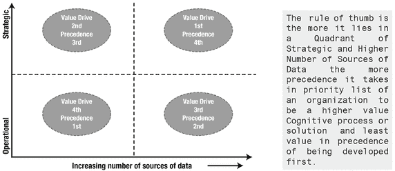
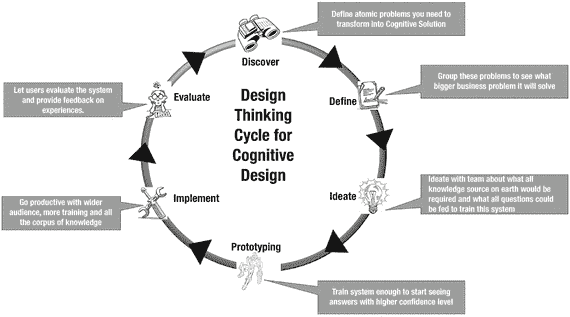
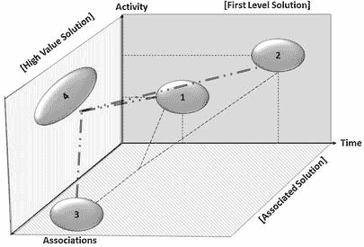
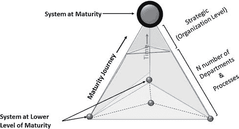
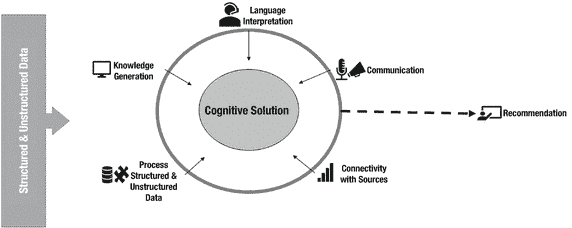
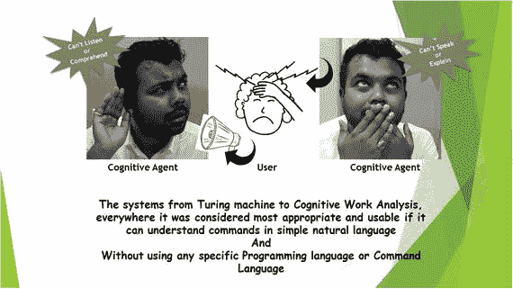
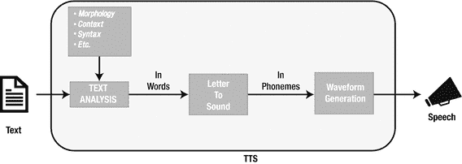
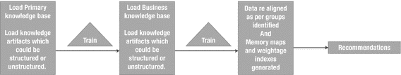
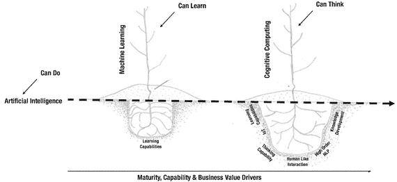

# 8. 认知系统的设计原则

本章讨论认知系统的设计原则。作为认知辅助工具的系统，其训练和设计方式应能在相关领域实现最大产出。

注意

我们在第 7 章中详细讨论了什么是认知系统，并通过一些示例说明了我们可以期待哪些益处。现在，我们来讨论如何在原则上设计这样一个系统。这些原则是后续详细技术设计和活动的基础。我将在本章末尾从宏观层面提及这些步骤。

## 设计原则

设计原则是什么意思？这些是用于制造某物的原则或规则。它可以是软件、建筑、机器、服装，或世界上任何其他东西，甚至是一个流程。

设计任何东西都需要一些基本步骤。对于每种类型的设计起点，都会提到一些步骤，作为设计原则。设计随后会引导出实际的创造。

世界上任何事物的设计都遵循一些共同的步骤，如下所示：

*   确定问题领域或需求
*   宏观范围界定
*   确定有助于解决问题的参考资料
*   可行性分析与范围重定
*   确定更细化的需求或关联
*   蓝图设计
*   详细执行计划
*   确定验证检查点
*   开发测试版、试点版或测试版
*   验证
*   修复缺陷或偏差
*   优化
*   反馈评估

无论是针对一个想法、一个流程、一台机器还是软件，开发都应遵循这条路径。

我认为设计原则可以分为两类：

*   用于设计和优化的整体方案。这是涵盖技术、管理和质量方面的原则。
*   整体逻辑或核心架构。这是其中的技术、逻辑或核心部分。它属于整体方案管理的范畴，但只包含与设计或核心开发计划相关的核心原则。这才是真正设计原则的范畴。

因此，从上述大列表中，以下内容应属于第二类：

*   蓝图设计
*   详细执行计划
*   确定验证检查点
*   开发测试版、试点版或测试版
*   验证
*   修复缺陷或偏差
*   优化

这些都是开发任何东西所需的一切。之前的所有步骤也是更大计划的一部分，但不包含实现的实际核心。相反，它们更多地基于常识和认知。这就是为什么它们特定于最终产品的计划。

其他步骤则更为通用，受产品类型（例如，软件、机器、流程等）的影响较小。

最后一步涉及对已开发产品获得更深入的洞察，然后将其提升到下一个复杂性或增强级别。

让我们逐一讨论大列表中的所有项目，看看它们代表什么。

### 确定问题领域或需求

这始终是第一步。必须有一些需求或问题驱动它；例如，办公楼的手动登记进入和基于打卡的进入各有其困难和低效之处。这定义了问题领域：实现更自动化，减少未经授权进入的可能性。结果可能是一个基于指纹、虹膜或 RFID 的进入系统。

或者，假设需要过河并将大量物品运到对岸；这种需求可能推动了船或桥的建造。

一个问题要成为问题，必须是反复出现的，或者是一种需要频繁满足的需求。如果某件事只发生一次或短暂发生，并且没有或极不可能再次发生，那么它很少会被视为此类下的需求或问题。

因此，在进入下一步之前，应该充分理解甚至记录下这样的问题或需求。通过回答“需要什么？”这个问题来记录细节。这大致定义了问题陈述。

让我们通过一个简单的例子来理解所有这些要点，即解决在新城市寻找住所的需求。

因此，当有需求或需要在新城市与家人一起居住时，应通过回答以下问题来描述：

需要什么？需要一个住处。我们将长期居住，不能长时间住在酒店里。所以，问题或需求就是找到一个住处。

### 宏观范围界定

这是迈向设计和开发的下一步。现在，在问题被定义之后，下一步是看看解决它需要什么。

一旦理解了“需要什么？”，就需要进行宏观范围界定。现在，关于需要做什么的推理被发展成一个更高层次的想法。它从仅仅是一个需求或问题定义，演变为迈向实现的建设性步骤。我们开始对“需要什么？”有更深入的理解。因此，这可以被视为上一步的延伸，两者之间有一条非常细微的界限。但实际上，这可能由专家或具有某些专业知识的人来完成。或者，这个人可能需要一些特殊知识才能达到这一点。

让我们扩展一下寻找住所的例子。现在我们有了上一步的输入，它强调了由于访问时间长，需要为家人找一个不是酒店的地方居住。所以，我们有两个主要因素：家庭住所和长期居住。

这些必须用于范围界定工作。所以，现在我们考虑更深入地思考，并尝试回答诸如以下问题：

*   预算多少？
*   需要购买还是租赁？
*   城市的哪个区域？
*   多长时间？
*   需要做什么？（例如，是否应该雇佣中介或查看在线广告）
*   家庭成员中谁负责什么？

因此，所有这些目标、特性、时长、功能、任务和预算都应被遵循。

这就是这一步的特点。请记住，我们仍然没有进入真正的设计原则制定阶段，但属于更大方案管理原则的一部分，该原则后续将包含允许核心设计原则解决问题的步骤，而这一过程现在已经开始。

### 可行性评估与范围调整

这是下一步：通过上一阶段对实际影响和经验的了解，我们现在能更清楚地认识到，在考虑完成任务的实际经验后，实际范围应该是什么。

我们现在知道了预期目标、我们的计划、在类似条件下尝试完成此事的人们的遭遇，以及他们取得了何种成果。

这让我们对实际需求中哪些部分可行有了概念。可能是全部、没有或部分可行。如果是全部可行，那很好；如果完全不可行，我们就需要调整需求，使其向可实现的方向靠拢，或先完成某些前置事项。如果部分可行，我们需要决定哪些部分可以做得更好；或者如果我们对部分结果满意，就按此重新规划和调整范围。除了第一种全部可行的情况外，通常都需要进行范围调整。但可行性评估必须结合上一阶段的参考核查来进行。

因此，在我们的示例中，我们现在有了如下输入：

*   考虑到价格低廉，购买会更划算
*   成本虽低，但仍需部分资金来支付所有费用
*   房产登记手续繁琐，需要先完成一些前置的公民身份注册

因此，我们对购买或租赁进行了可行性评估，结果发现购买是可行的（通常也被认为是更好的选择），但工作范围发生了变化，公民身份文件应被视为前置条件，并必须添加到现有工作范围中。

至此，可行性评估和范围调整利用了参考阶段的数据，这让我们对范围更有信心。

### 识别更细化的需求或关联项

这是上一步之后的最后一次检查，以确保拥有全面的范围覆盖。这一点很重要，因为如果计划中缺少一个需要制造或购买的销钉，机器开发就可能完全停滞。因此，更细化的需求以及关联项或依赖关系有时会毁掉整个项目。它们要么是需求本身的更细致考量，要么是一些相关的依赖关系。

因此，继续我们的示例，应考虑以下更细化的需求和依赖关系：

*   所有付款必须通过本地支票而非现金，因此需要开设一个全国性银行账户
*   房产登记时需提供近期照片以及学历和就业文件的原件
*   房产登记前必须完成房屋保险的支付和办理流程
*   入住前需缴纳州政府的卫生与清洁税
*   入住前必须完成电力和燃气的注册
*   应组织一次乔迁派对，包括向朋友发送邀请

因此，这份清单列出了一些更细化的需求和依赖关系。可能还有一些锦上添花的事项（例如，乔迁派对可能就属于这一类）。但在这个阶段，我们手头有了一些完善需求细节的事项，如电力、燃气供应等；一些依赖关系，如支票账户和原始文件；以及一些关联需求，如乔迁派对。

这一步也有助于更好地管理整个项目，并提供所有依赖关系的详细信息，缺少这些依赖关系可能会导致现场工作停滞。

### 蓝图制定

至此，项目层面设计原则的通用步骤已经完成，现在我们转向创建阶段；这正是实际设计原则制定的第一步。

我们必须将每种方法、工具、流程和步骤先在纸上规划一遍，以确保我们能够坚持执行，并能够衡量未来的偏差。这就是蓝图制定阶段。它有两个主要维度：一系列行动（以及每个行动后的结果），以及与之并行的时间线。现在，有了前面步骤的所有信息，我们需要按正确顺序（或部分并行）来规划事情，同时充分考虑时间因素。因此，什么任务在什么之后、在什么时间完成，这些细节都要在纸上详细规划。

继续我们的示例，既然包括依赖关系在内的所有必要方面都已确定，我们就可以规划事情并制定活动蓝图，以确保不会在正确的时间点遗漏任何步骤。

我们必须按以下顺序进行规划：

1.  在抵达新城市之前，通过中介搜索并获取潜在房产的详细信息（现在）——妻子可以帮忙
2.  准备前置文件集（现在）——与妻子一起完成
3.  通过看房之旅抵达并确定房产（前 2 天内）——全家参与
4.  开设银行账户（前 1 周内）——我必须完成
5.  公民身份相关文件（前 2 周内）——与家人一起
6.  敲定房产文件（前 3 周内）——与中介一起
7.  支付房产及其他公用事业连接费用（前 4 周内）——与中介一起
8.  乔迁派对（8 周内）——与家人一起

对于这个示例，我们现在有了一个工作蓝图。由于蓝图制定属于核心设计原则领域，这不再是通用步骤。这是针对特定结果的，在本例中就是找房子。

我们记录了以下问题：

*   工作顺序是什么？
*   谁做什么？
*   需要遵循什么时间线？

### 详细执行计划

此时，蓝图已经就位。现在，我们需要查看执行蓝图中每一项计划活动所需的所有细微具体行动。蓝图列出了为完成最终目标而要执行的主要活动或活动项，但完成蓝图中每一项此类活动可能还需要其他更细粒度的活动。

那么，在我们的示例中，哪些可能是更细粒度的活动呢？我将复制上一节的蓝图，然后尝试在每个要点下方列出更细致的执行计划：

1.  **在抵达新城市之前，通过中介搜索并获取潜在房产的详细信息（现在）——妻子可以帮忙**
    *   **更细致的行动**：通过沟通和评估中介机构来寻找一位好的中介，与中介签订合同，规划合作方式（例如，他是否会通过电子邮件发送房产照片和详细信息），并确定此项活动的时间线、他应遵循的期望等。
2.  **准备必要的文件集（现在）——与妻子一起完成**
    *   **更细致的行动**：找到所有文件并集中放置，获取任何缺失的文件，拍摄所需的照片，按要求将复印件装订成册等。
3.  **通过看房之旅抵达并确定房产（前 2 天内）——全家一起**
    *   **更细致的行动**：规划与中介的看房日，预订出租车服务，携带笔记本或平板电脑记录细节，检查所需文件，与房主讨论问题清单等。
4.  **开设银行账户（前 1 周内）——我必须完成**
    *   **更细致的行动**：选择一家银行，与银行经理会面，选择方案，咨询贷款事宜，申请贷款，跟进所有流程，从银行获取凭证等。
5.  **办理公民身份相关文件（前 2 周内）——与家人一起**
    *   **更细致的行动**：规划与办事处的面谈，预订出租车，参加面谈，进行具体的文件处理，获取颁发的证书等。
6.  **最终确定房产文件（前 3 周内）——与中介一起**
    *   **更细致的行动**：准备好法律文件，与房主一同审阅，如需修改则制定计划，进行印花税或公证，完成注册，填写必要文件等。
7.  **支付房产费用并办理其他公用事业连接（前 4 周内）——与中介一起**
    *   **更细致的行动**：查明确切要求，包括费用和文件，填写表格并提交至相应办公室，跟进直至完成。
8.  **举办乔迁派对（前 8 周内）——与家人一起**
    *   **更细致的行动**：确定日期，规划需要准备的事项，列出宾客名单，预订餐饮服务，预约装饰公司，发送邀请函，从相关部门获得举办派对的许可，主持派对，派对结束后收尾，清理打扫等。

这有助于我们以能获得最佳结果的方式来规划事情。此步骤也与为更好地进行测试所需采用的方法和流程对齐有关。

### 确定验证检查点

总有可能偏离计划好的路径。蓝图无法承担检查我们是否仍在正轨上的责任。每项活动都有许多子步骤，甚至还有子步骤中的子步骤，很容易偏离方向或不断转向其他选择。这可能会让你最终到达一个与计划完全不同的地方。因此，一旦我们有了详细的执行计划，就立即制定一个验证计划至关重要。这些基于时间节点和里程碑的检查有助于避免任何偏差。

在我们的示例中，我们可以假设一些检查点，如下所示：

*   在规定时间内与中介签订合同，以便我们尽早开始探索。必须与政府认证的 A 级中介合作。
*   在离开原居住地前及时准备好文件集，以免需要返回取回任何缺失文件。
*   尽快完成房产的最终确定，以避免入住昂贵的酒店。
*   确保在规定周数内获得所有证书。
*   确保所有预订在规定时间内得到确认，以便派对按计划进行。这仅与信誉良好的选定供应商合作。

验证检查点有助于我们确保在需要时完成各项事务，并且质量方面也得到检查。因此，当我们从时间角度对与中介的协议进行检查时，我们还有另一个验证点，即确保与 A 级机构或供应商合作。

验证点让我们保持在正轨上，并推动输出质量。我们在特定时间期望特定的事情达到特定的质量水平，这正是驱动验证检查计划的因素。

### 开发试点或测试

这并非在所有目标实现中都适用。因此，可能像寻找房产那样需要一整套规划步骤，但这不适用于个人；在这种情况下，没有试点结果的机会，但某些中间步骤可以被视为试点，例如，练习与中介、房主或公民身份办公室的即将到来的面谈。

但对于所有其他需要持续升级开发的领域，这是一个非常重要的步骤。这为我们提供了一个初步解决方案，并提供一个初始版本来测试我们实现目标的能力，以及从质量指标角度衡量我们努力的有效性。这展示了流程和计划的有效性，有助于据此进行调整，甚至可以帮助增加一些额外的验证检查点以备将来使用。

在开发方和使用方是不同方的情况下，这个版本也很有用，用户可以检查已实现的内容是否满足其期望。有时，即使是已实现的对象也能让人更好地理解需求，并且在尝试了初步开发的对象后，范围可能会发生一些变化。

然而，此步骤的主要目的是检查并发现所有偏差和缺陷。

### 验证

延续自确定的验证检查点：在此阶段执行在该阶段计划的所有验证检查，以确保预期实现的内容已经实现。如果任何测试失败，则需要在该方向采取行动和努力，使其回到正确的轨道上。这将在下一步中进行。

### 修复缺陷或偏差

延续自上一阶段，在此阶段修复缺陷或偏差。修复策略已在开始时记录，现在开始实施。

这是为了精确实现注定要作为目标实现的内容。

缺陷或偏差发生得越多，开发的有效性就越低。

但硬币的另一面是，任何项目或目标实现都必然存在一些问题和缺陷。

理想情况下，这标志着开发周期的结束。

### 优化

当通过消除和修复所有缺陷使目标几乎完美实现时，就存在引入额外功能的空间。这种优化递归地遵循从步骤 1 开始的所有内容：识别需求或问题。这将产生下一级别的专家对象或目标。

假设创造了一个机器人，用于将杯子从一个点搬运到另一个点。下一级别的优化可能是一个机器人，它不仅完成同样的工作，而且在执行过程中还能避开任何障碍物。这是一个新的事件周期，从识别需求或问题的步骤开始。

### 反馈评估

这有点类似于修复缺陷和偏差的步骤。但有一个区别：缺陷修复步骤旨在根据原始计划修复缺陷，并在开发完成或目标达成后立即进行。另一方面，反馈评估发生在部署后的很长一段时间内，旨在发现需求评估和范围界定中遗漏的缺陷。它指出了本应更好地规划以实现更优目标的地方，但这需要在对目标有了经验之后花费一些时间。

此步骤通常会跳回优化步骤，然后回到步骤 1（识别需求或问题）。

基本上，这就是我们列表中各项的含义。实际的设计原则是从蓝图到缺陷修复步骤执行或创建的。这涵盖了如何以最佳方式制造某物、进行测试，然后进行优化。然而，目标的核心设计或开发仅发生在蓝图和开发之间。在验证和缺陷修复之间是质量视角步骤。反馈评估则是在当前成就水平上经过更长时间的体验后进行的，以便进入下一个水平。

## 认知设计原则

现在让我们再次审视相同的概念，但这次是从认知设计原则的角度。此处的原则也将遵循完全相同的步骤，并具有那两类更高层次的设计原则：在项目层面涵盖一切，以及从蓝图到开发的核心设计原则。质量方面则从验证到缺陷修复。

在开始之前，有一个方面需要牢记：认知解决方案并非简单的技术技能驱动需求。它不能是那种可能作为初始设计规范需求，并因此预先开发以进行测试的东西。它必须是一个逐步发展的过程，采用最佳可能的设计，并由业务或管理层共同驱动。

现在让我们从认知设计的角度来看看相同的要点。经验法则保持不变：核心认知设计仅从蓝图到开发。在此之前是准备阶段，之后是质量视角和优化阶段。

我将首先概述这些要点，然后在后续章节中，更详细地讨论具体的技术步骤及其属性和需求。

### 识别问题领域或需求

获得一个认知系统是一个战略决策；如果认知系统没有实施，那么运营活动的选项将是我们一直拥有的，即企业资源规划（ERP），而对于业务报告，则将是数据仓库。

这些在未来仍将存在；那么为什么还要额外增加认知系统呢？需求是什么？这个答案将来自对企业、行业定位和市场分析以及财务分析的战略分析。

关于如何进入认知驱动型组织的细节包含在后续一些章节的范围内。我们在这里讨论的只是关于项目设计原则和核心认知设计原则的基本指南。

所以，回到识别问题或需求，需要理解关键 KPI 和关键决策之间的区别。这些 KPI 应该为每个不同的业务和流程领域收集。

一旦每个领域的关键驱动因素和 KPI 被分组，就可以将能够实现的收益按优先级降序排列。因此，最高优先级排在首位。这必须被选为第一个需求。一个需求越具有战略性，它带来的价值就越高，但被优先实施的优先级就越低。它越具有操作性，在开发序列中的优先级就越高。图 8-1 展示了这一点。

图 8-1.

运营与战略价值驱动因素

一旦优先级确定，你就有了需要逐一解决的需求或问题列表。

所需的数据源越多，且越具有战略性，就越接近价值最高的认知转型。

那些战略性较低、操作性较强的需求所需的“真相维度”较少，因此其范围也较小。此外，根据图 8-1 中显示的优先级，优先级较低的需求是认知过程的子集，并从其上级需求获得方向，或者为更高级别的需求做出贡献。因此，较高级别的需求产生更高的战略价值，而较低级别的需求应具有从较高级别需求获取指导的认知解决方案。

这意味着，一个帮助做出顶层领导决策的认知系统，应该为展厅层面的认知解决方案子集提供指导，以指导销售人员使用其语言和她在基层执行的活动。由认知系统做出的管理决策必须从基层获取数据，直达每个部门的顶层，学习所有部门相关业务领域的语料库，并利用大数据观察市场。相比之下，门店层面的系统将拥有较少的数据源，确保战略在基层执行时，不必要的数据更少。

现在，需求应该被识别并确定优先级。

### 高层范围界定

在这个阶段，每个部门都应该理解在认知建模的首次切分中，哪些内容需要纳入范围。并非所有内容都可见，但那些通过此类自动化能带来最大价值的流程应该被识别出来。这再次转化为一个全组织层面的范围界定，以更广阔的视角看待整体需要开发什么。

这还包括功能、时间跨度、功能和预算的概要。

现在，我们有了一个已识别的高优先级流程，以及所有待实现的功能。

### 可行性分析与范围重定

受前一步骤的影响，这将提供重新界定范围的机会，并且可行性分析应同步进行，考虑在首次切分中可以将哪些内容纳入范围。

现在我们谈论的是一个成熟的组织面貌，其范围已根据列出的优先级确定。整个文档包括重新界定范围后的解决方案期望。

### 识别更精细的需求或关联

这一点很重要：既然我们现在已经列出了所有高层需求，我们需要最终确定所需的数据源以及要引入的数据设计。应理解相关部门在运营中可能存在的关联，并且与之相关的数据也应纳入范围。

这最终会生成一个功能概要，其中列出了优先级以及实现这些功能所需的数据。

### 蓝图设计

至此，我们拥有了所需的一切，现在实际的设计原则应该启动了。我们首先需要根据时间线列出活动和优先级。这也应指定负责人员作为已确定的团队成员。

这就形成了蓝图，它是核心设计原则的第一步，并有助于其启动。

### 详细执行计划

这是核心认知设计原则领域。我们试图创建的并非任何需要创建规则、编写代码或构建网络或深度学习的机器学习解决方案。我们讨论的是一种现成的、具备学习所需全部特性、能够完成学习认知过程的解决方案。

因此，针对该特定认知解决方案的执行计划应从单一类型的问题或需求满足开始。这最好通过设计思维方法来解决。关于认知设计的设计思维循环的详细信息，请参见图 8-2。

**图 8-2.** 认知设计的设计思维方法

设计思维过程是一个非线性过程，因此任何步骤都可能在另一步骤之后重复，或者整个过程可能回到之前的任何步骤。

这是认知系统核心的设计原则，是设计思维与认知系统学习过程的结合。

实施应从底层（战略或运营层面最低 + 数据源关联较少）开始，逐一向上推进至顶层（战略层面最高 + 数据源关联最多）。

系统必须学习提出解决方案建议的过程。因此，应首先教授最简单、最原子化的业务流程相关学习内容，然后才逐步增加复杂性。与单个业务部门或流程相比，这能提升建议的价值。

现在，让我们讨论一个执行计划复杂性的示例，以理解上述句子的含义。

假设一家名为 ABC 的公司希望拥有一个认知系统，为其提供建议，以便在需要将任何订单重新分配给一组新供应商时，从供应商池中决定哪个供应商足够好。这意味着，例如，必须为涉及另一组供应商的变更场景进行重新调整规划，理想情况下，该建议也应源自认知系统，作为执行此操作的警报。

造成这种情况的所有可能原因是什么？

*   政治动荡
*   天气状况
*   销售驱动
*   客户反馈/情绪
*   供应商绩效

原因可能有很多。我们只考虑上面列出的那些：这涉及哪些业务或知识领域？让我们看看：

*   最新的相关新闻更新
*   天气预报与分析
*   销售交易数据
*   销售概念（所有可能的书籍、期刊、该特定组织的规则和学习资料）
*   客户主数据
*   客户反馈（所有来源，包括社交媒体和其他网站）
*   情绪（文本分析数据、客户之声）
*   供应商主数据
*   供应商趋势
*   供应商反馈与学习
*   财务数据
*   产品主数据
*   产品销售数据（与产品相关的销售数据）
*   法律数据
*   与供应商的合同细节
*   生产数据
*   工厂数据
*   订单数据

以及更多。

当所有这些都可用时，认知系统可以理解来自特定供应商区域的高概率天气问题，并发出警报。此外，基于其他细节，它还可以推荐哪个应该是替代供应商以及会产生什么影响。这是一个重大的战略和运营建议。

前面列出的所有部门和知识领域都应作为来自单一领域的知识数据输入，即各个运营领域（例如，销售、财务或合同数据）。这里的数据源数量较少，且数据本质上是运营性的。它们与所有其他数据源结合，以生成关于警报和替代供应商规划的战略价值建议。

与单个运营部门相关的建议相比，此建议的价值更高，并且在业务覆盖范围方面具有更强的能力。

这就是我们所说的复杂性（运营或战略层面）以及按特定顺序输入多个数据源以提升建议价值（如前所述）的含义。这不是各个领域能力的线性叠加，而是它们共同产生的一种新的联合能力或价值。

因此，执行计划是多维的，时间和活动作为一个维度，然后与下一维度的关联开发相联系，这些开发进一步利用所有这些关联与最终的高级解决方案相结合。参见图 8-3。

**图 8-3.** 执行的复杂性维度

在图 8-3 中，标记为 1 和 2 的椭圆是随着时间的推移，针对业务中的某些领域，通过各种活动水平开发的两个解决方案。它们是围绕各个领域的独立解决方案。当我们在这里说解决方案时，我们指的是围绕该业务领域的认知解决方案。这些解决方案 1 和 2 属于一个维度，是简单的独立或原子解决方案。

现在，解决方案 3 位于另一个维度平面，并与解决方案 1 和 2 相关联。因此，它使用了一些新的领域知识，并且也使用了来自 1 和 2 的所有知识。这使其归入关联解决方案的类别，这些解决方案比 1 和 2 更复杂，并且也使用了它们。

然后我们在图中看到解决方案 4，它是所有独立/原子解决方案和关联解决方案的组合。这是最复杂的解决方案，建立在顶层：最高阶的解决方案。

这些是复杂性的维度，并通过执行计划进行规划。因此，这也是执行计划的复杂性。

现在，有一点需要注意，为了方便并能够轻松解释诸如“不同级别的基础和关联解决方案”（图 8-3 中的 1、2 和 3）以及“高阶、最复杂的解决方案”（图 8-3 中的 4）等术语。实际上，同一个认知解决方案会随着时间的推移扩展到不同的复杂性级别。

因此，可以说系统最初被训练为推荐更简单的解决方案，并关联到多个独立的部门或流程，然后随着时间的推移，复杂性随着问题类型（从运营到更具战略性）以及系统知识输入范围的扩大而增加。并非为每个解决方案创建多个系统并层层叠加。

这可以如图 8-4 所示。

**图 8-4.** 认知系统的成熟路径

这些是在此阶段规划认知系统设计原则时需要考虑的要点。当开发（知识库构建、训练和用户界面）开始时，必须进一步执行这些原则。

### 确定验证检查

与任何类型的开发或目标实现一样，确定目标检查或验证条件非常重要。在认知系统方面，很容易迷失方向。因此，应规划非常严格和现实的测试，包括正面测试和负面测试。认知系统可能会以其回答和揭示一些以前未知的有趣事实的能力而令人惊叹。人们很容易因此被冲昏头脑，任何考虑此类新数据方面的诱惑都应暂时搁置，留待以后探索。必须严格规划针对所有预期功能的验证检查，并做好文档记录，且仅在之后进行测试。

### 开发试点或测试系统

此时，初步的知识语料库已加载到系统中，策展工作已完成，认知系统已准备好创建其加权分析，并据此生成自己的学习图谱。用于训练系统的第一批问题开始被添加到系统中，系统现在已准备好进行回答。每增加一个新问题，系统就会得到进一步的训练。最好在需求收集的早期阶段就开始收集问题。然后，该系统就达到了试点或测试级别的系统就绪状态。知识语料库的构建及相关材料将在本章末尾进行较为详细的说明。

还有其他开发领域，例如用户界面开发，但这些并非本书的主题。

### 修复缺陷或偏差

需要使用早期阶段确定的验证参数进行快速检查，以建立对答案质量的信心。

### 优化

一旦系统按照设计思维概念运行了一段时间，就应通过增加新功能或对现有功能进行更新来优化系统。

### 反馈评估

这是一个持续的反馈过程，以确保系统是动态发展的，并且新的业务关系和数据点会随着时间的推移不断被发现并添加到系统中。此外，应允许专家持续与系统交互，以便在这些领域学到更多知识。随着时间的推移，这将使认知系统变得越来越高效。

认知系统的设计原则仅限于“认知设计原则”部分所讨论的认知系统详细执行计划。

## 认知工作分析

认知工作分析（CWA）是一个用于社会技术应用开发的有趣框架。这个术语由 Vicente（1999）提出；它是一个由 Rasmussen、Pejtersen 和 Goodstein（1994）开发的用于分析认知工作的框架。

这个概念探讨了用户从系统中检索信息的过程，这些系统能够适应受各种内外部因素影响的输入响应。然而，“用户”不被视为用户，而是被视为“行动者”。

区别何在？“用户”是一个更静态的术语，其用途是预先定义好的：超级用户、管理员用户、开发者用户、业务用户等等。因此，根据分配给他们的授权和角色，他们在系统中只能执行有限的相关活动列表。由于操作是有限的，无论用户面临的实际场景如何，向系统请求的方式、输入和输出都保持不变。无论用户是生气、饥饿、困倦，还是想做其他未定义的活动，系统都不会改变；它只会接受指定的命令，并按照系统中相关规划好的步骤处理数据，因为它仅限于服务系统中由规则和配置定义和限制的特定用户类型。

于是，“情境”便应运而生，“行动者”会根据当前所处的环境和情况来行动，并做出相应的行为。“行动者”表达同一个“句子”的方式可能有无数种，但情境却不同。

在现实世界中，同一个人也可能因情境、工作环境等因素的影响，以不同的方式表达同一个句子或话语。表达方式的行为变化不能作为判断情境的唯一属性；还应考虑其他属性，否则无法保证“精神不稳定”不会被当作有效因素（Fidel 和 Pejtersen 2004）。因此，重点不应仅仅放在行为上。

科学家们（Patricia Katopol 等人，2006-2007 [`​collab.​infoseeking.​org/​resources/​papers/​KatopolUIowa.​pdf`](http://collab.infoseeking.org/resources/papers/KatopolUIowa.pdf)）提出了多个其他维度，如工作环境、组织分析、工作领域分析、任务分析、决策分析、策略分析等等。因此，为了智能地做出响应，必须理解行动者行为背后的总体原因。

此外，它不能仅仅基于大多数人或此类行动者在特定情况下的反应方式；它必须足够智能，能够分析情境以及交互背后的原因。

因此，考虑到所有影响组织内部行动者或为特定目的从组织外部进行交互的主体的因素，应该通过情境来理解，而不仅仅是通过情感属性或简单的行为特征。

简而言之，可以说，为了能够设计一个用于特定目的的系统，必须对工作有深入的理解。应该理解各种影响因素，无论是工作内部的还是外部的；这将有助于设计一个能够提供预期输出的系统（即使是认知系统）。

工业革命先后带来了机械化、自动化，最后是计算机化。计算机时代寻求利用 CWA 来设计能够理解工作情境和偏差并融入其中以提高生产力的系统。为了设计一个好的系统，必须对工作空间进行分析。

在 20 世纪 80 年代和 90 年代，世界各地都有这样的例子：尽管对计算机化的投资成倍增加，但生产力却反而下降了。麻省理工学院出版社甚至出版了一本名为《计算机的麻烦：有用性、可用性和生产力》（T. K. Landauer，1995）的书。

Landauer 讨论了机械自动化是如何成功实现的，但与人类更高智力能力相关的自动化，例如根据情境和情况进行实时推理，或学习并针对特定情况提出新的解决方案，却未能实现。这被称为“绩效悖论”。

一个不是基于工作分析设计的系统，可能会因为只能使用特定的命令或查询语言而强加限制，导致浪费时间。因此，在不同环境下的交互和响应方面，它应该更接近人类。

所以，如果系统不够灵活，它可能对某个用户很好，但对另一个用户则完全不好。系统应该能够适应人类的认知行为。

这些系统也存在一个缺点，即需要分析大量的数据。机器是根据编程机器的愿景来规划的，因此，要求程序员在特定业务领域拥有越来越多的知识也是强制性的，并且是一个约束条件。

CWA 是一个用于设计本质上是社会技术性的复杂系统的框架。它已被广泛应用于许多领域，如航空、培训开发、团队组建、流程设计等。

CWA 中提到了一些可能阻碍人机交互的约束条件（例如，关于特定情境的某些因素、技能不足等）。

这是一个很有前景的框架，现在可以通过新的认知系统完全实现；换句话说，该框架的设计方式可以很好地用于设计认知系统。当今的系统可以不断从日常经验中学习，并实时利用相关网站上的任何信息进行更新。

在中间插入这一小节的目的是，介绍一种接近认知计算的技术，并且该技术原则上仍可与将在认知系统中实施的方法一起使用。

## 工作空间设计

我特意加入这一小节，是为了强调即便是人们工作的空间，也受到认知系统的影响。在实体办公室中，同一时间点需要聚在一起讨论业务的人数减少了。协作通过聊天机器人进行，人们无需身处同一地点。认知计算机器大多以虚拟人的身份工作，并拥有自己的系统 ID 和密码。

我们无需使用多台机器来监控各种原始参数，而是可以用一台机器通过简单的自然语言进行通信，从而减少设备数量和电力消耗。

这是走向认知化的一个间接影响，它简化了系统界面、可用性以及需要使用的应用程序数量。

有时，这成为提高生产力的一个额外因素。不仅是系统，工作场所也变得智能且针对特定任务进行了定制；由于具备认知能力，其设计变得更具协作性。人们可以专注于解决问题，而不是将大量时间花费在数据准备和其他耗时的活动上。需要协作的人可以坐得很近，进行比以往更高效的协作，因为他们只需专注于业务核心，几乎没有任何非生产性活动。

## 认知知识的生成与来源

认知解决方案成功的关键在于知识生成和训练。任何认知解决方案最初都像一个婴儿。这意味着它在那个工作领域没有任何知识。它需要被教导和训练，以理解问题并提供建议。这个过程就是知识生成练习。

知识构建工作必须通过大量可能的相关知识来源来完成。针对特定领域的产品，可以预先加载该领域的知识。

但在将知识引入系统并进行训练之前，系统本身应内置一些模块，以便能够进行结构化学习并进行通信。

通常，一个认知系统应具备以下原生能力：

*   语言能力（自然语言处理 [NLP]）
*   对话或通信能力（文本转语音 & 语音转文本）
*   与所有数据源的连接能力
*   处理所有类型数据的能力（结构化与非结构化数据）
*   知识生成能力
*   建议生成能力

如图 8-5 所示。

图 8-5.

认知系统能力

让我们简要讨论一下这些原生能力；然后我们可以继续介绍知识构建步骤。

在本书中，我提到了一些认知产品，主要是当前市场领导者 IBM Watson，但这里关于知识构建和其他方面的讨论本质上是通用的，尽管它们都受到这些最常见实现方法的影响。

### 语言能力（自然语言处理）

我们在第 5 章中详细讨论过 NLP。

认知系统应具备非常高阶的自然语言处理能力。如果系统能够理解用简单自然语言（如印地语、英语、中文、俄语等）以口头或文本形式发出的命令，那么它被认为是最可用的。输出也应以同样的方式进行。这对于认知机器来说更为重要，因为日复一日使用它们的业务部门成员并非技术人员，如果要求使用某种具有特定语法和句法的计算机语言才能工作，那么认知计算机器所提供的协作环境将受到限制。图 8-6 展示了这样一种场景和用户的困境。

图 8-6.

认知代理的 NLP 期望

所有认知产品在自然语言处理能力方面都极其高效，这是它们必须具备的。通常，系统在特定语言能力上经过预先训练，随着时间的推移，通过与多个用户的训练，会为每个用户生成各种关联模型；通过登录信息，它可以识别语音并做出响应。

### 对话或通信能力

我们在第 5 章和前面的“语言能力”部分已经讨论了很多。这与所有媒介（包括文本和语音）中的自然语言处理有关。为了获得更好的可用性，它应该能够像人类一样“说话”和“倾听”。有麦克风拾取音频信号，也有语音合成能力以人声进行回话。这些能力使其成为极其有用且强大的机器。这被称为 TTS 或文本转语音能力。

请参见图 8-7 了解 TTS 的高级示意图。

图 8-7.

文本转语音 (TTS)

这些能力是认知系统的额外支持功能，但它们在可用性方面扮演着非常重要的角色。一个智能系统的理想形象是，底层那些智能应用程序不暴露给用户；用户感知到的只是交互式响应。因此，如果系统能够智能地交互，它就会被很好地接受，并且可用性因素也会更好，因为能够与机器对话总是比使用键盘聊天要好，更不用说使用命令了。

### 与所有数据源的连接能力

这是另一个重要的原生属性，即能够使用所有可能的数据适配器或驱动程序连接到所有可能类型的数据源。认知系统声称能够提供由所有类型信息相关来源的数据支持的全面建议。为了给出恰当的建议，它可以是任何可能且与业务领域相关的来源。

因此，在连接性方面不应有任何限制，仅限于特定数量的来源，因为那会违背其根本目的。

### 处理所有类型数据的能力

同样，正如前一点所述，认知系统可以从所有类型的数据（结构化或非结构化）中提取含义；这些数据源包括图像、视频、音频、网络日志等。

认知系统有能力混合使用结构化和非结构化数据，并从中推导出综合含义。它不受此限制；其建议正是来源于这些数据，这些数据由该主题所有可能的、可靠的、标准形式的数据所丰富。

### 知识生成能力

所有前述能力都是为了支持将所需输入引入系统这一功能而存在的。

这是作为认知解决方案创造功能性的核心能力。实现这一目标需要多个步骤，这些步骤内置了本书前面描述的所有超级计算能力，例如人工智能、机器学习、语言解释、预测分析、神经与深度网络等。

通常，系统需要吸收两类知识。第一类是特定学科领域的知识（例如市场营销），第二类是该领域内组织特有的规则、知识和经验。

通常情况下，只有后一类知识会被输入系统进行训练；系统本身已预先加载了学科领域的数据。否则，从头构建知识库并在该领域进行训练就毫无意义。机器凭借这些预加载的丰富知识在该领域得到了充分训练，这也有助于在现有数据和新加载数据之间建立新的关联。

这些步骤将在本节以及本章后续的“知识生成——细节探讨”部分进行详细描述。

### 推荐能力

这是用训练数据对已加载的知识库进行训练的结果，从而在认知系统中构建出推荐能力。

系统做出的推荐在任何业务中都应具有实际价值。只有当作为学科知识预先输入系统的理论知识，与组织相关数据相结合时，才能实现这一点；如果做到了，系统就能提出对组织有价值的推荐。否则，推荐将几乎毫无意义。

因此，数据被摄入后，所构建的知识会与来自书籍、期刊的学科标准规则以及组织的事实数据建立关联。这种关联通过以问答形式存在的训练数据集而不断深化，帮助系统更好地洞察数据。

### 知识生成——细节探讨

在本节中，我们将更详细地讨论知识是如何在认知系统中构建的。

如前所述，针对任何特定学科的系统都会预先加载所有可用的知识。这是通过将书籍、期刊和各种网络来源中所有可能的业务基本规则输入系统来实现的。这些知识构成了基础知识库：IBM Watson 称之为语料库。因此，如果它是一个专注于癌症领域的 Watson，它至少会预加载所有相关的书籍、期刊/研究论文的详细信息；如果是一个从事市场营销相关工作的认知系统，那么相关的知识也会被预先输入系统。

然后，通过训练将基础知识库构建到系统中。系统利用神经技术进行更深入的洞察，会尝试通过标签和其他聚类算法对信息进行分离。它会基于此创建自己的学习成果，甚至生成一个信息关联的记忆图谱，其工作方式与大脑类似。因此，通过自然语言处理输入的问答训练数据会被理解，并推导出数据的各个方面和上下文。所有这些随后被连接成一个庞大而复杂的记忆图谱。图谱上的每个点都基于某些训练问答集被推导为一个独立的信息节点。这意味着这些节点成为了判断标准。随后，推荐将沿着这些信息节点的分支进行追踪，并得出推荐结果。训练或使用得越多，就会创建出越复杂的关联，从而产生更智能的认知响应。

因此，知识构建的步骤可列举如下：

图 8-8.

从知识到推荐

1.  从来源加载知识库内容
2.  用问答进行训练
3.  加载业务领域数据
4.  用特定业务的问答进一步训练
5.  分离数据并在基础数据与业务数据之间建立关联，以在知识数据内部生成分组
6.  创建包含数据内所有关系的信息映射
7.  从数据中获取更深入的洞察，形成推荐

让我们简要了解一下每个步骤的细节，如图 8-8 所示。

#### 从来源加载知识库内容

这通常是系统提供的、特定学科预置的丰富知识，其形式是所有基于规则的基础知识，用以确立在该学科的专业性。因此，如果一个系统要执行市场营销任务，其基础知识输入就是所有可能的好书籍和期刊被摄入系统。摄入不仅意味着信息以内容形式被加载，还意味着系统接受深度训练以解释这些内容。这种训练是在该领域专家的帮助下进行的，他们以问答形式输入必要的训练内容。系统是一个学习和思考系统，因此它通过这种方式开始学习该学科。

这就像在人类或动物大脑中创建关联一样。方法上的区别在于，人类不断获取零散的信息，并立即建立关联并存储起来；而认知机器则首先获取从 A 到 Z 的完整内容，然后通过问答形式进入情境并创建关联；所有上下文中的整体关联就是所开发的学习图谱。

因此，第一步与加载此类内容相关。下一步则是创建关联。

#### 通过问答进行训练

如前一节所述，训练必须通过问答方式进行。关键问题在于“为何如此？”难道不能用其他方式吗？

让我们看看人类是如何学习的。机器认知学习模仿的正是这一自然过程。

为了解释这一点，我们暂且回顾一下第 7 章中关于香烟的故事。

一位天生失明的人第一次接触香烟时，他从未尝试过，但通过气味知道存在某种令人愉悦的燃烧棒（这是他被告知的信息，而不知道健康危害等其他维度）。

现在，看看他大脑内部是如何获取这些原始信息并产生关联的。我们无法涵盖所有方面，但会尝试在本书主题和范围内追溯最有用的部分。

他获得了以下原始信息：

*   某种叫做香烟的东西（一个新名称）
*   应该用于娱乐
*   需要燃烧才能使用
*   需要以一定价格购买
*   由烟草和纸卷制成

即使这被认为是原始信息，它也是通过问答方式被大脑吸收的。同样的内容可以这样构建：

*   这叫什么？某种叫做香烟的东西（一个新名称）
*   为什么要使用它？应该用于娱乐
*   如何使用它？需要燃烧才能使用
*   如何获得它？需要以一定价格购买
*   它由什么制成？由纸卷包裹的烟草制成

因此，大脑天生就具备问答式的学习格式。我们学到的一切都只能通过这条路径，并赋予其逻辑性。即使是难以理解的抽象事物（例如百慕大三角或外星人）也是如此，通过诸如“它真的未知吗？”或“它真的存在吗？”这样的问题来学习。

另一个方面是与任何情感相关的情绪、感受或体验。感受或感觉也属于某种情感范畴。

因此，关于香烟的感觉，结合目前所有信息，会与愉悦的情绪联系起来，以及他所能假设或听到的任何相关情绪。这大致决定了它在大脑中的存储位置。

类似地，认知机器也会在专家的帮助下，经历所有可能的问答训练，以探索信息并相互关联。信息的分类聚类方式与人类相同。

就像人类在提到某个主题时会产生“某种感觉”，这可能是他大脑中关于该主题的整体知识所创建的映射，存储在大脑的不同部位，但关联成一个映射，最终产生一个整体理解。

同样，认知系统会从其主题中生成学习映射；这也是动态的，并随着时间推移获得的经验而改变。

同样，当我们的主体最终对香烟有了深刻理解，并了解到所有负面健康影响时，他的情绪关联会改变，他的知识示例会改变，他的整体映射也会改变，从而对该产品产生新的“感觉或形象”，这不过是整个大脑中关于该主题的所有关联的映射。

类似地，认知系统会学习并生成映射，这些映射可能会根据其随时间获得的经验而彻底修改和重建。这无法通过编程实现，即使可能也不应硬编码。学习应该是开放式的，就像人类一样。

#### 加载业务领域数据

到目前为止，系统已经准备好以映射形式吸收所有知识，在某个主题领域发挥作用。系统已准备好利用其知识朝这个方向思考。但每个业务都不同；例如，根据经验，营销或销售的业务概念在操作上可能相似，尽管不同书籍中可能提到大量不同的概念和方法。

同样，特定组织可能以略微不同的变体或组合执行相同流程。他们可能有不同的经验，这些宝贵的知识将增强系统的学习能力，以应对他们可能经历过的特定挑战。

为此，必须将业务相关的知识库输入系统。这就是已上线的认知机器真正开始定制化的地方。

#### 通过特定业务问答进一步训练

然后，系统需要以其自身的工作方式和解释事物的方式进行训练。此外，应通过针对性的训练来澄清业务特定的关键词和行话。

这使得系统具备业务的本地能力，并针对该业务进行定制，准备好从此处进一步发展。

以下三个部分已在前面几点中涵盖：

*   数据分离以及在基础数据和业务数据之间创建关联，以在知识数据内部生成分组
*   利用数据内部所有关系创建的信息映射
*   从数据中获得的更深层次洞察，作为建议

## 接口

我们在前一节“认知知识生成与来源”中讨论过接口；我们讨论了能够从所有可能的接口获取数据以将知识输入认知系统，从而不断丰富其数据的重要性。

这让我们想到能够将数据引入认知系统的可能接口组。

它们可能包括以下内容：

### 基于 Web 的接口

这些可以是位于万维网或私有企业网络上的来源。或者，它们可以是正在被监控的特定网站，以关注特定主题的提及。这将有助于获取相关警报和舆情。

例如，一个组织的认知系统可以监控所有指定的可靠/可信新闻网站。如果某个地方因新的制裁而提到对某些医药产品的业务限制，系统会立即理解，对于其自身组织而言，由于它身处医药行业并在那些产品和地理区域开展业务，这条新闻可能很重要。它会进一步利用所有其他已有的业务、战略、财务等信息来理解这条新闻，然后向管理层呈现一个包含预期影响证据的警报。

来自网站或物联网网络设备的博客也可能很重要。

社交媒体是一个重要领域，那里已经有一些舆情分析选项。认知机器也能够进行此类分析；结合推荐能力，这将以一种完全不同的方式利用这一能力。

来自可信来源的大量研究论文和期刊也可能存在。认知系统可以在它们发布时立即获取；从网络上获取并吸收。知识被创建并与现有知识映射关联，以更新一个或多个此类映射。

因此，Web 接口非常重要，它们就像这些机器的知识窗口，就像对我们一样，只是它们拥有超级计算能力，使其更加强大。

### 物联网接口

这是机器感知、响应和通信的领域。机器上的传感设备只做一件事，即感知，无论它擅长何种感知，别无他用。来自物联网接口的数据必须被监听、记录、结构化、解释，然后与企业所有可能相关的知识相关联，以便在某处给出正确的建议。

除了我们所说的“与企业所有可能相关的知识相关联”这部分之外，每一项能力都是机械性的且基于规则的。

因此，将每微秒或更短时间内到达的大量信号数据作为一个单一信息单元集进行处理、记录，并创建结构化数据以将其解释为低于或超过某个阈值，这些都可以通过本质上不具备认知能力的线性计算设备来实现。

但对于一个人来说，要处理这种巨大的、全天候不间断的数据流，解读其商业价值，然后将其与所有相关的业务决策联系起来或发出警报，几乎是不可能的。从人类认知的局限性和能力角度来看，这是不可能的。一个有限的领域可以与特定的、可计数的业务领域相匹配或关联，但无法与所有领域关联。因此，一台机器发出的警报信号可以由负责维护它的部门解读，然后制定维护计划。但是，在财务讨论期间，向人类决策者提供一个信息点，并参考所有机器传感器数据，就电力消耗或机器同步如何增加一定比例的利润或资产回报率提出建议，这并非寻常之事，而是特例。仅考虑这里描述的这一种关联：在推荐新机器采购时，认知代理根据其对传感器和其他业务数据的理解和经验，建议购买某组机器或配件，认为这些是从各个方面实现优化的最佳选择。

这就是认知计算充分利用物联网设备的地方，这也使其成为一个非常重要的数据接口。

### 用户输入

认知系统不仅是思考和推荐的机器，也是持续学习的机器。来自用户的输入，无论是在训练期间还是之后，都很重要。同样，也需要专家的输入来更好地训练它。从用户那里获取输入的视觉或文本界面，也带来了宝贵的学习经验，将系统提升到更高水平的成熟度和效率。

### 业务数据

诸如扫描、摄像头、条码、文本扫描（OMR）、信息或数据的软拷贝、电子表格、图片、音频和视频等接口都包含业务信息，增加了知识价值；因此，定制这些系统以利用各种接口至关重要。

所有相关的输入设备，包括文本转语音和语音转文本，都有助于此。

业务数据也是持续输入的，并且系统内部在该领域的训练也在持续进行。因此，这也是一个重要的接口。

### 标准数据源

这些类似于网络源，但它们提供重要的单一主题信息，大多是科学或观测数据。这些可能是提供天气数据的天气源，或提供交通详情的 GPS 源。这些也是重要的接口。

### 金融与商业网络

这些是指定的咨询公司和金融数据网络（例如，尼尔森）。它们从金融和战略角度提供最新的实时信息。通常，这项工作由规划人员完成，他们以大型团队的形式进行规划运营，并根据需求或作为日常工作向高层管理人员提供咨询建议。无论团队规模或专业知识如何，在这方面他们都无法与认知机器的能力相抗衡。是的，它们仍然无法取代经验丰富的顾问，但可以使顾问的角色更高效，根据每一条实时信息提供基于事件的建议。这使得他们能够专注于自己擅长的事情，进行更深入的合作，而无需花费大量时间准备数据。

这使得它们成为一个非常重要的数据接口。

### 系统自身

我们之前讨论过认知系统随时间推移的成熟度，以及通过关联来自多个部门的数据，以甚至以前未曾想到的方式揭示数据隐藏方面的能力：参见之前关于传感器数据帮助机器采购或财务管理的例子。这是随着系统成熟度的提高而逐步实现的。随着时间的推移，系统自身会成为一个良好的接口，建立更深层次的联系，并挖掘出所有事物的深层含义，同时兼顾其他所有方面。多个学习到的知识图谱被组合在一起，生成一个大的图谱，以推荐相互关联的事物。

## 失败的机器

我们讨论了机器的认知能力及其训练方面。但是否有可能在这方面失败呢？答案是既可能又不可能。

从技术上讲，如果在任何地方，使用相同或同类解决方案，即使只有一个成功率极高的例子，那么在其他地方就不可能失败。

但实际上，这是可能的，因为可能没有以最优方式执行。但好消息是，与软件或 ERP 应用程序不同，它不需要部分、大部分或完全重做。与其重做，不如继续推进。这意味着存在失败的可能，但无需回头；相反，要持续前进以纠正它。这也意味着两件事：

*   修复实现认知机器的失败，大多情况下并非失败，而是努力不足
*   修复与升级系统完全相同

因此，一台失败的机器意味着其运行未达到预期的能力阈值。

在多个方面，缺陷可能导致失败：

*   没有规划好哪些内容需要纳入认知转型范畴，以及其优先级或顺序
*   这不是要取代事务处理系统，而是要优化它们
*   没有列出所有需要与认知系统共享的信息
*   训练不足或训练不当
*   没有正确设定用户的期望

为了在这方面保持安全，应该遵循从较少数据源和更多运营领域开始，逐步过渡到最具战略意义的领域的转型规则。这也是知识获取的自然顺序；我们总是从简单到复杂，没有其他路径。这应该在每个层面进行评估，并确保在这些层面达到预期效果；只有这样，我们才能进入下一个成熟度级别。这也有助于创建更好的学习能力或图谱，并限制失败的可能性。

经验法则如下：

*   根据复杂性和业务价值水平（如前所述）进行适当规划
*   遵循相同的路径
*   在进入下一级别之前，验证并确保达到预期的满意度和置信水平
*   确保摄入所有可能的信息

遵循这些原则，就永远不会导致严重的失败局面。由于不可避免的原因，从项目管理的角度来看，在时间线上可能仍会遇到一些问题，但每一个实现的质量里程碑都将确保更有效的采用。由于这些系统是运营系统，并且不取代任何东西，它们应该能够按照这里描述的节奏，以很小的偏差运行，因此不会阻碍任何事情。

## 与人工智能和机器学习的关系

我们在前几章已经讨论过人工智能和机器学习。

我们已经讨论过，机器学习是一种专门的人工智能，它能够从经验中学习，并通过改变其算法来调整其功能。

因此，**人工智能**是关于像人一样智能地实现自动化，而**机器学习**则更进一步，确保这些智能机器也能学习。

人工智能的主要目的之一是“自动化”，即让机器自动完成事情；简而言之，就是将智能本身智能地植入机器。但这实际上并非真正的智能。这大多是通过 if-else 条件实现来处理事情。

然而，机器学习将其提升到了一个新的水平，使其更加智能，并能够学习。这是迈向真正意义上智能或人工智能的第一步。以本书前面提到的同一个例子为例，人工智能使机器人能够将物体从一个点移动到另一个点。机器学习则赋予了它们学习如何克服常见障碍的能力，并确保它们能够克服这些障碍，到达目标点并放下物体。

**认知计算**则将事情向更智能的方向推进了一步。它是一种更加智能的机器，尽管在这方面仍在努力接近人类甚至任何动物。

智能机器的设计灵感来源于人类认知的工作方式，这还有很长的路要走，但认知计算已经将其推进到足以被称为真正智能机器的程度。

有些人认为机器学习和人工智能互为子集，而认知计算则是新型专门人工智能的一个子集，这种人工智能能够思考而不仅仅是学习。

在我看来，这些都是走向成熟的过程，机器学习和认知计算本质上就是人工智能。可能存在不同成熟度级别的设备/机器/计算机，这可能会将它们限制在基础人工智能、具备机器学习能力或成熟到认知计算的水平，但归根结底，这些都是概念和理论。我相信认知计算是人工智能的最新形式。

认知计算的一部分可以作为纯粹的人工智能工作，另一部分则可以执行机器学习活动；总的来说，具备预测能力、知识图谱生成能力（使用加权分析并根据训练信息对数据进行分类）以及与物联网设备通信能力的机器就是认知机器。

人工智能是通过成为具备认知能力的机器而产生的。该机器在业务所需的有限主题领域内具有超级智能，甚至在这方面超越了人类。然而，它们仍然无法与人类从地球上任何主题学习新学科的认知能力相提并论。认知系统有固定的议程，它们只在这些范围内学习。

从这个角度来看，人工智能是一个总括性概念，涵盖了所有具有任何级别智能能力的机器，而机器学习和认知计算则是不同的区分因素。我们可以说机器学习和认知计算正在赋能新的能力，但人工智能是整体的智能能力，不能在此背景下被单独区分出来。

因此，人工智能是播下并收获机器学习和认知计算种子的土壤。

图 8-9.

人工智能、机器学习与认知计算之间的关系

## 总结

我们在本章中详细讨论了认知设计原则。这些设计原则通常是通用的，具有固定的步骤。设计中的步骤分为两类：更大的计划或项目级原则，以及应用或参与特定的核心设计原则。所有这些都通过每个原则的示例进行了详细描述，我们可以看到每个点都必须谨慎对待；我们还看到了与设计思维的关系。

我们还讨论了社会技术设计原则——认知工作分析，以比较的方式了解为设计自适应机器所做的稳健工作。这与认知思维过程有相似之处，并且它本身也做出了贡献。

然后，我们讨论了认知系统中建立的知识。我们讨论了认知机器中预期的一些基本能力以及这些能力是如何发展的。

我们还详细讨论了知识生成过程，并附有示例，以了解它如何追溯到人类的认知能力以及为什么会这样。

我们还讨论了认知计算的显著特征和重要接口。这些比传统企业软件可能寻求的连接要多得多。

我们还简要讨论了认知系统实施失败的可能性、其原因及缓解措施。

最后，我们自然地讨论了人工智能、机器学习和认知计算之间的关系，并以此结束了本章。

进一步掌握了这些知识后，我们将在下一章讨论自我演进的商业智能系统。

