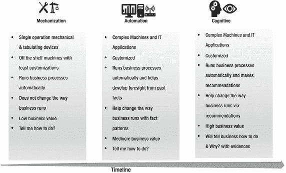
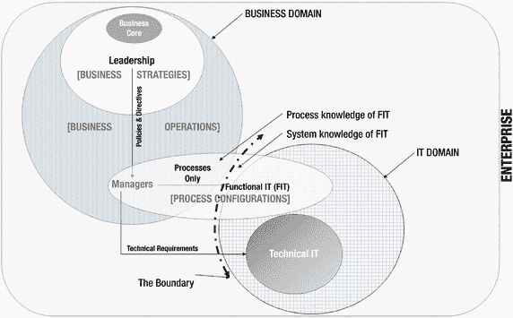
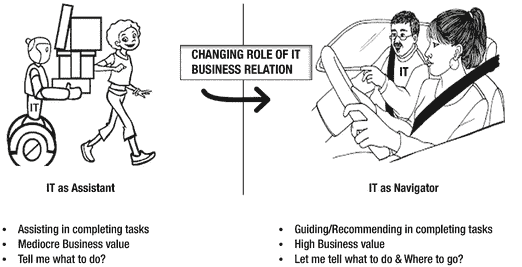
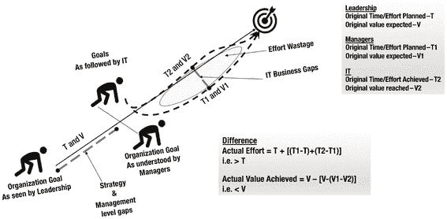
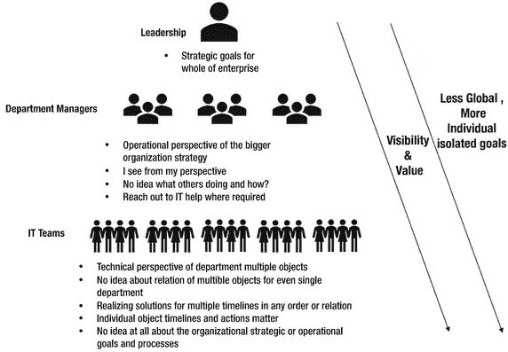
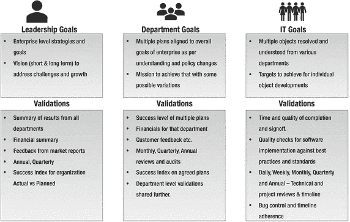
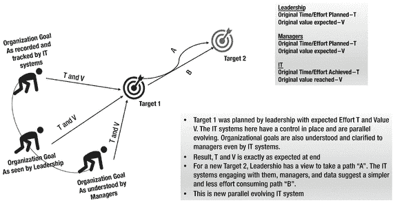
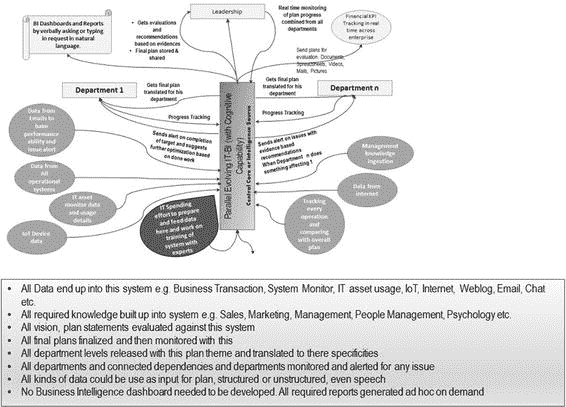
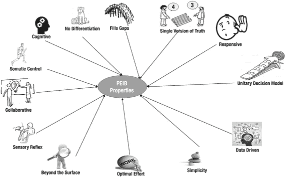
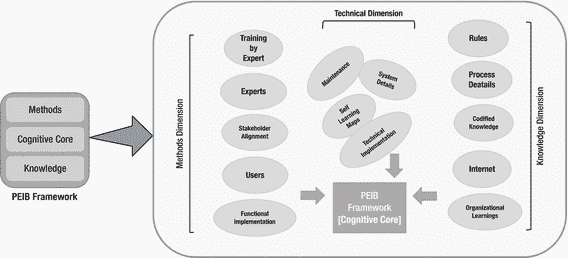

# 9. 并行演进的 IT-BI 系统

这是一个新概念，我相信这是 IT 格局和商业智能系统应该演进的方式。我称之为“并行演进的 IT-BI 系统”（PEIBs）。

注意

我们一直在讨论已经存在的概念（人工智能、机器学习、认知计算等）。不过，有时我也深入探讨了一些预期具备但尚未完全实现的能力。同样，在本章中，我们将讨论一个我经常提到的假设：“并行演进的 IT-BI 系统”。

## 我们接下来该何去何从？

IT 与业务之间的关系是什么？谁驱动谁：是 IT 驱动业务，还是业务驱动技术进步？这是一个先有鸡还是先有蛋的问题。

我将尝试讨论其中的某些方面，从历史视角开始，一直谈到今天，然后展望未来应如何构建。

因此，我们将讨论：

*   过去是怎样的
*   现在是如何的
*   之后会走向何方

我们将努力理解这个故事的方方面面，以及预期的变化及其复杂性。我们将讨论并行演进 IT 系统的概念。

在本章中，我们将始终围绕 IT 与业务之间的关系展开讨论。我们知道，业务从事的是其自身职责范围内的活动，而非 IT 的职责。但我们之所以在整个讨论中将 IT 和业务放在一起，是为了找到它们之间最佳的合作方式。因此，在图表和对话中，我们看到业务和 IT 总是紧密相连；这突显了 IT 工具和应用程序在确保业务能够更好地进行日常行动中的依赖性和主要作用。这不应被理解为业务工作由 IT 来执行的情况。

## 当今的 IT 与业务关系

IT 与业务之间有着悠久的合作关系，这一点无需赘述。IT 技术的发展始终围绕着解决业务问题，正如任何科学领域所做的那样。但它也深受业务需求方式的影响：例如，考虑业务的不同时代和概念、市场状况的需求以及全球化的挑战。这意味着，在某个时间点，有人（或许多团体）想到要创造一些东西来帮助业务解决问题，从那时起，它们便并行发展，相互促进。IT 的发展不仅受限于当时业务需求的范围，也受限于技术进步。有许多技术远见者思考着未来的业务问题，但他们过于超前于时代；由于技术可能性的限制，他们束手束脚。近年来，处理能力、内存芯片等方面的进步，帮助实现了很久以前最初构想的东西。鉴于这一切，我们应该始终注意，业务是发展 IT 的核心，因此它驱动着 IT，并将继续如此，因为 IT 遵循的是业务用例。但随着 IT 的不断进步，它在业务运作中扮演了更重要的角色，并从自动化角色转向了咨询角色。

让我们首先简要地按时间顺序回顾一下 IT 与业务的关系。

图 9-1.

IT 能力的时间演进

IT 与业务之间的真正关系始于自动化时代，大约在 20 世纪 80 年代。在此之前，IT 更像是一个操作员或一个巨大的计算器，而不是我们现在所拥有的特定人员或部门。相反，IT 主要与维护和修理相关。

### 业务与 IT 的范围

首先，让我们了解一下传统意义上的 IT 和业务是什么，以及新趋势是什么。只有在我们理解了它们的范围之后，才能讨论它们之间关系的时机和趋势。

根据法律定义，任何为了盈利而运营的注册或未注册的商业组织都被视为“业务”。但本书的范围并非法律层面，因此我们采用另一个相关且适合本书讨论的定义。

业务是指为企业创造收入过程中的每一个人，从最高领导层（例如，CXO、董事总经理、总裁）到执行实际运营的一线人员；所有人都在某种程度上是业务的一部分。对于 IT 而言，这些人都被称为“业务”。

如果只考虑直接执行业务运营的人员，那么处于战略角色的 CXO 级别并不直接被视为业务。这是 IT 服务提供商在日常用语中的理解，即他们的项目人员与谁互动以改进、理解和评估任何业务技术操作。但就我们的范围以及从讨论 IT 系统的角度来看，我们不会加以区分，并且会将任何创造收入、担任从运营到战略政策的任何职位或角色、并以某种方式使用任何 IT 分析或商业智能系统的人都视为“业务”的一部分。这些人了解企业的业务领域，并以某种方式遵循组织的战略指示。

因此，在本次讨论中，我们考虑企业中的三类人：业务人员、IT 人员和其他支持执行人员（从工厂工人到司机）。然而，本书将只讨论前两类。

另一方面，传统上，IT 是指组织中属于一个特定部门（称为 IT 部门）的所有人员，他们负责根据业务需求或作为日常工作，以一种或另一种工具的形式（商业智能报告解决方案、接口管理、系统管理等）来开发或维护应用程序。

他们不需要理解业务战略，甚至不需要深入了解业务流程（通用的或特定于组织的）。他们是技术极客，高度以技术为中心。由于技术如此具体，不同技术角色的人员几乎无法理解其他系统领域正在发生的事情。从技术角度来看，他们的视野仅限于自己负责的解决方案领域。一些像 SAP 这样的 ERP 技术需要人员理解功能流程（例如，SAP 功能配置任务、SAP 销售与分销、物料管理等）。这仅限于功能顾问，但对于分析、报告和战略应用，其工作团队仍然更偏向技术而非业务导向。功能配置团队更多地参与系统中的流程建模，而技术 IT 团队则负责生成分析应用、报告、仪表板等。应用的开发方式也对此负有责任。此外，最终产品的范围是固定的，因此可能被硬编码，仅包含一定程度的动态计算。

这方面有一个著名的笑话：一个人乘坐热气球飞行，意识到自己又迷路了。他降低高度，看到地面上有一个人。他问道：“打扰一下，你能帮我确定我的位置吗？我在哪里？”

那人回答说：“可以。你在一个热气球里，离地面大约 20 英尺，正以大约 20 米/秒的速度向东北偏东 30 度方向移动。”

热气球驾驶员说：你一定是在 IT 部门工作。

IT 人员说：你怎么知道的？

热气球驾驶员说：你告诉我的每件事在技术上都很完美，但仍然没有解决我的问题：“我在哪里？”

IT 人员说：你一定是业务部门的人。

热气球驾驶员说：你怎么知道的？

IT 人员说：你不知道自己在哪里，也不知道要去哪里，却期望我能帮上忙。你现在的处境和我们相遇前一样，但现在却成了我的错。

这不仅仅是个笑话。一个在 IT、业务或两者都有丰富经验的人可能写过这个。

让我们在下一节看看从这个笑话中我们能学到什么关于两者关系的东西。

### 业务与 IT 的关系：边界

此外，本节中的图 9-2 以笑话的形式讲述了我们之前讨论过的同一个故事。这是该故事的图示。

图 9-2.

IT-业务边界

IT 在企业中的许多领域都具有实用性。其中可能包括：

*   网络解决方案
*   服务器及其他资源维护
*   管理任务，如数据备份、用户管理
*   机器上的软件安装
*   修复硬件，如办公台式机
*   与所用工具相关的知识与培训
*   ERP 系统的功能配置
*   解决方案的开发或维护

我们在此只关注最后两点。在 IT 技术（主要是）与业务之间，通常存在一个鸿沟或边界（如图所示）。职能团队则处于中间地带。他们既精通软件的技术知识，也了解流程（包括通用流程和特定流程）。IT 与业务关系的成熟度体现在商业智能解决方案或基于分析的应用中，正如前几章所述，这些是游戏规则的改变者：边界越高，解决方案的有效性越低，业务价值也越低。

但这种连接或脱节是否只存在于所谓的 IT 技术部门与业务部门之间？答案是否定的。从领导层到管理层，再到基层，同样存在脱节。当指令从高层向基层传达时，流程和指令可能会被稀释或改变（有时甚至会被加剧），导致全局观和路线图丢失。职能 IT 与组织之间也存在脱节，这仅仅是因为业务流程由业务经理共享。技术 IT 则像一个卫星，完全存在于企业的技术领域组织内部。它不处理流程，而是处理对象。

组织有时会演变并产生内部 IT 组织：这样做是为了让 IT 技术部门与业务部门建立更紧密的关系。他们是内部 IT 技术人员，可以培养其对业务流程的理解，但这同样伴随着挑战、成本、重大依赖和风险。因此，这并非适用于所有情况的解决方案。此外，内部 IT 有时会失去外部供应商或多个供应商可能感受到的竞争因素，而这种竞争因素可能会促使他们提供更高的效率和更好的结果。身处内部的舒适感可能会过于强烈，甚至可能对这类 IT 投资的利润构成风险。

这一切是否意味着 IT（如目前所讨论的）完全功能失调？并非如此。有许多流程方法论（如 DevOps）和项目方法论（如敏捷）试图弥合这一鸿沟。也有一些流程和组织举措来实现这一目标，例如为每个部门设立单一联络点，与 IT 技术架构师和职能架构师紧密合作，以融入组织特色并提升解决方案的业务价值。

这种方法在 2014 年 IBM 提出认知计算概念之前被认为非常成功。这促使人们重新思考与 IT 的关系和协作。一个新的概念应运而生并发展良好，如今已融入全球的商业思维过程。我们将在后续章节详细讨论。

然而，即使在那之前，这一鸿沟也一直在被解决：诸如规划、预测分析等技术都大放异彩。用户自助报告功能有助于使临时报告更加高效。

因此，关于这种解决问题的方法，有许多相关的思考：

*   IT 与业务之间的具体鸿沟已经在某种程度上得到解决
*   这种鸿沟不仅存在于 IT 与业务之间；也存在于业务内部的多个层级之间
*   业务层面的鸿沟又会反映到 IT 与业务的鸿沟中，使其更加严重

整体的 IT-业务基础设施是这样的：先确定战略，然后列出一系列操作。这些特定的操作和流程集随后被塑造成 IT 解决方案。这些方案被分发给 IT 组织中各部门级别的经理，然后在这两个子组织之间开展工作。

我们也经常听到 IT 组织的企业负责人对 IT 供应商说：“我同意这是必要的，但需要帮助我向业务部门提出强有力的理由，让他们批准这个项目。”

因此，最大的鸿沟在于存在两个共生的组织，它们有着两个不同的核心目标。一个组织在有限的视野下，坐在其部门的隧道尽头，寻求帮助来使用 IT 资源；而另一个组织，即 IT 部门，则更专注于采用最新技术并利用其展示自身能力。它们有时都不清楚要实现什么目标，而相互之间的无知常常导致解决方案失败或质量低下，以及项目延误（大约 80%的 IT 解决方案会因各种原因而延误）。

这就是我们面临的赤裸裸的现实；在我合作过的几乎所有客户组织中，我都亲眼目睹过这一点。

这两个组织之间存在一种不安、竞争和自负的情绪。简单来说，原因在于它们拥有两个不同的目标和地位。总体目标显然是组织的成长和成功，这与它们的奖金挂钩。但在实际层面，情况却截然不同。

这并不是因为我们雇佣了两种不同类型的人。不，之所以会这样，仅仅是因为它们在同一个时间点有着不同的目标以及不同的地位——一个被视为收入创造者，另一个则仅被视为成本中心。我们可以再次列出一些关于问题原因的学习要点：

*   高层战略与基层日常政策修订之间缺乏一致性和对应性。
*   IT 技术部门和职能部门的解决方案领域已明确界定，而技术复杂性使得技术方专注于技术，业务知识则显得无关紧要且耗时。
*   需要自动化或转化为商业智能报告的部门级流程频繁变更，有时这些流程并不十分相关，且依赖于单个业务部门，而该部门自身的协作能力有限。业务部门需要报告解决方案，但无法始终有空帮助 IT 将其转化为技术解决方案。有时，甚至用户的测试也不够深入；随后漏洞悄然出现，这当然是 IT 无法接受的。
*   存在如此多的系统和复杂的架构，以至于尽管 IT 部门进行了集中化，但无论是 IT 还是业务部门，都难以将所有数据同步并从中提取意义。
*   IT 部门因其作为组织成本的责任，任何开发都必须经历完整的周期。因此，任何经过所有周期开发出来的解决方案，都必须再次等待一段时间才能看到其收益或不足。
*   有时，需求过于用户特定，这增加的价值极其有限。

由这些因素导致的一些问题可能如下：

*   在部门层面考虑 IT 开发与业务需求时，常常存在某种不清晰性。
*   上下级之间存在双向的信息损失。上文描绘的图景难以理解，因为只分享了其中一部分，无法看清全貌；从底层来看，拼图的碎片可能以不可预见的方式被分享，导致高层管理者难以追溯其有效性。
*   业务部门之间至少存在协作的可能性，这些部门已经努力用一只手获取信息，再用另一只手传递给 IT（而且，这并非他们唯一的工作）。他们还必须在此期间腾出时间评估之前提出的需求，并向高层汇报。
*   IT 部门（尤其是技术部门）以技术为中心，更关注技术专长，对业务“行话”兴趣不大。
*   技术变化迅速，这给 IT 部门带来了培训与再培训人员的开销。
*   组织与部门的整体需求不同步，以及 IT 交付流程普遍存在的混乱和长期积弊，都是巨大的障碍，它们可能导致对预期成果与实际产出之间的理解偏差。
*   在创建 IT 基础解决方案上投入的精力，往往比将其用于实际业务所消耗的精力更多。
*   对于每一种新类型的问题或需求，业务部门都必须走完项目的完整周期才能推进。

这就是常见的 IT 与业务组织的图景。敏捷方法也有其挑战。有时，它意味着大量的返工。

结果可能是，IT 部门拿出了非常技术性的东西，在付出了大量真正的技术努力之后，最终却让业务部门感到毫无意义；业务部门通常只有有限的时间来消化这些关键细节，并对 IT 部门的产出抱有很高的期望。

解决之道在于找到某种方法，将所有数据整合到一个中心位置，并自上而下地监控所有流程，以检查它们与组织目标的一致程度。挑战在于消除组织中的“褶皱”；每个部门层级都必须确保自身没有陷入流程开销之中。挑战在于实现部门之间以及所有部门向高层领导的更好协作，做到按需、实时。挑战在于让 IT 和业务拥有相同的愿景和通往目标的单一路径。

由于前面提到的原因，这很难实现。解决方案不能仅仅以流程为导向。它还必须包含技术，因为技术在这里也扮演着同等重要的角色。技术在它能够构建的能力以及已经投入的各类资源方面，都起着关键作用。这也影响了人们的工作方式，因此它们不能被割裂开来。

## IT 与业务关系：走向何方？

直到最近，IT 还一直是支持系统。它至今扮演着非常重要的角色，但并非处于主导地位；相反，它处于辅助地位。如今，随着市场维度的变化和业务日益数据驱动，IT 已开始崭露头角，成为业务的导航者。

图 9-3.

角色转变 - IT 与业务

在本章开头，我们提到了一个“先有鸡还是先有蛋”的问题：谁驱动谁？是 IT 驱动业务，还是反之？我们得出的结论是，业务驱动了 IT 的存在，但 IT 也以其能力驱动业务，并扮演着重要角色（如上一节“并行演进的 IT-BI 系统”所述）。

当今和未来的业务面临着许多前所未有的新挑战，例如以下一些方面。

### 全球经济

如今业务已处于全球层面。由于竞争也处于全球层面，制胜因素已不再那么线性。业务通过电子商务进行；讨论在社交媒体上如野火般蔓延。

企业无法在地方层面，甚至国家或大洲层面推行政策。重要的是全球存在感和全球性政策。业务需要比昨天和今天更具协作性，并考虑具有前瞻性的解决方案。决策应更加稳健和及时。平庸已无意义，卓越表现才是新的平均水平。愿景和精力不应花费在探索所有可能的机会上，而应立刻直达经过智能筛选的目标，然后在正确的时间投入正确的精力聚焦于此。全球市场更具动态性，影响所有地点的参数更多，因此，整体增长和愿景有可能在瞬间转变为业绩下滑。对快速变化的市场、动态定价以及必要的损害控制的理解，必须达到全球规模。

组织的地理差异可能带来成本，更不用说地方部门层面的差异和缺乏协作了。

所有这些都意味着需要更强大的 IT，因为仅凭人类的认知能力无法在如此规模下运作；无论人类认知多么出色，都无法处理如此海量的信息。

这意味着两件事：

*   更紧密的业务与 IT 关系
*   应用程序需具备企业绩效与指标的整体视图

举个例子，两个从事类似业务的主要竞争对手可能位于不同的大洲，拥有完全不同的内部部门设置。但竞争依然存在。

如果不够警惕和缺乏竞争，现在非常流行和革命性的东西很容易被超越（例如，诺基亚手机，甚至 iPhone）。它们曾面临来自基于安卓系统的三星的竞争浪潮。新的 iPhone 设计也与其以往的风格有些偏离；这似乎是全球挑战带来的影响。所有这些信息和业务关键绩效指标（KPI）都必须迅速处理，而这需要更紧密的 IT-业务整合。

我甚至在最近注意到，以前在 CXO 级别没有 IT 代表的企业，现在也开始设立了。IT 已经进入了董事会。

### 海量数据

由于上一节讨论的各个方面，甚至由于与制造或服务相关的新技术（例如，使用物联网传感器的技术），数据变得极其丰富。

数据从 KB 级别开始，然后发展到 MB 级别；当制表计算机出现时，兆字节（MB = 1,000,000 字节或 1e+6 字节）已经非常巨大。IBM 曾开发出一个能装进卡车的 MB 级驱动器。近年来，即使是太字节（1e+12 字节或 1e+6 MB）也被认为是高容量。凭借所有的技术优势，我们已经进入了拍字节（1e+15 字节或 1e+9 MB）的范畴，并且很快将迈向泽字节（1e+21 字节或 1e+15 MB）。这还有另一个维度：非结构化数据的组合。数据湖已经形成，它们实际上无法在当前 IT-业务关系的模式下运作。

### 分析

基于分析的应用程序已经变得普遍，并在市场上站稳了脚跟。这也需要 IT 和业务的更紧密整合；没有这种整合，它将根本无法运作。这不再是关于带有下钻、切片、切块功能，或具备一定动态计算和筛选能力的静态报表。这是关于围绕数据运行数学模型，理解数据和业务需求将 IT 和业务紧密联系在一起。它们必须同步运作。

### 上市速度

在这个互联互通的世界里，约 50%的人口使用互联网，市场瞬息万变且反应迅速。产品版本的生命周期很短，很快就会被市场上的其他策略所取代。研发与营销必须与销售同步协作，确保三者共同生成并推出相关的服务与产品，以满足市场需求。需要利用潜在的需求和供应链估算，快速制造并推出各种变体产品。这一切都需要高质量的 IT 资源，这意味着 IT 将扮演更重要的角色，且 IT 与业务之间需要紧密合作。

### 客户关系

企业外出进行调研、聘请专业公司，甚至利用内部业务数据结合调研数据来划分主要客户群体或细分市场，并针对他们推出产品和服务，这样的日子已经一去不复返了。如今，客户分类变得更加精细，甚至已经细化到单个客户层面。现在需要的是触达每一位客户并获取他们的反馈。得益于这个互联的世界，企业可以获取客户所需以及他们的详细信息（但同样拜这个互联世界所赐，坏名声也会像野火般蔓延，这构成了挑战）。渠道众多，因此监控所有渠道的挑战也同样巨大。例如，Facebook 或 Twitter 上每天都有数十亿条帖子；一条错误的帖子可能在几小时内就复制传播给数百万甚至数十亿用户。这也使得实时数据的可用性要求变得至关重要。

当下的需求是理解每位客户所获得的收益，然后向他们推销他们愿意接受的产品。必须在这方面建立起差异化优势。

客户关系及此类数据也需要 IT 和业务部门通力合作，共同制定以业务核心为中心、并由单个客户层面的数据驱动的解决方案。他们应携手实现并持续优化此类解决方案。

### 向内审视

在第 7 章中，我提到瑜伽有句谚语：“先向内看，而非向外看。”这同样适用于当前所需的优化水平。内部的冗余和僵化流程应分别予以理顺和清除。这意味着存在一种非常规的可能性，即衡量较小组织单元相对于整个企业机制和总体目标的绩效。应基于组织的整体图景进行比较，以剔除或改进；这应当由数据驱动，而非基于直觉或个人好恶（无论是亲近还是排斥）。

组织应能根据每天面临的挑战动态调整。关键绩效指标（KPI）应在不断变化的情境中得到关注，以使其适应变化。在全球化的商业世界中，财务管理变得更加动态，应关注所有可能的参数以保持其稳定。

因此，应建立动态的内省能力。应在内部创建价值链，并在变化的情境中持续优化。这指向了设计 IT 战略解决方案时需要采用迭代方法，并且需要深入的业务理解与 IT 能力协同合作，才能创造出奇迹。需要的是端到端的解决方案，而非互不兼容、无法协作的零散方案。这些解决方案只有在以下情况下才能实现：

*   高层与基层之间紧密协作，且所有部门都相互连接
*   这些部门再次与 IT 部门或利用此类资源进行紧密协作

### 协作是关键

如今比以往任何时候都更需要协作，并在全球层面关注 KPI。一旦我们开始与 IT 部门紧密合作，开发出能够与其他系统集成而非孤立运行的解决方案，这一点就能实现。与 IT 的协作和标准化能够创建出可与其他系统协作的应用程序，从而构建起一个协作的技术框架。

还存在其他挑战，如营销、销售和供应链，它们成为在更大平台上运营的企业的决定性因素。所有这些都需要 IT 和业务部门共同努力，拿出联合解决方案。

这就是未来的发展方向。

## 什么是并行演进的 IT-BI 系统？

这应当是面向业务的 IT 新形态，以及面向 IT 的业务新形态。让我们来看看具体如何实现。

关于 IT 与业务组织之间的问题和关系鸿沟，我们能提出哪些论点？让我们来看：

*   业务部门仅将 IT 视为一种支持工具，这便是 IT 在组织中的地位
*   业务部门在全球市场面临上一节所列的挑战
*   业务部门需要快速演进以应对这些挑战，但担心复杂的流程以及所需 IT 资产的创建。流程变更或功能必须以需求的形式提出，并经历完整的开发周期。
*   IT 解决方案是在某个时间点被请求和设计的硬编码解决方案（包含一些动态计算），而这个时间点往往在项目延误中早已被遗忘；当它准备就绪时，队列中又出现了另一个需求，并且该需求在当时已占据优先地位。但 IT 部门仍需先完成第一个需求的所有步骤，以确保其能够计费。
*   IT 部门紧跟技术发展，不断更新升级，并率先创建新的解决方案和应用。但在企业内部，业务部门仍觉得 IT 像一块绑在腿上的石头，拖慢了他们的速度，而非推动他们前进——而 IT 本应与业务携手并进。这里显然出了问题。
*   总体而言，任何企业都有成千上万的流程嵌入到业务 IT 解决方案中，却无法追踪那些陈旧、无用且老化的解决方案，它们正在消耗资源和时间。有时，这还会带来不相关的信息。
*   并非所有人都能看清全局，甚至 IT 部门也完全看不到。IT 部门在各自为政的孤岛中工作，而这也正是人们对它的期望，所以这并非指责。

尽管业务成功是这一切安排的最终目标，但它们却在相互掣肘。业务和 IT 存在于同一组织，却处于两个不同的时间框架，朝着两个不同的方向运行。它们需要像接力赛一样朝着同一个方向奔跑，而不是在赛车比赛中相互竞争、争先恐后。在这种情况下，它们的道路或许偶尔会交叉，但中间存在着太多的偏差。

图 9-4 从实际投入和价值期望的角度描绘了整个情况。这清晰地展示了，当从高层管理层传递到业务经理，再进一步由 IT 部门实现时，时间线和投入是如何增加的，而最初预期的业务价值却相对下降。

图 9-4.

价值期望的偏差

同样的情况也可以从另一个角度来看。针对图 9-4 中所示各个群体的原始目标和转化后的目标，让我们看看当它们被整合到图 9-5 中时是什么样子。

这两张图将成为后续讨论的基础。

图 9-5.

不同的议程

如果我们总结这两张图的细节，就能更清晰地看到问题所在。我们也可以说，问题并非由某个人造成，而是由情境，或者更确切地说，是对情境的控制所导致的。

考虑一个关于番茄酱工厂中番茄应如何放置在长滚筒上的情境。收获的番茄会进入不同层级的滚筒，在那里被清洗、分拣，然后送去加工。这里重要的是滚筒侧面的小挡板，它可以防止番茄在中间掉落；这就像是一种控制。同样，从顶层到底层，再到 IT 部门，所有行动中都需要设置控制，其精髓和控制力应被统一应用，并持续驱动直至终点。

与此非常相似，IT 与业务之间的所有这些架构，都是随着 IT 部门的出现以及 IT 角色和范围的不断扩大而开始的。随着时间的推移，它们发展成了一个独立的 IT 组织，但相应的控制机制却没有得到多少发展。

那么，我们是否意味着控制将有助于推动 IT-业务场景的演进，并且更好的关系会提高整体效率？

为什么之前没有人想到这一点？嗯，在项目、项目和收入管理层级上已经存在控制；在 IT 组织层面也有管理控制，这个角色需要范围指导和度量指标。

但如果我们仔细审视这两张关于问题或解决方案主题的图，价值损失和投入膨胀仍然存在。愿景因素以及与业务的联系仍然存在差异。

问题之所以存在，是因为控制的目标。由于需要紧密的关系，IT 和业务必须共同实现目标，但质量控制和其他类型的控制在它们之间以及组织所有其他部分之间都存在差异。那里没有统一性。差异不仅仅在于获取输入并将其传递到下一层级。在衡量回报价值和度量指标方面也存在挑战。甚至负责的人员和时间线也可能不同。因此，我们可以针对一个目标或目标的达成，在多个不同层级和并行世界中衡量结果、价值和成功因素。如果每个领域和每个层级的标准都很困难，那就意味着我们没有真正统一的衡量程序。

所衡量细节的粒度也可能不同。存在所有这些差异，我们无法期望它能接近完美。当我们在全球市场上说“卓越才是新的优秀”时，这种接近完美的状态显然行不通。

总体目标首先被分散成碎片，这些碎片随后进一步失去其特性，并使用不同的使命宣言、价值宣言和 KPI 来衡量；这怎么可能平衡呢？

我们现在就来探讨答案。首先，请考虑图 9-6，它是对我们刚才所述内容的图形化表示。它将帮助你记住并总结我们目前的理解。

图 9-6.

不同的议程和验证点

所以，现在我们看到了在三个相互关联的领域中各自的目标和验证。这只是一个简单的例子；在现实中，情况可能更广泛。

还能实现哪些更好的结果？请记住，直到最近，这仍是标准的组织架构，而非有缺陷的架构。但这种设置已不再是常态，也不应该成为常态，因为如果我们有不止一个目标，且工作方式不相似，验证也不是通过单一的控制设置来完成的：系统可能很好，但它并非随着当前和未来的需求而演进。IT 应该与业务演进的需求并行，沿着同一条虚线，在可用性和控制方面共同演进。这并非推理或领导力上的缺陷；以前根本不可能做到这一点，因为技术是限制因素。

IT 不应仅仅是 IT，与业务相关联，而应该有一个 PEIB。它应该是真正意义上的商业智能，而不仅仅局限于报表。商业智能应该由 IT 能力来促进，并融入管理的结构之中。它应该是一条与之并行编织的线，相互交织，既不疏离，也不超前或落后于它。

它应该成为导航者，赋能业务不仅能够自动完成事务，还能在能力和可用性上更进一步，成为企业的精髓。它应该从人们手中接管计算器和机器人式的活动，通过接管最适合它们完成的任务，帮助人们自由协作。它应该自然地成为系统的一部分。

并行发展的 IT-BI 体系应成为主流，使 IT 与业务融为一体。实践中，IT 与业务部门仍可保留，但关系与工作协同方式必须改变，转向相互补充、相辅相成。

这种运作模式具备哪些特性？我们应如何实现这种并行发展的 IT-BI 体系（PEIB）？

这些问题将在下一章详细解答；本章我们先探讨第一个问题。

PEIB 可定义如下：“IT 系统自然顺应业务需求演进，实现自我管控，并引入自动与按需验证机制，以衡量业务成功的关键绩效指标（KPI），同时将自上而下的政策与策略完整覆盖，作为业务流程与行动中不可分割的自然组成部分。该系统由业务需求驱动，而这些需求有时又源于其自身行动与流程所产生的结果。”通过图 9-7 中同一场景的描绘，我们可看出差异。若与本章类似示例对比，差异显而易见。

图 9-7. 借助认知能力实现目标路径与价值

IT 拥有一个控制系统，不仅有助于记录目标，还能帮助业务理解并厘清全局图景。它将分散的拼图整合为单一结果呈现给领导层，助力实现预期成果，并至少以顾问角色指导如何达成下一个目标。之所以能做到这一点，是因为该系统掌握了各部门的所有成果以及全部可用知识与资源。

这正是人工智能、机器学习和认知计算能力的正确运用。这便是全新的商业智能。

### 该系统置于何处？

该系统置于现有 IT 系统内部，无需关闭现有 IT 系统与工具。它作为管控与治理主体，位于现有系统之上，具备认知能力。

现有系统仍负责运营任务与报告生成。这种新方式则对其进行了优化。

业务部门专注于业务活动，无需关心数据如何准备。IT 人员负责设置数据加载、标注数据、训练并维护系统，不涉足业务术语。系统则致力于帮助业务部门专注于其最擅长的任务。

用于报告生成的 IT 系统复杂，商业智能的建立耗时费力。当前这种开发方式已不再必要。PEIB 系统是一个实时系统，在认知能力的支持下持续学习。

认知计算与 PEIB 之间是否存在差异？

技术上没有差异，但功能上存在差异。PEIB 将利用基础认知框架来达成结果，而 PEIB 框架则有助于确定如何运用这些认知能力，以及围绕它应建立怎样的组织架构来支持 PEIB 能力系统。PEIB 是在组织内部实施的一种方式；它不是工具，而是一个流程和框架。因此，PEIB 是一个需要采纳的概念，以便最大化利用认知计算及所有资源（人员、流程和技术），从而最大程度减少当前 IT 与业务相关挑战所引发的问题。

在了解了认知计算及相关概念后，我们对其能力已有所熟悉。但 PEIB 这一概念将为我们提供一种实践方法，使其在实时组织中得以应用，作为更高阶的商业智能系统，助力组织更好地发展。

在探讨 PEIB 应如何部署、如何融入协同体系之前，我们先看看当前的做法。

我们拥有多层级决策机制；在顶层，决策由愿景驱动。愿景驱动使命与战略。大多数情况下，这些愿景由一人或多人基于个人抱负或自身认知的事实所驱动。他们在将其强化为愿景之前，确实会考虑一些事实，而决策便由此开始。愿景是所有后续行动的第一步，随后引发连锁反应。这是整个体系中最具风险的部分。若愿景有误，其下所有环节都将面临风险。个人情感因素及认知偏差也可能在此发挥作用，导致愿景被稀释或产生缺陷。

随后，愿景根据组织及组织架构的相关事实转化为使命。使命被传递至各部门执行，各部门将其转化为自身的操作语言并付诸实施。在此过程中，IT 负责提供工具以整合数据、发现模式、促进沟通等。

有必要在系统架构和流程中战略性地部署认知能力，以控制这些疏漏或偏差。这也能控制 IT 应如何工作及其原因。

那么，让我们通过另一张图来看看 PEIB 应如何在系统与流程中部署。图 9-8 大致描述了 PEIB 的概念。

图 9-8. PEIB 系统概念

业务、IT 以及一个新成员——具备超级计算能力的认知系统——现在构成了三方。

如前所述，团队中的第三方充当中央控制角色。

业务仍属于业务领域，IT 人员仍属于 IT 组织。但关系已发生改变。两者不再直接连接，而是都与这一中央资源进行交互。这便成为掌控全局的新中央商业智能。商业智能这一术语的范围不再局限于 BI 报告和仪表盘，而是扩展至一个全新的、更宏大的范畴，囊括了整个企业的业务。

IT 主要负责为该系统提供数据并训练它。IT 的职责是确保所有必需的知识都被注入该系统。知识图谱需借助充足的训练数据生成，并由内外部不同专家协作训练系统。理想情况下，此类系统应预装所有必需的知识领域。组织数据也被输入，并在业务部门的协助下进行训练。所需的用户界面由 IT 创建，而网络、服务器备份与维护（企业级）、访问管理及软件安装等运营工作，仍是当前 IT 与业务交互的主要领域。但针对报告、分析工具、其他仪表盘开发等的需求收集工作已不再需要。IT 中与根据业务规则配置 IT 系统相关的职能部分，可暂时保留，并逐步移交至这一中央超级计算核心。该超级计算核心还拥有一个或多个自己的用户 ID。IT 承担越来越多与数据准备、标签化及接口管理相关的通用活动。这些是核心技术要求。数据上传后对系统进行训练，将是唯一需要业务部门协助监控的环节。

现在，业务部门的所有需求都直接与这一系统交互，而不再与 IT 部门打交道。

### 执行计划

让我们从愿景或计划的起点开始，看看其与预期的差异，然后评估预期的时间/精力投入以及价值产出。

领导层根据全球形势和业务驱动因素，构思出一些新的愿景和指令。他们使用带有图片和图表的 Word 文档模板来规划这些内容。他们手头有一些网站博客示例和电子表格中的业务数据，正在整合这些资料，以确定如何最终确定并完善这一新的愿景声明及其旗下的各项新使命。

他们有一个由十人组成的董事会，正在举行讨论会，其中一些人在本地，另一些人则远程接入。

讨论开始后，他们就产品的新变体应该是什么，以及应该在六个月内计划进入哪个新领域，提出了某种愿景；基于讨论，他们计划从某些欧洲国家开始。他们认为这将是他们业务的下一件大事，并就此得出结论。现在，让我们倒带：在他们得出结论之前，他们将同样的问题提交给认知中央系统，并提供了所有细节，如文档、图片、图表、视频、博客等；同时，在系统聆听时，他们口头陈述了自己的论点。他们还提到了用于计算的某些业务数据。

认知系统提出，如果选择地点 A 作为新产品的制造地，可能会出现某些潜在的供应商问题，并基于事实提供证据，例如天气问题、地震风险、根据最新新闻可能出现的政治问题，以及之前与该地区原材料供应商打交道的整体经验。系统根据这些细节，建议将产品制造地点从 A 改为 B，并提供了证据。此外，它还建议分阶段启动，并从某个更有可能消费此类产品的地区开始。系统还从网络上找出了与所分享的博客类似的文章和反馈，并提供了详细的分析。考虑到这些建议，董事会决定按照这个认知代理的建议来执行计划。这个计划甚至清晰地预测了哪些供应品应该来自哪个供应商，成品应该通过哪个分销渠道运输，以及根据展厅当前销售情况确定的分配比例。该计划还详细说明了其对各部门收入和成本的影响，以及预测的在三个月、六个月和十二个月内的利润影响。

相关的推广渠道也经过了权重评估，并对现有和未来客户进行了恰当的分析。这个计划包罗万象。领导层对基于证据的解决方案感到满意，并要求系统将其付诸实施。

一旦付诸实施，该计划就会被传达给相关部门，并根据各部门负责的部分进行翻译或分解，同时注明对其他部门的依赖关系（如有）。系统会持续监控每个部门的进展，并实时从所有部门的总结果集中生成全局图景。这为领导层提供了关于计划在各个部门层面以及整个组织层面的推广和执行状态的实时监控。

各部门会及时收到提醒，对于任何功能步骤，他们都知道如果遇到困难，可以随时请求系统指导他们选择最佳方案。

系统会持续监控计划，并从绩效角度对照里程碑和质量验证检查点进行检查。如果计划整体运行不佳，需要在部门层面或整体层面进行某些更改，系统会发出警报，让领导者或管理者了解哪里出了问题，以及应该采取什么措施来解决。

另一个方面是报告。报告在发明之初，以及像 Business Objects 这样的产品开始进入市场时，曾被视为福音。如今，这么多年过去了，显而易见的一点是它们开发的复杂性。产品本身很好，但在使用之前需要根据特定需求进行开发，这意味着大量的资金和时间投入。还有其他复杂问题，比如延迟、冗长的后端阶段、ETL 等。因此，报告受需求驱动且完全依赖开发周期是一种限制。你需要提出某个报告需求，然后你的“武器库”中就会有一批特定的报告可供使用。明天出现了新的信息需求，就得再制作新的报告。还有另一个方面：随着时间的推移，创建了许多报告，但其中一些在过了一段时间后就从未被使用过。看到一个长期运行的系统拥有 20,000 份报告，而统计数据显示过去两年中只使用了 150 份，这并不罕见。这也表明报告需求有时是多么短暂。

所有这些努力很快就付诸东流，然后又需要新的报告。临时报告是当今可用的一个不错选择，用户可以通过自己动手来创建自己的报告。但这也有局限性，比如后端需要准备好数据，并且只能在为该报告定义的范围内实现。

这一点也被 PEIB 概念系统所解决：无需创建仪表盘或报告。使用这些系统和数据，可以即时创建报告，对需要显示的组合没有任何限制。这甚至可以通过简单的自然语言来实现。

因此，如果坐在房间里的经理正在讨论数据的某些方面，想从某个特定角度查看数据的样子，无需找人创建报告，也无需将数据提取出来加载到电子表格中进行转换。只需使用组织或业务领域中使用的术语，用简单的英语询问系统即可。

这也是此类 PEIB 系统概念最重要的特征之一。

因此，这些系统是以认知能力为核心辅助的商业智能系统：它们围绕业务需求而演进，而业务反过来也围绕认知能力而发展。

这些 IT 商业智能系统随后会随着时间和需求的变化而自我演进，这是并行演进的 IT-BI 系统的最终归宿。

## PEIB 框架的属性

正如本章前面所述，PEIB 系统的核心是认知能力。

但是，仅仅在中心放置一个认知能力机器，没有任何结构，是行不通的。应该有一种方法来利用资源以最大化收益，并控制组织目前正在努力管理的冲突和生产力损失。

PEIB 必须被恰当地安置，否则，在已经存在的众多“白象”之上，系统本身也可能成为一个“白象”。我们将在下一章讨论这些问题。在此之前，让我们熟悉一下 PEIB 究竟会是什么样子，以及这样一个系统应具备哪些属性。

图 9-9 展示了在遵循此框架时需要牢记的一些关键属性。

图 9-9.

PEIB 属性

### 认知能力

正如本节开头所述，PEIB 的核心由认知能力驱动，它将所有能力融合为一体。认知能力只是整体系统架构的一部分，旧的运营/事务系统并不会被其取代。它的存在仅仅是为了统一现有系统的效能与能力，并对所有可能的方式施加控制，以最大化利用人员、流程和技术——这三者被视为同一框架下的三大资源领域。

认知能力包含内部所有类型的知识：它们可能以人为中心，例如人力资源、心理学、情感分析等；以流程为中心，例如市场营销、销售等；或以技术为中心，例如系统和网络知识。

### 无差别化

PEIB 框架及其驱动系统不对人员、流程和技术资源进行区分。它们平等地帮助管理这三者，这同样包括层级最高层的决策者。因此，该框架以统一的视角和唯一的目标看待一切，即最大化企业的效益与可持续性。

如果它有助于监控从底层汇总到顶层的成果绩效，那么它也会对高层管理提出的方案进行验证，通过评估其即将做出的决策的利弊，使其更基于数据驱动，而非仅凭直觉或经验假设。基于经验的决策并非不好或无用。它能迅速将决策引导至适合当前情况的正确选项范围内，在此基础上，系统再通过数据驱动的事实使其更加精准。

### 填补鸿沟

从顶层到底层存在多个纵向层级，也存在多个横向层级。信息通过这些渠道流动。很有可能，即使信息被完整发送并在另一端被接收，某些关键信息仍会被以不同方式理解。因此，一份使命宣言可能传达到各部门，如果没有持续的验证控制来监控由此产生的计划和行动，各部门可能会在很大程度上偏离该宣言。这种情况可能发生在所有层级。PEIB 框架有助于防止这种情况，因为它会验证由此产生的部门级计划，直至每个层级，并持续验证其所见的成果，包括任何偏差。这避免了任何鸿沟的出现。这是该框架能够实现的重要特性之一。

### 单一事实版本

成功的秘诀在于拥有一个单一事实版本来监控并实现成功的执行。但由于信息被感知的方式以及组织各部分执行整体行动计划的不同部分，这个版本在每个层级都会发生变化。因此，对于销售部门而言，是达成高销售额；对于技术开发团队而言，是在新的销售运营中拥有最少的缺陷并遵循开发时间表；而对于计费团队而言，则是确保计费和回款按时完成。因此，关键绩效指标各不相同，有时甚至不同步。当战略目标是推出新产品线以获取更高利润时，整体图景就丢失了。最终，即使所有部门都竭尽全力去实现目标，也可能发生他们遗漏了与新产品线相关的关键战略要素的情况。在这场混乱中，目标是通过销售旧产品线实现的，而并未专注于新产品线，因为初衷本是停止生产旧产品。

如果使用 PEIB 框架来监控单一事实版本（即使是针对战略），这种情况就能得到很好的解决；每个部门都可以通过计划的关键绩效指标看到目标达成追踪情况，而整体管理层也能看到同样的信息。任何偏差都会向所有人发送警报，以使其重回正轨。如果市场部门计划投放新广告，但展示的元素并未推广新产品线，而是坚持推广旧产品线，系统就会提供反馈，表明这偏离了计划。

总的来说，所有决策和计划的制定都着眼于核心的单一事实版本，并且也以这种方式进行监控。

### 躯体控制

生物科学使用术语“体”（身体）和“心”。与身体相关的事物是躯体性的。非常类似地，PEIB 也展现出对整个企业及其内部运行的各项计划/使命的明确的躯体控制。它作为一个企业整体运作，而不是作为多个同步运作或试图同步运作的独立机构或子组织。这创建了一个单一企业体的抽象概念，该企业体对所有情况和活动拥有完全的控制权。

一旦企业拥有一套使命和运营或战略计划，它就会被分发到整个组织并进行监控，以便向计划目标迈进，就像一个人或机器人协调移动其四肢以到达目标一样。这看起来有些抽象，但这就是 PEIB 系统通过工作分配和控制层级所呈现的方式，其中人员、流程和技术等不同组成部分协同运作。

### 感觉反射

PEIB 系统具有非常独特的感觉反射和控制特性。身体、心智与反射共同作用，向心智发送警报，使其能够自动采取预设行动，以保护身体免受重大伤害。这就是反射的工作方式。

PEIB 系统也展现了同样的特性。它们可以在紧急阈值被突破时发送感觉警报。例如，系统级警报被 PEIB 框架自动解读，该框架使用用户 ID 和密码执行系统备份和重启。这可以保护系统免受损害。另一种场景是，某个部门的行动可能因造成性能问题而损害另一个部门。系统可以发出警报，并就可能采取的路径提出建议。这种旨在在损害发生前或风险水平达到阈值时控制损害的警报监控系统，就如同感觉反射一样。这是其一个非常重要的特性。

### 统一决策模型

我们在第 7 章中讨论了受偏见污染的决策过程，本章也涉及了部分相关内容。我们深知，在企业整体愿景和关键使命的范畴内，制定规范来约束决策行为是多么重要。

每个层级（纵向或横向）做出的决策，都应呼应自上而下设定的政策或使命。这些决策可以是复合型的，也可以是单一型的（即由单一使命或一组使命驱动）。

PEIB 框架有助于实现这一点。该系统密切监控每个部门及子部门层级，确保在最细微、最基础的运营层面做出的每一项决策，都能与更高层级的使命相呼应。这本质上就是为了确保运营效率。

例如，交叉销售和客户忠诚度是某企业在某一年度的两个工作重点。这一使命体现在该年度各个层级的每一项政策中，并由 PEIB 框架进行监控。示例如下：

*   财务部门确保用于生产和采购商品的预算，能够使我们拥有可供交叉销售的产品。一旦预算分配方式倾向于无法实现这种预算组合，PEIB 框架会立即将其标记为红色，视为偏差。一旦系统提出调整建议或经系统调整后，该指标会显示为绿色。
*   供应商和客户部门提出的计划，如果经此系统验证后发现其未能遵循上述使命，也会收到红色警告。实际上，供应商团队会收到系统推荐的供应商名单，这些供应商能够为所有或大部分待生产的交叉销售产品共同供应原材料，从而降低成本。客户管理部门则会收到此类可能购买关联产品的客户数据推荐。
*   各工厂的生产计划将只能生成确保即将交叉销售的产品以正确组合方式生产的方案，别无他选。相关建议将由 PEIB 框架生成或由其验证。
*   物流和供应链部门将确保将正确组合的交叉销售产品发送到正确的门店目的地。

这些只是部分示例，说明了每个层级的决策应如何呼应一个或多个使命，以及 PEIB 框架应如何管理这种统一决策模型。

### 响应性

这是任何组织最重要且长期渴望的特性之一，因此也是 PEIB 框架的一个非常重要的特性。

企业一直希望拥有一个响应性极强的内部环境，以便能够快速适应不断变化的需求或时间框架。建立这样的环境是一项耗时且艰巨的任务。

实现这一目标一直面临挑战，因为响应性与协作和及时升级息息相关。这说起来容易做起来难。我们在本章前面部分已经讨论过这些挑战。

市场中的成败可能就在于此。企业要么沉没，要么扬帆。诺基亚就是一个例子。其内部组织未能仔细倾听对市场变化的回应。研发工作正朝着新时代智能手机的方向进行。他们甚至制作了基于互联网的智能手机原型；事实上，诺基亚是最早考虑这一点的公司之一。但由于各业务部门之间缺乏合作，他们未能将重点放在软件上。苹果和安卓系统将其取代。一个组织的响应性应通过所有可能的可能性进行充分评估，这样才能确定应对变化的正确响应水平。而这正是 PEIB 框架发挥作用的地方。如果诺基亚当时拥有 PEIB 框架，该框架就会捕捉到关于新操作系统的消息，并对该选项进行理性的、基于证据的研究，而这一选项可能会被一些有影响力的决策者视为无关紧要而忽略。

因此，这不仅是首要特性，也是 PEIB 框架必须存在的原因。

### 核心协作

设想一个企业，管理层做出的决策是数据驱动、基于证据的，并辅以最先进的预测分析。整体建议也是一个知情决策，它比较了所有相关的新闻和研究论文，无论是市场营销、销售、一般商业，还是相关的科学和政治/地理信息。所有相关的商业事实都已摆在桌面上，并且是最新的，以辅助决策。管理层只做他们擅长的事情：定义使命、设定目标和撰写使命宣言。

另一方面，经理们则忙于根据经验做出决策，并在此方面获得 PEIB 框架的验证支持。

所有经理都无需事先规划他们希望在组织内各级协作之前，以报告、仪表板和书面总结形式呈现的内容。这是 PEIB 框架的一个特性。

因此，人们无需进行前置准备和报告整合。在这些都处理妥当后，他们可以将办公桌彼此相邻摆放，尝试各种形式的规划和协作。这种核心协作是 PEIB 框架的一个非常重要的特性，能够提高企业的整体效率。

### 最优投入

所有益处和控制措施也有助于防止精力被错误地消耗，或者防止在正确的地方投入不足。这种监控水平以及持续与全局进行比较，也能帮助 PEIB 框架了解哪些流程是不必要的、缺失的或过于复杂的。

这意味着一个精益且高效的组织。所有不必要的冗余和缺陷都会被识别并修复。

这是 PEIB 框架的一个重要特性和良好副作用。

### 简洁性

列奥纳多·达·芬奇说过：“简洁是终极的精致。”

这位天才的言论毋庸置疑。假设有一台机器，需要每分钟拉动、推动或旋转几十个操纵杆才能运行。这台机器能制造东西。再比较另一台机器，它只需按下一个按钮即可运行，任何需要的操作都通过一个简单的交互式触摸屏完成。此外，还可以根据需要编程实现自己的工作流程或功能。你会买哪一台？

显然是第二台。你可以更专注于业务，而不是操作机器和学习所有操纵杆。这正是使用 PEIB 框架带来的区别。

这个系统很简单：流程经过精心设计，人们花更少的时间处理和理解多种技术界面，从而有更多的时间开展业务。其余的事情都由框架及其认知能力处理。

简洁性是一个巨大的优势和极佳的特性，它隐藏了所有复杂性，使事情变得简单易操作。它甚至可以通过语音指令来操作。复杂性甚至不会暴露给管理它的 IT 部门，IT 部门只需执行加载数据和帮助系统训练等基本任务即可。

### 数据驱动

要做出决策或得出结论，通常需要来自不同渠道和各行各业的海量数据。但由于时间、人类能力以及偏见等因素，这并非总是可行。

这在 PEIB 框架中不再是限制。该系统永不疲倦，企业能够受益于完全基于证据的数据驱动文化，甚至能从新闻、博客和社交媒体平台等非常规来源，以任何格式（音频、视频或图像）获取所需的详细信息。

最重要的是，它是基于证据的。因此，这更加现实。与其说“根据我以往的经验，我认为这可能会发生，而且我见过 50% 的几率会发生，这又被数据再次确认”，如果我们能够说“这个决策的置信水平是基于从所有来源中提取的强有力证据”，我们就知道自己在说什么；人们会更信任这一点，成功的几率也更高。

这也能防止可能受偏见影响的情绪化决策（参见第 7 章）。

### 深入表象

PEIB 框架一旦实施，能够深入情境达三万英尺之深，即使在情况看似非常隐蔽的时候也是如此。因此，邮件线索解读可以帮助组织发现欺诈、不良行为甚至骚扰，而无需逐一阅读每一封往来邮件。

这也有助于在问题浮出水面、事情变得更复杂之前，就找到合适的人才，并培养他们具备恰当的人际交往能力。

该框架在常规认知能力之上，还具备读取进入由机器监控的邮箱的邮件，并以相关方式回复，或在需要时转发给人工操作员的能力。

这也有助于人力资源部门确保留住组织中最有能力的人才。

集成到系统中的这些能力，是已展示能力的一个全新维度。

该框架结合了编码化的学习知识、特定的业务规则，以及一种使企业协调一致以获取最大收益的方式。系统向专家学习最佳技能，也从企业已经历过的案例中学习，并在此基础上不断超越。PEIB 是一种利用人员、流程和技术的恰当组合来完成工作的完整方法。我们将在下一章讨论实施或建立它的细节。目前，实施 PEIB 仅需三个维度：方法、认知核心和知识维度（见图 9-10）。

图 9-10.

PEIB 框架基础

## 它复杂吗？

我们在上一节中讨论的关于具有认知能力的 PEIB 框架的特性，其核心包含了大量的信息和相关方面。

那么，实现它是否非常复杂？

答案是否定的。它一点也不复杂，但必须以正确的方式进行，否则就有可能浪费时间而收效甚微；那可能会陷入困境。

这是一个框架，是技术和流程的结合。框架的每个领域都定义了相关利益方，并且达成目标的路径是特定的。

这使得它略显复杂且耗时，但在当今追求快速成果的世界里，建议以某种方式实施该框架，系统是逐步构建的，其价值很快就能显现出来。

并没有特定类型的组织才应该使用它；相反，所有组织都应该使用。某些组织可能会面临成本限制，但未来会有人推出基于云的 SaaS 来解决这个问题。

## 为什么这是游戏规则改变者？

回顾本节，我们已从较高层面讨论了 PEIB 的概念及其特性。虽然我们将在下一章更详细地讨论，但这里我们先探讨为什么 PEIB 会成为游戏规则改变者。

到目前为止，我们已经充分讨论了机器学习和认知计算的概念。我试图提出各种技术、业务和用例层面的细节、场景和论点，来说明它们如何成为业务的游戏规则改变者。

PEIB 也将以这些技术为核心，并在此基础上，它是一个旨在帮助组织实施其其他组件和部分（即方法和知识维度）的框架。

因此，尽管我们已经拥有了机器学习和认知计算等技术，以及大量优秀的示例和用例，但仅凭这些知识是无法在组织中实施它们的；然而，关于它们的深入知识确实存在。这些更多是技术性课题。需要有一个向量或采用方法和计划，才能在特定组织中实施这些解决方案。

应该有明确的采用流程、方法和指导方针。从哪里开始？如何推进？有哪些漏洞？如何衡量和评估？最佳实践是什么？在将这些技术的正确组合和要素适时引入并融入企业之前，需要回答很多诸如此类的问题。

PEIB 概念正是这一切的答案。这种做事方式能让该领域的知识不断积累。该框架是一个完整的解决方案，旨在帮助人们深入理解，从而正确、恰当地使用这些技术。

不存在放之四海而皆准的单一法则或相同处方。PEIB 框架本身也包含了采用方法和细节。

PEIB 作为一个概念形式的框架，明确阐述了所有必要的指导方针。这将帮助组织克服他们一听到这些技术时遇到的第一个问题；这个问题可能是：“好吧，听起来很棒；但我该如何迈出第一步？我需要做什么？有没有什么测试可以确保我的组织适合采用这样的技术？我进入这个领域或至少开始行动的最佳时机是什么？如果这必须作为一种渐进式能力来发展，我的第一层级是什么，又是如何决定的？我在过程中可能会遇到问题和挑战；我可能会遇到哪些障碍和误报？”

因此，当这些令人着迷的技术要为自己的组织实施时，脑海中会涌现出许多问题。所有这些问题的答案都在第 10 章的 PEIB 实施路线图中。

这个路线图或配方就是 PEIB。这是一个游戏规则改变者，因为这是第一次有一本书开辟了讨论此问题的途径，首先提供了所有必要的技术知识及商业用例（本书之前的所有章节），然后提出了一个供采用的框架。当有新事物出现时，总会有推动其发展的论点；也许这些论点会与我分享，并在本书的后续版本中得到解决，或者由其他人来推动。但本书旨在用商业语言帮助理解一个框架的技术基础及其相关挑战。我还将在最后一章讨论组织、IT 服务提供商和顾问应如何协作来解决这个问题。这一切都指向了为什么认知和机器学习是游戏规则改变者的一个重要方面。

这个框架就是 PEIB，这是关于采用讨论的精髓，也是游戏规则改变者。它引导我们思考如何实现像机器学习和认知计算这样的游戏规则改变者技术。

我们现在将讨论一个小型案例研究，然后进入第 10 章，探讨转型路线图，这其实就是本书作者提出并定义的 PEIB 框架。

## 案例研究

本案例旨在展示，通过对比采用 PEIB 框架的组织与普通组织，会呈现出哪些差异。

组织 ABC（一个虚构的组织）是一家制造商。他们在销售方面市场表现良好，并计划开拓新的制造领域。

他们在全球拥有许多制造单位，所有这些单位都运行着一个集中的 ERP 系统以及基于物联网传感器的应用程序，用于监控其制造流程和工具。他们甚至拥有一个良好的商业智能系统，并希望在此基础上更进一步。管理层咨询了一家咨询公司，并期望为其组织应用一个四阶段的 PEIB 转型，以便在全球充满挑战的市场中提高效率。他们目前盈利状况良好；目标是在不造成不适且能长期维持的情况下，进一步降低成本。

过去曾出现过大量运营失误和一些战略决策失误。这让他们付出了代价，但以当前的系统、ERP 和自动化成熟度水平（这再次被认为是世界级的）而言，这已是最大可能。ABC 一直专注于尽可能将报告能力优化到实时水平。为业务决策者提供了良好的即席报告（用户自助服务）和数据实验区作为工作空间。他们可以在一个安全、洁净的环境中处理数据，并能够为任何紧急的即席报告需求进行一定级别的数据建模。最近，他们利用最新的 UI 技术开发了基于移动端的人物画像，以实现更快速的移动端工作流程。他们运行着一些最新的基于内存的数据库作为后端数据库，并将其计算能力提升了数倍。精简的数据模型带来了更快的开发速度和更低的成本。这家历史悠久的组织已经建立了整体流程，并根据需要为各个部门建立了本地流程。财务管理也是一个中央数据库，具备近乎实时的报告能力。

这就是一个组织光鲜亮丽的一面，配备了最新技术，以帮助各级业务和一线运营实现智能化运行。基于物联网的工具监控和其他输入由一个专门部门负责，以实现基于警报的维护，并最大限度地减少计划性和破坏性维护的需求。某处参数变红会向技术人员发送警报，技术人员会安排前往该区域进行修复并回复状态，而状态会由基地监控站再次检查和确认。这在降低维护成本、减少工作中断方面带来了显著的好处。

管理层听说了认知能力、机器学习以及其他可用的产品，这促使他们希望将这些技术引入组织。因此，他们参观了许多演示，并参加了行业研讨会。所有这些都展示了技术奇迹以及在产品专业化方面的优势用例。从聊天机器人到认知供应链，一切皆可获取。

问题是如何推进：从哪里开始？

管理层继续推进，购买了一些与工厂自动化相关的产品，这些产品利用认知能力，旨在现有应用程序之上运行。

期望如同在各种产品演示中看到的那样，但现实却大相径庭。该工具是在产品卖方和供应商的指导下购买并实施的。项目计划和预算由业务部门根据他们认为当时可以开始的需求签署批准。他们让供应商按原样应用软件，并通过软件培训达到初始工作水平后，他们签署了验收，然后由内部负责支持和维护。之前负责早期物联网基础设施的鲍勃和他的团队，与供应商团队一起接受了培训，并接管了后续的支持工作。当然，到那时他们已经获得了产品功能方面的认证。

ABC 公司提到了自动化能力，并根据产品和解决方案的预期，预测了即将到来的收益，甚至在投资者会议上在一定程度上宣布了这一点。

但现实是残酷的。该解决方案并未展现出演示中所展示的那种能力。每次，都有一个新项目在运行，以增加更多功能。但不知何故，它始终无法达到令人满意的水平。这已经阻碍了他们进一步将其推广到组织内更广泛的范围。它没有按照计划的方式实现投资回报，到现在已被视为又一个白象项目。

财务部门对此非常不满，业务部门也将其视为一项开销。他们看不到太多直接的好处。当然，认知模型确实提高了维护团队的能力，他们可以与系统对话，并且对维护的预测效果不错，但如此有限的范围，在如此巨大的投资面前是值得怀疑的，更何况还要一次又一次地运行项目来探索更多功能并将其与其他系统连接。

这立即转移了将认知解决方案作为单一应用程序广泛使用的关注焦点。它本应只是一个选项，或许在有多余资金可供投资并接管时才使用。

鉴于当前市场的挑战，他们发现最好还是专注于维护领域带来的 3%到 5%的收益，并对此感到满意；在企业层面扩大应用程序的范围似乎很困难。

实际体验令人沮丧。原因当然不在于产品本身。认知解决方案具有弹性和可塑性，前提是它们得到正确实施。

他们错过了评估需求以及为正确用例规划路径的机会。这一失误导致他们偏离了投资初衷，并削弱了进一步投资的理由，而进一步投资需要随着时间的推移通过适当的指标来验证回报。没有适当的指标，随着时间的推移，持续引入更多投资就会变得更加困难。投资流程应该有一个印在纸上的路线图，并且要有适当的验证、期望和顺序。预期的挫折和挑战应与最佳实践一同被了解。应该有一个评估企业的计划，以确定应该首先采用什么来获得回报和易于集成的能力。应用程序的可持续性应该被考虑在内，而这需要具备良好知识能力的人员来管理，并要有将其提升到更高水平的愿景。认知解决方案的价值可以随着时间的推移而增长，但前提是要有计划、确定的路径和优先级。

ABC 公司恰恰缺失了这一点，这不仅导致他们错失良机，还进一步传播了对这项技术奇迹的负面评价，而这项技术背后已有如此多的优秀成果。

这就是 PEIB 系统发挥作用的地方。我们将在下一章详细讨论这一点，描述它如何展开，为企业提供所有必要的支持，使其能够正确起步并持续前进。这不仅对企业本身至关重要，而且对于这些技术能够最大限度地发挥其作用也至关重要。

## 总结

本章介绍了并行演进的 IT-业务系统（PEIB），这是作者提出的一个术语。

本章的讨论首先从理解组织中 IT 与业务的范围开始。我们探讨了它们的角色与范畴。文中提到，将 IT 与业务并列讨论的目的，并非是要说明最终所有由业务执行的活动都将由 IT 来完成，而是暗示了任务所需的 IT 赋能应用与服务之间的深层关联。本书旨在通过简单易懂的知识，帮助革新思维过程，正确理解认知计算和机器学习等技术如何成为游戏规则改变者。能够实现这一点的企业将能更好地持续发展；否则，这些工具的实施将极其困难。

我们进一步讨论了 IT 与业务之间存在的挑战和无形界限，以及由此带来的负面后果。

讨论随后转向 IT-业务关系如何朝着不同方向发展。我们探讨了全球性的挑战以及这种变革的必要性。我们理解了为何需要 IT 与业务之间、高层与基层之间以及各部门之间进行协作。

在本章中，我们讨论了 PEIB 的概念及其与其他现有解决方案的定位。我们进一步探讨了 PEIB 框架的特性。我们认识到，如果按照 PEIB 框架中建议的方法（将在下一章详细讨论）进行合理规划，实现这一目标并不复杂。

我们进一步讨论了为何这将成为游戏规则改变者，并尝试通过一个基于我见过的真实商业案例的假设性案例研究来加深理解。

至此，本章内容结束；让我们在第 10 章中详细讨论 PEIB 框架。

