# 10. 转型路线图

本章将讨论基于`PEIB`框架的“转型路线图”。

> **注意**
>
> 在前几章中，我们讨论了基于`PEIB`框架在组织中采用认知核心的一些好处。同时，也描述了该框架的基本定义和细节。本章将深入探讨如何使用`PEIB`框架来采用认知核心。

在正式开始之前，让我们先看看如何着手处理本章讨论的所有内容。

本章全部围绕`PEIB`框架展开，并讨论在企业中采用认知核心。本章将提供许多估算模板和“可行-不可行”指南模板，以帮助在各个方面做出决策。

在深入探讨之前，我们首先在此收集一些基本事实，这些事实将帮助我们确定各种框架、指南和数据流。

这些事实将让我们对IT支出、其类别、优先级以及进行这些投资的企业/业务的各种规模有所了解。

我们将提供`PEIB`每一步的详细信息，其中包含多个可供使用的测试和估算模板。

## 一些事实

本节将列出一些来自`Gartner`、`Spiceworks`和`Tech Pro Research`等研究机构的相关事实。理解这些内容对于进一步掌握后续信息是必要的。

### IT 支出优先级

以下数据由`Tech Pro Research`发布（[`www.zdnet.com/article/it-budgets-2016-surveys-software-and-services/`](http://www.zdnet.com/article/it-budgets-2016-surveys-software-and-services/)），内容是关于2016年IT预算的优先级。

支出方面共列出了16个优先级标题。其中，与大数据和分析相关的投资仅对15%的企业来说是主要优先事项。其他一些成本节约优先事项（分别按主要、中等、次要优先级划分）如下：

*   提高效率与业务流程：43% + 37% + 14%
*   利用技术提高生产力：42% + 42% + 11%
*   管理风险：30% + 40% + 22%
*   确保合规性：28% + 35% + 26%
*   简化IT管理：22% + 33% + 33%
*   业务流程自动化：30% + 30% + 25%
*   面向客户的应用程序：17% + 30% + 25%

现在，如果我剔除所有“非优先”项，仅考虑将上述列出的各项（连同大数据分析）的投资（主要、中等、次要）与所有其他支出（主要、中等、次要）进行对比的折线图，我们得到图10-1（让我们将前者称为A组，后者称为B组）。

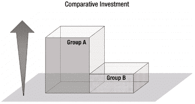

图 10-1. A组与B组对比

使用相同数据进行的对比分析显示，A组远大于B组。

该图是通过为16个支出优先级中的每一个分配100个点区域，然后根据主要、中等、次要中提到的百分比，从成本节约支出中移除相应点数来绘制的。这些被移除的点成为非成本节约区域值，然后与之前提到的成本节约总额进行对比，从而得出这些数值。

这意味着，对于上述列表和大数据而言，其投资可能性的总比例远高于所有其他目的。

这些与A组相关的领域，都是认知核心可以解决的。

认知技术能够执行所有这些功能：

*   提高效率与业务流程
*   利用技术提高生产力
*   管理风险
*   确保合规性
*   简化IT管理
*   业务流程自动化
*   面向客户的应用程序

即使不能100%实现，认知技术也能完成其中的大部分工作。因此，我们可以说，在某种程度上，我们已经拥有现有的IT投资基金，这些资金可以逐步整合到`PEIB`框架计划中。这些成本是经常性成本，每年都会发生，但借助认知核心，这些成本在每个标题下都将呈现下降趋势，从而推高利润率并降低整体IT相关成本。

从2017年到2020年，每年的支出增长率预计最高不超过0.3%至2.5%的范围。但考虑到我在A组相关成本中提到的节省，这将从中获得额外的百分比，并且随着价值的增加，IT支出将呈现负增长趋势。

### 最新趋势

这是关于采用尖端技术的最新趋势，自2014年以来呈现出积极的增长态势，并预计将进一步上升。

图表清晰地显示了自2014年以来人工智能和物联网的增长趋势。（参见技术讲座：IT最新趋势 - [`www.spiceworks.com/marketing/state-of-it/report/`](https://www.spiceworks.com/marketing/state-of-it/report/)）

这意味着，这种行业趋势已经持续了三年，并且仍在增长。

### 企业或业务规模

对于企业规模（小型、中型或大型）的分类，并没有硬性规定。但我们采用了一种平均化的方法，并尝试用下文列出的一些参数来描述它们，这些参数将在本章后续内容中使用（表10-1）。

表 10-1. 小型、中型和大型企业

|  | 小型企业 | 中型企业 | 大型企业 |
| --- | --- | --- | --- |
| 员工基数 | 0-100 | 100-999 | 1000+ |
| 收入 | 500万至1000万美元 | 1000万至10亿美元 | 超过10亿美元 |
| 资本支出（IT） | 有限 | 一定程度 | 大量 |
| 主流IT模式 | 按使用付费 | 基于能力、功能 | 先进 |
| IT支出占收入百分比 | 最高 | 中等 | 最低 |
| 支出金额 | 最低 | 中等 | 最高 |

与中型和大型企业相比，小型组织最终需要将收入中更高比例用于IT成本。

小型企业大多采用按使用付费的模式，而企业规模越大，其IT模式就越先进。

## PEIB 框架

在深入探讨`PEIB`框架（我提出的用于认知数字核心转型的框架）的细节之前，我们首先需要了解两件事：`PEIB`框架的整体高层细节及其流程，以及认知核心建立过程中涉及的成本。了解这两件事后，我们才能深入探讨`PEIB`框架的细节（图10-2）。这是我提出的一个框架，旨在简化组织对数字核心的采用。我们将通过简短的示例和替代方案详细讨论`PEIB`的每个部分。此外，在需要的地方，我会提供相关的检查清单。

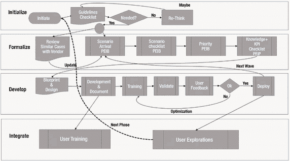

图 10-2. PEIB框架

所示流程即为`PEIB`框架，包含方法（例如，场景到达）、认知核心和知识流程（后两者发生在认知核心开发的后期阶段）。

我们将在下一节中进一步看到横向泳道，即：初始化、形式化、开发和集成。

在准备和采用认知核心的过程中，还需要一些额外的成本，这些成本发生在`PEIB`框架的不同阶段。

以下是在`PEIB`各个指定阶段（泳道）所需的一些成本（图10-3）。

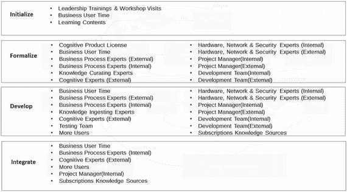

图 10-3. PEIB各层级的成本

现在将更详细地讨论`PEIB`流程。

## 初始化

初始化是图10-2中的第一个泳道，因此也是`PEIB`框架的第一个阶段。它负责决定是否启动此类项目以实施认知核心。`PEIB`框架提供了部分流程和指导性检查清单，以帮助决定是否进行该项目。

该指导性检查清单是一个简单的清单，如下所示（图10-4）。

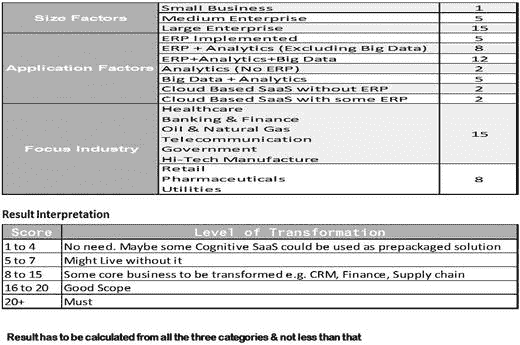

图 10-4. PEIB指导性检查清单

这意味着什么？这些计算背后的思路是什么？

让我们看看每个结果解释类别的一些示例。

*   1到4分结果类别：一家小型企业（1分），使用基于云的软件，没有`ERP`或只有小型`ERP`，且不属于任何重点行业（重点行业得分为0，因为不在列表中）。总分为3分。他们仍然可以尝试一些小型认知解决方案（开源或按使用付费的SaaS）。但这通常不需要任何转型路线图。
*   5到7分结果类别：可能是一家拥有`ERP`但仍不属于任何重点行业的小型企业，或者是一家拥有小型`ERP`和SaaS应用但仍不属于任何重点行业的中型企业。他们可以选择进行或不进行。但总体而言，这不是一个强有力的用例；他们可以根据具体情况进行评估。
*   8到15分结果类别：这些是拥有良好`ERP`和分析基础但不在重点行业的中型企业。考虑到现有的IT成熟度，他们可以将一些核心流程纳入认知计算能力的范畴。
*   16到20分结果类别：这些是拥有`ERP`的大型企业，或者是拥有重点行业和`ERP`的中型企业。它们有很好的应用前景，应该进行转型。
*   20分以上结果类别：这些是拥有高价值重点行业、良好`ERP`分析成熟度以及更优条件的中型企业。它们应该进入认知核心领域，并尝试进行广泛开发以实现最大程度的优化。

这些是创新型企业，将成为此类采用的行业基准。

因此，初始化阶段是对组织是否准备好利用认知核心进入下一阶段参与度的测试。这将有助于回答第一个问题：我是否适合进行此转型？

这可能需要反复讨论，并可能需要更多次的重复才能得出正确的结果类别。

PEIB 指导性检查清单提供了第一个具体的答案，用于对企业进行分类，并从一开始就设定正确的基调和期望。

因此，如果你属于“没有它也能生存”的类别，你的期望和投资就应该得到正确的关注。这是目前的情况；随着时间的推移，随着更多认知解决方案变得普遍，这种情况可能会改变。因此，今天处于“不适用或可能适用”列表中的某些项目，未来可能会升级到“良好前景”或更高类别，因为随着时间的推移，将会有许多关于此方面的开源和/或基于云的 SaaS 应用可用。

PEIB 检查清单的作用是作为第一步，为决策提供信心并标准化响应。

## 形式化

这是图像中最复杂的流程泳道。其中定义了许多指导方法，且流程漫长。整个实施的成功与否都系于此。这一步至关重要，足以决定此类项目的成败。

在此阶段需要进行大量的规划，以便在下一个泳道流程中执行。

如果处理不当，可能会给整个项目留下无人愿意解决或无法推进的负面影响。项目非但不能盈利，反而会成为价值有限的鸡肋。由于所有已实施的内容都需要维护成本，与之相比，其价值显得微不足道。

该流程泳道分为五个不同的子流程或方法，我在第 9 章中已简要提及。此外，它还包含四个检查表评估模板，以确保我们能够有序地准备好正确的“登机牌”，并确定合适的日期和目的地。这一步的重要性还在于，它有助于设定恰当的指标，用于衡量和评估各个阶段的实施情况，并在最终确保项目不偏离轨道。

因此，PEIB 的这一步骤使流程变得：

*   有序

*   与需求对齐

*   与后续环节对齐

*   细化到具体细节

*   列出并对齐所有知识驱动因素

在此阶段对齐知识驱动因素，不仅能确保所有必要内容都已列出，还能确保及时规划并订购适当的专家支持。

因此，PEIB 的这一步骤将需求完美地形式化，确保所有内容都记录在案，例如：

*   需要清晰且细化到最细节地实现什么？

*   所有这些需要在何时完成？

*   是否设定了 `KPI` 指标，以确保我们拥有适当的衡量尺度，既能衡量我们在不同维度上的深入程度，又能持续监控以避免任何偏差？

PEIB 的这个泳道流程确保了可衡量、可实现的目标设定，并具有明确的目标。

接下来，我们逐一讨论“形式化”泳道下的五个流程/方法。

### 场景到达矩阵

这是泳道中的第一个流程，尽管它实际上被列为第二个。第一个流程“审查类似案例”是此流程的补充流程（图 10-5）。

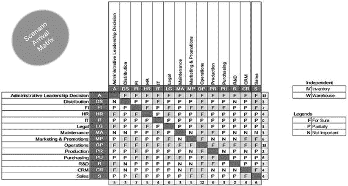

图 10-5.

场景到达矩阵

这是第二个检查表，也是一个主要的建议检查表。它有助于决策。前面的检查表考虑的是通用制造组织，这类组织采购原材料，然后进行加工并在市场上销售（例如，美容皂制造商）。它们依赖于采购、生产、维护、人力资源等内部流程，以及客户关系管理、销售和营销等外部流程。

因此，这里的重点不在于场景到达矩阵（图 10-5）中建议网格的构成，而在于它是如何完成的，以及分配图例 `F`、`P` 和 `N`（分别表示“必须”、“部分”和“不重要”）的目的。

这是一个技术流程框架，而不仅仅是技术框架。它具有灵活性，可以围绕业务需求的任何排列组合进行调整，而不仅仅遵循单一的硬性构成步骤。“如何完成”比直接照搬更重要。

因此，图 10-5 中所示的场景到达矩阵是针对上述业务类型的一个示例检查表；现在我将讨论它是如何得出的，以解释其背后的理念和概念。这是实现该泳道“形式化需求”步骤所必需的。

图中在 x 轴和 y 轴上列出了两次重要的部门。这些是应该或可以考虑引入认知能力的部门。在继续讨论之前，需要牢记一点：这里提到的部门是认知能力的候选对象，而不仅仅是自动化。这些部门已经存在并正在运作。认知层必须为这些部门启用，而不是从头创建。此外，大数据和物联网框架已经就位。

为了便于理解，我们在网格中从左到右、从上到下进行查看。我将尝试从列表中的第二项“分销”开始解释，因为它包含了所有图例（`F`、`P` 和 `N`）。

左侧列出的部门名称与顶部列出的部门名称进行交叉比对。对于“分销”，第二个单元格是灰色的：无法进行分销与分销之间的分析。

比较时应使用一个简单的问题：“我是否需要这个部门来确保我正在比较的部门的基本运行能力？”在某些场景下，将一个部门的数据与另一个部门的数据连接起来，可能有助于认知应用的良好运行，但这里我们只考虑最重要的连接，没有这些连接，该部门就不可能具备基本的认知能力。我们这样做是为了首先寻找跨部门运行的最基本的认知能力。

此外，在开始比较之前，请确保列出预期的基本能力。

现在，让我们对“分销”行进行此项练习，看看在此示例中是如何完成的。

对于分销的基本能力范围，我需要具备一种认知能力，以确保销售信息、运营信息以及所有关联的物流系统（通过 IT 连接）能够以这些数据为最低要求进行编排。我应当能够智能地确认销售了什么，从而确保交付什么，并利用运营数据和物流数据（通过 IT 解决方案）以最高效的方式完成。另一个例子是为此使用天气预报大数据能力。我再次强调，这些并非我在此为任何特定部门制定的标准陈述；对于实际组织而言，这些内容可能根据其需求而有所不同。只需关注应如何实现即可。

结合上述讨论，让我们进行比较：

*   分销 vs. 行政领导：此处标记为 `N`，因为不需要该部门直接提供数据流。一旦我们能够建立完善的认知能力，该部门所需的信息将逐步流向分销部门。但对于大多数基本能力，我们并不需要这一点。

*   分销 vs. 分销：属于同一部门，因此无需进行。已灰显。

*   分销 vs. 财务（FI）：财务是任何组织的命脉，但我在此关注的是最基本的功能，因此将其标记为 `P`。这意味着部分需要进行基于财务证据的深度盈亏分析并提出建议，但在初步的认知解决方案中可以忽略。如果我们期望基本功能中也需要包含财务影响分析，我们会将其标记为 `F`。

*   分销 vs. 人力资源：与财务类似，当然需要管理资源，但基本功能目前可以忽略，我们将其标记为 `P`。

*   分销 vs. 维护：这需要在认知解决方案的更高成熟度阶段进行，以添加运输工具和生产机器的维护状态视角，从而计算可能的延迟。但目前我们可以没有它，因此标记为 `P`。

*   分销 vs. 市场营销与推广：这是非常高端且细分的营销数据，用于从客户满意度、供应有效性以及针对新选定市场活动的分销准备情况等维度建立详细分析。但目前可标记为 `P`。

*   分销 vs. 运营：这是开发分销相关认知能力非常重要且关键的数据。运营将首先帮助其运行，同时物流也将通过此进行管理。因此标记为 `F`。

*   分销 vs. 生产：来自生产的数据可能有助于优化分销解决方案，甚至关注工厂产出的批次，并将其与销售和交付数据进行匹配。但这是下一阶段的事情；我们暂时跳过，将其标记为 `P`。

*   分销 vs. 采购：采购部门可能参与为其他所有部门进行采购。但这无法驱动分销的基本能力，因此标记为 `P`。

*   分销 vs. 客户关系管理：此关系与上述市场营销的描述类似。因此目前标记为 `P`。

*   分销 vs. 销售：这是与分销相关的关键部门，因此标记为 `F`。

所有 `N` 项大多在任何时候都不需要，所有 `P` 项对于基本能力并非必需，但后续可能添加，而所有 `F` 项则是非常必需的。

得出 `F`、`P` 或 `N` 的场景和判断基于一个假设的制造公司，对于不同的实际场景，`F`、`N` 和 `P` 的组合可能不同，完全取决于他们自身的理解。但请记住两点：

*   我是否需要该部门来确保我所比较的部门的基本运行能力？

*   我计划为该部门提供的最基本的认知能力是什么？

横向数字是该行中 `F` 的数量，表示在高层面上有多少数据源或数据点将进入该场景，以创建该部门的基本认知能力：我们称之为 `IN`，对于上述分销示例，该数字为 3。

网格底部也有一些数字。它们是该列中 `F` 的数量，从上到下读取。这些是 `OUT`，表示网格中有多少个基本认知场景需要该部门的数据（例如，分销的第二列再次显示数字 3，意味着它将为那么多计划的认知场景提供数据）。

上述所有逻辑和概念为我们提供了一个包含以下 `IN` 和 `OUT` 数字的总体表格（图 10-6）。

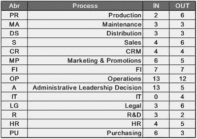

图 10-6.

来自场景到达矩阵的原始输入

据此，我们将进入该泳道的下一层级：场景检查清单。

此过程可通过图 10-2 中所述的“与供应商审查类似案例”进行微调。

这意味着供应商和外部专家的参与应尽早进行，并达到范围正式化的层面。这有助于在从场景到达矩阵创建原始输入结束时（图 10-6）得出更精细的矩阵。

### 场景清单

我们将通过此步骤来细化形式化的范围。此步骤的输入是上一步骤中图 10-6 所示的表格。

因此，表格首先按 `IN`（从低到高）排序，然后按 `OUT`（从高到低）排序。

这样就能按照从上到下的区域顺序，正确排列出哪些区域需要更多的 `IN`。需要最少 `IN` 的区域会排在最上面，而需要最多 `IN` 的区域则排在最下面。在认知能力的层级结构中，处于顶层水平的区域需要最基础、最单一的区域相关认知能力。

现在，表格看起来如图 10-7 所示。

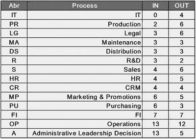

图 10-7.

### 来自场景到达矩阵的排序数据

现在我们得到的是一个整体的优先级列表，它似乎可以作为认知解决方案开发的顺序来遵循。但这需要进一步分解为“核心业务”和额外的“增值”区域。对于不同的组织而言，这种区分会因其运营方式和地点、市场状况与挑战以及主要组织指令的不同而有所差异。但对于我们的场景，我们将其视为图 10-8 所示。我们称之为场景清单。这让我们能够清晰且有根据地组织各个部门/区域。

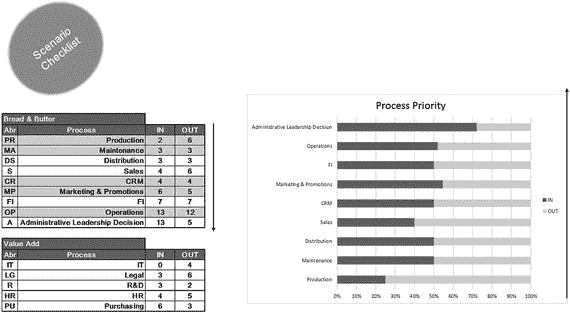

图 10-8. 场景清单

这还需要一定的业务理解以及深入的讨论，才能得出以下结论：

*   哪些属于核心业务领域，哪些属于额外增值部分？

*   核心业务表格中的灰色条带和连续的白色条带，建议将相关行项目放在一起考虑，因为它们是最紧密关联的流程。

增值部分以及核心业务表格中表示的其他项目，将在下一张图中以图形方式再次展示，以便从视觉上清晰地说明它们在 IN 和 OUT 方面的表现。此图应从下往上阅读。

这同样完全取决于所讨论的具体组织，并且需要所有部门负责人共同参与深入讨论，才能获得最佳结果。此外，在后期阶段，还应让认知经理和来自供应商的专家参与进来，听取他们的意见，以确保此列表得到微调。此列表是形式化范围过程中的下一个重要里程碑。

现在，让我们详细描述得出如图 10-8 所示列表的思考过程。

## 核心业务清单

第一个表格按相同顺序仅列出了我所在制造组织的核心业务部门。这些部门是我必须进行转型的。其余部门则移至额外的“增值”表格中。

在增值表格中，也有一些看起来很重要的部门，如 IT 和研发部门。我们将在本节中进一步讨论这一点。

此外，核心业务表格中还有一些分组部门。让我们看看从上一步骤接收并在此处排序的数据如何帮助我们，以及业务知识的应用如何为此业务示例制定场景清单增加价值。

以下是顺序和分组（排序顺序和基于业务知识的分组）：

*   第 1 组，顺序 1：生产与维护

*   第 2 组，顺序 2：分销与销售

*   第 3 组，顺序 3：客户关系管理与市场营销

*   第 4 组，顺序 4：财务

*   第 5 组，顺序 5：运营

*   第 6 组，顺序 6：行政领导决策

首先，让我们验证顺序，然后验证每个级别的分组。

### 验证示例中的顺序

我在前面的章节中提到过，应该从内部审视能力以改进当前的业务场景。我们一如既往地需要稳健的流程，但需要比以往更多的精简和流程优化。我们不应仅仅向外寻找机会，而应向内看，削减系统中的冗余，为认知能力奠定坚实的基础。

这种思考过程驱动并证明了上述顺序的合理性。当然，要得出这样的顺序，我们需要按照 PEIB 指南正确工作，才能得出一个合适的场景到达矩阵。

让我们通过图 10-9 来看看这个顺序在此处的含义。

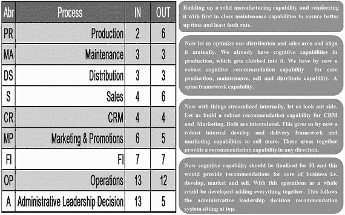

图 10-9. 排序顺序的含义（高级别）

该图从高层次展示了为什么这种排序顺序是合理的，并且与场景到达矩阵中最初输入步骤所产生的结果保持一致。这正反映在我们当前层级所拥有的排序顺序中。

让我根据列表以及图 10-9 中高层次描述的内容，来描述一下这个排序顺序。

这个顺序是针对我们选择的假设性制造业的；根据我们的输入以及随后创建的排序顺序，我们看到这个顺序也带来了两个关键点：

*   首先考虑的是那些能够快速参与的业务领域，使用所需数量的输入。在我的案例中，能够快速参与的领域是指那些能用最少数据输入快速提供认知解决方案的领域。

*   这提供了对认知解决方案的快速洞察、示例和体验。

我们在此考虑了制造业的例子，最佳启动方式可能由各部门建议；它可以是任何内容（即，他们希望首先引入哪个流程，以及整体上应该发生什么）。

可能是一个表达能力很强的、拥有 MBA 背景的市场营销团队，快速列出如果他们获得这种能力所能带来的好处，然后可能是销售和分销团队，但真正的顺序是什么？这由此处显示的排序列表自动设定，并在本阶段使用 PEIB 指南得出。

所示的顺序对这个特定业务是合适的。假设我们决定以不同的顺序开始：

*   市场营销与推广

*   运营

*   生产

*   维护

现在我们在这里要说的是，我们将在开发任何其他系统之前，首先为市场营销应用开发认知系统。请记住一点：认知系统是通过所有领域的知识以及对其进行的训练来开发的。

如果我们需要获得市场营销和推广方面的建议，我们首先需要分析销售数据以了解购买模式。这意味着在开发市场营销与推广认知解决方案时，我们还需要引入销售方面的知识库，并且训练也应从这个角度进行。我们确实需要了解分销模式，以便偶尔查看市场营销方面的建议，并了解我们能够快速触达哪些区域，以便为我们将要开展活动的新产品服务做准备。我们可能还希望拥有优化的生产流程，以支持这些旨在节省资金和抢占市场的市场营销认知解决方案。

因此，在开发此系统时，我们需要引入所有这些领域的数据以及所有相关知识内容，然后用所有这些材料来训练系统。

此外，在前面的章节中我提到过，这些并非独立的认知解决方案，而是一个随着时间推移，由于额外数据、知识的添加以及训练（初始训练和通过使用进行的训练）而不断成熟的单一解决方案。

请注意，并行但渐进地向系统添加知识和培训始终是困难的。如果系统在进入下一层之前，已经准备好了来自每一层的知识和培训，那么效果会更好，因为下一层是建立在此基础之上的。

在 PEIB 框架下进行的练习中，这一点会自动得到处理。

因此，我们的示例和顺序表明，我们应该先发展内部生产能力，然后再发展销售和分销方式。这本身就能带来很多价值。继续优化您接触和服务客户的方式。接下来，开始转型 FI 系统，以确保 FI 的关键绩效指标（KPI）也使用相同的语言。然后，优化运营，将所有内容都纳入这个框架之下。有人可能会争辩说，FI 是任何组织的命脉；为什么不从它开始呢？但需要提醒您的是，FI 系统已经就位，并且正在从先前层级的认知转型中获益。这是 FI 的认知转型，它将从组织中在其之前开发的所有层级获取细节和认知能力。因此，FI 在这里是稍后进行的。在这些运营之后，我们就可以开始最终的行政认知转型了。

这说明我们从先前步骤（场景到达矩阵和场景检查表）得出的顺序是合理的。

让我们讨论一下分组的另一个方面。

### 验证示例中的分组

为方便起见，我将再次列出我们示例中采用的层级和分组：

*   第 1 组和第 1 序列：生产与维护

*   第 2 组和第 2 序列：分销与销售

*   第 3 组和第 3 序列：客户关系管理（CRM）与市场营销

*   第 4 组和第 4 序列：FI

*   第 5 组和第 5 序列：运营

*   第 6 组和第 6 序列：行政领导决策

我们知道这源于我们对业务的理解。这将对整个项目的时间线和蓝图产生重大影响。

我们在这里要说的是，将最紧密协作的部门/流程分组在一起。这需要深入的标准流程和组织的实际经验。

#### 第 1 组和第 1 序列：生产与维护

生产和维护属于同一组，用于开发和制造。它们关系紧密，将共同帮助实现最重要的目标，例如：

*   更快的制造

*   最少的浪费

*   最少的错误

*   避免常规维护停机

*   使用认知维护时间线，节省大量时间

*   更好的生产计划

这些是我们获得的一些好处，并且它们交织在这两个流程之间。此外，这在可衡量的收益方面能带来快速的结果。可以确定关键绩效指标（KPI）来衡量实施此转型后的状态、进展和收益。

这应能进一步将重复性 IT 投资的成本降低约 11% 至 40%，并将生产力提高约 30%。

这个核心认知设置将已经拥有与制造、智能维护和智能制造流程相关的知识。

#### 第 2 组和第 2 序列：分销与销售

销售和分销属于同一业务领域：销售和安排向客户分销。这也可能包括向不同制造单位的内部分销。这包括物流部分。

这些肯定需要一起处理，因为它们协同运作。此外，它们可能需要与生产相关的信息，以便能够为内部分销相关的推荐提供建议。

这也可能利用来自认知模型维护分支的数据，以了解计划制造对象的维护或停机影响，从而在分销中提供更全面的 360 度视角。

当我们进行到转型的这一部分时，我们只专注于它，而不处理其他任何事情。对于先前实施的其他领域，培训确实会发生，但从当前主题的角度来看，会进一步与这些领域的先前培训建立关联。因此，通过这种方法，它既丰富了先前的领域，也丰富了当前的领域。

#### 第 3 组和第 3 序列：客户关系管理（CRM）与市场营销及促销

现在，我们已经准备好了基础和核心的制造、维护、销售和分销转型。我们拥有一个高效的核心在运行，并且每天都在接受培训。这一层级现在将把它扩展到更好的 CRM 和市场营销及促销能力。仅仅拥有一个精益、智能、直观的核心来制造产品以交付给组织，就已经开始收获回报。凭借这些快速回报的价值领域，就有可能进入下一个层级，这些层级相比之下不会立即显示出价值回报。

现在，`CRM` 和市场营销及促销确实需要来自销售和分销的数据。这些数据已经准备好了。在这些数据之上，它们还需要系统事先在这些方面接受培训，而这现在已经完成了。到这个时候，系统的信心已经建立，组织已经准备好进一步朝这个方向投入资源。基于生产和维护，针对每一个这样的单元给出明确的建议，这有助于根据促销后某个时间点可能制造和交付的产品来规划市场营销。可以实现基于地理位置的针对性活动，并从中获益。

这将使已经存在的后端得到转型和赋能，从而只专注于这个领域。

### 第 4 组和第 4 序列：`FI`

由于之前的转型，`FI` 部门将已经在账目方面看到收益。现在是时候转型 `FI` 部门本身了。此转型将建立在先前步骤的基础上，以进一步优化和记录资金方面的问题，并对此时已转型的每个层级和领域进行规划。

### 第 5 组和第 5 序列：运营

与运营相关的所有基础工作都已就绪，运营与认知复杂性层级中处于其下的所有部门和流程都有关联。也可以对这个部门进行分析和评估。这将使组织提升一个层级，更接近工业 4.0 级别的升级，这需要整体运营框架能够自主思考，并每次都能协助用户做出相关且明智的决策。

因此，实现了由物联网和大数据驱动的运营组织。

### 第 6 组和第 6 序列：行政领导决策

在上一层级取得的结果自动对领导层也有帮助。这些结果成为他们了解组织的耳目。通过将各个运营部门整合到一个统一的决策系统下，在这一层级实现了更高水平的成熟度。

通过这个示例，我们可以看到，通过适当的场景到达矩阵所确定的序列选择，帮助我们确定了合适的顺序，并且该示例为我们假设的制造组织示例证明了这一点。

## 附加价值清单

这是图 10-9 场景检查表中单独列出的附加价值清单。考虑到该图的位置，我将再次提供一个突出显示价值清单的不同版本，以便于我们讨论（图 10-10）。

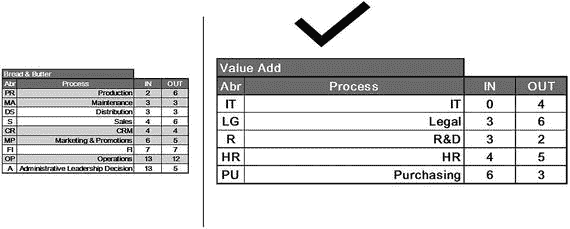
图 10-10. 突出显示价值清单

我们从场景到达矩阵（图 10-7）排序数据的主表中移除了某些部门/流程。

这些被以类似的方式分离：在我们的示例中，我们利用业务知识和理解进行了分组。这对于不同的组织可能有所不同。以我们的制造业示例为例，我们将以下部门作为附加价值移除：

*   信息技术部

*   法务部

*   研发部

*   人力资源部

*   采购部

对于我假设的公司，我将它们移除了。这是 `PEIB` 中的一个流程，组织应将其视为附加价值而非主营业务的内容从主清单中单独列出。

这样做必须有坚实的理由。这是一项非常重要的战略活动，有助于将注意力集中在期望的领域。列出的附加价值领域应该是那些能够将组织的认知价值提升到更高有效性水平的领域，但不包含它们则有助于构建一个初步的认知组织，并建立转型的信心。此外，这些领域需要一个完全转型的组织才能开始达到更高层次的有效性。

`IT` 认知能力将有助于创建一个实时的 `IT` 环境，在该环境中，`IT` 人员只需在他们擅长的领域工作：系统维护、网络、防火墙、数据上传、接口开发、`UI` 开发等。他们无需花费太多精力去理解流程再工作。然而，他们将协助训练系统，但仅从技术角度工作。因此，在宣布整个 `IT` 部门实现认知化之前，首先让一切“活跃并思考”是有意义的。为了进一步优化系统以实现自我修复和自我维护，未来需要一些知识和培训。没有必要提前单独规划。此外，这是一个非创收部门，因此不应与主营业务场景一起规划，因为后者是创收领域，能带来回报并增强对认知转型可用性的信心。

法务认知能力将有助于业务的各个领域，但没有人会从它开始受益。这应该在一个成熟的认知组织之上建立。它本身也不产生任何收入，因此应该稍后进行。

研发认知能力可能被认为是一个独立的领域，无需在附加价值清单中等待太久。从某种意义上说，这是正确的，但从认知组织的思考角度来看并非如此。在传统的组织规划中，这是有效的，但对于认知组织则不然。认知应用并非孤立运作。研发部门将处理核心研究数据以及由生产和其他相关部门发送的输入（例如，市场部门发送关于功能变更的市场反馈，以开发更用户友好的产品或设计）。这正是认知转型发挥作用的地方。辅助研发的认知系统无需共享任何特定输入，而是可以根据所有需求自动提供建议。此外，所需的研究和其他数据当然会通过相关且可信的互联网来源进行连接。

人力资源认知能力是新一代智能资源管理，用于技能提升和跟踪资源能力以满足各种需求。但这也不是一个直接创收的部门，并且由于它需要来自所有经过认知转型的领域的数据，因此应将其保留在第二份清单中。

采购认知能力对于提供良好的采购建议是必要的，但这些建议需要与所有其他创收运营组织集成，因此它们也应列入第二份清单。

因此，该清单包含了所有有助于构建一个全面认知组织的领域，但它们不应在首次尝试中全部被采纳。

原因如下：

*   不产生收入，因此无法很好地衡量此类投资的回报

*   不直接与任何流程相关，而是在多个流程间共享

*   需要更广泛的认知背景才能启动

*   本质上更具监管性而非运营性

因此，构建此清单的目的是从增值事物中剥离出核心要素，因此该清单扮演着非常重要的角色。

现在，我们将进入第三个组成部分，称为场景优先级清单。

## 场景优先级清单

在这一部分，我们应该为场景绘制一个高级流程图，然后将其作为流程图呈现，以便对我们需要考虑的范围有一个可视化的映射和流程。同样的内容可以进一步用于知识清单以及蓝图与项目计划（图 10-11）。

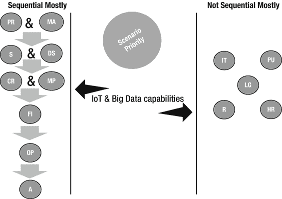
图 10-11. 场景优先级清单

这是一项简单的活动，且更具技术性；它无非是清晰地将讨论和验证的结果呈现为一个按时间顺序排列的可实现目标的最终清单。主营业务清单按确定的适当顺序排列。价值清单则没有任何顺序限制。它们可以按任何方便的顺序排列。大数据和物联网也被提及作为前提条件设置。

此清单将作为 `PEIB` 流程下一阶段（称为知识清单）的输入。

这些优先级应经过充分评估，并在内部业务专家以及外部认知与业务专家的参与下，最终确定并发布。前两个清单也应经过验证，以确保对此最终清单的信心。至此，范围界定中的困惑、困境和混乱将基本消除。此后，项目规划将照常进行，但会包含一些与认知转型相关的具体变更。

## 知识与 `KPI` 检查清单

接下来的流程至关重要，是形式化流程泳道的最后一步。此步骤包含两个主要领域：

*   知识检查清单准备

*   `KPI` 识别

如果没有规划好恰当的知识管理，许多认知过程可能会失败。

这有多重要？

嗯，认知意味着会思考的机器，但让认知计算变得最重要的能力是什么？这种能力就是在某个领域吸收知识，并能够基于所学内容推荐解决方案或指导。这是通过使用数据训练来实现的，这有助于系统理解其内部积累的每一点知识的上下文，并创建自己的学习索引和知识图谱。这类似于人类的联想学习，区别在于我们通过数据字节获取知识字节。但这些机器是批量获取知识，然后从中进一步生成新知识。

由此可见，在这些机器中，学习能力实际上充当了思考能力。知识成为首要因素，并且其本身也是进一步知识的来源。

这使得以下几点非常重要：

*   确保首次核心知识构建有良好的知识来源（通用和内部）

*   规划良好的训练

*   识别各种类型的持续、相关且可信的信息来源

所有这些因素都应被规划好。`PEIB` 指出，一旦我们有了最终的优先级检查清单，就应该立即进行规划。该规划将有助于执行认知赋能功能，并产生良好的认知构建。

在范围最终确定的这个阶段，应仔细制定知识检查清单，并涵盖多个标题，如表 10-2 所示。

表 10-2. 知识检查清单——`PR` 和 `MA`（示意性）

| 编码知识 |
| --- |
| 机器手册 |
| 产品详情 |
| 质量方法与流程 |
| 质量测量 |
| 产品制造流程 |
| 能效措施与标准 |
| 机器维修 |
| 模型零件详情 |
| 流程挑战知识 |
| 操作员手册 |
| 运营中的问题 |
| 其他 |
| 专家知识库 |
| 专家培训问答 |
| 标准研究论文 |
| 标准期刊 |
| 相关新闻网站 |
| 内部知识 |
| 内部专家知识库 |
| 内部专家培训问答 |
| 物联网数据流 |
| 历史日志 |
| 历史故障详情 |
| 其他历史问题 |
| 机器维修日志 |
| 机器改造记录 |
| 定制机器手册 |
| 产品详情与规格 |
| 内部代码 |
| 内部质量控制历史数据 |
| 内部质量控制流程 |
| 内部质量控制指标 |
| 能耗与问题数据 |
| 内部流程 |
| 内部手册 |
| 历史生产数据 |
| 持续知识 |
| 新闻源 |
| 免费网络资源 |
| 基于订阅的网络资源（其他） |
| 基于订阅的技术信息 |
| 机器制造商提供的软硬件详情数据源 |
| 软件升级数据源 |
| 人力资源 |
| 专家操作员 |
| 工程师 |
| 外部流程专家 |
| 内部流程专家 |
| 产品专家 |
| 产品研发专家 |
| 认知数据摄取专家 |
| 企业 `IT` 对口学习者 |
| 内部 `IT` 专家 |
| 内部物联网数据专家 |

| 以下人员需持续跟进以确保知识连续性 |
| --- |
| 企业 IT 对口学习者 |
| 内部 IT 专家 |
| 物联网数据专家 |

上一步优先级清单中列出的每个部门和流程领域都应在此处进一步处理。每个项目旁边都应列出相应的知识资源。PEIB 建议知识清单应包含以下五个标题：

*   编码知识
*   其他
*   内部知识
*   持续知识
*   人力资源

表 10-2 中的细节是指示性的，实际清单可能更详尽。除此之外，“编码知识”标题下的内容通常由认知产品提供商作为该特定领域的丰富知识库预加载。应理解并处理任何差距。

让我们更详细地了解一下 PEIB 推荐的这些知识领域及其特性。

### 编码知识

这主要是认知服务运作领域中标准化的多样化知识。因此，在生产与维护的案例中，这类似于通过输入所有标准工程和产品内容来创建工程师和产品专家。同时，维修和维护方面的内容也被输入。由于还需要集成物联网，相关的工程知识也被输入。这些知识大多已在行业解决方案中预加载和摄取，并以已丰富的数据形式存在（即在该领域也经过了预训练）。这为认知解决方案提供了所有概念性知识效率和规则细节。这是知识构建的最大部分，可能需要更长时间来加载和训练。但由于这是作为产品特性提供的，只需向供应商检查是否存在任何差距即可。

### 其他

这也是预期在系统中预加载和摄取的知识，但基于期刊、视频、音频网络广播以及其他任何相关的材料。该领域的知识不仅是直接的学习内容，还包括相关的研究和新闻。这通常也是供应商的责任，但应检查差距是否符合预期。可能存在一些问题，然后由供应商的专家进行构建，为特定的生产业务需求增加更多的知识维度。这将调整和更新系统。

### 内部知识

这开始为系统带来主要价值。所有相关的知识、文档、日志和历史相关性数据（如维修日志、维修工单、解决方案日志等）都需要加载。同时，内部专家也与外部专家合作构建问答，以确保数据也得到丰富。基于网络的资源，如天气、新闻、机器硬件和软件升级等，也需要集成。产品详情、生产中使用的代码、尽可能精细的流程细节，以及质量数据（如流程、指标和用于质量评估的历史数据）都应被输入。同时，在内部和外部专家的帮助下，数据正在被丰富。由于这使得安装针对特定组织，这是最大的知识构建工作，应规划到最精细的细节。在此规划中，有两件事非常重要：

1.  来自供应商功能和技术专家的专家建议
2.  实际运营和管理人员的参与，而不仅仅是管理人员参与数据资源清单制定工作

内部 IT 部门在此扮演着重要角色，通过提供技术方面的帮助，协助供应商与数据源集成。

组织内部的物联网专家也应与外部供应商的物联网数据专家合作，以帮助正确集成这一宝贵的数据源。

### 持续学习

认知系统是一个持续学习的系统；它不仅从日常运营和输入的数据中学习，还从外部知识源获取信息，以保持自身对相关领域新动态的感知和更新。这可以是机器供应商提供的新闻、警报、硬件和软件信息详情。它也可以连接到软件更新源，并能够像其他员工一样，使用用户 ID 帮助实现自动升级。这种连接性有助于系统保持更新，并逐步用新数据丰富自身。基于问答的学习也应持续进行。

### 人力资源

这也需要与知识源列表一起规划。应通过内部和供应商研讨会，对选定人员进行适当的培训和指导，使其更具备认知实施导向。应确定、协调并指派相关人员。这些人应该是实际执行这些操作的人员，而不仅仅是管理或监督这些流程的人员。应有一份指定人员名单，以便在供应商退出后继续丰富和加载数据。可能有必要与供应商签订超常关怀和支持合同，以帮助系统稳定运行。

### KPI/特性

现在，最终需要用预期的 KPI 或特性来更新列表：每个部门可能都有很多。选定的指标应是可衡量或可识别的。例如，“应用程序最终应能更好地工作”是一个模糊的表述；而“系统应能根据传感器输入呈现警报，并应在 3 到 10 秒内建议正确的部件和修复方法”则是一个可量化、可识别的表述。参见表 10-3。

表 10-3. PR 与 MA 的最终知识清单（参考性）

| 知识类别 | 详细内容 |
| :--- | :--- |
| 编码化知识 | 机器手册、产品详情、质量方法与流程、质量测量、产品制造流程、能效措施与标准、机器维修、模型零件详情、流程挑战知识、操作员手册、运营中的问题 |
| 其他 | 专家知识库、用于培训的专家问答、标准研究论文、标准期刊、新闻网站（相关） |
| 内部知识 | 内部专家知识库、用于培训的内部专家问答、物联网数据流、历史日志、历史故障详情、其他历史问题、机器维修日志、机器改造记录、定制化机器手册、产品详情与规格、内部代码、内部质量控制历史数据、内部质量控制流程、内部质量控制指标、能耗与问题数据、内部流程、内部手册、历史生产数据 |
| 持续学习 | 新闻源、免费网络资源、基于订阅的网络资源（其他）、基于订阅的技术信息、机器制造商提供的软件和硬件详情、软件升级源 |
| 人力资源 | 专家操作员、工程师、外部流程专家、内部流程专家、产品专家、产品研发专家、负责数据导入的认知专家、企业 IT 对接学习者、内部 IT 专家、内部物联网数据专家、以下人员负责知识连续性（企业 IT 对接学习者、内部 IT 专家、物联网数据专家） |
| KPI/特性 | 根据物联网设备的传感器输入，发出包含问题详情、历史记录、修复方法和正确零件的警报；应能仅通过语音输入，根据新的优先订单生成新的生产计划；当机器发生卡料时，应能停止该单元的生产线，并发出包含详细信息的警报 |

除了组织的期望之外，这些特性也可能是供应商推荐的。

至此，从场景到达矩阵开始，我们已经完成了形式化步骤，即图 10-2 中的第二条泳道。到目前为止，我们已经准备好了以下内容：

*   核心（优先）部门或流程列表
*   次要或附加增值领域列表
*   场景优先级列表，以便将所有内容连接并在流程中可视化
*   知识清单，包含五个 PEIB 标题，与优先级列表中的每个流程/部门相对应
*   所需的人力资源已规划、确定、指导并准备就绪
*   预期特性的 KPI/特性清单

简而言之，范围在此层面已最终确定。所有需要完成的事项都已列出，并附有时间表。此外，针对完整优先级列表的 KPI/特性也已准备就绪。这将有助于建立检查或控制机制，确保在所需资源管理得当的情况下，没有或只有最小的偏差。

现在，我们将进入 PEIB 框架的下一条泳道：开发。

## 开发

这是 PEIB 框架中的第三条泳道。为方便起见，我将再次在此处放置 PEIB 框架，并标记当前泳道，如图 10-12 所示。

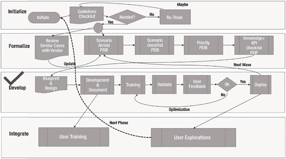

图 10-12. PEIB 框架

该区域包含六个流程和一个决策条件。这里的流程与传统的软件实施略有不同，因为它有一个由决策条件触发的递归路径，并且可能根据满足条件将流程带回之前的步骤。

我们将更详细地讨论每个步骤。

### 蓝图与设计

这是两个不同的领域。通常，蓝图是与进行认知转型的供应商共同完成的，而设计则完全由供应商完成。但对于认知转型，PEIB 建议在蓝图和设计的整个过程中都采取联合努力或协作。

认知转型项目不同于任何其他软件开发，需要在供应商和客户之间的整个流程中进行协作。这更像是一种战略合作，需要监控每一步，而不是进行里程碑或周度审查。这需要投入精力，可以通过将核心工作组和管理团队分开来管理。但所有这些努力都将得到回报，最终形成一个功能非常强大、长期对供应商依赖性较低的系统。

#### 蓝图

这是通常的蓝图阶段。系统在定稿阶段的基础上进行进一步设计。定稿阶段也是与供应商专家共同完成的。目前市场上对此类实施/转型的成熟度和经验尚不充分；由于其性质极具战略性，即使在需求收集阶段也需要供应商的支持。

蓝图阶段的输入来自上一阶段锁定的知识清单的最终版本。知识清单是一项非常注重细节的需求；它必须包含组织所需的每一步骤和资源的完整细节。

剩下的部分现在由供应商负责，需要最终确定系统/产品细节、服务器规模、网络适配器、接口细节以及自身的资源计划。蓝图是这些内容的汇总。所有这些细节都与供应商的实施策略一同记录；对运行系统可用性的任何影响及其测试策略，都是围绕知识清单中预定义的 KPI 和特性来制定的。他们可能会额外添加一些测试用例。但这种情况的可能性很小，因为之前的清单也是仅由供应商创建的。

PEIB 框架推荐使用 PEIB 控制（图 10-13）。这必须通过更精细的对齐来实现，再次围绕预期的特性和验证 `KPI`，以确保供应商实施团队与组织期望之间不存在理解上的差距。这一点必须反复核对。`PEIB` 建议与供应商一起，严格围绕目标和期望，对蓝图文档进行逐步审查。在必要时，供应商应能够展示一些小型模型或解决方案原型作为演示，以更清晰地阐明蓝图与知识清单之间的对应关系，知识清单包含了转型的最终流程、知识关联以及 `KPI/特性`清单。

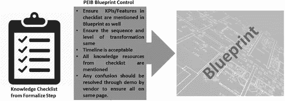

图 10-13. `PEIB` 蓝图控制

这将确保项目在此阶段不会出现偏差。强烈建议遵循此蓝图控制流程，因为认知转型的本质如此，会出现许多令人兴奋且充满冒险精神的新特性，很容易偏离轨道、脱离现实。坚持现实变得困难。通常，软件具有明确的观感以及预期的数据输出。我们知道通过软件中创建的哪个按钮可以实现什么目标。但对于认知转型来说，这极其困难。由于技术如此新颖且强大，会出现许多新特性，可能会让开发者/配置者以及企业人员都为之着迷。因此，对照知识清单中预期的 `KPI` 和特性进行快速现实核查至关重要。

知识清单应完整地转移到蓝图中，以供供应商后续操作。`PEIB` 增加了一个新的控制项，称为“过程中的 `PEIB` 蓝图控制”。

### 设计

设计紧随蓝图之后，包含每个待执行步骤的详细计划和时限。它由现场的供应商专家团队主导，并进行一些详细分析，以在最精细的层面上理解需求。这包括具体的数据库、接口、应用程序等及其相互关系。步骤以精细粒度进行描述，并包含数据纳入和丰富（训练）步骤。蓝图被完全转移到设计中。为开发阶段设定了基于里程碑的验证，以执行知识清单中的 `KPI` 和特性。这必须得到双方同意。

### 开发与训练

在认知转型的情况下，这与常规软件开发略有不同。它从开发阶段就包含用户的参与，这意味着开发本身也应该是不同的。`PEIB` 建议以下子领域：

*   技术基础开发
*   项目设计引导的开发

技术基础开发是指安装技术硬件、连接到网络、添加与源数据服务器所需的接口，并启动认知系统的核心能力。此时，也会进行基本能力检查，以确保知识清单中所有编码化的知识都可供使用。这些是通用的业务能力，应向用户进行演示。因此，来自不同业务领域的用户从这一阶段就开始与系统交互。随着时间的推移，“其他”领域也应被启用。

项目设计引导的开发则是开发的一部分，它将改造系统，使其具备为部门工作的形态。这将包括界面设计和知识上传。知识上传之后是训练操作。

因此，第四条泳道“集成”已经开始，同时用户训练也开始并行进行。用户已经开始参与第一和第二阶段开发测试。

开发包含知识清单中提到的所有列，所有商定和计划的数据都必须加载或使其可用。通过训练进行的数据丰富是转型中最重要的部分。做得越好，后续结果就越理想。

当这项工作在认知专家和紧密合作的业务用户看来已基本完成且足够成熟时，验证里程碑便被触发。

### 验证与用户反馈

这是对在正式化阶段确定并在知识清单中提及的验证 `KPI` 和特性进行执行。这些内容已进一步转移到蓝图和设计中。

验证由更广泛的受众在不同层级进行。目标期望清单会被共享。同时，会向这些用户提供记录遇到的问题和建议的渠道。`PEIB` 建议，有必要让那些从未参与任何转型工作并保持距离的人员参与进来。他们作为对照组，在验证中可能具有价值。由此产生的反馈随后应进行核实。如果未达到验证阈值，或者出现了关键的新建议，则流程将返回到训练甚至数据加载阶段，然后再到训练。通常，会有进一步丰富系统性能和体验的训练需求。一旦确认可行，便进入下一步：部署。

### 部署

认知系统的部署与常规软件部署略有不同。通常，生产系统的数据库比环境中的任何其他服务器拥有更多数据。认知系统与开发系统的情况相同。唯一的区别是允许更多用户进入系统。可能会启用更高核心数的服务器以支持更大的流量。在此阶段，第二波（即附加价值）也可以开始实施。系统现在向更广泛的用户群开放使用，并逐步向所有人推广。根据用户需要执行的任务，为他们启用各种接口。这会自动将项目带入下一阶段，即集成阶段，也称为用户探索阶段。

## 集成

这是最后的冲刺阶段。用户培训的第一个流程早在开发第一阶段完成时就已经开始了。用户探索的第二阶段则在部署之后启动。

为什么我们称之为“集成”而非“上线”？原因在于，这是新启用的认知能力发展过程中的一个阶段。这些用户获得的能力尚未完全成熟。这些能力必须随着时间的推移，通过进一步的培训、使用、数据输入等方式，变得越来越成熟、越来越强大。它将越来越深入地融入组织，并有助于在提供更深层次的潜在建议方面发挥更深远的作用。因此，这被称为集成阶段，而不仅仅是面向用户的上线。

如果组织希望从这一阶段继续前进，并再次遵循完整的事件周期，他们可能希望进入下一阶段的转型。

至此，完成了对认知实施 `PEIB` 框架的描述。

## 关于成本

我们之前简短地讨论过成本，并通过图 10-3 进行了展示。那里列出的成本并非详尽的逐项清单，而是指示性的。真实的成本案例只能通过面对的实际场景来确定。

但与已实现的收益相比，成本会变得更低。系统成本和许可价格可能会像其他软件一样随时间上涨，但它所带来的优化降低了整体运营成本，并在各个层面多次提高了决策的有效性，从而进一步带来收益。因此，与当前支出相比，未来的总体成本甚至可能呈现负向趋势。

这不仅带来了效率，还优化了之前使用的 `IT` 资源，具体方式包括：

*   更优化地利用来自它们的数据
*   使使用更有效且以用户为驱动

当今的企业在进行任何决策时，几乎连所获取数据的 2-3% 都未能利用。认知应用可能会扭转这一比例。

`PEIB` 是一个指引性的框架，帮助组织满怀信心地迈出这一步，并以最低的偏离风险持续前进。

## 数字化转型

这里提出的 `PEIB` 框架将引领企业走向认知赋能，但原则上，它正在为组织实现一种非常高阶的数字化转型。

通过全面实施认知解决方案，组织将能够颠覆每一个流程，并将其彻底数字化。

数字化转型的三个关键要素可能是：

1.  领导力：愿景驱动者
2.  客户体验提升
3.  运营与员工

现在是什么在阻碍我们？如今，没有一家大中型企业不在谈论这个话题。数字化转型已经是未来生存的必要条件和关键要素。不遵循这一趋势的组织可能会失败。

过去，商业模式在很长一段时间内要稳定得多。随着全球市场和社交媒体世界中商业形态与可持续性的不断变化，企业现在甚至必须每天持续适应。

这正是人类的局限性成为障碍，需要数字核心的地方。这能帮助人们专注于他们最擅长的事情，而不是花费更多时间准备他们需要快速完成的事情。

认知核心为组织带来了那些亟需的数字化转型能力。它颠覆了本节开头提到的所有三个要素。让我们简要看看是如何做到的。

1.  **领导力：愿景**：这得益于认知系统提供的弹性信息、洞察和建议供给。它还能作为一种控制手段，确保人类局限性（例如偏见）不会影响决策。愿景陈述也由证据支持，因此也得到了支撑。这提高了决策和计划的整体有效性。同样的信息会以执行者能够理解的语言和适用于他们的方式传达下去。同样，信息又从下至上进行转换，汇聚成一幅完整的图景，以实现持续一致的监控。

2.  **客户体验**：客户为王，现在和过去一样，甚至更甚。如今，借助强大的工具和技术，即使客户是十亿分之一，他们的声音也能被听到。产品和服务会在几分钟内收到反馈，并且必须迅速响应。这就是当今客户体验的力量。客户现在是全渠道客户，无论通过网站、移动应用还是实体店，都能享受到相同的用户体验。

3.  **运营与员工**：认知能力为运营的一致性和有效性提供了数字核心。通过这些转型，各级员工都获得了更多赋能，生产力也得到了提高。这也提升了工作满意度。随着时间的推移，运营职能和流程可以变得越来越高效，消除缺陷和非必要流程。

因此，数字化转型由认知能力从根本上得以实现，而 `PEIB` 框架则促进了对其的适应。

## 整体转型

一个整体转型应具备以下特性：

*   它已在所有领域（人员、流程和技术）均衡地发生
*   它的转型方式已从上到下贯穿各个层级，并在此过程中连接了各个流程
*   它真正驱动了一种数据驱动和基于证据的文化，而非基于假设或偏见的文化
*   它足够灵活、智能且有能力快速适应业务需求的变化，而不会成为障碍
*   它简单但极其有效，并且在组织内具有很高的可用性
*   通过使用它，能提供可见的收益

如果具备这些特性，就可以被视为一次整体的数字化转型。当我们在整个组织中实施认知能力时，所有这些特性都会呈现。

因此，认知型组织是未来，这引领着整体转型。`PEIB` 有助于实现这一目标。该框架的设计方式旨在帮助组织轻松地、按照标准校准的方法/流程流进入整体转型。

在缺乏此类框架的情况下，组织很有可能无法正确起步、方向错误，或在途中迷失方向，而这本身就是实现数字核心的一大挑战。

## 制造业中的认知能力

如今，许多组织都在运用认知能力。这里我将提及一个例子。谁不记得 `IBM Watson` 在《危险边缘》游戏中展现的智慧呢？但这类认知能力如今甚至能帮助企业做出明智的决策。

如今具备认知能力的企业比过去的企业高效得多。制造业就是一个很好的例子。

# 制造业中的认知计算应用

制造业拥有认知计算能力，其应用范围从工厂流水线的超级自动化到供应链的方方面面。工厂机器可以通过传感器与认知核心对话，而认知核心则反过来监控工具参数。这些工具可以被监控，以发现可能出现的任何缺陷。例如，如果钻头温度过高，认知系统可以快速检查冷却油箱是否已空，或者钻头是否运转过快，又或者钻头尖端本身是否有损坏导致摩擦增大。如果感应到材料难以加工，甚至可以将钻头尖端更换为另一种类型。

生产计划是工厂车间的另一个关键领域。当产品数量或产出组合发生变化时，计划必须随之调整。这需要规划团队付出大量精力和数学计算，而通过认知能力，这一过程得以自动化。如果需要软件更新，认知系统会负责处理，并在该工具未被使用或使用频率最低时进行规划，从而不断提高设备正常运行时间。

任何故障和问题都能通过通知正确的人员、提供详细数据作为循证支持来有效管理。系统还会提供以往发生情况的详细信息。技术人员也可以从系统中获取所需技术知识方面的帮助。

市场营销和供应链都由一个核心认知系统管理，并能提供对数据的更深入洞察。它可以监控整个供应链和供应商的表现。实时网络数据访问（如新闻）也有助于组织规划某些事务。如果系统发现世界某个地区可能出现天气干扰，这可能会影响原材料供应或对生产单元造成损害风险，它会发出警报，并在可能时提供替代方案。它可能有助于重新规划货运路线，以确保供应链卡车的安全通行。

因此，它提高了制造组织的整体正常运行时间和效率，同时通过监控供应商和客户的数据来照顾他们的利益。

## 总结：PEIB 转型框架

本章围绕转型框架 `PEIB` 展开，该框架有助于企业的认知转型。

我们目前的大部分 IT 成本都是经常性支出，需要每年投入。这些年度投资在价值创造方面的价值主张为零或极低。数据也日益庞大。不幸的是，按照我们目前使用 IT 工具的方式，我们在决策中几乎只使用了 2% 到 5% 的数据。即使是使用大数据能力的组织，也几乎未将其用于决策过程。

组织都了解认知计算的能力，但只有一小部分组织真正着手去实施它。有一些非常成功的案例研究展示了已实施认知计算的组织，但这个数字仍然非常低。

目前组织面临的主要挑战是，他们需要弄清楚如何迈出第一步，走上实施认知能力的正确道路。

### 框架详解与实施路径

我们通过大量示例和图片详细讨论了 `PEIB` 框架。这些基于框架的评估、清单和方法为认知实施提供了一条更简单、可量化且可追踪的路径。这是一个游戏规则的改变者。

`PEIB` 框架得到了详细解释，并附有相关示例。特别是认知实施过程中产生的成本也得到了强调。

`PEIB` 的四个泳道阶段（`初始化`、`形式化`、`开发` 和 `集成`）得到了详细描述。这些阶段包含许多清单和方法。所有这些都得到了详细解释。如前所述，这是一个流程框架；它能够针对不同类型的行业进行定制。这里给出的例子是一个假设的制造组织。

我们还讨论了最终的知识清单，并据此创建蓝图和设计。该蓝图具有一个在 `PEIB` 中专门为认知项目定义的控制机制。

### 成本、回报与总结

然后，我们简要讨论了涉及的成本、回报可能性、数字化转型和整体转型特性。

最后，我们用一个简短的例子进行了总结。

我们将在下一章讨论此转型的障碍。