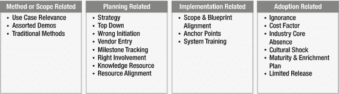
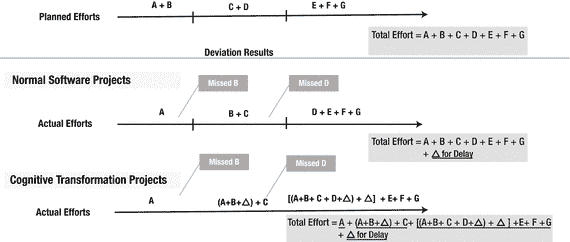
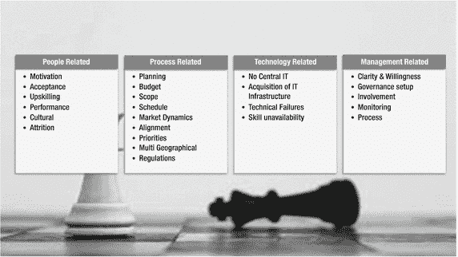

# 11. 转型障碍

本章讨论转型中的障碍。

注意

我们已经详细讨论了转型路线图，使用 PEIB 框架来获得高度可衡量且有助于避免途中偏差的可靠路线图。在本章中，我将详细讨论转型障碍，并涵盖一些重要的风险和成因。

第 10 章专门讨论了制定和规划转型的各个方面。

我们讨论了所提出的 PEIB 框架，该框架具有预定义的活动和清单集，有助于确定认知转型的范围和优先级。它还有助于进一步确保如何管理和调整转型。

有了该框架中提到的这些细节和步骤，一个重大问题应该会变得清晰：“我应该如何着手带领我的组织走向认知转型？”

尽管如此，这里我将提到一些障碍。应该了解并理解这些障碍，以避免在认知转型中出现任何进一步的问题或挑战。

本章后续所有章节中列出的挑战属于以下任何一类：

*   方法或范围相关
*   规划相关
*   实施相关
*   采纳相关

除此之外，这个概念本身非常新这一事实有时也使得采纳变得困难。

图 11-1 列出了所有类别及其下的挑战。

图 11-1.

各种挑战类别

## 方法或范围相关

此组中的挑战要么与采用了不相关的方法有关，要么与干扰范围确定的事情有关。初始阶段的范围也取决于可能性：如果没有确定用例的可能性，范围就会受损。如果范围未确定，则无法继续推进。

让我们更详细地了解一下属于此类的三个挑战：

*   用例相关性
*   混杂的演示
*   传统方法

### 用例相关性

这已成为许多新技术应用面临的挑战。它们推出时，包装上列出了一长串可能性和功能，但由于未能识别出足够的实际用例，或潜在客户/用户未能接受，最终未能在市场上获得成功。

认知技术也不例外。听到它、感到惊叹、观看精彩的示例视频和演示固然不错。

有些组织拥有明确的认知技术用例：例如，重度物联网驱动的组织，如石油天然气、制造业（复杂）、数字产品、零售、供应链等。这些领域很容易关联起来。但某些行业，如建筑行业、简单制造业（例如水泥）、金融行业以及内部组织（人力资源、会计等），则难以提出强有力的用例。

为自己的企业及其不同部门和活动寻找用例，有时很难。对于一个小型用例来说，它可能会给本已庞大的 IT 基础设施投资和能力带来额外负担。

这种无法识别用例的情况，有时也归因于市场上关于它的信息非常少，以及周围缺乏类似的案例，这在新技术早期阶段是常见现象。

随着时间的推移，当许多组织都使用某项技术时，就更容易看到和比较。但在初期，由于案例有限，这很困难。

例如，某个组织的领导层参加了一个近期的贸易和技术展会。该组织属于银行和金融领域。展会通过一些演示和展示，让他们对这项技术有了一个高层次的了解。但这并不是他们在展会上看到的全部。基于他们已有的认知，这个新的未知事物并不会在他们的记忆中占据重要空间。演示大多与非银行和非金融组织相关。因此，他们也难以想出一个更大的用例和收益。

他们甚至无法想象出一个使用这项技术、而现有技术无法实现的潜在用例。

这些以及许多其他类似的情况可能存在，并成为一些障碍。它们阻止了潜在用户使用这个解决方案。

克服这一挑战需要提供解决方案的行业和可能使用它的组织共同努力。但大多数情况下，责任落在供应商身上，他们需要用正确的用例示例瞄准正确的领域。同时，应该带着新能力的视角去探索现有的业务领域，以便在现有行业中提出全新类型的用例，利用这种新能力颠覆当前的执行策略。这可能是一种全新的、前所未有的做事方式。

有时，这看起来是一个非常简单的议题或挑战，但如果能为可能的用例预先设想出实际的场景，而不仅仅是谈论一般特性或有限的行业示例，那么这确实会带来回报。空谈可能会围绕产品制造错觉，并展现出产品截然不同的特性。

因此，无法找到适用于特定组织的相关用例是一个挑战。

### 多样化的演示

制造或实施新技术的公司通常只专注于一个用例。即使是与某个行业相关的演示，也常常无法展示其他能力。他们可能进行一两个演示，展示工厂流水线自动化或认知辅助维护，但仅此而已。内部会争论：为什么只为了这两个核心盈利领域投资，还要冒险增加一个可能成为摆设的新玩意儿？我们已经在优化运营和调整流程上投入了大量资金；这成了额外的负担。这是一个好的用例，但总体而言，随着时间的推移，持续增长的收益是什么？我们有没有这样的可能性？这些以及许多类似的想法会掠过人们的脑海，这降低了投资的可能性，从而也降低了组织对该技术的采用率。

深入细节来说，假设我们拿到一份文档，描述了认知系统在整个组织范围内的深入推广，以及对其每个部分带来的益处。这正是双方——实施组织和实施伙伴——经常忽略的。而一个好的计划能帮助他们理解其引入过程，既能循序渐进，又能立竿见影。PEIB 框架正是为此设计的，这类方法将有助于进一步应对这一挑战。

所有这些加起来，就形成了一种情况：有时，多样化的演示曝光反而成为了采用的障碍。

### 传统方法

当前应用的传统软件开发方法可能会成为转型的障碍。

认知转型不应采用传统的实施方法来规划和对待。

原因是，这主要是一个针对应用程序的训练活动，而该应用程序已在特定的业务领域组中预先进行了知识增强。技术开发仅限于接口开发和 UI 开发。这甚至不是一个功能配置活动（即需要配置预定义的业务流程，并专注于正确执行），也不是应用程序开发或报表创建。相反，这主要是以最合适的方式训练系统，收集所有必要的数据和知识，并将其加载到系统中。

训练中有两组参与者：供应商团队和企业团队。他们在实现良好训练方面扮演各自的角色（如 PEIB 步骤所述）。

因此，这个过程不能使用涉及角色分离的软件开发方法。开发阶段需要用户以及来自认知团队的开发人员的参与。范围定义也需要供应商团队的输入。

简而言之，这是一个从头到尾的协作工作。某个阶段需要特定技能或角色更多时，相应团队的参与度会更高，但所有团队都携手并进。因此，虽然项目的范围界定由企业的业务人员和人员驱动，但供应商团队会分享相关知识，帮助他们以最佳方式实现目标。开发团队驱动开发，但用户与他们并肩同行。

因此，计划采用这种方法或其他不相关的方法，可能会减缓或完全偏离转型工作，最终反而成为正确转型的障碍。

## 规划相关

就像任何游戏一样，认知转型也需要在每个阶段遵循正确的规则。这些规则非常关键，因为这项技术非常强大，规划上稍有偏差，很快就会导致非常不理想的结果。

规划从考虑采用这项技术开始，到执行完规划的每一步、最终获得解决方案时结束。

因此，每个环节的规划都应尽可能接近完美。以下部分将讨论一些规划因素。

### 战略

认知转型是数字化转型的核心，也是一项覆盖整个组织的战略规划。

它不应被视作其他任何仅存在于组织某个部门、而非其他部门的工具构建或报告编制工作。

数字化转型的核心在于使组织以数据为中心。利用认知技术的学习和推荐能力，以数据为中心的决策将推动整个组织达到更高的成熟度和卓越水平。组织将成为一个统一的数字实体，其任一“器官”的响应都能被每个末端感知。例如，生产单元的一台机器过热，通过内部历史数据分析，也能驱动采购建议。这可能成为在特定区域仅采购特定品牌零件的驱动因素；认知系统通过理解该零件有很高的故障概率，并考虑其在服务站点的可用性或合适技术人员的配备情况，可能会通过报告供应可能出现延迟来影响分销决策。随后，可以立即调用另一个生产单元来增加产量，以按时完成订单。

这一切都是相互关联的，但并非自然而然。它是通过增量知识构建起来的，并缓慢地将所有“器官”连接在一起。否则，将认知能力永久或长期地局限于某个子组织是毫无意义的。这扼杀了其存在的目的。

基于以上所有论点，显而易见，在迈出第一步之前，就应考虑转型的战略性质。然后，应制定一个计划，随着时间的推移，朝着正确的方向，将认知能力作为数字核心逐步推广到整个组织。PEIB 的形式化阶段正是为此提供了一种定义明确的初始实施及后续维护方法。之所以需要这种形式化步骤，是因为每个组织都各不相同，但基本规则保持不变。因此，像 PEIB 这样的适当框架将确保其遵循同类组织应遵循的路径，并且每个组织都能正确且统一地执行。

### 自上而下

这一点也与之前关于转型战略性质的论述相关。虽然转型的战略性质已被理解，但有时组织会首先考虑宏大的解决方案（即，首先引入利用认知能力实现领导层决策支持）。这在技术上是可行的。因此，如果你还记得前一章 10 中关于我们为何以及如何决定自下而上推进的内容，就会明白，正是来自各个分支的业务知识逐渐汇聚，才形成了整个组织的认知能力。这使我们能够构建更高层次的成熟度和能力。

如果前一层级的能力构建得当，那么当它进入下一层级时，其在该新层级的学习能力已经过调优和打磨。例如，当你从十年级升到十一年级时，你所学的物理知识是建立在之前层级细节之上的，并且信息在每个层级都得到了逐步丰富。认知的工作原理与此非常相似。直接向大学生讲授裂变和聚变的概念，而不需要先修物理知识，这或许是可能的。但必须同时传授所有先验知识，才能完善其含义，从而实现理解。因此，如果从顶层开始，系统需要一次性加载和训练所有信息。在我们学生的例子中，这不会取得最佳成功，因为在学习物理的每个阶段，她都在逐年构建概念或心智模型，并在下一年进行优化和升级。但如果试图一次性完成所有这些，质量就会下降，变得更为肤浅。

在采用自上而下的方法建立认知能力时，也会发生类似的情况。更好的选择是遵循一条渐进且相关的路径（PEIB 的形式化阶段），这适合该组织的特定需求和构成。一次性完成所有工作可能会导致训练流于表面，并且由于需要同时训练的维度太多而可能过于复杂。

因此，如果规划是自上而下的，它就会成为转型路线图上的障碍。

### 错误的启动

规划应确保能够持续构建组织下一抽象层级所需的知识。这意味着必须制定良好的规划，以确保遵循正确的顺序。

这正是我们在 PEIB 框架形式化阶段创建检查清单时所采用的方法，该清单提供了用于决策的规则。

“我们做不到”不是问题所在；正确的说法是“我们不应该这样做”。最好是先伸手摘取“低垂的果实”，从中获得收益，然后逐步升级到下一层级。这确保了知识在每个层级都得到良好的打磨和丰富，并在之前的层级上已经产生成果。

这才是正确的做法。如果操作不当，首先选择的可能就是一个错误的步骤。这可能导致下一阶段出现财务障碍，因此应尽可能避免。

### 供应商介入

供应商是为企业实施认知解决方案的一方。他们被认为是这方面的专家。这涉及两个方面：

*   他们不仅是技术专家，更是认知计算能力专家
*   他们是认知领域（或许还有行业领域）的专家，但并非特定企业的专家

即使是同一业务领域的企业，在许多方面也各不相同。因此，没有一条经验法则能完全适用于另一家企业，无论它们的业务类型多么相似。因此，供应商和企业应通力合作，以完成这个知识循环。

一次成功的认知转型是供应商与企业端到端的联合行动，这里的“端到端”是字面意思。因此，供应商应从概念化范围阶段（或更早）就参与其中。通常情况下，供应商是在这个阶段之后才被引入的。他们仅从技术/功能蓝图的角度进行范围细化，并将其转化为有助于实施的形式。

但在此案例中，这应该是一个贯穿始终的联合行动。不这样做将是一个错误的决定。

因此，供应商的介入对转型的成败有着重大影响。如果管理不善，这将成为获得成功范围的障碍，最终损害整体成果。供应商协作应始终尽早到位。

### 里程碑跟踪

我并非指基于里程碑的跟踪不好。它必须进行。但仅仅这样做可能很危险。PEIB 框架是为协作而设计的，我们迄今为止的所有讨论也与此相关。因此，各级领导层也应频繁参与，以确保事情按计划进行。企业中的一线人员，即经理和用户，很容易在长期过程中逐渐偏离方向，最终背道而驰。定期就所获得的能力（与团队关注的主题相关）进行汇报，可以提供良好的控制机制。领导层也应努力审视正在“烹饪”的内容，以及根据 PEIB 框架形式化阶段已列出的优先 KPI 和功能，完成了多少工作。这可以成为对转型路线图的双重检查，有助于使其保持在正轨上。

仅使用基于里程碑的正式评审和评估可能会成为转型的障碍。

### 正确的人员参与

任何项目的成功都离不开正确人员的参与，认知转型项目也不例外。但对于认知转型项目而言，其要求远不止于此。

通常，我们需要各部门高层级的正确利益相关者，即担任这些部门单点联系人（SPOC）的人员。在确定项目范围时，他们需要与业务代表一同参与。随后，这些业务人员中的一部分将扮演 SPOC 的角色，持续对已开发的解决方案进行第一手测试。基层人员主要与这些 SPOC 互动，很少直接与开发团队接触。

测试完成后，解决方案会面向所有人发布；随后，反馈和需求会传递给这些利益相关者，并再次形成新的（或大或小的）需求，为下一个迭代周期做准备。我们主要需要 SPOC 充当部门内的知识汇总持有者，并作为代表测试系统质量和功能，从而帮助开发团队。

但认知转型需要每个部门、每个层级的人员都参与进来。当然，并非 100%的人员，而是需要各种类型的用户。这种参与几乎贯穿整个转型过程，因此也会增加成本。不过，随着时间的推移，这部分成本会显著下降。因为随着知识的丰富，这些人员用于培训和贡献的直接投入曲线将持续陡峭下降，而系统的可用性则会随着其功能的自然使用（除任何正式培训外）而持续提升。

在部门层面，需要 SPOC 来监控关键绩效指标（KPI）和功能追踪，以检查偏差，但他们不再是唯一的活跃参与者。他们有助于把控转型的方向。

如果无法满足这一要求，可能会导致系统未能得到最优化的训练，从而效果不佳，这将成为转型步入正轨的主要障碍。

### 知识资源

认知系统核心是一个能够学习和生成知识的系统。对人类而言，学习意味着在脑海中构建基本的地图；这些地图通过不同经历随时间连接起来，并以关联的形式存储。这些关联会随着新的经历和事件不断修正；这改变了对同一事件的感知和反应。现在，要想在某一个领域（例如“治疗癌症”）成为专家，就需要通过学习医学院的各种课程来不断丰富知识。这些学习，连同讲座、实践实习和实验，会不断得到充实。课程中提出的问题会激发更深入的思考，并进一步丰富知识。随着时间的推移，这些问题会变得越来越内化。最初，课堂上由教授提出的问题是为了引导思考朝着需要培养技能的具体方向发展；然而，经过教育和多年的医院实践后，这些问题被内化了。因此，这位拥有所有学习和经验的人现在会向自己提问；例如，“如果某个特定患者用这种方式治疗，而之前那位患者因这种药物组合而生病，那么对于这个看似相似但患者年龄是之前患者的两倍且为女性的病例，我该怎么办？”所以，区别在于，最初的问题旨在训练，而现在的问题用于解决问题。前者源于外部，后者则源于内部。培训起着重要作用，但如果没有充足的知识资源作为适当输入，其效果就会受限。

那么，如果将其转化为当前阻碍因素的情景，这意味着什么？这意味着所需的知识资源（核心知识、其他知识、内部业务知识以及持续学习知识）必须进行广泛、毫无妥协且非常提前的规划；并且要部署在转型的每个阶段旁边。

如果进行转型的组织对认知系统如何最佳运作了解不足，这一切都可能被忽略。这就是为什么这里也需要外部专家。

无论培训多么出色，如果整体知识资源不够优质和充足，知识库之间的关联将只能在有限的信息范围内发生，从而产生有限的效果。

在获取正确格式或所需内容时，也可能存在阻碍，例如成本考量，或者甚至是对认知选项本身缺乏了解，或不知道如何找到它。

懒惰，或者对快速见效抱有过高期望，也可能是原因之一。

这可能会成为实现成功转型的主要障碍。最终可能导致一个非常稀释且智能程度较低的解决方案。

### 资源对齐

我们在“正确参与”中讨论过，应该将合适的人员分配到组织的转型路线图中，这与传统项目（例如 ERP 项目）的人员分配方式不同。在此之前，我们还讨论了向系统输入丰富多样的知识资源具有很高价值，这有助于认知机器获得所需的推荐能力深度。

现在，本节将讨论一个有趣的障碍，它是上述两者的结合。假设一个项目已经将每项材料（学习内容）和每个参与者的角色都规划到了最精细的细节。所有内容都已列出；所有人员都已确定，并且我们有一个坚实的行动计划，详细说明了每个资源的去向。

但时间维度（即在适当时间可用）同样重要。因此，另一个障碍是没有规划好每种资源（任何类型）的可用时间框架。基于本章前面解释的所有原因，认知转型应该逐步构建。

自上而下的方法在技术上可行，但在实践中无法产生预期的结果。因此，可能会错过资源的可用时间，而对于前一个知识发展阶段来说，这意味着该阶段的努力本应已经完成。如果必须严格遵守项目每个阶段所决定的时间，那么努力的质量将会很低，和/或时间线会过长。

无论哪种情况，都不理想。因此，如果没有一个基于现实时间线的可用性计划，或者没有在整个过程中制定备用计划，这将成为转型成功的主要障碍。

为了实现转型成功，资源必须在时间上对齐，并达到计划的数量和质量。否则，这可能会成为一个重大的质量问题，并可能完全破坏整个转型，因为由于前一个阶段的此类失败，下一个阶段将更容易出现规划失败，因为现在整体复杂性已经增加。

图 11-2 描绘了普通软件开发（例如，典型的报表开发）与认知转型之间的区别。

图 11-2.

比较工作量评分

在普通软件开发中，任何缺失的步骤都会被传递到下一步，但从一个部分到下一个部分，工作量大致保持不变。因此，如果项目每个阶段都有缺失的步骤，总体工作量大致保持不变，仅因延迟而产生一些增量（Δ）。

但对于认知转型，每个缺失的步骤除了自身的工作量外，还需要额外的增量努力，以弥补在每个层级上因更多缺失输入而达到的复合成熟度。因此，如果 B 被遗漏，那么在下一阶段，其工作量将作为 A + B + Δ 添加，而不仅仅是 B。原因在于，在这个新层级，C + D 过程本应与来自 A 和 B 的已丰富数据一起成熟。由于这在上一阶段没有发生，因此必须在此处与 C 一起进行，如果 D 也被遗漏，那么总工作量将变为 (A + B + Δ) + C，而不仅仅是 B + C。

此外，在下一阶段，本应与 A + B 一起成熟的 C + D 应被传递下去，然后与 E、F 和 G 一起丰富。但这并没有发生。D 被遗漏了。因此，现在 C 和 D 需要与 A 和 B 一起得到丰富或训练，然后再与 E、F 和 G 一起进行，并且即使对于 D，也需要添加额外的 Δ 努力，因为它已经进入了一个更高的复杂性层级，需要更多的努力才能实现结果。

结果，加上与之前示例中类似的延迟增量 Δ，在消耗的工作量方面要复杂得多。

这可能是认知转型路线图中一个非常棘手的障碍。它甚至可能完全颠覆项目。图 11-2 是一个线性示例；考虑到正在转型的多个流程和关系，它会变得复杂许多倍，并需要付出巨大的努力。

如果不在每个阶段消耗 Δ，那么质量就会相应降低相同的比例，这会产生不可预测的结果。

## 实施相关

在实施过程中，也可能出现一些挑战或问题，成为障碍。我在这里不列出那些通用的问题，比如网络故障、人力资源采购、硬件采购等等。相反，我将提及三个可能成为任何组织成功转型障碍的主要问题；这将仅从认知转型的角度出发。

### 范围与蓝图对齐

范围是巨大努力的结果，主要由组织驱动。我在这里使用“组织”一词而不是仅仅“业务”是有原因的。传统的 IT 项目由业务用户的需求、测试和结果驱动，由开发人员和配置人员实现。因此，当我们谈论它们时，我们是从业务和 IT 的角度出发的。

对于认知能力转型，它是所有正在做的事情以及做这些事情的人的总和，并且是每种类型和角色的直接体现。因此，提及“组织”而不仅仅是“业务”是合适的。整个组织的缩小版必须做出贡献。

同样，组织在经验丰富的供应商顾问的帮助下驱动范围的形式化。正式的范围是在第 10 章 PEIB 框架的形式化阶段中提到的所有练习之后得出的。

这必须由开发或其他项目团队在蓝图中翻译成“现状”。考虑到偏差的可能性以及时间和工作量失控的可能性（如图 11-2 所示），这在认知转型项目中极其重要。

如果没有经过彻底的讨论、验证和批准，这可能会成为一个风险或障碍。

认知转型在许多方面与其他项目不同。认知转型的蓝图必须是协作努力的结果，并由技术开发团队主导。

但是，如果转型没有按照蓝图进行，那么需求很有可能无法正确转化为最终结果，这可能会破坏整个转型周期。结果可能与预期存在很大偏差，甚至可能缺失最初计划的能力。

### 锚点

在开阔的海洋中，很难感知实际的速度和方向。认知转型也是如此，它本身就像一片海洋；在任何特定方向或流程领域丰富学习的可能性实际上是无限的。

考虑一下我们在“知识资源”部分中关于癌症治疗和医疗处理的先前示例中的情况。这个人从医学研究生阶段的学习开始。她更进一步，专攻一个治疗领域；然后她可能还会进行超级专业化。这意味着她只是医学科学一个领域的专家，并不专注于其他疾病（如心脏、腹部、肝脏、肾脏等）的专业治疗。尽管作为一名医学博士，她对这些问题有相当的了解，但她的主要焦点只在一个领域。她在这个专业领域不断学习，随着时间的推移，可能会只专注于某一种癌症或某一种特定的治疗程序。

同样，假设有一家企业计划按特定顺序对某些领域进行认知转型。但事实是，该系统在所有领域的学习能力实际上是无限的，这取决于投入到该特定领域的知识资源、培训和时间。因此，在项目执行的任何阶段，焦点都有可能发生转移，从而偏离方向。这可能导致大量时间花费在少数几个部门或领域，而不是按照特定时间投入计划来取得平衡。

因此，我们谈到在转型的形式化步骤中，将“可衡量”和“清晰可辨”的 KPI 或特征作为锚点。这有助于避免偏离。事实上，在任何领域对系统进行更高程度的专业化丰富总是可行的，但在时间有限且预期收益有限的实际情况下，这可能会对最初选择的方案带来不利影响。

如果在计划中未能创建锚点，可能会成为障碍，整体结果可能会变得扭曲且不可预测。

### 系统训练

认知计算中的知识构建练习是核心。正如我们在本章前面所讨论的，计划将所有内容及时纳入并提供是很重要的。这些事项确保了编码和非编码数据能够顺畅地流入系统。这对于确保所有可能影响建议的方面都得到覆盖至关重要。

但这甚至还没完成一半的工作。有必要确保所有这些资源都被用来在系统中构建所需的智能水平。

这是通过对系统进行良好的训练来实现的；正如本章前面提到的，有指向内部和外部的两类问题。外部问题（回想一下“知识资源”部分）是构建知识所必需的。而内部问题，即本部分讨论所考虑的，是解决问题以及根据其新结果（期望的、不期望的，或介于两者之间的任何结果）进一步发展和丰富知识所必需的。

如果一个认知系统加载了所有数据，但没有经过大量问题的训练，那么当它被用于提供建议时，将毫无意义。这不是一个从数据库中查找相关文本并推送到用户屏幕上的搜索应用程序。它必须理解文本，而这需要训练以获得对核心主题领域和特定业务知识的深入理解。除非训练者本人是专家，并且知道对于一个相关的子主题，可以用多种方式提出哪些问题，否则他无法做好这项工作。这成为了成功转型路线图上的一个障碍。

还有另一个方面。正如第 10 章 PEIB 框架细节中提到的，每个组织的转型都遵循特定的顺序：即转型路径。在进入下一层级之前，应尽可能丰富当前层级。跳过某个层级可能会导致在后期阶段需要指数级更多的精力和努力来填补空白。每个层级的训练质量都会影响后续每个层级的质量水平。

这使得它成为转型成功的重要障碍之一。

## 与采用相关的问题

“采用”的字典定义是“选择接受或遵循一个想法、方法或行动方案”。

与采用相关的问题有两种类型。

*   那些在我们考虑是否采用某物时出现的问题
*   那些在我们已经部署了某物，但需要遵循某些行动计划才能持续正确使用它之后出现的问题

因此，一种发生在采用之前，另一种发生在采用之后，即需要遵循程序以保持正确使用时。第二种也可以看作是适应（即，正确地采用它）。

现在让我们讨论一些可能成为转型障碍的此类挑战。

### 无知

无知并不总是福气。我见过一些案例，人们对行业的最新发展了解不多，甚至对后果也一无所知。

许多研究公司已经提到，如果行业内的领先者不追随工业 4.0 的趋势，他们可能会衰落。

这是一个明确的趋势；事实上，它已经开始了，许多组织已经深入其中，或者至少迈出了第一步。

在未能理解技术、行业或两者最新趋势的情况下，这种无知有时也被视为一个巨大的风险和障碍。

### 成本因素

每当我与高层管理人员谈论认知解决方案和收益时，我都会看到一系列表情。他们先是感到有趣，印象深刻，然后迅速把手伸进口袋，扬起眉毛说：“看起来挺贵。”他们接下来想到的可能是：“当目前的预算都是通过如此疯狂的谈判才挤出来的时候，我怎么能说服业务部门承担这笔新成本呢？”

这个现实可能是此类问题中的一个主要障碍。它可能在探索解决方案或转型路线图的大门尚未到达之前就阻断了道路。

关键在于，这还伴随着大量内部资源的投入，进一步增加了成本、复杂性和工作量。

但你还记得第 10 章开头的讨论吗？随着时间的推移，节省下来的成本将抵消每年在 IT 预算中作为重大投资而产生的经常性成本。对认知的投资是不同的。系统会随着时间的推移自我进化。虽然它是一个自治系统，但维护方面肯定是存在的，然而其价值会随着使用逐年增加。培训会融入组织，并且不再产生额外的外部成本。

可以提出许多这样的论点，但成本确实存在，并且一些新型成本（包括订阅成本）也会增加，这成为了一个障碍。

### 行业核心缺失

我们在第 10 章讨论了所需的资源。为了方便讨论，我将这些信息再次整理为表 11-1。

| 编码知识 |
| --- |
| 机器手册 |
| 产品详情 |
| 质量方法与流程 |
| 质量测量指标 |
| 产品制造流程 |
| 能效措施与标准 |
| 机器维修 |
| 模型零件详情 |
| 了解工艺挑战 |
| 操作员手册 |
| 运营中的问题 |
| 其他 |
| 专家知识库 |
| 用于培训的专家问答 |
| 标准研究论文 |
| 标准期刊 |
| 新闻网站（相关） |
| 内部知识 |
| 内部专家知识库 |
| 用于培训的内部专家问答 |
| 物联网数据流 |
| 历史日志 |
| 历史故障详情 |
| 其他历史问题 |
| 机器维修日志 |
| 机器改造记录 |
| 定制机器手册 |
| 产品详情与规格 |
| 内部代码 |
| 内部质量控制历史数据 |
| 内部质量控制流程 |
| 内部质量控制指标 |
| 能耗与问题数据 |
| 内部流程 |
| 内部手册 |
| 历史生产数据 |
| 持续知识 |
| 新闻源 |
| 免费网络资源 |
| 付费网络资源（其他） |
| 付费技术信息 |
| 机器制造商提供的软硬件详情数据流 |
| 软件升级数据流 |
| 人力资源 |
| 专家操作员 |
| 工程师 |
| 外部流程专家 |
| 内部流程专家 |
| 产品专家 |
| 产品研发专家 |
| 负责数据摄入的认知专家 |
| 企业 IT 对接学习者 |
| 内部 IT 专家 |
| 内部物联网数据专家 |
| 为保持知识连续性而持续跟进的人员 |
| 企业 IT 对接学习者 |
| 内部 IT 专家 |
| 物联网数据专家 |

在第 10 章的背景下，该表格提供了一个指示性的详细知识项列表。但就本节讨论而言，我们只需关注这些标题。标题如下：

*   **编码知识**：赋予认知系统基本特征的知识。因此，如果用于癌症研究，它应包含该领域所有编码化的详细知识。
*   **其他**：这也与前一项相关。这里提供了用于训练和丰富前一类数据的问答。此外，所有研究论文、期刊、视频等也在此提供。
*   **内部知识**：这是加载组织特定知识内容并进行训练的领域。
*   **持续知识**：由系统投入运行时提供的知识之外的知识源组成。
*   **人力资源**：这是临时（项目阶段）和未来的人力资源计划。

我们这里关注的是第一点和第二点。核心知识能力被赋予认知系统，使其能够在特定领域工作。这特定于某项任务、流程或行业。这可以被称为行业核心。

行业核心的存在总能给组织带来更多信心，使其选择某个解决方案。在这方面相关性越高，被采用的可能性就越大。

已有一些软件非常贴合特定行业（例如公用事业、电子、制造、零售、银行与金融等）或特定流程（如财务、物料管理、销售与分销等）的实例。这是一个真正的吸引点，能以最少的定制量确保应用的高度契合。

因此，对于认知解决方案，这可能意味着：

*   基于丰富形式进行严格训练的行业特定编码知识（全部）
*   通过添加所有研究内容并加以丰富来增加价值
*   由此可能产生的新时代用例，也获得了额外能力
*   知识更新直至安装之日

如果这些都不存在，那么很明显，这可能会成为第一层级的阻碍因素，因为将基础材料转化为知识黄金是一项艰巨的任务。

### 文化冲击

从业务转型的角度来看，文化冲击的定义如下：“当人们日常业务和任务的执行方式发生变化时，往往会体验到的一种不确定、困惑或焦虑的感觉。” 如果转型与当前状态差异巨大，这种感觉会更加普遍。这可能是由于对新工具不熟悉，以及对复杂性的个人假设，以及害怕失去使用先前手段的舒适区。

认知解决方案有时也被展示为高端的小工具应用，而担心自己无法使用它们的恐惧可能潜藏在心底。此外，担心认知解决方案表现优异从而取代人力资源，也是一个非常重要的原因。

像“高端”和“复杂”这样的术语也可能导致对高成本的认知。

人们甚至可能觉得它过于侵入他们个人部门级别的小圈子，因为它几乎是一种无处不在的文化。认知计算能力与所有人相关，并具有企业级的覆盖范围，随时利用来自每个角落的所有数据，因此无法对信息/数据进行局部屏蔽。当没有时间进行损害控制时，这种高度的透明度有时会变得困难。所有这些想法都与文化冲击现象有关，并且可能成为阻碍因素。

担心业务部门的用户需要更复杂的 IT 相关知识，以及 IT 人员担心因此被淘汰或变得多余，也是一些阻碍因素。

### 成熟度与丰富化计划

即使“首次准备好使用”，认知系统也并非真正准备就绪。它会随着时间和新数据的出现不断积累经验并学习。当然，也需要对其进行训练。这被称为未来的成熟度与丰富化计划。

如果不这样做，系统可能只会持续获取数据，并基于其在该领域的已有知识来理解数据的含义。如果它属于某个新的业务领域或新流程，那么未经训练的系统将没有太大用处。

这可能会成为进一步的阻碍因素，因为如果系统不随着时间的推移进行更多训练，并且不通过添加新数据来使用，那么预期的成熟度增长就无法实现。

如果不这样做，系统可能无法充分发展，这可能会成为一个阻碍因素。

### 限量发布

限量发布也是一种规划上的缺陷，它阻碍了理解认知系统在多人使用下如何随时间演变并更好地运作。认知系统需要从最小的活动数据到最大的财务和生产规划数据等一切信息。这意味着它从一开始就应该被规划好，以便服务于组织中尽可能低的层级。

它被使用得越广泛，对组织的理解就越深入。因此，将其局限于精英群体或由相似背景人员组成的群体，可能会随着时间的推移损害其整体的可用性和成熟度。

这会成为一个巨大的障碍，因为基于这种愿景，没有规划出好的用例；即使在基层，未能广泛使用也使其无法深入理解并分析业务领域。这无疑是一个障碍。

本章这一部分讨论的一些挑战，只需遵循 PEIB 框架即可克服。但有些挑战需要被重视并牢记，以确保它们不会成为障碍。还有一些甚至与认知和意愿问题有关，这些问题可能无法控制地发生，但所需的控制力可以随着时间的推移而建立起来。

因此，要改变转型方式，以避免重大挑战和障碍。

## 风险

任何活动都伴随着一定的风险。即使是骑自行车，也存在风险，考虑到世界上所有的危险，风险可能会成倍增加。因此，如果从高速斜坡上摔下自行车，最坏的结果可能是骨折或脱臼。但如果骑行者被车辆撞击，则可能导致重伤甚至死亡。所以，风险不仅与实际的工具或载体本身有关，更是与之交互的环境因素的总和。

认知转型也是如此。风险不仅源于所讨论系统的可能故障，也可能源于周围的相关方、情境和受影响的情景。

我将这里的风险分为四大类：

*   人员相关
*   流程相关
*   技术相关
*   管理相关

图 11-3 展示了这四个类别，并列出了一些更具体的风险。

图 11-3.

主要风险

### 人员相关风险

这些风险与从事不同项目的各类人力资源有关。这涵盖了组织中除少数高层外的所有层级的工作人员。

此类别下还列出了进一步的风险。

#### 积极性

存在与个人积极性相关的特定风险。不可能让所有人在项目的全部时间里都保持完美的积极性。

团队中总会有失去积极性的可能。这甚至可能具有传染性。一个流程清晰、由流程驱动的组织是解决方案。

通过团队各层级之间的频繁接触，并在早期发现并解决小问题和顾虑，可以降低这种风险。

这本身就是一个风险，因此确保团队中建立起一定程度的热情和积极性至关重要；否则，转型可能会因积极性不足而受挫。团队应该看到全局，并对整个过程有理解力和责任感。

#### 接受度

这是一个非常重要的因素；多年来，它因影响众多转型而臭名昭著。

人们总是将现状视为基准，并据此发展自己的专业技能，认为基准不会很快改变。任何像这样的变化，即使很小，也会被视为挑战。但更大的变化，例如认知转型，在这方面可能变得至关重要。我所依赖的整个基准发生了变化，这意味着我需要建立一套全新的能力。这可能会危及我的声誉、我的工作，甚至我的职业生涯。

这种恐惧和可能的不适感可能构成风险，导致拒绝。认知系统并非运营系统，用户可能会倾向于少用或忽视它，仅仅将其视为一个技术小玩意。但使用得越少，情况就越糟，因为它需要被尽可能多地使用，才能提供进一步的价值。

对于大多数技术或流程转型来说，这是一个常见的风险。认知转型作为两者的结合，更容易受到此风险的影响。

#### 技能提升

认知转型需要三个层次的技能提升：

*   了解其运作方式的技术知识（至少）
*   如何使用它（尽管很简单）
*   如何通过不同的方式、以认知的方式做事，从而从当前流程中获得最大收益

在进行认知转型时，应牢记这一点。推广技能提升和认知普及是必要的，以使人们了解这三个方面。

这也有助于提高接受度，并起到激励作用，因为当人们对某事感兴趣时，他们往往会以某种方式拥有它，结果也总是更好。他们心中假想的挑战和风险得以缓解，他们可以参与所有活动；因此，技能提升可以减轻之前讨论的所有风险。

这有助于在风险演变成巨大的失败泡沫之前将其化解。

如果不这样做，可能会导致巨大的风险，因为归根结底，劳动力必须使用它才能使其成功。

#### 绩效

这始终是劳动力管理和业务项目管理中的一个关键 KPI。因变革而导致的绩效下降，有时是由许多未管理的风险（如技能提升、接受度挑战和缺乏积极性）引起的连锁反应。

这给劳动力带来了困境，他们的有效工作时间可能会大幅减少。这也可能源于两个截然相反的原因：

*   技术和流程变革被认为非常难以采用
*   转型过程如此有趣，以至于大量时间都花在了摆弄它上

这可以与 20 世纪 80 年代计算机开始在工作场所普及时的情景相类比；当时的技术太神奇了，以至于人们有一半的时间都在做不必要且无成效的工作。

因此，如果不考虑对劳动力绩效的潜在影响，这可能会成为转型成功的严重风险。

#### 文化

与任何文化一样，工作文化对任何组织也有着显著的影响。没有两个组织会拥有完全相同的工作文化。我不打算提及具体名称，但在 IT 行业本身就有这样一个突出的例子。一家成功运营的 IT 公司被另一家制造业巨头收购。他们将那些主要凭借制造业行业经验发展职业生涯的优秀经理人，安排到这家新收购的公司中。他们的目的是使其文化与母公司的文化同质化。这些被引入的都是精挑细选的成功高级经理。但结果却与预期相反。这家新的 IT 组织在这种架构下举步维艰。原因不仅在于两种组织文化，更在于两种行业文化。如果是 IT 对 IT 的文化同质化，过程会更容易，因为在大多数管理方面，基本框架通常是相同的。

认知转型不仅仅改变 IT 架构或带来一些高端解决方案。这是一项战略变革。同时，行业在市场层面正朝着提升消费者体验的方向发展。同样，在企业内部，他们也在朝着更加以员工为中心、基于员工体验的组织迈进。认知数字核心颠覆了当前的工作文化，并带来了一种更具生产力和协作性的工作方式。这必须在实际转型开始之前很久就缓慢地注入，以便为未来成功的转型奠定基础。网络广播、研讨会、认知培训、邮件通知和全员大会都应推动这一点，同时辅以一些小型培训，让人们了解工作文化如何借此升级。

如果处理不当，这就是一个风险。任何转型的认知体验不仅与技术专长成正比，也与随之而来的员工体验成正比。

#### 人员流失

高人员流失率表明存在问题，尽管人员流失永远不会为零。但应该取得平衡，因为即使是评估为平庸的员工的流失，也会带走一些专业知识，并且需要付出努力来填补这个缺口。即便如此，也没有人能确切预测填补是否成功。

如果在转型的关键阶段人员流失更多，这也是一种风险。认知解决方案就像一位智者，坐下来向每一位参与者学习游戏的所有可能规则。经验丰富的资源参与讨论越多越好。

必须事先与人力资源部门详细制定人员流失应对计划，以确保至少在转型期间或转型之前，关键参与者不会流失。

### 流程相关风险

有许多支持性流程并行运行，以确保转型成功。该领域的任何问题迟早也可能演变成重大风险。

让我们更详细地讨论我所涵盖的一些主要风险。

#### 规划

这无疑是讨论中最大的风险，并且在整个过程中都将如此。忘掉所有关于“万无一失”的说法吧，因为首先就不存在万无一失的计划。

与所有其他项目相比，认知转型是一种非常不同的转型。它是技术和流程转型的结合。实现它的方式也是独特的，因此在某些领域，正如前面讨论的障碍，可能极具风险（例如，前面图 11-2 讨论的时间线和工作量示例）。我们看到，一次遗漏一个步骤的影响可能会对工作量产生计划外的巨大影响。

因此，对于流程相关风险以及所有其他风险而言，规划仍然是一个重大风险。

本书提出了一个名为 PEIB 的新框架，该框架也在第 9 章中重点介绍。

#### 预算

这是规划中至关重要的一部分，从个人层面到组织层面皆是如此。对个人而言，可能主要是因为银行账户资金不足。但对组织而言，也可能是因为咨询顾问与领导层之间的想法不一致。

如果预算根本未获批准，这始终是一个风险；但如果计划分期提供（可能基于已取得的立足点或已产生的价值），则更加危险。

因此，预算风险不仅可以从财务角度进行管理，还可以通过良好的规划以及遵循像 PEIB 这样标准且合乎逻辑的框架来管理。预算大多是分期支付的，除非我们有一个强大的认知交付框架，否则根本不可能给出一个令人信服的图景，以使其在预算流入方面具有可持续性。

#### 范围

这是程序性风险中非常明显的一类。如果没有恰当地界定需要什么、何时需要以及以何种形式需要，范围就会成为一个重大风险。无需详细讨论，因为这一点对所有已执行的项目都是一样的。

#### 进度

这与两件事相关：计划以及执行这些计划的运营效率。

我们已经在本章中讨论了计划是最大的风险。进度是同一计划的时间维度呈现，它为计划中的每个项目标记了明确的时间段。

所以，我们可以说这是规划的下一层级；它通过整合时间因素，将规划提升到更详细的层级。

进度的另一个方面是执行方面，即我们遵循进度。如果不遵循进度，这也是一个风险。

可能会有许多挑战影响进度中的时间线。这些挑战无法完美控制，但应尽可能最大限度地加以控制。

转型进度同样需要遵循像 PEIB 这样的标准框架，这将提供对执行的更多控制，带来更高的信心和最小的偏差。

#### 市场动态

所有这些转型都是为了业务的利益而进行的。如果在过程中间出现市场衰退，可能会成为转型的风险。因此，为了避免这种情况，计划的制定应确保主要的初期投入在一年中合适的时间进行，而不是在不确定性更高的年初或年末。

#### 协调一致

在这里，“协调一致”特指内部与外部协调机构之间的协调一致。

如果内部不协调一致，这是一个风险；如果外部和内部利益相关者之间不协调一致，这也是一个风险。

内部协调一致问题可能由多种原因引起；从流程角度来看，可能是因为没有适当的计划，或者缺乏一个能够从定量和定性角度进行管理的良好框架。

供应商与组织利益相关者之间可能存在内外部协调一致问题，并且在各个层面，这种协调一致问题都可能导致风险。协调一致问题可能源于规划问题、职责不清、或其他模糊点和混淆点。这些都是主要问题，而且可能数量众多。

这些协调一致问题是一个大问题，应通过强有力的流程和明确的框架来缓解。应使用定义的参数进行持续监控，以确保紧密整合，否则这就是一个风险。

#### 优先级

规划能够为良好的转型带来所需的要素。但这一切无法一蹴而就，即便按顺序执行，也应规划出最优且可行的顺序。优先级需要明确界定。

当范围确定后，时间线也会随之确定，但如果优先级设定不当，计划就无法顺利执行。

这可能对认知转型构成危险。我们在本章中已经看到了一个例子，即当未遵循正确顺序时，工作量会急剧增加。这只是一个例子；可能还有很多。

因此，在规划和安排项目（在 PEIB 中正式化）时，也包含了一个优先级步骤，以避免这种风险。

#### 多区域

我们讨论的是企业利用认知核心进行核心数字化转型。单一组织的覆盖范围通过一个有效的数字核心来统一。这与组织的规模无关。组织越大，用例效果越好，因为最小的组织可能让员工集中在同一区域，甚至在同一间大厅或桌子旁协同工作。决策在近距离内做出，协调可能只需在一张小餐巾纸上完成。但对于大型企业而言，这种员工体验和协作是由数字核心创造的。一个虚拟层向所有各方敞开大门，他们通过这个单一核心连接。如果做得好，听起来不错。但在实施过程中，这种风险更大。PEIB 框架（或任何类似的现有框架）应在规划阶段和范围最终确定（正式化）时进行调整，以纳入这一方面。如果处理不当，认知核心可能会提供与某些地点不相关的建议。

此外，还应确保在计划执行时，有来自所有相关区域的合适人员按层级参与其中。

#### 法规

无论我们在一个还是多个区域开展业务，合规需求始终存在，它管辖着数据保密等各个方面。但是，当我们谈论一个跨区域运营的组织的单一数字认知核心时，不同区域对类似流程必然存在不同的法规。

这使得情况更加复杂，需要仔细规划。某些国家对客户数据（如果使用的话）有非常严格的法律。如果忽视这一点，可能会构成风险。

### 技术相关风险

任何技术转型都必须列出与技术相关的风险，以便规划缓解措施，最大限度地减少此类风险的影响。

认知转型既包含技术要素，也包含流程相关要素。

仅就技术而言，它也是关键。技术重点和活动也非常专业。

这可能导致一些技术相关风险的发生。此外，参与此转型技术方面的整体行动和能力对其成功至关重要。这取决于转型组织内部 IT 部门的成熟度。

让我们进一步讨论其中一些技术相关风险。

#### 无中央 IT

我认为，只有当组织的工具、流程和战略在跨区域范围内保持一致时，才能称其为中央 IT。

如果存在一个独立的 IT 组织，它仅与中央 IT 组织关联，但在本地运营时却遵循自己特定的规则，这可能会成为认知转型的风险。

如果我们尚未拥有一个统一的 IT 核心或中心，有时成本会更高。因此，在启动转型项目之前，应首先将其标准化。

#### IT 资源获取

这里所指的 IT 资源包括硬件、软件和网络硬件。这些通常来自多个供应商，并由多个团队处理。如果不同步，整个项目可能会延迟。

这种风险主要存在于项目启动阶段；随着时间的推移，影响会逐渐减小。

该风险的另一个方面是硬件存储的容量规划。这很关键，因为如果问题发生在项目中期，不仅涉及再次采购，还涉及将其与现有或早期引入的设备连接并使其协同工作。

#### 技术故障

技术成功无法永远保证，失败始终是任何 IT 相关转型从开始到结束乃至之后的风险。应遵循国际标准，通过确保高质量的组件来避免此类故障。有最佳实践和良好的监控来避免这些潜在故障。

但这在整个过程中仍然是一种风险。

#### 技能不可用

在任何项目中，适当的技能对于确保良好的实施或转型都起着巨大作用。

认知能力不仅需要良好的技能才能发挥作用，还需要流程、内部流程、技术以及集成环境中许多其他技术方面的各种专家。

与其他任何项目一样，技能的可用性仍然是一种风险；即使是一个拥有合适技能的人在过程中途离开也是一种风险。

### 管理相关风险

“组织管理”是一个简单的短语，但在实践中并非如此单一。在任何组织中，都有不同的部分、层级和等级制度协同工作，形成一个统一的管理层，试图引导航船驶向单一方向。但同一管理层中不同层级和部门工作不同步，并因管理效率低下或脱离背景，甚至更糟的管理不善而产生问题，这种情况并不少见。

此类风险中有一些突出的风险，我现在将进一步讨论。

#### 清晰度与意愿

任何层级缺乏清晰度都可能是一个巨大的风险。对于如此重大的战略举措，合作的管理层从上到下都应保持清晰。任何一个层级的模糊或混乱都可能导致下游问题成倍增加。

高层的意愿决定了项目的“行”或“不行”。但在底层，意愿是由激情、奖励或惩罚驱动的。第三种是实现预期行动的最差驱动力。

应达成明确的共识、理解和责任分担，以增强合作意愿。信任也是一个重要因素。

任何这些要素的缺失都可能构成风险，导致错误或敷衍的解决方案。

#### 治理架构

所有层级都应在有利、清晰且激励人心的环境中进行合作与协调。对于这些转型项目，也应建立适当的治理架构。每个层级都应按照预期的计划和范围，对各自负责的部分进行监督。整个组织无法并行处理所有事情。同时，不应允许随意的人员介入治理和推动各个方面。必须在预先定义好的责任框架内妥善进行。

一个较小规模的人员层级代表，并在每个层级定义了适当的流程，这被称为治理架构，它对成功至关重要；反之，其缺失则是一种风险。

#### 参与度

认知核心转型比任何其他软件项目都更需要协作。它始终需要管理层的参与。如果管理层在未能充分理解方向和动机的情况下缺席，这可能会构成风险。

各级管理层都应参与其中并坚持到底，在每一个阶段都进行审慎的风险承担。这种参与也需要从最高领导层贯穿至基层，以确保他们始终关注着任何特定时间点所产生的价值成果。

由于这是一项兼具战略性和新颖性的技术，因此更需要各个层面的参与。

#### 监控

计划的首要任务应是交付成果的质量。这正是监控的重要性所在。监控基于在确定范围时已决定的关键绩效指标和预期功能进行。这些指标和功能也需要被监控。如果不加以监控，它们将构成巨大风险，因为这与一开始就没有设定它们几乎无异。

#### 流程

在某些情况下，流程并未得到优化。在启动此类战略举措之前，应尽可能克服这一缺陷。

缺乏清晰的流程来管理这些项目始终是一个风险。那些容易产生不当操作或低标准工作方式的流程，可能会导致错误做法被纳入认知系统本身，并使其朝着错误的方向“学习”。

## 总结

在本章中，我详细讨论了认知转型过程中的障碍。我还讨论了主要风险及其存在的原因。

各种障碍主要分为四大类：

*   方法或范围相关
*   规划相关
*   实施相关
*   采纳相关

每一大类都进行了讨论，并列出了其面临的挑战。

我们还讨论了资源协调一致的好处，并举例说明了如果协调不到位会发生什么：随着时间的推移，付出的努力可能会呈螺旋式上升。

障碍可能源于组织对如何利用这一前沿转型的理解，以及一旦范围确定后他们实际如何执行之间的差距。

规划要素也应当是恰当且可量化的。正确的资源和知识来源也应当及时协调到位。

如果此类项目所需的关键锚点缺失，则极有可能出现偏差，这需要加以管理。

有时，转型的整体采纳本身就是一个挑战和障碍。

风险是另一个需要预先识别某些事项的领域。这里讨论的一些主要风险类别如下：

*   人员相关
*   流程相关
*   技术相关
*   管理相关

