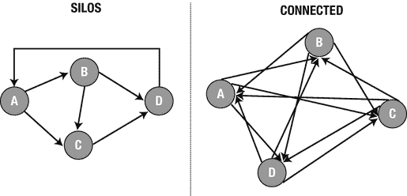
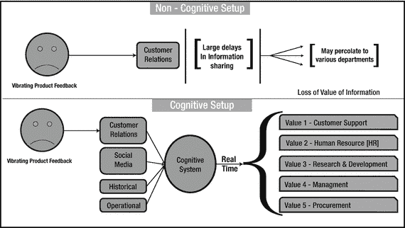
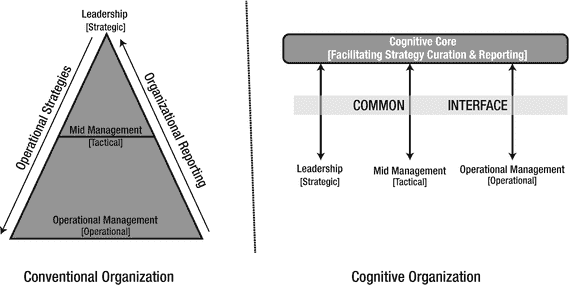

# 12. 自我进化的认知型业务

本章讨论的是天生由认知驱动的业务。这种业务的核心由认知驱动，不仅能够近乎实时地响应变化需求，还能通过实时数据进行业务规划和监控。在认知计算环境中，决策几乎 100%由数据驱动，并且始终经过偏差验证。

注意

我们在第 9 章讨论了并行演进的 IT-BI 系统（PEIB）及其特性。在第 10 章，我们讨论了 PEIB 的具体细节，以理解该框架的实施视角。第 11 章帮助我们理解了在规划或执行认知转型时可能遇到的障碍以及其中涉及的风险。本章将总结并整合所有这些知识，来描述一种认知“自我进化型业务”——一个如今已可能实现的梦想。

在继续本章内容之前，根据前面的提示，让我快速区分一下第 9 章和本章。

我之所以这样做，是因为描述的核心概念听起来几乎相同。但果真如此吗？

不，它们是不同的。第 9 章讨论了 IT-BI 系统应如何随业务需求并行演进。在那里，我讨论了这种转型框架的特性。在第 10 章和第 11 章中，我讨论了框架的细节以及实现它面临的障碍。

在本章中，我们已经具备了所有必要的理解，可以从 A 点走到 B 点。

现在，我们应该在本章中总结认知型业务是什么样的。为什么需要它？它应该是什么样的？

基于所有这些理解，我们将直接讨论自我进化的认知型业务。

“自我进化”的含义将在本章中解释，并在结尾处进行总结。这有助于我们理解为什么这是一个颠覆性的变革。

我们将本章的讨论分为三个主要领域。

*   当前组织架构中存在的问题是什么
*   这与认知进化系统相比如何
*   对认知系统应有何期待，不应有何期待

前两点将在下一节中一起讨论。

## 传统系统与认知自我进化系统

我们在前几章中已经从不同角度讨论过这一点。但需要将其整合成一幅完整的图景来审视整体情况；之后，我们才能讨论认知自我进化系统。什么是认知自我进化系统这个问题将在总结中得到回答，但在此之前，我们只需将其理解为一个逐步适应业务的系统。

到目前为止，我们还没有对 IT 系统使用“适应”或“进化”这些术语，因为一旦认知数字核心与这些系统融合，并且 PEIB 框架开始被利用，这些系统就在业务模型内部作为单一实体运行。因此，现在我们可以将业务和 IT 视为一个整体来讨论。

当前业务有一些作为其整体执行特性的要点。基于这些要点，我们将进一步讨论当前视角与认知数字核心视角的不同之处。我将首先列出它们，然后逐一讨论。我们将在此处进行有限的讨论，因为很多内容已经讨论过，并且讨论的视角是从业务出发，而非 IT 与 BI 的差距和关系。

以下是这些要点：

*   孤岛
*   结果/考量混杂
*   领导力效能
*   损益方法
*   扩展与整合问题
*   浪费与过度
*   仅限人力资源的人才管理

### 孤岛效应

遗憾的是，尽管我们拥有大数据能力、预测性解决方案、自动化维护与生产、互联设备以及移动端解决方案等高端技术，工作依然在孤岛中进行。我们身处一个拥有高速计算能力的高端解决方案世界，但这个问题仍然存在。

这要归功于（或归咎于）这些解决方案的开发方式及其在业务中的采用方式。这些解决方案是针对具体业务问题或业务领域开发的，而非针对特定组织的整体功能。例如，像 SAP 这样的 ERP 解决方案，提供了针对特定行业需求的行业解决方案，并具备实现高阶定制的能力。但这仅限于运营活动。通过它们连接的企业数据，除了在相互独立的 KPI 之间建立良好连接，并可能生成源自这些 KPI 的优秀报告之外，别无他用。它们从一个存储库中存储和呈现事实。在每个所谓的模块中，都配置了运营的副本。但除非有人主动进入那扇门并窥探数据，否则它们仍然在孤岛中运作。

一位客户因延迟交付或包装方式不满意而将数据发送给配送和客户关系部门，但这并不会让市场上的销售人员去联系同一位客户，询问其之前反馈的问题，或其在 Facebook 上发布的评论。

像 Hybris Marketing 这样的智能营销解决方案，会告诉你如何管理营销活动，但它无法预知天气变化、突发的政治或社会障碍，而这些因素需要营销活动做出相应调整；并且，一旦调整完成，它也无法几乎实时地、无需人工干预地立即启动生产计划的修改。

这就像一种反射。一旦某种类型的反射被识别为刺激，所有相关的业务器官就会自动执行反应。

业务价值是一个组织整体价值的综合指标，涵盖了其业务的广度和深度。由于这种孤岛效应，它无法从中产生全部价值。目前，这些孤岛之间缺乏连接线。我们拥有在各自领域高效运作的高端解决方案，但它们无法协同工作，无法最大化业务价值。

业务价值是按部门计算和最大化的。因此，如果我发现某个不错的营销产品附加功能，我会直接实施，提高该部门的效率。但这对于维护、采购或生产等其他部门帮助不大。它仅对销售和配送等紧密相关的部门产生有限的影响。

当今的业务对数据或信息具有响应能力，甚至能达到近乎实时的程度。但除了从中得出一些直接的含义之外，这些数据并没有被充分利用。因此，如果有人 在 Facebook 上发布了一条差评服务评论，只有客户关系部门会看到它出现在他们的仪表盘上。现在，由他们负责解决，并与其他可能需要的部门分享细节。例如，产品设计团队可能从一条评论中了解到“振动感不舒适”，但客户关系团队通过解释为什么一定程度的振动是正常的，以及将设备放在橡胶垫上会有所帮助，从而帮助了客户。然后，他们决定不将此信息分享给设计团队，因为他们认为这是正常且必要的特性，并且由于对产品开发了解有限，他们并不认为这是产品问题，而是使用问题。与此同时，设计团队正在验证新版本，并寻找更多可以改进的领域。他们依赖的反馈，在传达到他们手中时已经有些过时了，因为这对其他团队来说是额外的负担，并且是否传达也取决于他们的理解。这是一个很好的例子，说明业务虽然具有响应能力，但并未有效地将这些数据用于所有可能应用的领域。这是因为连接是人工的，而非自动化的。

认知业务会以不同的方式处理这种情况。各部门相互连接，这不仅是为了共享事实，更是为了从 n:n 的角度审视和比较它们。这两种情况如图 12-1 所示。

图 12-1.

认知业务中解决的孤岛问题

当前非认知业务中，业务部门之间大多是单向且开放的连接网络，导致许多机会领域未被探索。然而，认知业务却能因以下原因获益。

*   每个部门都能从直接或间接关联部门的每一个行动中获得指导，以做出决策。

以之前的机器振动为例。这一次，认知系统会连接这些社交媒体数据，然后进行情感或语气分析。它会立即获取这个主要针对客户关系部门的学习成果，并采取行动。同时，根据问题解决所花费的时间，它会衡量其有效性。研究团队也会收到系统的建议，看看是否可以对振动问题采取一些措施，因为刚刚有一个或多个客户在讨论这个问题。此外，还有一些人在谈论竞品运行平稳。在特定时间范围内，提到产品振动问题的人数有一定数量或比例，而对于竞品，提到振动问题的客户数量更高，但提到运行平稳功能的客户数量却更低。这无疑表明，为了提升产品接受度和应对竞争，团队应该更多地考虑振动方面的设计。

这也是基于证据且自动化的，从而实现了 n 个部门之间信息的 n:n 式共享。

*   当业务信息和价值被用于为其他组织创造价值时，所产生的价值视角会呈指数级增长，而不仅仅是信息共享指数。

例如，当今的 ERP 系统之间只是原样共享信息。但这里的认知计算则额外生成价值，并共享这种价值以创造价值。请看下文：

**价值 1**：第一阶段产生的价值在于，通过不仅提供负面情绪信息，还提供其他客户安全处理此类问题的方式，高效地帮助客服人员，并赋予客服更多优势来协助客户。由此产生的价值，便是从这些信息中获得良好的客服支持。

**价值 2**：随后，这一价值甚至被发送给人力资源部门，用于分享客服代表在解决此问题上的有效性。

**价值 3**：同一信息会立即从历史和竞争角度补充更多证据，并与研发团队共享。

**价值 4**：针对这款振动更强烈的产品，同一信息会附上可能存在的风险，与管理层共享，同时提供目标市场细分预测的证据以及其他细节，例如每个区域的评论数量，然后与所涉及的生产单元进行比较，甚至细化到不同零部件供应商可能提供的不同零部件细节。

**价值 5**：也许某个部件是导致产品振动更强烈的原因，因为有一个相关组件是由不同的零部件制造商供应的，而这些区域通过电话或社交媒体收到的负面反馈更多。

这一点在图 12-2 中进一步展示。

图 12-2.

实时价值链生成

因此，具备认知计算能力的企业不仅能够通过响应式驱动自身摆脱困境——这是我们目前已经达到的水平。认知赋能还能帮助协调所有资源和精力，随时调整行动路线，帮助组织在每一次此类问题中变得更好。组织表现得像一个生命体，并学会通过经验进化到更高水平的专业能力。

业务部门看似相互连接，但仅限于运营目的。决策制定是孤立的。认知计算则利用这种信息和价值传播网络系统，使它们同样紧密连接并不断进化。

### 混合领域以进行决策

这是对前文的延续，但又略有不同。如上一节所述，各部门各自为政，即便拥有共享事实库的互联数据库也是如此。那些响应能力强的部门，其信息渠道也仅通过人工把关进行混合。在前一个例子中，研发部门获取客户反馈数据，依赖于客服部门在验证其可能有用后提供。这两个部门之间存在人工把关。

这一点讨论的是来自不同部门的数据的自愿混合（例如，如果有人想对多个部门进行对比分析）。这触及了人类的局限性，比如分析人员一次能思考多少内容，以及从每个相关领域对动态、挑战、趋势等拥有的深度知识。

随着时间的推移，企业有各种需求需要满足，以分析来自不同部门的混合数据，但这仅限于固定的分析需求。偶然发现一套全新的、之前未曾想到的信息，是一种“意外发现”（即偶然发现，通常并非源于真正的努力）。我们有数据科学家进行一些深度分析，但并非总能成功。如前所述，这受到人类认知计算速度和能力的限制。这无法像图 12-1（右侧）所示那样，连接来自 n 个组织的 n 个数据，并对其进行趋势分析、实时自动预警，并持续进行。

数据分析可以用于分析交付缓慢与配送调度设置之间的关系、供应商能力分析、从工厂到供应商的分销效率等。但是，一旦分析师需要对一个 1:n 的场景进行分析，其中 n 等于所有其他可能的部门和子领域，以发现任何可能建立的关系，这就变得不可能了，无论可用的数据分析能力如何，都会束手无策。这里的能力是两个因素的总和：

*   用于分析的有效工具（对数据编写查询或创建程序）
*   人为因素，例如：分析师的聪明才智、智力和经验

功能众多的工具拥有无限的能力，但人类学习和运用所学知识的能力维度有限，从而限制了它们。

因此，以下因素限制了决策或分析工作：

*   只能可视化来自 n 个来源的有限数据关系
*   理解所有业务领域业务流程含义的学习能力
*   运用所有已学或已知可能手段的能力有限
*   能力保持最佳效率的时间范围有限；在长时间连续工作中，质量会下降
*   可用于分析的时间线有限
*   每个人在处理以往类似情况时的经验差异
*   身体和情感环境（包括内部和外部）

这一直影响着当前以 TB 级生成的业务信息的全部潜力利用。结果，企业使用的信息不到 2%。原因是期望人类去做本该由机器人做的事情，即大规模并行处理。

这项任务由认知核心数字化转型接管。我们不再需要数据分析师手动完成；相反，它由系统本身处理。

对具有根深蒂固的强化学习能力的认知系统的每一次查询，都将有助于利用系统内外（甚至包括互联网和物联网）一切可能的信息进行深度分析。其结果是为认知企业的每个部门层面提供非常稳健的决策支持。

这本质上就是一个随着时间推移，能够快速适应每个部门需求的业务系统。企业随着环境的变化而整体且迅速地发展，而在所有器官（部门）之间复制这种变化所需的协调，会自动且及时地同步进行。

### 领导效能

领导力有多种定义。就本文而言，我们将其定义为一组人员，从高层到中层再到基层，他们在层级结构中做出战略、战术和/或运营决策，以有效管理企业事务。

我们已经详细讨论过认知数字核心在帮助统一运营业务方面的益处。

之前讨论的一个常见问题是，当战略从高层以各部门战术洞察的形式向下渗透，并最终作为运营任务传递到基层时，它有时会失去上下文，这是必然会发生的情况。虽然有与工具、流程和审计一同建立的控制措施来管理这种偏差，但这些措施效果也并非十分理想，并且会消耗时间和精力。

此外，我们之前也讨论过，从基层到高层的绩效拼图必须进行汇总；这很困难，而且必然会变得不清晰并产生偏差。这可能导致最终的整体图景与原始计划大相径庭。

所以，这有点像一只正在散失热量的暖瓶。热量在传递过程中流失了。链条越长、越多样化、越复杂，其失去理想“温度”的可能性就越大。

这种情况被普遍接受，我们也不得不与之共存，因为统一的中央控制并未被提供。它只能借助控制和检查手段来管理。组织需要每年、每月、甚至在运营层面每周或每天进行持续监控，以确保目标按计划推进。

认知型企业对此具有免疫力，并且随着使用频率的增加，其免疫力会越来越强。这使得它们能够按计划演进，各层级之间的双向沟通转变为扁平化的沟通模式。计划的优先级对所有人而言都处于同等距离，结果则返回至单一层级，而非在多个层级间自上而下或自下而上地传递。

图 12-3.

传统组织 vs. 认知型自我演进组织

在图 12-3 中，我们可以清晰地看到差异。左侧，熵值从高层到基层递增；从基层到高层建立秩序非常困难，并且会损失大量价值。

在认知核心驱动的组织中，层级结构被扁平化了。所有层级都处于同一水平，与同一个核心进行交互。而核心则根据该实体的不同，扮演着相应的角色。因此，如果领导层需要与中层或运营层互动，核心便会以相应方式进行交互。这里的交互意味着获取相关信息。它不再直接面向人员；而是通过认知核心进行。在传统架构下，考虑到运营层面的广度，领导层几乎不可能获取到该层面的数据。而现在，借助认知架构，这成为了可能。

这也提升了领导效能。组织的层级金字塔仅作为一个角色金字塔框架留存，用于推动企业事务的运作。物理架构和头衔链条已被彻底打破。

这意味着组织的认知核心代表组织本身，并扮演所有需要与其他层级交互的角色。因此，组织需要在一个包含所有层级的单一层面——即核心——上进行演进。这有助于组织在转型过程中毫无损耗地演进，从而指数级地提升其演进效能。

### 扩张与整合问题

将业务扩展到多个地区或与新的收购对象进行整合总是困难的，这不仅是因为法律上的复杂性以及合并两家公司所需的大量文件，更在于此之外。新的分支必须与旧有部分整合，双向的信息和流程对齐必须实现。新组织极有可能带来特定于新业务的新知识和新流程，而这需要已经被过度扩张的大型组织来吸收。

新组织需要理解旧组织的商业文化、战略、流程和运营方法，反之亦然。这种知识需要双向流动。

这是合并完成后噩梦般的场景。高管们会花费数月时间，努力逐一协调各项事务。假设有一家公司 Alpha，它是一家横跨各大洲的巨型 IT 服务和产品巨头，在全球拥有数百个办事处和庞大的产品组合。它收购了一家小型利基软件产品公司 Beta，Beta 是一家只有单一办公地点的小型团队。

收购 Beta 是因为它拥有特定的云和超级计算能力，这将有助于 Alpha 在全球范围内占据更强势的地位。

Beta 的新利基领域一直采用一种截然不同的方法进行管理，这种方法在 Alpha 内部从未使用过。此外，由于 Beta 将成为 Alpha 整体蓝图中的一个组成部分，它将在 Alpha 未来两年的资产负债表表现中扮演非常重要的角色。

这意味着 Alpha 和 Beta 必须迅速相互适应。两地的控制措施必须迅速到位。一家传统企业会在多个方面陷入困境，例如：在 Alpha 人员对 Beta 人员进行初步指导后，还需要进行流程知识的手把手交接；以及调整 Alpha 各部门以适应 Beta 用于管理其产品实施的新流程（该流程将在 Alpha 的许多部门中使用）。这些都必须通过为合并双方发布手册、组织培训、举办研讨会和建立知识库来完成。正如许多案例所见，这是一个会持续数年的挑战。在并购之后，沟通有时会成为主要挑战，而那些本已感到处境困难的员工，如果未能顺利融入新组织，可能会完全陷入困惑。因此，员工留任成为一个巨大的挑战。在我们的例子中，这是一家小型本地企业并入一家全球性流程驱动型组织的合并。困难是双向的：小型组织不习惯这种流程驱动的文化，而大型合作伙伴则难以调整其庞大的流程体系来容纳小型组织所需的事项。

因此，联合存在的整体稳定性、合并的预期价值、文化连接以及流程融合，都是巨大的风险，决定着任何并购的成败。关键在于良好的规划和任务的出色执行，以实现快速合并，并将创伤降至最低且最快愈合。

认知型自我演进企业的情况则不同。在讨论这一点之前，让我们先看看需要完成或具备哪些关键事项。

*   聚焦于并购所带来的价值视角
*   对双方进行快速培训，使其了解所需内容
*   将新实体的指标与现有体系对接
*   具备对所有新旧实体进行集中监控的能力
*   提升员工体验，从而降低人员流失率
*   在需要的地方建立混合流程

这些是并购后初步看来必须完成的几件事。

未能实现这些目标将带来财务影响，从而破坏并购的价值。经验丰富的高管和经理们被投入到这些活动中。但即便如此，它仍然严重失败，因为这本应在各个层面发生，并且可能出现许多问题（例如，基层员工在进入新系统后无法理解福利制度，担心自己的财务状况和发展前景，这看似简单）。然而，新母公司拥有非常自由且多轨道的成长路径，远优于他们原来的组织。但这并非演示和研讨会上需要优先讨论的内容，因为业务启动才是首要任务。这导致了不满情绪，一切开始变得糟糕。

不过，现在的认知核心系统拥有不少捷径。认知系统已经迅速用新知识进行了扩展，并考虑到了新加入的群体。在并购完成后，组织特定的信息会立即在此基础上被输入系统。因此，在我们的案例中，由于看到了最高优先级，系统已经用云和分析的核心知识丰富了自身。在并购时，所有部门的数据都被输入。运营系统和人力资源系统被连接起来。所有关于产品和功能的知识数据库也被输入。

现在并购发生了：认知系统必须由来自两家公司的大量专家以及外部专家进行训练。

系统是需要准备的核心事物，而不是各个部门。与此同时，入职引导开始。在合适的时间，系统准备就绪可供使用。无需培训；只需给出如何使用认知系统的提示，或者进行少量培训。已经处于同一环境中的运营数据，现在都在核心系统的范围内，并被一起处理和分析。任何有疑问的员工都可以去询问认知助手，它们可以全天候回答他们需要知道的一切。培训已经负责指导流程专家为运营系统制定混合流程，而认知系统则自动包含新的业务细节。这一切与之前为 PEIB 流程所描述的完全一致。在认知核心的帮助下，员工体验并不差。一旦使用 PEIB 完成数据导入和培训，两个组织的业务就合并了，并在认知助手的协助下建立了联合监控和控制。

这使得旧公司向新旧混合体的演变非常迅速；这主要是通过将精力投入到认知数字核心的准备工作中完成的。其余部分则自动处理。

### 浪费与过度

这在商业中非常普遍。随着时间的推移和复杂性的增加，浪费性的活动和流程会累积起来。甚至有些部门因为要用自己的指标来回应多个部门而面临过度工作。

无论组织在各方面多么成熟，这种情况总是存在。总有一些角落仍然使用低效的方式做事。而认知数字核心组织能很好地处理这一点。认知核心不仅能在 ERP 以及所有其他内外部来源之上辅助决策，还能基于其对流程和标准的内在知识，持续关注流程的价值视角。它会就此发出警报并提供基于证据的事实。它可以指出零价值或低价值的流程。例如，一家制造企业自成立以来一直使用一条路线从附近的矿山运送原材料。这已成为一种传统，司机们知道应该在什么时间将材料送到生产单位，以及何时进行下一次运输。他们正确地遵循着供应流程，这方面从未出现过问题。管理层也非常谨慎地确保原材料供应运行良好，并不断奖励主管和卡车协调员，以鼓励他们保持良好的时间表遵守情况。当认知系统上线，新系统配备了 GPS 定位追踪功能、实时地图功能以及用于最佳优化网络计算的运营知识和算法后，系统向经理发送了一条建议，要求检查该路线的状况。情况一如既往地好，但并非最优。卡车司机们一直沿着一条较长的路线行驶，但现在存在一条更短的路线。此外，在雨季或遇到交通拥堵时，系统可以推荐更好的路线。因此，这不仅升级了一个新流程使其更优化，还通过降低燃油成本增加了利润。类似地，另一条生产线被建议遵循不同的加工顺序，以显著提高效率。维护部门的数据也被用来查看最佳可能的零部件，参考历史上此类更换的效率和使用寿命。机器可以避免更换钻头的停机，因为基于认知的系统能够识别待钻探的材料，并根据从冶金部门接收的数据决定钻探速度和钻头。这些是组织通过这种“活”的特性实现演进的众多方式之一。它不断重新发现使其变得更加优化和精益所需的方法。

### 人力资源管理

这是一个非常重要的部门。随着时间的推移，人力资源的重要性正从仅仅是一个招聘和员工管理部门转变为一个更高层次的部门。

在紧凑的工作环境、工作优化以及需要将合适的人放在合适的位置上这些背景下，人力资源有更多的事情要做。在当今的行业中，为了获得更优化的绩效，还需要提高员工满意度。提升技能并保留合适的技能也至关重要。

像绩效评估意见、投诉、反馈等工具效果并不理想，因为它们容易被篡改或影响。

人力资源需要通过测试和邮件分析来审视员工的就业历史、社交媒体存在感、简历分析、心理测量分析以及内部行为分析，从而将所有员工恰当地划分到不同的人才集群中。

应该进行数据驱动的智能规划。只有通过新的认知组织才能实现这方面的最大效率。这是在任何组织中发展工作文化、满意度、保留率和能力建设的一个非常重要的方面。

## 那么，什么是自我进化型业务？

自我进化型业务可以定义为这样一种组织：“它不仅通过最优化的精益流程和各级最受控的净化决策来成功维持日常运营，而且会因‘挑战组织的需求’或‘由其自身认知核心检测并确定的新建议对组织提出挑战’而不断进化、升级或修改这些流程与决策。”

现在，如果你仔细审视我们之前讨论的内容，就能更清晰地理解什么是自我进化的认知型业务。其核心构建模块是并行进化的 IT-BI 系统。该系统是依据 PEIB 框架指南和检查清单建立的，并由此催生了这类业务。

其障碍和风险已在第 11 章中提及。

在结束本节之前，让我快速将定义拆解成几个部分并加以解释；然后我们进入下一节。

1.  “……不仅通过最优化的精益流程和各级最受控的净化决策来成功维持日常运营，
2.  而且会因‘挑战组织的需求’而不断进化、升级或修改它们（流程与决策），
3.  或‘由其自身认知核心检测并确定的新建议对组织提出挑战’。”

因此，定义包含三个部分。让我针对每个部分简要说明，以便定义清晰明了，含义明确无误。

*   “不仅通过最优化的精益流程和各级最受控的净化决策来成功维持日常运营” 这意味着——这些业务组织在各级执行流程时都遵循最优化的方式，并随时间推移不断优化，以便在执行时做出最有效的决策。如果发现某项决策在长期或短期内会妨碍某些方面，该决策也会通过基于证据的反向建议得到净化和控制。
*   “而且会因‘挑战组织的需求’而不断进化、升级或修改它们（流程与决策）” 这意味着——这些业务组织不仅具备响应能力，能立即知晓挑战和因素是什么，还能根据任何外部挑战或业务需要采取的新路线，立即调整流程和决策。例如，一旦有新桥梁建成并开放使用，配送路线会立即做出更改。系统会评估收益，并通过此路线重新规划所有货运。新的路线计划会附带事实、数据和证据推荐给用户。经同意后，路线计划的变更便会得到处理。
*   “或‘由其自身认知核心检测并确定的新建议对组织提出挑战’” 这意味着——这些业务组织同样擅长响应内部环境中的因素。例如，当它发现某个旧计划或流程正在被使用，并看到替代方案能带来更好价值时，它会推荐更优的解决方案，从而使组织进化。

自我进化的认知型业务组织有能力在遇到内外部需求时迅速调整自身，并通过建议和协议升级所有流程，从而高效地适应这些需求。因此，它能够自然而然地、毫不费力地实现自我进化，掌控着中央认知数字核心。人们只需向其提问，基于证据验证各种建议，并做出有价值的决策，而这些决策同样可由数字认知核心来执行。

下一节将描述关于认知能力的一些现实检验。自我进化的认知系统是围绕认知能力概念化的。认知能力有许多围绕其构建的假设。我将在下文讨论其中一些。

## 关于认知能力的现实检验

对认知能力有何期望？它将给行业带来何种影响？我们可以从这场变革中期待什么？

在进一步深入细节之前，请允许我在此澄清，其所能带来的益处是毋庸置疑的。但同样，这是一项非常新的技术，伴随着诸多挑战，例如行业内成功案例不多、相关知识不易获取、可用框架有限（因此我在本书中提出了 PEIB）、以及围绕它的困惑等等。所有这些已在第 11 章中讨论过。

认知系统具备一些核心技术能力。

*   它必须精通核心学习主题，在获得大量内容输入后，已接受过充分的训练。
*   它必须能够将来自多个来源的数据与知识相结合，并使用加权响应优先级系统进行分析、预测并基于证据提出建议。
*   它应能进一步学习，并不断建立新的关联。
*   应精通自然语言处理与合成。同时，应具备高度交互性。

因此，它应当：

*   精通学习
*   具备适应性与整合能力
*   能够进化
*   具备交互性

核心能力可以在加载的数据中建立映射和关联，就像人类进行记忆关联一样。然后，利用概率模型，它可以寻找权重最高的路径，以确定最佳的可能答案或结果。这一切都在几秒钟内对数以十亿计的记录完成。

输入的上下文应被分解为基本要素，与后端可用的知识进行评估，基于训练生成的知识含义进行评价，然后根据具有最高置信度指数的加权响应进行呈现。所有用于推导出该置信水平的证据和推理，都会以数据的形式呈现。

市场上对这些解决方案存在一些担忧和关注点。接下来，让我们进一步了解其中一些。

### 认知技术适合所有人吗？

答案是既肯定又否定。还记得我们讨论过的 PEIB 框架吗？当我们处于初始化阶段时，我们曾提到一个检查条件，用于判断它是否适合用户。

我们甚至说过，对于非常小的组织和小型企业来说，它可能并不适用。规模和复杂度是决定用例的一组因素。现有系统环境对所需 IT 基础设施的准备程度也决定了这一点。对于较小的组织，某些特定工具可能不错（例如，某些应用程序上的聊天机器人），但将所有内容都转化为认知技术可能毫无意义。如果存在一种可能性，即从上到下的各级管理者总能坐在同一个屋檐下共同决策，那么进行认知转型就没有意义。但话说回来，实施它也绝非坏事。

另一个方面是业务类型。业务用例决定了我们是否真的需要认知能力。比方说，如果某个业务需要大量产品组合或服务可能性，并且这取决于众多变量和输入，那么采用认知技术是合适的。否则，那些行动迟缓的大型企业也是不错的用例。始终要考虑核心业务领域（第 10 章）。如果核心或关键业务流程并非如此，那么认知技术对你来说就是可选的。

如果趋势分析、实时信息和数据输出能为你的业务带来巨大差异，那么认知技术就非常出色：银行、金融、保险、物流、石油和天然气勘探以及零售业务都具备这些特性，而一家制造螺丝钉的公司，无论其规模多大、营业额多高，都不一定是一个合适的用例。

目前还没有成熟的跨行业市场趋势分析可用，但胜出者将是那些看到其核心领域能从中受益，并通过 PEIB 等框架无缝实施的公司。

认知计算已进入一个工业时代，大数据和分析技术正被热情接纳。这个阶段正是这些技术在长期等待后刚刚兴起的时候。那些在此之前已大规模涉足这些技术的公司，也是进行这种转型的良好案例。它们已经完成了足够的后端和用例工作。

正如我之前提到的，还存在法律影响。应确保能够对组织内的数据进行适当控制，根据适用的数据隐私政策对数据进行隔离或屏蔽。

组织应花费相当多的时间，在充分评估的基础上，制定出具有战略意义的未来规划。

不要仅仅因为已经有人在做了就考虑它，但同时也要确保你不会因为采用者不多而落后或错失机会。是时候以无偏见的心态进行深入评估（或许使用 PEIB 框架或类似方法），看看纯粹的评估数字说明了什么。如果这对核心业务有利，那么就迈出你的第一步。现在采用，未来将受益。

### 认知技术万无一失吗？

答案是否定的。这是一台具有学习能力的机器。它学习你如何训练它，但事实是，它无法被训练去应对所有事情。因此，它可能无法确定地知道某些事情。

其核心是概率性的，因此确实存在一定程度的失败可能性。所以，请记住它并非万无一失。它能让生活更轻松，但无法在商业中取代人脑。它既能提供绝佳的洞察，也能给出权重较低的响应，这都取决于底层数据的丰富程度和可用性。

认知技术不可能万无一失，但人类也并非如此。然而，认知技术的失败率低于人类。人类还拥有情商，这意味着他们可能会做出情绪化的决策。这是认知机器无法做到的。因此，在情感有益的地方，认知系统可能就没那么有用了。情感在人类生活中确实有价值，比如友谊中做出的坚定承诺。但对于认知计算而言，一切都是基于实际和加权分析的，在情感领域可能显得反应迟钝或效果不佳。

所以，认知系统也可能失败。但有一点好处是，它们不会重复犯同样的错误。而我们人类可无法保证这一点。这使得认知系统随着时间的推移变得越来越有效。

### 所有供应商/产品都好吗？

这是一个棘手的问题。先了解一些基本事实。认知计算成为商业现实，不过是几年前 IBM 将 Watson 推向市场时的事。现在还有许多其他公司在销售被称为“认知”的产品，但实际上并非如此。我在本章开头提到了一些技术特性。如果这些特性不满足，那它就不是一个认知系统。

同样，我也不敢声称自己了解市场上的每一款产品。那么，最好的决策方式是什么？以下是你应该牢记的一些要点。

*   解决方案应该是真正的认知解决方案，而不仅仅是某种机器学习的奇迹。它不仅要展示学习和改进响应的能力，还应该能够进行思考并以加权置信度给出建议。
*   应该承诺提供良好的行业或主题丰富的数据，而不是一个空无一物的空白系统。这也会使实施更容易。
*   系统应能够随着数据量的增加而提升能力。
*   考虑购买选项，因为租赁系统可能存在风险。数据和知识丰富过程位于你的组织之外，存在这样的风险：明天当你更换供应商寻求类似服务时，你必须重建一切，因为一个供应商的解决方案可能不支持另一个供应商的解决方案。
*   知识丰富或训练至关重要。寻找具有广泛行业经验并有专家支持来训练系统并帮助你的团队的供应商。
*   寻找可扩展到业务多个领域、而非仅适用于一两个业务领域的解决方案，并为你自身进行评估。

因此，在选择合适的合作伙伴以确保成功时，务必非常谨慎。选择一个好的合作伙伴，项目成功的可能性会大得多。

### 自我认知能力？

我能从零开始构建自己的认知能力吗？不要重复造轮子。我见过一些客户谈论这个，但这毫无意义。认知系统是多种技术的结合：它不仅仅是机器学习或预测分析。开发出这些系统的厂商已经投入了大量的时间和金钱。如果你有机会去评估所有这些方案并选择最适合你的一个，为什么不这样做呢？

然而，你自身应该具备管理它的能力。除非你没有计划朝这个方向培养自身能力，否则依赖供应商的能力并非好主意。要持续培训和培养你的内部团队，以管理和支持实施工作。

### 认知技术会抢走工作吗？

答案依然是：既会，也不会。有些岗位可能会消失，但认知技术同样会为一些人转向新领域开辟道路。

总体而言，影响将更多地集中在那些已经属于常规活动导向的工作上（例如，员工资源经理）。这些人所做的无非是根据技术/技能组合、地点、偏好、资历等条件来比对简历，以匹配组织内部的职位空缺。这项工作由认知系统来完成效果更佳。它们还能额外进行简历分析、检查社交媒体资料、关联所有过往的分配数据等，以尝试将求职者与职位进行匹配。

它也可能取代一些重复性的工作，比如测试。但总的来说，它不应产生巨大影响。认知技术是在大数据和分析技术之后立即出现的。但这个时代的困境在于，被引入并积累在这些系统中的 98-99%的数据从未被使用过。分析工作仅针对其中一小部分数据展开。因此，紧接着，当某个给定的认知系统进化时，它必须首先确保 ERP 及其他各种系统中的数据被优先使用，以保证大数据和分析技术的投资得到优化，并且存储在大型 Hadoop 集群中 98-99%的数据被用于决策。所以，目前认知技术更多的是提供辅助，并取代那些更适合由计算机完成的工作。人们得以从数据和报告的准备工作中解放出来，专注于更多基于决策和业务的活动。

## 本章小结

在本章中，我讨论了自我进化的认知型业务。通过到目前为止关于 PEIB 和障碍的学习，我们知道了如何实施一个本质上是认知型的核心 IT 系统。

前面的章节详细描述了核心 IT 基础设施和转型路径、障碍以及风险，而本章则描述了由此产生的自我进化的认知型业务。

我在此给出的定义如下：“不仅要以最优化精益的流程和所有层级上最受控、最纯净的决策来成功维持日常需求，还要因‘挑战组织的需求’或‘由其自身认知核心检测并确定的新建议来挑战组织’而不断进化、升级或修改这些流程和决策。”

文中穿插描述了业务方面的各种亮点。以下列表有助于解释传统业务与认知型自我进化业务之间的区别：

*   孤岛
*   混合结果/考量
*   领导力效能
*   损益方法
*   扩张与整合问题
*   浪费与过度
*   仅限人力资源的人才管理

然后，在最后一节中，我们对认知解决方案进行了现实检验。在此我讨论了认知系统的基本技术特性。

我尝试回答了一些关于认知技术的常见问题。我们甚至谈到了认知技术在取代工作方面的影响。但我目前并不认为这是一个重大挑战。

