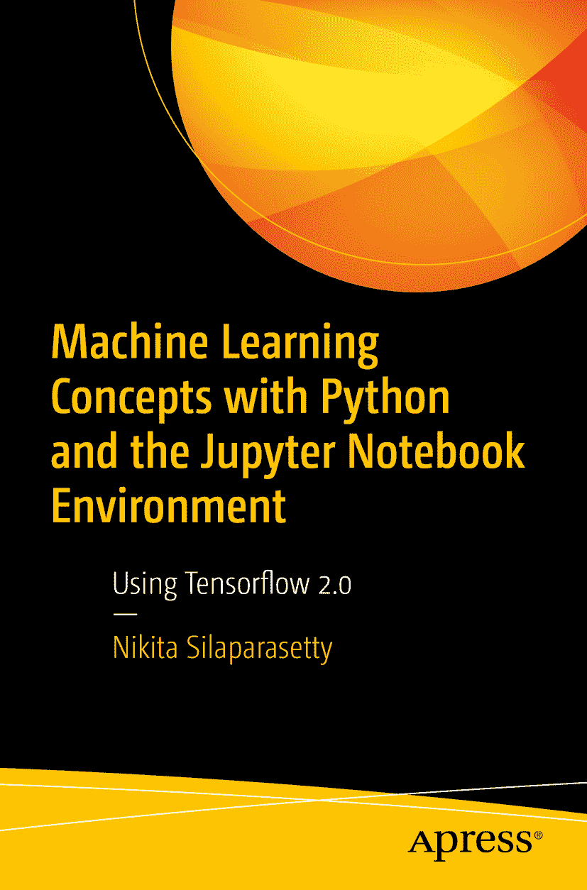
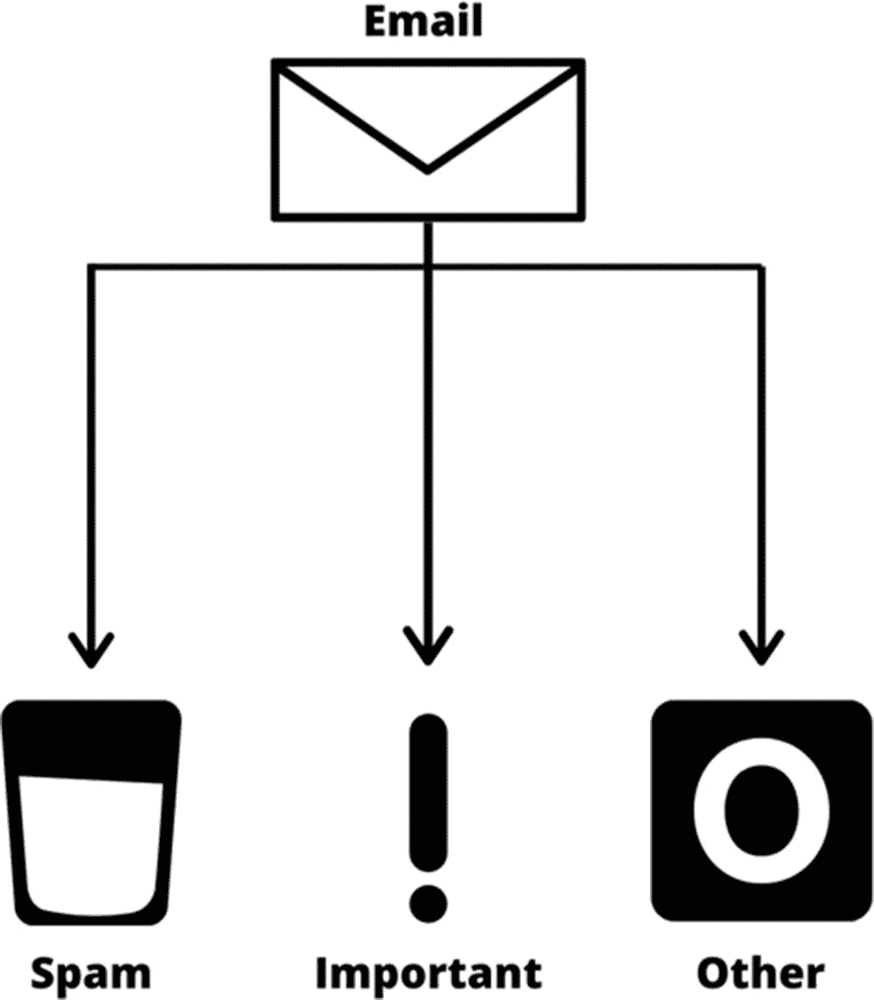

<!--

ISBN 978-1-4842-5966-5 e-ISBN 978-1-4842-5967-2 [`doi.org/10.1007/978-1-4842-5967-2`](https://doi.org/10.1007/978-1-4842-5967-2) Apress 标准版 © Nikita Silaparasetty 2020 本作品受版权保护。出版商保留所有权利，无论涉及材料的全部或部分，特别是翻译、重印、重用插图、朗诵、广播、以缩微胶片或任何其他物理方式复制，以及传输或信息存储与检索、电子改编、计算机软件，或通过目前已知或未来开发的类似或不同方法进行使用的权利。本出版物中使用通用描述性名称、注册商标名称、商标、服务标志等，即使未作明确声明，也不意味着这些名称不受相关保护性法律和法规的约束，因此可自由用于一般用途。出版商、作者和编辑可假定本书中的建议和信息在出版之日是真实准确的。出版商、作者或编辑均不对本文所含材料或可能存在的任何错误或遗漏提供明示或暗示的担保。出版商对已出版地图中的管辖权主张和机构归属保持中立。本书通过 Springer Science + Business Media New York 在全球图书贸易中发行，地址：233 Spring Street, 6th Floor, New York, NY 10013。电话：1-800-SPRINGER，传真：(201) 348-4505，电子邮件：orders-ny@springer-sbm.com，或访问 www.springeronline.com。Apress Media, LLC 是一家加利福尼亚有限责任公司，其唯一成员（所有者）是 Springer Science + Business Media Finance Inc (SSBM Finance Inc)。SSBM Finance Inc 是一家特拉华州公司。
-->

# 引言

我记得有一天，大约在我 15 岁的时候，我的小表妹来家里做客。作为一位称职的好姐姐，当所有大人在屋内热烈交谈时，我陪她在外面的花园里玩耍。很快，我就开始追着这个活泼的 4 岁小家伙跑，她忙忙碌碌地到处转，摸摸每一朵小花，观察每一个小生物。

起初，她默默地做着这些事，唯一的声音是她跑过草地时的脚步声。然而，过了一会儿，她再也忍不住了，开始向我询问她视线范围内的每一个物体和现象。有一阵子，我很兴奋，觉得自己已经足够大，能够满意地回答这些问题。但这种兴奋很短暂，因为她开始深入探究，渴望了解更多。

这种情况一直持续到妈妈出来叫我们吃晚饭。当我感激地走回屋里时，我得出了两个结论：

1.  人类的大脑具有非凡的好奇心
2.  我并没有自己想象的那么聪明

现在想想，很有意思的是，我们所知道做的一切——从数脚趾头，到唱准国歌，再到说出太阳系的行星名称——都是我们随着时间推移而发展出的技能。

我们生来就具备这些能力吗？

不，当然不是。

但我们确实有能力学习如何做所有这些事情，这要归功于我们不断学习和处理信息的大脑。我们学得越多，知识就越丰富。知识越丰富，我们就越聪明。

不仅仅是人类，动物也是如此。通过教导狗，当它正确完成坐下、打滚和装死这些任务时，就能获得美味零食作为奖励，狗就能学会这些动作。通过知道如何执行这些任务，它就被认为是一只“聪明的狗”。

那么，我们是如何学习新事物的呢？

学习的一种方式是通过询问。当我的表妹问她看到的一切问题时，她是在试图从她认为可靠的来源那里获得答案。她知道我已经了解了所有这些事情，所以我可以给她所需的答案。

另一种学习方式是通过观察。在我的表妹开始问我问题之前，她一直在观察一切。她注意到天空是蓝色的，而草是绿色的；蚱蜢跳来跳去，而蚂蚁沿着地面爬行。她能够自己学习新事物，而无需向任何人求助。

她问的问题越多，观察得越多，她的知识就增长得越多。

想想看，仅仅通过学习，一个生命就能变得聪明，这真的很令人着迷。

正是这种智慧造就了今天的世界。人们增长了知识，有了新的发现，使日常生活变得更快捷、更高效。这导致了可用工作的数量和种类以及所需技能的增加。

很快，人们开始开发新的想法和方法来执行各种任务。他们设法创造出能够自动完成某些事情的物体，比如钉钉子、拧螺丝等等。换句话说，人们创造出了我们现在称之为“机器”的东西，它们被制造出来模拟人的动作。这些机器减少了所需的体力劳动，尤其是在制造过程中。我们现在有机器接管了我们很多工作——让我们有更多的时间和精力去处理稍微更复杂的智力任务，而这些任务是这些机器无法完成的，因为尽管我们可以让机器执行特定的动作，但我们无法让它们像人类那样思考。

现在考虑一下……如果机器*能够*思考，从而也能执行这些智力任务，那会怎样呢？

## 人工智能的简单示例

以电子邮箱为例。过去，它只是一个普通界面，我们只能进行阅读、回复和删除邮件等简单操作。如今，我们的邮箱功能强大得多，设有“垃圾邮件”、“重要邮件”、“其他邮件”等文件夹。邮箱会自动检测某封邮件是否为垃圾邮件，并将其归入相应文件夹。它甚至能识别相对重要的邮件，并将其放入“重要邮件”文件夹。其余所有邮件则归入“其他邮件”文件夹。

图 I-1

邮件分类

但邮箱是如何区分这些类别的呢？

答案很简单——***它学会了***。

它学会了如何检测邮件是否为垃圾邮件，就像我们学会这样做一样——通过寻找邮件中的某些特征。这些特征包括：

1.  无关的广告内容
2.  索要敏感信息，如账号、联系方式等
3.  使用通用称呼而非收件人真实姓名
4.  可疑的附件

一旦邮箱识别出此类邮件，就会将其标记为可能的垃圾邮件，然后发送到“垃圾邮件”文件夹。这样一来，我们每天就省去了处理大量无关邮件的麻烦。我们只需进入“垃圾邮件”文件夹，全选所有邮件，然后删除即可。甚至无需打开邮件逐一阅读。

*机器具备思考并执行此类任务的能力被称为“人工智能”（AI），而机器获得这种人工智能的过程则被称为“机器学习”（ML）。*

这个邮件分类的例子只是人工智能和机器学习的一个简单应用。事实上，这项技术也存在出错的可能。然而，这些领域实际上蕴藏着巨大的潜力。试想一下——借助人工智能和机器学习，我们可以创造出能够思考、推理并执行任务的机器。这将为人们带来更快捷、更便利的生活方式。

如何实现呢？

想象一个万物自动化的世界：从根据天气和场合自动挑选早晨的着装，到在繁忙的交通中自动驾驶去办公室，再到在合适的时间自动浇灌花园。我们的日常琐事将不再需要亲力亲为。而在更宏观的层面，在商业、医疗、教育等领域，还会有更多的应用。例如，会出现 AI 招聘官、AI 医生、AI 教师等等。简而言之——人类将被能够更高效完成工作的机器人所取代。

## 用机器取代人类

我认为，在考虑用机器取代人类来完成他们的工作之前，我们需要认真地问自己以下这个问题——

*这真的是个好主意吗？*

嗯，目前这还是一个尚无定论的辩论话题。但这绝对是一个值得探讨的有趣领域。

最早的一些人工智能机器人最初是在跳棋和国际象棋等游戏中成为不可战胜的冠军。这些机器人可以在需要技巧和策略的游戏中取代人类玩家。这不仅是一种有趣的观赏现象，也是衡量人工智能技术先进程度的标准。看起来没什么危害，对吧？这些 AI 所做的不过是把游戏玩得非常好。

然而，后来人们意识到，如果人工智能机器人能在游戏中取代世界冠军，那么它们肯定也能被用于更重要的场合。但这确实也有其弊端。

一个非常著名的例子是，*亚马逊公司*曾试图用 AI 招聘官取代人类招聘官。结果却出乎意料，机器产生了性别偏见，开始拒绝女性求职者。这自然引起了轩然大波，但也给 AI 开发者在构建自我学习机器方面上了宝贵的一课。

让我们简要回顾一下当时的情况。

## 带有性别偏见的 AI 招聘官

通常，招聘官在筛选求职者名单时，会考虑哪些因素？以下是一些可能因素，排名不分先后：

1.  相关经验

2.  专业领域

3.  资质证书

4.  额外项目

5.  背景经历

6.  推荐信

招聘官会浏览简历，核对求职者与应聘岗位相关的信息，并可能致电核实。根据公司不同，还可能增加一些额外测试和评估。如果此人最终符合要求，就会被录用。

这大致就是合乎道德的招聘流程，对吧？

然而，当涉及 AI 机器人时，它们不具备人类思维，无法区分相关因素与无关因素。它们所拥有的只是数据，通过分析数据、寻找模式并做出决策。

这家知名公司的机器人接受了至少十年求职申请数据的训练。众所周知，职场中男性通常多于女性，对吧？因此，机器在学习数据时，认为性别是招聘时需要考虑的重要因素。它的思维过程大致如下：

*男性 = 合适人选，*

*女性 = 不合适人选。*

于是，它开始拒绝任何提及女性的申请。这样一来，它就对女性求职者产生了偏见。

当然，公司努力修复了这个问题。他们修改了程序，使其在此类情况下保持中立。然而，许多人仍对此持批评态度，因为他们认为机器仍可能找到新的歧视方式。

这对 AI 爱好者来说是一次宝贵的学习经历，因为他们意识到，虽然并非所有 AI 机器都会产生偏见，但这仍是一种可能的结果，需要以正确的方式加以应对。这也表明，在开发 AI 机器本身时必须采取预防措施。**我们必须特别小心所使用的数据类型**，因为机器正是依赖这些数据进行学习的。

这很有趣，不是吗？就像养育孩子一样。孩子从所接受的教育中学习。如果她/他学到好的东西，获得良好的体验，就更可能在外在行为中表现出来。然而，如果孩子被灌输了错误观念，就会对她/他产生负面影响。

甚至有时，人工智能的某些领域会让研究人员感到失望，人们几乎对这个领域失去热情。这样的时期被称为“AI 寒冬”，我们稍后会读到相关内容。

不过，几乎所有人都认同一点：人工智能和机器学习正在飞速发展，并且极其重要。如果方法得当，我们可以创造出真正改变世界和生活方式的技术系统。

这就是这些领域岗位需求如此旺盛的原因。这也是相关研究如此之多、新理念不断涌现的原因。捕获数据、存储数据并利用数据进行编程已经变得前所未有的简单和快速。

因此，当我们开启人工智能和机器学习之旅时，让我们先了解一些重要概念，以便真正理解我们将要涉足的领域，以及如何利用它创造有用且高效的技术。

致谢

*“无论做什么，或说话或行事，都要奉主耶稣的名，藉着他感谢父神。”*

> ——歌罗西书 3:17

首先，我要感谢全能的上帝赐予我这次绝佳的机会，并帮助我成功完成本书。

其次，我要感谢我的父亲 S. Mohan Kumar、母亲 Agnes Shanthi Mohan 和姐姐 Vinita，在整个创作过程中，他们始终给予我支持、帮助和灵感。

我也非常感谢整个 Apress 团队，他们不知疲倦、耐心地审阅我的章节，提出建议，并提供我所需的必要指导，旨在让最终作品真正丰富读者的知识。与他们合作让我受益匪浅。

当然，我也不会忘记我的朋友们、熟人们、同行们、祝福者们以及我生命中的其他人，他们以各自的方式为我祈祷、激励我、指导我，甚至在我因忙碌而疏远他们时包容我。

最后但同样重要的是，我感谢互联网，它在整个过程中发挥了重要作用。

关于作者 关于技术审校者

