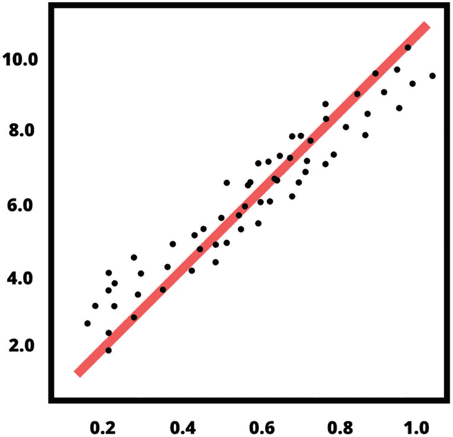
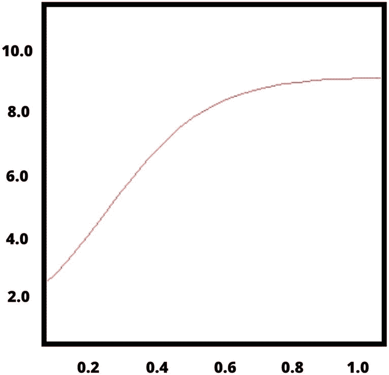
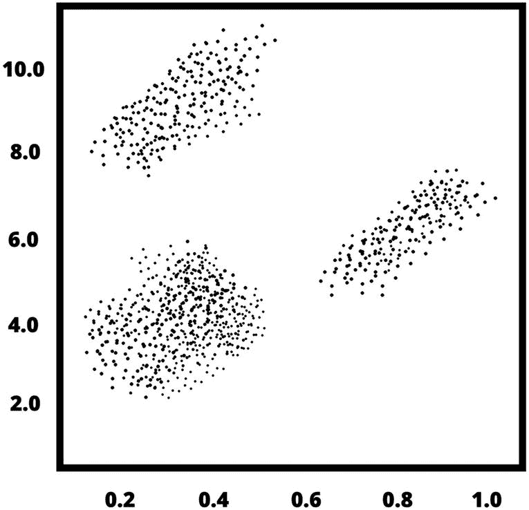
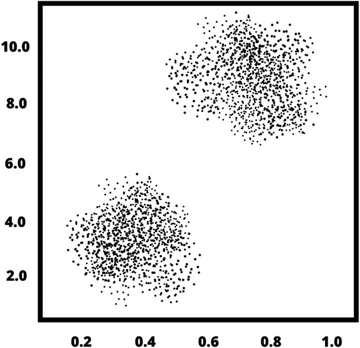
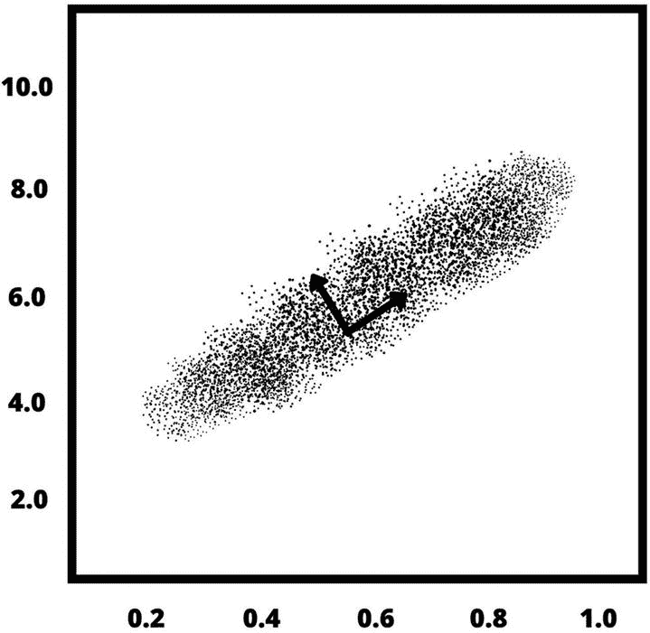

# 2. 机器学习概述

人工智能听起来相当有趣，不是吗？创造一台能按需完成任务的思考机器令人兴奋。而且你无需担心学习什么新奇复杂的东西——你只需要学会编程。

这多方便啊？

那么，你到底需要编程什么呢？答案很简单：编程让机器去学习！否则它怎么能思考呢？这个概念属于机器学习的范畴，而机器学习是人工智能中极其重要的一部分。让我们深入探讨，看看它究竟是怎么回事。

## 什么是机器学习？

如果这个名称本身还不够明显，这里有一个简单的定义，应该能帮助你理解你将要接触的内容。

机器学习可以定义为：无需显式编程，教会机器像人类一样思考以执行特定任务的过程。

回想一下你第一次学习阅读的情景。你从学习字母开始，然后将这些字母组合成单词。最后，你开始学习如何发音这些不同的字母组合。随着不断练习，你的阅读能力越来越好。

机器学习的工作原理与此相同。机器像人类一样学习、理解和思考，然后利用这一思维过程来完成某些工作。通过机器学习，机器可以被教会执行更高级别的任务。

就像人类需要学习来提升自然智能一样，机器也需要学习来提升人工智能。这就是为什么机器学习在开发人工智能系统时如此重要。

### 机器学习工作流程

一个典型的机器学习问题遵循以下步骤：

1. **定义问题：** 在开始解决问题之前，我们首先需要确定问题究竟是什么。我们需要弄清楚问题是什么，是否适合用机器学习来解决，等等。

2. **收集数据：** 然后，我们需要根据问题定义来收集数据。数据极其重要，因此必须谨慎收集。我们需要确保拥有分析所需的所有必要因素对应的数据。

3. **预处理数据：** 我们需要清理数据，使其更易于使用。这包括移除异常值、处理缺失信息等。这样做是为了降低分析结果出现错误的可能性。

4. **开发模型：** 现在我们可以创建机器学习模型，该模型将用于解决问题。这个模型将数据作为输入，对其进行计算，然后产生一些输出。

5. **评估模型：** 需要对模型进行评估，以验证其准确性，并确保它能够处理可能提供给它的任何新数据。

正如我们在工作流程中看到的，机器学习是借助数据——海量的数据——来完成的。机器获取这些数据，进行分析，并从中得出结论。这就是数据科学理念如何演变为机器学习不可或缺的一部分。

## 什么是数据科学？

数据科学使我们能够从数据中获取知识。

从数据中收集、处理、分析并得出推论的全过程被称为数据科学。

因此，数据科学是统计学、数学、计算机编程、复杂问题解决、数据捕获以及处理数据（包括清洗、准备和使用数据）的结合。

从数据科学过程中获得的数据，一旦准备就绪，就可以输入机器以帮助其学习。

### 数据科学的分支

数据科学包含以下主要领域：

* **数据收集：** 收集数据

* **数据存储：** 保存数据以供后续访问

* **数据整理/清洗：** 清理原始数据以便于使用

* **数据可视化：** 以图形方式查看数据

还有另外两个领域，即大数据和数据分析，虽然它们被视为独立的实体，但也处理数据，因此也属于数据科学的范畴。

### 大数据

大数据指的是海量数据的存储。这些数据主要通过以下三个特征来定义：

* **高容量：** 指生成和存储的数据量。这些数据量极其庞大，其来源包括图像、视频、音频和文本。

* **高速度：** 指数据生成和处理的速度。通常，这些数据是实时可用的，这意味着它被持续不断地产生和处理。

* **高真实性：** 指数据的质量。这里产生的数据可能差异很大，这会影响整体分析。

大数据可应用于以下领域：

* 通信

* 金融

* 零售

* 教育

* 媒体

大数据面临的一些挑战包括：

* **收集数据：** 由于数据量巨大，收集数据并非易事。

* **存储数据：** 需要非常强大的存储单元来存储如此海量的数据。

* **传输和共享数据：** 为了成功传输和共享大量数据，需要先进的技术和工具。

### 数据分析

原始数据可以通过分析来观察趋势，并基于这些趋势得出结论。因此，数据分析是指对数据进行检验，以从中获取洞见，并据此进行推断和得出结论。

它遵循若干步骤，并包含多种方法，这些方法有助于提高流程效率并获得预期结果。它运用了多种统计和数学技术。

数据分析主要有四种类型，如下所示：

1. **描述性分析**：用于解释已经发生的情况。例如，可用于描述公司当前的业绩表现。

2. **规范性分析**：用于预测未来会发生什么。例如，可根据公司过往业绩来预测其利润。

3. **诊断性分析**：用于确定某事发生的原因。例如，可用于理解公司为何可能出现亏损。

4. **预测性分析**：用于找出需要发生什么，即需要采取什么行动。例如，可用于制定更好的策略和想法，帮助公司重回正轨并再次盈利。

数据分析可应用于以下领域：

* 医疗保健

* 能源管理

* 旅行

* 金融

大数据和数据分析各自都是数据科学中非常复杂的部分，因此对它们的需求巨大，尤其是在就业方面。通过这些方法获得的数据随后可用于机器学习及相关领域。

根据不同的用例，可以从多种来源获取数据。在下一节中，我们将介绍一些用于数据收集的重要方法。

## 数据收集

数据无非就是事实和数字，当它们汇集在一起时，就能产生一些信息。这些数据可以来自多种来源，包括：

1. **调查**：用于从多位受访者那里收集数据，以得出可应用于更广泛范围的结论。例如，研究社交媒体对某所学校学生的影响，以了解社交媒体总体上如何影响在校学生。

2. **民意调查**：用于了解人们对特定话题的看法或情绪。例如，网店可以询问顾客对所购产品的意见，这些信息可用于制定更有效的销售策略。

3. **访谈**：这是一种结构化的对话，其中一方（或一组人）提问，另一方（或一组人）回答问题。例如，新闻记者在抗议活动中采访一群人，以了解他们抗议的对象以及如何改善局势。

4. **观察**：顾名思义，这是观察或观看研究对象的自然反应、回应或行为的过程，以便得出一些有用的推论。例如，在自然栖息地观察老虎可以帮助野生动物研究人员了解它们的需求，从而找出更好地保护该物种的方法。

另一种收集数据的方法就是简单地观察人、行为或现象。例如，我们可以利用过去的天气模式来预测未来的天气模式，或者仅仅通过观察人们对某位候选人的反应来预测选举结果。

数据也可以从在线来源收集，因为如今互联网上有大量的内容。一些例子包括从社交媒体网站收集数据、抓取网页，甚至只是从网上下载数据集。然而，需要记住的一点是，在使用这些数据之前，我们必须确保其使用是允许且合乎道德的。

数据收集完成后，在用于任何进一步的应用之前，需要进行预处理。

### 数据预处理

我们收集的数据可能包含错误、缺失值、多余信息等。这可能会给我们的机器学习过程带来问题。因此，数据需要经过一种清洗过程，这被称为预处理。

#### 数据清洗

数据通过以下方式进行清洗：

* 删除不准确、不相关或不完整的数据。

* 转换数据以确保它们具有相同的类型或格式。

* 检查数据是否可接受使用。

#### 填充缺失值

值可能因以下原因而缺失：

1. 随机误差

2. 系统误差

3. 人为错误

4. 传感器读数错误

这些值通过以下方式处理：

1. 删除包含缺失数据的部分，前提是剩余数据足够用于机器学习过程。

2. 删除包含问题数据或与另一属性一致或相关的属性。

3. 对于因可接受原因而缺失的数据，分配一个特殊值，如“N/A”（例如，如果某人未能参加比赛，他们对比赛的看法无效）。

4. 通过取该属性的平均值来估算缺失值。

5. 根据其前序值预测该值。

#### 移除异常值

异常值是一组值中与其余值差异极大的不规则值。它可能严重影响对该组值进行的任何计算的结果。表 2-1 显示了一个非常简单的例子。

表 2-1

异常值计算

|   | a | b | c | d | e | f | g | h | i | j |
|---|---|---|---|---|---|---|---|---|---|---|
| X | 2 | 3 | 1 | 1 | 4 | 3 | 5 | 100 | 5 | 2 |

正如我们所见，h 的值是 100。这远大于其余落在 1 到 5 范围内的值。

同样，在为数据科学目的收集的数据中也可能出现此类不规则值。需要谨慎处理这些值，以防止结果中出现不准确或错误。

处理异常值最常用的方法是使用数据可视化将数据绘制在图表上，然后检测不规则值并进行处理。

#### 数据转换与降维

数据转换也称为数据整理或数据清洗。它将数据转换为机器学习算法可读的格式。数据也变得更易于学习，并且可以获得更准确的输出。

数据降维会移除那些对机器学习算法结果产生积极影响可能性较小的某些属性。例如，某些属性可能包含随机值、方差非常低的值或大量缺失值。在这种情况下，该属性可以从数据集中完全移除。

### 数据类型

收集和使用的数据可分为以下两类：

* **有标签数据：** 每个类别/类型都根据特定特征进行了标记，以便机器能够轻松识别并将数据划分到各自的组中。例如，你有一组图片，它们被相应地分开并标记为“猫”或“鱼”。

## 监督学习算法

每个监督学习算法的目标都是将输入映射到输出，如下面的等式所示：

`y = f(x)`

有多种算法可以借助监督学习来解决机器学习问题。这些算法可以分为以下几类：

1.  **回归算法：** 这些算法的输出是实数或可数的。例如，身高（4 英尺、5 英尺、6 英尺）、年龄（27、31、65）或价格（100 卢比、20 英镑、10 美元）。

2.  **分类算法：** 这些算法的输出是抽象的或分类的。例如，颜色（橙色、紫色、蓝绿色）、情绪（快乐、悲伤、愤怒）或性别（女孩、男孩）。

为了让您对这些算法有所了解，我们来介绍三种常用的算法类型：

*   线性回归

*   逻辑回归

*   K-近邻算法

### 线性回归

顾名思义，线性回归是一种回归算法。它模拟了因变量和自变量之间的关系。在图形上，它看起来像图 2-1。

图 2-1 线性回归算法

### 逻辑回归

尽管名称中包含`回归`，但它通常被用作分类算法。它通常是希望进行二分类的程序员的首选。它看起来像图 2-2。

图 2-2 分类算法

### K-近邻算法

该算法可用于回归和分类。它假设相似的单元彼此邻近。它利用这一思想来得出解决方案。它看起来像图 2-3。

图 2-3 K-近邻算法

### 监督学习算法的应用

1.  **垃圾邮件检测：** 还记得我们之前读到的第一个电子邮件分类示例吗？这就是借助监督学习完成的。

2.  **生物信息学：** 这是一种记录个人生物信息以备后续使用的方法。最常见的例子之一是我们手机上的安全系统，它可以扫描我们的指纹并据此授予我们访问权限。

## 无监督学习算法

无监督学习算法的目标是发现所提供数据集中可能存在的模式。该算法事先不了解数据中存在的模式和标签。

有多种算法可以借助无监督学习来解决机器学习问题。这些算法可以分为以下几类：

*   **聚类分析：** 这种方法找出数据之间的相似性，然后将共同的数据分组到簇中。

*   **降维：** 这种方法试图降低数据的复杂性，同时保持数据的相关性。

现在让我们看看两种常用的无监督学习算法：K-均值聚类和主成分分析。

### K-均值聚类

K-均值聚类方法从总共 `n` 个观测值中形成 `k` 个簇。每个观测值都将属于均值最近的簇。它看起来像图 2-4。

图 2-4 K-均值聚类算法

### 主成分分析

主成分分析使用正交变换，将一组可能相关的变量统计变换为一组线性不相关的变量，这些变量称为主成分。它用于降低数据的维度。它看起来像图 2-5。

图 2-5 主成分分析算法

### 无监督机器学习算法的应用

`异常检测`是指识别某些与其他观测值不同的异常或观测值。这些异常也称为离群点。例如，通过检测信用卡的异常交易可以发现信用卡欺诈。

`关联分析`是指借助提供的数据识别不同观测值之间关联的过程。例如，在电子商务中，通过分析客户过去的购买记录，很容易判断出客户可能对哪种类型的产品感兴趣。

**任务时间**

对机器学习算法再多做一些研究。你甚至可以将它们相互比较，这将拓宽你对这些算法的理解，帮助你决定在未来的项目中应该使用哪一种。

除了监督学习和无监督学习之外，还有两种不太为人所知的机器学习方法，如下所示：

*   **半监督学习：** 这种方法使用一些有标签数据和大量无标签数据进行训练。

*   **强化学习：** 这种方法类似于训练宠物。当机器给出期望的输出时，它会向机器发送正向信号，让它知道自己是正确的，并帮助它更好地学习。同样，如果机器提供了错误的输出，它会向机器发送负向信号。

## 机器学习的应用

多年来，随着机器学习日益普及，爱好者们开始深入研究解决机器学习问题的不同方法。他们很快提出了不同类型的算法，这些算法被证明是最有效的，具体取决于你所使用的数据和参数。因此，这些算法得以在全球范围内应用。开发者可以轻松选择他们想要实现的方法，并相应地遵循算法。

机器学习模型的结构根据其需求而有所不同。我们将在本书后面更深入地探讨机器学习模型的架构。

现在，我们对机器学习有了基本了解，接下来看看它在现实世界中的一些应用，如下所示：

*   **电子商务：** 机器学习可以通过推荐系统（向潜在客户推荐相关产品）、分析和预测（从过去的销售中学习并改善未来的销售）等来帮助提升在线销售额。

*   **自动驾驶汽车：** 自动驾驶汽车将不再是未来的事物。它们已经存在，并且在几年内将面向所有人开放市场。

*   **制造业：** 许多公司使用机器人以更快、更便捷的方式开发产品。这是因为机器人可以被编程为不知疲倦地工作，精度更高，成本更低。

*   **医疗保健：** 人工智能技术已经取得了巨大进步，一个重要的证据就是它现在正被应用于医疗保健领域。一个非常有趣的应用是机械臂手术，顾名思义，就是使用机械臂进行手术。自 1985 年首次使用 Arthrobot 机器人以来，这种手术已多次进行，以提高精度并减小切口。

## 总结

我们现在知道了什么是机器学习，以及它如何借助数据科学技术来利用数据。我们了解了一些机器学习算法类型，并看到了它们目前在现实世界中的应用。随着我们技术的飞速发展，对机器学习的需求也在急剧增长。这呼唤着更好、更先进的机器学习方法。机器学习的一个此类分支是一种广泛使用的技术，称为深度学习。我们将在下一章中介绍它。